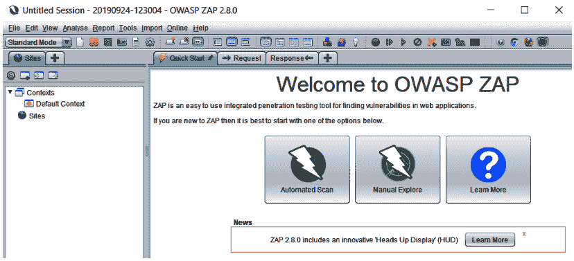
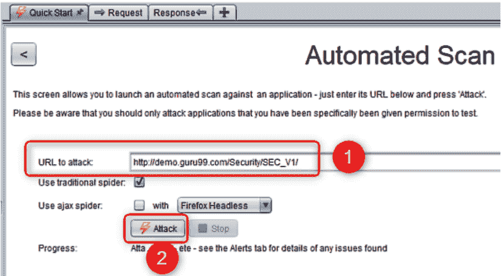
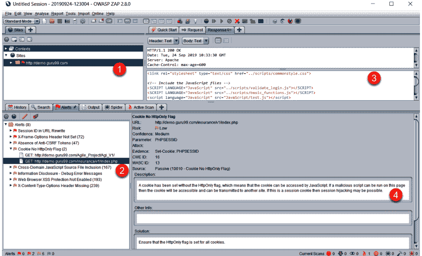
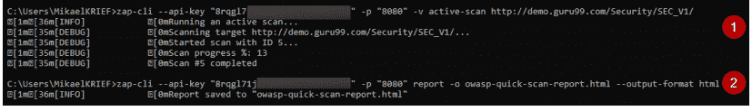
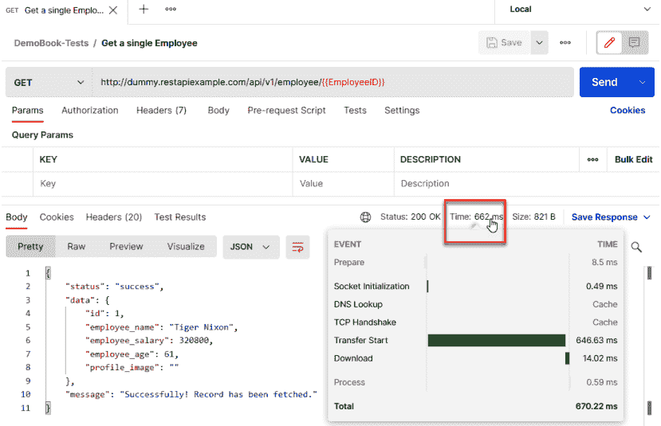
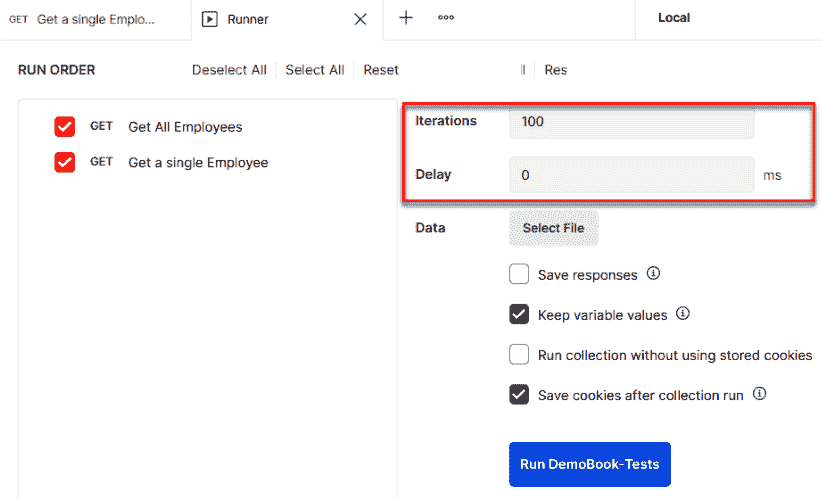
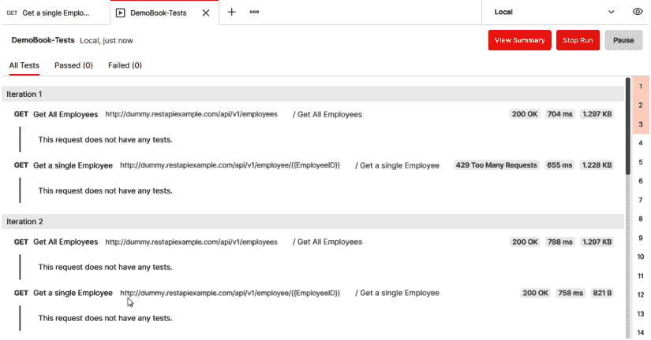

## 13 安全与性能测试

在第 11 章《使用 Postman 测试 API》和第 12 章《使用 SonarQube 进行静态代码分析》中，我们分别介绍了使用 Postman 进行 API 测试以及使用 SonarQube 进行静态代码分析的测试自动化。

在本章中，我们将讨论如何基于 OWASP 建议，使用 ZAP 工具对 Web 应用程序进行安全和渗透测试。随后，我们将进一步提升 Postman 技能，以便能够对 API 进行性能测试。

本章将涵盖以下主题：

- 使用 ZAP 进行 Web 安全和渗透测试
- 使用 Postman 运行性能测试

### 技术要求

要使用 ZAP，我们需要安装 **Java 运行时环境 (JRE)**，可从 https://www.oracle.com/technetwork/java/javase/downloads/jre8-downloads-2133155.html 获取（需要 Oracle 账户）。

在本章中，我们将讨论 Postman，我们在 _第 11 章《使用 Postman 测试 API》_ 中已介绍过它。

请查看以下视频，观看代码实际运行情况：https://bit.ly/3HbOgD0。

### 使用 ZAP 进行 Web 安全和渗透测试

如今，应用程序安全必须成为企业关注的核心。只要 Web 应用程序（或网站）在互联网上公开暴露，就可能成为恶意人员攻击的目标。此外，需要注意的是，如果应用程序用于存储银行账户或个人信息等敏感数据，应用程序安全就更加重要。

为了解决这个问题，存在 **开放 Web 应用程序安全项目 (OWASP)** (https://www.owasp.org/index.php/Main_Page)，这是一个研究应用程序安全问题的全球性组织。该组织的目标是公开突出应用程序系统中可能遇到的安全问题和漏洞。除了这些宝贵的安全信息外，OWASP 还为测试和保护应用程序提供建议、解决方案和工具。

OWASP 提供的一个重要且有用的项目和文档是前 10 大应用程序安全问题。该文档可在 https://owasp.org/www-project-top-ten/ 获取。该文档非常详细，为每个安全问题提供了解释、示例和解决方案。在该文档中，我们可以看到，应用程序最容易受到的首要安全漏洞是注入漏洞，例如 SQL 注入，它涉及向应用程序注入代码或请求，以从应用程序中收集、删除或损坏数据。

在撰写本文时，前 10 大 OWASP 缓解技术如下：

1. 持续风险评估
2. 使用自动化和手动手段进行评估
3. 选择强大的 **Web 应用程序防火墙 (WAF)**
4. 确保 Web 开发框架和编码实践具有内置安全性
5. 强制实施 **多因素身份验证 (MFA)**
6. 加密所有数据
7. 立即应用所有软件更新
8. 确保 Web 应用程序已进行清理
9. 开展正式的意识提升活动
10. 遵守 OWASP 合规性标准

有关这些缓解技术的更多详细信息，请阅读以下文章：`https://www.indusface.com/blog/owasp-top-10-mitigation-techniques/`。

我们在该文档中还了解到另一个已知安全缺陷，即 **跨站点脚本 (XSS)**。它涉及在用户的 Web 浏览器上执行 HTML 或恶意 JavaScript 代码。

企业面临的挑战是能够自动化其应用程序的安全测试，以保护它们，并在发现缺陷时尽快采取措施。

有许多安全和渗透测试工具可用。一个非常完整的列表可在 `https://www.owasp.org/index.php/Appendix_A:_Testing_Tools` 获取。其中，我们在上一章中了解了 SonarQube，它允许您分析代码以检测安全漏洞。

该列表中另一个非常有趣的工具是 **Zed Attack Proxy (ZAP)** (`https://www.owasp.org/index.php/OWASP_Zed_Attack_Proxy_Project`)，它由 OWASP 社区开发。

让我们学习如何使用 ZAP 对我们的应用程序进行安全测试。

### 使用 ZAP 进行安全测试

ZAP 是一个免费开源的图形化工具，允许您扫描网站并执行大量安全和渗透测试。

与 SonarQube 不同，SonarQube 也在应用程序的源代码中执行安全分析但不执行它，而 ZAP 运行应用程序并执行安全测试。

运行时，ZAP 将在用户和应用程序之间充当代理，扫描应用程序的所有 URL，然后对这些不同的 URL 执行一系列渗透测试。它目前是应用程序测试中最广泛使用的工具之一，因为除了免费之外，它还提供许多非常有趣的功能，例如能够配置 Ajax 渗透测试，以及高级测试配置。此外，它与许多 CI/CD 流水线平台集成良好。最后，可以使用 REST API 控制它。相应的文档可在 `https://www.zaproxy.org/docs/api/` 获取。

我建议在一个带有安全漏洞的公共演示网站上使用 ZAP 进行一个小型实验室。正如我们在 _技术要求_ 部分中提到的，使用 ZAP 的一个先决条件是在将执行测试的机器上安装 Java。它可以是本地机器或构建代理。

我们可以在 `https://www.zaproxy.org/download/` 下载 ZAP；下载与您的操作系统对应的软件包。

然后，按照操作系统的软件安装程序安装 ZAP。安装完成后，我们可以打开 ZAP 并访问其界面。

以下截图显示了默认的 ZAP 界面：

图 13.1 – OWASP ZAP 工具

我们将按照以下步骤使用 ZAP 进行第一次安全分析：

1. 在右侧面板中，单击 **自动扫描** 按钮，这将打开一个表单，我们可以在其中输入要扫描的 URL。
2. 在 **要攻击的 URL** 字段中，输入要分析的网站的 URL。在我们的示例中，我们将输入演示站点的 URL：`http://demo.guru99.com/Security/SEC_V1/`。
3. 然后，要开始分析，请单击 **攻击** 按钮。

以下截图直观地显示了上述步骤：

图 13.2 – OWASP ZAP – 自动扫描

我们必须等待此网站的安全测试分析完成。

4. 分析完成后，我们可以在左下角的面板中看到遇到了哪些安全问题。
5. 最后，单击其中一个警报将显示问题的详细信息，并帮助我们解决它。

以下截图显示了我们刚刚提到的分析结果：

图 13.3 – OWASP ZAP 扫描结果

至此，我们学习了如何使用 ZAP，这是一个图形化工具，可用于非常快速地分析网站的安全漏洞。

现在，让我们来看看自动执行 ZAP 的不同方式。

### 自动执行 ZAP 的方式

我们还可以通过将 ZAP 安装在 CI/CD 流水线的代理服务器上并使用 zap-cli 工具来自动化此 ZAP 分析，该工具可在 `https://github.com/Grunny/zap-cli` 获取。它用于命令行并调用 ZAP API。

以下截图显示了在命令行中使用 zap-cli 分析我们的演示网站：

图 13.4 – zap-cli 扫描命令行

在上述执行中，使用了两个命令：

- 第一个，`zap-cli active-scan`，分析作为命令参数传递的网站。
- 第二个，`zap-cli report`，以 HTML 格式生成扫描结果的报告。

> 注意
>
> 在上述命令中，我们使用了 `--api-key` 参数。要检索您的 API 密钥值，请在 ZAP 工具实例中转到 **工具 | 选项 | API** 菜单。

如果我们使用 Azure DevOps 作为 CI/CD 流水线平台，可以使用 Visual Studio Marketplace 上的 OWASP Zed Attack Proxy Scan 任务，该任务可在 `https://marketplace.visualstudio.com/items?itemName=kasunkodagoda.owasp-zap-scan` 获取。如果我们有 Azure 订阅，Azure Pipelines 还可以在 Docker 容器中运行 ZAP，该容器托管在 Azure 容器实例中，如 `https://devblogs.microsoft.com/premier-developer/azure-devops-pipelines-leveraging-owasp-zap-in-the-release-pipeline/` 中详细说明。

如果我们使用 Jenkins 作为构建工厂，请查看以下文章，它解释了如何在运行作业时集成和使用 ZAP 插件：`https://www.breachlock.com/integrating-owasp-zap-in-devsecops-pipeline/`。

我们刚刚学习了如何使用由 OWASP 社区开发的 ZAP 对我们的 Web 应用程序进行安全测试。我们了解了通过其图形界面的基本用法，并对演示应用程序进行了安全测试。然后，我们看到也可以使用 `zap-cli` 自动化其执行，以便我们可以将其集成到 DevOps CI/CD 流水线中。

现在，让我们学习如何使用 Postman 进行性能测试。

### 使用 Postman 运行性能测试

在为保证应用程序质量并确保其功能正常（包括代码分析和安全测试）而需要进行的测试中，还有性能测试。性能测试的目的不是检测应用程序中的错误，而是确保应用程序（或 API）在可接受的时间范围内响应，以提供良好的用户体验。

### 应用程序的性能由以下指标决定：

- 响应时间
- 其使用的资源（CPU、RAM 和网络）
- 错误率
- 每秒请求数

性能测试分为多种测试类型，例如负载测试、压力测试和可扩展性测试。

有许多工具可用于执行性能测试。以下文章列出了 15 个最佳工具：https://www.softwaretestinghelp.com/performance-testing-tools-load-testing-tools/。在本书中我们已经见过的工具中，Postman 并非专门用于性能测试的工具，尤其是因为它主要关注 API 而不是单体 Web 应用程序。但是，Postman 可以很好地指示我们 API 的性能。

我们在第 11 章《使用 Postman 测试 API》中详细讨论了其用法。当您执行以单元方式测试 API 的请求时，Postman 会提供该 API 的执行时间，如下图所示：

图 13.5 – Postman 性能测试

此外，在 Postman 的 **集合运行器** 中，可以执行集合中的所有请求并指定迭代次数；也就是说，运行器将执行循环测试的次数。这模拟了多个调用 API 的连接，这也是 Postman 呈现的执行时间变得非常有趣的地方。

下图显示了 Postman **运行器** 的配置，输入参数中有多个迭代：

图 13.6 – Postman 运行器配置测试

下图显示了运行器的结果：

在这里，我们可以看到运行器显示每个请求的执行时间，这意味着我们可以识别 API 上的过载问题。

现在我们已经学习了如何使用 Postman 执行性能测试，让我们总结本章。

### 总结

在本章中，我们了解了如何使用 ZAP，这是由 OWASP 社区开发的用于自动执行 Web 应用程序安全测试的工具。我们还了解了 Postman 如何提供 API 性能信息。

在下一章中，我们将继续讨论安全和 DevSecOps，学习如何使用 Inspec 自动化基础设施测试，如何使用 HashiCorp 的 Vault 保护机密，以及使用 Azure 安全开发工具包检查 Azure 基础设施的安全合规性。

### 问题

回答以下问题以测试您对本章的了解：

1. ZAP 是分析应用程序源代码的工具吗？

2. 在 Postman 中，什么指标允许我们获取性能信息？

### 延伸阅读

要了解本章涵盖的更多内容，请查看以下资源：

- 学习渗透测试：https://www.packtpub.com/networking-and-servers/learn-penetration-testing

- 关于 OWASP 和 ZAP 的 Pluralsight 视频：https://www.pluralsight.com/search?q=owasp
