## 14 DevOps 流程中的 DevSecOps 安全

到目前为止，在本书中，我们详细讨论了 **开发运维（DevOps）** 文化以及将促进开发人员和运维人员（**信息技术运维**，或 **ITOps**）之间沟通与协作的 DevOps 工具。

然而，在这种结合中，我们注意到一个非常重要的方面往往缺失，那就是安全。确实，**持续集成/持续部署（CI/CD）** 管道和 **基础设施即代码（IaC）** 允许更快地部署基础设施和应用程序，但问题是，为了更快地部署，我们没有包含安全团队，这导致以下情况：

- 安全团队阻塞或减慢部署，从而导致更长的部署周期。

- 安全问题在基础设施和应用程序中被非常晚地发现。

这就是为什么，一段时间以来，安全已被纳入 DevOps 文化，成为更广泛的 **开发安全运维（DevSecOps）** 文化。安全无所不在。由于我们以快速的速度开发，将安全作为过程的一部分而不是在过程之外是非常合理的。

因此，DevSecOps 文化或方法是开发人员和运维人员的结合，并尽早将安全集成到项目的实现和设计中。DevSecOps 方法也是 CI/CD 管道中合规性和安全验证流程的自动化，以保证持续安全且不减慢应用程序部署周期。

今天，DevOps 文化必须绝对集成安全团队，也要集成所有安全流程，无论是在工具、基础设施还是应用程序上。这是为了不仅提供更好的质量，而且提供更安全的应用程序。

在本章中，我们将重点介绍 DevSecOps 方法。首先，我们将了解如何使用 Chef 的 InSpec 测试 Azure 基础设施的合规性。然后，我们将学习如何使用 HashiCorp 的 Vault 保护所有基础设施和应用程序机密。

本章将涵盖以下主题：

- 使用 Chef InSpec 测试 Azure 基础设施合规性
- 使用 HashiCorp Vault 保护敏感数据

### 技术要求

在本章中，我们将了解 InSpec 的使用，它要求本地计算机上安装了 **Ruby** 2.4 或更高版本。要根据您特定的 **操作系统**（OS）安装 Ruby，请阅读此文档：`https://www.ruby-lang.org/en/documentation/installation/`。

在《使用 HashiCorp Vault 保护敏感数据》部分中，我们将讨论 Vault 与 Terraform 的集成，而不深入探讨 Terraform 的细节，因此我建议您先阅读《第 2 章，使用 Terraform 配置云基础设施》。

本章的完整源代码可在此处查看：

`https://github.com/PacktPublishing/Learning-DevOps-Second-Edition/tree/main/CHAP14`

查看以下视频以观看代码实际运行情况：

`https://bit.ly/3In9kb2`

### 使用 Chef InSpec 测试 Azure 基础设施合规性

DevOps 文化的重要实践之一是 IaC，详细介绍于《第 1 章，DevOps 文化与基础设施即代码实践》，它包括对基础设施配置进行编码，然后通过 CI/CD 管道自动部署。IaC 允许非常快速地部署和配置云基础设施，但经常出现的问题是：_自动配置的基础设施是否符合功能合规性和安全要求？_

要回答这个问题，我们将不得不编写和自动化基础设施测试，这些测试将验证以下内容：

- 部署的基础设施与应用程序和企业架构规范相符。
- 公司的安全策略已正确应用于基础设施。

这些测试可以用任何可以与我们的云提供商交互的脚本语言编写，如果我们有 Azure 订阅，可以使用 Azure **命令行界面（CLI）** 或 Azure PowerShell 命令来编码我们 Azure 资源的测试。此外，如果我们使用 PowerShell，可以使用 **Pester** (`https://pester.dev/docs/quick-start/#what-is-pester`)，这是一个允许我们执行 PowerShell 测试的库，结合 Azure PowerShell，允许我们执行基础设施合规性测试。

> **注意**
> 要了解如何使用 Pester 测试 Azure 基础设施的示例，我建议您阅读此文章：`https://dzone.com/articles/azure-security-audits-with-pester`。此外，请查看此博客文章：`https://dev.to/omiosec/unit-testing-in-powershell-introduction-to-pester-1de7`。

这些脚本工具的问题是它们需要编写大量代码。此外，这些工具专用于特定的云提供商，并且需要学习一种新的脚本语言。

IaC 工具之一是 **InSpec** (`https://www.inspec.io/`)，它执行基础设施合规性测试。

在本节中，我们将详细了解使用 InSpec 测试 Azure 基础设施合规性，并为了开始其实现，我将为您提供 InSpec 的概述。


### InSpec 概述

InSpec 是一个用 Ruby 编写的开源工具，可在命令行上运行，由领先的 DevOps 工具之一 **Chef** 生产，其网站为 `https://www.chef.io/`。它允许用户编写声明式代码来测试系统或基础架构的合规性。

要使用 InSpec，无需学习新的脚本语言；我们应当已经具备足够的知识来编写要测试的基础架构资源或系统的期望状态。

使用 InSpec，我们可以测试远程机器和数据的合规性，并且自最新版本起，还可以测试云基础架构，例如 Azure、**Amazon Web Services (AWS)** 和 **Google Cloud Platform (GCP)**。

对 InSpec 做了简要概述后，让我们来看看如何下载和安装它。

### 安装 InSpec

我们在 _Technical requirements_ 部分中了解到，InSpec 需要在我们的机器上安装 **Ruby (>2.4)**。

InSpec 可以手动安装，也可以通过脚本安装，具体如下：

- **手动**：可以从 `https://www.chef.io/downloads/tools/inspec` 下载与我们操作系统对应的软件包。
- **使用脚本**：我们可以在终端中执行下面详细说明的命令来安装 InSpec。

在 Windows 上，我们可以使用 Chocolatey 软件包下载并安装 InSpec，软件包地址为 `https://community.chocolatey.org/packages/inspec`，使用以下命令：

```
choco install inspec -y
```

在 Linux 上，使用以下脚本：

```
curl https://omnitruck.chef.io/install.sh | sudo bash -s -- -P inspec
```

以下截图显示了通过 **Chocolatey 软件包** 安装 InSpec 的过程：

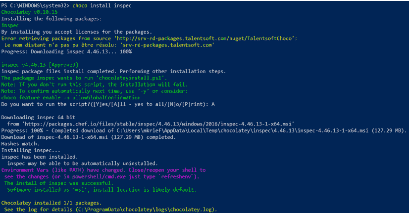

### 图 14.1 – Windows 上的 InSpec 安装

#### 注意

有关所有操作系统上安装 InSpec 的更多信息，请参阅此文档：`https://docs.chef.io/inspec/install/`。

要验证 InSpec 是否已正确安装并正常工作，我们运行 `inspec --version` 命令来显示其版本，并运行 `inspec` 命令来显示可用命令列表。

以下截图显示了这些命令的执行情况：

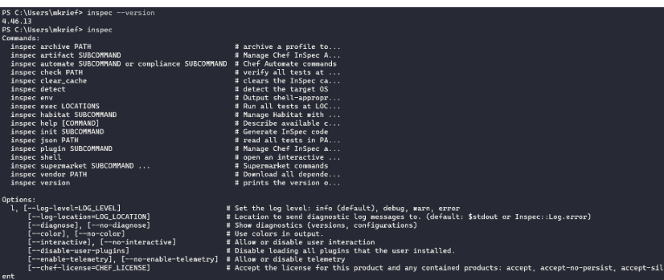

### 图 14.2 – 检查 InSpec 版本并显示 InSpec 选项

此外，与本书中已详细介绍的许多工具一样，InSpec 已集成到 **Azure Cloud Shell** 工具套件中，如以下截图所示：

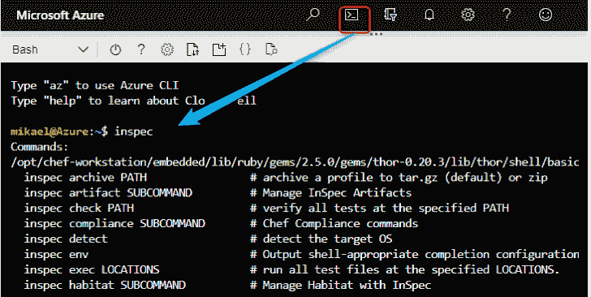

图 14.3 – Azure Cloud Shell 中的 InSpec

我们刚刚了解了安装 InSpec 的不同方式，现在将了解为 InSpec 配置 Azure。

### 为 InSpec 配置 Azure

在编写测试用例来测试 Azure 基础架构的合规性之前，我们需要创建一个对将要测试的 Azure 资源具有读取权限的 Azure 服务主体。

要创建此 Azure 服务主体，我们将使用在 _Chapter 2, Provisioning Cloud Infrastructure with Terraform_ 的 _Configuring Terraform for Azure_ 部分中已详细介绍的相同过程。

使用 **Azure CLI** 工具，我们执行以下 `az cli` 命令：

```
az ad sp create-for-rbac -name="<SP name>" -role="Reader" -scopes="/subscriptions/<subscription Id>"
```

此命令需要以下参数：

- `-name` 是要创建的 Azure 服务主体的名称。
- `--scopes` 是 Azure 资源所在的订阅（或其他范围）的 **标识符 (ID)**。
- `--role` 是服务主体在指定资源范围内将拥有的角色名称。

执行此命令将返回与创建的服务主体相关的以下三个身份验证信息：

- 客户端 ID
- 客户端密钥
- 租户 ID

> 注意
> 有关服务主体的更多详细信息，请参阅以下文档：
> https://docs.microsoft.com/en-us/cli/azure/create-an-azure-service-principal-azure-cli?view=azure-cli-latest

我们将了解如何在运行 InSpec 时使用这些身份验证信息，但在执行之前，我们需要具备足够的知识来编写 InSpec 测试。让我们看看如何操作。

### 编写 InSpec 测试

安装 InSpec 并为 Azure 配置身份验证后，我们可以开始使用 InSpec。为了展示 InSpec 测试的示例，我们将编写测试，用于检查我们使用 Terraform 在 _Chapter 2, Provisioning Cloud Infrastructure with Terraform_ 中预配的 Azure 基础架构是否符合我们 Azure 基础架构的规范，该基础架构必须由以下内容组成：

- 一个名为 `bookRg` 的资源组
- 一个包含名为 `book-subnet` 的子网的 **虚拟网络 (VNet)**
- 一个名为 `bookvm` 的 **虚拟机 (VM)**

作为编写 InSpec 测试的第一步，我们将创建一个 InSpec 配置文件。

### 创建 InSpec 配置文件

要创建 InSpec 配置文件，我们将生成测试目录结构，然后修改生成的 InSpec 配置文件。

要执行此操作，我们创建一个测试文件夹结构和一个定义一些元数据和 InSpec 配置的 InSpec 配置文件。要创建结构和 InSpec 配置文件，请在您的机器上转到所选目录并执行以下命令：

```
inspec init profile azuretets
```

此命令通过创建一个名为 azuretets 的新文件夹来初始化新配置文件，该文件夹包含 InSpec 测试所需的所有工件，包括：

- 控件（测试）
- 库
- 一个配置文件，`inspec.yml`，包含一些默认元数据

然后，我们使用一些个人元数据修改此 `inspec.yml` 配置文件，并从 InSpec-Azure 资源包添加 **统一资源定位符 (URL)** 链接到示例代码，如下所示：

```
name: azuretets
title: InSpec Profile
maintainer: Your name
copyright: Your name
copyright_email: you@example.com
license: All Rights Reserved
summary: An InSpec Compliance Profile
version: 0.1.0
inspec_version: '>= 4.6.9'
depends:
- name: inspec-azure
url: https://github.com/inspec/inspec-azure.git
```

在此代码中，我们输入了一些个人信息，例如我们的姓名，以及有关此代码许可证类型的信息。然后，最后，在此文件的最后部分，我们指示了一个依赖项，并附上了 InSpec-Azure 资源库包的 URL。

事实上，自 InSpec 2.2.7 版本起，我们可以使用一组使用 Azure API 的 InSpec 库，从而允许我们访问所有 Azure 资源。基于此，InSpec 团队创建了一个 Azure 资源包，其中包含大量库，用于测试广泛的 Azure 资源，例如 Azure 用户、Azure Monitor、Azure 网络（VNet 和子网）、Azure SQL Server、Azure 虚拟机 (Azure VM) 以及许多其他 Azure 资源。

> 注意
> 有关可用 Azure 资源的完整列表，请参阅 InSpec 文档中关于 InSpec Azure 资源包的内容：
> https://www.inspec.io/docs/reference/resources/#azure-resources

在生成包含测试和配置文件更新的目录后，我们将编写基础架构合规性测试。

### 编写合规性 InSpec 测试

为了回答我们的示例规范，我们将编写测试，用于验证我们预配的基础架构是否包含资源组、VM 和子网。

我们将起草的所有测试都位于 controls 文件夹中，并以 Ruby 文件 (.rb) 编写，代码非常简单且易于人类阅读。

首先，我们将编写一个检查资源组是否存在的测试，为此，我们将删除 controls 文件夹中的 example.rb 示例文件（这是测试模板中提供的测试示例），并创建一个名为 resourcegroup.rb 的新文件，其中包含以下代码内容：

```
control 'rg' do
 describe azure_resource_groups do #call the azurerm_resource_groups of Azure Resource Pack
 its('names') { should include 'bookRg' } #test assert
 end
end
```


在这段声明式代码中，描述了资源的期望状态，并采取了以下操作：

1. 创建一个名为 `test_rg` 的控制（或测试）。
2. 在此控制中，我们将创建一个 `describe` 类型的方法，在其中使用 Azure 资源包中的 `azure_resource_groups` 库，该库允许我们测试资源组是否存在。
3. 在此 `describe` 方法中，我们编写一个测试断言，用于检查 Azure 订阅中是否存在名为 `bookRg` 的资源组。

然后，我们将继续为 VM 和子网编写测试。为此，我们在 `controls` 目录中手动创建一个包含以下代码的 `subnet.rb` 文件：

```
control "subnet" do
 describe azure_subnet(resource_group: 'bookRg', vnet: 'book-vnet', name: 'book-subnet') do
 it { should exist }
 its('address_prefix') { should eq '10.0.10.0/24' }
 end
end
```

在此代码中，我们使用 `azurerm_subnet` 库，该库允许我们测试 VNet 中子网是否存在。在此测试中，我们检查 `book-subnet` 子网是否存在于 `book-vnet` VNet 中，并且其 IP 范围为 `10.0.10.0/24`。

最后，在此，我们通过在 `vm.rb` 文件中使用以下代码来完成编写允许我们检查 VM 的测试：

```
control 'vm' do
 describe azure_virtual_machine(resource_group: 'bookRg', name: 'bookvmn') do
 it { should exist }
 its('properties.location') { should eq 'westeurope' }
 its('properties.hardwareProfile.vmSize') { should eq 'Standard_DS1_v2' }
 its('properties.storageProfile.osDisk.osType') { should eq 'Linux' }
 end
end
```

在此代码中，我们使用 `azurerm_virtual_machine` 库并测试名为 `demovm` 的 VM 是否存在于 `bookRg` 资源组中。我们还检查其一些属性，例如区域、操作系统类型和 VM 大小。

我们已完成编写将用于检查 Azure 基础设施合规性的 InSpec 测试，现在将看到使用我们刚刚编写的这些测试执行 InSpec 的过程。

### 执行 InSpec

要执行 InSpec，我们将执行以下步骤：

1. 我们将配置 InSpec 对 Azure 的身份验证；为此，我们将使用之前在“配置 Azure 以用于 InSpec”部分中创建的 Azure 服务主体信息的值创建环境变量。此处列出了四个环境变量及其值：
   - `AZURE_CLIENT_ID` 与服务主体的客户端 ID
   - `AZURE_CLIENT_SECRET` 与服务主体的客户端密钥
   - `AZURE_TENANT_ID` 与租户 ID
   - `AZURE_SUBSCRIPTION_ID` 与包含资源且其服务主体具有读取者权限的订阅的 ID

   以下是在 Linux 操作系统中创建这些变量的示例：
   ```
   export AZURE_SUBSCRIPTION_ID="<Subscription ID>"
   export AZURE_CLIENT_ID="<Client Id>"
   export AZURE_CLIENT_SECRET="<Secret Client>"
   export AZURE_TENANT_ID="<Tenant Id>"
   ```

2. 然后，在终端中，我们将进入包含配置文件 `inspec.yml` 的目录，并运行 `inspec vendor .` 命令以下载所有依赖项并在 `vendor` 目录中生成锁文件。

3. 然后，执行以下 `inspec` 命令以检查测试的语法是否正确：
   ```
   inspec check .
   ```

此命令提供的参数是包含 `inspec.yml` 文件的目录的路径。在此命令中，我们在参数中使用 `.`（点）来指示 `inspec.yml` 文件位于当前目录，以下截图显示了执行此命令的结果：

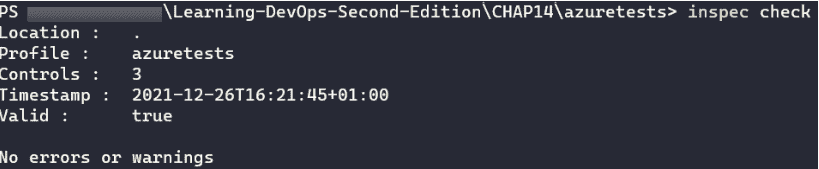

图 14.4 – InSpec 检查配置文件

4. 最后，我们使用 `inspec exec` 命令执行 InSpec 来运行测试，如下所示：

```
inspec exec . -t azure://
```

此命令以包含 `inspec.yml` 文件的目录的路径作为参数（此处为点）。我们还添加了 `-t` 选项，该选项将测试的目标（即 azure）作为值。

以下截图显示了执行此命令的结果：

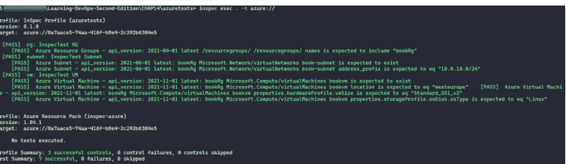

图 14.5 – InSpec 执行测试

从此结果可以看出，所有测试均为绿色，因此成功，基础设施的合规性非常成功。

我们刚刚在本节中解释了如何编写 InSpec 测试并运行它们以验证 Azure 基础设施的合规性。

InSpec 是一个非常强大的工具；它还允许您测试 VM 的配置。因此，我邀请您查看以下文档：https://www.inspec.io/docs/。

我们在此处了解了 InSpec 的安装，然后是 InSpec 测试的编写，最后是如何使用其命令行来测试 Azure 基础设施的合规性。在下一节中，我们将探讨使用 HashiCorp 的 Vault 密钥管理器保护敏感数据的另一个安全方面。

### 使用 HashiCorp Vault 保护敏感数据

当今，当我们谈论信息系统安全时，最受期待的话题是系统不同组件之间敏感数据的保护。需要保护的这种敏感数据包括服务器访问密码、数据库连接、**应用程序编程接口（API）身份验证令牌**以及应用程序用户帐户。确实，许多安全攻击之所以发生，是因为这种数据在应用程序的源代码或暴露于本地工作站的保护不佳的文件中被解密。许多已知工具可用于保护此类敏感数据，例如：

- KeyPass (`https://keepass.info/`)
- LastPass (`https://www.lastpass.com/`)
- Ansible Vault，我们在 _第 3 章，使用 Ansible 配置 IaaS 基础设施_ 中讨论过其用法
- HashiCorp 的 Vault

此外，云服务提供商还提供其自身的密钥保护服务，例如：

- Azure Key Vault: `https://azure.microsoft.com/en-us/services/key-vault/`
- **密钥管理服务（KMS）**适用于 Google Cloud Platform: `https://cloud.google.com/kms/`
- AWS Secrets Manager 适用于 AWS: `https://aws.amazon.com/secrets-manager/?nc1=h_ls`

在我们提到的所有工具中，我们将探讨 HashiCorp 的 **Vault** 的使用，它是免费且开源的，可以安装在任何类型的操作系统上，也可以安装在 Kubernetes 上。

Vault 的主要功能和优势如下：

- 它允许存储静态密钥以及动态密钥。
- 它还具有用于轮换和撤销密钥的系统。
- 它允许在不存储数据的情况下对数据进行加密和解密。
- 它还具有允许管理密钥的 Web 界面。
- 它与众多身份验证系统集成。
- 所有密钥都存储在单个集中式工具中。
- 它允许您独立于架构，因为它可以通过所有主要云服务提供商、Kubernetes，甚至内部数据中心（本地）访问。

> 注意
> 有关 Vault 功能的更多信息，请参阅 https://www.vaultproject.io/docs/what-is-vault/index.html 的产品页面。

凭借所有这些非常有趣的功能，Vault 因此是我推荐给任何希望保护其敏感信息并将其安全可访问性集成到 CI/CD 管道中的公司的工具。确实，除了在数据保护方面非常高效之外，Vault 在 CI/CD 管道中集成得非常好。这些管道将能够在预配基础设施和部署应用程序时使用此受保护的数据。

在对 Vault 进行概述后，我们将继续在本地计算机上安装 Vault 并使用它来加密和解密数据。我们还将介绍 Vault 用户界面（UI），最后，我们将介绍如何在 Terraform 中从 Vault 检索数据的过程。

### 在本地安装 Vault

如果您决定使用 Vault，重要的是要知道它是负责保护您的敏感基础设施和应用程序数据的工具。在实践中，Vault 不仅仅是一个工具，在将其安装到生产环境之前，您需要了解其概念及其不同的架构拓扑。

> 注意
> 要了解有关 Vault 架构拓扑的更多信息，请参阅 https://learn.hashicorp.com/vault/operations/ops-reference-architecture 的文档。

本章的目的因此不是深入探讨 Vault 概念和架构的细节，而是解释如何在开发模式下安装和使用 Vault。换句话说，我们将在本地工作站上安装 Vault，以便拥有一个用于测试和开发的小型实例。


我们已经在本书中详细介绍了如何使用 Terraform 和 Packer 等 HashiCorp 工具，同样，Vault 可以手动安装，也可以通过脚本安装，具体步骤如下：

- 若要**手动安装 Vault**，其步骤与安装 Terraform 和 Packer 完全相同，因此你需要执行以下操作：

  A. 导航至下载页面：`https://www.vaultproject.io/downloads.html`。

  B. 在所选文件夹中下载与你的操作系统相关的软件包。

  C. 解压软件包，并将 `PATH` 环境变量更新为包含该文件夹路径的路径。

- 若要**自动安装 Vault**，我们将使用一个脚本，其代码取决于我们的操作系统。

对于 **Linux**，在终端中运行以下脚本（来自 `https://www.vaultproject.io/downloads`）：

```bash
curl -fsSL https://apt.releases.hashicorp.com/gpg | sudo apt-key add -
sudo apt-add-repository "deb [arch=amd64] https://apt.releases.hashicorp.com $(lsb_release -cs) main"
sudo apt-get update && sudo apt-get install vault
```

此脚本执行以下操作：

1. 向 HashiCorp 软件包注册表注册。
2. 安装 Vault 软件包。

对于 **Windows**，若要通过脚本安装 Vault，我们将使用 **Chocolatey**（即 Windows 软件包管理器（`https://chocolatey.org/`）），并在终端中执行以下命令：

```bash
choco install vault -y
```

此命令从 Chocolatey 下载并安装 Vault。

除了这些允许在本地工作站上安装 Vault 的脚本之外，HashiCorp 还提供 Terraform 代码，可让你在不同的云提供商上创建完整的 Vault 基础设施。

### 注意

此 Terraform 代码可用于 Azure，地址为 `https://github.com/hashicorp/terraform-azurerm-vault`；用于 AWS，地址为 `https://github.com/hashicorp/terraform-aws-vault`；用于 GCP，地址为 `https://github.com/hashicorp/terraform-google-vault`。

对于 **Kubernetes**，我们可以使用 Helm chart 在 Kubernetes 实例中安装 Vault，使用以下脚本：

```bash
helm repo add hashicorp https://helm.releases.hashicorp.com
kubectl create namespace vault
helm install vault hashicorp/vault --namespace vault
```

在上述脚本中，我们执行以下操作：

1. 在本地添加 HashiCorp Helm 仓库。
2. 创建 `vault` 命名空间。
3. 使用 Helm chart 在 `vault` 命名空间中安装 Vault。

有关在 Kubernetes 上安装 Vault 的更多详细信息，请阅读此处的教程：

`https://learn.hashicorp.com/tutorials/vault/kubernetes-raft-deployment-guide?in=vault/kubernetes`

安装 Vault 后，我们将通过在终端中运行以下命令来测试其安装：

```bash
vault --version
```

此命令显示已安装的 Vault 版本。我们也可以执行 `vault --help` 命令以显示可用命令列表。

我们刚刚了解了在本地机器或 Kubernetes 上安装 Vault 的不同方式；下一步是启动 Vault 服务器。

### 启动 Vault 服务器

Vault 是一种客户端/服务器工具，由开发者用于应用程序的客户端组件和负责保护远程后端中数据的服务器组件组成。

> 注意
> Vault 支持非常多的后端，列表可在此处查看：
> https://www.vaultproject.io/docs/configuration/storage/index.html

在本地安装 Vault 后，我们只能访问客户端部分，为了能够使用 Vault，我们将启动服务器组件。

要在开发模式下启动 Vault 服务器组件，我们将在第二个终端中执行此命令：

```bash
vault server -dev
```

此命令启动并配置 Vault 服务器，使用包含身份验证令牌和名为 in-memory 的默认后端的最小配置，该后端将所有机密数据存储在服务器内存中，如以下截图所示：

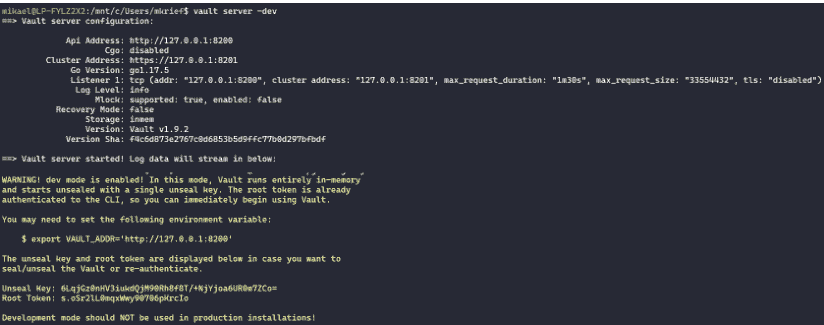

图 14.6 – Vault 启动 -dev 模式

> 重要注意事项
> 此终端必须保持打开状态，以使 Vault 服务器保持运行。

此外，由于我们处于开发模式且后端存储仅在内存中，一旦 Vault 服务器停止，所有机密数据都将从内存中删除。

然后，如执行过程中所示，我们将在另一个终端中使用以下命令导出 VAULT_ADDR 环境变量：

```bash
export VAULT_ADDR='http://127.0.0.1:8200'
```

最后，为了检查 Vault 服务器的执行状态，我们执行以下命令：

```bash
vault status
```

以下是命令输出，显示了 Vault 服务器的属性：

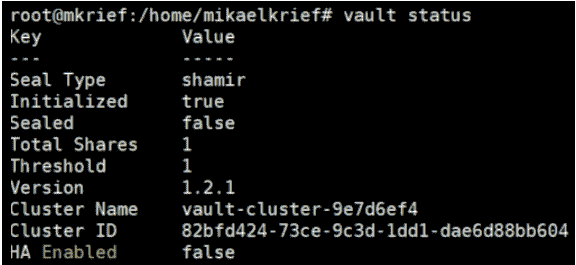

图 14.7 – Vault 状态

> **注意**
> 要了解有关在开发模式下启动的 Vault 服务器的更多信息，请阅读 `https://www.vaultproject.io/docs/concepts/dev-server.html` 中的文档。

现在 Vault 已安装且服务器已启动，我们将了解如何将数据写入 Vault 以保护它，并读取该数据以便从第三方应用程序使用。

### 将机密写入 Vault

当你想要保护将由应用程序或基础设施资源使用的敏感数据时，第一步是将此数据存储在公司选择的机密数据管理器中。我们将在实践中了解将数据写入 Vault 的步骤。

要在 Vault 中保护数据，我们进入终端并执行以下命令：

```bash
vault kv put secret/vmadmin vmpassword=admin123*
```

以下截图显示了其执行情况：

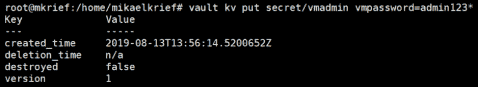

图 14-8 – 使用 vault kv put 命令行将机密写入 Vault

该命令的 put 操作在内存中创建名为 vmadmin 的新机密数据，类型为键值对，在此示例中是 VM 的管理员帐户，位于 secret/ 路径中。

在 Vault 中，所有受保护的数据都存储在对应于 Vault 中组织位置的路径中。Vault 的默认路径为 secret/，并且可以创建自定义路径，这些路径将允许更好地管理机密权限，并按域、主题或应用程序更好地组织。

关于存储在 Vault 中的机密，其优势之一是可以在同一机密中存储多个数据；例如，我们将使用另一个机密（即 VM 的登录管理员）来更新我们已创建的机密数据。

为此，我们将执行以下命令，该命令在同一 Vault 数据中添加另一个键值机密：

vault kv put secret/vmadmin vmpassword=admin123* vmadmin=bookadmin

正如我们在此执行中所见，我们使用了完全相同的命令和相同的机密，并添加了新的键值数据——即 vmadmin。

注意
有关此 kv put 命令的更多信息，请阅读 `https://www.vaultproject.io/docs/commands/kv/put.html` 中的文档。

我们学习了如何使用命令在 Vault 中创建机密以及机密的各种用途，现在我们将查看读取此机密的命令，以便在应用程序或基础设施资源中使用它。

### 在 Vault 中读取机密

一旦我们在 Vault 中创建了机密，就必须读取它们以便在我们的应用程序或基础设施脚本中使用它们。

要读取存储在 Vault 中的键，我们进入终端以执行此命令：

```bash
vault kv get secret/vmadmin
```

在此命令中，我们使用 `kv` 操作和 `get` 运算符，并在参数中指定要获取的键的完整路径，以便在我们的示例中获取受保护的值 `secret/vmadmin`。

以下截图显示了命令执行情况及其输出：

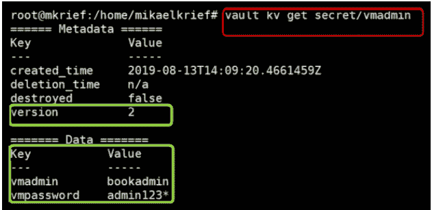

图 14.9 – 使用 vault kv get 命令行获取机密

我们在此命令输出中注意到以下内容：

- 此处机密的版本号为 `2`，因为我们执行了两次 `kv put` 命令，因此每次执行时版本号都会递增。
- 在之前的“将机密写入 Vault”部分中，我们在机密中保护了两个键值数据项。

如果你想要访问此机密中存储的数据，但来自较早版本，你可以执行相同的命令，并可选地指定所需的版本号，如以下示例所示：

```bash
vault kv get -version=1 secret/vmadmin
```


### 以下是执行的截图：

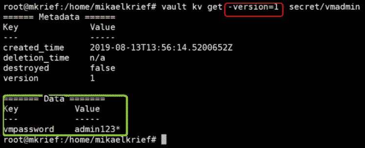

图 14.10 – 通过版本获取 Vault 密钥

我们可以在此输出中看到，在 Data 部分，第一次执行 `kv put` 命令时的键值数据的版本 1。

> **注意**
> 有关 `kv get` 命令的更多信息，请阅读 `https://www.vaultproject.io/docs/commands/kv/get.html` 上的文档。

我们刚刚了解了使用 `kv get` Vault 命令来检索密钥的所有或特定版本的值；现在我们将简要了解如何使用 Vault UI Web 界面来更好地管理密钥。

### 使用 Vault UI Web 界面

Vault 的一个有趣的功能是，除了允许您在 Vault 服务器上执行所有操作的客户端工具之外，Vault 还有一个 UI Web 界面，允许您管理密钥，但更加直观和图形化。

要打开并使用 Vault Web 界面来可视化我们使用客户端工具创建的密钥，我们必须遵循以下步骤：

1. 在浏览器中，输入启动服务器时提供的 URL，即 `http://127.0.0.1:8200/ui`，这是默认的本地 Vault URL。

2. 在身份验证表单中，输入在终端的根令牌信息中提供的令牌，如下面的截图所示：

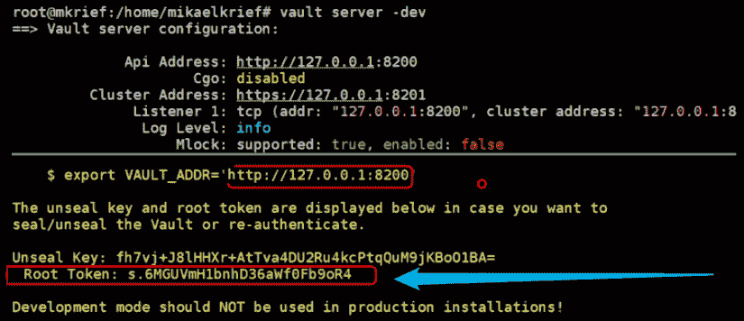

图 14-11 – Vault 获取根令牌

3. 单击 Sign In 按钮进行身份验证，如下所示：

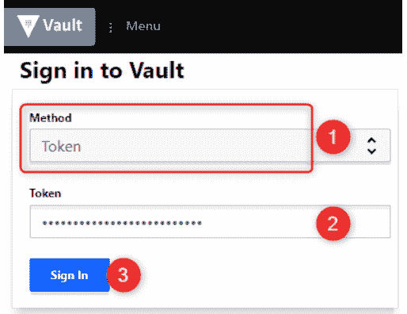

图 14-12 – Vault UI 登录

4. 界面的主页显示一个名为 **Secrets Engines** 的密钥路径列表，包含已存储的密钥，如下面的截图所示：

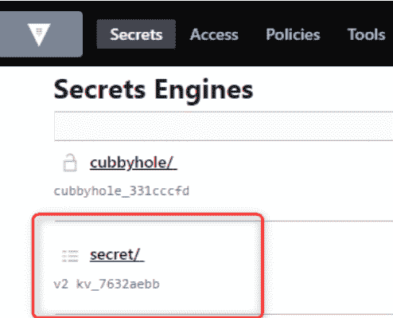

图 14.13 – Vault UI Secrets Engines

5. 单击每个密钥引擎，您可以查看已保存的密钥列表。下面的截图显示了密钥引擎页面，该页面显示了我们在上一节中在命令行上创建的密钥：

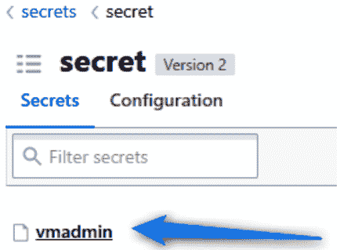

图 14.14 – Vault UI 密钥

6. 单击特定密钥，您可以访问已保护的数据列表，并有可能以明文查看每个键的值。我们还可以通过在 **History** 下拉菜单中选择所需的版本来显示密钥内容的历史记录，如下面的截图所示：

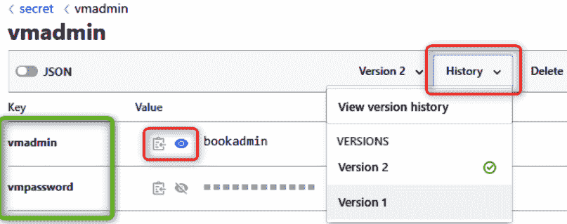

图 14.15 – Vault UI：读取密钥详细信息

Vault Web 界面还允许您对密钥和其他 Vault 组件执行所有管理操作。

> **注意**
> 如果您想了解更多关于此 Web 界面的信息，请阅读此文章：https://www.hashicorp.com/resources/vault-oss-ui-introduction

我们已经看到，Vault Web 界面是客户端工具的一个非常好的替代方案，允许您查看和管理 Vault 元素。在对 Vault 及其操作进行概述后，我提出一个小的 Vault 用例，向您展示如何在 Terraform 代码中获取密钥。

### 在 Terraform 中获取 Vault 密钥

正如我们在 _第 2 章，使用 Terraform 配置云基础设施_ 中已经看到的，保护我们在 Terraform 代码中编写的基础设施配置信息非常重要。保护此敏感数据的一种方法是将其存储在 Vault 等密钥管理器中，并直接使用 Terraform 动态检索它。

以下是一个 Terraform 代码示例，允许您从 Vault 检索要配置的 VM 的密码。此 Terraform 代码示例由三个块组成，详细说明如下：

1. 首先，我们使用 Vault 提供程序通过执行以下代码来配置 Vault URL：

```hcl
provider "vault" {
    address = "http://127.0.0.1:8200" #Local Vault Url
}
```

Vault 提供程序已配置 Vault 服务器配置及其身份验证。

在我们的案例中，我们在 Terraform 代码中配置 Vault 服务器 URL，并且对于令牌身份验证，我们将在运行 Terraform 时使用环境变量，在代码说明之后。

> 注意
> 有关 Terraform Vault 提供程序及其配置的更多详细信息，请参阅以下文档：
> https://www.terraform.io/docs/providers/vault/index.html

2. 然后，我们添加 Terraform 数据块 vault_generic_secret，用于从 Vault 服务器检索密钥。代码如下片段所示：

```hcl
data "vault_generic_secret" "vmadmin_account" {
    path = "secret/vmadmin"
}
```

此数据块允许我们（以只读模式）检索存储在 Vault 中的密钥的内容。在这里，我们要求 Terraform 检索位于我们在本节中先前创建的 secret/vmadmin Vault 路径中的密钥。

> 注意
> 有关 vault_generic_secret 数据及其配置的更多详细信息，请参阅以下文档：
> https://www.terraform.io/docs/providers/vault/d/generic_secret.html

3. 最后，我们添加一个输出块来使用密钥的解密值，如下所示：

```hcl
output "vmpassword" {
  value = "${data.vault_generic_secret.vmadmin_account.data["vmpassword"]}"
  sensitive = true
}
```

此块提供了密钥利用的示例。

`data.vault_generic_secret.vmadmin_account.data["vmpassword"]` 表达式用于获取先前使用的数据块返回的密钥。在 `data` 数组中，我们添加了需要加密值被恢复的键的名称。此外，此输出被视为 `sensitive`，以便 Terraform 在执行时不以明文显示其值。

> **注意**
> 完整的 Terraform 源代码也可在此处找到：
> https://github.com/PacktPublishing/Learning-DevOps-Second-Edition/blob/main/CHAP14/vault/terraform_usevault/main.tf

我们已完成编写 Terraform 代码；现在我们将快速执行它以查看密钥的恢复。

> **注意**
> 对于我们已在 _第 2 章，使用 Terraform 配置云基础设施_ 中详细说明的代码执行，我们将在此节中仅引用命令而不再进一步详细说明。

要执行 Terraform，我们在终端中进入包含 Terraform 代码的文件夹，然后按以下顺序进行：

1. 将 `VAULT_TOKEN` 环境变量导出为 Vault 令牌的值。在我们的开发模式案例中，此令牌在启动 Vault 服务器时提供。以下命令显示在 Linux 操作系统上导出此环境变量：

```bash
export VAULT_TOKEN=xxxxxxxxxxxxxx
```

2. 然后，我们将使用以下命令执行 Terraform：

```bash
terraform init
terraform plan
terraform apply
```

以下是这些命令详细信息的快速摘要：

- `terraform init` 命令初始化上下文并下载所有必要的提供程序。
- `terraform plan` 命令显示 Terraform 将应用的所有更改的预览。
- `terraform apply` 命令对基础设施应用所有更改并显示输出值。

> **注意**
> 要了解主要 Terraform 命令和 Terraform 生命周期的所有详细信息，请阅读本书 _第 2 章，使用 Terraform 配置云基础设施_。

下面的截图显示了 `apply` 命令的执行：

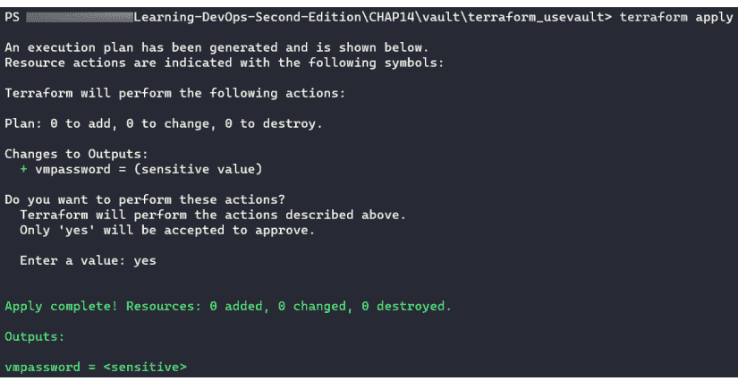

图 14.16 – Terraform 敏感输出

我们可以看到，名为 `vmpassword` 的 Terraform 输出中的值在终端中未以明文显示。

3. 最后，我们使用 `terraform output` 命令和 `-json` 选项以 **JavaScript Object Notation**（JSON）格式显示 Terraform 输出值，如下所示：

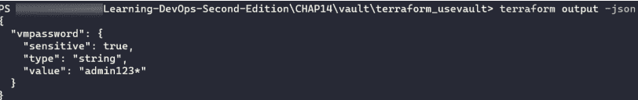

图 14.17 – JSON 格式的 Terraform 输出命令

我们看到，Terraform 已显示密钥中键的值，我们已将该值插入 Vault。此值现在可用于任何不应存储在 Terraform 代码中的敏感数据，例如 VM 密码。

> 但是，请小心
> 我们已通过将所有敏感数据外包给密钥管理器来保护我们的 Terraform 代码，但不应忘记 Terraform 将所有信息（包括数据和输出信息）存储在 Terraform 状态文件中。因此，将 Terraform 状态文件存储在受保护的远程后端中非常重要，如我们在 _第 2 章，使用 Terraform 配置云基础设施_ 的“在远程后端中保护状态文件”部分中所见。

在本节中，我们研究了 HashiCorp 的 Vault 的使用，它是一个密钥数据管理器。我们了解了如何在不同操作系统上手动和自动进行安装。我们使用其命令行来保护和读取我们在其中保护的数据。然后，我们讨论了如何使用其 Web 界面在 Vault 中管理密钥。最后，我们编写并执行了使用 Vault 提供程序并允许我们从 Vault 服务器检索存储密钥的 Terraform 代码。

### 摘要

本章专门介绍将安全性集成到 DevOps 实践中。我们介绍了三种工具来验证和保护您的数据和云基础设施。我们讨论了如何使用 Chef 的 **InSpec** 检查 Azure 基础设施的合规性。

为此并检查基础设施合规性，我们安装了 InSpec 并详细介绍了 InSpec 测试的编写。我们使用其命令行来验证 Azure 基础设施的合规性。


在上一节中，我们了解了如何使用 HashiCorp 的 **Vault** 保护敏感数据。在本节中，我们探讨了 Vault 中的数据加密和解密，并编写了 Terraform 代码，该代码将动态检索存储在 Vault 中的密钥。

在下一章中，我们将介绍 **蓝绿部署** 的概念及其用于减少部署停机时间的模式。然后，我们将学习如何在应用程序以及 Azure 基础设施部署中实现它。

### 问题

- 1. InSpec 的作用是什么？
- 2. 允许您通过命令行下载 InSpec 的包管理器的名称是什么？
- 3. 哪个 InSpec 命令允许您执行 InSpec 测试？
- 4. Vault 的发布者是谁？
- 5. 哪个命令以开发模式启动 Vault？
- 6. 当 Vault 在本地安装时，可以用于生产环境吗？
- 7. 在本地模式下，Vault 的加密数据存储在哪里？

### 进一步阅读

如果您想了解有关使用 InSpec、Vault 和 **Azure 安全开发工具包 (AzSK)** 进行 DevSecOps 的更多信息，以下是一些资源：

- InSpec 文档：`https://www.inspec.io/`
- HashiCorp Vault 文档：`https://www.vaultproject.io/docs/`
- 了解 HashiCorp Vault：`https://learn.hashicorp.com/vault`
