## 15 减少部署停机时间

到目前为止，在本书中，我们讨论了 **DevOps** 实践，例如 **基础设施即代码 (IaC)**、**持续集成/持续部署 (CI/CD)** 管道以及不同类型测试的自动化。

在 _第 1 章，DevOps 文化和基础设施即代码实践_ 中，我们了解到这些 DevOps 实践将提高应用程序的质量，从而提高公司的财务收益。我们将进一步深入了解 DevOps 实践，探讨如何在部署期间确保应用程序的持续可用性，以及如何更频繁地将这些应用程序的新版本交付到生产环境中。

通常，我们看到的是，部署需要中断应用程序，例如——基础设施更改或服务停机。而且，我们还看到的是，公司仍然不愿更频繁地交付到生产环境。他们无法在生产环境中测试应用程序，或者正在等待其他依赖项。

在本章中，我们将探讨几种有助于改进应用程序交付流程的实践。我们将从一种在 Terraform 部署期间减少基础设施和应用程序停机时间的方法开始。然后，我们将讨论蓝绿部署的概念和模式，以及如何使用一些 Azure 资源对其进行配置。最后，我们将介绍在应用程序中实现功能标志的详细信息，这将允许您修改应用程序的操作，而无需在生产环境中重新部署它。

您还将学习如何配置 Terraform 代码以减少应用程序停机时间。您将能够使用蓝绿部署配置 Azure 资源，并使用开源组件或 LaunchDarkly 平台在应用程序中实现功能标志。

在本章中，我们将涵盖以下主题：

- 使用 Terraform 减少部署停机时间
- 了解蓝绿部署概念和模式
- 在 Azure 上应用蓝绿部署
- 功能标志简介
- 使用开源框架实现功能标志
- 使用 LaunchDarkly 解决方案

### 技术要求

为了理解本章中将介绍的 Terraform 概念，您需要阅读过 _第 2 章，使用 Terraform 配置云基础设施_。

我们将查看如何在 Azure 中实现蓝绿部署的示例。如果您没有 Azure 订阅，可以在此处创建免费的 Azure 帐户：`https://azure.microsoft.com/en-gb/free/`。

然后，我们将查看如何在 ASP.NET Core 应用程序中使用功能标志的示例。要使用我们的示例，您需要安装 **.NET Core 软件开发工具包 (SDK)**，可以从 `https://dotnet.microsoft.com/download` 下载。

对于代码编辑，我们使用了免费的 **Visual Studio Code (VS Code)** 编辑器，可以在此处下载：`https://code.visualstudio.com/`。

本章的完整源代码可在 `https://github.com/PacktPublishing/Learning-DevOps-Second-Edition/tree/main/CHAP15` 找到。

查看以下视频，观看代码实际运行情况：
https://bit.ly/3hcvrVH

### 使用 Terraform 减少部署停机时间

在第 2 章，使用 Terraform 配置云基础设施中，我们详细介绍了 Terraform 的使用，探讨了其命令和生命周期，并通过在 Azure 中的实施进行了实践。

Terraform 的一个问题是，根据需要实施的基础设施更改，Terraform 可能会自动销毁并重建某些资源。

为了充分理解这种行为，让我们查看以下 Terraform 执行的输出，该执行在 Azure 中配置了 Azure Web 应用，并已通过名称更改进行了修改：

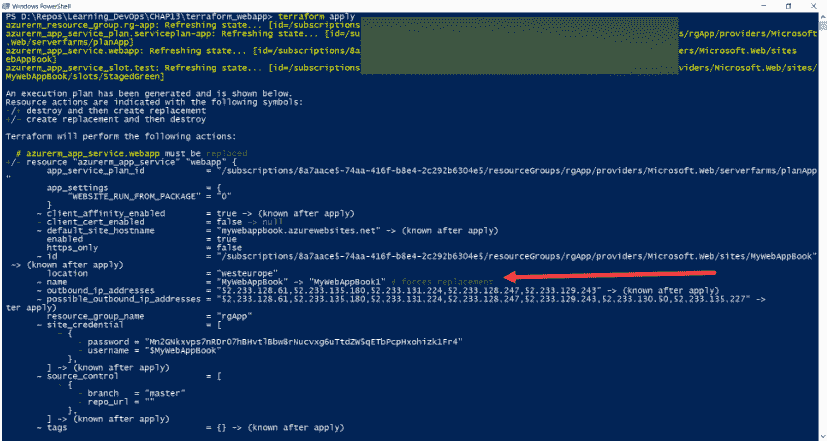

图 15.1 – Terraform 停机时间

在这里，我们可以看到 Terraform 将销毁 Web 应用，然后使用新名称重建它。虽然销毁和重建是自动完成的，但在 Terraform 销毁和重建 Web 应用期间，应用程序对用户不可访问。

为了解决这个停机问题，我们可以添加 Terraform create_before_destroy 选项，如下所示：

```hcl
resource "azurerm_app_service" "webapp" {
  name = "MyWebAppBook1" #new name
  location = "West Europe"
  resource_group_name = "${azurerm_resource_group.rg-app.name}"
  app_service_plan_id = "${azurerm_app_service_plan.serviceplan-app.id}"
  app_settings = {
    WEBSITE_RUN_FROM_PACKAGE = var.package_zip_url
  }
  lifecycle { create_before_destroy = true }
}
```

添加此选项后，Terraform 将执行以下操作：

- 首先，Terraform 使用新名称创建一个新的 Web 应用。
- 在配置新 Web 应用期间，它使用 app_settings 属性中提供的 ZIP 格式应用程序包的 **统一资源定位符 (URL)**。使用 WEBSITE_RUN_FROM_PACKAGE 启动应用程序。
- 然后，Terraform 将销毁旧的 Web 应用。

使用 Terraform create_before_destroy 选项将确保在部署期间我们的应用程序的可行性。

但是，请注意，只有当正在创建的新资源允许我们在配置的同时非常快速地运行应用程序，从而不会发生服务中断时，此选项才有用。

在我们的 Web 应用示例中，当我们使用 Web 应用的 WEBSITE_RUN_FROM_PACKAGE 属性时，这奏效了。对于 **虚拟机 (VM)**，我们可以使用由 **Packer** 创建的 VM 映像。正如我们在 _第 4 章，使用 Packer 优化基础设施部署_ 中所见，Packer 包含有关 VM 映像中已更新的 VM 应用程序的信息。

> 注意
> 有关 `create_before_destroy` 选项的更多信息，请参阅以下 Terraform 文档：https://www.terraform.io/language/meta-arguments/lifecycle。

我们刚刚看到，使用 Terraform 和 IaC，在资源更改的情况下，可以减少部署期间的停机时间。

我们现在将探讨一种称为 **蓝绿部署** 的实践的概念和模式，它允许我们以极大的信心在生产环境中部署和测试应用程序。

### 了解蓝绿部署概念和模式

蓝绿部署是一种允许我们在不影响当前应用程序版本的情况下在生产环境中部署新版本应用程序的实践。在此方法中，生产架构必须由 **两个相同的环境** 组成；一个环境称为 **蓝色** 环境，而另一个环境称为 **绿色** 环境。

允许在环境之间进行路由的元素是路由器——即负载均衡器。

以下图表显示了蓝绿架构的简化示意图：

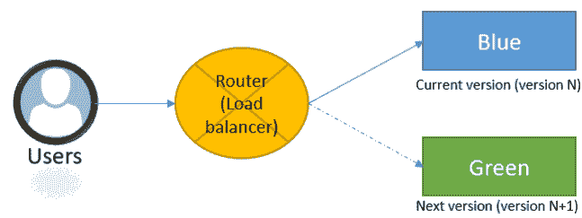

图 15.2 – 蓝绿架构

如我们所见，有两个相同的环境——称为 **蓝色** 的环境，即应用程序的当前版本，以及称为 **绿色** 的环境，即应用程序的新版本或下一个版本。我们还可以看到一个路由器，它将用户的请求重定向到蓝色环境或绿色环境。


现在我们已经介绍了蓝绿部署的原理，将在部署过程中探讨如何在实践中实现它。

### 使用蓝绿部署改进生产环境

蓝绿部署的基本使用模式如下：当我们部署应用程序的新版本时，应用程序将部署在蓝色环境（版本 _N_）中，并在此环境中配置路由器。

当部署下一个版本（版本 _N+1_）时，应用程序将部署在绿色环境中，并在此环境中配置路由器。

蓝色环境将变得未使用且闲置，直到版本 _N+2_ 的部署。它也将在需要快速回滚到版本 _N_ 时使用。

这种蓝绿部署的实践也可以分解为几种模式——即金丝雀发布和暗启动模式。让我们详细讨论每种模式的实现。我们将从金丝雀发布模式开始。

### 理解金丝雀发布模式

金丝雀发布技术与蓝绿部署非常相似。应用程序的新版本将部署在绿色环境中，但仅针对一小部分受限制的用户群体，他们将在真实的生产环境中测试应用程序。

这种实践是通过配置路由器（或负载均衡器）将流量重定向到两个环境来实现的。在此路由器上，我们应用用户组的重定向限制，使其只能重定向到包含新版本的绿色环境。

以下是金丝雀发布模式的示例图：

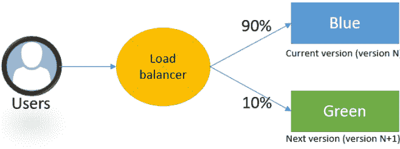

图 15.3 – 蓝绿金丝雀发布

在前面的图中，路由器将 90% 的用户重定向到蓝色环境，将 10% 的用户重定向到包含应用程序新版本的绿色环境。

然后，一旦由该用户组完成测试，路由器可以完全配置到绿色环境，从而使蓝色环境可用于测试下一个版本（N+2）。

如下图所示，路由器配置为将所有用户重定向到绿色环境：

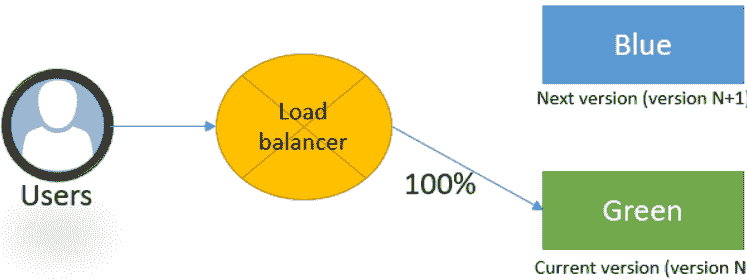

图 15.4 – 带路由器的蓝绿架构

这种部署技术使得可以在真实的生产环境中部署和测试应用程序，而无需影响所有用户。

我们将在本章后面的“在 Azure 上应用蓝绿部署”部分中，探讨这种蓝绿部署模式的实际实现。但在此之前，让我们来看另一种蓝绿部署模式——暗启动模式。

### 探索暗启动模式

暗启动模式是与蓝绿部署相关的另一种实践，它包括以隐藏或禁用模式（因此不可访问）将新功能部署到生产环境中。然后，当我们希望在已部署的应用程序中访问这些功能时，可以逐步激活它们，而无需重新部署应用程序。

与金丝雀发布模式不同，暗启动模式不是依赖于基础设施的蓝绿部署，而是在应用程序代码中实现的。要设置暗启动模式，有必要将应用程序的每个功能的代码封装在称为**功能标志**（或**功能开关**）的元素中，这些元素将用于远程启用或禁用这些功能。

我们将在本章的最后几个部分中，探讨使用开源框架和云平台实现和使用功能标志的方法。

在本节中，我们介绍了蓝绿部署的实践，以及其概念和模式，例如金丝雀发布和暗启动模式。我们讨论了这种实践需要对生产基础设施进行更改，因为它由两个基础设施实例组成——一个蓝色和一个绿色——以及一个重定向用户请求的路由器。

现在我们已经讨论了蓝绿部署模式，将探讨如何在 Azure 云基础设施中实际实现其中一种。

### 在 Azure 上应用蓝绿部署

现在我们已经了解了蓝绿部署，将探讨如何使用两种类型的组件——App Service 槽位和 Azure 流量管理器——将其应用于 Azure 基础设施。

让我们先来看看最基本的组件——App Service 槽位。

### 使用带槽位的 App Service

如果我们有 Azure 订阅，并且希望在不投入太多精力的情况下使用蓝绿部署，可以使用 App Service 槽位（Azure Web Apps 或 Azure Functions）。

在 Azure App Services（例如 Web App）中，我们可以通过为其创建槽位（根据 App Service 计划最多可创建 20 个槽位）来创建 Web App 的第二个实例。这个槽位是一个次要的 Web 应用，但附加到我们的主 Web 应用上。

换句话说，主 Web 应用代表蓝色环境，槽位代表绿色环境。

要使用此 Web 应用及其槽位作为蓝绿架构，我们将执行以下配置步骤：

+ 1. 一旦创建了 Web 应用槽位，应用程序的新版本将部署在此槽位中，我们可以分配一定比例的流量，如下图所示：

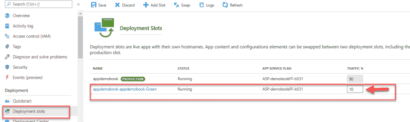

在此，我们已将 10% 的流量分配给包含新版本应用程序更改的 Web 应用槽位。

+ 2. 一旦应用程序的新版本在槽位上经过测试，我们可以将槽位交换到主 Web 应用（蓝色环境），如下图所示：

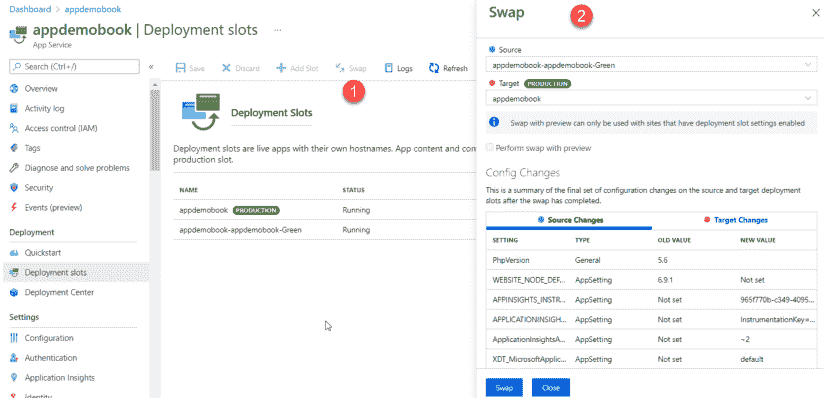

通过此交换，Web 应用将获取其槽位的内容，反之亦然。

Web 应用现在包含应用程序的新版本（_N+1_），而槽位包含旧版本（_N_）。如果出现紧急问题，我们可以通过再次执行交换来恢复应用程序的先前版本。

> **注意**
> 要了解有关配置和使用 Web 应用槽位的更多信息，可以阅读以下文档：https://docs.microsoft.com/en-us/azure/app-service/deploy-staging-slots。

这正是我们在金丝雀发布模式中看到的内容，它允许我们为一组用户分配生产流量，并将应用程序路由到包含 _N+1_ 版本的环境。

现在我们已经讨论了槽位的使用，将探讨 Azure 流量管理器组件，它也允许我们实现蓝绿部署。

### 使用 Azure 流量管理器

在 Azure 中，有一个名为 **Azure 流量管理器** 的组件，它允许我们管理多个资源终结点（例如两个 Web 应用）之间的流量。

为此，我们需要有两个 Web 应用：一个用于蓝色环境，另一个用于绿色环境。

然后，在我们的 Azure 订阅中，我们需要创建一个 Azure 流量管理器，并按以下步骤进行配置：

+ 1. 在流量管理器中，我们将首先配置一个确定流量路由方法的配置文件。在我们的案例中，我们将配置一个 **加权** 配置文件——即根据我们将在 Web 应用中分配的权重进行配置。下图显示了按权重配置配置文件的过程：

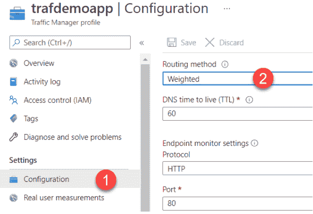

图 15.7 – Azure 流量管理器配置

> **注意**
> 要了解其他配置文件配置选项及其工作原理，可以阅读以下文档：https://docs.microsoft.com/en-us/azure/traffic-manager/traffic-manager-routing-methods。

2. 然后，我们将记录构成我们两个 Web 应用的终结点。对于每个终结点，我们将配置一个优先权重，如下图所示：

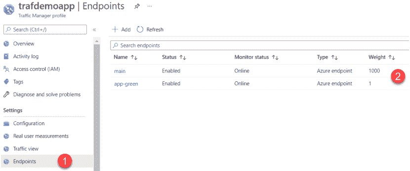

图 15.8 – Azure 流量管理器终结点


因此，`main` 终结点（即蓝色环境）具有最大权重，相当于 100% 的流量。

> 注意
> 如果你想了解有关配置流量管理器的更多信息，可以参考本教程：https://docs.microsoft.com/en-us/azure/traffic-manager/tutorial-traffic-manager-weighted-endpoint-routing.

至于应用服务槽位，通过流量管理器，我们可以根据希望在每个终结点上获得的流量来调整此权重，然后应用蓝绿部署。

我们刚刚讨论了蓝绿部署的实现，更具体地说，是在 Azure 基础设施中使用几种解决方案实现金丝雀发布模式，总结如下：

- 对于第一种解决方案，我们使用了一个位于 Web 应用下的槽位，并配置了其用户流量百分比。
- 对于第二种解决方案，我们使用并配置了一个 Azure 流量管理器资源，该资源充当两个 Web 应用之间的路由器。

现在，让我们详细了解暗启动模式，首先介绍功能标志及其实现。

### 引入功能标志

功能标志（也称为功能开关）允许我们动态启用或禁用应用程序的某个功能，而无需重新部署它。

与使用金丝雀发布模式的蓝绿部署不同，后者是一种架构概念，功能标志是在应用程序代码中实现的。其实现是通过使用条件 `if` 规则的简单封装完成的，如以下代码示例所示：

```
if(activateFeature ("addTaxToOrder") ==True) {
    ordervalue = ordervalue + tax
}else{
    ordervalue = ordervalue
}
```

在此示例代码中，`activateFeature` 函数允许我们了解应用程序是否应根据 `addTaxToOrder` 参数将税费添加到订单中，该参数在应用程序外部指定（例如在数据库或配置文件中）。

功能标志封装的功能可能对于应用程序的运行或内部目的（例如日志激活或监控）是必要的。

功能的启用和禁用可以由管理员控制，也可以由用户通过图形界面直接控制。

功能标志的生命周期可以是以下之一：

- **临时**：用于测试功能。一旦用户验证，功能标志将被删除。
- **确定**：用于长期保留功能标志。

因此，使用功能标志，应用程序的新版本可以更快地部署到生产阶段。这是通过禁用发布的新功能来完成的。然后，我们将为特定用户组（例如测试人员）重新激活这些新功能，他们将直接在生产环境中测试这些功能。

此外，如果我们发现应用程序的某个功能无法正常工作，功能标志可以非常快速地禁用它，而无需重新部署应用程序的其余部分。

功能标志还允许 A/B 测试——即由特定用户测试新功能的行为并收集他们的反馈。

在应用程序中实现功能标志时，有几种技术解决方案，概述如下：

- 你开发和维护自定义功能标志系统，该系统已根据你的业务需求进行调整。此解决方案适合你的需求，但需要大量的开发时间，以及对架构规范（例如使用数据库、数据安全性和数据缓存）的必要考虑。
- 你使用必须在项目中安装的开源工具。此解决方案可以节省开发时间，但需要选择工具，尤其是在开源工具的情况下。此外，在这些工具中，很少提供门户或仪表板管理功能，允许远程管理功能标志。功能标志有大量开源框架和工具。请访问 http://featureflags.io/resources/ 查找它们。请参考以下内容：

  - RimDev.FeatureFlags (https://github.com/ritterim/RimDev.FeatureFlags)
  - Flagr (https://github.com/checkr/flagr)
  - Unleash (https://github.com/Unleash/unleash)
  - Togglz (https://github.com/togglz/togglz)
  - Flip (https://github.com/pda/flip).

- 你可以使用云解决方案（平台即服务，或 PaaS），无需安装并具有用于管理功能标志的后台，但其中大多数在企业大规模使用时需要财务投资。在这些解决方案中，我们可以提及以下内容：

  - LaunchDarkly (https://launchdarkly.com/)
  - Rollout (https://app.rollout.io/signup)
  - Featureflag.tech (https://featureflag.tech/)
  - Featureflow (https://www.featureflow.io/).

在本节中，我们讨论了使用功能标志是一种开发实践，允许你直接在生产阶段测试应用程序。

我们还提到了不同的功能标志使用解决方案，并说明了其实现。让我们讨论一下使用名为 RimDev.FeatureFlags 的开源工具的其中一种实现。

### 使用开源框架实现功能标志

正如我们所见，有大量开源工具或框架允许我们在应用程序中使用功能标志。

在本节中，我们将查看在 .NET (Core) 应用程序中使用名为 RimDev.FeatureFlags 的简单框架实现功能标志的示例。

RimDev.FeatureFlags 是一个用 .NET 编写的免费开源框架 (https://github.com/ritterim/RimDev.FeatureFlags)，并通过 NuGet 包进行打包和分发。可以在此处找到：https://www.nuget.org/packages/RimDev.AspNetCore.FeatureFlags.

要存储功能标志数据，RimDev.FeatureFlags 使用必须事先创建的数据库。RimDev.FeatureFlags 的优势在于，一旦在我们的应用程序中实现，它提供了一个 Web **用户界面 (UI)**，允许我们启用或禁用功能标志。

作为本示例的先决条件，我们需要有一个已初始化的 ASP.NET Core MVC 应用程序。我们将使用一个已创建的 SQL Server 数据库来存储功能标志数据。

要在此应用程序中初始化 RimDev.FeatureFlags，我们将执行以下步骤：

1. 第一步是在我们的应用程序中引用 NuGet RimDev.FeatureFlags 包，并使用任何文本编辑器修改应用程序的 .csproj 文件（位于应用程序文件的根目录，包含一些应用程序参数），添加 PackageReference 元素，如下所示：

   ```xml
   <ItemGroup>
   ...
   <PackageReference Include="RimDev.AspNetCore.FeatureFlags" Version="2.1.3" />
   </ItemGroup>
   ```

   或者，我们可以在终端命令行中执行以下命令，以在现有项目中引用 NuGet 包：

   ```
   dotnet add package RimDev.AspNetCore.FeatureFlags
   ```

2. 然后，我们将转到 appsettings.json 配置文件，使用以下代码配置我们事先创建的数据库的连接字符串：

   ```json
   "connectionStrings": {
   "localDb": "Data Source=<your database server>;Database=FeatureFlags.AspNetCore;User ID=<your user>;Password=<password data>"
   }
   ```

### 3. 在 `startup.cs` 文件中，该文件位于应用程序文件的根目录，我们将使用以下代码块向 `RimDev.FeatureFlags` 添加配置：

```csharp
private readonly FeatureFlagOptions options;
public Startup(IConfiguration configuration)
{
    Configuration = configuration;
    options = new FeatureFlagOptions()
        .UseCachedSqlFeatureProvider(Configuration.GetConnectionString("localDb"));
}
```

在前面的代码片段中，我们使用数据库连接初始化了 RimDev.FeatureFlags 的选项。我们可以使用以下代码配置服务加载：

```csharp
public void ConfigureServices(IServiceCollection services)
{
    ...
    services.AddFeatureFlags(options);
}
public void Configure(IApplicationBuilder app, IHostingEnvironment env)
{
    ...
    app.UseFeatureFlags(options);
    app.UseFeatureFlagsUI(options);
}
```

应用程序启动后，RimDev 将功能标志数据加载到应用程序上下文中。至此，我们已在项目中配置了 RimDev.FeatureFlags。


现在，我们将创建功能标志并在应用程序中使用它们。在这个示例中，我们将创建一个名为 ShowBoxHome 的功能标志，它可能会或可能不会显示应用程序主页中间的图像。让我们看看如何在项目中创建和操作这些功能标志，如下所示：

+ 1. 首先，我们将通过创建一个包含以下代码的新类来创建功能标志：

```csharp
using RimDev.AspNetCore.FeatureFlags;

namespace appFeatureFlags.Models{
    public class ShowBoxHome : Feature {
        public override string Description { get;
        } = "Show the home center box.";
    }
}
```

这个类包含 ShowBoxHome 功能标志。为这个功能标志提供了一个覆盖的描述。

+ 2. 然后，在我们的控制器中，我们使用以下代码调用 ShowBoxHome 类：

```csharp
public class HomeController : Controller {
    private readonly ShowBoxHome showboxHome;
    public HomeController (ShowBoxHome showboxHome) {
        this.showboxHome = showboxHome;
    }
    public IActionResult Index() {
        return View(new HomeModel{ShowboxHome = this.showboxHome.Value});
    }
    ...
}
```

控制器接收存储在数据库中的功能标志值，这些值在应用程序启动时加载。

3. 我们还将创建一个 HomeModel 类，用于列出主页所需的所有功能标志，如下所示：

```csharp
public class HomeModel
{
    public bool ShowBoxHome { get; set; }
}
```

4. 最后，在 Views/Home/index.cshtml 中，我们将使用这个模型来根据功能标志的值显示主页中间的图像，代码如下：

```razor
@if(Model.ShowBoxHome){
<div></div>
}
```

一旦开发过程结束，部署并运行我们的应用程序。默认情况下，主页中间没有图像，如下面的截图所示：

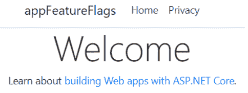

图 15-9 – 功能标志演示主页应用程序

要显示图像，我们需要动态激活功能，如下所示：

+ 1. 访问 http://<yoursite>/_features 的后台。我们将看到一个名为 ShowHomeBow 的开关。

+ 2. 我们通过打开切换开关来激活标志，如下面的截图所示：

图 15.10 – 功能标志演示功能切换

重新加载我们应用程序的主页。在这里，我们可以看到图像显示在页面中间：

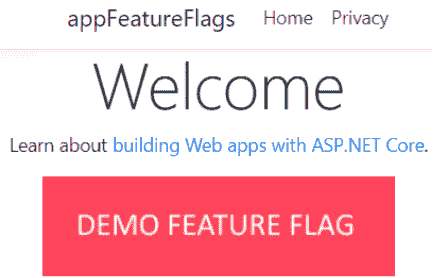

图 15.11 – 功能标志演示应用程序

通过使用 RimDev.FeatureFlags 框架和功能标志，我们能够启用或禁用应用程序的功能，而无需重新部署它。

> **Note**
> 
> 此应用程序的完整源代码可在 `https://github.com/PacktPublishing/Learning-DevOps-Second-Edition/tree/main/CHAP15/appFF` 找到。

我们刚刚看到如何使用开源工具在 .NET Core 应用程序中实现基本的功能标志。我们注意到，使用开源工具，我们可以在基础设施中创建数据库。这种功能标志的使用相当基础，而且，管理功能标志的 UI 访问不安全。

最后，与任何开源工具一样，检查它是否由其编辑器或社区定期维护和更新很重要。但是，使用开源工具进行功能标志对于小型商业项目来说仍然很有吸引力且成本低廉。

### 使用 LaunchDarkly 解决方案

在上一节中，我们讨论了使用开源工具进行功能标志，这可能是一个好的解决方案，但需要一些基础设施组件，并且依赖于开发语言（在我们的示例中，它是 .NET Core）。

为了更好地使用和管理功能标志，我们可以使用一个云解决方案，它不需要实现架构，并提供许多围绕功能标志的功能。

在这些云解决方案（**软件即服务**，或 **SaaS**）中，有 **LaunchDarkly** (`https://launchdarkly.com/`)，它是一个 SaaS 平台，由功能标志管理后台和允许我们在应用程序中操作功能标志的 SDK 组成。

LaunchDarkly SDK 可用于许多开发语言，例如 .NET、JavaScript、Go 和 Java。完整的 SDK 列表可在此处找到：`https://docs.launchdarkly.com/sdk`。

除了经典的 `RimDev.FeatureFlags` 功能标志管理版本之外，LaunchDarkly 还允许功能标志由用户管理，并提供与功能标志相关的 A/B 测试功能。A/B 测试可以通过功能标志来衡量应用程序功能的使用情况。

但是，LaunchDarkly 是一个付费解决方案 (`https://launchdarkly.com/pricing/`) 。幸运的是，它提供 30 天试用，以便我们可以试用。请看看如何使用 LaunchDarkly，以便您可以在 .NET 应用程序中实现功能标志。

为此，我们将首先创建一些功能标志，如下所示：

+ 1. 首先，通过单击 LaunchDarkly 网站顶部菜单中的 **Sign In** 按钮登录您的 LaunchDarkly 帐户。或者，您可以访问 `https://app.launchdarkly.com/`。

+ 2. 一旦我们连接到帐户，在 **Account settings** 部分，我们可以创建一个名为 `DemoBook` 的新项目，如下面的截图所示：

图 15.12 – LaunchDarkly 项目创建

默认情况下，项目中创建了两个环境。我们将能够创建自己的环境，然后在不同环境中测试功能标志。此外，每个环境都有一个唯一的 SDK 密钥，将作为 SDK 的身份验证。

+ 1. 然后，在名为 **Test** 的环境中，我们将导航到 **Feature flags** 菜单，单击 **Create flag** 按钮，然后创建一个名为 `ShowBoxHome` 的功能标志，如下面的截图所示：

图 15.13 – LaunchDarkly 功能标志创建

创建后，我们可以通过单击 **On/Off** 切换开关来激活它。现在我们已经在 LaunchDarkly 门户中配置和创建了功能标志，我们将看到如何在应用程序代码中使用 SDK。

> Note
> 在 LaunchDarkly 中，对功能标志所做的更改是由连接到应用程序的用户完成的。这意味着应用程序必须提供身份验证系统。

要使用 SDK 并启动应用程序，请执行以下步骤：

+ 1. 第一步是选择与应用程序开发语言对应的 SDK。我们可以通过访问 https://docs.launchdarkly.com/docs/getting-started-with-launchdarkly-sdks#section-supported-sdks 来完成此操作。在我们的例子中，我们有一个 .NET 应用程序，因此我们将遵循此过程：https://docs.launchdarkly.com/docs/dotnet-sdk-reference。

+ 2. 现在，让我们将 NuGet LaunchDarkly.ServerSdk 包（https://www.nuget.org/packages/LaunchDarkly.ServerSdk/）的引用集成到我们应用程序的 .csproj 文件中，通过将其添加到引用包中，如下所示：

```xml
<ItemGroup>
<PackageReference Include="LaunchDarkly.ServerSdk"
Version="6.3.1" />
...
</ItemGroup>
```

+ 3. 在 .NET 代码中，我们在控制器中执行此操作。为此，我们需要使用 using 命令导入 SDK，如下所示：

```csharp
using LaunchDarkly.Client;
```

+ 4. 仍在控制器代码中，我们添加对 LaunchDarkly 的连接，由 FeatureFlag 调用。代码如下片段所示：

```csharp
public IActionResult Index() {
LdClient ldClient = new LdClient("sdk-eb0443dc-xxxx-xxx-xx-xxx");
User user = LaunchDarkly.Client.User.WithKey(User.Identity.Name);
bool showBoxHome = ldClient.BoolVariation("show-box-home", user, false);
return View(new HomeModel{ShowBoxHome = showBoxHome});
}
```


For the connection to LaunchDarkly, we need to use the SDK key that was provided when the project was created. Then, in the preceding code, we connect the user who is connected to the application to the feature flag that we created previously in the portal.

5. Finally, in the Home/Index.cshtml view, we add the following code to add a condition that will display the image, depending on the value of the feature flag:
```
<div class="text-center">
@if(Model.ShowBoxHome) {
<div></div>
}
</div>
```

6. Finally, we deploy and execute the application. As illustrated in the following screenshot, the home page shows the central image because the feature flags are set to true by default:

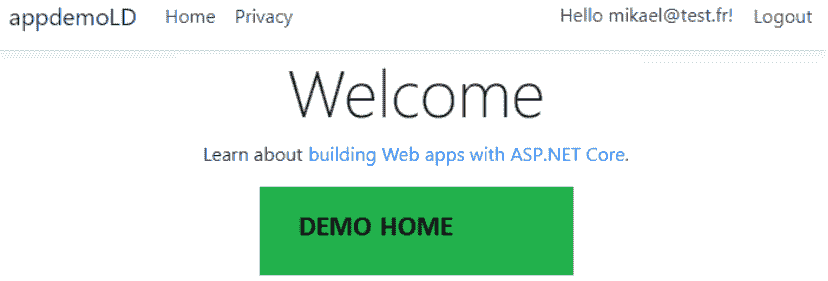

Figure 15.14 – LaunchDarkly feature flag demonstration application

### 7.

Then, we go to the LaunchDarkly portal and modify the configuration of this feature flag for the current user with a `false` value. On the **Users** management page, we select the user, as illustrated in the following screenshot:

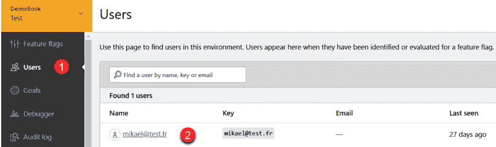

Figure 15.15 – LaunchDarkly user

Then, we update the value of the feature flag to `false`, as illustrated in the following screenshot:

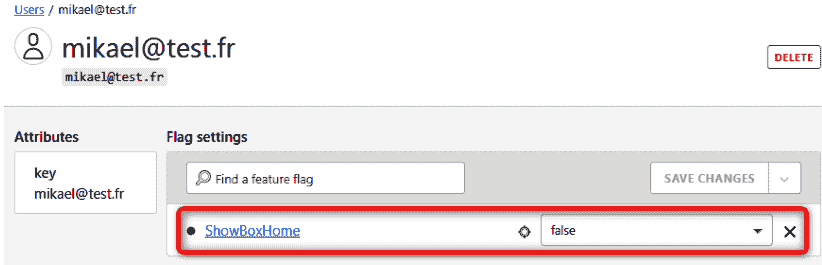

Figure 15.16 – LaunchDarkly feature flag user settings

### 8.

By reloading the page, we can see that the central image is no longer displayed, as illustrated here:

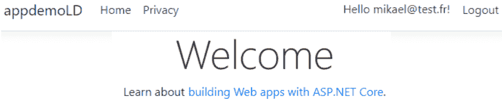

Figure 15.17 – Feature flag demo application with LaunchDarkly

This is an example of how to use LaunchDarkly, which has many other interesting features, such as a user management system, feature usage with A/B testing, integration with CI/CD platforms, and reporting.

> Note
> The complete code source for this application can be found at `https://github.com/PacktPublishing/Learning-DevOps-Second-Edition/tree/main/CHAP15/appdemoLD`.

What we have discussed in this section is an overview of LaunchDarkly, which is a feature flag cloud platform. We studied its implementation in a web application with the creation of feature flags in the LaunchDarkly portal.

Then, we manipulated this feature flag in the application code via the SDK provided by LaunchDarkly. Finally, in the LaunchDarkly portal, we enabled/disabled a feature for a user who wants to test a new feature of the application without having to redeploy it.

### 摘要

In this chapter, we focused on improving production deployments. We started by using Terraform to reduce downtime during provisioning and resource destruction.

Then, we focused on the practice of blue-green deployment and its patterns, such as canary release and dark launch. We looked at the implementation of a blue-green deployment architecture in Azure using App Service and the Azure Traffic Manager component.

Finally, we detailed the implementation of feature flags in a .NET application using two types of tools—`RimDev.FeatureFlags`, which is an open source tool that offers a basic feature flag system, and LaunchDarkly, which is a cloud-based solution. It's not free of charge but provides complete and advanced feature flag management.

The next chapter is dedicated to GitHub. Here, we will look at the best practices for contributing to open source projects.

### 问题

1. In Terraform, which option can we use to reduce downtime?
2. What is a blue-green deployment infrastructure composed of?
3. What are the two blue-green deployment patterns that we looked at in this chapter?
4. In Azure, what are the components that allow us to apply a blue-green deployment practice?
5. What is the role of feature flags?
6. What is the `RimDev.FeatureFlags` tool?
7. Which feature flag tool discussed in this chapter is a SaaS solution?

### 延伸阅读

If you want to find out more about zero-downtime and blue-green deployment practices, take a look at the following resources:

- * _Zero Downtime Updates with HashiCorp Terraform_: `https://www.hashicorp.com/blog/zero-downtime-updates-with-terraform`
- * _BlueGreenDeployment_ by _Martin Fowler_: `https://martinfowler.com/bliki/BlueGreenDeployment.html`
- * _Feature Toggles (aka Feature Flags)_ by _Martin Fowler_: `https://martinfowler.com/articles/feature-toggles.html`
- * _Blue-Green Deployment on Azure with Zero Downtime_ (article): `http://work.haufegroup.io/Blue-Green-Deployment-on-Azure/`
- * Feature flag guide: `http://featureflags.io/`
- * LaunchDarkly feature flag use cases: `https://launchdarkly.com/use-cases/`
