## 开源项目的 DevOps

Until a few years ago, the open source practice, which consists of delivering the source code of a product to the public, was essentially only used by the Linux community. Since then, many changes have taken place regarding open source with the arrival of GitHub. Microsoft has since made a lot of its products open source and is also one of the largest contributors to GitHub.

Today, open source is a must in the development and enterprise world, regardless of whether we wish to use a project or even contribute to it.

However, open source applications are not always free. There are sometimes licensing fees for plugins, support, or enterprise features. Also, in terms of support, using open source software can sometimes present difficulties and pitfalls when it comes to product support.

Throughout this book, we have seen many instances where open source tools such as Terraform, Ansible, Packer, Vagrant, Jenkins, and SonarQube have been used. However, one of the great advantages of open source is not only the use of products but also the fact that we can contribute to them.

To contribute to an open source project, we need to participate in its evolution by discussing issues with its use or by making suggestions regarding improving it. In addition, if you are a developer, you can also modify its source code to make it evolve.

Finally, as a developer or a member of an operational team, we can share our project in open source and make it available to the community.

In this chapter, we'll discuss open source contributions and why it's important to apply DevOps practices to all open source projects.

All of these practices, such as the use of Git, a CI/CD pipeline, and security analysis, have already been discussed throughout this book. However, in this chapter, we'll focus more on how to apply them in the context of our open source project.

We will start by learning how to share the code of a project in GitHub and how to initialize a contribution to another project. We will also discuss how to manage pull requests, which is one of the most important features of the contribution. In addition, we will look at how to indicate version changes using release notes, and the topic of binary sharing in GitHub Releases. We'll explain GitHub Actions, which allows us to created CI/CD pipelines on open source projects that are hosted on GitHub. Finally, we will look at the source code analysis of open source projects. We'll do this using SonarCloud, which is used for static code analysis, and WhiteSource Bolt, which is used for analyzing package security vulnerabilities that are contained in an open source project.

In this chapter, we will cover the following topics:

- Storing source code in GitHub
- Contributing to open source projects using pull requests
- Managing the changelog file and release notes
- Sharing binaries in GitHub releases
- Getting started with GitHub Actions
- Analyzing code with SonarCloud
- Detecting security vulnerabilities with WhiteSource Bolt

### Technical requirements

In this chapter, we will use GitHub as a Git repository platform to store our open source project. Therefore, you will need a GitHub account, which you can create for free at `https://github.com/`. To fully understand the DevOps practices that will be used in this chapter, you should be well-versed with the following chapters of this book:

- _Chapter 6, Managing Your Source Code with Git_
- _Chapter 7, Continuous Integration and Continuous Delivery_
- _Chapter 12, Static Code Analysis with SonarQube_


本章的完整代码可在 `https://github.com/PacktPublishing/Learning-DevOps-Second-Edition/tree/main/CHAP16/` 找到。
请观看以下视频，查看代码的实际运行情况：
`https://bit.ly/3JJCb9V`。

### 在 GitHub 中存储源代码

如果我们想以开源方式共享某个项目，必须在支持以下元素的 Git 平台上对其代码进行版本控制：

- 公共仓库；也就是说，我们需要能够访问该仓库中包含的源代码，但不一定需要在此 Git 平台上进行身份验证。
- 该平台不同成员之间进行代码协作的功能和工具。

有两个主要平台允许我们托管开源工具：**GitLab**（我们在 *第 7 章，持续集成和持续交付* 的 *使用 GitLab CI* 部分中介绍过）和 **GitHub**，后者目前是开源项目最常用的平台。
让我们学习如何使用 GitHub，以便我们可以托管自己的项目或为其他项目做出贡献。

### 在 GitHub 上创建新仓库

如果我们想在 GitHub 上托管项目，需要创建一个仓库。请按照以下步骤操作：

1. 首先，登录您的 GitHub 账户，如果您是新用户，请通过访问 `https://github.com/` 创建一个新账户。
2. 登录后，进入账户中的 **Repositories** 选项卡。单击 **New** 按钮，如下图所示：

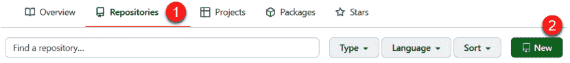

图 16.1 – 添加仓库

### 创建新仓库

仓库包含所有项目文件，包括修订历史记录。已在其他地方拥有项目仓库？
导入仓库。

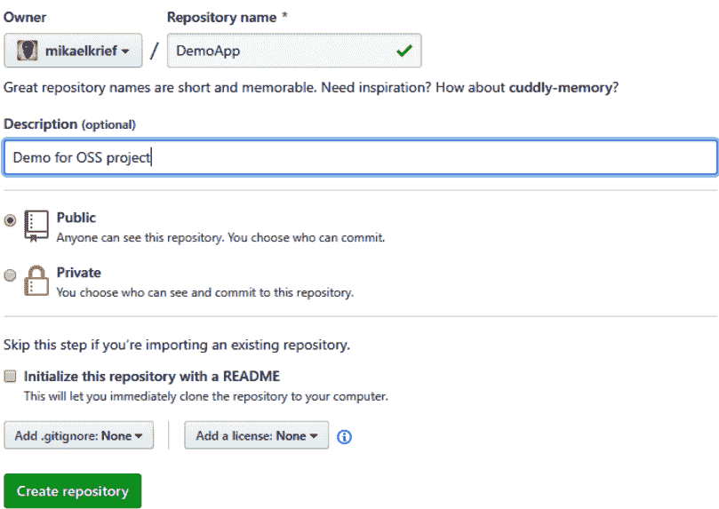

图 16.2 – GitHub 仓库详细信息

创建仓库需要填写的信息如下：

- 仓库名称。
- 描述（可选）。
- 我们需要指定仓库是 **Public**（所有人都可以访问，即使未经过身份验证）还是 **Private**（仅可供我们授权的成员访问）。
- 我们还可以选择使用空的 `README.md` 文件以及 `.gitignore` 文件来初始化仓库。

然后，单击 **Create repository** 按钮验证表单。

### 4. 创建仓库后，主页将显示第一条 Git 说明，以便您可以开始存档其代码。下图显示了新 GitHub 仓库说明页面的一部分：

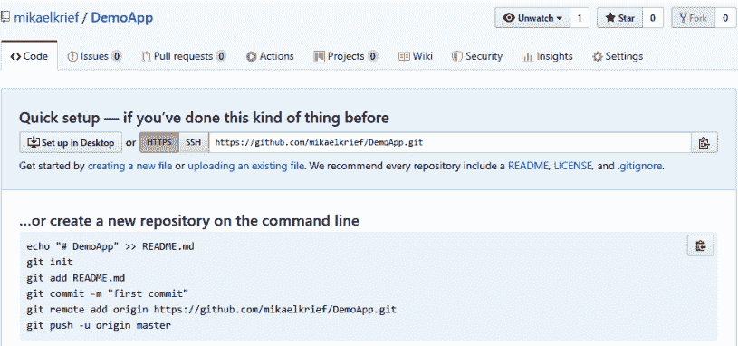

图 16.3 – GitHub 仓库 – 第一条 Git 说明

一切已准备就绪，可在 GitHub 中存档代码。请使用我们在 _第 6 章，使用 Git 管理源代码_ 中介绍的工作流程和 Git 命令来执行此操作。

此过程适用于在 GitHub 中创建仓库。现在，让我们学习如何使用另一个仓库的项目来为 GitHub 做出贡献。

### 为 GitHub 项目做出贡献

我们刚刚学习了如何在 GitHub 上创建仓库。但是，我们需要知道的是，默认情况下，只有仓库的所有者才被允许修改该仓库的代码。

> **注意**
> 我们可以将人员添加为此仓库的协作者，以便他们可以对代码进行更改。有关此过程的更多信息，请访问 https://help.github.com/en/articles/inviting-collaborators-to-a-personal-repository。

根据这一原则，我们无权修改另一个仓库的代码。

要为另一个仓库的代码做出贡献，我们需要创建要贡献的初始仓库的一个 **fork**。fork 是在我们的 GitHub 账户中执行的初始仓库的副本，从而在我们的账户中创建一个新仓库。

请按照以下步骤了解如何创建仓库的 fork：

1. 首先，导航到您要为其做出贡献的初始仓库。然后，单击页面顶部的 **Fork** 按钮，如下图所示：

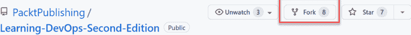

图 16.4 – GitHub – 复刻仓库

2. 几秒钟后，该仓库连同其所有内容将被复刻并复制到您的账户中。这样做，您的账户中将获得一个与初始仓库关联的新仓库，如下图所示：

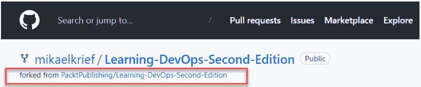

图 16.5 – GitHub fork 链接

3. 现在，您的 GitHub 账户中有一个您要为其做出贡献的仓库的精确副本。您可以自由修改代码并提交更改，所有更改都将存档在您的仓库中。

但是，即使初始仓库和 fork 之间存在链接，每个仓库的代码也完全不相关，并且代码不会自动同步。

在本节中，我们学习了如何创建 GitHub 仓库或对另一个仓库进行 fork，以便我们可以为其做出贡献。现在，让我们学习如何使用拉取请求提出代码更改并将我们的代码合并到另一个仓库中。

### 使用拉取请求为开源项目做出贡献

当我们想要为 GitHub 上的开源项目做出贡献时，我们需要对我们 GitHub 账户仓库中的应用程序源代码进行更改。要将这些代码更改合并到初始仓库，我们必须执行 **merge** 操作。

在 GitHub 中，有一个称为 **pull request** 的元素，它允许我们在仓库之间执行合并操作。除了在代码分支之间执行简单且经典的合并之外，拉取请求还通过提供允许不同贡献者讨论代码更改的功能，增加了全新的协作方面。

让我们学习如何执行拉取请求：

1. 在对您账户仓库中的源代码进行更改后，您必须通过提交 commit 来存档这些更改。已进行的更改现在已准备好与远程仓库合并。为此，请转到您的仓库，进入 **Pull requests** 选项卡，然后单击 **New pull request** 按钮，如下图所示：

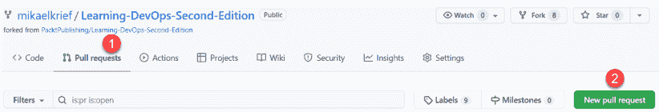

图 16.6 – GitHub – 新建拉取请求

### 2. 出现的页面将指定将要创建的拉取请求的所有信息，如下图所示：

比较更改
选择两个分支以查看更改内容或开始新的拉取请求。如果需要，您还可以跨 fork 进行比较。

与其他人讨论和审查此比较中的更改。了解拉取请求。

显示 1 个已更改文件，包含 6 处添加和 5 处删除。

图 16.7 – GitHub 拉取请求详细信息

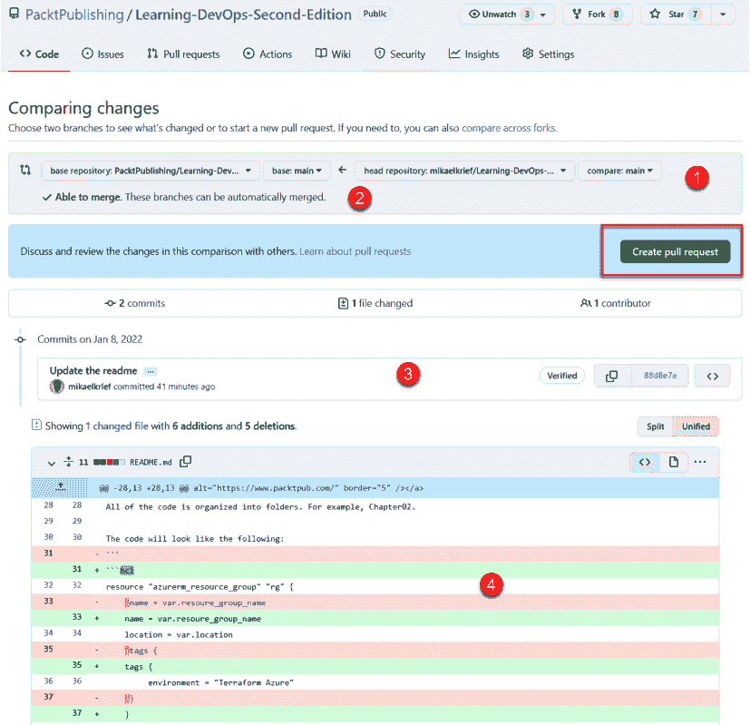

屏幕上显示的信息如下：
• 源仓库/分支和目标仓库/分支
• 指示是否存在代码冲突的指示器
• 包含在此拉取请求中的提交列表
• 修改文件的代码差异

3. 要验证拉取请求的创建，请单击 **Create pull request** 按钮。
4. 在出现的表单中输入拉取请求的名称和描述，如下图所示：

### 打开拉取请求

通过比较两个分支的更改来创建新的拉取请求。如果需要，您还可以跨 fork 进行比较。

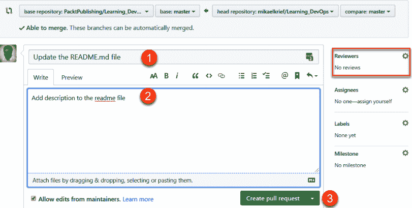

图 16.8 – GitHub 拉取请求标题和描述

此信息很重要，因为它将帮助仓库的目标所有者快速了解此 **pull request** 中包含的代码更改的目标。
此外，从右侧面板，可以选择审核人，他们将通过电子邮件收到拉取请求通知。这将由负责审查代码更改并验证或拒绝它们的人执行。

5. 最后，单击 **Create pull request** 按钮验证拉取请求的创建。

创建拉取请求后，原始仓库的所有者将看到在其仓库的 **Pull requests** 选项卡中打开了一个新的拉取请求（带有您提供的标题）。他们可以单击 **Pull requests** 选项卡来访问它并查看其所有详细信息。

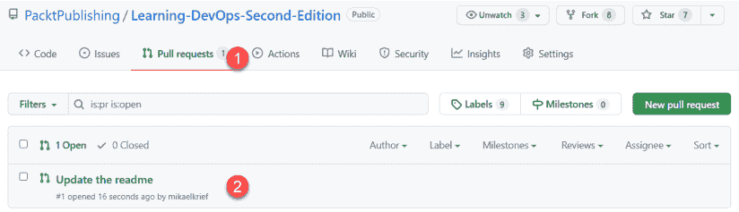

图 16.9 – GitHub 拉取请求列表


### 更新 readme #1

mikaelkief 想要将 2 个提交从 `mikaelkief:main` 合并到 `PacketPublishing:main`

对话 0 提交 2 检查 2 个文件已更改 1

mikaelkief 于 4 分钟前评论
update the readme

mikaelkief 于 1 小时前添加了 2 个提交
Update README.md
Update the readme

已验证 15eff6c
已验证 X 88dBe7e

通过向 mikaelkief/Learning-DevOps-Second-Edition 的 `main` 分支推送来添加更多提交。

某些检查未成功
1 个失败和 1 个成功的检查

此分支与基础分支没有冲突
可自动执行合并。

合并拉取请求
你也可以在 GitHub Desktop 中打开此内容或查看命令行说明。

写入预览
H B I < > ... ☐ @ ↻ ↳

留下评论
通过拖放、选择或粘贴来附加文件。

关闭拉取请求
评论

请记住，对此仓库的贡献应遵循我们的 GitHub 社区准则。

图 16.10 – GitHub 拉取请求验证

以下是仓库所有者可以对此拉取请求执行的不同操作：

- 通过单击 **Files changed** 选项卡，审阅者可以查看对代码所做的更改，并在每个修改的行上留下注释。
- 审阅者或仓库所有者可以就代码更改发起讨论，并单击 **Comment** 按钮来验证他们的评论。
- 如果所有者对代码更改满意，他们可以单击 **Merge pull request** 按钮来执行合并。
- 另一方面，如果所有者不满意并拒绝拉取请求，他们可以单击 **Close pull request** 按钮，此时请求将被关闭。
- 我们还可以执行一些自动化检查。

合并后，拉取请求将具有 **Merged** 状态，原始仓库的代码将使用我们所做的代码更改进行更新。

在本节中，我们了解到，通过拉取请求，我们有一种简单的方法来为 GitHub 上的开源项目做出贡献，即提出代码更改。然后，项目所有者可以接受此拉取请求并合并代码，或者拒绝这些更改。在下一节中，我们将学习如何使用 changelog 文件来管理我们对项目所做的更改。

### 管理 changelog 文件和发行说明

当我们将项目作为开源项目托管时，最好在更改发生时向用户提供有关正在应用到项目的更改的信息。如果除了源代码之外，我们的仓库还公开提供应用程序的二进制文件，那么此更改日志系统（也称为 **release notes**）就更加重要，因为该二进制文件的使用取决于其不同的版本和代码更改。

从逻辑上讲，我们可以通过浏览 Git 提交历史来找到代码更改的历史记录。但是，对于 Git 新手来说，这将过于繁琐且耗时。出于这些原因，我们将在文本文件中以代码版本的形式指示历史记录中的更改。此文件没有固定的命名法或形式，但为简单起见，我们决定将其称为 `CHANGELOG.md`。

因此，此 changelog 文件是一个 markdown 格式的文本文件，可以使用简单的格式轻松编辑，并放置在仓库的根目录下。在此文件中，更改历史记录以列表形式提供，不会透露每个更改的太多细节。

为了更好的可见性，最近更改的历史记录将按从新到旧的顺序排列，以便我们可以快速访问最新更改。为了让您了解 changelog 文件的形状，以下是一张截图，显示了 Azure Terraform 提供程序的 changelog 文件中的摘录：

### 1.30.1 (June 07, 2019)

BUG FIXES:

- Ensuring the authorization header is set for calls to the User Assigned Identity API's (#3613)

### 1.30.0 (June 07, 2019)

FEATURES:

- New Data Source: azurerm_redis_cache (#3481)
- New Data Source: azurerm_sql_server (#3513)
- New Data Source: azurerm_virtual_network_gateway_connection (#3571)

IMPROVEMENTS:

- dependencies: upgrading to Go 1.12 (#3525)
- dependencies: upgrading the storage SDK to 2019-04-01 (#3578)
- Data Source azurerm_app_service - support windows containers (#3566)
- Data Source azurerm_app_service_plan - support windows containers (#3566)
- azurerm_api_management - rename disable_triple_des_chipers to disable_triple_des_ciphers (#3539)
- azurerm_application_gateway - support for the value General in the rule_group_name field within the disabled_rule_group block (#3533)
- azurerm_app_service - support for windows containers (#3566)
- azurerm_app_service_plan - support for the maximum_elastic_worker_count property (#3547)
- azurerm_managed_disk - support for the create_option of Restore (#3598)
- azurerm_app_service_plan - support for windows containers (#3566)

图 16.11 – GitHub changelog 示例

注意
此文件的完整内容可在此处查看：https://github.com/terraform-providers/terraform-provider-azurerm/blob/master/CHANGELOG.md。

此文件中需要提及的重要信息是已交付到此应用程序的更改的版本历史记录。对于每个版本，我们编写已交付的新功能、改进和错误修复列表。

对于每个更改，都有非常简短的描述，并且提交编号作为链接分配，允许我们通过单击它来查看更改的所有详细信息。

> 注意
> 有关 changelog 文件格式的完整详细信息，请查看以下文档：https://keepachangelog.com/en/1.1.0/。

最后，为了集成到 DevOps 流程中，也可以使用 Git 提交和标签自动生成 changelog 文件。

许多脚本和工具允许生成此 changelog，例如 GitHub 帐户（https://github.com/conventional-changelog）。但是，如果您不确定是应该编写还是生成此文件，那么这里有一篇非常有趣的文章，解释了这两种方法的优缺点：https://depfu.com/blog/ changelogs-to-write-or-to-generate。

在本节中，我们学习了如何使用 changelog 文件向用户和贡献者通知对开源项目所做的代码更改的历史记录。然后，我们查看了应该在此 changelog 文件中提及的有用信息，以便用户可以确切地了解应用程序在每个版本之间正在经历哪些更改。

在下一节中，我们将学习如何在 GitHub releases 中共享二进制文件。

### 在 GitHub releases 中共享二进制文件

开源项目的目的不仅是使项目的源代码可见，而且还要将其与公共用户共享。对于项目的每个新版本（称为 **release**），此共享包含发行说明，以及由项目编译生成的二进制文件。

因此，对于希望使用此应用程序的用户，他们不需要检索整个源代码并对其进行编译——他们只需从所需的发行版中检索共享的二进制文件并直接使用即可。

请注意，发行版与 Git 标签相关联，该标签用于在源代码历史记录的特定点定位标签。标签通常用于为源代码提供版本号；例如，标签可以是 v1.0.1。

> 注意
> 要了解有关 Git 中标签处理的更多信息，请阅读以下文档：
> https://git-scm.com/book/en/v2/Git-Basics-Tagging.

在 GitHub 中，在每个仓库中，都可以从 Git 标签发布 releases，这些 releases 将
带有版本号（来自 Git 标签）、指定更改列表的描述以及
应用程序二进制文件。

在了解 GitHub 中 releases 的简介后，让我们学习如何使用其 Web 界面在 GitHub 中创建 release：

1. 要创建 GitHub release，请转到包含应用程序代码的仓库。
2. 单击右侧面板中的 **Releases** 链接，该链接可以通过 **Code** 选项卡找到，
如以下截图所示：

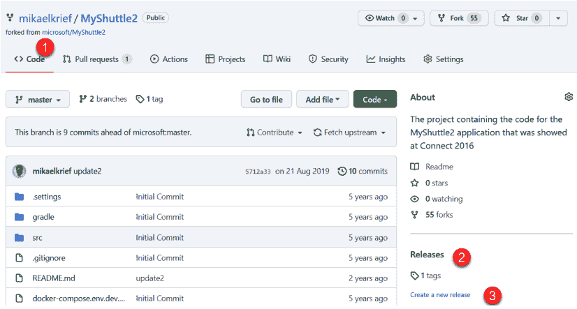

图 16.12 – GitHub – Releases 链接


3. 在接下来出现的页面中，单击 **Create a new release** 按钮以创建新的发布。将显示发布表单并填写发布信息，如下图所示：

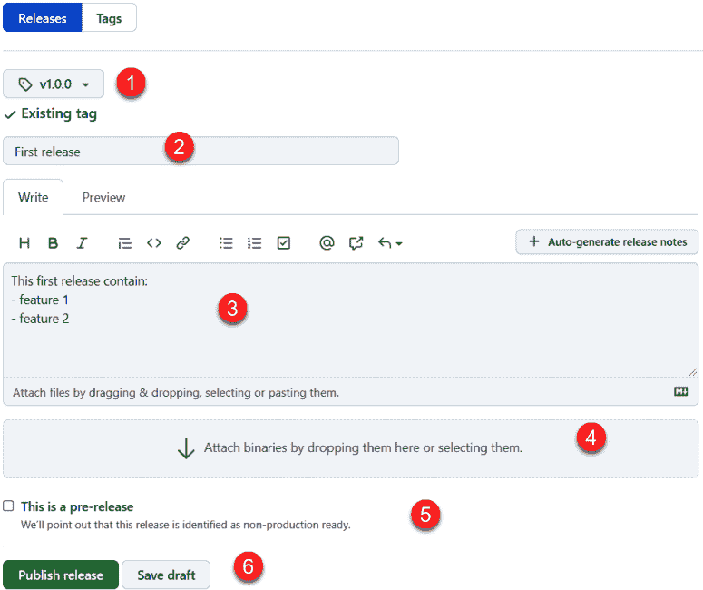

图 16.13 – GitHub – 创建发布

在此表单中，我们输入了以下信息：

- 与发布关联的标记。
- 发布的标题。
- 发布的描述，其中可能包含更改列表（发行说明）。
- 我们以 ZIP 文件格式上传与该发布对应的应用程序二进制文件。
- 我们还标记了关于是否为预发布的复选框。

然后，通过单击 **Publish release** 按钮验证新发布。

### 4. 最后，我们被重定向到刚刚创建的项目的发布列表，如下图所示：

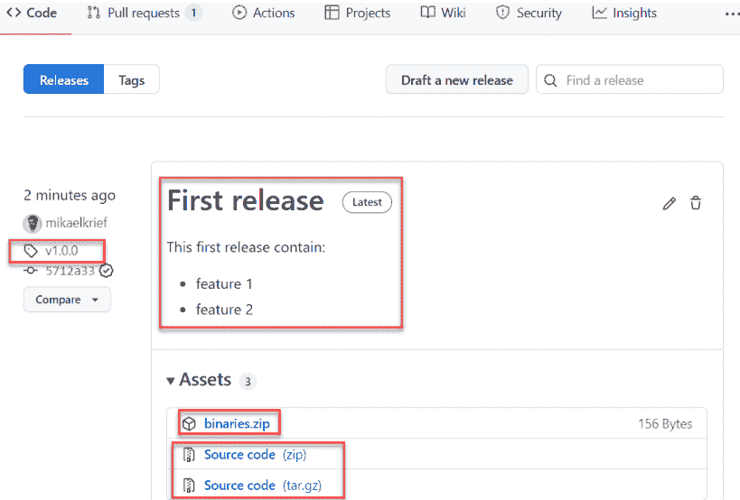

在上述截图中，我们可以观察到与发布关联的标记 (v1.0.0)、我们输入的信息以及我们上传的 `binaries.zip` 文件。此外，GitHub 已自动添加到发布的其他资产中；即，包含与此标记关联的应用程序源代码的包 (ZIP)。

我们刚刚看到，通过 GitHub Web 界面，我们可以创建 GitHub 发布，从而与所有用户共享项目的发行说明和二进制文件。

> **Note**
> 也可以使用各种 GitHub API 将所有这些步骤集成到 CI/CD 管道中，使用自动脚本。有关此内容的文档可在 `https://developer.github.com/v3/repos/releases/` 找到。

在下一节中，我们将在 GitHub 中使用 GitHub Actions 创建此相同的管道。

### 开始使用 GitHub Actions

GitHub 正在将多个其他 DevOps 功能集成到其存储库源代码平台中。这使其能够与存储库的代码完全集成。

在撰写本文时，这些新功能如下：

- GitHub Package registry，一个包管理器，其介绍文档可在 `https://github.com/features/package-registry` 找到

- GitHub Actions，一个 CI/CD 管道管理器，其介绍文档可在 `https://github.com/features/actions` 找到

在本节中，我们将概述 GitHub Actions 的使用，它允许您直接在 GitHub 中创建 CI/CD 管道。这将检查并部署托管在 GitHub 存储库中的源代码。

为此演示，我们将在 GitHub 中创建一个 CI 管道，用于编译并运行我们的 Node.js 应用程序的测试。相关资源可在 `https://github.com/PacktPublishing/Learning-DevOps-Second-Edition/tree/main/CHAP16/appdemo` 找到。

按照以下步骤使用 GitHub Actions 创建 CI 管道：

1. 转到包含要部署的源代码的存储库，并单击 **Actions** 选项卡，如下图所示：

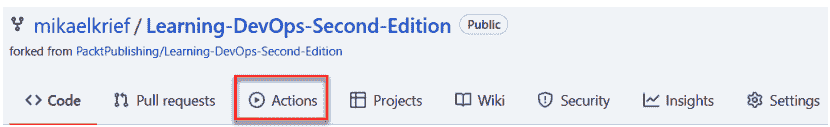

图 16.15 – GitHub – Actions 选项卡

2. 此时，GitHub 界面将根据不同的开发语言和目标系统（例如 VM 或 Kubernetes）推荐管道模板，称为 **workflows**。我们也可以从空模板开始创建自定义工作流。下图显示了创建工作流的选项：

### 开始使用 GitHub Actions

构建、测试和部署您的代码。按您想要的方式进行代码审查、分支管理和问题分类。选择一个工作流以开始。

跳过此步骤并自行设置工作流 →

搜索工作流

### 针对此存储库推荐

Docker 镜像
由 GitHub Actions 提供
构建 Docker 镜像以部署、运行或推送到注册表。
配置 Dockerfile

.NET
由 GitHub Actions 提供
构建和测试 .NET 或 ASP.NET Core 项目。
配置 C#

Jekyll
由 GitHub Actions 提供
使用 jekyll/builder Docker 图像打包 Jekyll 网站。
配置 HTML

图 16.16 – GitHub Actions 工作流模板

在上述截图中，我们可以看到名为 **set up a workflow yourself** 的链接，用于创建自定义工作流，以及用于搜索工作流模板和推荐模板的文本框。

3. 为此演示，让我们通过搜索 `node` 并在 Node.js 模板框中单击 **Configure**，从为 Node.js 应用程序设计的工作流模板创建一个工作流：

node 1

找到 7 个工作流

将 Node.js 部署到 Azure Web 应用
由 Microsoft Azure 提供
构建 Node.js 项目并将其部署到 Azure Web 应用。
配置部署

Grunt
由 GitHub Actions 提供
使用 npm 和 grunt 构建 NodeJS 项目。
配置 JavaScript

Gulp
由 GitHub Actions 提供
使用 npm 和 gulp 构建 NodeJS 项目。
配置 JavaScript

Webpack
由 GitHub Actions 提供
使用 npm 和 webpack 构建 NodeJS 项目。
配置 JavaScript

将 Node.js 包发布到 GitHub Packages
由 GitHub Actions 提供
将 Node.js 包发布到 GitHub Packages。
配置 JavaScript

发布 Node.js 包
由 GitHub Actions 提供
将 Node.js 包发布到 npm。
配置 JavaScript

Node.js
由 GitHub Actions 提供
使用 npm 构建和测试 Node.js 项目。
配置 JavaScript

图 16.17 – GitHub Actions – 选择 Node.js 模板

4. GitHub 将显示工作流的 YAML 代码，该代码将提交到 `node.js.yml` 文件中，该文件将自动创建在 `.github/workflows` 文件夹树中。在此 YAML 代码中（也可在 `https://github.com/PacktPublishing/Learning-DevOps-Second-Edition/blob/main/.github/workflows/node.js.yml` 找到），我们可以看到以下内容：

- `runs-on` 属性，用于指定由 GitHub 提供的管道的 Ubuntu 代理。

- 关于使用动作块 (`actions/checkout`) 的步骤列表，以便我们可以检索 GitHub 代码，随后是一个脚本块 (`npm`)，它将在 Ubuntu 代理上执行。

在存档此文件之前，向其中添加一小段代码，指示脚本的执行路径，如下图所示：

```
build:
runs-on: ubuntu-latest
strategy:
matrix:
node-version: [12.x, 14.x, 16.x]
### See supported Node.js release schedule at https://nodejs.org/en/about/releases/
steps:
- uses: actions/checkout@v2
- name: Use Node.js ${{ matrix.node-version }}
uses: actions/setup-node@v2
with:
node-version: ${{ matrix.node-version }}
- run: |
cd CHAP16/appdemo
npm ci
npm run build --if-present
npm test
```

图 16.18 – GitHub Actions 工作流源代码

此工作流的完整源代码可在 `https://github.com/PacktPublishing/Learning-DevOps-Second-Edition/blob/main/.github/workflows/node.js.yml` 找到。

5. 通过单击代码编辑器顶部的 **Start commit** 按钮提交此文件。提交后，该文件将出现在存储库代码中并将触发新的 CI 管道。

### 6. 最后，让我们返回到 **Actions** 选项卡。我们将看到已触发并完成了一个工作流：

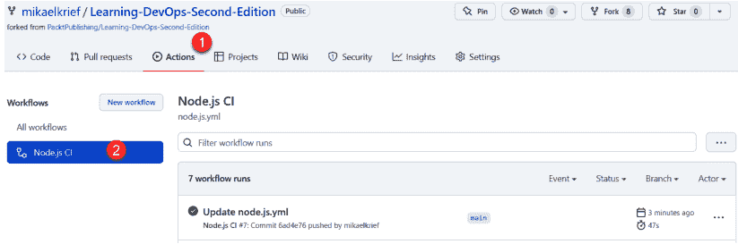

图 16.19 – GitHub Actions 工作流运行中

在此，我们可以看到此工作流的运行执行列表。单击运行行，我们可以查看执行详细信息。下图显示了执行详细信息：

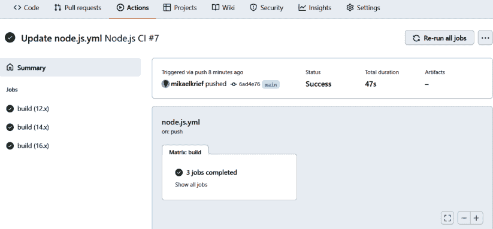

图 16.20 – GitHub Actions 工作流执行详细信息

GitHub Actions 的巨大优势在于它在其 GitHub Marketplace (https://github.com/marketplace?type=actions) 中原生提供非常丰富的动作目录，并且还可以开发和发布动作 (https://help.github.com/en/articles/development-tools-for-github-actions)。

在本节中，我们讨论了使用新的 GitHub Actions 功能在 GitHub 中实现 CI 管道，这使您能够为开源项目集成 DevOps。迄今为止，在本章中，我们专注于 GitHub 中的代码管理以及使用 GitHub Actions 为开源项目实现 CI/CD 管道。

在即将到来的章节中，我们将讨论开源代码安全性。我们将首先学习如何使用 SonarCloud 分析代码。

### 使用 SonarCloud 分析代码

在第 12 章“使用 SonarQube 进行静态代码分析”中，我们解释了实施静态代码分析实践的重要性。对于开源项目，代码分析更加重要，因为源代码及其二进制文件是公开发布的。

开源的一个角色是提供可用于企业应用程序的代码和组件，因此这些代码必须正确编写且没有任何安全问题。

此前在本书中，我们讨论了 SonarQube（及其安装和使用）是允许企业应用程序进行代码分析的主要工具之一。但是，它需要本地基础设施来安装，这对公司来说成本更高。

对于开源项目代码分析，可以使用 **SonarCloud** (`https://sonarcloud.io/`)，它与 SonarQube 是同一产品，但提供云解决方案，无需安装。

SonarCloud 有一个免费计划，允许我们分析托管在 GitHub、BitBucket 甚至 Azure Repos 上的开源公共存储库项目的代码。有关其定价计划的更多信息，请访问 `https://sonarcloud.io/pricing`。

让我们看看为托管在 GitHub 上的开源项目设置代码分析有多快。在实施分析本身之前，我们将在 SonarCloud 中连接到我们的 GitHub 存储库。为此，我们需要按照以下步骤访问 `https://sonarcloud.io/` 页面：

1. 从上述主页，单击 **Log in** 按钮：


图 16.21 – SonarCloud – 登录


2. 然后，选择使用 GitHub 账号登录，如下图所示：

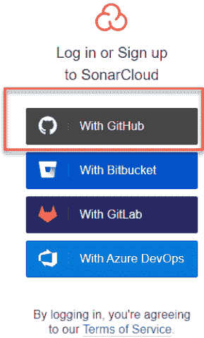

图 16.22 – SonarCloud – 使用 GitHub 登录

现在，我们必须配置 SonarCloud，以便创建一个将包含我们 GitHub 项目分析结果的项目，该项目位于 `https://github.com/PacktPublishing/Learning-DevOps-Second-Edition/tree/main/CHAP16/appdemo`。为此，请执行以下步骤：

1. 使用 GitHub 账号连接到 SonarCloud 后，在主页上单击 **Analyze new project** 按钮：

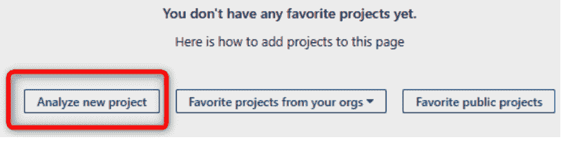

图 16.23 – SonarCloud – 分析新项目

### 2. SonarCloud 提供几个步骤来选择要分析的目标 GitHub 仓库。首先，选择 **Import an organization from GitHub**。然后，选择 **Only select repositories** 选项并选择目标仓库：

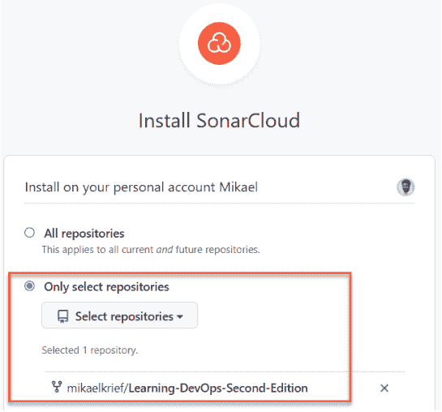

图 16.24 – SonarCloud – 选择仓库

### 3. 接下来，标记仓库的复选框，并通过单击 **Set Up** 按钮将其与您的组织关联：

#### 分析项目 - 选择仓库

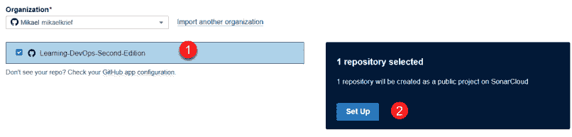

图 16.25 – SonarCloud – 设置仓库

### 4. 将显示项目分析仪表板，并指示代码尚未分析。

至此，我们已成功配置 SonarCloud 项目。现在，让我们通过执行以下步骤以最基本的方式分析项目：

1. 在 SonarCloud 项目中，在 **Configure** 下，选择推荐的选项，即 **With GitHub Actions**（如我们在上一节 _Getting started with GitHub Actions_ 中所学）：

图 16.26 – SonarCloud – 使用 GitHub Actions 模板

2. 然后，按照 SonarCloud 提供的指示，在 GitHub 仓库中创建 GitHub 密钥（带有 `SONAR_TOKEN` 密钥）并添加一个包含一些 Sonar 配置的新文件：

图 16.27 – SonarCloud GitHub Actions 说明

3. 然后，提交这个新的 GitHub Actions 工作流文件。这将自动触发该项目的 SonarCloud 分析。

4. 几分钟后，您将看到两次执行的结果。首先，您将看到 GitHub Actions 工作流已成功：

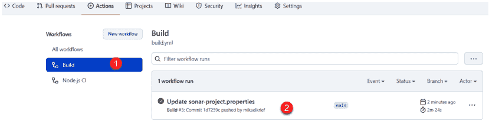

图 16.28 - GitHub Actions Sonar 分析

然后，您将在 SonarCloud 仪表板中看到分析结果，如下图所示：

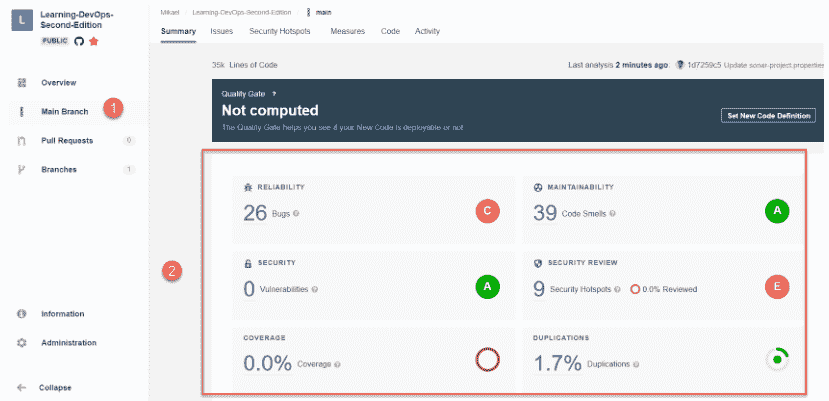

图 16.29 - SonarCloud 分析结果

因此，每当对该仓库进行新的代码提交时，无论是直接提交还是通过合并拉取请求，都将触发代码分析，并且 SonarCloud 仪表板将被更新。

很明显，我们的最终目标是将 SonarCloud 分析集成到 CI/CD 管道中，因此这里有一些资源可以帮助我们集成它：

- 如果您使用 Azure DevOps，这里有一个完整的教程，可以帮助您将 SonarCloud 集成到管道中：`https://docs.microsoft.com/en-us/labs/devops/sonarcloudlab/`。

- 如果您使用 Travis CI（我们在本章中介绍过），请查看以下文档：https://docs.travis-ci.com/user/sonarcloud/。

在本节中，我们学习了如何配置 SonarCloud，这是一个分析静态代码的云平台。我们这样做是为了通过持续集成过程分析 GitHub 上开源项目的源代码。然后，我们查看了仪表板上的分析结果。

在下一节中，我们将探讨开源代码安全的另一个方面，即使用 WhiteSource Bolt 分析代码漏洞。

### 使用 WhiteSource Bolt 检测安全漏洞

由于公开可见性，开源项目或组件高度暴露于安全漏洞，因为更容易无意中将包含安全漏洞的组件（包或其依赖项之一）注入其中。

除了静态源代码分析之外，持续检查开源项目中引用或使用的包的安全性也非常重要。

有许多可用的工具，我们可以用来分析应用程序中引用的包的安全性，例如 SonaType AppScan (https://www.sonatype.com/appscan)、Snyk (https://snyk.io/) 和 WhiteSource Bolt (https://bolt.whitesourcesoftware.com/)。

> Note
> 有关开源漏洞扫描工具的更多信息，请查看以下文章，该文章列出了 13 个分析开源依赖项安全性的工具：https://techbeacon.com/app-dev-testing/13-tools-checking-security-risk-open-source-dependencies。

在所有这些工具中，我们将研究 **WhiteSource Bolt** (https://bolt.whitesourcesoftware.com/)，它提供免费计划，可以分析多种开发语言的包代码，并允许您直接与 GitHub 和 Azure DevOps 集成。

### Note

关于在 GitHub 中集成 White Source Bolt 的完整文档可在 https://whitesource.atlassian.net/wiki/spaces/WD/pages/556007950/WhiteSource+Bolt+for+GitHub 上查阅。

在我们的案例中，我们将直接在 GitHub 上使用它来分析一个应用程序的安全性，其源代码可在此处查看：https://github.com/PacktPublishing/Learning-DevOps-Second-Edition/tree/main/CHAP16/appdemo。

要执行此安全分析，我们必须在 GitHub 账号上安装和配置 WhiteSource Bolt 并触发代码分析。按照以下步骤了解如何操作：

1. 在 Web 浏览器中，访问 https://bolt.whitesourcesoftware.com/github/ 并单击 **GitHub APP** 按钮，在 GitHub 账号上安装 WhiteSource Bolt。

2. 您将被重定向到 WhiteSource Bolt 应用程序，该应用程序可在 GitHub Marketplace (https://github.com/marketplace/whitesource-bolt) 上找到。要使用免费计划安装它，请单击页面底部的 **Install it for free** 按钮，如下图所示：

### 定价和设置

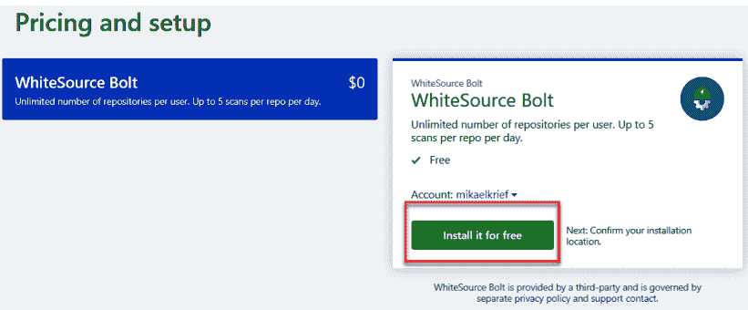

图 16.30 – 安装 WhiteSource Bolt

3. 单击 **Complete order and begin installation** 按钮确认您以 $0 购买该应用程序。然后，在下一页上，确认 WhiteSource Bolt 已安装在您的 GitHub 账号上。

安装完成后，您将被重定向到 WhiteSource Bolt 账号创建页面，您必须填写全名和国家/地区，然后验证表单。

4. 现在，通过转到包含要扫描代码的仓库的 **Settings** 选项卡并勾选 **Issues** 复选框，在 GitHub 中激活 **Issues** 功能，如下图所示：

### 功能

图 16.31 – GitHub – 激活问题

5. 要在该仓库上配置 WhiteSource 分析，您必须验证并合并安装 WhiteSource Bolt 时自动创建的新拉取请求。

图 16.32 – WhiteSource Bolt 问题配置

此拉取请求添加了一个 `.whitesource` 文件，该文件用于仓库根目录下的配置。

6. 最后，通过在 GitHub 仓库中提交此应用程序的代码来执行代码分析。

7. 几分钟后，您将在仓库的 **Issues** 选项卡中看到一系列安全问题。

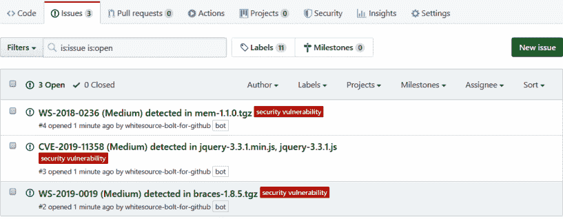

8. 要了解安全问题的完整详细信息，只需单击所需的问题，阅读它，并考虑问题描述中提供的信息。

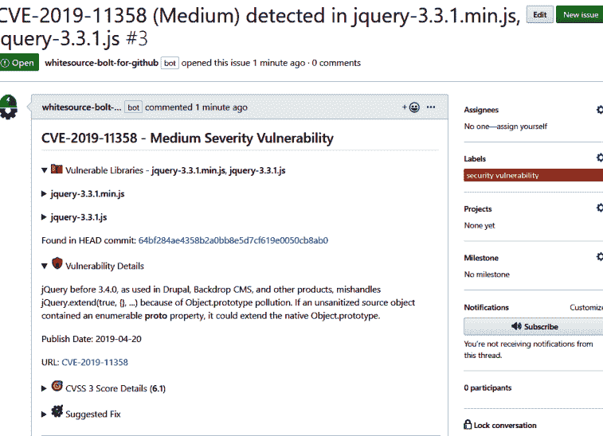

我们将不得不修复所有这些问题，并重新提交代码以触发新的 WhiteSource Bolt 扫描，确保我们为将要使用该应用程序的人提供一个安全的应用程序。

在本节中，我们学习了如何使用 WhiteSource Bolt 分析开源项目的代码。我们安装了它并触发了代码分析，该分析揭示了我们演示应用程序中的安全问题。

### 摘要

本章专门介绍可以应用于开源项目（尤其是 GitHub 上的项目）的 DevOps 最佳实践。在本章中，我们学习了如何协作开源代码，从使用 GitHub 创建仓库和分叉开始。然后，我们学习了如何使用拉取请求以及如何在 GitHub Releases 中共享二进制文件。

之后，我们使用与 GitHub 完全集成的 GitHub Actions 实现了持续集成流程。

最后，我们学习了如何使用 SonarCloud 分析开源代码的静态代码，以及使用 WhiteSource Bolt 分析安全漏洞。

在下一章中，我们将总结本书中讨论的每个 DevOps 最佳实践。

### 问题

1. 在 GitHub 中，我可以修改另一个用户仓库的代码吗？

2. 在 GitHub 中，哪个元素允许我们在两个仓库之间合并代码更改？

3. 哪个元素允许我们简单地显示开源项目中代码更改的历史记录？

4. 在 GitHub 中，本章提到的哪个功能允许我们共享二进制文件？

5. 本章中我们研究的哪两个工具允许我们分析开源项目的源代码？

6. WhiteSource Bolt 检测到的安全问题在哪个 GitHub 选项卡中列出？


### Further reading

如果你想了解更多关于在开源项目中使用 DevOps 实践的内容，请参阅 _GitHub Essentials_，作者 Achilleas Pipinellis，由 _Packt Publishing_ 出版：https://www.packtpub.com/in/web-development/github-essentials-second-edition。
