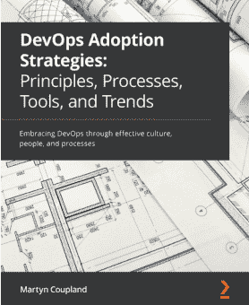

### 其他您可能喜欢的图书

如果您喜欢这本书，可能会对 Packt 出版的其他图书感兴趣：

#### DevOps Adoption Strategies: Principles, Processes, Tools, and Trends

Martyn Coupland

ISBN: 9781801076326

- 了解文化在 DevOps 中的重要性
- 构建、培养并发展成功的 DevOps 文化
- 了解如何实施成功的 DevOps 框架
- 衡量并定义 DevOps 转型的成功
- 掌握持续反馈和迭代流程变更的技术
- 了解 DevOps 生命周期不同阶段使用的工具

#### Modern DevOps Practices

Gaurav Agarwal

ISBN: 9781800562387

- 精通 AWS ECS、Google Cloud Run 和 Knative
- 了解如何高效构建和管理安全的 Docker 镜像
- 了解在 Kubernetes 和 GitHub Actions 上使用 Jenkins 进行持续集成
- 掌握使用 Spinnaker 进行持续部署/交付
- 使用 Packer、Terraform 和 Ansible 在云上管理不可变基础架构
- 使用 GitHub Actions、Terraform 和 Flux CD 探索 GitOps 的世界

#### Packt is searching for authors like you

如果您有兴趣成为 Packt 的作者，请立即访问 `authors.packtpub.com` 并提交申请。我们已与成千上万像您一样的开发人员和技术专业人士合作，帮助他们将见解分享给全球技术社区。您可以提交通用申请，申请我们正在招募作者的特定热门主题，或提交您自己的想法。

#### Share Your Thoughts

现在您已经读完了《Learning DevOps - Second Edition》，我们很乐意听听您的想法！如果您从 Amazon 购买了本书，请点击此处直接前往本书的 Amazon 评论页面，分享您的反馈，或在您购买本书的网站上留下评论。

您的评论对我们和技术社区非常重要，将帮助我们确保提供优质内容。

