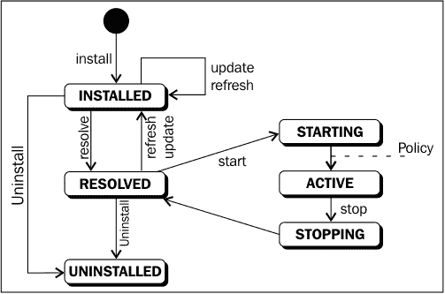

## Apache Karaf – Provisioning
and Clusters

**Open Software Gateway initiative (OSGi)** 长期以来一直被“隐藏”，仅保留给中间件，如 IDE 或应用服务器。然而，OSGi 可应用于许多不同的上下文和应用。OSGi 应用需要一个运行环境。Apache Karaf 是一个轻量级、功能强大且面向企业的 OSGi 容器，您可以在其中部署应用程序。在生产系统上，特别是关键任务平台，有意义的是能够管理一组 Apache Karaf 容器，并将应用程序的部署（或配置）分发到这些不同的实例。

在本章中，我们将涵盖以下主题：

- 什么是 OSGi 及其关键特性？
- OSGi 框架的作用
- OSGi 基础构件 – OSGi bundle 以及 bundle 之间依赖关系的概念
- Apache Karaf OSGi 容器以及在容器中配置应用程序
- 如何在多个 Karaf 实例上管理配置？

### The OSGi bundle

在 OSGi 中，组件被打包为 OSGi bundle。OSGi bundle 是一个简单的 Java JAR（Java ARchive）文件，其中包含 OSGi 框架使用的额外元数据。这些元数据存储在 JAR 文件的清单文件中。

以下是元数据：

```
Manifest-Version: 1.0
Bundle-ManifestVersion: 2
Bundle-Version: 2.1.6
Bundle-Name: My Logger
Bundle-SymbolicName: my_logger
Export-Package: org.my.osgi.logger;version=2.1
Import-Package: org.apache.log4j;version="[1.2,2)"
Private-Package: org.my.osgi.logger.internal
```

我们可以看到 OSGi 非常描述性且冗长。我们明确描述所有 OSGi 元数据（头），包括我们以指定版本或版本范围导出的或导入的包。

由于 OSGi 头定义在 JAR 文件中包含的 META-INF/MANIFEST 文件中，这意味着 OSGi bundle 是一个常规 JAR 文件，您可以在 OSGi 之外使用它。

OSGi 框架的生命周期层是安装、启动、停止、更新和卸载 OSGi bundle 的 API。

### Dependency between bundles

OSGi bundle 可以以两种方式使用 OSGi 框架中的其他 bundle。

第一种方式是静态代码共享。当我们说这个 bundle 导出包时，意味着一个 bundle 可以向其他 bundle 暴露一些代码。另一方面，当我们说这个 bundle 导入包时，意味着一个 bundle 可以使用其他 bundle 的代码。

例如，我们有 bundle A（打包为 bundleA.jar 文件），其 META-INF/MANIFEST 文件如下：

```
Manifest-Version: 1.0
Bundle-ManifestVersion: 2
Bundle-Version: 1.0.0
Bundle-Name: Bundle A
Bundle-SymbolicName: bundle_a
Export-Package: com.bundle.a;version=1.0
```

我们可以看到 bundle A 暴露（导出）com.bundle.a 包，版本为 1.0。另一方面，我们有 bundle B（打包为 bundleB.jar 文件），其 META-INF/MANIFEST 文件如下：

```
Manifest-Version: 1.0
Bundle-ManifestVersion: 2
Bundle-Version: 2.0.0
Bundle-Name: Bundle B
Bundle-SymbolicName: bundle_b
Import-Package: com.bundle.a;version="[1.0,2)"
```

我们可以看到 bundle B 导入（因此将使用）com.bundle.a 包，版本在 1.0 到 2（不包括）之间。因此，这意味着 OSGi 框架将连接这些 bundle，因为 bundle A 提供了 bundle B 使用的包（因此约束得到解决）。

这种机制类似于常规 Java 应用程序，但不是将所需的 JAR 文件嵌入到您的应用程序中，您只需声明预期的代码即可。OSGi 框架负责不同 bundle 之间的链接；这是由 OSGi 框架的模块层完成的。这种方法在您想要使用未为 OSGi 原生设计的代码时很有趣。这是组件重用的进步。然而，它对本章前面看到的目的，尤其是可见性和发现性，提供了一个有限的答案。

OSGi bundle 可以使用 OSGi 框架中的其他 bundle 的第二种方式更有趣。它使用面向服务的架构（SOA）用于低级组件。这里，除了暴露代码之外，OSGi bundle 还暴露 OSGi 服务。另一方面，另一个 bundle 可以使用 OSGi 服务。OSGi 框架的服务层提供服务注册表和所有用于连接服务的管道机制。

OSGi 服务提供了一个非常动态的系统，为 bundle 提供发布-查找-绑定模型。


### Downloading the example code

您可以从 http://www.packtpub.com 在您的账户中下载您购买的所有 Packt 书籍的示例代码文件。如果您在其他地方购买了本书，您可以访问 http://www.packtpub.com/support 并注册以直接将文件发送到您的电子邮件。

- Apache Karaf 是一个面向企业的容器，并提供面向企业的特性。以下企业特性默认未安装（为最小化容器的默认大小和占用空间），但一个简单的命令允许您使用企业功能扩展容器：
  - WebContainer 允许您部署 **Web Application Bundle (WAB)** 或 WAR 文件。得益于 Pax Web，Apache Karaf 是一个完整的 HTTP 服务器，支持 JSP/servlet。
  - **Java Naming and Directory Interface (JNDI)** 在 Apache Karaf 中添加命名上下文支持。您可以将 OSGi 服务绑定到 JNDI 名称并使用该名称查找这些服务，得益于 Aries 和 Xbean naming。
  - **Java Transaction API (JTA)** 允许您在 Apache Karaf 中添加事务引擎（作为 OSGi 服务公开），得益于 Aries JTA。
  - **Java Persistence API (JPA)** 允许您在 Apache Karaf 中添加持久性适配器（作为 OSGi 服务公开），得益于 Aries JPA。现成的持久性引擎也可以非常轻松地安装（尤其是 Apache OpenJPA 和 Hibernate）。
  - **Java Database Connectivity (JDBC)** 或 **Java Message Service (JMS)** 是方便的特性，允许您轻松创建 JDBC DataSources 或 JMS ConnectionFactories 并直接在 shell 控制台中使用它们。
- 如果您可以使用 shell 命令和 JMX MBeans 完全管理 Apache Karaf，您还可以安装 Web Console。此 Web Console 使用 Felix Web Console，允许您使用简单浏览器管理 Karaf。

得益于这些特性，Apache Karaf 是一个完整、丰富且面向企业的容器。我们可以将 Apache Karaf 视为一个 OSGi 应用服务器。

### Provisioning in Apache Karaf

此外，Apache Karaf 提供了三种核心功能，可在 Apache Karaf 内部使用，也可被部署在容器中的外部应用程序使用：

- OSGi bundle 管理
- 配置管理
- 使用 Karaf Features 的配置

正如我们之前学到的，OSGi 中的默认构件是 bundle。再次强调，它是一个常规 JAR 文件，其中 MANIFEST 文件包含额外的 OSGi 元数据。bundle 由 OSGi 框架直接管理，但为了方便，Apache Karaf 将 bundle 的使用封装在特定的命令和 MBeans 中。

bundle 有特定的生命周期。特别是在您安装 bundle 时，OSGi 框架会尝试解析 bundle 所需的所有依赖项，以将其提升为已解析状态。以下是 bundle 的生命周期：



OSGi 框架检查是否有其他 bundle 提供您的 bundle 导入的包。对于 OSGi 服务，等效操作在您启动 bundle 时执行。这意味着一个 bundle 可能需要大量其他 bundle 才能启动，以此类推对于传递性 bundle。

此外，一个 bundle 可能需要配置才能工作。Apache Karaf 提出了一种非常方便的方式来管理配置。etc 文件夹会定期监控以发现新的配置文件并加载相应的配置。另一方面，您有专用的 shell 命令和 MBeans 来管理配置（和配置文件）。如果一个 bundle 需要配置才能工作，您首先必须在 etc 文件夹中创建配置文件（使用预期的文件名）或使用 `config:*` shell 命令或 ConfigMBean 来创建配置。

考虑到 OSGi 应用程序是一组 bundle，手动安装 OSGi 应用程序可能很长且痛苦。


OSGi 应用的部署称为 provision，因为它包含以下内容：

- 一组 bundle 的安装，包括传递性 bundle
- 这些 bundle 所需的一组配置的安装

## OBR

OSGi Bundle Repository（OBR）可以是解决此问题的首选方案。Apache Karaf 可以连接到 OBR 服务器。OBR 服务器存储所有 bundle 的元数据，其中包括 bundle 提供的 capabilities、packages 和 services，以及 bundle 所需的 requirements、packages 和 services。当你通过 OBR 安装一个 bundle 时，OBR 服务器会检查已安装 bundle 的需求并找到提供与需求匹配的 capabilities 的 bundle。OBR 服务器可以自动安装第一个 bundle 所需的 bundle。

## Apache Karaf Features

作为一个轻量级且独立的 OSGi 容器，Apache Karaf 提出了另一种 provision 应用的方式。Apache Karaf Features 是 Apache Karaf 中的默认 provision 解决方案。

Karaf Features 描述了一个应用，声明以下方面：

- 应用中的 bundle
- 应用所需的其他 Karaf features
- 应用所需的配置

一个 Karaf Feature 仓库是一个简单的 XML 文件，描述了一组 Karaf features。
一个 Karaf Feature 仓库如下所示：

```
<features name="my-features">

    <feature name="core-feature" version="1.0">
        <bundle>mvn:bundleA_groupId/bundleA_artifactId/bundleA_version</bundle>
        <bundle>file://path/to/bundleB</bundle>
        <bundle>http://path/to/bundleC</bundle>
    </feature>

    <feature name="extend-feature" version="1.0">
        <feature version="[1,2)">core-feature</feature>
```

为了启用文件系统锁定系统，你必须按如下方式更新 etc/system.properties 配置文件：

```
karaf.lock=true
karaf.lock.class=org.apache.karaf.main.SimpleFileLock
karaf.lock.dir=/path/to/lockfile
karaf.lock.delay=10
```

当共享文件系统不可用时（例如出于安全或基础设施原因），你可以使用数据库来存储锁。使用数据库锁定，Apache Karaf 会对表进行锁定（默认情况下为 KARAF_LOCK 表）。任何支持 JDBC 的数据库都可以使用。

配置也定义在 etc/system.properties 配置文件中，如下所示：

```
karaf.lock=true
karaf.lock.class=org.apache.karaf.main.DefaultJDBCLock
karaf.lock.level=50
karaf.lock.delay=10
karaf.lock.jdbc.url=jdbc:derby://dbserver:1527/sample
karaf.lock.jdbc.driver=org.apache.derby.jdbc.ClientDriver
karaf.lock.jdbc.user=user
karaf.lock.jdbc.password=password
karaf.lock.jdbc.table=KARAF_LOCK
karaf.lock.jdbc.clustername=karaf
karaf.lock.jdbc.timeout=30
```

你必须将 JDBC 驱动 JAR 文件复制到 lib/ext 文件夹中。Apache Karaf 为某些特定数据库提供了专用的 JDBC 锁实现（DefaultJDBCLock 是通用的，OracleJDBCLock 用于 Oracle 数据库，DerbyJDBCLock 用于 Derby 数据库，MySQLJDBCLock 用于 MySQL 数据库，PostgreSQLJDBCLock 用于 PostgreSQL 数据库，以及 SQLServerJDBCLock 用于 Microsoft SQLServer 数据库）。

Apache Karaf 锁定机制为高可用性提供了一个良好的解决方案。然而，只有 一个 Apache Karaf 实例处于活动状态（主节点）；所有其他实例都处于非活动状态（备用/主节点）。

为了同时提供高可用性和性能可扩展性，拥有多个活动 Apache Karaf 实例是一个很大的优势。

## Provisioning clusters

想象一下，你有一个 Apache Karaf 容器的集群，每个容器都在不同的机器上。如果你想在容器实例上 provision 一个 OSGi 应用，你必须连接到每个容器并安装 features。

这意味着你必须执行以下任务：

- 登录到每个容器以反复执行相同的操作
- 最终，根据每个本地实例调整配置（端口号、文件路径等）
- 添加新实例，这将再次需要相同的操作

基本上，这意味着大量的人工操作，存在出错的风险。这就是 provision 集群发挥作用的地方。

provision 集群的目的是保持多个容器实例同步。对于 Apache Karaf 来说，这意味着资源状态的更改将被广播到同一集群中的所有容器成员。

资源可以是 bundle、feature、配置或节点本地的任何类型资源。这意味着本地操作会发送事件以更新集群中的其他成员。

另一方面，也可以创建一个集群事件发送给所有成员以更新它们。

基本上，这意味着 provision 集群执行以下任务：

- **创建事件**：此事件可以由于本地更改或手动创建
- **广播事件**：此事件发送给集群的成员

如果 provision 是 provision 集群的首要目的，这并不意味着它不能提供在集群拓扑中有用的额外功能。例如，集中式日志、负载均衡器、会话复制等都是可以在 provision 集群之上提供的有趣功能。在下一章中，我们将看到 Karaf Cellar 作为 provision 集群解决方案。

## Summary

在本章中，我们回顾了 OSGi 的目标以及一些核心组件（bundle、manifest 等）。我们还简要介绍了 Apache Karaf OSGi 容器，描述了提供的不同功能。最后，我们讨论了将多个 Apache Karaf 实例一起使用的方法：主动/被动方式（故障转移）或主动/主动方式（provisioning cluster）。

下一章将介绍 Apache Karaf Cellar provisioning cluster。
