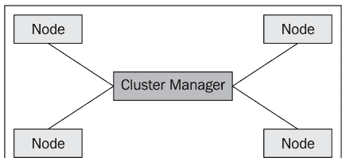
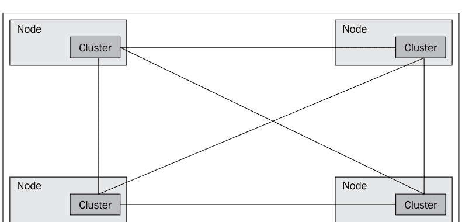
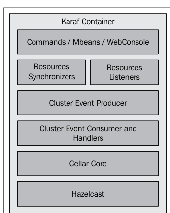
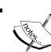
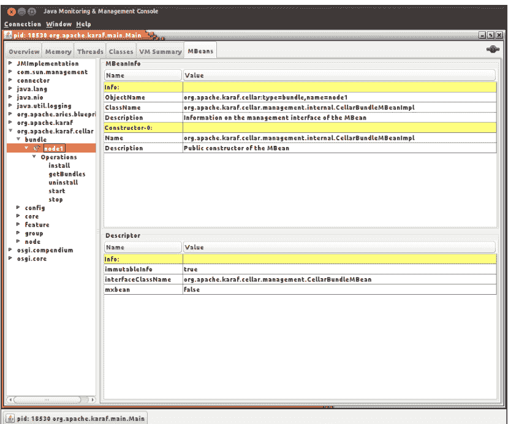
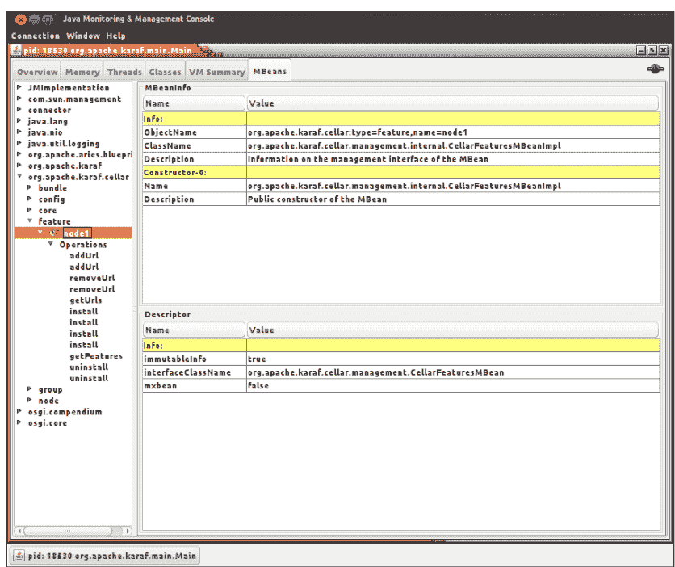
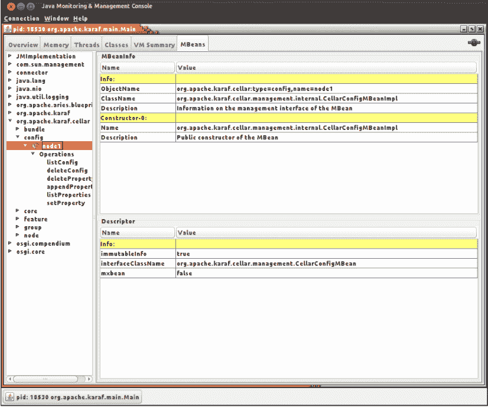
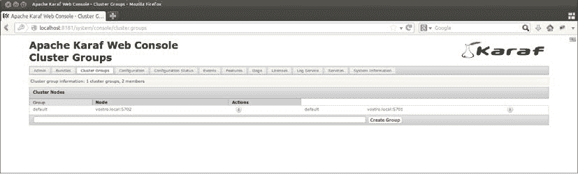

# 2 Apache Karaf Cellar
## Apache Karaf Cellar

Apache Karaf Cellar 是 Apache Karaf 的 provisioning cluster 解决方案。

它是一个在 Apache 2 许可证下发布的 Apache Karaf 子项目。欲了解更多信息，请访问 http://karaf.apache.org/index/subprojects/cellar.html。

Apache Karaf Cellar 允许你管理分布在不同机器和网络上的 Apache Karaf 实例集群。

作为一个 provisioning cluster 解决方案，Apache Karaf Cellar 同步不同实例的状态。通过同步，我们的意思是节点上的资源操作将导致通知其他节点进行更改。

本章将涵盖以下主题：

- 集群拓扑
- Apache Karaf Cellar 架构
- Apache Karaf Cellar 安装
- 集群资源

## Cluster topologies

当我们谈论 provisioning clusters 时，这意味着我们必须在不同实例之间存储和共享资源的状态。

我们将节点命名为 provisioning cluster 的实例成员。

我们可以看到两种共享资源状态的方法。

第一种方法是使用中央组件来存储状态。该中央组件名为 `cluster manager`。它负责存储节点之间共享的数据以及节点之间的通信。请看下图：



所有节点都连接到存储资源状态的中央组件。例如，该组件可以是 Apache ZooKeeper。

这种方法的优点是 provisioning cluster 对节点没有影响；节点只需与中央组件通信。

cluster manager 不仅仅是一个简单的共享存储，因为它必须处理节点之间的通信和信息传输。

这种方法的缺点是 cluster manager 是一个单点故障。

为了保证可靠的集群和高可用性，cluster manager 本身应该是集群化的：我们必须提供并安装一个 cluster manager 集群。

这意味着你有两个层级的集群，如下所示：

- 节点之间的实际集群
- **Cluster Manager** 集群，仅用于保证高可用性


在 Apache Karaf Cellar 中，采用了不同的方法。下面的图表将简要介绍这种方法：



每个节点都嵌入了自己的集群组件，该组件与其它节点进行通信。

集群组件的目的如下：

- 它是集群中资源状态的本地表示。资源的状态在每个集群组件上进行复制和分发。
- 它管理节点的发现和可见性，并将信息从一个节点传输到其它节点。它是一个**集群事件**模型。

这意味着更改资源的状态会触发两个操作，分别是：

- `distributed` 状态被更新。这意味着每个节点上的集群组件都会被更新。
- 该节点的集群组件向其它节点发送一个事件，通知它们某个资源已更改，需要更新其本地状态。

得益于这种方法，Apache Karaf Cellar 提供了以下功能：

- 它是一个非常可靠的解决方案。我们只需要一个节点处于活动状态即可拥有一个有效的集群。集群本身具有容错能力。
- 集群上具有分布式状态，并配有集群事件同步机制。

## Apache Karaf Cellar 架构

Apache Karaf Cellar 提供了实现集群组件的 API。默认的集群组件实现由 Hazelcast 提供支持。

Hazelcast 是一个集群化和可扩展的数据分发解决方案。它提供了完全符合集群组件需求的功能，尤其是以下功能：

- 分布式存储实现。这是 Apache Karaf Cellar 存储资源状态的地方。
- 分布式主题用于发布/订阅消息传递。Apache Karaf Cellar 将使用此分布式主题来实现集群事件。

这就是我们在集群组件中寻找的两个功能。

然而，Hazelcast 还提供了额外的功能。得益于 Hazelcast，Apache Karaf Cellar 支持多种发现集群节点的方式：静态 IP 地址定义、多播和白板注册。下面的图表显示了 Karaf 提供的模块：



首先要做的是在目标成为集群成员的各个 Karaf 容器中安装 Cellar（节点）。

由于 Apache Karaf Cellar 以 Karaf Feature 的形式打包，我们必须安装 Cellar 功能。这意味着 Cellar 是一组 bundle 和配置文件。

安装 Apache Karaf Cellar 功能提供了以下模块：

- **Hazelcast**：Apache Karaf Cellar 直接利用 Hazelcast，并仅封装了一些功能（例如节点发现）。
- **Cellar core**：默认情况下，Cellar 使用 Hazelcast。但是，可以更改实现（例如，可以用 Apache ZooKeeper、Apache ActiveMQ 或自定义实现替换 Hazelcast）。Cellar Core 模块提供了其它模块使用的 API。Cellar Core 将 API 使用委托给实际实现。最重要的是，API 提供了操作集群上资源状态存储的操作。
- **Cluster event producer**：该模块是消息传递层的一部分。生产者负责创建集群事件并将此事件广播给其它节点。生产者实际上创建一条消息（集群事件）并将其发送到 Hazelcast 分布式主题。
- **Cluster event consumer and handlers**：另一方面，集群事件由集群事件消费者接收。集群事件消费者实际上是 Hazelcast 分布式主题上的订阅者。得益于集群事件生产者和消费者，我们拥有一个非常动态的系统：当新节点加入集群时，其集群事件消费者会订阅主题。我们拥有即插即用的解决方案。然而，集群事件消费者本身并不处理集群事件。它将事件处理委托给集群事件处理器。我们为每种资源类型提供一个集群事件处理器。得益于这种方法，可以轻松添加集群中管理的新的资源。集群事件生产者和消费者是通用的；集群事件处理器专门用于资源管理。
- **Resources synchronizers**：该模块负责将节点本地的资源与该资源在集群上的状态进行同步。同步器在安装 Apache Karaf Cellar 时以及节点加入集群时被调用。
- **Resources listeners**：该模块监听本地资源更改，创建集群事件，并将其发送到集群中的其它节点。
- **Commands, MBeans, WebConsole plugin**：这些模块与集群交互，检查节点状态，检查资源状态，等等。Apache Karaf Cellar 提供了一组 shell 命令和 MBean 上的操作。可选功能还提供了一个 WebConsole 插件，可将集群视图扩展到 Apache Karaf WebConsole。

## Apache Karaf Cellar 安装和首次命令

Apache Karaf Cellar 以 Karaf feature 的形式提供。

在本书中，我们将使用以下安装：

- 节点 1 是一台运行 192.168.1.1 网络地址的服务器。它托管一个运行在 /opt/apache-karaf 文件夹中的 Apache Karaf 2.3.3 实例。
- 节点 2 是另一台运行 192.168.1.2 网络地址的服务器。它托管一个运行在 /opt/apache-karaf 文件夹中的 Apache Karaf 2.3.3 实例。
- 两台服务器均可访问互联网。

我们通过 SSH 或客户端连接到节点 1 上的 Apache Karaf 实例，以安装 Apache Karaf Cellar 功能，如下所示：

```
karaf@node1> features:addurl mvn:org.apache.karaf.cellar/apache-karaf-cellar/2.3.1/xml/features
karaf@node1> features:install cellar
```

完成！Apache Karaf Cellar 已在 node1 上安装并运行。

我们现在可以在节点 2 上安装 Apache Karaf Cellar。我们连接到节点 2（使用 SSH 或客户端）并安装 Apache Karaf Cellar 功能，如下所示：

```
karaf@node2> features:addurl mvn:org.apache.karaf.cellar/apache-karaf-cellar/2.3.1/xml/features
karaf@node2> features:install cellar
```

我们现在拥有了专用于集群的新 shell 命令。例如，可以使用 cluster:node-list 命令查看集群中的节点，如下所示：

```
karaf@node1> cluster:node-list
  ID                 Host Name       Port
  [192.168.1.2:5702 ] [192.168.1.2] [ 5702]
* [192.168.1.1:5701 ] [192.168.1.1] [ 5701]
```

我们现在可以看到我们的两台服务器。* 表示本地节点（我们连接并将从此处执行命令的地方）。

[6  ] [Active] Apache Karaf :: Management :: MBeans :: System (2.3.3)

[7  ] [Active] Apache Aries Blueprint Core (1.1.0)

[8  ] [Active] Apache Karaf :: Shell :: Development Commands (2.3.3)

[9  ] [Active] Apache Karaf :: Features :: Command (2.3.3)

[10 ] [Active] Apache Karaf :: Diagnostic :: Common (2.3.3)

[11 ] [Active] Apache Karaf :: Admin :: Management (2.3.3)

默认参数是 Cellar 集群组。Cellar 使用名为 default 的默认集群组。我们将在本书的另一章中看到有关集群组的更多详细信息。

我们可以使用 cluster:bundle-install 命令在集群上安装 bundle。

例如，我们从节点 1 在集群上安装 commons-lang bundle 如下：

```
karaf@node1> cluster:bundle-install default mvn:commons-lang/
commons-lang/2.6
```

此命令创建并向所有节点（包括本地节点）发送集群事件以安装 commons-lang bundle。现在，如果我们使用以下代码检查集群上 commons-lang bundle 的状态，我们可以看到它已安装：

```
karaf@node1> cluster:bundle-list -l default|grep -i commons-lang
[60  ] [Installed ] mvn:commons-lang/commons-lang/2.6
```



> -l 选项显示 bundle 的位置而不是其名称。

我们可以在节点 1 和节点 2 上检查 commons-lang bundle 是否已本地安装到每个节点，如下所示：

```
karaf@node1> la -l|grep -i commons-lang
[ 63] [Installed ] [      ] [  80] mvn:commons-lang/
commons-lang/2.6
```

```
karaf@node2> la -l|grep -i commons-lang
[ 63] [Installed ] [      ] [  80] mvn:commons-lang/
commons-lang/2.6
```


我们的两个节点已同步。commons-lang 捆绑包已安装到两个节点上。

现在，我们将启动 commons-lang 捆绑包。不过这次我们不使用 `cluster:bundle-start` 命令，而是在节点 1 上使用本地的 `osgi:start` 命令。由于我们刚刚安装了这个捆绑包，它尚未启动，因此我们需要现在启动它。执行以下命令：

```
karaf@node1> osgi:start 63
```

现在，运行以下命令，我们可以看到 commons-lang 捆绑包已在节点 1 上启动：

```
karaf@node1> la -l|grep -i commons-lang
[ 63] [Active ] [       ] [  80] mvn:commons-lang/commons-lang/2.6
```

得益于 Cellar 捆绑包监听器，这个本地变更已被 Cellar 捕获并广播到其他节点。因此，这意味着 commons-lang 捆绑包现在也应该在节点 2 上启动了。运行以下命令：

```
karaf@node2> la -l|grep -i commons-lang
[ 63] [Active ] [       ] [  80] mvn:commons-lang/commons-lang/2.6
```

再次回到这里，我们的两个节点仍然保持同步。

总而言之，Apache Karaf Cellar 支持你对捆绑包执行的所有操作（安装、启动、停止、卸载、刷新等）。

默认情况下，得益于 Cellar 捆绑包监听器，所有本地操作都会传播到整个集群。

你也可以使用专用的 `cluster:bundle-*` 命令。

## Apache Karaf Cellar

除了 `cluster:bundle-*` 命令之外，你还可以通过 JMX 使用 Cellar BundleMBean。这个 MBean 允许你使用任意 JMX 客户端（如 JConsole）操作集群上的捆绑包，如以下截图所示：



## Karaf 特性

Apache Karaf Cellar 还能够同步 Karaf 特性。

Cellar 特性监听器会将所有本地操作传播到集群上的某个特性，就像捆绑包一样。

你还可以使用 `cluster:feature-*` shell 命令来操作集群上的 Karaf 特性。

例如，可以通过以下命令查看集群上的 Karaf 特性仓库 URL：

```
karaf@node1> cluster:feature-url-list default
mvn:org.apache.karaf.cellar/apache-karaf-cellar/2.3.1/xml/features
mvn:org.jclouds.karaf/jclouds-karaf/1.4.0/xml/features
mvn:org.apache.karaf.assemblies.features/enterprise/2.3.3/xml/features
mvn:org.apache.karaf.assemblies.features/standard/2.3.3/xml/features
```

特性状态可以通过以下命令检查：

```
karaf@node1> cluster:feature-list default|more
Features in cluster group default
Status      Version      Name
[uninstalled] [3.0.7.RELEASE ] spring
[uninstalled] [2.3.1       ] cellar-eventadmin
[uninstalled] [2.3.3       ] scr
[uninstalled] [1.4.0       ] jclouds-cloudfiles-uk
[uninstalled] [1.4.0       ] jclouds-services
[uninstalled] [1.4.0       ] jclouds-aws-s3
[uninstalled] [1.4.0       ] jclouds-cloudserver-us
```

请注意，我们可以通过以下方式查看 eventadmin 特性的本地状态和集群状态：

```
karaf@node1> features:list|grep -i eventadmin
[uninstalled] [2.3.3       ] eventadmin
karaf-2.3.3      OSGi Event Admin service specification for event-based communication
karaf@node1> cluster:feature-list default|grep -i eventadmin
[uninstalled] [2.3.3       ] eventadmin
```

现在我们想使用 `cluster:feature-install` 命令在集群上安装 eventadmin 特性。我们将通过以下命令来执行：

```
karaf@node1> cluster:feature-install default eventadmin
```

我们可以通过以下方式检查集群上 eventadmin 特性的状态：

```
karaf@node1> cluster:feature-list default|grep -i eventadmin
[installed  ] [2.3.3       ] eventadmin
```

现在我们可以看到 eventadmin 特性已安装。让我们用以下命令检查节点 1 和节点 2 上本地是否也是如此：

```
karaf@node1> features:list|grep -i eventadmin
[installed  ] [2.3.3      ] eventadmin                 karaf-2.3.3
OSGi Event Admin service specification for event-based communication
```

```
karaf@node2> features:list|grep -i eventadmin
[installed  ] [2.3.3      ] eventadmin                 karaf-2.3.3
OSGi Event Admin service specification for event-based communication
```

我们的两个节点已同步，eventadmin 特性已安装到两个节点上。

现在我们想卸载 eventadmin 特性，但这次我们不使用专用的 `cluster:feature-uninstall` 命令，而是在节点 1 上使用本地的 `features:uninstall` 命令，如下所示：

```
karaf@node1> features:uninstall eventadmin
```

得益于 Cellar 特性监听器，这个本地变更会传播到整个集群。我们可以通过以下方式检查集群上 eventadmin 特性的状态：

```
karaf@node1> cluster:feature-list default|grep -i eventadmin
[uninstalled] [2.3.3      ] eventadmin
```

并在节点 2 上本地检查如下：

```
karaf@node2> features:list|grep -i eventadmin
[uninstalled] [2.3.3      ] eventadmin
karaf-2.3.3        OSGi Event Admin service specification for event-based communication
```

正如我们所见，节点 1 和节点 2 仍然保持同步。Apache Karaf Cellar 提供了一个 Cellar FeatureMBean，允许你使用任意 JMX 客户端（如 JConsole）执行集群操作，就像对捆绑包的操作一样，如以下截图所示：



## 配置

除了捆绑包和特性之外，Apache Karaf Cellar 还支持配置的同步和分发。

你可以使用 `cluster:config-list` 命令查看集群上的配置列表，如下所示：

```
karaf@node1> cluster:config-list default
------------------------------------------------------------
Pid:          org.apache.karaf.features.repos
Properties:
    service.pid = org.apache.karaf.features.repos
    openejb = org.apache.openejb:openejb-feature:xml:features: (0,]
```

```
jclouds = org.jclouds.karaf:jclouds-karaf:xml:features:(0,]
camel = org.apache.camel.karaf:apache-camel:xml:features:(0,]
cxf-dosgi = org.apache.cxf.dosgi:cxf-dosgi:xml:features:(0,]
wicket = org.ops4j.pax.wicket:features:xml:features:(0,]
```

我们通过以下命令行创建包含关键属性的 my 配置：

```
karaf@node1> cluster:config-propset default my key value
```

并使用以下命令查看集群上的配置：

```
karaf@node1> cluster:config-list default
...
Pid:        my
Properties:
    key = value
    service.pid = my
```

我们可以通过以下命令检查 Cellar 是否已在本地为节点 1 和节点 2 创建此配置：

```
karaf@node1> config:list "(service.pid=my)"
------------------------------------------------------------
Pid:        my
BundleLocation: null
Properties:
    service.pid = my
    key = value
```

```
karaf@node2> config:list "(service.pid=my)"
------------------------------------------------------------
Pid:        my
BundleLocation: null
Properties:
    service.pid = my
    key = value
```

再次，两个节点都处于同步状态。my 配置已复制到节点 1 和节点 2。

现在我们想把 key 属性的值改为 other。但这次我们不使用 `cluster:config-propset` 命令，而是直接在节点 1 上使用本地 Karaf 原生的 `config:*` 命令，如下所示：

```
karaf@node1> config:edit my
karaf@node1> config:propset key other
karaf@node1> config:update
```

得益于 Cellar 配置监听器，my 配置的状态已在集群上更新：

```
karaf@node1> cluster:config-list default
...
Pid:          my
Properties:
    key = other
    service.pid = my
```

我们可以检查 “my” 配置是否在节点 2 上也已更新：

```
karaf@node2> config:list "(service.pid=my)"
-------------------------------------------------
Pid:          my
BundleLocation: null
Properties:
    service.pid = my
    key = other
```

再次，两个节点都处于同步状态。

## Apache Karaf Cellar

Apache Karaf Cellar 提供了一个 Cellar ConfigMBean，允许你使用任意 JMX 客户端（如 JConsole）操作集群，就像对捆绑包和特性一样，如以下截图所示：



## 可选资源

除了默认的捆绑包、特性和配置资源支持之外，Apache Karaf Cellar 还提供了一些可选资源支持。

要启用对这些资源的支持，你必须安装以下专用的 Cellar 特性：

- `cellar-eventadmin` 特性，为 eventadmin 特性添加集群支持。这意味着某个节点上的所有本地 OSGi 事件都会广播到其他节点。


- `cellar-obr` 功能为 OBR 服务添加了集群支持。这意味着 OBR 仓库的 URL 会分发到集群中的所有节点。你也可以使用专用的 shell 命令（以及 MBean 操作）通过 OBR 服务安装 bundle。

### The Karaf WebConsole plugin

可选地，你可以安装 `cellar-webconsole` 功能。该功能会安装并向 Karaf WebConsole 注册一个插件，显示可用的 Cellar 集群组。在安装 WebConsole 功能时，Karaf 会提供一个 URL（默认情况下 URL 为 `http://localhost:8181/system/console`），你可以使用简单的浏览器管理容器。webconsole 功能使用登录名和密码进行保护（默认情况下为 `karaf/karaf`）。`cellar-webconsole` 功能在此 webconsole 中添加了新页面。以下命令将安装 `cellar-webconsole` 功能：

```
karaf@node1> features:install cellar-webconsole
```

以下截图是 Karaf WebConsole 的外观：



### Summary

在本章中，我们介绍了 Apache Karaf Cellar 的拓扑结构和架构。

我们还安装了 Apache Karaf Cellar 并使用了一些基本命令来同步集群中的两个节点。下一章将描述 Apache Karaf Cellar 使用的配置文件以及 Hazelcast 的使用。
