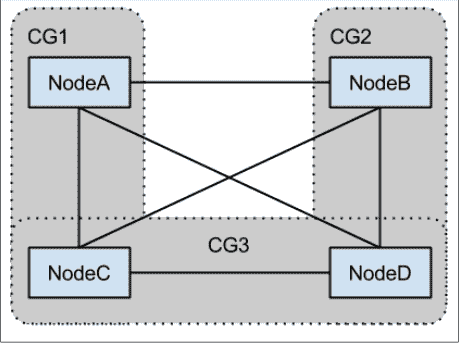

# 4 集群组
## 集群组

到目前为止，我们一直将 Cellar 用作全局集群。这意味着集群中所有节点都具有相同的功能和角色。然而，在真实系统中使用一组 Karaf 实例时，我们可能希望将部分实例专门用于特定的功能/角色。这正是 Cellar 集群组的作用。

例如，我们的 Cellar 集群中有一个由 20 个节点组成的实例池。

我们可能希望部署以下内容：

- 一条 Camel 路由可以描述并打包为 Karaf Features XML 文件。我们希望仅将这条路由部署到集群中的 10 个节点上（而不是所有节点）。
- 一个 CXF Web 服务（描述并部署为另一个 Karaf Features XML 文件）部署到另外 10 个节点上。

在 Cellar 中，我们可以创建不同的集群组，并将节点定义为其中一个或多个集群组的成员。

## 管理集群组

默认情况下，所有节点都是默认集群组的成员。该默认集群组被用作创建新集群组的模板。

你可以使用 `cluster:group-create <group-name>` 命令创建集群组：

```
karaf@root> cluster:group-create book
```

这里，我们创建了一个名为 book 的新集群组。我们可以通过 `cluster:group-list` 命令在集群组列表中看到这个新集群组：

```
karaf@root> cluster:group-list

    Group                 Members
*   [default             ] [vostro.local:5701* ]
    [book                ] []
```

目前，我们的 book 集群组还没有任何成员。

节点可以使用 `cluster:group-join` 命令加入集群组：

```
karaf@root>  cluster:group-join book
    Group                 Members
*   [default             ] [vostro.local:5701* ]
*   [book                ] [vostro.local:5701* ]
```

`cluster:group-join` 命令接受以下两个参数：

- 集群组的名称（在我们的示例中，集群组的名称是 book），如 `cluster:group-list` 命令所显示。
- 节点 ID。在我们的示例中，我们没有提供节点 ID，这意味着使用本地节点（当前连接到的节点）。也可以提供指定的节点 ID（例如，远程节点）来加入集群组，使用以下命令：
  
  `karaf@root> cluster:group-join book nodeB:5701`

因此，你可以从任何节点控制所有节点和集群组。

当集群组为空时，你可以使用 `cluster:group-delete <group_name>` 命令将其删除，如下所示：

```
karaf@root> cluster:group-create test
karaf@root> cluster:group-list
    Group                 Members
    [default             ] []
    [test                ] []
*   [book                ] [vostro.local:5701* ]
karaf@root> cluster:group-delete test
karaf@root> cluster:group-list
    Group                 Members
    [default             ] []
*   [book                ] [vostro.local:5701* ]
```

请注意，默认集群组不能被删除，因为它被用作创建新集群组的模板。这意味着新创建的集群组的默认配置将是默认集群组配置的副本。

`cluster:group-join` 命令会将节点添加到指定的集群组，而不会改变该节点当前的集群组成员身份。

因此，一个节点可以是多个集群组的成员。

节点可以使用 `cluster:group-quit` 命令退出集群组：

```
karaf@root> cluster:group-list

    Group                  Members
  [default             ] []
* [test                ] [vostro.local:5701* ]
* [book                ] [vostro.local:5701* ]

karaf@root> cluster:group-quit test

    Group                  Members
  [default             ] []
  [test                ] []
* [book                ] [vostro.local:5701* ]
```

`cluster:group-set` 命令将节点从一个集群组移动到另一个集群组。它是 `cluster:group-join` 和 `cluster:group-quit` 命令的组合：

```
karaf@root> cluster:group-list

    Group                  Members
  [default             ] []
  [test                ] []
* [book                ] [vostro.local:5701* ]

karaf@root> cluster:group-set test

    Group                  Members
  [default             ] []
* [test                ] [vostro.local:5701* ]
  [book                ] []
```

## 定向部署

创建集群组并将节点分配到不同集群组后，你就可以将资源定向部署到特定的集群组。为此，Cellar 提供了与常规 Karaf 命令对应的集群感知命令。

例如，Karaf 提供了 `features:install <feature_name>` 命令用于在容器中安装 Karaf 特性。此外，Cellar 还提供了 `cluster:feature-install <group_name> <feature_name>`，它与 `features:install` 命令类似。`features:install` 命令会在本地 Karaf 容器中安装特性，而 `cluster:feature-install` 命令会在指定集群组的集群中安装特性。

在本章末尾，你会看到一个表格，介绍与常规 Karaf 命令对应的 Cellar 的 `cluster:*` 命令。

## 特性

为了将特性部署到特定的集群组，我们可以使用 `cluster:feature-install` 命令：

```
karaf@root> cluster::feature-install book eventadmin
```

`cluster:feature-install` 命令接受以下参数：

- 集群组的名称（此处为 `book`）
- 特性的名称（此处为 `eventadmin`）
- 特性的版本（可选）

例如，我们在 `book` 集群组上安装了 `eventadmin` 特性。由于 Cellar 扩展了常规 Karaf 命令，你会发现相同的功能都以 `cluster` 为前缀。

你可以按集群组控制 Karaf 特性仓库（URL）。例如，你可以使用以下命令列出在某集群组上注册并可用的 Karaf 特性仓库：

```
karaf@root> cluster::feature-url-list book
mvn:org.apache.karaf.cellar/apache-karaf-cellar/2.3.1/xml/features
mvn:org.jclouds.karaf/jclouds-karaf/1.4.0/xml/features
mvn:org.apache.karaf.assemblies.features/standard/2.3.1/xml/features
mvn:org.apache.karaf.assemblies.features/enterprise/2.3.1/xml/features
```

你可以使用 `cluster:feature-url-add` 在集群组上添加特性的 URL。

例如，你可以使用以下命令在 `book` 集群组上添加 Camel 特性仓库：

```
karaf@root> cluster::feature-url-add book mvn:org.apache.camel.karaf/
apache-camel/2.12.1/xml/features
karaf@root> cluster::feature-url-list book
```


mvn:org.apache.karaf.cellar/apache-karaf-cellar/2.3.1/xml/features
mvn:org.jclouds.karaf/jclouds-karaf/1.4.0/xml/features
mvn:org.apache.karaf.assemblies.features/standard/2.3.1/xml/features
mvn:org.apache.karaf.assemblies.features/enterprise/2.3.1/xml/features
mvn:org.apache.camel.karaf/apache-camel/2.12.1/xml/features

这意味着 book 集群组的全部节点成员都会在本地注册特性仓库。使用常规的 Karaf 命令（本地），我们可以看到特性仓库，如下所示：

```
karaf@root> features:listurl
    Loaded   URI
      true   mvn:org.apache.karaf.cellar/apache-karaf-cellar/2.3.1/xml/features
      true   mvn:org.jclouds.karaf/jclouds-karaf/1.4.0/xml/features
      true   mvn:org.apache.karaf.assemblies.features/standard/2.3.1/xml/features
      true   mvn:org.apache.karaf.assemblies.features/enterprise/2.3.1/xml/features
      true   mvn:org.apache.camel.karaf/apache-camel/2.12.1/xml/features
```

现在，我们可以看到 Camel 特性在 book 集群组上可用（我们可以使用 `cluster:feature-list` 命令列出）并且在 book 集群组的节点成员本地可用（我们可以使用 `features:listurl` 列出）。这可以通过发出以下命令来完成：

```
karaf@root> cluster:feature-list book
...
[uninstalled]  [2.12.1        ]  camel-cxf
[uninstalled]  [3.0.7.RELEASE ]  spring-orm
[uninstalled]  [2.12.1        ]  camel-apis
[uninstalled]  [2.12.1        ]  camel-guice
```

## Bundles

Cellar 还提供了集群感知的 bundle 命令。您可以使用 `cluster:bundle-list` 命令（相当于 `osgi:list` Karaf 命令）查看集群组上可用的 bundle，如下所示：

```
karaf@root> cluster:bundle-list book
...
[59 ]  [Active ]  Apache Karaf :: Features :: Management (2.3.1)
[60 ]  [Active ]  Apache Karaf :: Features :: Core (2.3.1)
```

我们可以使用 `cluster:bundle-install` 命令（相当于 `osgi:install` Karaf 命令）在集群组上部署 bundle：

```
karaf@root> cluster:bundle-install book mvn:org.apache.servicemix.bundles/org.apache.servicemix.bundles.commons-lang/2.4_6
karaf@root> cluster:bundle-list book|grep -i commons-lang
[64  ] [Installed  ] Apache ServiceMix :: Bundles :: commons-lang (2.4.0.6)
```

集群感知 bundle 命令的应用如下所示：

- 要查看在 book 集群组的节点成员上本地安装的 bundle，可以使用以下命令：
  `karaf@root> osgi:list|grep -i commons-lang`
  `[ 64] [Installed  ] [          ] [ 80] Apache ServiceMix :: Bundles :: commons-lang (2.4.0.6)`

- 要在集群上启动 bundle，可以使用 `cluster:bundle-start` 命令。如果您想在集群上启动使用 `cluster:bundle-list` 命令找到的 ID 为 64 的 bundle，请发出以下命令：
  `karaf@root> cluster:bundle-start book 64`
  `karaf@root> cluster:bundle-list book|grep -i commons-lang`
  `[64  ] [Active   ] Apache ServiceMix :: Bundles :: commons-lang (2.4.0.6)`

- 要在给定的集群组上停止 bundle，可以使用 `cluster:bundle-stop` 命令。您可以使用 `osgi:list` 命令查看 bundle 的本地状态：
  `karaf@root> cluster:bundle-stop book 64`
  `karaf@root> osgi:list|grep -i commons-lang`
  `[ 64] [Installed  ] [          ] [ 80] Apache ServiceMix :: Bundles :: commons-lang (2.4.0.6)`

- 要从集群组卸载 bundle，可以使用 `cluster:bundle-uninstall` 命令：
  `karaf@root> cluster:bundle-uninstall book 64`

```
[61  ] [Active   ] Apache Karaf :: Cellar :: Bundle (2.3.1)
[62  ] [Active   ] Apache Karaf :: Shell :: PackageAdmin Commands (2.3.1)
[63  ] [Active   ] Apache Karaf :: Deployer :: Karaf Archive (.kar) (2.3.1)
```

## Configurations

Cellar 允许配置集群化。您可以使用 `cluster:config-*` 命令管理集群上的配置。

您可以使用 `cluster:config-list` 命令列出给定集群组上可用的配置：

```
karaf@root> cluster:config-list book
…
--------------------------------------------------------------------
Pid:              org.apache.karaf.features.obr
Properties:
    startLevel = 80
    startByDefault = true
    service.pid = org.apache.karaf.features.obr
    resolveOptionalImports = false
```

您可以使用以下方式编辑或更改属性（使用 `cluster:config-propset` 命令），添加属性（使用 `cluster:config-propappend` 命令），删除属性（使用 `cluster:config-propdel` 命令），或列出给定集群组上配置的属性：

```
karaf@root> cluster:config-propappend book my.config key value
karaf@root> cluster:config-proplist book my.config
Property list for configuration PID my.config in cluster group book
Key                                      Value
key                                      value
service.pid                             my.config
karaf@root> cluster:config-propdel book my.config key
karaf@root> cluster:config-proplist book my.config
Property list for configuration PID my.config in cluster group book
Key                                      Value
service.pid                             my.config
```

## Optional resources

特性、bundle 和配置是 Cellar 原生支持的。然而，通过安装可选特性，Cellar 还可以为其他资源提供集群支持。

## Cluster Groups

**OSGi Bundle Repository (OBR)** 是一种 OSGi 规范，其目标如下：

- 简化 bundle 的部署
- 鼓励独立且原子的 bundle 开发

OBR 使用 bundle 仓库，其中可以添加一些额外的元数据，如下所示：

- bundle 提供的功能
- bundle 的需求

得益于这些元数据，当您从 OBR 服务器安装 bundle 时，OBR 会自动安装提供功能以匹配您已安装的第一个 bundle 的需求的其他 bundle。

`cellar-obr` 特性提供了集群感知的 OBR 支持。这意味着 Cellar 在不同节点之间同步使用的 OBR 服务器，并在集群中的节点之间广播 OBR 命令（安装、启动、卸载等）。

我们可以找到专用于集群 OBR 的 `cluster:obr-*` 命令。

`cellar-eventadmin` 特性不提供新命令。然而，所有 OSGi 本地事件都会在集群中广播到同一集群组中本地节点的其他节点成员。

## Overlapping

一个节点可以是多个集群组的成员。这意味着我们可能在单个节点上存在多个集群组的重叠，可以在以下图表中看到：



## Cluster Groups

`cluster:*` 命令执行的所有操作都可以通过 JMX 使用 Cellar 提供的 MBeans 执行。另一方面，也可以使用 Cellar 提供的 WebConsole 插件管理集群组。

## Summary

在本章中，我们看到了如何对节点进行分组并在特定集群组上定位供应。借助此功能，很容易设置多层集群并按功能对节点进行分组。

在下一章中，我们将看到用于在同一集群组的成员之间创建和传输集群事件的不同 Cellar 组件；我们还将看到组是如何实际实现的。
