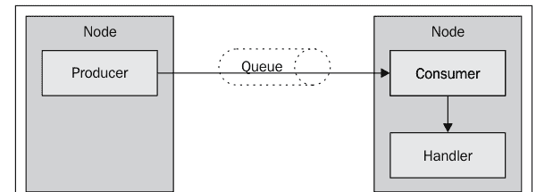

# 5 生产者、消费者、处理器、监听器和同步器
生产者、消费者、处理器、监听器和同步器

在前几章中，我们看到 Cellar 在不同节点之间交换集群事件。这意味着一个节点创建集群事件并将其发送到其他节点。另一方面，其他节点接收集群事件并使用集群事件中包含的语句更新本地状态。

在底层，一个节点充当集群事件生产者。Cellar 使用 Hazelcast 队列存储和分发集群事件到其他节点。生产者向队列发送代表集群事件的消息。

其他节点充当集群事件消费者。这意味着它们从队列中消费集群事件。由于队列包含不同类型的集群事件（bundle 事件、配置事件、特性事件和 OBR 事件），消费者会将事件的处理委托给为每种类型的集群事件专门设计的处理器。此过程在以下图表中显示：




## 生产者、消费者、处理器、监听器和同步器

### 事件生产者

每个 Cellar 节点都内嵌了一个集群事件生产者。当节点需要向其他节点发送事件时，就会使用该生产者。

生产者负责以下功能：

- 创建集群事件消息。
- 将集群事件消息发送到目标分布式队列。该队列是唯一的，可以通过集群组和资源类型来标识。例如，一个可能的队列名称是 `book.bundles`，其中 book 是集群组的名称，bundles 是资源类型。因此，Cellar 能够按资源发送集群事件，并且能够将集群事件仅定向到给定的集群组。

可以从任何节点管理节点的生产者。

例如，我们可以使用以下 `cluster:producer-status` 命令查看生产者的当前状态：

```text
karaf@root> cluster:producer-status
```

| 节点 | 状态 |
|---|---|
| `[node2:5702]` | `[ON]` |
| `* [node1:5701]` | `[ON]` |

这里，我们可以看到全局集群中所有节点的生产者状态。我们可以使用以下命令指定一个节点：

```text
karaf@root> cluster:producer-status node2:5702
```

| 节点 | 状态 |
|---|---|
| `[node2:5702]` | `[ON]` |

可以使用 `cluster:producer-stop` 命令停止某个节点的生产者（不带参数时，该命令停止本地节点的生产者），如下所示：

```text
karaf@root> cluster:producer-stop node2:5702
```

| 节点 | 状态 |
|---|---|
| `[node2:5702]` | `[OFF]` |

当生产者停止时，该节点不会向其他节点发送任何集群事件。这意味着本地更改和 `cluster:*` 命令不会改变集群中的其他节点。

`cluster:producer-stop` 命令可以停止位于远程节点（与我们实际执行命令的节点相距较远）上的生产者。

可以使用 `cluster:producer-start` 命令启动已停止的生产者，如下所示：

```text
karaf@root> cluster:producer-start node2:5702
```

| 节点 | 状态 |
|---|---|
| `[node2:5702]` | `[ON]` |

生产者可以发送任何类型的集群事件。每个集群资源都有自己的集群事件类型。以下是集群事件的类型：

- `ClusterBundleEvent`：当 bundle 的状态发生变化（安装、启动、停止或卸载）时发送
- `ClusterFeatureEvent`：当 Karaf feature 的状态发生变化（添加仓库、删除仓库、安装或卸载）时发送
- `ClusterConfigEvent`：当配置的状态发生变化（删除、添加、设置属性、删除属性或追加属性）时发送
- `ClusterObrEvent`：当 OBR bundle 的状态发生变化（添加仓库、部署 OBR bundle 或启动 OBR bundle）时发送

`cluster:producer-start` 和 `cluster:producer-stop` 命令会更新 `etc/org.apache.karaf.cellar.node.cfg` 配置文件。

此配置文件包含 producer 属性，该属性定义了生产者的状态（例如，在启动时使用）：如果 producer 的状态为 true，则节点生产者启动，否则生产者停止。

### 事件消费者

如前所述，生产者将集群事件消息发送到队列中。

另一方面，每个节点都内嵌了一个消费者。消费者绑定了一组处理器。

消费者负责从不同的队列获取集群事件消息，并根据集群事件的类型，将集群事件委派给相应的处理器。这意味着每种资源类型都有一个处理器。

对于消费者，我们可以执行以下任务：

- 使用 `cluster:consumer-status` 命令检查消费者（在每个节点上）的当前状态，如下所示：

  ```text
  karaf@root> cluster:consumer-status
  ```

  | 节点 | 状态 |
  |---|---|
  | `[node2:5702]` | `[ON]` |
  | `* [node1:5701]` | `[ON]` |

  `cluster:consumer-status` 命令接受节点 ID 作为参数，如下所示：

  ```text
  karaf@root> cluster:consumer-status node2:5702
  ```

  | 节点 | 状态 |
  |---|---|
  | `[node2:5702]` | `[ON]` |

- 使用 `cluster:consumer-stop` 命令停止任何节点的消费者，如下所示：

  ```text
  karaf@root> cluster:consumer-stop node2:5702
  ```

  | 节点 | 状态 |
  |---|---|
  | `[node2:5702]` | `[OFF]` |

当某个节点上的消费者停止时，该节点无法接收来自其他节点的任何集群事件。这意味着节点不会使用集群事件消息中包含的信息更新其本地状态。

- 使用 `cluster:consumer-start` 命令启动任何节点的消费者，如下所示：

  ```text
  karaf@root> cluster:consumer-start node2:5702
  ```

  | 节点 | 状态 |
  |---|---|
  | `[node2:5702]` | `[ON]` |

与生产者的状态类似，消费者的状态存储在 `etc/org.apache.karaf.cellar.node.cfg` 配置文件的 consumer 属性中。

### 事件处理器

当消费者收到集群事件消息时，它会根据集群事件的类型将消息委派给相应的处理器。

使用 `cluster:handler-stop` 命令的结果如下：

```text
karaf@root> cluster:handler-stop org.apache.karaf.cellar.bundle.BundleEventHandler node2:5702
```

| 节点 | 状态 | 事件处理器 |
|---|---|---|
| `[node2:5702]` | `[OFF]` | `org.apache.karaf.cellar.bundle.BundleEventHandler` |

当某个节点上的处理器停止时，意味着该处理器管理的集群事件不会被处理。例如，如果 BundleEventHandler 停止，节点仍会接收集群事件，但与 bundle 相关的集群事件将不会被处理。这意味着节点不会更改 bundle 的状态。

可以使用 `cluster:handler-start` 命令在任何节点上启动处理器，如下所示：

```text
karaf@root> cluster:handler-start org.apache.karaf.cellar.bundle.BundleEventHandler node2:5702
```

| 节点 | 状态 | 事件处理器 |
|---|---|---|
| `[node2:5702]` | `[ON]` | `org.apache.karaf.cellar.bundle.BundleEventHandler` |

与生产者和消费者的状态类似，每个处理器的状态存储在 `etc/org.apache.karaf.cellar.node.cfg` 配置文件中，如下所示：

```text
#
### Cluster event handlers
#
#### bundle event handler
handler.org.apache.karaf.cellar.bundle.BundleEventHandler = true
#### config event handler
handler.org.apache.karaf.cellar.config.ConfigurationEventHandler = true
#### feature event handler
handler.org.apache.karaf.cellar.features.FeaturesEventHandler = true
#### DOSGi event handler
handler.org.apache.karaf.cellar.dosgi.RemoteServiceCallHandler = true
#### OSGi event handler
handler.org.apache.karaf.cellar.event.ClusterEventHandler = true
#### OBR event handler
handler.org.apache.karaf.cellar.obr.ObrBundleEventHandler = true
handler.org.apache.karaf.cellar.obr.ObrUrlEventHandler = true
```

### 监听器和同步器

如果我们使用 `cluster:*` 命令来管理集群中的资源（features、bundles、配置、OBR 和本地事件），Cellar 也会监听本地资源的变化并将这些变化广播到集群中。

例如，如果你在本地安装一个 bundle（使用 `osgi:install` 命令），Cellar 将捕获此更改并将其广播到集群事件中，这意味着与本地节点处于同一集群组的所有其他节点将安装相同的 bundle。

Cellar 提供以下监听器：

- 用于 features 仓库和 features 的监听器（安装和卸载）
- 用于 bundles 的监听器（安装、卸载、启动、停止等）
- 用于配置的监听器（propset、propdel、删除等）

另一方面，当节点启动或加入集群组时，Cellar 会调用一组同步器。同步器的目的是将节点的本地状态与集群中资源的状态对齐。同步器负责应用本地更改，以使节点处于与集群相同的状态。每种资源类型都有一个同步器。

Cellar 提供以下同步器：

- 用于 features 仓库和 features 的同步器。例如，如果一个 feature 在集群上的状态为 `installed`，则同步器（在启动时）检查本地节点上该 feature 的状态，如果该 feature 未安装，则同步器会安装它。
- 用于 bundles 的同步器。例如，如果一个 bundle 在集群上已安装，则同步器（在启动时）检查本地节点上该 bundle 的状态，如果该 bundle 未安装，则同步器会安装它。
- 用于配置的同步器。

得益于这些同步器，Cellar 会在节点启动或加入集群组时更新该节点。


