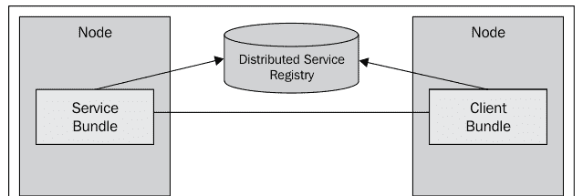

在之前的章节中，我们将 Cellar 视为一种配置集群解决方案；在一个节点上对资源执行的操作会创建集群事件并发送到其他节点；这些节点随后会相应地做出反应。Cellar 还提供了除配置集群之外的一些特性。Cellar **Distributed OSGi (DOSGi)** 就是这些附加特性之一。

在本章中，我们将涵盖以下主题：

- DOSGi 是什么以及一个用例
- Cellar DOSGi 实现
- 使用 Cellar DOSGi 的完整示例

## What is Cellar DOSGi?

Cellar DOSGi 是 OSGi 规范中 Remote Service Admin 规范的实现。基本上，它是托管在不同容器中的 bundle 之间服务的远程通信。

使用 OSGi 服务，一个 bundle 将服务（实际上是一个接口）暴露给 OSGi 框架提供的服务注册表。另一个 bundle 可以在服务注册表中查找服务，获取对该服务的引用并使用它。借此，我们在低级组件（bundle）上实现了真正的 **Service-Oriented Architecture (SOA)** 方法。

Cellar DOSGi 提供了分布式服务注册表，并使用 Hazelcast NIO 进行服务的远程使用。

Hazelcast NIO 是 NIO 的数据序列化和传输实现。详情可参阅 Java NIO Javadocs（http://docs.oracle.com/javase/7/docs/api/java/nio/package-summary.html）和 Hazelcast NIO 文档（http://hazelcast.org/docs/2.6/javadoc/com/hazelcast/nio/DataSerializable.html）。

下图显示了两个节点如何通过分布式服务注册表相互通信：



在一个节点上，一个 bundle（名为 Service Bundle）可以在分布式服务注册表中暴露一个服务。为此，它只需使用 service.exported.interfaces 服务属性注册服务。我们将在本章后面通过示例了解如何创建服务并定义此服务属性。Cellar 会监听所有服务注册，如果服务具有 service.exported.interfaces 属性，则会自动将其暴露到分布式服务注册表。

另一方面，一个 bundle（名为 Client Bundle）只需执行常规的服务查找。Cellar 在以下情况下拦截此查找：

- 如果服务存在于本地服务注册表中，Cellar 使用它
- 如果服务不存在于本地服务注册表中，Cellar 将查找转发到分布式服务注册表

客户端 bundle 获取对服务的引用。对于本地服务，此引用直接指向 JVM 中的对象。对于远程服务，此引用是位于远程 JVM 中的实际服务的代理。

我们必须注意，DOSGi 不使用集群组（集群组目前用于资源同步）。这意味着不同集群组的节点成员可以使用 DOSGi 相互通信。

为了说明和理解（从用户角度）Cellar DOSGi 的工作原理，我们将创建一个 Greeter 应用程序。

在此应用程序中，我们将有一个 bundle 通过说 hello 暴露服务，以及一个使用该服务的客户端 bundle。

示例的源代码可在 Cellar 源代码的以下链接中获得：

https://github.com/apache/karaf-cellars/tree/cellar-2.3.x/samples/dosgi-greeter

## The API bundle

在 OSGi 中，服务由接口描述。这意味着同一服务的服务 bundle 和客户端 bundle 必须共享相同的接口。

为了解耦接口和实现并能够在不影响服务 bundle 的情况下更新客户端 bundle，一个良好的实践是创建一个仅包含接口的 API bundle。

我们通过在 OSGi 导出包头中按如下方式暴露 API 包来创建此 API bundle：

```
<osgi.export>
    org.apache.karaf.cellar.samples.dosgi.greeter.api*;version="${project.version}"
</osgi.export>
```

API bundle 包含描述 Greeter 服务的接口，如下所示：

```
package org.apache.karaf.cellar.samples.dosgi.greeter.api;

/**
 * Interface describing the Greeter service.
 */
public interface Greeter {

    /**
     * Returns a greet message.
     * @return
     */
    public GreetResponse greet(Greet greet);

}
```

服务提供一个操作：greet 对应于 Greeter 接口的 greet() 方法。此 greet() 方法以对象作为参数（Greet）并返回一个对象（GreetResponse）。


## DOSGi

这些对象也是 API bundle 的一部分，因为它们将被服务 bundle 和客户端 bundle 同时使用。Greet 对象只是包装了一个消息（字符串）。请注意，此对象是可序列化的。这是必需的，因为它将在远程使用。可以使用以下代码包装消息：

```
package org.apache.karaf.cellar.samples.dosgi.greeter.api;

import java.io.Serializable;

/**
 * Object used in the Greeter interface/service.
 */
public class Greet implements Serializable {
    String message;

    public Greet(String message) {
        this.message = message;
    }

    public String getMessage() {
        return message;
    }

    public void setMessage(String message) {
        this.message = message;
    }
}
```

GreetResponse 类表示 greet() 方法返回的响应。它也是一个可序列化对象，因为它将在节点之间传输（远程）。这是通过以下代码完成的：

```
package org.apache.karaf.cellar.samples.dosgi.greeter.api;

import java.io.Serializable;

/**
 * Response returned by the Greeter service.
 */
public class GreetResponse implements Serializable {

    private Greet greet;
    private String response;

    public GreetResponse(Greet greet, String response) {
        this.greet = greet;
        this.response = response;
    }

    public Greet getGreet() {
        return greet;
    }

    public void setGreet(Greet greet) {
        this.greet = greet;
    }

    public String getResponse() {
        return response;
    }

    public void setResponse(String response) {
        this.response = response;
    }
}
```

API bundle 并未提供 Greet 服务的实现。它只是 API。

服务的实现和注册在服务 bundle 中完成。

### 服务 bundle

服务 bundle 将服务暴露给服务注册表。

只需向服务添加 service.exported.interfaces 属性，服务就会被暴露到分布式服务注册表中。

首先，服务 bundle 实现了 Greet 接口；它是 Greet 服务的实现，代码如下：

```
package org.apache.karaf.cellar.samples.dosgi.greeter.service;

import org.apache.karaf.cellar.samples.dosgi.greeter.api.Greet;
import org.apache.karaf.cellar.samples.dosgi.greeter.api.GreetResponse;
import org.apache.karaf.cellar.samples.dosgi.greeter.api.Greeter;
```

```
<argument ref="nodeId"/>
</bean>

<!-- The current Node -->
<bean id="node" factory-ref="clusterManager" factory-method="getNode"/>
<!-- The id of the current node -->
<bean id="nodeId" factory-ref="node" factory-method="getId"/>

<!-- OSGi Services & References -->
<service ref="greeterImpl" interface="org.apache.karaf.cellar.samples.dosgi.greeter.api.Greeter">
    <service-properties>
        <entry key="service.exported.interfaces" value="*"/>
    </service-properties>
</service>

<reference id="clusterManager" interface="org.apache.karaf.cellar.core.ClusterManager"/>

</blueprint>
```

我们可以看到为 greeterImpl 服务定义了 service.exported.interfaces 属性。正如我们之前看到的，此属性是指定该服务在集群中可用的标志。它包含我们希望暴露给集群的接口（服务）。如果提供服务的 bean 实现了多个接口，我们可以指定用于集群接口的接口。通配符 (*) 意味着 bean 实现的任何接口都将在集群中可用。

现在我们可以将服务 bundle 部署在 node1 上。

Cellar DOSGi 并非默认安装在 Cellar 功能中。要启用 DOSGi 支持，您需要使用以下命令安装 cellar-dosgi 功能：

```
karaf@root> features:install cellar-dosgi
karaf@root> la | grep -i dosgi
[ 63] [Active ] [Created ] [ 40] Apache Karaf :: Cellar :: DOSGi (2.3.1)
```

要部署的第一个 bundle 是 API bundle；可以通过运行以下命令完成：

```
karaf@root> osgi:install -s mvn:org.apache.karaf.cellar.samples.dosgi.greeter/org.apache.karaf.cellar.samples.dosgi.greeter.api/2.3.1
```

现在，我们可以使用以下命令部署并启动服务 bundle：

```
karaf@root> osgi:install -s mvn:org.apache.karaf.cellar.samples.dosgi.greeter/org.apache.karaf.cellar.samples.dosgi.greeter.service/2.3.1
```

我们可以通过运行以下命令在本地服务注册表中查看我们的 Greeter 服务：

```
karaf@root> ls 65

Apache Karaf :: Cellar :: Samples :: DOSGi Greeter :: Service (65) provides:
------------------------------------------------------------
---
objectClass =
org.apache.karaf.cellar.samples.dosgi.greeter.api.Greeter
osgi.service.blueprint.compname = greeterImpl
service.exported.interfaces = *
service.id = 286
```

我们现在可以看到 Cellar DOSGi 正在查找的 `service.exported.interfaces` 属性。

Cellar DOSGi 还提供了以下 `cluster:service-list` 命令来显示在集群中注册的服务（在分布式服务注册表中）：

```
karaf@root> cluster:service-list
```

| Service Class | Provider Node |
| --- | --- |
| org.apache.karaf.cellar.samples.dosgi.greeter.api.Greeter | node1:5701 |

我们可以看到我们的 Greeter 服务在集群中可用，并由集群的 node1 提供。

### 客户端 bundle

客户端 bundle 提供了一个 `dosgi-greeter:greet` shell 命令。shell 命令是客户端 bundle 的一部分，您可以在 GitHub 源代码库中找到命令代码。命令调用以下 `GreeterClient`：

```
package org.apache.karaf.cellar.samples.dosgi.greeter.client;

import org.apache.karaf.cellar.samples.dosgi.greeter.api.Greet;
import org.apache.karaf.cellar.samples.dosgi.greeter.api.GreetResponse;
import org.apache.karaf.cellar.samples.dosgi.greeter.api.Greeter;

/**
 * Client that uses a remote Greeter service.
 */
public class GreeterClient {

    private Greeter greeter;
    private String greetMessage;
    private int count;

    public GreeterClient(Greeter greeter, String greetMessage, int count) {
        this.greeter = greeter;
        this.greetMessage = greetMessage;
        this.count = count;
    }

    public void start() {
        Greet greet = new Greet(greetMessage);
        for (int i = 0; i < count; i++) {
            GreetResponse greetResponse = greeter.greet(greet);
            if (greetResponse != null) {
                System.out.println(greetResponse.getResponse());
            } else System.out.println("Time out!");
        }
    }
}
```

客户端非常简单，因为服务是通过 blueprint 注入到 greeter 属性中的，如下所示：

```
<?xml version="1.0" encoding="UTF-8"?>

<blueprint xmlns="http://www.osgi.org/xmlns/blueprint/v1.0.0">

    <reference id="greeter"
        interface="org.apache.karaf.cellar.samples.dosgi.greeter.api.Greeter"/>

</blueprint>
```

此 blueprint 描述符非常简单。它只是获取对 Greeter 服务的引用。此引用可以是对本地实际服务的引用，也可以是对远程服务的代理的引用。

现在我们可以使用以下命令在 node2 上部署 API 和客户端 bundle：

```
karaf@root> osgi:install -s mvn:org.apache.karaf.cellar.samples.dosgi.greeter/org.apache.karaf.cellar.samples.dosgi.greeter.api/2.3.1

karaf@root> osgi:install -s mvn:org.apache.karaf.cellar.samples.dosgi.greeter/org.apache.karaf.cellar.samples.dosgi.greeter.client/2.3.1
```

> Node1 和 node2 应该在两个不同的组中；否则，不同 bundle（API、服务和客户端）的安装会从一个节点传播到另一个节点。这不是我们想要的；我们希望服务 bundle 仅安装在 node1 上，客户端 bundle 仅安装在 node2 上。

现在我们可以按如下方式调用 `dosgi-greeter:greet` 命令：

```
karaf@root> dosgi-greeter:greet hello 5
hello.Hello from node node2 count 0.
hello.Hello from node node2 count 1.
hello.Hello from node node2 count 2.
hello.Hello from node node2 count 3.
hello.Hello from node node2 count 4.
```

### 总结

DOSGi 是在节点之间实现远程服务通信的一种非常简单的方法。它为 OSGi 带来了新的维度，并允许您创建大型且可扩展的应用程序，可以部署在容器集群上。

与集群组结合使用（以定位 bundle 在特定节点上的部署）时，DOSGi 是运行时集群向前迈出的第一步。这意味着 Cellar 不仅仅是一个配置集群解决方案；它还为运行时集群带来了有趣的功能。

在下一章中，我们将看到 Cellar 与 Apache Camel 结合使用时用于运行时集群的另一种用法。


