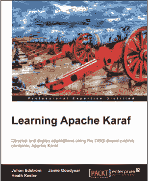
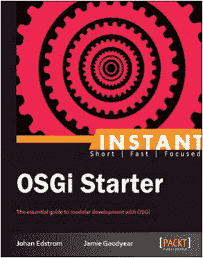
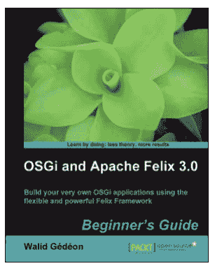
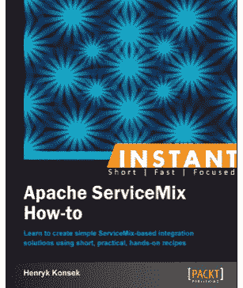

## 索引

**A**

**Apache Karaf**
  features 11-16
  provisioning 13, 14
**Apache Karaf Cellar**
  about 21
  architecture 24
  commands 26
  features 24
  installing 26
  URL, for information 21
**Apache Karaf locking mechanism** 18
**Apache ZooKeeper** 22
**API bundle** 79-81
**architecture, Apache Karaf Cellar** 24
**async backup operations** 43

**B**

**backup**
  about 42, 43
  persistence 43
**blacklisted filter** 71
**blacklist keyword** 71
**bundle cluster event** 70, 72
**BundleEventHandler** 65
**bundles, Cluster resources** 27-29
**bundles, targeting provisioning** 55, 56

**C**

**caching**
  with distributed map 91-93
**Camel** 87

**camel-hazelcast component** 91
**Cellar**
  runtime features 95
**Cellar core** 25
**Cellar distributed map** 42
**Cellar Distributed OSGi (Cellar DOSGi)** 77
**cellar-eventadmin feature** 36, 58
**cellar-obr feature** 37, 58
**Cellar sources**
  URL for source code 79
**cellar-webconsole feature** 37
**client bundle** 78, 84-86
**ClusterBundleEvent** 63
**cluster:bundle-install command** 28
**cluster:bundle-list command** 27
**cluster component**
  purpose 23
**ClusterConfigEvent** 63
**cluster:config-list command** 33
**cluster:config-propset command** 35
**cluster:consumer-start command** 64
**cluster:consumer-status command** 64
**cluster:consumer-stop command** 64
**cluster event consumer**
  about 61-63
  functionalities 64
**Cluster event consumer and handlers**
  module 25
**ClusterEventHandler** 65
**cluster event model** 23
**cluster event producer**
  about 61, 62
  functions 62
**Cluster event producer module** 25

cluster events
bundle 70, 72
config 70, 73
features 70-74
filtering 69, 70
inbound 71
outbound 71
specifying 71
cluster events, for producer
ClusterBundleEvent 63
ClusterConfigEvent 63
ClusterFeatureEvent 63
ClusterObrEvent 63
ClusterFeatureEvent 63
cluster:feature-install command 54
cluster:feature-install <group_name> <feature_name> command 54
cluster:group-create command 70
cluster:group-create <group-name> command 51
cluster:group-delete <group_name> command 52
cluster:group-join command
about 52, 53
arguments 52
cluster:group-list command 52
cluster:group-quit command 53
cluster groups
managing 51-53
cluster:group-set command 53
cluster:handler-start command 66
cluster:handler-status command 65
cluster:handler-stop command 65
clustering
layers 22
Cluster Manager cluster 22
cluster manager component 22
cluster:node-list command 26
ClusterObrEvent 63
cluster:producer-start command 63
cluster:producer-status command 62
cluster:producer-stop command 62, 63
Cluster resources
about 27
bundles 27-29
configuration 33-35
Karaf features 30-32
Karaf WebConsole plugin 37
optional resources 36, 37
Cluster topologies 21, 22
commands module 25
commands, Apache Karaf Cellar 26
commands, targeting provisioning 59, 60
commons-lang bundle 28, 29
communication
between remote routes 87-91
config:list command 73
configuration, Cluster resources 33-35
ConfigurationEventHandler 65
configuration, filters 69, 70
configurations, targeting provisioning 57
D
default filter configuration 75
distributed cluster resource states
about 40
Cellar distributed map 42
distributed queues 41
distributed topics 41
distributed map
caching with 91-93
distributed queues 41
distributed topics 41
dosgi-greeter:greet shell command 84
E
event handlers
BundleEventHandler 65
ClusterEventHandler 65
ConfigurationEventHandler 65
FeaturesEventHandler 65
ObrBundleEventHandler 65
ObrUrlEventHandler 65
overview 64-66
event identifier 72
F
features, Apache Karaf Cellar 24
features cluster event 70, 74
FeaturesEventHandler 65
features:install <feature_name> command 54

features:list command 74
features, targeting provisioning 54, 55
filters
  configuring 69, 70
functionalities, cluster event consumer 64
functions, cluster event producer 62

G
greet() method 79
GreetResponse class 80

H
Hazelcast
  about 24, 25, 39, 40
  URL, for session clustering 99
hazelcast:map endpoint, headers
  about 93
  CamelHazelcastCacheName 93
  CamelHazelcastListenerAction 93
  CamelHazelcastListenerTime 93
  CamelHazelcastObjectId 93
Hazelcast NIO
  about 78
  URL 78
HTTP
  load balancing 95-98
  session clustering 95, 99, 100

I
inbound cluster events 71
installation, Apache Karaf Cellar 26
IPv6 support 48

J
Java Authentication and Authorization Service (JAAS) 12
Java Database Connectivity (JDBC) 13
Java JAR (Java ARchive) file 9
Java Message Service (JMS) 13, 88
Java Naming and Directory Interface (JNDI) 13
Java NIO Javadocs
  URL 78

Java Persistence API (JPA) 13
Java Transaction API (JTA) 13
Java Virtual Machine (JVM) 8

K
Karaf features, Cluster resources 30-32
Karaf WebConsole plugin, Cluster resources 37

L
layers, clustering 22
listeners 67
load balancing, HTTP 96-98
log service
  clustering 100, 101

M
MBeans 25
modules, Karaf
  Cellar core 25
  Cluster event consumer and handlers 25
  Cluster event producer 25
  Commands 25
  Hazelcast 25
  MBeans 25
  Resources listeners 25
  Resources synchronizers 25
  WebConsole plugin 25
multiple Apache Karaf containers
  about 17, 18
  provisioning cluster 19

N
networks
  about 44
  encryption, enabling of content 47
  interfaces 45, 46
  IPv6 support 48, 49
  multiple clusters 44
  outbound ports, restricting 49
  SSL 46
  TCP/IP 45

- 节点
    - 通过分布式服务注册表进行通信 78
    - NodeA 88, 89
    - NodeB 90, 91
- none 关键字 72

## O

- OBR 15, 58
- ObrBundleEventHandler 65
- ObrUrlEventHandler 65
- 开放服务网关倡议。参见 OSGi
- 可选资源，集群资源 36, 37
- 可选资源，定向供应 57, 58
- org.apache.felix.fileinstall：配置 73
- org.apache.karaf.cellar：配置 73
- org.apache.karaf.management 配置 73
- org.apache.karaf.shell 配置 73
- org.ops4j.pax.logging 配置 73
- org.ops4j.pax.web 配置 73
- OSGi
    - 关于 8
    - 敏捷性 8
    - 发现 8
    - 特性 8
    - 框架 8
    - 目的 8
    - 复用 8
    - 可见性 8
- OSGi 捆绑包
    - 关于 9
    - 依赖 9, 10
- OSGi 捆绑仓库。参见 OBR
- OSGi 容器
    - 关于 11
    - Apache Karaf 特性 15
    - OBR 15
    - 供应，在 Apache Karaf 中 13
- 出站集群事件 71
- 出站端口
    - 限制 49
- 重叠，定向供应 58, 59

## P

- 可插拔认证模块（PAM）12
- 供应集群，Apache Karaf
    - 任务 19

## R

- 正则表达式（regex）72
- 远程路由
    - 通信 87-91
- 副本
    - 关于 42, 43
    - 持久性 43
- 资源 70
- 资源监听器模块 25
- 资源同步器模块 25
- 基于角色的访问控制（RBAC）系统 12
- 运行时特性，Cellar
    - HTTP 95
    - 监控 95
    - 其他项目 95

## S

- 服务捆绑包 78, 81-84
- 面向服务的架构（SOA）10, 77
- 会话集群，HTTP 99, 100
- SSL 套接字通信 46
- 阶段事件驱动架构（SEDA）87
- 同步备份操作 43
- 同步器 67

## T

- 定向供应
    - 关于 53
    - 捆绑包 55, 56
    - 命令，摘要 59, 60
    - 配置 57
    - 特性 54, 55
    - 可选资源 57, 58
    - 重叠 58, 59
- TCP/IP 45
- 生存时间（TTL）41

## 感谢您购买《Learning Karaf Cellar》

## 关于 Packt 出版社

Packt，发音为“packed”，于 2004 年 4 月出版了第一本书《Mastering phpMyAdmin for Effective MySQL Management》，此后一直专注于出版针对特定技术和解决方案的高度聚焦的书籍。

我们的书籍和出版物分享了 IT 专业人士在调整和定制当今系统、应用程序和框架方面的经验。我们基于解决方案的书籍赋予您定制所需软件和技术以完成工作的知识与能力。Packt 的书籍比起您过去所见过的 IT 图书更加具体、针对性更强。我们独特的商业模式使我们能够为您带来更聚焦的信息，让您更多地了解所需的内容，更少地了解不必要的内容。

Packt 是一家现代而独特的出版公司，专注于为开发者、管理员和新手社区制作高质量、前沿的书籍。

如需了解更多信息，请访问我们的网站：www.packtpub.com。

## 关于 Packt Open Source

2010 年，Packt 推出了两个新品牌：Packt Open Source 和 Packt Enterprise，以继续保持其对专业化的关注。本书属于 Packt Open Source 品牌，该品牌出版围绕开源许可证构建的软件相关书籍，为从高级开发者到初出茅庐的网页设计师在内的任何人提供信息。该开源品牌还运营着 Packt 的开源版税计划（Open Source Royalty Scheme），根据该计划，每当有关于某个开源项目软件的书籍售出时，Packt 都会向该项目提供版税。

## 为 Packt 撰稿

我们欢迎所有对写作感兴趣的人士联系我们。图书提案请发送至 author@packtpub.com。如果您的图书构思尚处于早期阶段，希望在撰写正式图书提案之前先进行讨论，请联系我们；我们的一位策划编辑会与您联系。

我们不仅仅在寻找已出版过作品的作者；如果您拥有扎实的技术技能但缺乏写作经验，我们经验丰富的编辑可以帮助您发展写作事业，或者仅仅为您的专业知识获得额外回报。

## Learning Apache Karaf

ISBN：978-1-78217-204-8    平装本：128 页

使用基于 OSGi 的运行时容器 Apache Karaf 开发和部署应用程序

- 1. 了解 Apache Karaf 的命令和控制能力。
- 2. 熟悉其供应特性。
- 3. 通过实践探索各种应用程序部署目标。

## Instant OSGi Starter

ISBN：978-1-84951-992-2    平装本：58 页

使用 OSGi 进行模块化开发的基本指南

- 1. 即时学习新知识！一本简短、快速、聚焦的指南，带来立竿见影的效果。
- 2. 了解 OSGi 能做什么，以及它能为您的发展结构带来什么。
- 3. 构建您的第一个应用程序，并将其部署到简化您体验的 OSGi 运行时中。
- 4. 发现一种简单、对话式的方法来学习 OSGi，以构建和部署模块化应用程序。

请查看 **www.PacktPub.com** 了解我们的图书信息

## OSGi and Apache Felix 3.0 Beginner's Guide

ISBN：978-1-84951-138-4    平装本：336 页

使用灵活而强大的 Felix Framework 构建属于您自己的 OSGi 应用程序

- 1. 使用 Felix 构建一个完全可运行的、由多个捆绑包和 Web 前端组成的真实应用程序。
- 2. 以易于遵循的渐进方式熟悉 OSGi 概念。
- 3. 学习关于 Felix Framework 所需的一切，并熟悉其命令行 shell Gogo，以开始开发您的 OSGi 应用程序。

## Instant Apache ServiceMix How-to

ISBN：978-1-84951-966-3    平装本：66 页

通过简短、实用、动手实践的方法，学习创建基于 ServiceMix 的简单集成解决方案

- 1. 即时学习新知识！一本简短、快速、聚焦的指南，带来立竿见影的效果。
- 2. 利用 OSGi 加速 ESB 部署。
- 3. 使用 Camel DSL 定义消息流。
- 4. 通过 Web 服务公开您的系统。

请查看 www.PacktPub.com 了解我们的图书信息

