# 1 引言
Saga 简介

在本章中，我们将讨论 Saga 的简介。Saga 只是 **NServiceBus（NSB）** 支持的众多设计模式之一。NSB 是一种 **企业服务总线（ESB）**，为端到端企业带来了许多设计特性和好处。我们将简要了解这些特性，并简单讨论 NSB 支持的一些设计模式。在此基础上，我们将介绍 Saga 设计模式，并简要介绍其用途。本书其余部分将深入探讨 Saga 模式及其使用，并讨论 NSB 的更多特性。

在本章中，我们将学习以下内容：

- ESB 简要介绍
- 其他模式
  - 发布-订阅模式
  - 请求-响应模式
  - 数据总线模式
  - 超时模式
  - 消息突变模式
  - 消息加密模式
  - 扩展模式
  - Saga 设计模式
- Saga——它们有什么用？

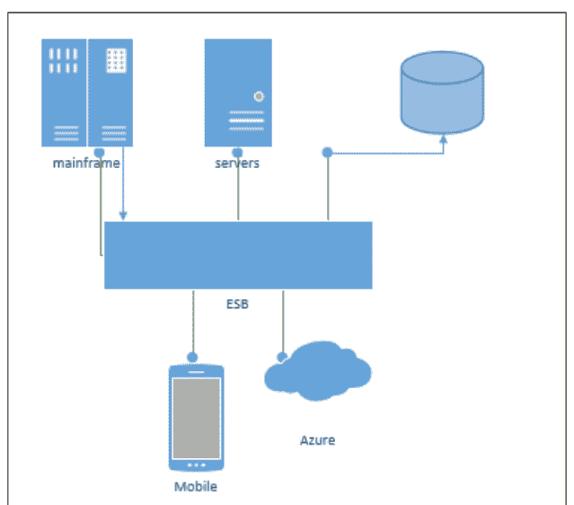

上图展示的是非常高级的接口，因此我们可以深入探讨服务本身的协议。

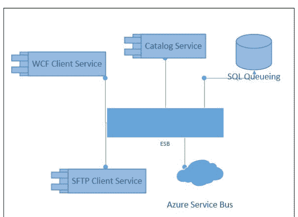

- **极其可配置：** NSB 使用 `Configure.With()` 函数进行配置，可以轻松地将持久化从 RavenDB 更改为 NHibernate ORM 框架，或将队列从 MSMQ 更改为 RabbitMQ、ActiveMQ 或 SQL 队列。除了某些配置外，几乎所有代码（如果不是全部）无论采用何种持久化和队列模型都能同样工作，因为 NSB 负责端点的配置和映射。
- **服务托管：** NSB 使用 `NServiceBus.Host.exe` 文件负责服务的管理和托管。
- **集中式生产监控：** Particular 的 ServicePulse 可以监控生产端点、消息报告和服务报告。
- **ServiceInsight：** Particular 的 ServiceInsight 可以通过可视化画布、端点视图、消息视图提供深入洞察，并让你更深入地理解 Saga 的消息、端点和消息服务。
- **快速开发：** Particular 的 ServiceMatrix 是 Visual Studio 的开发工作室扩展，通过生成 C# 代码的图形画布提供快速开发。

让我们看看 ESB 设计的几个实际需求。

- **支付引擎到银行：** C# 程序员可以使用 Microsoft Windows Communication Foundation（WCF）或 Microsoft Web API 为外部银行执行 Web 服务以扣款信用卡。WCF 有许多无法支持横切关注点的部分，例如重试和失败处理。NSB 可以托管服务，并在 MSMQ 中提供持久消息传递，以便在 WCF 接口上执行消息重试。如果 Web 服务对第三方服务（如银行）出现中断，NSB 将持久化消息。这包括跟踪消息报告，甚至消息加密。因此，虽然 WCF 可以实现 Web 服务部分，但在 WCF 领域之外还有许多部分，只有像 NSB 这样的产品才能提供横切功能。
- **在线订购系统：** 订购产品时，你可能会看到一个旋转的页面，并显示 **请勿刷新，正在处理订单**。这显然是一种网站与订购站点（包括信用卡处理）紧密耦合的设计。许多自动化过程可能会干扰 Web 浏览器，或者服务器端可能出现断连，导致流程重新开始。ESB 将始终确保，如果你不得不再次下订单或遇到中断，你的消息是事务性和持久性的，从而在订单收费时确保完整性。

> 对于与 NSB 设计松散耦合的网站，网站只需向服务队列发送消息，而不会中断 Web 流程。不允许在订单处理时刷新的网站依赖于后端流程完成，而 Web 流程可能会被中断。NSB 设计仍然可以在不中断网站的情况下向用户反馈订单状态。

## 事件驱动型任务

对于在 Windows 上调度任务，Windows 任务计划程序可以完成这项工作（参见 http://en.wikipedia.org/wiki/Windows_Task_Scheduler）。然而，取决于任务的复杂性，Windows 任务计划程序可能不足以处理它。例如，如果需要在启动任务之前检查节假日安排，并且该任务依赖于其他事件和服务在其运行前发生，你可能会遇到任务计划程序的局限性。Windows 任务计划程序是一个很棒的工具，但它不像 ESB 那样是事件驱动的。对于 ESB 来说，时间本身就是一种事件。

即使某项任务可以轻松由任务管理器完成，除非你使用像 NSB 这样的框架，否则你无法获得服务的全局管理、事件、命令和消息的消息传递，以及从管理视角对处理过程的反馈。

NSB 扩展了设计，以支持事件驱动设计的许多方面，在这些设计中，构建一个简单的网站、调度每日任务或发送付款可以轻松扩展到更大的规模，以便拥有、监控、管理、扩展、保护并维持良好的软件质量。当这些简单设计变得复杂时，常常需要进行重写，这并不少见。这仅仅是因为软件质量和设计扩展没有提前考虑。

ESB 是一种用于设计 SOA 架构的架构软件设计模式和框架。然而，ESB 还可以带来许多其他软件设计模式。这些是 NSB 支持的软件设计模式，但并非所有 ESB 都支持这些模式。


## 其他 SOA 模式

NSB 支持许多其他软件设计和消息传递模式。许多此类模式可以在 http://www.enterpriseintegrationpatterns.com 找到。设计模式的目的是提供经过行业复用验证的可重用框架，以快速部署之前设计好的方案。NSB 拥有多种在健壮可靠的 ESB 解决方案中广受欢迎的设计模式。

### 发布-订阅模式

使用 ESB 技术的一大好处是发布-订阅消息模式的可用性（更多细节，请参见 http://en.wikipedia.org/wiki/Publish-subscribe_pattern）。发布-订阅模式已经存在很长时间了，其简单性是许多系统的基础。

该模式利用消息队列，NSB 通过队列存储消息，无论是 MSMQ、SQL 队列、RabbitMQ、Azure 队列还是 ActiveMQ。其基本前提是消息发布到队列；在 NSB 中，它使用 `Bus.Publish(message)` 函数将事件消息放入队列，而无需发送到特定的接收者。可以有多个称为订阅者的输出通道监听发布者。这样做的好处是，服务之间除了消息之外不依赖任何彼此关系，并且可以相互独立地运行。这是一种解耦的服务，意味着依赖关系彼此分离。

当然，NSB 的正常功能仍然适用。例如，消息将保留在队列中，直到订阅者从队列中取出消息进行处理。对于 NSB，这意味着即使机器重启，消息仍会保留在队列中，直到订阅者处理完消息，从而确保消息永不丢失。

订阅者将处理消息，可以有一个或多个订阅者。例如，发布者可能在其队列中放入 10 种不同类型的消息，而每种类型的消息都可能有一个订阅者。

NSB 框架拥有 Windows 性能监视器的插件。在端点的服务级别协议（SLA）代码中，我们可以指定：如果服务未达到性能标准，将创建新服务或发送警报。因此，如果某个订阅者表现不佳，它将迫使其他订阅者接管，因为它们在多台机器上表现更好。因此，NSB 是一个高可用、持久消息、高性能的 ESB 引擎，可以通过多种方式进行开发。发布-订阅模式的设计如下所示：

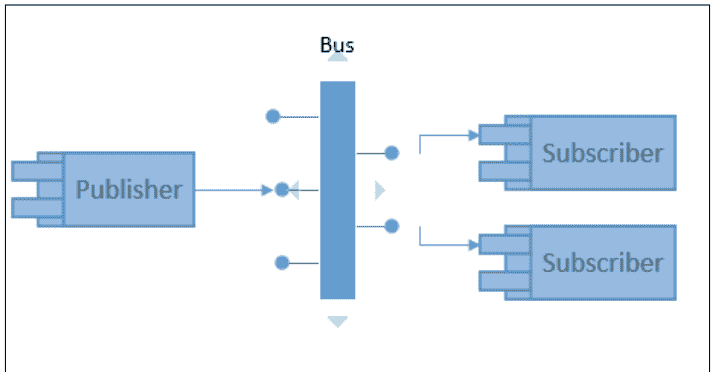

在 NSB 中，有一些专门用于发布-订阅的特殊类型消息，称为事件。这迫使代码在发布-订阅场景中处理消息，而不是在请求-响应场景中。

发布者-订阅者映射通过应用程序配置文件完成。这将定义订阅者将从发布者队列订阅的消息类型，以处理这些消息。当这些程序执行时，订阅映射将进一步保存到本地数据库中。默认情况下，它们保存在 RavenDB 中。

### 网关模式

在某些情况下，部分服务可能存储在一个组织的某个局域网中，而其他服务存储在另一个局域网中，彼此之间唯一的传输方式是通过 HTTP 或 HTTPS 隧道将消息传递给 NSB。

网关的主要目的是允许您在物理上分离的站点之间执行与 NServiceBus 中惯用的相同持久即发即忘消息传递，这里的站点是指运行 IT 基础设施的位置，而不是网站。

网关只有在无法使用正常的 LAN 到 LAN VPN 隧道或使用内部 LAN 服务器进行 MSMQ 到 MSMQ 通信时才发挥作用。网关的目的是创建通过 HTTP 通信的消息，但最好使用 HTTPS 以确保消息安全。以下架构图展示了使用 NSB 构建的网关：

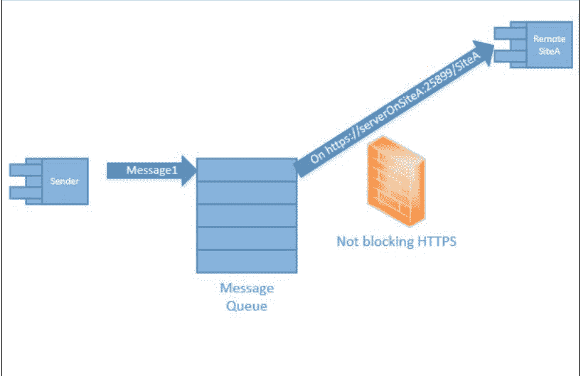

### 源代码

在本节中，我们将使用以下网关解决方案：

- Headquarters.Messages：指 Headquarters、SiteA 和 SiteB 的公共消息。
- Headquarters：将从 http://localhost:25899/Headquarter/ 和 http://localhost:25899/Headquarter2/ 接收消息，并向 http://localhost:25899/SiteA/ 和 http://localhost:25899/SiteB/ 发送消息。
- SiteA：这是一个项目，将从 Headquarters 通过 http://localhost:25899/SiteA/ 接收更新的价格信息，并通过 http://localhost:25899/Headquarter2/ 向 Headquarters 响应成功。
- SiteB：这是一个项目，将从 Headquarters 通过 http://localhost:25899/SiteB/ 接收更新的价格信息。
- WebClient：这将有一个 Index.htm 页面，用于向 http://localhost:25899/Headquarter/ 发送 JSON 脚本。

上述代码解决方案是在 Windows Server 2012 上使用 Visual Studio 2012 构建的，并安装了 MSMQ、DTC、NServiceBus 引用和 SQL Server 2012 Express LocalDB。

在网关中，有传入通道和定义的站点键，用于将传出消息发送到其站点。我们可以在总部的应用程序配置文件中看到，总部的接收通道是 http://localhost:25899/Headquarter/ 和 http://localhost:25899/Headquarter2/。

将有一组用于发送站点的站点键，这些站点构成 SiteA 和 SiteB。

```
<GatewayConfig>
  <Sites>
    <Site Key="SiteA" Address="http://localhost:25899/SiteA/" ChannelType="Http" />
    <Site Key="SiteB" Address="http://localhost:25899/SiteB/" ChannelType="Http" LegacyMode="false" />
  </Sites>
  <Channels>
    <Channel Address="http://localhost:25899/Headquarter/" ChannelType="Http" />
    <Channel Address="http://localhost:25899/Headquarter2/" ChannelType="Http" Default="true" />
  </Channels>
</GatewayConfig>
```

`Bus.SendToSites (new[] { "SiteA", "SiteB"})` 允许您向多个站点发送消息，正如您在前面的配置中所看到的。例如，SiteA 参数会将消息发送到 http://localhost:25899/SiteA/。

通过 HTTP 等替代通道传输意味着您失去了 MSMQ 对每一条消息恰好一次传递的安全保证。这意味着通信错误导致的重试可能会使同一条消息被多次接收。为了避免让您处理去重问题，NServiceBus 网关开箱即用地支持此功能。您只需存储所有已接收消息的消息 ID，以便检测潜在的重复。可以使用 NHibernate 持久化配置将去重表存储在 SQL Server 上。这将通过 `.UseNHibernateGatewayDeduplication()` 方法在 IBus 上进行配置。当然，始终需要在 App.config 文件中应用设置来定义数据库连接。这里，我们连接到本地 SQL Express 实例。

```
<connectionStrings><add name="NServiceBus/Transport" connectionString="cacheSendConnection=true"/>
<add name="NServiceBus/Persistence" connectionString="Data Source=.\SQLEXPRESS;Initial Catalog=nservicebus;Integrated Security=True"/>
</connectionStrings>
<!-- specify the other needed NHibernate settings like below in appSettings:-->
<appSettings>
<!-- dialect is defaulted to MsSql2008Dialect, if needed change accordingly -->
<add key="NServiceBus/Persistence/NHibernate/dialect" value="NHibernate.Dialect.MsSql2008Dialect"/>
<!-- other optional settings examples -->
<add key="NServiceBus/Persistence/NHibernate/connection.provider" value="NHibernate.Connection.DriverConnectionProvider"/>
<add key="NServiceBus/Persistence/NHibernate/connection.driver_class" value="NHibernate.Driver.Sql2008ClientDriver"/>
</appSettings>
```

这种网关模式允许我们通过 HTTP/HTTPS 传递消息，从而允许从本地局域网到外部系统进行排队。通常 Web 服务通过 HTTP/HTTPS 运行，但使用 NSB，排队过程也可以通过 HTTP/HTTPS 运行到外部服务器，在这些服务器中所有端口都被阻止，只能使用 HTTP/HTTPS。


## DataBus 模式

DataBus 用于以附件形式发送大块数据或文件，因为 MSMQ 的限制是 4 MB。因此，可以通过引用本地文件来传递数据，使用 `databus` 方法。消息将提供对较大数据文件的引用，该文件因大小限制而超出消息队列的大小。

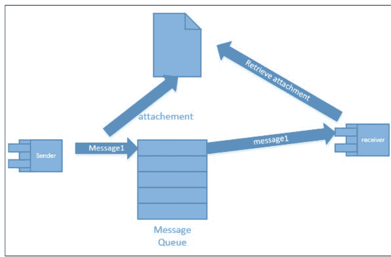

在本节中，我们将使用网关解决方案。

数据总线的路径必须在端点的配置中设置。我们将使用相对于网关项目运行位置的相对路径。`SiteA` 和 `SiteB` 也将使用相对路径。将有一个指向二进制文件的相对路径，其中包含一个数据总线子目录，该子目录包含大量数据的文件。代码如下：

```
public void Init()
{
    Configure.With()
        .DefaultBuilder()
        .FileShareDataBus(".\\databus");
}
```

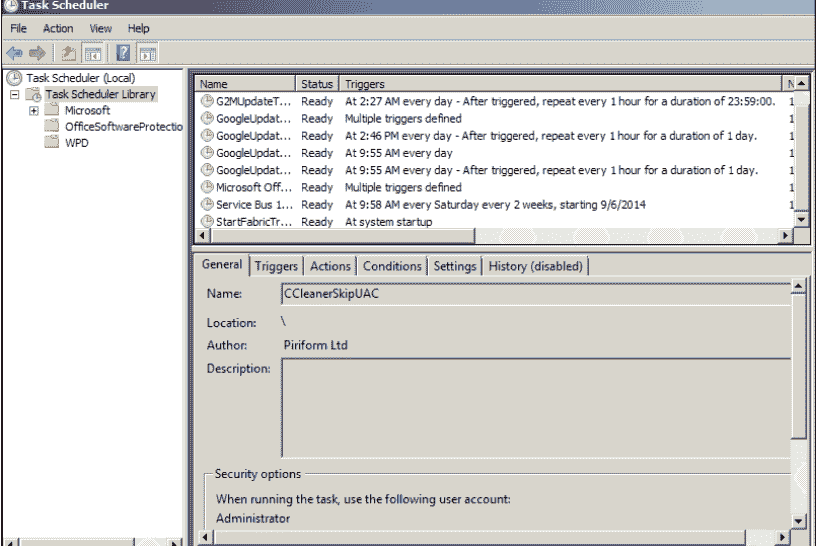

在 NSB 中，我们可以使用事件驱动的定时器消息。这是 saga 根据其定时器启动函数、运行命令或执行许多其他任务的能力。在事件驱动的定时器函数中，我们可以为一天中的任何时间设置超时，从进程启动后的几秒到几分钟、几小时、几天，甚至可以为进程使用假日表。通过托管服务，定时器的使用可以更加复杂，例如添加假日表、周末不执行定时器，以及任务调度器无法处理的更多业务功能。NSB 还包括服务本身的安装和管理。仅节省部署服务的时间和让 NSB 为管理员设置 DTC 所节省的时间，可能就足以支付 NSB 的许可证费用。

本节中的源代码将位于 NSB 5.0 版本的 `TimerSaga - v5` 目录中。这里有以下几个项目：

- AppCommon：包含 Windows 窗体的 ViewModel 和上下文。
- TimerSubmit：这是一个向 saga 提交 1 到 100 秒之间定时器消息的项目。
- TimerMessages：包含项目之间共享的消息。

当我们添加一个 1 到 100 秒之间的值时，消息将被发送到 TimerSaga 的队列中，其中包含秒数和一个用于跟踪消息 ID 的 RequestId，如下面的截图所示：

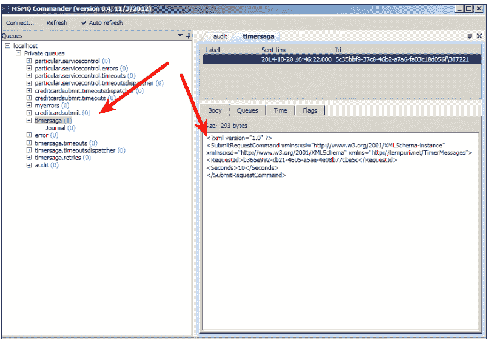

消息的 RequestId 用于将消息映射到 saga 数据。saga 由 SubmitRequestCommand 启动，其中包含秒数。它将 saga 数据保存在 TimerRequestData 对象中，该对象允许原始客户端数据对其进行响应。秒数将设置在超时中，当超时到期时，它将执行一个 TimeoutMessage 实例，该实例将由 saga 处理。定义此映射的 saga 对象类定义如下：

```
public class TimerRequestSaga : Saga<TimerRequestData>,
    IAmStartedByMessages<SubmitRequestCommand>,
    IHandleTimeouts<TimerRequestSaga.TimeoutMessage>
{
```

启动消息 SubmitRequestCommand 将由 saga 的消息处理器处理，代码如下：

```
public void Handle(SubmitRequestCommand message)
{
    logger.Info("--------TimerSaga SubmitRequestCommand-------" + message);
    
    var command = new TimeoutMessage
    {
        RequestId = message.RequestId
    };
    
    // We put the number of seconds 1-100 in the timer
    RequestTimeout<TimeoutMessage>(TimeSpan.FromSeconds(message.Seconds),command);
    
    Data.RequestId = message.RequestId;
    Data.Seconds = message.Seconds;
}
```

这段代码将设置定时器，定时器会发送一个带有消息 RequestId 的 TimeoutMessage 实例。同一启动消息的所有消息将具有相同的 RequestId。这将跟踪哪个消息启动了下一个消息，并将 saga 数据映射到保存和检索它的 saga 中。RequestId 被视为 saga 数据的主键，NSB 将使用它来将数据映射到消息。NSB 处理映射，但我们必须定义唯一标识符并在消息中持续处理它们。如果这看起来复杂，请继续阅读，因为后续章节会对其进行分解。

当我们传递给 `RequestTimeout<>()` 代码的超时时间到达时，一个超时消息实例会被传回给 saga。如果设置为 10 秒，则在 10 秒过后，将调用 saga 中的以下消息处理器来处理我们在定时器中设置的超时消息。超时消息处理器如下所示：

当 TimerSubmit 进程收到回复消息时，它将弹出一个“Timer in Seconds”窗口，如下所示：

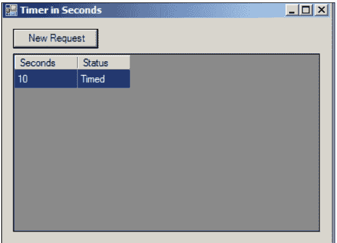

这段代码包含了简单 saga 的所有部分。该代码也可以使用其他框架的组合来创建，例如使用 Quartz 处理定时器，使用 TopShelf 创建服务，但 NSB 是一个完整的框架，提供端到端的架构片段以及包含所有部分的多种模式。

在 Windows 窗体中显示 Timed 状态的最终消息可以很容易地是作业的执行、另一个程序、系统状态的电子邮件、系统状态的报告，以及更多定时任务。之前使用的秒数只是一个演示。`RequestTimeout()` 函数可以接受秒、分钟、小时、天，或者可以在一天中的特定时间执行。我们可以使用周末和假日日历执行该函数，并进一步扩展功能。我们可以创建一个集中的 saga 定时器，像 Microsoft 任务计划程序一样调度所有任务，但创建一个可监控、可管理、可生成报告并在更详细的解决方案中改进功能的托管服务。

## 消息变异模式

消息变异器允许你通过将自定义逻辑插入到几个简单的接口中来更改消息。例如，你可以加密消息的一部分或全部。加密消息变异器是 NServiceBus 库的一部分，可以随时使用。你可以拦截传入消息，然后在将其作为传出消息发送之前对其进行变异。这就是消息在离开客户端并进入服务器时被更改的过程。

## 源代码

在本节中，我们将使用 MessageMutators 解决方案，其中包含以下项目：

- Client：客户端将向服务器发送消息。
- Server：服务器将接收变异后的消息。
- Messages：这是在客户端和服务器之间传递的消息格式。
- MessageMutators：此项目将包含在 TransportMessageCompressionMutator.cs 中压缩和解压缩消息的变异代码，以及在 ValidateMessageMutator.cs 中验证消息注解的代码。

客户端和服务器需要运行。客户端将提示发送一条好消息或坏消息。好消息会被压缩，以便通过 4 MB 的 MSMQ 缓冲区大小限制，如下面的截图所示：

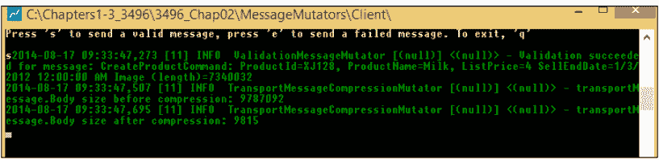

队列中的数据将在 MSMQ 处理之前由客户端进行验证和压缩。如下图所示：

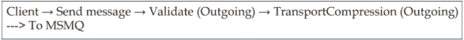

然后，服务器将从 MSMQ 接收消息，但在处理之前，它会解压缩并验证消息。它将恢复客户端变异前的消息。如下图所示：

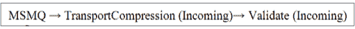

这只是一个简单的压缩和数据注解验证，以确保 MSMQ 能够处理该消息。变异消息的原因之一可能是对支付消息中的信用卡进行加密。


```
public class PaymentRequestSaga : NServiceBus.Saga.Saga<PaymentRequestData>,
    IAmStartedByMessages<SendCommand>,
    IHandleMessages<ResponseCommand>,
    IHandleTimeouts<SendCommand>
{
    public void Handle(SendCommand message)
    {
        ResponseCommand resp = new ResponseCommand();
        resp.RequestId = message.RequestId;
        resp.state = PaymentMessages.MessageParts.StateCodes.SentMyWCFClient;
        ReplyToOriginator(resp);
        Bus.Send(message);
        RequestTimeout(TimeSpan.FromHours(3), message); // 3 hours
        Data.RequestId = message.RequestId;
    }
}
```

- `Saga<IContainSagaData>`：saga 数据是被持久化的数据。这些数据包含 NSB 为 ID、发起方和 OriginalMessageId 实例设置的默认值。此外，应使用唯一 ID 在消息和数据之间进行映射，反之亦然。如下图所示：

```
public class PaymentRequestData : IContainSagaData
{
    /***
     * Gets/sets the Id of the process. Do NOT generate this value in your code.
     The value of the Id will be generated automatically to provide the
     best performance for saving in a database.
     ***/
    public virtual Guid Id { get; set; } // Required
    /***
     * Contains the return address of the endpoint that caused the process to run.
     ***/
    public virtual string Originator { get; set; } //Required
    /***
     * Contains the Id of the message which caused the saga to start.
     This is needed so that when we reply to the Originator, any
     registered callbacks will be fired correctly.
     ***/
    public virtual string OriginalMessageId { get; set; } //Required

    [Unique]
    public virtual Guid RequestId { get; set; } // Unique ID to lookup Request message
}
```

- `IHandleMessages<IMessage>`：除非正在处理消息，否则 saga 不会做太多事情。它可以检索通过配置映射的消息的已保存数据。NSB 通过唯一 ID（此处为 `RequestId`，定义在 `ConfigureHowToFindSaga()` 中）来处理数据到消息的映射。
- `ConfigureHowToFindSaga()`：saga 模式的这个函数用于将数据映射到消息。通常，映射可以通过 GUID 或 ID 执行，但它必须是唯一的数据类型，可以作为数据库中的主键存储。被映射的消息包含相同的键，当它传入 saga 时，会找到与该键匹配的数据。当 saga 对象被实例化时，会调用此函数。

```
public override void ConfigureHowToFindSaga()
{
    ConfigureMapping<ResponseCommand>(x => x.RequestId).ToSaga(x => x.RequestId);
}
```

## Saga 有什么用处？

Saga 在工作流管理中扮演着关键角色。如果无法将数据映射到持久化数据，消息之间的工作流就无法实现。Saga 的目的是持久化 saga 数据对象，这些对象由消息处理程序中的消息指示，从所选内容中填充数据。以下是 saga 的一些用途：

- **保存消息状态/会话信息**：当消息启动时，消息处理程序将创建 saga 数据实例，该实例将在消息处理程序结束时保存。由消息处理程序数据负责将数据设置到对象的实例中。NSB 处理映射。以下截图显示了处理消息的代码：

```
public void Handle(SendCommand message)
{
    ResponseCommand resp = new ResponseCommand();
    resp.RequestId = message.RequestId;
    resp.state = PaymentMessages.MessageParts.StateCodes.SentMyWCFClient;
    ReplyToOriginator(resp);
    Bus.Send(message);
    RequestTimeout(TimeSpan.FromHours(3), message); // 3 hours
    Data.RequestId = message.RequestId;
}
```

在此场景中，我们给消息三个小时的时间来执行其操作，然后使其超时。以下截图显示了提供超时的代码：

```
public class PaymentRequestSaga : NServiceBus.Saga.Saga<PaymentRequestData>,
    IAmStartedByMessages<SendCommand>,
    IHandleMessages<ResponseCommand>,
    IHandleTimeouts<SendCommand>
{
    public override void ConfigureHowToFindSaga()...

    public void Handle(SendCommand message)
    {
        // ...
        RequestTimeout(TimeSpan.FromHours(3), message); // 3 hours
        // ...
    }

    public void Handle(ResponseCommand message)...

    public void Timeout(SendCommand state)
    {
        ResponseCommand resp = new ResponseCommand();
        resp.RequestId = state.RequestId;
        resp.state = PaymentMessages.MessageParts.StateCodes.Timeout;
        ReplyToOriginator(resp);
        MarkAsComplete();
    }
}
```

由于 saga 模式能够持久化消息的状态数据，消息变成了各自独立、无连接的片段，并提供了一种将多个消息相互连接以执行端到端流程的方法。因此，saga 成为交互的焦点。消息现在具有行为模式，因为它们比单一实例更有意义。它们现在具有很长的生存时间，因为即使单个消息不再可用，代表该消息数据的 saga 数据仍然会继续存在，直到被标记为销毁。

这些示例表明，在 5.0 版本中，总线配置是作为一个对象创建的，配置值被添加到该对象的实例中。总线配置可以作为配置传递给函数，以便反复利用，实现总线配置的重用。

较新版本中 NServiceBus 扩展的其他功能还包括新增的 NSB 包。其中一个包是 `NServiceBus.NLog`，它专门用于在 NSB 5.0 及以上版本中使用 NLog。它用于扩展 NSB 的日志记录能力，以记录适用于端点、消息和服务的更多信息。有关 `NServiceBus.NLog` 包的详细使用，请参见 `http://docs.particular.net/nservicebus/logging-in-nservicebus`。我们将在本章后面演示该代码的用法。

## Saga 工作流

Saga 的目的是提供工作流。它提供 saga 数据的持久化，以便消息可以返回 saga，并有一个指向原始消息的参考点。

本节中的源代码位于 *CreditCardApproval – v5* 部分。它使用 NSB 5.0 版本在 Visual Studio 2012 中编译。项目将如下所示：

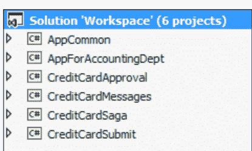

这里我们有以下项目：

- `AppCommon`：这包含 Windows 窗体的 ViewModel 和上下文。
- `AppForAccountingDept`：这接收与信用卡审批相关的采购订单号。
- `CreditCardApproval`：这审批信用卡。
- `CreditCardSubmit`：这提交信用卡以供审批。

## NServiceBus Saga 架构

- `CreditCardMessages`：这包含项目的公共消息。
- `CreditCardSaga`：这是信用卡 saga，通过使用消息处理和 saga 数据来指导工作流和消息路由。

消息流（它完成了所有工作，即工作流）将从 `CreditCardSubmit` 项目开始。此窗体将向 saga 提交信用卡，saga 将保存其状态并将其转发给 `CreditCardApproval` 项目。`CreditCardApproval` 窗体将批准或拒绝该卡，并将响应发送回 saga。saga 将检索先前的消息并将其传递回 `CreditCardSubmit` 窗体，如果获得批准，则会将其发送到 `AppForAccountingDept` 项目。消息流如下所示：

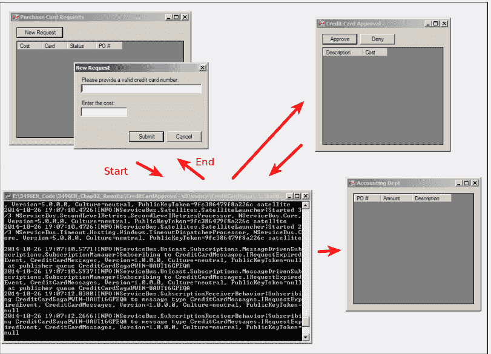

这是一个非常简单的工作流，因为它跟踪信用卡是否获批。通过使 saga 数据持久化，它允许持久化的 saga 数据状态在单一点路由消息并管理消息信息。saga 数据将包含必需的 ID、发起方和 `OriginalMessageId`，以确保能够响应原始客户端。这些字段确保返回始终可用。我们在下图中看到这些字段：


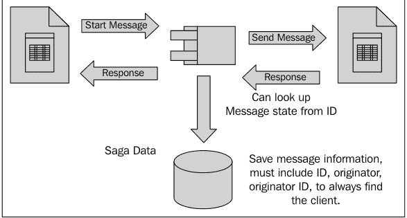

Saga 数据是通过使用 IContainSagaData 接口来存储的。即使这三个字段没有显式定义，IContainSagaData 接口也会在存储中定义它们。不要修改这些字段，因为 NServiceBus 使用它们。主键是另一个在所有 saga 中用于从消息查找 saga 数据的字段。在此情况下，我们使用 RequestId，它将始终包含来自 [Unique] 注解的唯一值。我们可以在以下代码中看到这一点：

```
public class CreditCardRequestData : IContainSagaData
{
    /***
    * Gets/sets the Id of the process. Do NOT generate this value in your code.
    The value of the Id will be generated automatically to provide the
    best performance for saving in a database.
    * ***/
    public Guid Id { get; set; } // Required
    /***
    * Contains the return address of the endpoint that caused the process to run.
    * ***/
    public string Originator { get; set; } //Required
    /***
    * Contains the Id of the message which caused the saga to start.
    This is needed so that when we reply to the Originator, any
    registered callbacks will be fired correctly.
    * ***/
    public string OriginalMessageId { get; set; } //Required

    [Unique]
    public Guid RequestId { get; set; } // Unique ID to lookup Request message
    public string Card { get; set; }
    public decimal Cost { get; set; }
    public bool RequiresApproval { get; set; }
    public bool Approved { get; set; }
}
```

超时也可以用于为 saga 安排每日任务以完成其清理和维护工作。例如，我们可以每天向运营发送电子邮件，报告 saga 当天处理的邮件数量以及错误队列中是否有报告的邮件。在这里，我们给信用卡审批人 60 秒的时间进行审批。以下屏幕截图显示了此代码：

```
public void Handle(SubmitRequestCommand message)
{
    logger.Info("--------CreditCardSaga Handle-------" + message);
    
    // We give the Approver 60 seconds to respond
    RequestTimeout<TimeoutMessage>(TimeSpan.FromSeconds(60));
}
```

Saga 的目的是通过 saga 数据的状态来管理消息的工作流。Saga 将由 `IAmStartedByMessages<>` 中定义的消息或多个消息启动。后续消息在 `IHandleMessages<>` 中定义。超时有一个特殊的消息处理器，称为 `IHandleTimeouts<>`。我们可以在以下类图中观察到这一点：

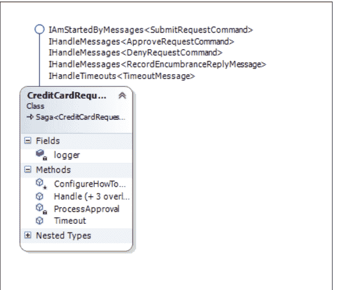

为了保存 saga 数据，数据需要映射到消息。NSB 会完成大部分映射工作，但它需要定义将用于将数据映射到消息的消息 ID。在我们的 saga 数据中，我们使用 RequestId 实例作为消息的数据主键。在 4.0 版本中，我们将此功能映射为使用 RequestId 实例来映射消息 ApproveRequestCommand 和 DenyRequestCommand，如以下代码所示，使用 ConfigureHowToFindSaga()：

```
public override void ConfigureHowToFindSaga()
{
    ConfigureMapping<ApproveRequestCommand>(x => x.RequestId).ToSaga(x => x.RequestId);
    ConfigureMapping<DenyRequestCommand>(x => x.RequestId).ToSaga(x => x.RequestId);
}
```

在 5.0 版本中，我们将此功能映射为使用 RequestId 实例来映射消息 ApproveRequestCommand 和 DenyRequestCommand，如以下代码所示，使用 `ConfigureHowToFindSaga(SagaPropertyMapper<> mapper)`：

```
protected override void ConfigureHowToFindSaga(SagaPropertyMapper<CreditCardRequestData> mapper)
{
    mapper.ConfigureMapping<ApproveRequestCommand>(x => x.RequestId).ToSaga(x => x.RequestId);
    mapper.ConfigureMapping<DenyRequestCommand>(x => x.RequestId).ToSaga(x => x.RequestId);
}
```

这些消息由消息处理器处理，例如 `Handle(DenyRequestCommand message)`。Saga 数据将从 NSB 中提取与消息的 RequestId 匹配的记录。NSB 只需要映射定义，它就会处理维护持久性和映射的记录，如以下代码所示：

```
public void Handle(DenyRequestCommand message)
{
    logger.Info("----------CreditCardSaga Handle----------" + message);
    var reply = new SubmitRequestReplyMessage
    {
        RequestId = Data.RequestId,
        Approved = false
    };

    ReplyToOriginator(reply);
    MarkAsComplete();
}
```

## 消息流

启动流程的源客户端将是 CreditCardSubmit。此客户端可以很容易地是一个网站或启动消息流程的另一种方式。SubmitRequestCommand 消息是 saga 的起始消息，该消息从 CreditCardSubmit 项目发送。它在 CreditCardSubmit 项目的 App.config 文件中定义为发送到 saga，如以下代码所示：

```
<UnicastBusConfig ForwardReceivedMessagesTo="MyAudits">
  <MessageEndpointMappings>
    <add Endpoint="CreditCardSaga" Messages="CreditCardMessages.SubmitRequestCommand, CreditCardMessages" />
    <add Endpoint="CreditCardSaga" Messages="CreditCardMessages.IRequestExpiredEvent, CreditCardMessages" />
  </MessageEndpointMappings>
</UnicastBusConfig>
```

我们可以在 MSMQ 中查看正在发送的消息，但如果 saga 正在运行，消息会处理得太快而无法观察。我们可以在不运行所有服务的情况下，通过在某个时间点拍摄快照来查看 saga 中的消息，如以下屏幕截图所示：

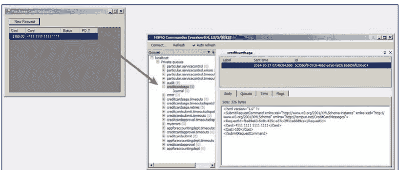

一旦 saga 启动，它就会处理 SubmitRequestCommand 消息。Saga 将使用默认值和消息信息填充数据。请注意，RequestId 在 saga 数据中设置为与消息的 RequestId 实例匹配。这是为了将 saga 数据映射到 saga 处理的其他消息，但为了使此 RequestId 实例匹配，saga 需要映射的每个消息中都必须设置此键。此代码如下所示：

```
public class SolicitApprovalFromLevel1CommandHandler : IHandleMessages<SolicitApprovalFromLevel1Command>
{
    public Context<ItemViewModel> Context { get; set; }

    public void Handle(SolicitApprovalFromLevel1Command message)
    {
        Context.MarshalToUiThread(() => HandleOnUiThread(message));
    }

    private void HandleOnUiThread(SolicitApprovalFromLevel1Command message)
    {
        var item = new ItemViewModel
        {
            RequestId = message.RequestId,
            Card = message.Card,
            Cost = message.Cost
        };

        Context.Items.Add(item);
    }
}
```

另请注意，在生产系统中，信用卡会被加密。如我们在上一章中所讨论的，NSB 很容易处理数据的加密和消息的加密。这将按如下方式加载审批或拒绝的选择：

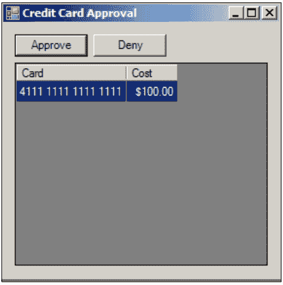

Saga 将读取并处理来自会计部门的类型为 RecordEncumbranceReplyMessage 的消息。Saga 将响应原始客户端 CreditCardSubmit，以便其可以使用采购订单号和状态进行更新。我们可以在 saga 消息处理器代码的以下屏幕截图中看到这一点：

```
public void Handle(RecordEncumbranceReplyMessage message)
{
    logger.Info("--------CreditCardSaga Handle------" + message);
    var reply = new SubmitRequestReplyMessage
    {
        RequestId = Data.RequestId,
        Approved = true,
        PurchaseOrderNumber = message.PurchaseOrderNumber
    };

    ReplyToOriginator(reply);
    MarkAsComplete();
}
```

源客户端将通过 saga 从会计部门应用程序接收采购订单，如下所示：

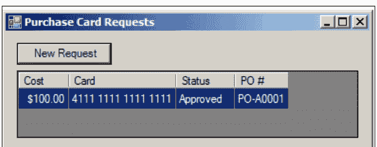

在原始请求者收到采购订单后，消息即完成。对于拒绝和错误，消息流将类似。

有人可能会问为什么消息流中有这么多工作。NSB 几乎完成了消息流和映射的所有工作。许多组织保存数据是为了处理错误。Saga 具有处理消息、端点和服务中错误的大量基本错误处理机制。我们已经编写了超时代码，以便消息在特定时间内发生。


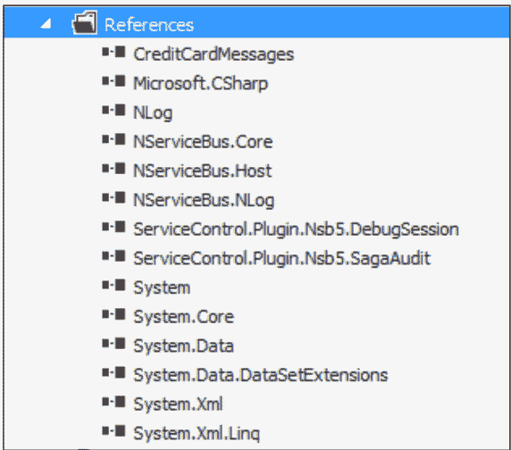

在向项目添加服务控制后，我们将其命名为 CreditCardApprove - v5 - ServiceInsight，我们可以通过 ServiceInsight 获取有关 saga 及其消息的详细信息，其显示效果与以下屏幕截图类似：

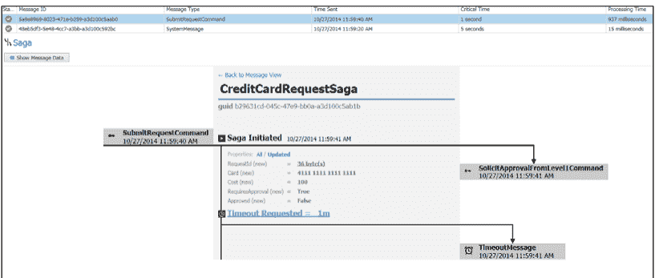

## 特定服务平台

在本章中，我们将重点关注 Particular Service Platform，其中包括 ServicePulse、ServiceControl、ServiceInsight 和 ServiceMatrix。我们可以使用 ServicePulse 来获取 NServiceBus（NSB）端点、消息、saga 和服务的脉搏。这更像是一个生产监控产品，供运维人员检查正在运行的 NSB 组件。

ServiceInsight 是用于深入了解 NSB 端点、消息、saga 和服务的产品，以便深入排查问题并详细验证操作的正确性。ServiceMatrix 是图形化开发者界面，可扩展到 Visual Studio 画布，用于生成 NSB 端点、服务和消息的代码。

在本章中，我们将介绍：

- ServicePulse
- ServiceControl
- ServiceInsight
- ServiceMatrix
- 通过 ServiceMatrix 进行发布-订阅
- 通过 ServiceMatrix 进行 Sagas
- 为 ServicePulse 引入自定义检查

## 介绍 NSB 组件

可以从 http://particular.net/ 许可许多工具，以帮助开发和监控 NSB 组件。NSB 组件包括端点、消息和服务。组件包括 IBus 上配置的任何项目。

ServiceMatrix 是可安装到 Visual Studio 2012 的扩展插件。该插件创建 NSB 画布，通过向导创建各种 NSB 组件，并生成用于 ESB 的 C# 代码。ServiceMatrix 通过生成与 NSB Canvas 中设计的图表相匹配的代码来简化和标准化开发生命周期，并帮助开发人员通过 NSB Visual Studio 向导创建 NSB 标准化代码。NSB 向导有助于学习不同部分如何构成从头到尾的 NSB 应用程序。ServiceMatrix 还创建骨架组件并关联生成的 C# 代码，以便开发人员以更少的精力运行端到端的 NSB 解决方案。

ServiceControl 是 NSB 的管理扩展控制器。其代码可从 https://github.com/Particular/ServiceControl 下载。ServiceControl 是一个 Windows 服务，收集端点、消息和服务信息，并将其存储在本地 RavenDB 中。这样其他产品如 ServicePulse 和 ServiceInsight 就可以访问信息以报告服务的运行状况并提供有关消息的详细信息。ServicePulse 通过心跳插件检查 NSB 应用程序的心跳，并提供自定义检查。它有一个仪表板，显示哪些 NSB 应用程序在生产环境中处于运行状态。ServiceInsight 提供消息、端点和服务的详细信息。它显示消息的详细图形流程和属性，包括端点和服务信息、超时、有效负载等。ServiceInsight 允许深入挖掘消息传递。这些工具可从下载页面 http://particular.net/downloads 找到。虽然可以在没有这些工具的情况下监控、维护和构建 NSB 应用程序，但这些工具投入了大量工作来帮助开发人员理解、构建和维护 NSB 应用程序，以便更快地将构建更好的产品推向市场。

我们将逐步介绍设置 ServicePulse，然后是 ServiceInsight，然后使用 ServiceMatrix 构建一些应用程序，供 ServicePulse 和 ServiceInsight 检查。ServiceControl 是 ServicePulse 和 ServiceInsight 都需要使用的安装，以便收集其信息。我们将从 ServicePulse 开始向我们展示仪表板，因为它是这些工具中最基础的。要运行本章中的任何应用程序，必须安装 ServiceControl、ServicePulse、ServiceMatrix 和 ServiceInsight。您可以通过访问 http://particular.net/downloads 并点击 Download Now 按钮来下载这些产品，选择通过 Platform Installer 安装所有产品，该安装程序适用于 Windows 8.1 及其他桌面机器。对于某些服务器，如 Windows Server 2008，此按钮可能无法使用，可能需要从此页面单独安装各个下载项。本章假设所有这些产品都已安装。

ServicePulse 将通过其在安装 ServicePulse 时的设置来知道如何调用 JSON API 的此起点。请参阅以下屏幕截图，了解我们设置 ServiceControl API 实例的位置：

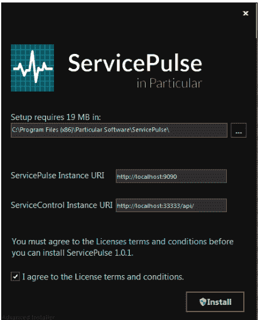

让我们看一个简单示例。我们可以从 https://github.com/Particular/NServiceBus.Msmq.Samples/tree/master/PubSub 的发布-订阅 MSMQ 示例开始。

我们需要通过 NuGet 添加 ServiceControl 插件以生成用于监控目的的 ServiceControl 端点，否则将没有任何内容供 ServiceControl 监控。目前可用的插件如下：

- ServiceControl.Plugin.DebugSession：可在 https://www.nuget.org/packages/ServiceControl.Plugin.Nsb4.DebugSession/ 找到 4.x 版本，以及 https://www.nuget.org/packages/ServiceControl.Plugin.Nsb5.DebugSession/ 找到 5.x 版本。部署后，调试会话插件会将指定的调试会话标识符添加到端点发送的每条消息的标头中。这允许在 ServiceInsight 中关联、过滤并突出显示在 Visual Studio 中调试或测试运行期间发送的消息。

2. 然后，我们可以在 ServicePulse 中检查心跳，以验证应用程序是否发出指示可用性的心跳。我们通过 URL http://localhost:9090 监控 ServicePulse。这在以下 ServicePulse 屏幕截图中可见

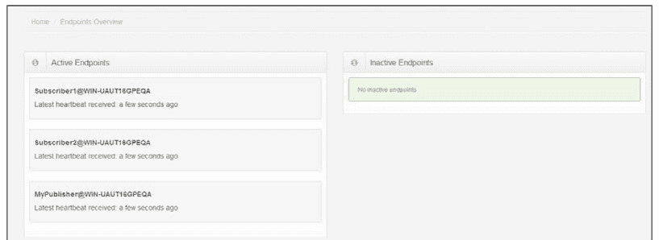

3. 如果服务出现问题，请始终检查 ServiceControl 和 ServicePulse 是否正在运行。以下屏幕截图显示了它们正在运行：

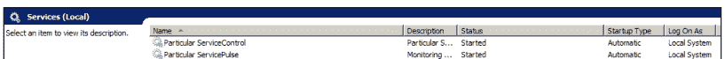

## 理解 ServiceInsight 及其功能

ServiceInsight 提供对特定消息的详细洞察。它提供详细流程、时序和错误处理，以及重试消息、排序消息、查看其标头、查看其 saga、复制标头、复制消息等功能。

我们将在构建的 ServiceMatrix 示例中进一步探索这一点，但我们需要熟悉 ServiceInsight 的功能。您可能选择在开发中不使用其中一些工具，但本章的目的是讨论这些工具。

在本章后续关于 ServiceMatrix 的部分中，我们将采用 PaymentEngine - Start 目录中的此请求-响应解决方案并扩展为发布-订阅消息流，并添加 saga。最终结果是发布-订阅和 saga 将位于 PaymentEngine - Sagas 目录中。
在 Windows 8.1 中，您可能需要以管理员身份运行 Visual Studio 2012。在 Windows Server 2008 和 Windows Server 2012 上运行 Visual Studio 2012 时，您可能不需要以管理员身份运行 Visual Studio 2012。

## 创建 ServiceMatrix 解决方案

我们将通过导航到 Tools | Extensions and Updates 在 Visual Studio 中安装 ServiceMatrix。您将看到以下屏幕：

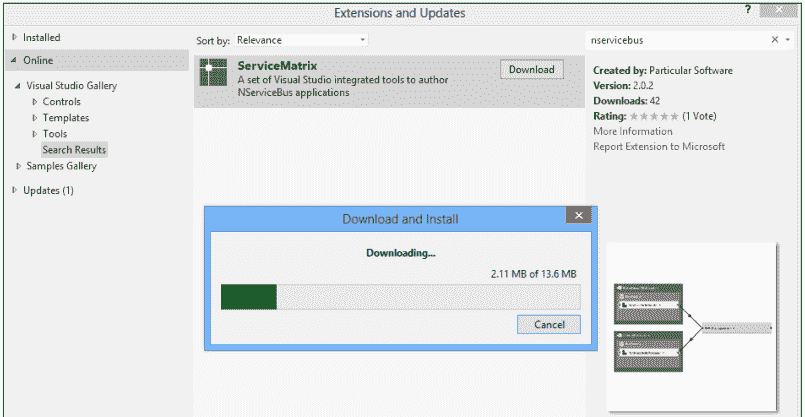


通过右键单击这些部分的各个元素，我们可以添加或更改属性，如以下屏幕截图所示：

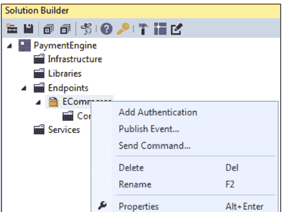

我们可以在 NServiceBus Canvas 中完成类似的任务。不同之处在于这是一个显示流程的可视化图表，而不是树形目录层次结构。如以下屏幕截图所示，右键单击图形信息：

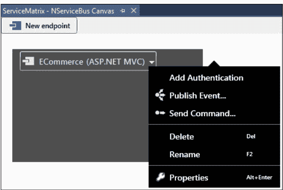

解决方案资源管理器窗格将显示生成的代码。部分代码是为在开发过程中添加更多细节而创建的存根。可以通过 Publish Event... 创建事件，并通过 Send Command... 创建命令消息。我们可以创建一个发送命令消息。我们将为 SubmitPayment 命令消息将服务命名为 Payments，如以下屏幕截图所示：

此时，代码将无法编译，因为消息只有一个端点。我们需要使用 Deploy Component... 命令部署另一个端点，如下所示：

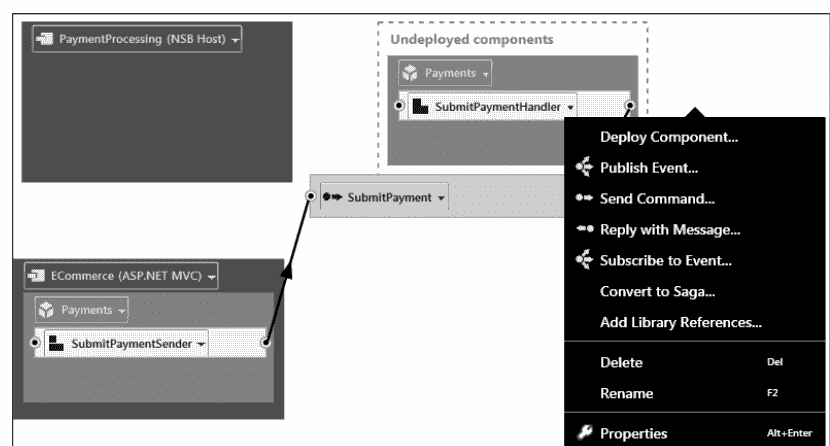

我们可以选择可用的端点。在这种情况下，我们有能力像为 PaymentProcessing 端点所做的那样以图形方式创建新的端点，如以下屏幕截图所示：

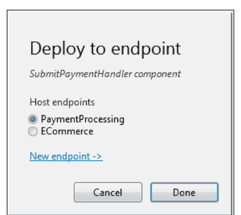

然后，我们将有两个端点，其中一条命令消息从 ECommerce，即 MVC 控制器，发送到 PaymentProcessing，即 NSB 主机。这些端点将根据部署情况成为控制台应用程序或服务应用程序。在以下屏幕截图中，我们可以看到这两个端点以及它们之间的消息：

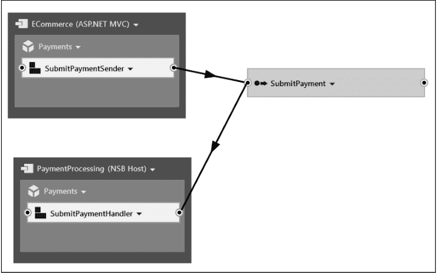

SubmitPaymentSender 函数将发送消息，而 SubmitPaymentHandler 函数将接收消息，如前面的图表所示。这些函数已由 ServiceMatrix 创建，可以进行扩展。查看 SubmitPaymentHandler，我们可以扩展该函数以打印数据字段。

```
using System;
using NServiceBus;
using PaymentEngine.Internal.Commands.Payments;

namespace PaymentEngine.Payments
{
    public partial class SubmitPaymentHandler
    {
        partial void HandleImplementation(SubmitPayment message)
        {
            // TODO: SubmitPaymentHandler: Add code to handle the SubmitPayment message.
            Console.WriteLine("Payments received " + message.GetType().Name);
            Console.WriteLine("Data " + message.data);
        }
    }
}
```

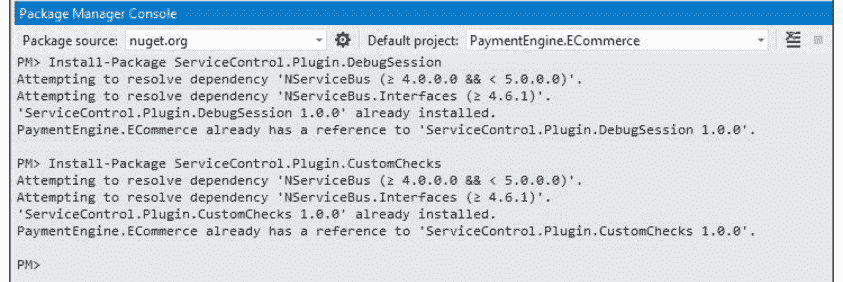

到目前为止，我们已经提到了可以安装的四个 ServiceControl 插件：

- **ServiceControl plugin for CustomChecks**：CustomChecks 插件允许 NSB 端点的开发人员定义在端点启动时或定期检查的一组条件。
- **ServiceControl plugin for DebugSessions**：DebugSessions 是一个专用插件，可实现 ServiceMatrix 与 ServiceInsight 之间的集成。
- **ServiceControl plugin for heartbeats**：Heartbeat 插件从端点向 ServiceControl 队列发送心跳消息。这些消息默认每 10 秒发送一次。
- **ServiceControl plugin for SagaAudits**：Saga Audit 插件收集 saga 运行时活动信息。此信息使 ServiceInsight saga 视图中能够显示详细的 saga 数据、行为和当前状态。

通过将 Heartbeat 插件安装到 ECommerce 和 PaymentProcessing 项目中，ServicePulse 现在将提供这些服务的正常运行时间的心跳信息，如下所示：

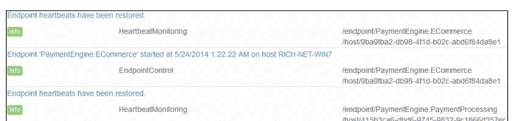

**Publish Event...** 选项用于创建将要发布的消息，如以下屏幕截图所示：

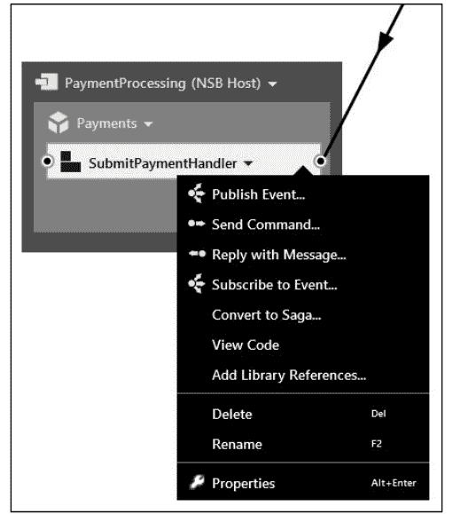

我们将从 `PaymentProcessing` 主机命名发布者事件消息为 `PaymentAccepted`，如下所示：

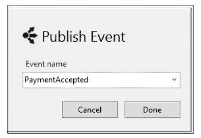

将创建代码生成窗口以在部署前查看代码：

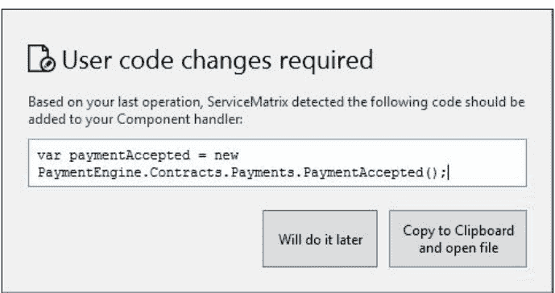

这样你就可以在将代码复制到要发布的消息处理程序之前查看代码。以下是代码：

```
public partial class SubmitPaymentHandler
{
    partial void HandleImplementation(SubmitPayment message)
    {
        // TODO: SubmitPaymentHandler: Add code to handle the SubmitPayment message.
        Console.WriteLine("Payments received " +
        message.GetType().Name);
        Console.WriteLine("Data " + message.data);
        var paymentAccepted = new
            PaymentEngine.Contracts.Payments.PaymentAccepted();
        Bus.Publish(paymentAccepted);
    }
}
```

要向发布者添加订阅者，只需使用如以下屏幕截图所示的 **Add Subscriber...** 命令：

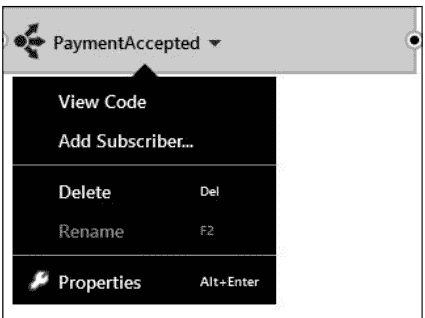

然后我们可以将订阅者添加到新服务。让我们将其命名为 `Paying`。

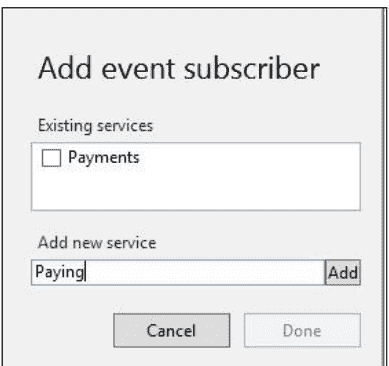

我们还必须将 PaymentAcceptedHandler 组件作为端点部署。在此场景中，我们也将其称为 Paying。进行这些更改后，我们应该看到以下内容：

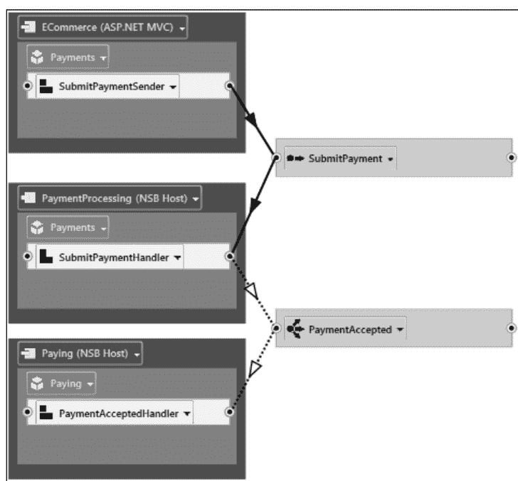

解决方案的属性窗口将定义错误和审计队列：

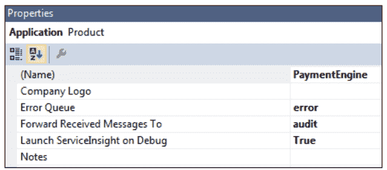

**Properties** 窗口还将显示可使用的各种类型的队列：

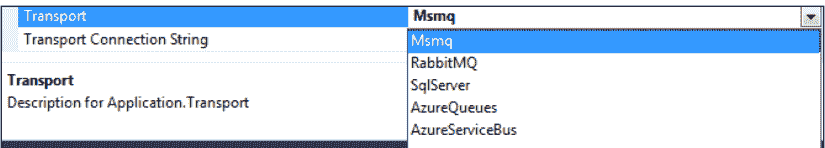

运行解决方案并重新运行 ServicePulse 时，我们可以看到创建的额外 Paying 端点，该端点尚未安装插件：

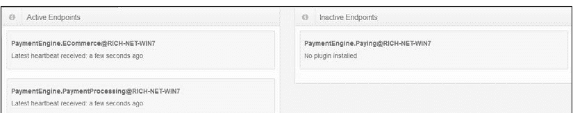

如果我们在 ServiceInsight 中查看流程，我们可以看到新的流程：

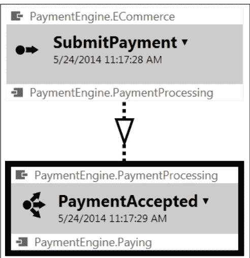

我们将把接收端点部署到名为 NotifyProcessing 的新端点。

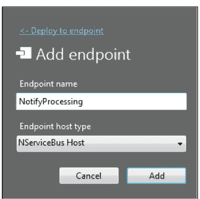

到目前为止，我们应该有以下内容：

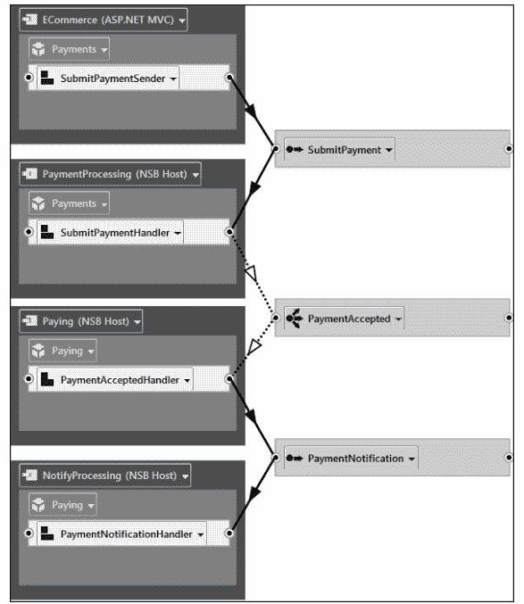

## 为什么要阅读？

读书让我们眼界开阔。

为什么要阅读？在很多人看来，这似乎不是一个问题。但在现在这个信息爆炸的时代，阅读似乎已经成为了一种奢侈。

读书让我们眼界开阔，能让我们站在巨人的肩膀上看到更远的世界。每一个成功的人，都离不开阅读。

读书能让我们拥有丰富的心灵世界。即使身处陋室，亦能感受“谈笑有鸿儒，往来无白丁”的意境。

读书，是世界上第一等好事。

- THE END -

> *文章来源：网络*

```
{
    public MyCustomCheck()
        : base("ECommerce SubmitPayment check", "ECommerce")
    {
        ReportPass();
    }
}
```

这样当提交付款时，我们可以在 ServicePulse 上获得一条额外的消息。

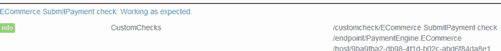

我们可以使用条件语句来检查是否存在的文件、其他消息以及可以报告为通过或失败的许多条件，同时向 ServicePulse 提供状态以供操作采取行动。

在 CustomChecks 类中，我们还可以设置一个计时器以使用 PeriodicCheck 接口定期检查。这将设置一个计时器来回调该类并将条件发送到 ServicePulse。它与 ReportPass 的操作方式不同，因为它是基于计时器的，以便报告条件。当新类引用 PeriodicCheck 接口时，它需要一个 PerformCheck() 函数来执行自定义检查。在我们的函数中，我们使用的是 NSB CheckResult：

```
namespace PaymentEngine.PaymentProcessing
{
    class CheckHealth : PeriodicCheck
    {
        public CheckHealth()
            : base("PaymentProcessing Healthcheck",
            "PaymentProcessing", TimeSpan.FromMinutes(2))
        {
        }

        public override CheckResult PerformCheck()
        {
            // Fake a failure once in a while
            if (DateTime.Now.Second % 2 == 0)
            {
```

## ASP.NET MVC 简介

**模型-视图-控制器（MVC）**是实现用户界面最常见的软件设计模式。ASP.NET MVC 是微软在 ASP.NET 中实现 MVC 软件设计模式的框架。通过复用已被他人验证和测试的已知设计模式与框架进行开发，可以为任何应用程序带来大量已知组件的可复用性。

通过将逻辑拆分为控制器（控制器具有 `session`、`request` 和 `response` 辅助函数），同时传递模型（即视图模型，其中包含我们希望呈现到视图中的信息），可以将大部分逻辑和暴露面从浏览器中移开，从而暴露 API。我们还将对许多模型对象使用 Microsoft Entity Framework（EF）。

微软推荐使用 **语言集成查询（LINQ）** 和 EF 来防止传统的 SQL 注入攻击。网页 https://msdn.microsoft.com/en-in/library/bb308959.aspx 还讨论了可以在 EF 中实施的其他安全措施。EF 并不能缓解所有注入攻击（例如 EF 注入），但正确组合使用 EF 和 LINQ，可以缓解许多常见的 SQL 注入攻击。其原因是，现在注入只能通过 LINQ 和 EF 对象发生，而不是通过任何开放的 SQL 命令，从而将攻击面从一系列广泛的命令缩小到一个对象，以及一个可能只能在 MVC 控制器中访问的集合。互联网上运行着许多脚本工具，例如 SQLNinja。请访问 http://sqlninja.sourceforge.net/ 来找出任何不安全的 SQL 命令。

然而，大多数工具并非为标记 EF 攻击向量而构建。请访问 http://www.slideshare.net/rhelton_1/sql-injection-amp-entity-frameworks 了解更多信息。

使用对象关系映射器（ORM）（如 EF）的理由还有很多，参见 http://karwin.blogspot.com/2009/01/why-should-you-use-orm.html。其中一些原因包括：

- **生成样板代码**：EF 从 SQL Server 数据库和表生成对象，从而创建可用于创建、更新、读取和删除表中字段的样板代码。
- **支持面向对象**：EF 对象支持常见的面向对象编程设计和方法论，与 PIE（多态-封装-继承）一样简单，并且支持可重用性。
- **加速开发**：从数据库生成代码并在应用程序中使用，可能比从头创建自定义代码快得多。我们可以在下面的图表中看到 MVC 组件的交互：

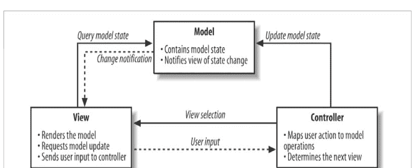

那么，为什么在 NSB 书中要讨论 MVC-EF 呢？这是因为大多数官方 NSB 示例都使用 MVC。我们将查看一些在 MVC 中扩展的示例，这些示例包含了微软在 EF 和 WCF 方面的最佳实践。

为了查看表以及与表相关的队列，我们使用 Kendo 网格。Packt 出版社出版了许多关于 Kendo 的书籍，例如《Kendo UI Grid》(http://www.packtpub.com/kendo-ui-grid/book)。一些 Kendo 示例也扩展自 http://www.codeproject.com/Articles/606682/Kendo-Grid-In-Action 上提供的文件。

## Saga 与 Web 服务

NSB 提供集成的众多端点之一是 **Windows Communication Foundation（WCF）** 端点。请访问 http://en.wikipedia.org/wiki/Windows_Communication_Foundation 了解更多信息。

WCF 是 .NET Framework 生态系统的一部分，它提供了用于构建互联的、面向服务的应用程序的运行时和一组 API。在 **简单对象访问协议（SOAP）** 绑定中，它使用 **Web 服务描述语言（WSDL）**，该语言定义了 Web 服务与 Web 服务客户端之间的接口。基于 WSDL，XML 根据 WSDL 规范创建，这样客户端和服务器就可以交换信息，无论它们的编程语言和平台是什么。它通过协议（通常是 HTTP 或 HTTPS）在服务器和客户端之间发送。绑定类型有多种；本书将主要讨论 SOAP 绑定，但如需了解更多的绑定类型，可以访问 http://msdn.microsoft.com/en-us/library/ms731092%28v=vs.110%29.aspx。例如，如果 WCF 客户端和服务都是使用 C# 构建的，我们可以考虑使用 NetTcpBinding 类，因为它在 .NET WCF 应用程序之间提供了高性能。更多信息请访问 http://msdn.microsoft.com/en-us/library/ms731092%28v=vs.110%29.aspx。

为简单起见，本章我们将只处理 WCF 中的 SOAP Web 服务。

WCF 是一个高度可扩展的框架，可以轻松集成到 NServiceBus 中。有关 NSB WCF 示例集成的更多信息，请访问 https://github.com/Particular/NServiceBus/tree/develop/IntegrationTests/WcfIntegration 和 http://docs.particular.net/NServiceBus/how-do-i-expose-an-nservicebus-endpoint-as-a-web-wcf-service。

虽然微软的 WCF 被认为是实现 **面向服务的架构（SOA）** 指南组成部分的框架，但它并不是 ESB。WCF 并不包含实现 SOA 指南端到端解决方案所需的全部功能和设计模式（如 Saga）、持久化或其他开箱即用的功能。另一方面，将 NServiceBus 作为 ESB 与 WCF 的 Web 服务结合使用，会带来许多 WCF 和其他 Web 服务框架所无法提供的能力。

## 源代码

代码目录位于 `Payment_WCFService` 目录下。`WCFService` 作为 WCF 服务，用于测试客户端。

然后，该解决方案在 Windows Server 2012 上的 Visual Studio 2012 中运行，并安装了 MSMQ、DTC、RavenDB、NServiceBus 4.0 引用和 SQL Server 2012 Express LocalDB。

必须先运行 `WCFService`，客户端 `Payment_WCFService` 才能向其发送消息。

## 创建 WCF 服务器

我们首先在 Visual Studio 中创建一个 `WCFServer` 项目，因为服务器需要先运行才能与客户端通信。通过从 NuGet 或 Package Manager Console 添加 `NServiceBus.Host` 引用，项目中会生成若干 NSB 默认设置（位于 `App.config` 文件中），并创建包含 `AsA_Server` 的 `EndpointConfig.cs` 文件，同时该项目将被设置为使用 `NServiceBus.Host.exe` 可执行文件运行。我们可以通过下面的截图看到这些文件的创建：

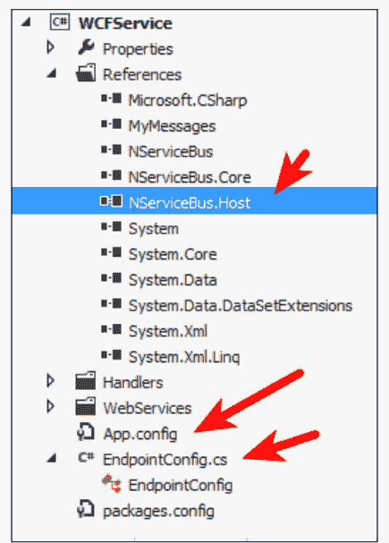

当我们通过 NuGet 或 Package Manager 向项目添加 NServiceBus.Host 引用时，项目还会被添加许多其他条目。这些其他条目如下：

- 项目中会创建一个 EndpointConfig.cs 文件，其中包含用于添加端点的默认设置。
- 项目将被设置为以 DLL 形式运行，在从调试器运行时由 NServiceBus.Host.exe 可执行文件执行。
- 若干用于创建通用 AsA_Server 端点的默认设置将被添加到 App.config 文件中。

从下面的截图可以看出，当我们添加 NServiceBus.Host 引用时，它会将项目设置为使用 NServiceBus.Host.exe 可执行文件作为 DLL 运行：

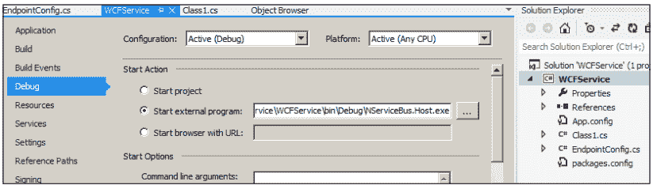

我们将使用 NSB WCF 集成来节省我们这边的大量工作。为了使用此集成，我们需要一些与 NSB 和 WCF 相关的组件。具体如下：

- Web 服务：这与 NServiceBus.WcfService<TRequest, TResponse> 类一起使用，我们在这个 Web 服务上定义请求和响应。我们将在此展示，名为 PayService 的服务将接收 PaymentMessage 消息作为请求，并以 ErrorCodes 作为响应。如下面的一行代码所示：
  public class PayService : WcfService<PaymentMessage, ErrorCodes>
- 消息处理程序：这是处理来自 Web 服务的消息并在集成中处理该消息所必需的。我们将此处理程序称为 PayHandler。
- 请求和响应消息结构：这是 PaymentMessages 项目所必需的。
- NSB 与 WCF 的配置：这在 App.config 文件中是必需的。


将 NSB 与 WCF 集成使用，与直接使用 WCF 类似，但又不尽相同。在 WCF 中，有四个基本步骤可以扩展。更多信息请访问 http://www.c-sharpcorner.com/UploadFile/dhananjaycoder/four-steps-to-create-first-wcf-service-for-beginners/。

创建 WCF 服务器的步骤如下：

- 1. 创建服务协定。这通过接口定义了 WCF 客户端与 WCF 服务器之间可用的功能。
- 2. 通过 App.config 或 Web.config 公开带有元数据的终结点。我们通过配置公开终结点，以包含数据交换的方式。
- 3. 实现服务。也就是说，我们向接口添加功能和数据对象。
- 4. 使用服务。或者换句话说，公开服务以供 WCF 客户端导入。

在使用 NSB 与 NHibernate 时，NSB 负责处理 NHibernate 与消息、终结点和服务之间的映射。在 WCF 集成中，NSB 也借助消息处理器和消息格式处理许多服务协定。

我们可以在以下截图中观察到这些功能点，接下来将进一步讨论它们：

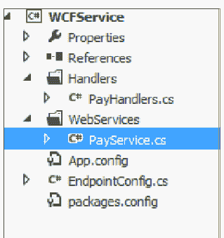

接下来我们将添加消息。

## 添加消息

现在，我们将按照以下截图所示，在解决方案中创建一个 `PaymentMessages` 项目：

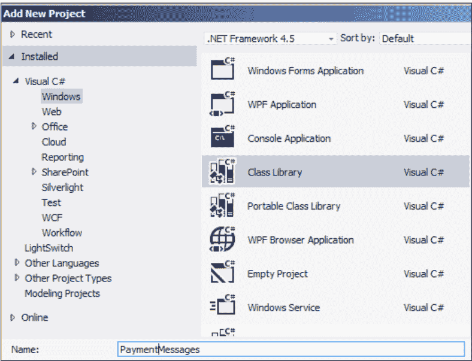

我们将使用 `PaymentMessage` 请求消息，该请求需要是 NServiceBus IMessage 接口，包含两个类：一个用于为每条消息生成唯一 ID 的 Guid 方法，以及一个 `PaymentReq` 类：

```
public class PaymentMessage : IMessage
{
    public Guid EventId { get; set; }
    public PaymentReq paymentReq { get; set; }
}
```

## 添加配置

为 Web 服务配置 App.config 文件的任务仍然存在。此步骤类似于前面提到的使用元数据公开终结点。

App.config 文件将定义 Web 服务的多个特征，例如侦听端口和 URL、服务的安全性以及服务的绑定类型。绑定类型定义终结点的通信机制，无论是基本 HTTP、MSMQ 还是其他机制。可在 http://msdn.microsoft.com/en-us/library/ms730879(v=vs.110).aspx 找到相关列表以及有关 WCF 绑定的更多信息。

我们可以手动编辑 App.config 文件，或使用随 Visual Studio 提供的 WCF 服务配置编辑器来配置该文件。

有关配置编辑器的更多信息，请访问：

http://msdn.microsoft.com/en-us/library/ms732009(v=vs.110).aspx

现在，我们将通过配置编辑器打开 App.config 文件，以完成以下操作：

- 建立服务器 URL（包括端口号），以作为 WCF 终结点供 WCF 客户端使用
- 建立绑定参数，以通过各种不同方式公开 WCF 服务终结点
- 设置跟踪和日志记录，以便在传输和服务发生时进行查看

我们首先打开项目的 App.config 文件，并设置 Web 服务将侦听的 URL 和端口，以开始配置终结点，如下面的截图所示：

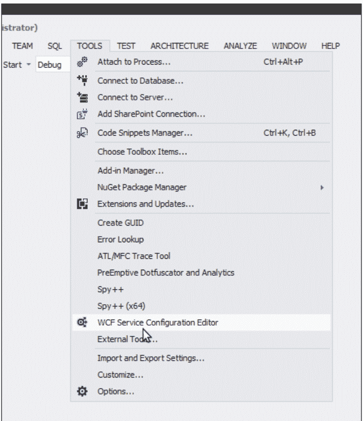

请访问 http://msdn.microsoft.com/en-us/library/ms731734(v=vs.110).aspx 查看 WCF 配置架构。我们可以通过服务终结点编辑绑定，如下所示：


## 添加跟踪

关于本节是否必需可能存在一些争议，因为本节是 WCF 特有的，与 saga 或 NSB 无关。但是，如果 WCF 客户端和 WCF 服务器之间的 WCF 通信无法正常工作，问题可能与消息结构、网络、WSDL 或任何其他因素有关。为了跟踪 WCF 中的问题，需要启用并设置跟踪功能。这也可以让我们看到通信的响应。但是，如果您的 WCF 功能正常且无需进行故障排除，则可以跳过本节。

WCF 中提供了服务跟踪实用工具，可用于查看 WCF Web 服务和 Web 客户端的图形、消息、网络调用、异常和活动。有关 Microsoft 服务跟踪查看器的更多信息，请参阅 http://msdn.microsoft.com/en-us/library/ms732023(v=vs.110).aspx。

我们可以通过在 App.config 文件中设置诊断节（以 <diagnostics/> 形式给出）来捕获客户端与服务器之间的消息，并通过设置将与库关联的侦听器和源来记录 App.config 文件中的事件，如下所示：

```
<AuditConfig QueueName="audit" />
<system.serviceModel>
    <diagnostics>
        <messagelogging logEntireMessage="true" logMalformedMessages="false" logMessagesAtServiceLevel="true" logMessagesAtTransportLevel="true" maxMessagesToLog="30000" maxSizeOfMessageToLog="30000" />
        <endToEndTracing activityTracing="true" messageFlowTracing="true" />
    </diagnostics>
    <behaviors>
        <serviceBehaviors>
            <behavior name="Default">
                <serviceMetadata httpGetEnabled="true" />
                <serviceDebug includeExceptionDetailInFaults="true" />
            </behavior>
        </serviceBehaviors>
    </behaviors>
    <services>
        <service name="WCFServer.WebServices.PayService" behaviorConfiguration="Default">
            <endpoint address="mex" binding="mexHttpBinding" contract="IMetadataExchange" />
            <host>
                <baseAddresses>
                    <add baseAddress="http://localhost:9009/services/paymessage" />
                </baseAddresses>
            </host>
        </service>
    </services>
</system.serviceModel>
</configuration>
```

以下截图展示了我们如何配置消息日志记录，以及我们将使用哪种跟踪侦听器来写入日志：


我们可以通过在服务跟踪查看器中打开 svc 日志文件来查看客户端与服务器之间发送的消息。如下面的截图所示，我们可以看到 SOAP 消息，包括标头和正文，这正是 WCF 服务器所接收的内容。

## 查看 Web 服务

在 Visual Studio 2012 中运行 Web 服务时，我们可以通过浏览器访问 http://localhost:9009/services/paymessage 来查看该服务。它将为 WCF 客户端提供一些简单的说明，如下面的截图所示：


我们还可以通过访问 http://localhost:9009/services/paymessage?singleWsdl 页面来查看 WSDL：

## 部署时的注意事项

请注意，对于大多数生产系统，在使用 Web 服务时，始终建议安装数字证书，以加密管道并验证客户端和服务器的身份。

对于真实的生产系统，WCF 客户端与 WCF 服务器之间的所有通信都必须使用 SSL 确保安全，并且您应该使用基于 WS-Security 的应用程序来检查您的 Web 服务。

```
public ActionResult SendWCF(int id)
{
    var user = new XMLLoads().GetPayments().Where(p => p.Id == id).FirstOrDefault();
    var message = new XMLLoads().GetMessages().Where(p => p.EventId == user.EventId).FirstOrDefault();
    ServiceReference1.WcfServiceOf_PayMessage_ErrorCodesClient client1 =
        new ServiceReference1.WcfServiceOf_PayMessage_ErrorCodesClient();
    ErrorCodes returnCode = client1.Process(message);
    user.errorCode = returnCode;
    return View(user);
}
```

这将是浏览器中的 Kendo 网格，它提供一个选择项，用于将数据发送到 WCF 服务。浏览页面时，网格将填充以下数据，并提供一个将消息发送到 WCF 服务的选项，如下表所示：

| Event Id | Action |
|---|---|
| 8b265223-dc9e-4789-a6df-69d19f644ad7 | Call_Payment_Service |
| 3721ba5d-4733-4d98-a5e2-8e8afa3e61f4 | Call_Payment_Service |
| 1ac188ec-4b2e-436c-b989-db88c65db1fa | Call_Payment_Service |
| 9bf180fa-f8f4-4b2b-8fac-cca73a4e2cab | Call_Payment_Service |
| ee2c56f7-6d42-4314-bce5-4825ed294437 | Call_Payment_Service |

SendWCFPay.cshtml 文件中的 Kendo 网格脚本如下所示：

```
<h2>Send Payment Message to WCF</h2>
<script type="text/javascript">
    $(document).ready(function () {
        var modelData = @Html.Raw(Json.Encode(Model))
        $("#grid").kendoGrid({
            pageable: true
          , sortable: true
          , silectable: true
```


为简单起见，MVC 控制器只是读取 XML 文件（这些文件创建在 C:\temp\ 的一个文件夹中），以便在前端显示，并可选择发送到 Payment WCF 服务。在生产环境中不建议使用这种 XML 文件的方式，因为通常这些文件会由面向客户的前端支付界面填写客户信息。我们选择这种方法是为了固化这些接口并对其进行测试。而设计客户界面来填充消息并不属于本次工作的范围。在这种类型的测试中使用 XML 文件是有优势的，因为我们可以扩展这个示例来发送数百条消息，既可以检查性能，也可以通过客户界面填充单独的消息，而无需依赖前端。

我们的基本架构是一个非常常见的设计，即 MVC 前端调用 WCF 客户端与 WCF 服务器进行交互。这种设计在一些订购网站上也很常见。例如，假设在一个披萨网站上，会弹出一个提示，上面写着**订单正在发送，请勿刷新**。由于这个示例同样没有与后端工作流解耦，如果这要成为一个没有通过 NSB 解耦的解决方案，我们很可能还得加上“支付正在发送，请勿刷新”的提示。在需要刷新页面的情况下，很多事情都可能出错。仅仅因为客户可能没有刷新他们的页面，并不意味着没有其他东西在刷新页面。

我们当前的架构如下：


## Saga 开发

让我们在上述解决方案中构建一些 saga 处理，以将 MVC 前端与 WCF 客户端解耦。NSB 将充当这两个组件之间交互的中介。

为什么使用 saga？因为它可以路由消息、执行超时处理并持久化状态。

上面的截图展示了使用 NServiceBus saga 的新工作流。它看起来可能有点复杂，但 NServiceBus 会在后台处理所有复杂性。对于控制器来说，它只是发出消息，然后就不再管了。如果它需要知道消息的状态，只需在数据库上执行一次 EF 查询。但它仍然会把消息发送出去，让 NSB 来处理它。

## 源代码

代码的目录位于 SagaPaymentClient 目录下。

MVCApp - WCF 项目用作客户端，通过 saga 发送 WCF 消息。

该解决方案是在 Windows Server 2012 上使用 Visual Studio 2012 构建的，并且还在 Windows 8.1 上运行的 VS 2012 中进行了测试，安装了 MSMQ、DTC、RavenDB、NServiceBus 4.0 版引用和 SQL Server 2012 Express LocalDB。

以下是加入 saga 后新项目的样子：


现在不同的是，MVC 应用程序将与 saga（即 MySaga）交互，而 saga 将与 WCF 客户端和 MVC 应用程序通信。这将使前端与 WCF 客户端解耦，并让 MVC 直接从 saga 消息中接收状态反馈。

## 将 NServiceBus 添加到 MVC

接下来，我们将添加总线，并把 `BasicPaymentClient` 文件夹和项目扩展为 `SagaPaymentClient` 文件夹和项目。区别如下：

- 我们将把 WCF 客户端从 MVC 控制器中重构出来，并将其移入一个新的消息处理器中。
- 我们将创建一个数据库来跟踪消息的状态。saga 数据将保存在 `nservicebus` 表中。请确保在运行 saga 代码时创建该表。
- 我们将创建一个新的消息处理器，并将 WCF 客户端代码放入其中。这段从 WCF 客户端到 WCF 服务器的代码将尽可能与前端代码分离，以保持 `PayMessage` 类与前端完全分离。
- 我们将在 MVC 中创建一个新的消息处理器，当它从端点接收到新状态时，会用消息状态更新数据库。在下一节中，我们将在测试时查看消息处理器和 saga 处理器的代码。
- `NServiceBus.Testing` 通过消息处理器和 saga 发送消息来提供测试功能。这包括消息处理器和 saga 可以执行的任何操作，包括消息头处理和依赖注入。有关一些基本示例，请参阅 http://docs.particular.net/NServiceBus/unit-testing 。`NServiceBus.Testing` 的源代码请访问 https://github.com/Particular/NServiceBus/tree/develop/src/ 。

开始单元测试最基本的方法是在 Visual Studio 中创建一个单元测试项目，即向现有解决方案添加一个新的单元测试项目。请访问 http://msdn.microsoft.com/en-us/library/hh598957.aspx 并将其添加为超链接。**新建项目**窗口如下所示：

## 消息处理器单元测试

消息处理器的代码将位于单元测试本身中。在我们的 UnitTestHandlers 项目中包含各种单元测试，我们将逐步分析 EventMessageHandler。EventMessageHandler 通过 saga 从 MVCApp 接收 SendCommand 对象，如下所示：


我们将继续创建 UnitTestHandler2.cs 文件，然后添加头部信息和 [TestMethod]。这个文件将位于 UnitTestHandlers 项目的 SagaPaymentClient 下。

创建完文件的基本结构后，我们将创建一个普通消息 SendCommand，其中包含一个 GUID 和消息在到达消息处理器之前应处于的状态，命名为 command。代码如下：

```
namespace UnitTestHandlers
{
    [TestClass]
    public class UnitTestHandler2
    {
        /***
         *
         * Test the message handler for MYWCFClient
         * This will call the WCF Service for a completion
         *
         *****/
        [TestMethod]
        public void Run()
        {
            Test.Initialize();
            /*****
             *
             * Create a Command message
             * used to look up an XML Message file
             * on Disk, send to WCF Server
             *
             *****/
            SendCommand command = new SendCommand();
            command.RequestId = new Guid("8b265223-dc9e-4789-a6df-69d19f644ad7");
            command.state = MyMessages.MessageParts.StateCodes.SentMyWCFClient;

            // The Test code
            Test.Handler<EventMessageHandler>()
                .ExpectReply<ResponseCommand>(m => m.state == MyMessages.MessageParts.StateCodes.CompleteMyWCFClient)
                .OnMessage<SendCommand>(command);
        }
    }
}
```

我们看到命令消息被传入 `.OnMessage<SendMessage>(command)` 方法，并且 Reply 方法中传入了 ResponseMessage 对象，其状态被设置为 CompleteMyWCFClient。在 Debug 模式下调用单元测试时，我们甚至可以在处理器中传入这条消息，观察它的行为，如下所示：


这使我们能够通过 TDD 在单元测试代码中设计和调试处理器功能。在测试处理器或 saga 时，可以使用许多规则。例如，ExpectNotReply 用于期望处理器不会以特定消息进行回复。

要了解 NServiceBus.Testing 中可用的功能，我们可以执行以下步骤：

- 1. 尝试输入一些内容，然后将鼠标悬停在 IntelliSense 上。


```
if (returnCode == ErrorCodes.None)
{
    command.state =
        StateCodes.CompleteMyWCFClient;
}
else
{
    command.state =
        StateCodes.MyWCFClientFail;
}

Bus.Reply(command);
Console.WriteLine("Success");
}
```

如果 XML 文件不存在会发生什么？下面是当时使用的代码：

```
// if no XML, just fail
if (payMessage == null)
{
    command.state = StateCodes.MyWCFClientFailXML;
    Bus.Reply(command);
    Console.WriteLine("No XML Found");
}
else
{
    ... normal path }
```

测试完这段代码后，我们可以将经过测试的代码（不含单元测试部分）用于在新项目中创建类，并将其用作消息处理器。通过在单元测试中开发代码，再将测试通过的产品放入应用程序项目中，这样可以节省时间。单元测试项目还可以作为备份，让我们了解代码在测试通过时的样子。

## Saga 处理器单元测试

让我们开始在消息处理器中测试上一节的 saga 代码：

```
// The Test code
Test.Handler<EventMessageHandler>()
    .ExpectReply<ResponseCommand>(m => m.state ==
PaymentMessages.MessageParts.StateCodes.
CompleteMyWCFClient)
    .OnMessage<SendCommand>(command);
```


正如我们所见，NServiceBus 测试 API 使用的是 Fluent API 规范风格的测试模式，而非大多数人通常会使用的、属于 nunit 或其他 xunit 类型框架的传统断言风格。

我们现在将开始测试来自 UnitTestHandlers 项目和 UnitTestSaga2.cs 文件的 saga 代码。

需要注意的一点是，如果 saga 实体对象在不同的函数调用中通过 MarkAsComplete() 方法被删除，这些应该分别进行测试。这是因为一旦我们删除了对象，就无法再次删除它。例如，在我们的测试中，我们将使用以下内容：

```
[TestMethod]
public void Run()
{
    Test.Initialize();

    /**
     * State sent to Saga
     * ***
    */
    SendCommand command = new SendCommand();
    command.RequestId = new Guid("8b265223-dc9e-4789-a6df-69d19f644ad7");
    command.state = MyMessages.MessageParts.StateCodes.SentMyWCFClient;

    /**
     * Response from WCF and to MVCApp
     * ***
    */
    ResponseCommand resp = new ResponseCommand();
    resp.RequestId = new Guid("8b265223-dc9e-4789-a6df-69d19f644ad7");
    resp.state = MyMessages.MessageParts.StateCodes.CompleteMyWCFClient;

    Test.Saga<MyTestSaga>()
        .ExpectReplyToOriginator<ResponseCommand>()
        .ExpectSend<SendCommand>()
        .When(s => s.Handle(command))
        .ExpectReplyToOriginator<ResponseCommand>()
        .When(s => s.Handle(resp))
        .AssertSagaCompletionIs(true);

    Test.Saga<MyTestSaga>()
        .ExpectReplyToOriginator<ResponseCommand>()
        .ExpectSend<SendCommand>()
        .ExpectTimeoutToBeSetIn<SendCommand>((state, span) => span == TimeSpan.FromHours(3))
        .When(s => s.Handle(command))
        .ExpectReplyToOriginator<ResponseCommand>()
        .WhenSagaTimesOut()
        .AssertSagaCompletionIs(true);
}
```

现在数据库部分已经创建，我们需要在 MSMQ 中创建 mysaga 端点。这只需按如下方式执行 MySaga 解决方案即可：


我们可以在 MSMQ Commander 窗口中看到端点已创建，如下所示：


如果测试运行成功，则 mysaga 端点存在并且正在工作。我们可以看到测试程序的工作情况如下：


数据库表，&lt;PayMessage&gt;，具有以下属性，如下所示：

|  | Column Name | Data Type | Allow Nulls |
|---|---|---|---|
| 🔑 | id | int | ☐ |
|  | EventId | uniqueidentifier | ☐ |
|  | error | varchar(50) | ☑ |
|  | state | varchar(50) | ☑ |

## RabbitMQ for NSB

RabbitMQ 是一个跨平台的消息框架，像 MSMQ 一样，可以在 Linux 和 Windows 操作系统上运行。

RabbitMQ 比 MSMQ 具有更多功能，例如路由、虚拟主机和强大的管理工具集。它可以在 Linux 上运行并且扩展性非常好。对于大型企业系统（尤其是在异构网络环境中），你应该认真考虑 RabbitMQ。RabbitMQ 可以在 NSB 配置中轻松替换 MSMQ 队列系统。

对于 RabbitMQ 的管理，可以轻松安装 Web 管理界面。然而，如果需要命令行界面，则需要安装 Python 语言。

为了重温前面章节中的一些参考资料，请查看以下内容：

- **Local host management site**: 这可以在 http://localhost:15672/#/. 找到。
- **Documentation**: 这可以在 http://www.rabbitmq.com/documentation.html. 找到。
- **Windows installation**: 这可以在 https://www.rabbitmq.com/install-windows.html. 找到。
- **NServiceBus samples**: 这些可以在 https://github.com/Particular/NServiceBus.RabbitMQ.Samples. 找到。
- **Development tools site for RabbitMQ**: 这可以在 http://www.rabbitmq.com/devtools.html. 找到。
- **NServiceBus.RabbitMQ source code**: 这可以在 https://github.com/Particular/NServiceBus.RabbitMQ. 找到。
- **NServiceBus RabbitMQ hands-on lab**: 这可以在 http://particular.net/HandsOnLabs. 找到。

## Saga Development

安装 RabbitMQ 后，我们可以使用 rabbitmq plugins 设置管理插件以启用 rabbitmq_management。这是为了使用 Web 管理 http://localhost:15672/#/queues 查看队列，如以下屏幕截图所示：


我们可以通过在 RabbitMQ 命令提示符中输入 rabbitmqctl list_queues 来获取队列列表，如下所示：


## ActiveMQ in NSB

Apache Active Message Queue（ActiveMQ）是 Apache 基金会基于 Java 消息服务（JMS）的 JAVA 开源框架。访问 http://en.wikipedia.org/wiki/Apache_ActiveMQ 和 https://activemq.apache.org 获取更多信息。它可以在机器上运行，无论是 Windows 还是 Linux，都在 Java 运行时环境（JRE）中。机器上必须运行 JAVA，并且 JAVA_HOME 环境路径必须配置为指向 JRE 的根文件夹。ActiveMQ 的安装说明可以在 https://activemq.apache.org/getting-started#GettingStarted20-Download. 找到。

### The source code

在本节中，我们将使用 ActiveMQ 解决方案。此解决方案与 RabbitMQ 类似，只是使用 ActiveMQ 而不是 RabbitMQ。

将有三个基本步骤：

- 1. 添加 NServiceBus.ActiveMQ 引用。
- 2. 将 NServiceBus 传输机制从 `<MSMQ>` 改为 `<ActiveMQ>`。
- 3. 在 App.config 文件中设置 ActiveMQ 传输配置。

在 Windows 操作系统上下载后，我们将 Windows 二进制文件解压到 c:\activemq\ 目录。从命令提示符在 c:\activemq\bin\ 下运行 activemq.bat 批处理文件，将显示一系列命令以表明 ActiveMQ 正在运行。这在以下屏幕截图中显示：


另一种选择是将 ActiveMQ 安装为 Windows 服务，其中存在适用于 Win32 和 Win64 机器的安装脚本。对于 64 位 Windows Server，我们可以使用 c:\activemq\bin\win64\ 中的 InstallService.bat。

确保 RabbitMQ 未在后台作为 Windows 服务运行，因为它们使用相同的网络端口。此外，Microsoft ServiceBus for Windows Servers 也会共享相同的 AMQP 端口，即端口 5672。ActiveMQ 的默认端口是 61616。可以使用 Microsoft 的 TcpView 检查端口，可以在 http://technet.microsoft.com/en-us/sysinternals/bb897437. 找到。

为了确保 ActiveMQ 正在运行，你可以通过浏览器使用 http://localhost:8161/admin 访问管理控制台。默认用户 ID 和密码均为 admin。请访问 http://activemq.apache.org/getting-started.html 查看文档。访问管理控制台时，你应该会看到如下屏幕截图：


要在 Visual Studio 项目中使用 ActiveMQ for NServiceBus，必须安装 NServiceBus.ActiveMQ 的 NuGet 版本。前往 https://www.nuget.org/packages/NServiceBus.ActiveMQ/1.0.5 查看如何将 PM> Install-Package NServiceBus.ActiveMQ 安装到项目中。确保 IBus 的配置设置为 ActiveMQ，如下所示：

```
protected void Application_Start()
{
    Configure.ScaleOut(s => s.UseSingleBrokerQueue());
    _startableBus = Configure.With()
        .DefaultBuilder()
        .RijndaelEncryptionService()
        .UseTransport<ActiveMQ>()
        .UnicastBus()
        .CreateBus();
    Configure.Instance.ForInstallationOn<Windows>().Install();

    _bus = _startableBus.Start();
    AreaRegistration.RegisterAllAreas();

    RegisterGlobalFilters(GlobalFilters.Filters);
    RegisterRoutes(RouteTable.Routes);
}
```

确保 App.Config 或 Web.Config 文件具有适当的连接字符串，以便 NServiceBus/Transport 字符串指向正确的 ActiveMQ 队列实例：

```
<connectionStrings>
<add name="NServiceBus/Transport" connectionString="ServerUrl=activemq:tcp://localhost:61616"/>
</connectionStrings>
```


然后，我们用这个示例，通过少量修改将传输机制从 MSMQ 改成了 RabbitMQ。在测试部分，我们讨论了如何让 saga 和消息处理器变得相似，也讨论了如何对它们进行足够的改动以增强其用途。我们还简要讨论了众多 NServiceBus 测试规则，以便在单元测试环境中构建处理器，而暂不需要考虑端点问题。

在接下来的章节中，我们将会继续展示更多的代码片段和场景。我们还会更详细地讨论如何使用处理器来满足事务处理和错误处理的需求。在后面的讨论中，我们也会进一步介绍相关工具的使用。
