# 5 Saga 代码片段

在本章中，我们将重点讨论 saga 中的代码片段。我们将介绍一个电子邮件和**安全文件传输协议（SFTP）**的示例，该示例将由 saga 代码中的每日定时器设置为超时。saga 代码将充当前端**Windows Presentation Foundation（WPF）**与执行电子邮件或 SFTP 的后端客户端之间的中介。使用 saga 作为前端和后端代码之间的中介，与外部服务器交互，将带来许多额外的好处和功能。外部服务器接口，例如电子邮件服务器或 SFTP 服务器，通常不受我们的控制，而是由外部运营方或组织（如银行）控制。因此，我们能处理的只有这些服务器的接口；随着业务、软件和运营需求的增长，我们需要一个足够健壮的框架来满足这些需求。于是，我们有了 NSB 和 saga。

我们还将逐步讲解如何修改此应用程序以支持 ActiveMQ。我们将简要讨论 ActiveMQ，以及如何对其进行设置以执行这些操作。

在本章中，我们将涵盖：

- 示例电子邮件 saga 通知
- 示例 SFTP saga
- Saga 部署
- ActiveMQ

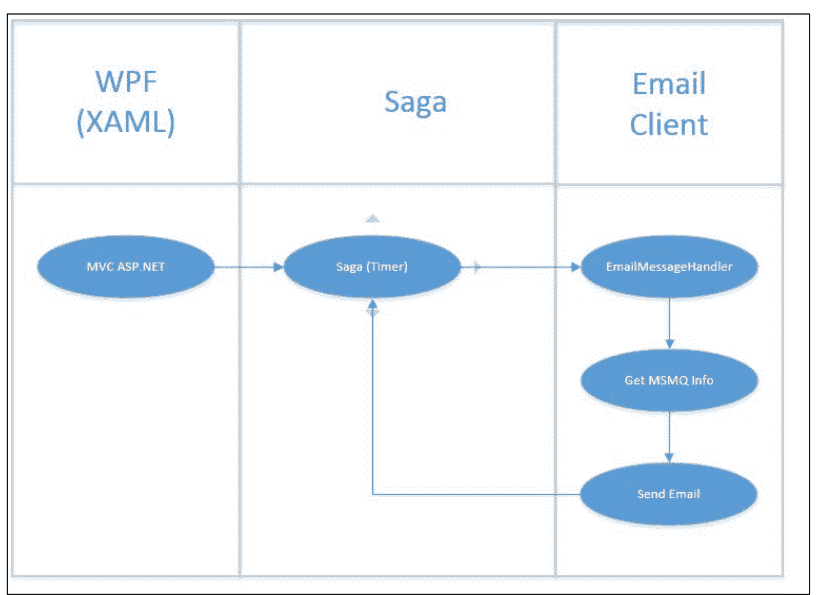

此应用程序的需求是：我们通过 GUI 设置一个定时器。这个 GUI 还可以设置一些电子邮件变量，例如电子邮件服务器、收件人和发件人地址。定时器将在 saga 中设置一个时间，用于发送每日电子邮件。每日电子邮件将是一封简单的邮件，将可用的 MSMQ 队列发送给运营人员。我们不希望硬编码定时器或任何电子邮件变量。我们也不希望使用 Windows 任务计划程序，因为那需要更多的运维支持。这个练习在 NSB 中可以轻松处理。

通过一个充当持久化和消息中介的 saga，将前端 GUI 与后端电子邮件客户端分离，带来了几个好处：

- 职责分离：如果前端出现问题，只要消息传递正确，saga 不一定会将这些问题传播给电子邮件客户端。
- 消息持久性：根据配置，消息、端点和 saga 数据会被持久化，即使服务器崩溃，数据仍然可以恢复。

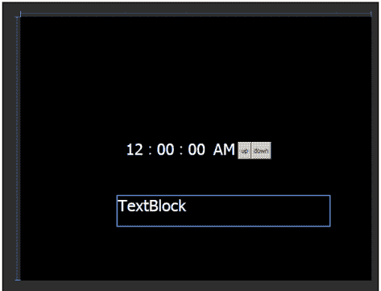

Microsoft Blend 提供了广泛的工具，可以在所见即所得（WYSIWYG）的可视化编辑器中构建用户界面，下面的截图给出了一个示例：

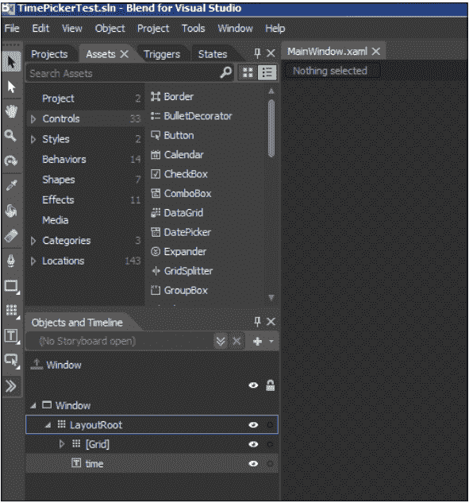

虽然这些是使用 XAML 和 WPF 的一些好处，但出于我们的简单目的，在 TimerPickerTest 项目中，我们将使用 Visual Studio 2012 自带的工具箱来完成图形界面，如下图所示：

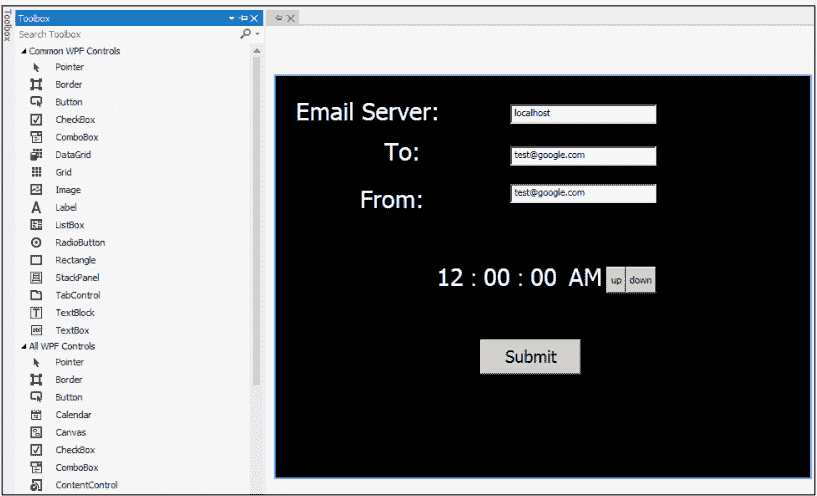

这个 GUI 用于设置几个变量：电子邮件服务器（默认设置为 localhost），以及收件人和发件人地址（两者默认都设置为 test@google.com）。

### saga 项目

此解决方案中的 saga 项目将命名为 TimerSaga。它将依赖于 TimerMessages 项目中的消息，该项目包含可用的 NSB 消息。

这个项目看起来会像我们迄今为止构建的典型 saga 项目，如下所示：

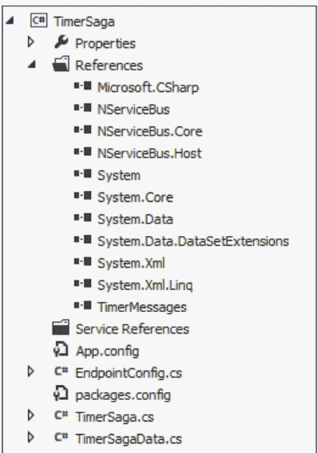

我们看到，我们引用了 NServiceBus.Host 引用，这反过来创建了 EndpointConfig.cs 文件，其中包含总线配置的代码。我们也知道，它必须设置 NServiceBus.Host.exe 文件，以便通过 NSB 将此项目作为 DLL 进行调试。同时，还创建了一个 App.config 文件，包含 NSB 主机引用，其中包括 EndpointConfig.cs 文件的单播和其他设置。

App.config 文件将包含以下设置：将 SendTime（带时间信息的消息）和 EmailMessage（带电子邮件信息的消息）发送到 EmailClient 端点，该端点将有一个消息处理器来发送运营电子邮件。该设置如下：

```
<UnicastBusConfig>
  <MessageEndpointMappings>
    <add Endpoint="EmailClient" Messages="TimerMessages.EmailMessage, TimerMessages" />
    <add Endpoint="EmailClient" Messages="TimerMessages.SendTime, TimerMessages" />
  </MessageEndpointMappings>
</UnicastBusConfig>
```

```
s_Time.SecTxt = "00";
    s_Time.AmPmTxt = "PM";

    _bus.Send(s_Time);
}
}
```

为了测试电子邮件，这里有一个简单邮件传输协议（SMTP）侦听器，它将在本地第 25 号端口拦截电子邮件以供查看，从而测试你的电子邮件发送场景。可以在 http://smtp4dev.codeplex.com/ 找到它。当电子邮件发送到 localhost 时，它将被记录在 smtp4dev 软件中供审查。

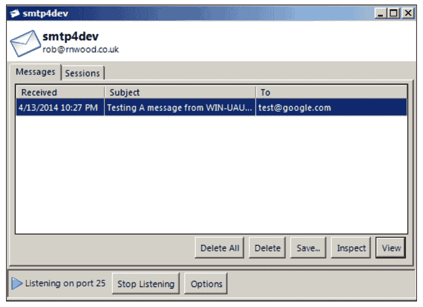

如果一切正常，并且我们收到了来自电子邮件客户端的消息，我们应该会收到一封类似于以下截图的电子邮件：

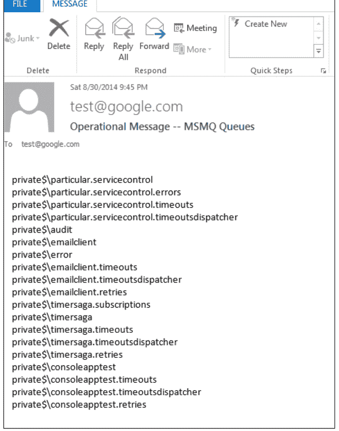

我们刚刚演示了一个简单解决方案，使用 GUI 配置电子邮件客户端，向我们发送关于 MSMQ 的每日运营电子邮件。这个示例可以轻松扩展，以提供 SQL Server 表的每日报告、审计或错误队列中的消息数量，以及许多其他用于检查系统运行状态的项目。

另一个日常示例，尤其是对于需要向银行发送文件或进行第三方传输的支付引擎相关人员，是使用 SFTP 发送文件。通过结合上一章中的 SFTP、电子邮件和 WCF，可以解决许多企业级场景。

此应用程序的需求是：我们通过 GUI 设置一个定时器。这个 GUI 还可以设置一些 SFTP 变量，例如 SFTP 服务器、用户名、密码和本地文本文件位置。

定时器将在 saga 中设置一个每日时间，用于上传每日文本文件，该文件将根据日期和时间获得唯一的名称，并上传到 SFTP 服务器。这样可以避免覆盖相同的文件名。

每日上传将是一个简单的示例，演示如何使用 saga 交互将文件上传到远程 SFTP 服务器（例如银行）以进行批量支付。我们不希望硬编码定时器或某些 SFTP 变量。我们也不希望使用 Windows 任务计划程序，因为那需要更多的运维支持。这个练习在 NSB 中可以轻松处理。

通过一个充当持久化和消息中介的 saga，将前端 GUI 与后端 SFTP 客户端分离，带来了几个好处：

- **职责分离**：如果前端出现问题，只要消息传递正确，不一定会将这些问题传播给 SFTP 客户端。SFTP 偶尔可能因密码重置、网络甚至服务器问题而无法登录。通过不让前端直接与 SFTP 客户端绑定，我们可以避免前端因 SFTP 问题而崩溃。
- **消息持久性**：根据配置，消息、端点和 saga 数据会被持久化，即使服务器崩溃，数据仍然可以恢复。
- **重试**：如果消息失败，根据配置，它会重试多次。这可能允许我们在 SFTP 连接出错的多次尝试 SFTP 客户端到服务器的连接。
- **监控**：有许多工具，并且根据持久化和队列配置的不同，有多种方法可以检查端点、消息和服务。这可能允许我们监控 SFTP 客户端以及传入其中的信息，以验证其是否适用于 SFTP 连接。
- **高可用性**：NSB 是一个高可用性框架，这意味着在配置中可以有多个连接、端点、服务器和消息传递场景，以确保服务始终在后台运行，并在高性能环境中接收信息。

其中许多主题已经讨论过，但随着针对此示例应用程序的不同需求被讨论，只需使用 NSB 即可添加这些功能。


## 使用 XAML

我们将使用 XAML 作为我们在之前的电子邮件示例中开发的基于 XML 的声明性语言。不同之处在于，我们加入了一些 SFTP 字段而不是电子邮件字段，以提供 SFTP 服务器、用户名、密码和本地文本文件名作为变量，如下所示：

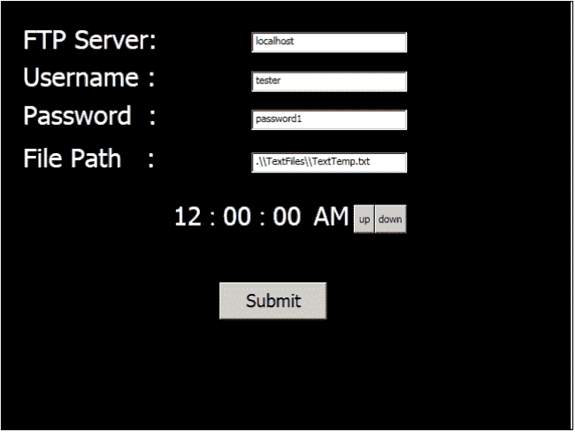

## 更改消息传递过程

在电子邮件示例中，我们使用 EmailMessage 中的值将信息从 saga 传递给电子邮件客户端。如下图所示：

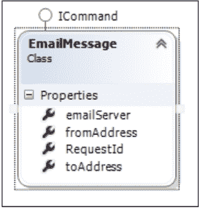

对于 SFTP，我们将改用 `SFTPMessage`，其中包含用于上传文件的 SFTP 变量，如下图所示：

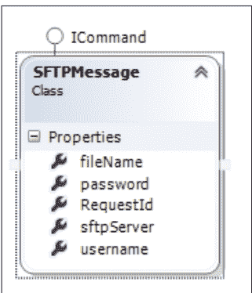

请注意，该变量与前端 GUI 的 SFTP 部分的输入变量几乎完全匹配。在创建服务时可以重用代码。在此示例中，我们还使用名为 `RequestId` 的消息 ID 作为主键来查找 saga 数据。

saga 代码的工作方式类似于电子邮件定时器 saga 和电子邮件消息处理器执行电子邮件客户端的方式。然而，现在我们将把 SFTP 信息从前端传递给 saga 和消息处理器。我们将不再访问电子邮件客户端，而是执行 SFTP 客户端。尽管这些消息发生了变化，并且使用 SFTP 代替了电子邮件，但大部分代码将保持不变。

## 设置 SFTP 测试环境

为了进行测试，我们需要一个 SFTP 服务器和客户端。我们已经在 saga 代码中开发了一个 SFTP 客户端，但我们需要一个 SFTP 服务器来建立连接并上传文件。

我们将从 http://www.freeshd.com 开始设置一个测试 SFTP 服务器。只需运行安装程序，然后设置一个用户和默认目录，用户可以在该目录中上传和下载文件。

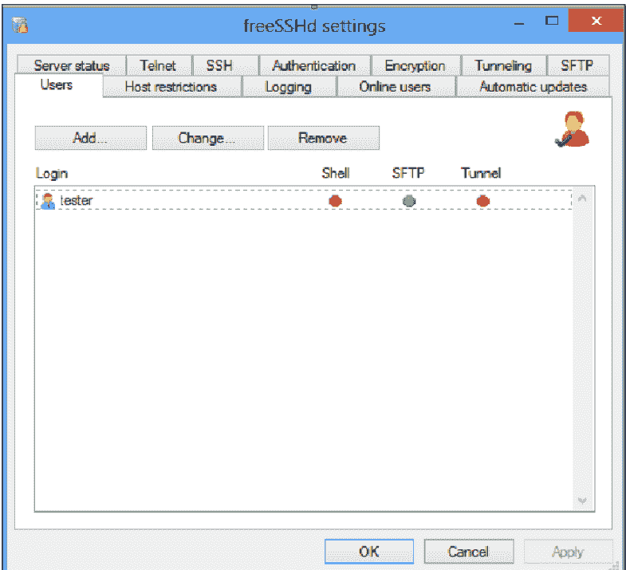

在测试我们使用 saga 创建的整个解决方案之前，让我们先执行一个简单测试，以确保 SFTP 服务器的连接设置正确。我们将编写一个简单的控制台程序来测试此连接，并查看将文件放到 SFTP 服务器上的代码。此示例代码可以在 ConsoleTestSFTP 目录中找到，如下所示：

```
namespace ConsoleTestSFTP
{
    class Program
    {
        static void Main(string[] args)
```

## Saga 片段

运行示例 SFTP 客户端程序时，我们不应该收到任何异常消息。但是，我们还应该检查文件是否已正确上传到 SFTP 服务器。为此，我们需要检查 freeSSHd 中的几个项目。首先查看上传目录的设置位置，并检查本地服务器目录中是否存在该文件。我们将在 freeSSHd GUI 中查看本地目录，如下所示：

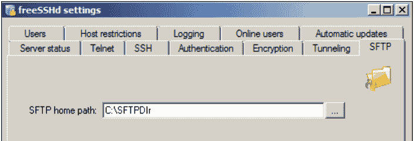

我们可以在 C: 下关联的 \SFTPDlr 目录中查看，并看到文件在我们测试时已上传：

| 名称 | 修改日期 | 类型 | 大小 |
|---|---|---|---|
| text-2014-08-31_02-53-27-AM | 8/31/2014 2:53 AM | 文本文档 | 1 KB |

除了通过查看文件本身来检查文件是否已通过 freeSSHd 上传之外，另一种方法是检查 freeSSHD 日志。我们可以检查 freeSSHd GUI 的日志记录部分，查看日志所在位置，甚至可以直接从 freeSSHd 单击 Open 按钮进行查看，如下面的屏幕截图所示：

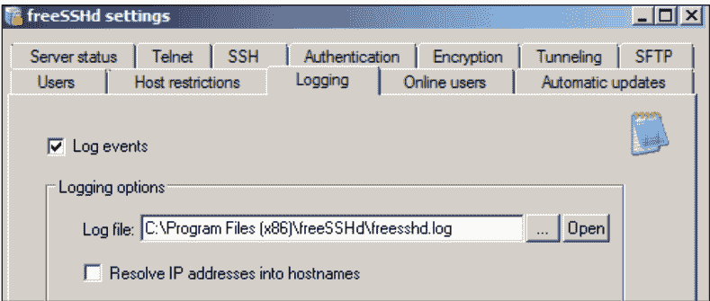

要了解有关可通过 NServiceBus.Host.exe 编写脚本的可用命令的更多信息，请参阅 http://docs.particular.net/NServiceBus/the-nservicebus-host/，或运行 NserviceBus.Host.exe。

目前，我们可以选择让 Windows 服务始终运行，并根据发送到 saga 的消息中定义的设定时间来执行 NServiceBus.exe。

另一种方法是使用 Windows 任务计划程序来运行控制台应用程序，可以每 10 分钟、每小时、每天、每月等运行一次。然而，例如，可以基于发送消息以验证 SFTP 文件已被验证为前提条件，在上午 10 点到下午 4 点之间将 SFTP 文件发送到服务器。业务需求可以基于各种条件，通过直接使用 NSB，我们已经考虑了许多可能的需求，以便轻松添加增强功能，例如在不重写原始功能的情况下进行加密。

另一个建议是探索 Quartz 框架，该框架同时存在于 C# 和 Java 中，用于在代码中调度 cron 作业。感谢 Mark Huber，他是 TopShelf 的作者。Quartz 将 Quartz 集成到 TopShelf DSL 中。

C# 版本可以在 http://www.quartz-scheduler.net/ 找到。

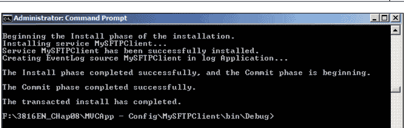

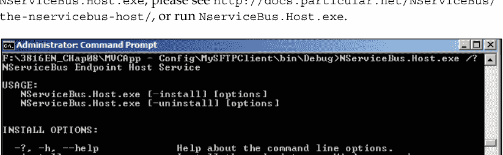

在下面的代码片段中，一个服务持续运行，但它会在每天早上 9 点运行一个计划作业：

```
public void Start()
{
    _log.Info("Service is Started");
    Console.WriteLine("Service is Started");
    try
    {
        if (_log.IsDebugEnabled) _log.Debug("\nLog successfully initialized.");
        IJobDetail jobDetail = JobBuilder.Create<CronJob>().WithIdentity("SampleJob", "SampleJobGroup").Build();
        _log.Debug("cronTrigger started.");
        ICronTrigger cronTrigger = (ICronTrigger)TriggerBuilder.Create()
            .WithIdentity("SampleTrigger", "SampleTriggerGroup")
            .WithCronSchedule("0 0 9 1/1 * ? *")
            .Build();
        var schedulerFactory = new StdSchedulerFactory();
        var scheduler = schedulerFactory.GetScheduler();
        scheduler.ScheduleJob(jobDetail, cronTrigger);
        scheduler.Start();
    }
```

cron 作业使用 9 AM 的表示法 0 0 9 1/1 * ? * 进行调度。要了解 cron 调度表示法的快捷方式，有许多网站可以提供帮助，例如 http://www.cronmaker.com/。但是，这里我们必须小心，因为 Quartz 添加了秒单位，使其与标准 cron 略有不同。

## ActiveMQ

Apache Active Message Queue（ActiveMQ）是 Apache 基金会的一个 Java 开源框架，基于 Java 消息服务（JMS）。有关更多信息，请参阅 http://en.wikipedia.org/wiki/Apache_ActiveMQ 和 https://activemq.apache.org。它将在 Windows 或 Linux 机器上的 Java 运行时环境（JRE）中运行。机器上必须安装 Java，并将 JAVA_HOME 的环境路径配置为指向 JRE 的根文件夹。ActiveMQ 的安装说明可以在 https://activemq.apache.org/getting-started#GettingStarted%20-Download 找到。

## 源代码

在本节中，我们将使用 ActiveMQ 解决方案；该解决方案类似于 RabbitMQ，不同之处在于使用 ActiveMQ 代替 RabbitMQ。

在 Windows 操作系统上下载后，将 Windows 二进制文件解压到 c:\activemq\ 目录中。在命令提示符下（路径为 c:\activemq\bin\）运行 activemq.bat 批处理文件，将显示一系列命令，表明 ActiveMQ 正在运行。

确保 RabbitMQ 没有作为 Windows 服务在后台运行，因为它使用与 ActiveMQ 相同的网络端口。要确保 ActiveMQ 正在运行，您可以在浏览器中通过 http://localhost:8161/admin 访问管理控制台。默认用户 ID 和密码分别为 admin 和 admin。请访问 http://activemq.apache.org/getting-started.html 了解更多信息。它将如下面的屏幕截图所示：

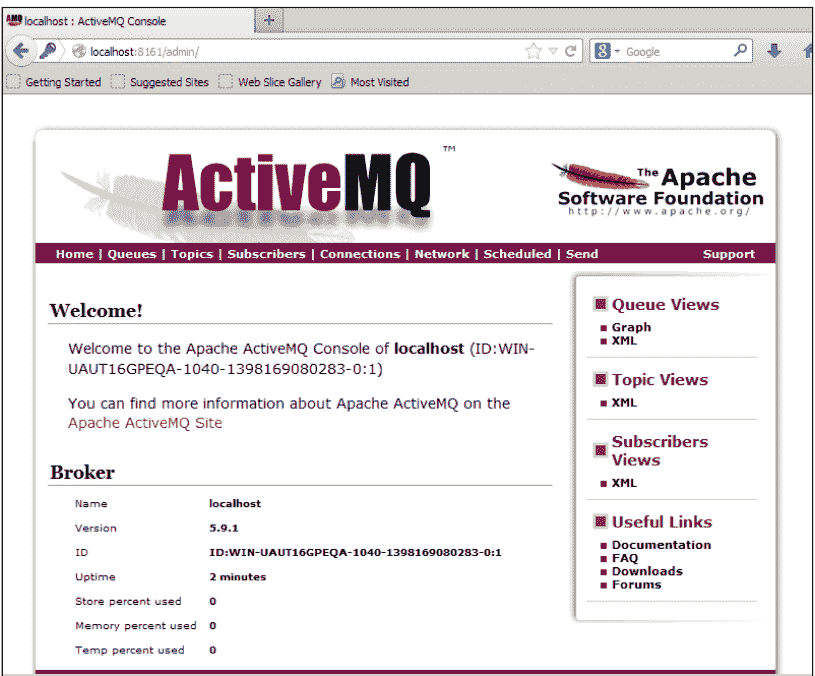

要在 Visual Studio 项目中将 ActiveMQ 用于 NServiceBus，必须安装 NuGet 版本的 NServiceBus.ActiveMQ。访问 https://www.nuget.org/packages/NServiceBus.ActiveMQ/1.0.5，在项目中安装 PM> Install-Package NServiceBus.ActiveMQ。确保 IBus 的配置设置为 ActiveMQ。

```
protected void Application_Start()
{
    Configure.ScaleOut(s => s.UseSingleBrokerQueue());
    _startableBus = Configure.With()
        .DefaultBuilder()
        .RijndaelEncryptionService()
        .UseTransport<ActiveMQ>()
        .UnicastBus()
        .CreateBus();
    Configure.Instance.ForInstallationOn<Windows>().Install();

    _bus = _startableBus.Start();
    AreaRegistration.RegisterAllAreas();

    RegisterGlobalFilters(GlobalFilters.Filters);
    RegisterRoutes(RouteTable.Routes);
}
```

确保 App.Config 或 Web.Config 文件具有适当的 NServiceBus/Transport 连接字符串，以指向正确的 ActiveMQ 队列实例。

```
<connectionStrings>
<add name="NServiceBus/Transport" connectionString="ServerUrl=activemq:tcp://localhost:61616"/>
</connectionStrings>
```

某些 EndpointConfig.cs 文件可能不会显式调用 IBus.Configure() 方法，因此请确保在 EndpointConfig 类中显式调用使用传输的 ActiveMQ 调用。


