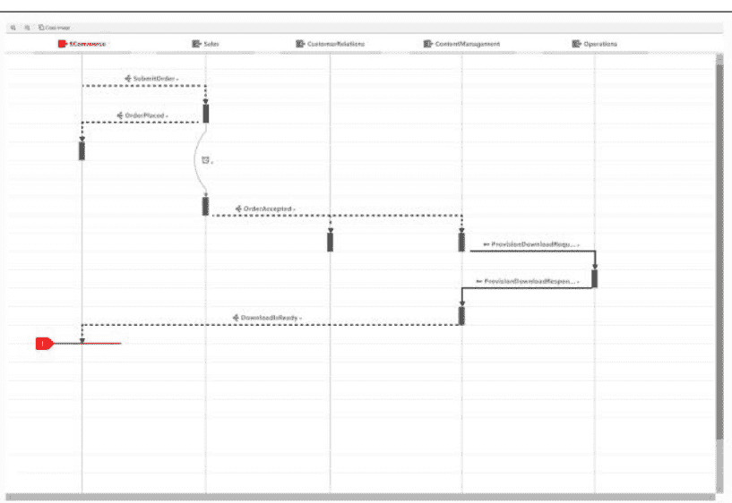
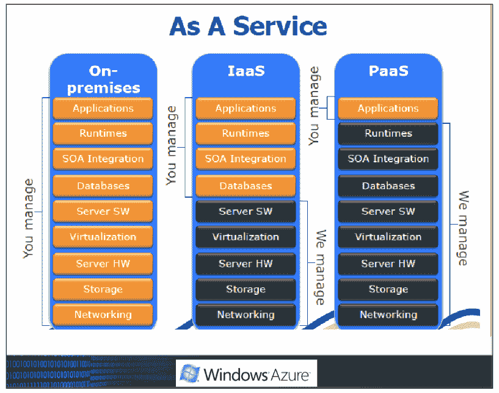

# 6 使用 NServiceBus 在云中

在本章中，我们将在对云及其部分服务进行非常简要的介绍后，重点关注 NServiceBus 在云中的代码片段。虽然 NServiceBus 作为 Microsoft Azure 云的服务总线得到了支持，但它也是集成到其他云技术中的有益工具，因为所有云都支持第三方集成以通过 Web 服务传递数据。

在本章中，我们将涵盖：

- 介绍云和 NSB
- 介绍 PaaS、IaaS 和 SaaS
- 使用 Microsoft Azure
  - 介绍 Azure 存储服务
  - Azure Service Bus 和存储队列
  - Azure 存储队列和 NSB
  - Azure Service Bus 在 NSB 中

### 介绍云和 NSB

本书撰写时，NSB 版本 5.0 for Azure 处于测试阶段，并且对 NSB 的云计算进行了许多更新。

无需使用本地 SQL Server、RavenDB 或 MSMQ 排队系统，所有订阅数据、Saga 持久化、超时持久化和排队消息都可以在 Azure Storage 中使用，并且消息也可以放入 Azure Service Bus。在许多情况下，存储表与数据信息之间存在一对一的映射，使用键来检索数据而不是 SQL 模式。

NSB 工具也在适应。ServiceInsight 正在增长，以处理在 Visual Studio 和 MSMQ 环境之外用于调试的序列图等更多细节。工具正从集成到物理服务器本地转变为集成到远程服务器，其中服务器本身的许多细节可能变得不那么重要，因为服务器已在异地虚拟化。例如，ServiceInsight 的未来将添加 Saga 序列图，以提供比当前流程图更多的细节。以下是 ServiceInsight 即将推出的序列图：

然而，许多云技术队列不支持分布式事务。其他排队平台，例如 RabbitMQ，也不支持分布式事务。NSB 版本 5.0 增加了补偿功能，以建立跟踪事务发生时状态的表。这种功能允许在原生不存在的情况下实现事务完整性。

### 介绍 PaaS、IaaS 和 SaaS

云计算服务使用三种基本模型提供：

- **SaaS**：这代表 **Software as a Service**。这促进了按需使用的托管软件服务供消费。我们的责任是配置由云厂商管理的这些服务。一个例子是 Google 邮件。这提供了业务软件的抽象。
- **PaaS**：这代表 **Platform as a Service**。这是指按需使用的通用服务供消费。这些服务例如排队、Web 服务器和其他仍需要构建业务软件的服务。我们的责任包括构建业务软件。这提供了可运行业务软件的服务的抽象。
- **IaaS**：这代表 **Infrastructure as a Service**。IaaS 提供商提供通用的存储、网络和服务器供消费。这些服务例如存储，仍需要构建服务和业务软件。我们的责任包括构建业务软件并为业务软件创建服务。这提供了运行平台服务的基础设施的抽象。

PaaS 是一种云计算服务，提供计算平台和解决方案堆栈作为服务。在 PaaS 中，云计算提供商提供操作系统、数据库、Web 服务器、开发工具以及托管消费者应用程序所需的其他服务。

IaaS 位于 PaaS 之下，因为它提供虚拟（以及物理）机器、服务器、存储选项、负载均衡器、网络等更基础的组件。

SaaS 位于 PaaS 之上，因为它是软件分发模型，其中应用程序本身由供应商或服务提供商托管，并通过网络，通常是互联网，使客户可以使用。以下是 Windows Azure 如何支持 IaaS 和 PaaS 的示例：

根据云厂商的不同，这些术语可能略有不同。虽然所有云厂商都支持这些组件，但它们在这些组件的抽象级别上有所不同。例如，Windows Azure 允许您在云中配置虚拟机（VM），而其他厂商仅提供 SaaS 模型。所选的云厂商以及许可将决定您资源的限制。在 Windows Azure 中，您可以创建一个免费网站，这将不需要运行成本；然而，您的应用程序可能与其他在该服务器上运行的网站共享。但如果您愿意支付更多费用，您可以拥有一个专用 VM，并在其上运行您自己的 Web 服务器运行您的网站。一切都取决于您选择的服务。在云世界中，资源和交易的消费基于许可。所有云厂商都提供了大量用于在其云中开发的资源；也有很多帮助可用，因为他们的目标是让您尽可能多地利用他们的云，因为那是他们的收入来源。
