# Credits

| 角色 | 人员 |
| --- | --- |
| Author | Michael Dorman |
| Project Coordinator | Rashi Khivansara |
| Reviewers | Dr. Amrinder Arora, Dan Hammer, Baburao Kamble, Dr. Robin Lovelace, Dipanjan Sarkar, Dr. Makhan Virdi |
| Proofreaders | Simran Bhogal, Stephen Copestake, Maria Gould, Ameesha Green |
| Indexer | Rekha Nair |
| Commissioning Editor | Akram Hussain |
| Graphics | Abhinash Sahu |
| Acquisition Editor | Greg Wild |
| Production Coordinator | Alwin Roy |
| Content Development Editor | Mohammed Fahad |
| Cover Work | Alwin Roy |
| Technical Editor | Ankita Thakur |
| Copy Editors | Pranjali Chury, Adithi Shetty |

# About the Author

**Michael Dorman** is currently a PhD candidate at the Department of Geography and Environmental Development, Ben-Gurion University of the Negev. His research explores the response of planted pine forests to changing climate through remote sensing and dendrochronology. He uses R extensively for time series and spatial statistical analyses and visualization. In spring 2013, he prepared and taught a course named *Introduction to Programming for Spatial Data Analysis* at the Ben-Gurion University of the Negev, introducing R as an environment for spatial data analysis to undergraduate Geography students. The course material served as a foundation for this book.

Michael holds a Master's degree in Life Sciences from the Ben-Gurion University of the Negev and a Bachelor's degree in Plant Sciences in Agriculture from The Hebrew University of Jerusalem. He has authored or coauthored eight papers in scientific literature and actively participated in 18 scientific conferences.

> I would like to express my gratitude to all the people from whom I have learned more about R and to those who have created this wonderful programming language. A special thanks goes to the excellent team at Packt Publishing for making this book possible.
>
> This book is dedicated to my wife, Hila, who unconditionally supported me every step of the way.

# About the Reviewers

**Dr. Amrinder Arora** is an adjunct faculty member in the Department of Computer Science at the George Washington University. He teaches graduate and undergraduate courses in Computer Science, mostly related to the design and analysis of computer algorithms and the design of data structures. He is also the author of the book *Analysis and Design of Algorithms, Cognella Academic Publishing*. He has been conferred the Instructor of the Year Award by the Department of Computer Science at the George Washington University and has received a VIP Grants Award by the Bowie State University. You can read more about his research at `http://www.standardwisdom.com`.

As part of his industry experience, he has served in the management teams of leading technology companies, including BizMerlin, Edifecs, and NTELX. As part of the Affordable Care Act, Dr. Arora designed a health exchange connector, a leading product in the $200 million market to connect insurance companies (payers) to the health insurance exchanges. As a leading expert in risk targeting, Dr. Arora led the technical design for US FDA's PREDICT system, which currently screens more than 16 million imports a year. His efforts in supporting FDA's PREDICT program were recognized by the FDA commissioner, Dr. Margaret Hamburg. The transportation management system designed by Dr. Arora for the port of Aqaba in Jordan won the award for the most innovative product by the Intelligent Transportation Society of America.

Dr. Arora earned an undergraduate degree in Computer Science from the Indian Institute of Technology, Delhi, and a Master's degree and doctorate, both in Computer Science, from the George Washington University. He served as a reviewer for numerous journals and conferences and many of his reviews have also been published in ACM Computing Reviews.

**Dan Hammer** is a data scientist and environmental economist who served as a Presidential Innovation Fellow at NASA as part of the White House program. He is a PhD student at University of California, Berkeley, and was formerly the Chief Data Scientist at the World Resources Institute, where he led the technical team behind Global Forest Watch. Dan writes code in Python, R, and Clojure on subjects ranging from spatial econometrics to information theory. He is currently reviewing *Clojure for Data Science, Packt Publishing.*

**Baburao Kamble** is an assistant research professor of Remote Sensing and Geospatial Data Analytics at the University of Nebraska-Lincoln (UNL). Currently, he works at UNL on developing machine learning and data mining algorithms using Big Data tools and techniques for climate and weather data. He has been involved in teaching Geospatial Information Sciences, Data Analysis using R, Python for Geospatial Data Analytics, and MATLAB courses at the graduate level. He is also the author of the upcoming book *Practical Data Analysis Cookbook, Packt Publishing.* He likes to spend his free time with new and interesting data science developments.

**Dr. Robin Lovelace** is an environmental geographer with 5 years of experience using R for spatial analysis, map making, and statistics. He has coauthored the popular free and open source online tutorial *Introduction to visualising spatial data in R* (2014), and teaches R to a range of professional and academic audiences.

Robin's latest book *Spatial microsimulation with R, CRC Press* (which will be published in 2015) demonstrates methods to generate and analyze multilevel data. By combining individual and geographical-level data, the technique can provide new insights into complex behaviors, for example, as an input into agent-based models.

Robin believes passionately in using open source technology to empower people to create a sustainable, post-carbon world — one in which we no longer depend on burning fossil fuels for a high quality of life.

**Dipanjan Sarkar** is a data engineer at DataWeave, one of India's top Big Data analytics start-ups, where he works on data semantics, information extraction, natural language processing, and machine learning. Prior to joining DataWeave, he worked as a graduate technical intern at Intel and received a Master's degree in Information Technology from the International Institute of Information Technology, Bangalore. Dipanjan is a technology enthusiast and loves Python and the start-up culture.

**Dr. Makhan Virdi** is a researcher at the Oak Ridge National Laboratory. He received his PhD from the University of South Florida in 2013. His current research interests include management and visualization of geospatial and time series data from satellite imagery for biogeochemical dynamics.

Dr. Virdi is also an independent researcher with a passion for using embedded electronics, robotics, and knowledge discovery to create machine augmented intelligence systems. In his spare time, he works on robots, ambient intelligence, and smart homes. You can read more about his research at TheXLabs.com.


# www.PacktPub.com

## 支持文件、电子书、折扣优惠等

有关您书籍的支持文件和下载，请访问 www.PacktPub.com。

您知道 Packt 为每本出版的图书都提供电子书版本，文件格式包括 PDF 和 ePub 吗？您可以在 www.PacktPub.com 升级到电子书版本，作为印刷图书的客户，您有权享受电子书的折扣。有关更多详情，请联系 service@packtpub.com。

在 www.PacktPub.com，您还可以阅读大量免费技术文章，订阅各类免费通讯，并获得 Packt 图书和电子书的独家折扣和优惠。


https://www2.packtpub.com/books/subscription/packtlib

您需要即时解决 IT 问题吗？PacktLib 是 Packt 的在线数字图书库。在这里，您可以搜索、访问和阅读 Packt 的全部图书库。

## 为什么订阅？

- 在 Packt 出版的每本书中完全可搜索
- 复制、粘贴、打印和书签内容
- 按需访问，并通过网络浏览器访问

## Packt 账户持有者的免费访问

如果您在 www.PacktPub.com 有 Packt 账户，您可以使用此账户立即访问 PacktLib 并查看 9 本完全免费的图书。只需使用您的登录凭据即可立即访问。

# Preface

The defining feature of spatial data analysis is the reference within the data being analyzed to locations on the surface of the earth. This is a very broad subject encompassing distinct areas of expertise such as spatial statistics, geometric computation, and image processing.

In practice, spatial data is commonly stored, viewed, and analyzed in Geographic Information System (GIS) software, of which the most well-known example is ArcGIS. However, most often, menu-based interfaces of GIS software are too narrow in scope to meet specialized demands or too inflexible to feasibly accomplish customized repetitive tasks. Writing scripts rather than using menus or working in combination with external software are two commonly used paths to solve such problems. However, what if we can use a single environment, combining the advantages of programming and spatial data analysis capabilities with a comprehensive ecosystem of computational tools that are readily implementable in customized procedures?

This book will demonstrate that the R programming language is indeed such an environment and teach you how to use it in order to perform various spatial data analysis tasks.

Most currently available books on this subject are focused on advanced applications such as spatial statistics, assuming you have prior knowledge of R and the respective scientific domains. Yet, introductory material on R from the point of view of a spatial data analyst, which is focused on introductory topics such as spatial data handling, computation, and visualization, is scarce. This book aims to fill that gap.

Chapter 8, Spatial Interpolation of Point Data, presents the subject of spatial interpolation in R from a practical point of view. Using a real-world case study, several common interpolation methods are applied and evaluated. An automated interpolation procedure is then constructed in order to create a series of interpolated maps from point data.

Chapter 9, Advanced Visualization of Spatial Data, shows readers how to produce publication-quality maps mainly using the popular ggplot2 R package.

Appendix A, External Datasets Used in Examples, provides a summary of the datasets used in the examples.

Appendix B, Cited References, lists the cited resources.

## What you need for this book

To follow through the examples in this book, all you need to do is install R (which is available for free) and download the example datasets from the book's website. Some of the examples also require you to have an Internet connection to download additional datasets and R packages from the R environment.

## Who this book is for

This book is intended for anyone who wants to learn how to efficiently analyze geospatial data with R. This book primarily targets GIS analysts, researchers, educators, and students who are working with spatial data and are interested in expanding their capabilities through programming. The book assumes familiarity with basic geographic information concepts (such as spatial coordinates) and no prior experience with R and/or programming.

## Conventions

In this book, you will find a number of styles of text that distinguish between different kinds of information. Here are some examples of these styles and an explanation of their meaning.

Code words in text, folder names, filenames, file extensions, and pathnames are shown as follows: "Here, we created a data.frame object named df by combining the vectors num, lower, and upper."

A block of code is set as follows:

```
> num = 1:4
> lower = c("a","b","c","d")
> upper = c("A","B","C","D")
> df = data.frame(num, lower, upper)
> df
  num lower upper
1   1     a     A
2   2     b     B
3   3     c     C
4   4     d     D
```

**New terms** and **important words** are shown in bold. Words that you see on the screen, in menus or dialog boxes for example, appear in the text like this: "Under the **Getting Started** section, select the **download R** link."

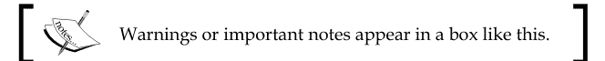


## Reader feedback

Feedback from our readers is always welcome. Let us know what you think about this book – what you liked or may have disliked. Reader feedback is important for us to develop titles that you really get the most out of.

To send us general feedback, simply send an e-mail to feedback@packtpub.com, and mention the book title via the subject of your message.

If there is a topic that you have expertise in and you are interested in either writing or contributing to a book, see our author guide on www.packtpub.com/authors.

## Customer support

Now that you are the proud owner of a Packt book, we have a number of things to help you to get the most from your purchase.

### Downloading the example code and data

You can download the example code and data files for all Packt books you have purchased from your account at `http://www.packtpub.com`. If you purchased this book elsewhere, you can visit `http://www.packtpub.com/support` and register to have the files e-mailed directly to you.

### Downloading the color images of this book

We also provide you a PDF file that has color images of the screenshots/diagrams used in this book. The color images will help you better understand the changes in the output. You can download this file from `https://www.packtpub.com/sites/default/files/downloads/43670S_ColoredImages.pdf`.

### Errata

Although we have taken every care to ensure the accuracy of our content, mistakes do happen. If you find a mistake in one of our books—maybe a mistake in the text or the code—we would be grateful if you could report this to us. By doing so, you can save other readers from frustration and help us improve subsequent versions of this book. If you find any errata, please report them by visiting `http://www.packtpub.com/submit-errata`, selecting your book, clicking on the **Errata Submission Form** link, and entering the details of your errata. Once your errata are verified, your submission will be accepted and the errata will be uploaded to our website or added to any list of existing errata under the Errata section of that title.

To view the previously submitted errata, go to `https://www.packtpub.com/books/content/support` and enter the name of the book in the search field. The required information will appear under the **Errata** section.


另外两个有用的条件运算符（`==` 和 `!=`）分别用于测试相等性和不等性。这些运算符彼此相反，因为一对对象要么相等，要么不相等。

```
```r
> 1 == 1
[1] TRUE
> 1 == 2
[1] FALSE
> 1 != 1
[1] FALSE
> 1 != 2
[1] TRUE
```
```

正如前面的示例所示，使用 `==` 运算符时，如果比较的对象相等，则返回 TRUE；否则返回 FALSE（参见表达式 1 和 2）。使用 `!=` 则相反（参见表达式 3 和 4）。

我们要介绍的最后一个运算符是否定运算符（`!`）。该运算符反转结果的逻辑值，从 TRUE 变为 FALSE，或从 FALSE 变为 TRUE。这在询问条件是否*不*满足时更为方便。让我们看一下下面的示例：

```
```r
> 1 == 1
[1] TRUE
> !(1 == 1)
[1] FALSE
> (1 == 1) & (2 == 2)
[1] TRUE
> (1 == 1) & !(2 == 2)
[1] FALSE
```
```

## 使用函数

在数学中，函数是一组输入与一组输出之间的关系，具有每个输入都与恰好一个输出相关的性质。例如，函数 *y* = 2*x* 将每个输入 *x* 与输出 *y* 相关联，*y* 等于 *x* 乘以 2。R（以及编程一般）中的函数概念非常相似：

- 函数由一段知道如何执行特定操作的代码组成。
- 使用函数是通过*调用*函数来完成的。
- 函数接收一个或多个对象作为输入（例如数字 9）。
- 函数返回一个对象作为输出（例如数字 18）。另外，它还可以执行称为*副作用*的其他操作，而不仅仅是返回输出。
- 函数接收为输入的对象类型和数量必须预先定义。这些称为函数的参数（例如一个数字）。
- 函数在实际的某次调用中接收到的对象称为函数的*参数*（例如数字 9）。

R 中最常见（也是最有用）的表达式是函数调用。事实上，我们一直在使用函数调用，因为算术运算符本身也是函数，这在使用不同记法时变得明显：

```
3*3
[1] 9

"*"(3,3)
[1] 9
```

函数本质上是一组预定义的指令。R 中有大量内置函数（启动 R 时自动加载到内存中的函数）。稍后，你还将学习如何使用未自动加载的函数，以及如何定义自己的函数。

正如你可能从前面的示例中猜到的那样，函数调用由函数名组成，后跟函数参数放在括号内并用逗号分隔。例如，函数 sqrt 返回其参数的平方根：

```
sqrt(16)
[1] 4
```

> R 区分大小写。例如，Sqrt 和 sqrt 被视为两个不同的名称：
> 
>     > Sqrt(16)
>     Error: could not find function "Sqrt"
> 
> 尝试第一个选项时，我们会收到一条错误消息，指出内存中没有名为 Sqrt 的函数。

## 处理警告和错误消息

当由于某种原因无法执行我们发送给解释器的表达式时，会打印错误消息。例如，这可能发生在我们引用的对象之一不存在时（参见前面的信息框）。另一个例子是尝试向函数传递不合适的参数。在 R 中，字符值由引号分隔。尝试对字符调用数学函数显然会产生错误：

```
```r
> "oranges" + "apples"
Error in "oranges" + "apples" : non-numeric argument to binary op$
```
```

> 文本消息末尾的 $ 符号表示我们需要在命令行窗口中向右滚动以查看整个消息。

当表达式可以解释但系统怀疑所使用的方法不当时，会返回警告消息。例如，负数的平方根在实数系统中不会产生数字。在这种情况下会返回一个非数字（NaN）值，并附带警告：

```
```r
> sqrt(-2)
[1] NaN
Warning message:
In sqrt(-2) : NaNs produced
```
```

R 有一组预定义符号来表示特殊常量值，其中大多数我们已经提到过：

- `NaN`：非数字
- `NA`：不可用
- `NULL`：空对象
- `TRUE` 和 `FALSE`：逻辑值
- `Inf`：无穷大（例如，尝试输入 `1/0`）

> 为了节省空间，本书代码段中省略了不必要的警告和信息消息，例如表明某项操作已成功完成的提示。然而，读者在重现示例时偶尔会在屏幕上看到此类消息。

## 获取帮助

R 中每个函数都可以通过使用 ? 运算符（或 help 函数）访问其帮助页面。例如，下面的表达式打开 sqrt 函数的帮助页面：

```
> ?sqrt
```

输入 help(sqrt) 也能达到相同结果。


> 另一方面，?? 运算符会在可用的帮助页面中搜索给定关键字（对应于 help.search 函数）。
> 另一个关于官方 R 帮助页面的有用表达式是 help.start()，它会打开一个包含 R 官方入门手册链接的页面。

所有函数帮助文件的结构相似，通常包括函数功能的简短描述、其参数列表、使用细节、返回对象的描述、参考资料和示例。帮助页面乍一看可能令人望而生畏，但随着时间的推移，它们会变得更清晰，并有助于提醒自己函数的用法细节。

R 的另一个重要信息来源是互联网。将我们想要执行的问题或任务（例如 Googling r read raster file）输入到网络搜索引擎，通常会从论坛、博客和文章中获得大量令人惊讶的信息。在研究 R 的新用途时，使用这些资源是不可避免的。

## 探索 R 中的基本对象类型

到目前为止，我们在 R 中遇到了两种类型的对象：数值（准确地说，是数值向量，我们将在第 2 章《使用向量和时间序列》中看到）和函数。在本节中，我们将介绍一个关键概念，即对象是某个类的实例。然后，我们将从操作目的出发，区分用于存储数据（数据结构）的类和用于执行操作（函数）的类。最后，将展示一段简短的示例代码，该代码在 R 中执行简单的 GIS 操作，以演示本章中介绍的主题（以及第 2 章《使用向量和时间序列》和第 3 章《使用表格》中将介绍的主题）将在本书后面的章节中如何应用于空间数据分析。

## 一切皆对象

R 是一种面向对象的语言；因此，R 中的一切都是对象。对象属于类，每个类都具有某些属性。对象所属的类决定了对象的属性以及我们可以对该对象执行的操作。为了作类比，一辆灰色的三菱 Super-Lancer 1996 款汽车对象属于汽车类。它具有特定的属性（例如颜色、型号和制造商），对应于汽车对象拥有的每个数据字段。它满足汽车类所包含的所有标准；因此，适用于汽车的操作（例如点火、加速或使用刹车）对该特定对象也有效。同样，R 中的多波段栅格对象将强制具有某些属性（例如行数、列数和分辨率）以及可执行的操作（例如创建仅包含第一个波段的子集或基于所有波段计算叠加）。

存储在内存中的所有对象都可以使用其名称访问，该名称以字符开头（不带引号；某些函数，例如所有算术和逻辑运算符，可以使用其各自的符号在引号内调用，例如我们之前看到的 "*"）。例如，sqrt 是平方根函数对象的名称；该对象所属的类是 function。启动 R 时，一组预定义对象会加载到内存中，例如 sqrt 函数和逻辑常量值 TRUE 和 FALSE。另一个预加载对象的例子是数字 π：

```
```r
> pi
[1] 3.141593
```
```

class 函数返回其作为参数接收到的对象的类名：

```
```r
> class(TRUE)
[1] "logical"
> class(1)
[1] "numeric"
> class(pi)
[1] "numeric"
> class("a")
[1] "character"
> class(sqrt)
[1] "function"
```
```


## R 环境

### 在数据结构中存储数据

从典型 R 用户的角度来看，我们在 R 中处理的所有对象可以分为两类：数据结构（用于保存数据）和函数（用于对数据执行操作）。

所有数据结构的基本组成是常量值，通常是数值型、字符型或逻辑型（最后一个代码部分展示了这三者的示例）。R 中最简单的数据结构是向量，这将在 *第 2 章“使用向量与时间序列”* 中介绍。稍后我们将看到，更复杂的数据结构本质上是较简单数据结构的集合。例如，R 中的栅格对象可能包含两个数值向量（保存栅格值及其维度）和一个字符向量（保存**坐标参考系（CRS）**信息）。语言的面向对象特性既方便了定义数据结构类的人（因为可以在预定义的较简单类的基础上构建，而不必从头开始），也方便了用户（因为他们可以利用之前对简单数据结构组件的了解来快速理解更复杂的结构）。

### 调用函数执行操作

第二类对象——函数——通常用于对数据结构执行操作。函数的影响范围可能仅限于 R 环境内部，也可能产生副作用，从而影响 R 之外的环境。到目前为止，我们使用的所有函数都只影响 R 环境；例如，保存栅格文件的函数具有外部效应——它影响硬盘上的数据内容。

### 简短的示例会话

最后，让我们看一段执行简单空间分析操作的完整代码：

```r
> library(raster)
> r = raster("C:\\Data\\rainfall.tif")
> r[120, 120] = 1000
> writeRaster(r, "C:\\Data\\rainfall2.tif")
```

这段代码执行的任务是从磁盘读取栅格文件 `rainfall.tif`（参见下面的截图，了解其在 QGIS 中的可视化效果），修改其中一个值（将第 120 行、第 120 列处的值改为 1000），并将结果栅格写入另一个文件。

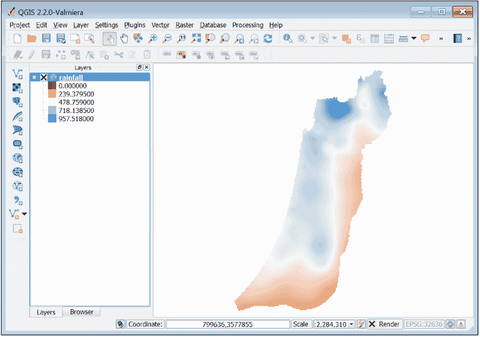

> `rainfall.tif` 文件以及本书中使用的所有其他外部数据文件均可在本书网站上获取，以便读者复现示例并自行试验。有关全书涉及的所有数据文件的汇总，请参阅 *附录 A“示例中使用的外部数据集”*。为方便起见，本书网站还提供了包含书中所有代码段的 R 代码文件。

如果你暂时不理解本节开头给出的所有代码行，不必担心。读完 *第 4 章“使用栅格”* 后，这些代码就会变得清晰明了。简而言之，第一行代码告诉 R 加载用于处理栅格的函数集（称为 raster 包），例如我们在此处用来读写栅格文件的 raster 和 writeRaster 函数。在第二行中，我们读取所请求的文件并将其加载到内存中。在第三行代码中，我们将值 1000 赋给该栅格的指定像素。第四行代码将新的（修改后的）栅格写入磁盘。

这个任务听起来确实很简单，但当我们使用桌面 GIS 软件时，通过菜单和对话框系统（可能无法直接访问栅格值）来执行它可能并不容易。例如，我们可能必须在栅格 A 中想要更改的像素 (120,120) 上创建一个新的点要素，将其转换为栅格 B（在 (120,120) 像素处值为 1，其他所有像素值为 0），然后使用叠加工具，将栅格 A 中与栅格 B 中值为 1 的像素相叠加的像素设为 1000，而其他所有像素保持其原始值。最后，我们可能还需要使用额外的工具箱来导出新的栅格。然而，如果我们需要对多个文件执行此操作，或者随着新信息的到来在给定文件上重复执行呢？

总的来说，当我们使用编程而不是基于菜单的界面时，我们必须采取的步骤可能看起来不那么直观（编写代码，而不是滚动屏幕、点击鼠标和填写对话框）。然而，我们向计算机发出具体指令时要强大得多。使用编程进行数据分析，尤其是使用 R 进行地理空间分析，其美妙之处不仅在于我们通过自动化获得更高的效率，还在于我们更接近数据本身，并发现分析数据的各种新可能，其中一些可能在使用预定义工具或菜单时根本不会被想到。

### 小结

在本章中，我们介绍了使用 R 的基础知识。至此，你应该已经安装了 R，并且能够从命令行或你偏好的文本编辑器中编写并执行几条基本命令。本章还引入了类和对象的概念，这两者对你将在本书中学到的其余主题都很重要。我们现在可以继续学习空间数据分析中使用的更复杂的数据结构和操作了。

下一章将专门介绍 R 中的基本数据结构——向量。然后，我们将在 *第 3 章“使用表格”* 中介绍表示非空间数据的更复杂数据结构，并在 *第 4 章“使用栅格”* 和 *第 5 章“使用点、线与多边形”* 中介绍表示空间数据的更复杂数据结构。

## 使用向量与时间序列

或者，当第一个参数大于第二个参数时：

```
> 33:24
[1] 33 32 31 30 29 28 27 26 25 24
```

逻辑向量也可以使用 c 函数创建。请记住，TRUE 和 FALSE 是特殊值，而不是字符。因此，在输入这些值时不应加引号：

```
> c(TRUE, FALSE, TRUE, TRUE)
[1] TRUE FALSE TRUE TRUE
```

然而，在实践中，创建逻辑向量通常是对向量应用条件运算符的结果，而不是手动输入一长串逻辑值。我们稍后将对此进行详细说明。

有几个函数可用于在不同向量类型之间进行转换。其中最有用的两个是 as.numeric 和 as.character，它们分别用于将向量转换为数值向量或字符向量。还有其他函数可以将特定类的对象转换为另一类对象，我们将在后续章节中看到。让我们看下面的例子：

```
> 33:24
[1] 33 32 31 30 29 28 27 26 25 24
> as.character(33:24)
[1] "33" "32" "31" "30" "29" "28" "27" "26" "25" "24"
> as.numeric(as.character(33:24))
[1] 33 32 31 30 29 28 27 26 25 24
```

因子（factor）是向量的一种特殊编码类型，其中向量具有一组已定义的可接受值或水平。这种编码在 R 的统计使用中最为常见，例如在定义分类变量以标识实验中的处理组时。就本书的目的而言，使用因子并不是必需的。然而，在使用 R 的过程中遇到因子是不可避免的（例如，从文件中读取表格时，字符列默认编码为因子），因此我们至少需要了解这种数据结构。

可以使用 factor 函数将向量转换为因子：

```
> factor(c("cat","dog","dog"))
[1] cat dog dog
Levels: cat dog
> factor(c("cat","dog","dog","mouse"))
[1] cat dog dog mouse
Levels: cat dog mouse
```

如你所见，生成的因子对象的可接受水平（默认定义为向量中唯一值的集合）会与其值一起打印出来。

### 使用赋值运算符保存对象

到目前为止，我们都是通过在命令行中输入独立表达式来使用 R。如前章所述，这样返回的对象不会保存在任何地方。因此，我们无法进行连续操作，即让每个创建的对象作为下一步的输入。然而，保存中间结果对于实现流程自动化至关重要。

将对象保存到临时内存称为赋值。所谓临时，是指当我们关闭计算机（或退出 R）时这些对象会被删除，这与写入硬盘上的文件不同——写入文件的信息将永久保留，除非被删除。赋值通过赋值表达式完成，该表达式由我们要保存的对象、赋值运算符 = 以及我们想给新对象起的名称组成。例如，我们可以将 1:10 序列向量保存到名为 v 的对象中，如下所示：

```r
> v = 1:10
```

然后，我们可以像在前一章中访问预定义对象（如 pi）那样，使用对象名称访问新创建的对象：

```r
> v
[1]  1  2  3  4  5  6  7  8  9 10
```


在 R 中还有另一种赋值运算符，即 <-：

```r
> v <- 1:10
```

在本书中，使用 = 运算符，因为它更容易输入。

另外，请注意赋值运算符 = 与相等条件运算符 == 之间的区别（参见上一章）。= 运算符用于赋值：

```r
> one = 1
> two = 2
> one = two
> one
[1] 2
> two
[1] 2
```

== 运算符用于比较：

```r
> one = 1
> two = 2
> one == two
[1] FALSE
```


当用已存在于内存中的名称为对象赋值时，旧对象会被删除并被新对象替换：

```r
> x = 55
> x
[1] 55
> x = "Hello"
> x
[1] "Hello"
```

ls 函数返回一个字符向量，其中包含所有用户定义对象的名称（在一个给定的环境中，默认的是全局 R 环境）。例如，到目前为止，我们在内存中分配了四个对象：

```r
> ls()
[1] "one" "two" "v" "x"
```

## 从内存中删除对象

我们可以使用 rm 函数从内存中删除对象。让我们看一下以下示例：

```r
> rm("v")
> ls()
[1] "one" "two" "x"
```

有时删除内存中的所有对象很有用。例如，如果我们想运行某个代码段而不担心之前定义的对象会干扰，可以将当前内存中对象的整个列表传递给 rm 函数，如下所示：

```r
> rm(list = ls())
> ls()
character(0)
```

`character(0)` 输出表示一个空字符向量。可以通过导航到 **Misc | Remove all objects**（RGui）或 **Session | Clear workspace...**（RStudio）来删除所有对象。编写 `list=ls()` 部分的原因在阅读本章 *Using functions with several parameters* 部分后会变得明显。


## 汇总向量属性

R 中的许多函数旨在处理向量。本节回顾了一些常用的函数，用于查找向量的属性。

例如，我们可能对给定向量的均值、最小值和最大值感兴趣。要获取这些值，我们可以分别使用 mean、min 和 max 函数：

```r
> v = 1:10
> mean(v)
[1] 5.5
> min(v)
[1] 1
> max(v)
[1] 10
```

我们也可以使用 `range` 函数一次获取最小值和最大值：

```r
> range(v)
[1] 1 10
```

length 函数返回给定向量元素的数量：

```r
> v = c(4,2,3,9,1)
> length(v)
[1] 5
```

对于逻辑向量，我们有时想知道它们是否包含至少一个 TRUE 值，或者它们的所有值是否都是 TRUE。这可以通过 any 和 all 函数分别实现：

```r
> l = c(TRUE, FALSE, FALSE, TRUE)
> any(l)
[1] TRUE
> all(l)
[1] FALSE
```

如果我们想知道向量包含多少个 TRUE 值，可以利用逻辑向量在算术函数中使用时默认转换为数值向量的特性：

```r
> l = c(TRUE, FALSE, FALSE, TRUE)
> sum(l)
[1] 2
```

在这个例子中，每个 TRUE 值首先被转换为 1，每个 FALSE 值转换为 0。因此，向量 c(TRUE,FALSE,FALSE,TRUE) 变成了向量 c(1,0,0,1)，该向量元素的和为 2。

which 函数返回逻辑向量中所有 TRUE 元素的<|message|>

```r
> which(l)
[1] 1 4
```

这里返回了一个长度为 2 的向量，因为向量 l 中有两个 TRUE 值。该向量的两个值是 1 和 4，因为第一个 TRUE 值占据向量 l 中的第一个位置，而第二个 TRUE 值占据第四个位置。

相关的函数 `which.min` 和 `which.max` 返回数值向量中最小或最大元素的位置：

```r
> which.min(v)
[1] 5

> which.max(v)
[1] 4
```

我们将在本书后面看到另一个使用 `which.min` 的例子。

我们要提到的最后一个有用的函数是 unique 函数，它返回向量的唯一元素；也就是说，它返回向量所包含的元素集合而不重复。让我们看一下以下示例：

```r
> v = c(5,6,2,2,3,0,-1,2,5,6)
> unique(v)
[1] 5 6 2 3 0 -1
```

## 向量的逐元素运算

与将向量视为单一实体的函数（见上一节）相反，一些函数对向量的每个元素都像单独的实体一样进行操作，并返回结果向量（因此结果向量的元素数量与输入向量相同）。事实上，所有算术和逻辑运算符都是这样工作的，如以下示例所示（我们一直使用长度为 1 的向量，所以没有机会见证这一点）：

```r
> 1:10 * 2
[1]  2  4  6  8 10 12 14 16 18 20
> 1:10 - 10
[1] -9 -8 -7 -6 -5 -4 -3 -2 -1 0
> sqrt(c(4,16,64))
[1] 2 4 8
```

在第一个表达式中，我们将向量 (1, 2, ..., 10) 乘以 2，得到了一个包含 10 个元素的向量，其中第一个元素等于 1*2，第二个等于 2*2，第三个等于 3*2，依此类推，直到 10*2。

逻辑运算符以相同的方式工作，如下所示：

```r
> x = 1:5
> x
[1] 1 2 3 4 5
> x >= 3
[1] FALSE FALSE TRUE TRUE TRUE
```

这里，对于值 1、2、3、4、5 中的每一个，都评估了该值是否大于或等于 3，对 1 和 2 给出 `FALSE`，对 3、4 和 5 给出 `TRUE`。

如果我们想检查一个向量中的某个值是否出现在另一个向量中，可以使用 `%in%` 运算符。使用 `%in%`，我们基本上询问左边的向量值是否与右边的向量值中的任何一个匹配：

```r
> 1 %in% 1:10
[1] TRUE
> 11 %in% 1:10
[1] FALSE
```

对于这些简单示例，我们可以不使用 `%in%` 运算符（见以下示例）。它的实用性将在本章末尾变得明显，当我们想要，例如，查找长向量 A 的每个元素并检查它是否在长向量 B 中有匹配项时。以下是前述表达式的替代方案：

```r
> any(1:10 == 1)
[1] TRUE
> any(1:10 == 11)
[1] FALSE
```

在这两个例子中，我们将逻辑运算包含在 `any` 函数中，以检查 resulting 逻辑向量是否至少有一个 TRUE 值。

现在，让我们转向字符向量。在处理字符值时，`paste` 函数可以用来将单独的元素组合成一个字符字符串。该函数的 sep 参数决定了用于分隔值的字符（默认是一个空格）。让我们看一下以下示例：

```r
> paste("There are", "5", "books.")
[1] "There are 5 books."
```

`paste` 函数也适用于具有多个元素的向量：

```r
> paste("Image", 1:5)
[1] "Image 1" "Image 2" "Image 3" "Image 4" "Image 5"
```

请注意，如果提供了字符，`paste` 函数会自动将数值转换为字符：

```r
> x = 80
> paste("There are", x, "books.")
[1] "There are 80 books."
```

paste0 函数与 paste 做同样的事情，只是 sep 参数的默认值为空：

```r
> paste(1, 2, 3, sep = "")
[1] "123"

> paste0(1, 2, 3)
[1] "123"
```

## 循环原则

在上一章中，我们只对长度为 1 的两个向量使用运算符。在本章中，到目前为止，我们使用的是一个长度为 1 的向量和另一个长度 >1 的向量的运算。当我们对两个长度都 >1 的向量执行运算时会发生什么？

如果我们有两个长度完全相同的向量，则运算会对从两个向量中取出的每对连续元素执行，如下所示：

```r
> c(1,2,3) * c(10,20,30)
[1] 10 40 90
```

在这个例子中，1 乘以 10，2 乘以 20，3 乘以 30，然后将三个结果组合成一个长度为 3 的向量。

如果两个向量的长度不相等，则在执行运算之前会先循环较短的向量。换句话说，较短向量的开头值会被顺序地附加到其末尾，反复进行，直到两个向量的长度匹配。最简单的案例，我们在上一节中见过，是涉及一个长度为 1 的向量和另一个长度大于 1 的向量。我们可以描述这种情况下发生的事情为将具有一个元素的向量循环，直到它与较长向量的长度匹配。例如，执行这两个表达式中的第一个，就像执行第二个一样：

```r
> 1:4 * 3
[1] 3 6 9 12

> 1:4 * c(3,3,3,3)
[1] 3 6 9 12
```

同样，在下面的例子中，向量 c(3,5) 被循环到长度为 4，即 c(3,5,3,5)。结果是 c(1,2,3,4) 乘以 c(3,5,3,5)：

```r
> c(1,2,3,4) * c(3,5)
[1] 3 10 9 20
```


当较长向量的长度不是较短向量的整数倍时，循环补齐是不完整的，我们会收到一条警告消息。尽管如此，操作仍会执行。在下一个示例中，向量 `c(1,10,100)` 的长度为 3，而向量 `1:5` 的长度为 5。向量 `c(1,10,100)` 被循环补齐为 `c(1,10,100,1,10)`，其长度与向量 `c(1,2,3,4,5)` 相同，如下所示：

```
```r
> 1:5 * c(1,10,100)
[1]   1  20 300   4  50
Warning message:
In 1:5 * c(1, 10, 100) :
  longer object length is not a multiple of shorter object length
```
```

## 使用具有多个参数的函数

R 中的函数可以有多个参数。在本节中，我们将了解如何向此类函数提供多个参数。同时，我们还将介绍几个接受多个参数的新函数。

### 在函数调用中提供多个参数

在函数中指定多个参数时，我们需要在函数调用期间使用常见的赋值运算符 `=` 将每个参数赋给相应的形参，并用逗号分隔不同参数的赋值表达式。

例如，让我们检查 `seq` 函数。其最有用的三个参数是 `from`、`to` 和 `by`（你可以在函数的帮助页面中看到它还有更多参数）。`seq` 函数根据输入创建一个序列向量，如下所示：

- `from`：此参数指定从哪里开始
- `to`：此参数指定在哪里结束
- `by`：此参数指定步长

让我们看下面的示例：

```
```r
> seq(from = 100, to = 150, by = 10)
[1] 100 110 120 130 140 150
> seq(from = 190, to = 150, by = -10)
[1] 190 180 170 160 150
```
```

## 使用向量和时间序列

> 我们之前遇到的 `:` 运算符实际上用于创建特殊情况的序列（其中步长为 1 或 -1），而 `seq` 函数则更加通用。

关于涉及多个参数的函数调用，有几个重要规则：

- 只要参数按照函数定义中指定的默认顺序输入，参数名可以省略。因此，以下两个表达式是等价的：

```
```r
> seq(from = 5, to = 10, by = 1)
[1]  5  6  7  8  9 10
> seq(5, 10, 1)
[1]  5  6  7  8  9 10
```
```

事实上，我们已经使用过这个特性。例如，`mean` 函数的第一个参数（用于计算均值的向量）的名称是 `x`，但在函数调用中我们可以省略它：

```
```r
> mean(1:10)
[1] 5.5
> mean(x = 1:10)
[1] 5.5
```
```

- 相反，如果指定了参数名，则参数的顺序可以改变：

```
```r
> seq(to = 10, by = 1, from = 5)
[1]  5  6  7  8  9 10
```
```

- 只要参数在函数定义中有默认值，就可以跳过该参数。例如，`by` 参数的默认参数值为 1，因此以下两个表达式是等价的：

```
```r
> seq(5, 10, 1)
[1]  5  6  7  8  9 10
> seq(5, 10)
[1]  5  6  7  8  9 10
```
```

## 创建默认向量

可以通过 `vector` 函数创建填充有默认值（数值型为 0，字符型为 ""，逻辑型为 FALSE）的新向量，并指定模式（向量类型）和长度：

```
> vector(mode = "numeric", length = 2)
[1] 0 0
> vector(mode = "character", length = 10)
[1] "" "" "" "" "" "" "" "" "" ""
> vector(mode = "logical", length = 3)
[1] FALSE FALSE FALSE
```

## 创建重复向量

你已经学会了使用 `:` 和 `seq` 创建连续向量的两种方法。另一种特殊类型的向量——重复向量，可以使用 `rep` 函数（代表 replicate）来创建。我们只需指定要重复的内容以及重复的次数：

```
> rep(x = 22, times = 10)
[1] 22 22 22 22 22 22 22 22 22 22
```

`rep` 函数也可以操作长度大于 1 的向量：

```
> x = c(18, 0, 9)
> rep(x, 3)
[1] 18  0  9 18  0  9 18  0  9
```

## 子字符串

另一个对字符有用的函数是 `substr`，它用于提取字符串的子集，也就是说，我们创建的是向量中单个元素内部的字符子集（子字符串），而不是向量元素的子集（参见下一节）。该函数需要起始和终止值。让我们看下面的示例：

```
> x = "Subsetting strings"
> substr(x, start = 1, stop = 14)
[1] "Subsetting str"
> substr(x, 6, 14)
[1] "tting str"
> substr(x, 1, 3)
[1] "Sub"
```

正如我们所见，起始和终止值是包含在内的。例如，最后一个表达式中，起始值等于 1，终止值等于 3，我们得到的是字符向量 x 中占据位置 1 到 3 的三个字符。

## 创建向量的子集

创建数据的子集是数据分析中的基本操作之一。在本节中，我们将介绍创建向量子集的两种基本方法。第一种方法涉及数值向量，它指定要包含在子集中的索引。第二种方法涉及使用逻辑向量，它为每个元素指定是保留还是丢弃。

### 使用数值索引向量进行子集化

使用数值索引向量进行子集化是通过方括号运算符 `[]` 完成的，即在方括号内提供索引向量。例如，我们可以通过将所需索引的值放在方括号内来选择向量的单个元素，如下所示：

```
```r
> x = c(5,6,1,2,3,7)
> x[3]
[1] 1
> x[1]
[1] 5
> x[6]
[1] 7
```
```

例如，如果我们想找出给定向量中最后一个元素的值，可以使用 `length` 函数，它返回向量的长度（即向量最后一个元素的索引），如下所示：

```
```r
> x[length(x)]
[1] 7
```
```

我们还可以向向量的子集赋予新值，如下所示：

```
```r
> x = 1:3
> x
[1] 1 2 3
> x[2] = 300
> x
[1]   1 300   3
```
```

当索引向量的长度大于 1 时，我们可以创建长度大于 1 的子集：

```
> x = c(43,85,10)
> x[1:2]
[1] 43 85
> x[c(3,1)]
[1] 10 43
```

如最后一个表达式所示，我们放在方括号内的索引向量不必由连续的值组成，其值也不需要按递增顺序排列。例如，我们可以通过使用从最后一个元素的位置到 1 的索引向量来反转向量中值的顺序：

```
> x = 33:24
> x
[1] 33 32 31 30 29 28 27 26 25 24
> x[length(x):1]
[1] 24 25 26 27 28 29 30 31 32 33
```

索引向量还可以包含重复的值，如下所示：

```
> x = c(43,85,10)
> x[rep(3,4)]
[1] 10 10 10 10
```

在这个示例中，`rep(3,4)` 表达式创建了向量 `c(3,3,3,3)`。后者随后导致创建了一个比原始向量更长的子集，其中向量的第三个元素被重复了四次。

循环补齐规则也适用于向子集赋值：

```
> x = 1:10
> x[3:8] = c(15,16)
> x
[1] 1 2 15 16 15 16 15 16 9 10
```

在这个示例中，值 15 和 16 交替出现，直到向量 x 中长度为六的子集被填满。

### 使用逻辑向量进行子集化

创建向量子集的另一种方法是在 `[` 运算符内提供一个逻辑向量。逻辑向量指出了子集中需要保留的元素；需要保留的元素是那些索引与逻辑向量中 TRUE 值的索引相匹配的元素。通过对我们希望子集化的同一个向量应用条件运算符来创建用于子集化的逻辑向量，这通常非常有用。让我们看下面的示例：

```
```r
> x = seq(85, 100, 2)
> x
[1] 85 87 89 91 93 95 97 99
> x > 90
[1] FALSE FALSE FALSE  TRUE  TRUE  TRUE  TRUE  TRUE
> x[x > 90]
[1] 91 93 95 97 99
```
```

这里，我们创建了一个逻辑向量 `x>90`，它与向量 x 一样有八个元素（因为该操作是如前所述的逐元素进行的）。该向量中的值取决于向量 x 在相应位置的值是否大于 90，为 TRUE 或 FALSE。当我们使用逻辑向量 `x>90` 创建向量 x 的子集时，我们得到一个包含 x 中五个值的向量，这些值占据的位置与 `x>90` 向量中 TRUE 值占据的位置相同。这些位置就是 x 的值大于 90 的位置。

我们甚至可以应用更复杂的条件来选择一些非常特定的值：

```
```r
> x
[1] 85 87 89 91 93 95 97 99
> x[x>85 & x<90]
[1] 87 89
> x[x>92 | x<86]
[1] 85 93 95 97 99
```
```

请注意，当使用逻辑向量进行子集化时，子集中值的顺序与它们在原始向量中的顺序一致，因为子集中的第一个元素将是逻辑向量中第一个为 TRUE 的元素，第二个将是逻辑向量中第二个为 TRUE 的元素，依此类推。


如果没有元素满足所需条件（导致逻辑向量全部为 `FALSE`），那么我们会得到一个空向量作为结果。例如，向量 x（或其他任何向量）中不可能同时存在大于 90 且小于 90 的值：

```r
> x>90 & x<90
[1] FALSE FALSE FALSE FALSE FALSE FALSE FALSE FALSE
> x[x>90 & x<90]
numeric(0)
```

## 处理缺失值

在本节中，我们将介绍 R 中缺失值的表示方式以及处理方法。在数据收集和分析过程中，缺失值可能在许多情况下出现，要么是因为某些原因无法获取所需信息，要么是因为在某些情况下我们希望将某些数据标记为缺失从而将其排除在分析之外。在空间数据分析中，可能是我们调查区域中的某些区域因无法进入而导致研究人员无法收集数据，或者航拍影像的某些部分被云层覆盖，导致我们无法在那里数字化感兴趣的地物。

### 缺失值及其对数据的影响

R 中用于标记缺失值的特殊值是 `NA`。正如前一章简要提到的，`NaN` 值表示计算结果在实数系统中无法表示的情况。在所有与此相关的方面，`NaN` 值的作用方式与 `NA` 相同。

与 `NaN` 值可能由不当计算（例如 0 除以 0）产生一样，当没有足够的信息来提供结果时，就会创建 `NA` 值。例如，一个只有 10 个元素的向量的第 100 个元素是不可用的：

```r
> x = 1:10
> x[100]
[1] NA
```

包含至少一个 `NA` 的一组数字的平均值是 `NA`，因为只有在所有计算依据的值都已知的情况下才能确定平均值：

```
> x = c(2,5,1,0)
> mean(x)
[1] 2
> x[2] = NA
> x
[1] 2 NA 1 0
> mean(x)
[1] NA
```

有时，我们会希望将某些类型的值标记为 `NA`。例如，如果我们有一个汽车行驶速度的数据集，其中一个值为 900 km/h，那么我们很可能会将其标记为录入错误。其他时候，我们要分析的数据会使用数据创建者决定的特定编码来标记缺失值（例如 -9999），而我们希望在 R 中将这些值转换为 `NA`。我们稍后会看到一个这样的示例。

### 检测向量中的缺失值

`is.na` 函数用于判断给定向量元素是否为 `NA`（如果是则返回 `TRUE`，否则返回 `FALSE`）。让我们看看以下示例：

```
> x = c(2,5,1,0)
> x[2] = NA
> x
[1] 2 NA 1 0
> is.na(x)
[1] FALSE TRUE FALSE FALSE
```

有时，检查向量中的哪些值不是 `NA` 比检查哪些是 `NA` 更方便。为此，我们可以使用在上一章中遇到的 `!` 运算符来反转得到的逻辑向量：

```
> !is.na(x)
[1] TRUE FALSE TRUE TRUE
```

例如，如果我们只想取 x 中非缺失元素的子集，可以输入以下代码：

```
> x[!is.na(x)]
[1] 2 1 0
```

### 对含缺失值的向量执行计算

继续前面的示例，如果我们只对非缺失值取子集，就可以计算出 x 中非缺失元素的平均值：

```r
> mean(x[!is.na(x)])
[1] 1
```

为了省去我们在此类计算前手动移除向量中缺失值的需要，许多要求所有值均为非缺失值的函数（如 `mean`、`min` 和 `max`）都有一个名为 `na.rm` 的参数，用于指示我们是否希望在执行计算之前移除缺失值。该参数的默认值为 `FALSE`（这意味着我们不移除 `NA` 值）；如果我们希望相反的行为，则需要指定 `na.rm=TRUE`：

```r
> x = c(3,8,2,NA,1,7,5,NA,9)
> mean(x)
[1] NA
> mean(x, na.rm = TRUE)
[1] 5
> max(x)
[1] NA
> max(x, na.rm = TRUE)
[1] 9
```

## 编写新函数

函数是加载到计算机临时内存中的一个对象，可以被激活（通常使用特定参数）来执行某个操作。到目前为止，我们一直在使用预定义函数（来自 R 的基础包；从*第 3 章：使用表格*开始，我们将使用来自其他贡献包中的函数）。在本节中，我们将描述函数定义的结构，并了解如何编写自己的函数。

请注意，在本书中你不会定义太多函数，而且你要定义的函数也将相当简单。原因是大多数时候你是在学习新方法，而不是重复应用你开发的某个给定方法（如果是后者，则有必要为其编写函数）。然而，在实践中，当你开发了某个希望定期应用于不同数据集的特定流程时，将代码封装成函数形式通常会非常有用。

### 定义我们自己的函数

让我们通过一个示例来回顾函数定义的各个组成部分。在下面的示例中，我们定义了一个名为 `add_five` 的新函数，它会向提供的参数加 5 并返回结果：

```r
> add_five = function(x) {
+   x_plus_five = x + 5
+   return(x_plus_five)
+ }
```

定义的组成部分如下：

- 函数名（例如 `add_five`）
- 赋值运算符（`=`）
- 函数定义运算符（`function`）
- 函数的参数，可能带有默认值，放在括号内（例如 `(x)`）
- 代码段的左花括号（`{`）
- 函数的主体代码（例如 `x_plus_five=x+5`）
- 返回值的定义（例如 `return(x_plus_five)`）
- 代码段的右花括号（`}`）

其原理是，构成函数主体的代码将在每次调用该函数时运行：

```r
> add_five(5)
[1] 10
> add_five(7)
[1] 12
```

当我们执行函数调用时，作为参数提供的对象会被赋值给函数环境中的局部对象，以便函数代码可以使用它们。这些对象只在函数运行期间存在，并且在函数终止后无法从全局环境中访问：

```r
> x_plus_five
Error: object 'x_plus_five' not found
```

每个函数都会返回一个值，我们通常希望保留该值以供后续计算使用。这可以通过赋值来实现，方式与本章前面介绍预定义函数时相同：

```r
> result = add_five(3)
> result
[1] 8
```

`return (x_plus_five)` 表达式可以省略，因为默认情况下函数会返回最后创建的对象（也就是 `x_plus_five`）。因此，事实上我们甚至不需要将结果赋给 `x_plus_five` 对象。此外，当代码段只包含一个表达式时，我们可以省略花括号。因此，一个功能相同的函数可以简单地定义如下：

```r
> add_five = function(x) x + 5
```

### 为参数设置默认值

我们可以在函数定义时为参数指定默认参数。这样，在函数调用时我们就可以省略部分（或全部）参数。换句话说，我们可以不为某些参数提供参数值，在这种情况下函数将使用默认参数：

```r
> add_five = function(x) x + 5
> add_five()
Error in add_five() : argument "x" is missing, with no default
> add_five = function(x = 1) x + 5
> add_five()
[1] 6
```

在前面的示例中，第一种情况我们收到了一条错误消息，因为我们试图调用 `add_five` 函数，却没有为 `x` 参数提供参数值，而该参数没有默认值。在第二种情况下，函数调用成功了，因为这次定义函数时为 `x` 设置了默认值（等于 1，因此返回的值为 6）。

R 中的许多预定义函数都为某些参数提供了默认参数。例如，`vector` 函数的 `mode` 和 `length` 参数的默认参数分别是 `"logical"` 和 `0`：

```r
> vector()
logical(0)
```

因此，默认情况下它会创建一个空的逻辑向量（可以在相应函数的帮助页面找到默认参数）。只要我们没有（或编写该函数的人没有）定义限制，函数调用中每个参数所属的类别就没有任何限制。但是，如果函数代码中的某个表达式在给定特定参数集时产生错误，函数的执行将终止，并且我们不会得到任何返回值。例如，当提供一个字符向量作为参数时，我们的 `add_five` 函数将触发错误：

```r
> add_five("one")
Error in x + 5 : non-numeric argument to binary operator
```


## 从CSV文件读取气候数据

现在，你将通过我们的第一个真实世界示例，学习如何在R中使用日期。我们将使用一个名为 `338284.csv` 的**逗号分隔值（CSV）**文件，该文件下载自**美国国家海洋和大气管理局（NOAA）**国家气候数据中心。该文件包含新墨西哥州阿尔伯克基国际机场气象站从1931年3月1日至2014年5月15日的每日降雨量和温度数据。

CSV文件用于存储纯表格数据，不包含XLS等电子表格文件中常见的额外功能。以下是在Excel中打开该文件时的样子：

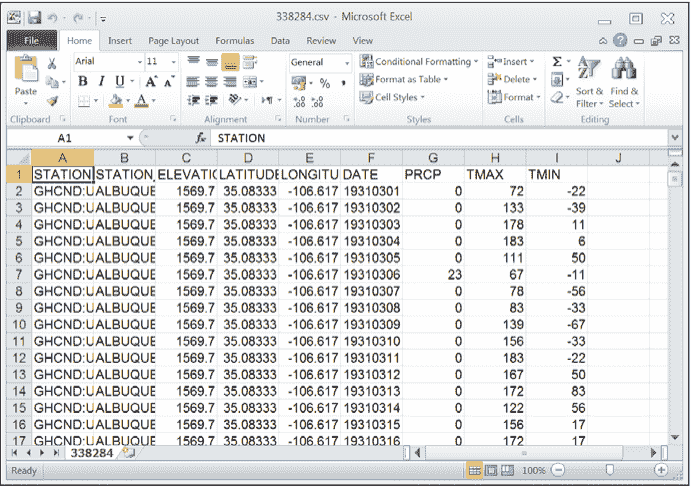

下面三行代码将文件读入R，并将DATE和TMAX列中的值分别赋给两个独立的向量，命名为 `time`（因为DATE列中的数据代表时间）和 `tmax`（代表最高温度）。这涉及到表格操作，将在下一章中解释。这里只是为了完整性而提供：

```r
> dat = read.csv("C:\\Data\\338284.csv", stringsAsFactors = FALSE)
> time = dat$DATE
> tmax = dat$TMAX
```

重要的是，我们现在有了两个可以操作的向量 `time` 和 `tmax`，作为对本章大部分主题的总结练习。

我们可以使用 `as.character` 和 `as.Date` 函数在字符向量和 `Date` 类之间切换。例如，我们可以使用 `as.character` 将 `Date` 对象 `x` 转换为字符向量：

```r
> x = as.character(x)
> x
[1] "2014-05-22"
> class(x)
[1] "character"
```

我们可以使用 `as.Date` 将字符向量转换回 `Date`：

```r
> x = as.Date(x)
> x
[1] "2014-05-22"
> class(x)
[1] "Date"
```

我们可以使用 `seq` 创建连续的日期序列，因为这个函数也接受 `Date` 对象：

```r
> seq(from = as.Date("2013-01-01"),
+     to = as.Date("2013-02-01"),
+     by = 3)
 [1] "2013-01-01" "2013-01-04" "2013-01-07" "2013-01-10"
 [5] "2013-01-13" "2013-01-16" "2013-01-19" "2013-01-22"
 [9] "2013-01-25" "2013-01-28" "2013-01-31"
```

这给出了从2013年1月1日到2013年2月1日，彼此相隔三天的连续日期。

后一种转换（从字符到日期）之所以如此容易，是因为 `"2014-05-22"` 这种配置是默认格式。这样，`as.Date` 函数就知道 `"2014-05-22"` 中的前四个字符代表*年*，接下来的两个字符（紧随连字符后）代表*月*，最后两个字符代表*日*。当我们有不同配置的字符代表日期时，需要使用 `as.Date` 的 `format` 参数，在其中指定元素的编码类型、顺序以及分隔它们的字符（如果有的话）。

## 处理向量和时间序列

年、月、日元素的常见编码类型及其在R中的对应符号，总结如下表：

| 符号 | 含义 |
|---|---|
| `%d` | 日（例如，15） |
| `%m` | 数字月份（例如，08） |
| `%b` | 月份的前三个字符（例如，Aug） |
| `%B` | 月份的完整名称（例如，August） |
| `%y` | 年份的后两位数字（例如，14） |
| `%Y` | 完整年份（例如，2014） |

使用这些符号，结合 `as.Date` 函数的 `format` 参数，我们可以将其他格式的字符值转换为日期。让我们看下面的例子：

```r
> as.Date("07/Aug/12")
Error in charToDate(x) :
  character string is not in a standard unambiguous format
> as.Date("07/Aug/12", format = "%d/%b/%y")
[1] "2012-08-07"
> as.Date("2012-August-07")
Error in charToDate(x) :
  character string is not in a standard unambiguous format
> as.Date("2012-August-07", format = "%Y-%B-%d")
[1] "2012-08-07"
```

在这两个示例对中，第一个表达式都导致了错误，因为我们试图将非标准日期格式的字符值转换为 `Date` 而没有指定格式，而第二个表达式可以工作，因为我们确实指定了格式。

一旦我们有了 `Date` 对象，就可以提取其三个元素（年、月、日）中的一个、两个或全部，并使用 `format` 函数按照我们想要的方式进行编码，指定所需的格式，方法与前面所示相同。请注意，结果不再是 `Date` 对象，而是字符向量：

```r
> d = as.Date("1955-11-30")
> d
[1] "1955-11-30"
> format(d, "%d")
[1] "30"
> format(d, "%B")
[1] "November"
> format(d, "%Y")
[1] "1955"
> format(d, "%m/%Y")
[1] "11/1955"
```

现在，我们准备继续处理涉及 `time` 和 `tmax` 向量的示例。首先，我们可以发现这两个向量都是数值型（准确地说是整数，即没有小数部分的数字），如下所示：

```r
> class(time)
[1] "integer"
> class(tmax)
[1] "integer"
```

然后，让我们打印这两个向量的前10个值，看看它们的样子：

```r
> time[1:10]
[1] 19310301 19310302 19310303 19310304 19310305 19310306
[7] 19310307 19310308 19310309 19310310
> tmax[1:10]
[1]  72 133 178 183 111  67  78  83 139 156
```

`time` 向量包含 `%Y%m%d` 配置的日期（年、月、日由完整的数值表示，没有分隔字符）。因此，我们可以将其转换为 `Date` 对象，如下所示：

```r
> time = as.Date(as.character(time), format = "%Y%m%d")
> time[1:10]
[1] "1931-03-01" "1931-03-02" "1931-03-03" "1931-03-04"
[5] "1931-03-05" "1931-03-06" "1931-03-07" "1931-03-08"
[9] "1931-03-09" "1931-03-10"
> class(time)
[1] "Date"
```

请注意，我们首先需要将 `time` 向量从数值型转换为字符型，因为 `as.Date` 函数作用于字符向量。现在 `time` 是日期向量，我们可以更自由地将数据视为时间序列。

### 检查我们的时间序列

查看NOAA气候数据的文档（本书网站上也提供），我们可以看到温度以十分之一摄氏度为单位提供，缺失值标记为 `-9999`。首先，我们将 `-9999` 值转换为 `NA`，通过选择相应的子集并进行赋值：

```r
> tmax[tmax == -9999] = NA
```

然后，将数据转换为摄氏度单位，我们将每个值除以10：

```r
> tmax = tmax / 10
> tmax[1:10]
  [1]  7.2 13.3 17.8 18.3 11.1  6.7  7.8  8.3 13.9 15.6
```

现在，让我们检查每个向量包含的值的范围：

```r
> range(time)
[1] "1931-03-01" "2014-05-15"
> range(tmax, na.rm = TRUE)
[1] -14.4  41.7
```

这意味着从1931年3月1日至2014年5月15日期间，测得的每日最高温度范围为-14.4至41.7摄氏度。

关于测量日期，查看 `time` 向量的前几个值（或者在电子表格中查看原始CSV文件），似乎这些天是连续的。然而，我们可能想确保该时间段内的所有日期确实都出现在文件中。我们可以通过将覆盖1931年3月1日至2014年5月15日期间的连续序列 `all_dates` 与我们的 `time` 向量进行比较来实现：

```r
> range_t = range(time)
> all_dates = seq(range_t[1], range_t[length(range_t)], 1)
> length(all_dates)
[1] 30392
> length(time)
[1] 30391
```

这已经表明我们有不完全一致的情况。我们的 `time` 向量包含30391个值，而从1931年3月1日至2014年5月15日期间共有30392个日期。因此，CSV文件至少缺少一个日期。

接下来，我们将检查缺少多少个日期（以及哪些日期）。首先，我们将使用 `%in%` 运算符（询问 `all_dates` 中的每个元素是否出现在 `time` 向量中）和 `all` 函数（询问结果逻辑向量中的所有值是否都为TRUE）来验证确实不是所有日期都出现在 `time` 向量中。

```r
> all(all_dates %in% time)
[1] FALSE
```

答案是否定的；在1931年3月1日至2014年5月15日的范围内，确实至少有一个日期从 `time` 向量中缺失。下一个问题将是哪个日期丢失了，或者哪些日期丢失了？我们可以使用 `which` 函数获取那些出现在 `all_dates` 中但不在 `time` 中的日期的索引：

```r
> which(!(all_dates %in% time))
[1] 5499
```

缺失的日期是 `all_dates` 向量的第5499个元素。其值如下：

```r
> all_dates[which(!(all_dates %in% time))]
[1] "1946-03-20"
```

在电子表格软件中手动检查CSV文件，将确认1946年3月20日确实因某种原因被跳过了。

我们可以提出的另一个有趣问题是，最高温度（我们之前看到是41.7摄氏度）是在哪一天观测到的：

```r
> max(tmax, na.rm = TRUE)
[1] 41.7
> time[which.max(tmax)]
[1] "1994-06-26"
```

最高的每日最高温度是在1994年6月26日观测到的。

### 基于日期创建子集

如果我们对时间序列的特定子集感兴趣，比如2005年12月31日至2014年1月1日期间，我们可以根据 `time` 向量创建该期间的日期子集，并根据 `tmax` 向量创建相应的数据值子集。我们可以分两步完成。首先，我们将创建一个逻辑向量 `w`，指向那些我们想要保留的日期：

```r
> w = time > as.Date("2005-12-31") & time < as.Date("2014-1-1")
```


为了找出我们希望保留在子集中的天数与完整序列天数之间的比值，可以输入以下表达式：

```
> sum(w) / length(w)
[1] 0.09614689
```

我们所关注的子集（2005年12月31日至2014年1月1日）中的数据量约占总数据量的9.6%，因为在逻辑向量 w 中，TRUE 值的数量占总数值数量的比例为0.096（请记住，在对逻辑向量求和之前，它会先被转换为数值向量，其中 TRUE 变为1，FALSE 变为0）。

其次，我们将使用 w 向量创建 time 和 tmax 向量的子集：

```
> time = time[w]
> tmax = tmax[w]
```

注意，由于我们使用了 `>` 和 `<` 运算符，选择结果不包含首尾日期：

```
> range(time)
[1] "2006-01-01" "2013-12-31"
```

如果希望包含首尾日期（2005年12月31日和2014年1月1日），则应使用 `>=` 和 `<=` 运算符。

## 绘图函数简介

数据的图形表示是数据分析（尤其是空间数据分析）的核心特征，甚至可以说是其主要目的。本节将基本介绍在 R 中创建图形输出的过程。在继续阅读后续章节之前，这样的介绍是必要的，因为在后续章节中，我们希望能够在各种空间数据分析步骤中快速显示中间结果。在第 9 章“空间数据的高级可视化”中，我们将额外花一些时间讨论 R 中的可视化主题，并了解如何在生成用于出版物质量的图形作为空间数据分析最终产物时自定义图形输出。

### 使用基础绘图系统显示向量

我们可以使用 `plot` 函数以图形方式显示向量的值。例如，以下表达式会在 R 环境中打开一个新窗口，绘制向量值的图形：

```
> plot(tmax)
```

下面的截图显示了使用 RGui 和 RStudio 时图形输出的效果及其出现位置：

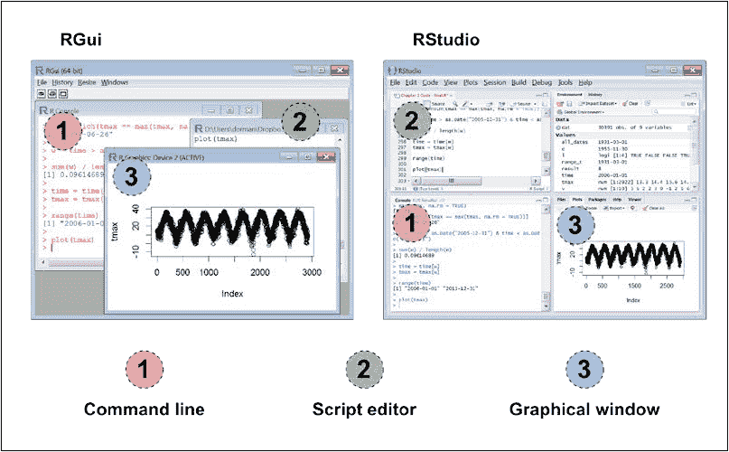

该输出是 `plot` 函数的默认输出；`tmax` 向量的值被绘制在 *y* 轴上，其在 *x* 轴上的索引作为自变量，并用空心圆标记数据点。

当绘制时间序列时，我们通常希望将观测时间放在 *x* 轴上（而不是索引），并看到一条从左到右连接数据点的线（而不是互不相连的圆圈）。这可以通过以下方式实现：

```r
> plot(time, tmax, type = "l")
```

绘制完成后，我们将看到如下截图所示的结果：

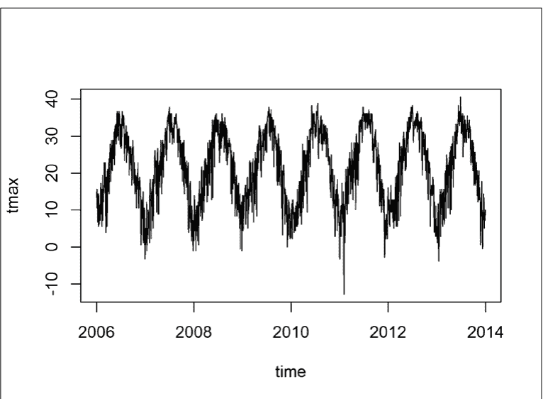

`type` 参数的 `"l"` 值表示我们想要绘制折线图，而第一个和第二个参数分别被视为 x 轴和 y 轴上的坐标向量。我们还可以看到，`time` 向量会自动格式化，使年份断点标记在 x 轴上。我们还有许多其他方式可以进一步自定义此图（以及后续章节中将要生成的其他类型的图）。但在到达第 9 章“空间数据的高级可视化”之前，我们通常会使用默认图形；该章将在空间数据的背景下详细讨论图形输出的自定义。

最后一个图也可以使用以下表达式生成：

```
> plot(tmax ~ time, type = "l")
```

### R 中的主要图形系统

R 中有三大图形系统：基础绘图系统（base graphics，我们刚刚用它创建了前面的图）、lattice 和 ggplot2。例如，以下代码除了生成前面的图之外，还使用 lattice 和 ggplot2 生成了两个类似的图。代码中包含一些将在后面说明的函数，并且需要安装额外的软件包（我们将在下一章中介绍）。

```
> dat = data.frame(time = time, tmax = tmax)
#### Base graphics
> plot(tmax ~ time, dat, type = "l")
#### lattice
> library(lattice)
> xyplot(tmax ~ time, data = dat, type = "l")
#### ggplot2
> library(ggplot2)
> ggplot(dat, aes(x = time, y = tmax)) +
+ geom_line()
```

下面的截图从左到右依次显示了该代码生成的图形，每个面板顶部标有相应的图形系统名称：

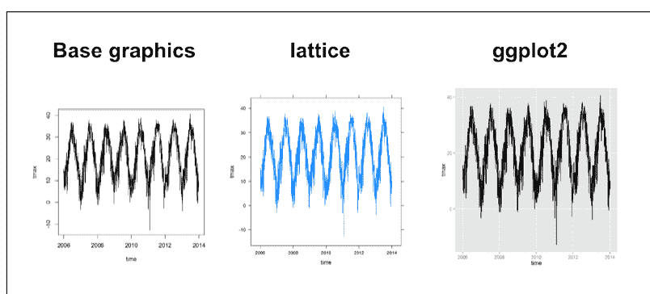

许多类型的图形（例如我们刚创建的时间序列图）都可以使用这三种系统中的任意一种生成。因此，在许多情况下选择哪一种只是个人偏好问题。不过，这些图形系统之间确实存在一些不重叠的功能。例如，分面（faceting，并排生成数据不同部分的系列图）无法使用基础绘图系统实现，而 ggplot2 无法生成 3D 图。如前面的截图所示，这些图形在默认样式上也有一些细微差别。最后，从前面的代码部分可以看出，ggplot2 与基础绘图系统和 lattice 相比，语法上有很大不同。

在接下来的章节中，我们将使用基础绘图系统（有时也用 lattice）来快速可视化空间数据分析各步骤中得到的成果。在第 9 章“空间数据的高级可视化”中，我们将主要使用 ggplot2 专注于自定义 R 中的图形输出。

### 小结

在本章中，我们介绍了从今以后几乎每一次操作都会用到的基础内容。首先，你学习了处理向量的基本方法，包括创建三种常见的向量类型、对它们进行子集操作以及处理其中的缺失值。你还了解了日期在 R 中是如何表示的，以及这种表示在处理时间序列时如何发挥作用。此外，我们详细阐述了 R 中的函数调用结构，讨论了如何定义自定义函数，并了解了如何生成和保存图形输出。

在下一章中，我们将讨论如何在 R 中处理表格。我们会看到，R 中常见的表格数据类（`data.frame`）是向量类的直接扩展。因此，一旦掌握了向量的使用方法，许多表格操作就会变得很直观。之后，我们将继续学习空间数据类，在这些类中，向量和表格的处理原则同样直接适用。

## 使用 data.frame 类表示表格数据

在本节中，你将学习表格在 R 中的表示方式，以及如何使用表格对象。具体来说，你将学习创建表格对象的两种常见方法（从向量创建，或从磁盘读取文件）。之后，你将学习如何检查表格、对表格进行子集操作以及使用表格进行计算。

### 从多个向量创建表格

`data.frame` 类是 R 中表示表格数据的基本类。`data.frame` 对象本质上是一个向量的集合，所有向量具有相同的长度。不过，这些向量的类型不必相同。它们也可以包含并非严格意义上的向量的一维对象，例如 `Date` 或 `factor` 对象（参见前一章）。因此，`data.frame` 对象特别适合表示这样的数据：不同的变量位于列中，不同的观测案例位于行中。这样，变量可以具有不同的类型；例如，一个存储气候数据的表可以用一个字符变量来存储气象站名称，用一个 `Date` 变量来表示测量日期，再用一个数值变量来表示测量值（如降雨量或温度）。

创建 `data.frame` 对象的一种方法是组合 R 环境中已有的多个向量。这可以通过 `data.frame` 函数实现，其参数是我们想要组合的向量对象的名称。让我们看下面的例子：

```
> num = 1:4
> lower = c("a","b","c","d")
> upper = c("A","B","C","D")
> df = data.frame(num, lower, upper)
> df
  num lower upper
1   1     a     A
2   2     b     B
3   3     c     C
4   4     d     D
```


在这里，我们通过组合向量 num、lower 和 upper 创建了一个名为 df 的 data.frame 对象。之前相互独立的向量现在构成了 df 中的各列。正如我们看到的，列名出现在 data.frame 对象打印输出的第一行。这些列名就是原始向量 num、lower 和 upper 的名字。行也有名称；它们会自动被赋为字符 1、2、3 和 4（正如打印输出中第一列左侧显示的那样）。

我们也可以直接在 data.frame 函数调用内部完成向量赋值，从而一步创建 data.frame 对象：

```
> df = data.frame(
+ num = 1:4,
+ lower = c("a","b","c","d"),
+ upper = c("A","B","C","D"))
```

请注意，在这个例子中，向量的类型是不同的（num 是数值型，而 lower 和 upper 是字符型）。不过，这些向量的长度相同；否则会报错，因为 data.frame 的所有列必须具有相同的长度。

data.frame 函数（以及下一节将介绍的其他几个函数，如 read.csv）的一个重要参数是 stringsAsFactors。stringsAsFactors 参数控制字符列是否会被自动转换为因子（默认值为 TRUE）。在本书的语境中，我们通常希望将字符向量保持为字符类型，以获得更大的灵活性（如有必要，我们随时可以使用 factor 函数自行转换为因子；更多信息请参见前一章）。因此，保留字符列的函数调用如下所示：

```
> df = data.frame(num, lower, upper,
+ stringsAsFactors = FALSE)
> df
  num lower upper
1   1     a     A
2   2     b     B
3   3     c     C
4   4     d     D
```

这个表格在屏幕上打印出来的方式与前面的示例完全相同。不过，使用后面才会介绍的一些方法，我们将能看到第 2 列和第 3 列现在由字符向量组成，而不是因子。

我们可以分别使用 rbind（行绑定）和 cbind（列绑定）函数向现有的 data.frame 对象添加行或列。例如，我们可以使用 rbind 向 df 表格添加第五行，如下所示：

```
> row5 = c(5,"e","E")
> rbind(df, row5)
  num lower upper
1   1     a     A
2   2     b     B
3   3     c     C
4   4     d     D
5   5     e     E
```

或者，我们可以使用 cbind 添加第四列，如下所示：

```
> word = c("One","Two","Three","Four")
> cbind(df, word, stringsAsFactors = FALSE)
  num lower upper word
1   1     a     A   One
2   2     b     B   Two
3   3     c     C Three
4   4     d     D   Four
```

在上面的示例中，我们必须再次指定：我们不希望字符向量 word 被转换为因子向量。

## 从 CSV 文件创建表

另一种常见的创建 data.frame 对象的方法是从磁盘读取表格数据。例如，我们可以使用 read.csv 函数（之前曾简单提及）读取 CSV 文件。该函数的第一个参数，也是唯一没有默认值的参数，是一个用于指定 CSV 文件路径的 file 参数。例如，下面的表达式读取 343452.csv 文件的内容，并将其赋给一个名为 dat 的 data.frame 对象（请记住，目录应使用 \\ 或 / 分隔）：

```
> dat = read.csv("C:\\Data\\343452.csv")
```

343452.csv 文件包含西班牙 30 年间的月降水量、月最低气温和月最高气温记录。该文件从 NOAA 气候档案下载，并按原样提供。由于我们将在本章及后续章节的多个示例中使用该文件的数据，让我们检查一下它的内容。因为表格非常大，为了查看它的样子，我们可以使用 head 函数只打印前几行，如下所示（类似地，使用 tail 函数可以打印最后几行）：

```
> head(dat)
          STATION STATION_NAME ELEVATION LATITUDE LONGITUDE
1 GHCND:SP000060010     IZANA SP       2371   28.3089  -16.4992
2 GHCND:SP000060010     IZANA SP       2371   28.3089  -16.4992
3 GHCND:SP000060010     IZANA SP       2371   28.3089  -16.4992
4 GHCND:SP000060010     IZANA SP       2371   28.3089  -16.4992
5 GHCND:SP000060010     IZANA SP       2371   28.3089  -16.4992
6 GHCND:SP000060010     IZANA SP       2371   28.3089  -16.4992
          DATE TPCP MMXT MMNT
1 19840101   514   56   -5
2 19840201     0   98   28
3 19840301   687   72    2
4 19840401   136  122   35
5 19840501   214  118   30
6 19840601    65  196  105
```

各列的内容如下：

- STATION：气象站标识代码
- STATION_NAME：气象站名称
- ELEVATION：气象站海拔高度（米）
- LATITUDE：气象站纬度（十进制度）
- LONGITUDE：气象站经度（十进制度）
- DATE：测量日期
- TPCP：月总降水量（0.1 毫米单位）
- MMXT：月平均最高气温（0.1 摄氏度单位）
- MMNT：月平均最低气温（0.1 摄氏度单位）

该 CSV 文件的完整文档随 NOAA 数据一起提供（也可以从本书网站下载）。

根据你在前一章学到的知识，日期以 `%Y%m%d` 格式记录（按 Date 对象的术语来说）。不过，由于数据是月度的，日部分没有信息（我们可以看到所有日期都编码为 01）。测量缺失值被标记为 -9999，这是一种常见的约定。

## 检查 data.frame 对象的结构

我们可以分别使用 nrow 和 ncol 函数获取 data.frame 对象的行数和列数。例如，我们的小表 df 有 4 行 3 列，而 dat（包含月度气候数据）有 28,536 行和 9 列：

```
> nrow(df)
[1] 4
> ncol(df)
[1] 3
> nrow(dat)
[1] 28536
> ncol(dat)
[1] 9
```

如果表格不太长，我们可以打印表格内容，并根据行名看出有多少列（或行）。但是，通常建议使用函数（如 ncol）获取对象的属性，而不是手动输入特定的数字（如 9）。这样，我们的代码就可以迁移到对任何对象的分析中，而不仅仅是我们当前正在处理的特定对象。

我们可以使用 dim 函数同时获取行和列两个维度的长度。如果参数是 data.frame 对象（我们稍后会看到 dim 函数也适用于其他类；这类函数在 R 术语中称为泛型函数），则返回一个长度为 2 的向量，第一个元素是行数，第二个元素是列数，如下所示：

```
> dim(dat)
[1] 28536     9
```

## 对 data.frame 对象取子集

创建 data.frame 对象子集有两种主要方式。第一种是使用 `$` 运算符，通过列名访问单独的列。第二种是使用 `[` 运算符，提供分别用于行和列的两个索引向量、名称向量或逻辑值向量。

使用 `$` 运算符，我们可以访问 data.frame 对象中的单独列。只需在 `$` 运算符左侧输入 data.frame 的名称，右侧输入所需列的名称，如下所示：

```
> df$num
[1] 1 2 3 4
> df$lower
[1] "a" "b" "c" "d"
> df$upper
[1] "A" "B" "C" "D"
```

由于 data.frame 对象的列本质上就是向量，我们可以像对独立向量使用向量方法一样，在 data.frame 对象的列上使用前面介绍的所有向量方法。例如，对于 dat 中的三个测量变量，我们可以将 -9999 值（标记缺失数据）替换为 NA，如下所示：

```
> dat$TPCP[dat$TPCP == -9999] = NA
> dat$MMXT[dat$MMXT == -9999] = NA
> dat$MMNT[dat$MMNT == -9999] = NA
```

与我们在前一章进行此操作相比，唯一的区别是 dat$ 这部分。这意味着我们引用的是 data.frame 对象（dat）的列，而不是独立的向量。现在，让我们将各相应列中的每个值除以 10，把 TPCP 值转换为毫米单位，把 MMXT 和 MMNT 值转换为摄氏度单位，如下所示：

```
> dat$TPCP = dat$TPCP / 10
> dat$MMXT = dat$MMXT / 10
> dat$MMNT = dat$MMNT / 10
```

请注意，如果我们先把 -9999 值编码为 NA 之前就除以 10，我们会得到 -999.9 值；而现在既然我们有 NA 值，它们将保持为 NA，因为 NA/10 得到 NA。这突出了使用 NA 表示缺失数据以降低出错几率的重要性。


## 处理表格

使用 `[` 运算符，我们可以获得 `data.frame` 对象的一个子集，其中包含任意数量行和列的交集。其工作方式与向量取子集相同，但有一个区别：`data.frame` 是二维对象，而向量是一维对象。因此，我们需要提供两个索引，而不仅仅是一个。

请记住，在使用 `data.frame` 中的 `[` 运算符取子集时，第一个索引表示行，第二个索引表示列。这种安排在其它环境也会出现（例如在矩阵和栅格中）。

用于创建 `data.frame` 对象子集的两个索引向量，可以是以下任意组合：

- 数值向量；此时数值向量指的是子集中需要保留的行/列的索引
- 字符向量；此时字符向量表示需要保留的行/列名称
- 逻辑向量；此时逻辑向量指示是否保留 `data.frame` 的每一行/列

我们在前一章中已经大量使用了向量中的方法 1 和方法 3，因此将这些方法扩展到二维情况应当是直观的。实际上，方法 2 也可以用于向量，因为向量可以像 `data.frame` 对象拥有行名和列名那样拥有元素名称（但我们这里不会用到）。

例如，下面的表达式给出了 `df` 中第二行第三列的元素：

```r
> df[2, 3]
[1] "B"
```

将行或列索引留空，表示我们对该维度（所有行或所有列）的全部元素感兴趣。例如，以下表达式返回 `df` 第二行的所有元素和第三列的所有元素：

```r
> df[2, ]
```

|   | num | lower | upper |
|---|-----|-------|-------|
| 2 | 2   | b     | B     |

```r
> df[, 3]
[1] "A" "B" "C" "D"
```

默认情况下，如果涉及单列的值，`data.frame` 对象的子集会被转换为更简单的类。例如，`df[2, 3]` 和 `df[, 3]` 表达式返回的是（字符）向量。`df[2, ]` 表达式返回的是 `data.frame` 对象，因为涉及三列。事实上，`df` 的第二行同时包含数值和字符值，而我们知道向量只能包含相同类型的值。如果我们愿意，可以通过 `drop` 参数抑制 `data.frame` 的简化，设置为 `FALSE`（而不是默认值 `TRUE`），这样无论什么情况下子集都会保持 `data.frame` 对象：

```r
> df[ , 3, drop = FALSE]
```

|   | upper |
|---|-------|
| 1 | A     |
| 2 | B     |
| 3 | C     |
| 4 | D     |

将上述输出与上例中的输出进行比较。在前一个表达式中使用 `drop=FALSE` 后，我们得到的是一个 `data.frame` 对象（四行一列），而不是向量。

对 `data.frame` 对象取子集的另外两种方法是使用逻辑向量和字符向量作为索引。我们来看下面的例子：

```r
> df[df$lower %in% c("a","d"), c("lower","upper")]
```

|   | lower | upper |
|---|-------|-------|
| 1 | a     | A     |
| 4 | d     | D     |

用通俗的语言说，这个表达式要我们取 `df` 的子集，其中行是 `lower` 列的值为 `"a"` 或 `"d"` 的那些行，列则同时包含 `lower` 和 `upper`。

在处理 `data.frame` 对象时，有一个非常有用的函数是 `complete.cases`。该函数返回一个逻辑向量，其长度与 `data.frame` 对象的行数相同，用于指示每一行（case）是否完整（其中没有 `NA` 值）。当某一行完整时，逻辑向量中对应的元素为 `TRUE`；当某一行不完整时，该值为 `FALSE`。然后，可以将得到的逻辑向量用于从表格中移除不完整的行，如下所示（注意：为节省空间，此处不打印输出）：

```r
> dat[complete.cases(dat), ]
```

请注意，在这个表达式中，我们将 `complete.cases` 返回的向量作为逻辑向量，用于指示 `dat` 中要保留的行。

### 计算新的数据字段

如前面所示，我们可以使用 `$` 运算符为表格的某一列（或某列的子集）赋新值。如果我们赋值的列名在表格中不存在，则会创建一个新列来容纳这些数据。我们来看下面的例子：

```r
> df
```

|   | num | lower | upper |
|---|-----|-------|-------|
| 1 | 1   | a     | A     |
| 2 | 2   | b     | B     |
| 3 | 3   | c     | C     |
| 4 | 4   | d     | D     |

```r
> df$word[df$num == 2] = "Two"
> df
```

|   | num | lower | upper | word  |
|---|-----|-------|-------|-------|
| 1 | 1   | a     | A     | `<NA>` |
| 2 | 2   | b     | B     | Two   |
| 3 | 3   | c     | C     | `<NA>` |
| 4 | 4   | d     | D     | `<NA>` |

这里，我们将字符值 `"Two"` 赋给了 `word` 列（原本在 `df` 中不存在）的一个子集，该子集对应于 `num` 列值等于 2 的行。结果创建了一个新列，其中包含所赋的值（其余所有元素为 `NA`）。请注意，`<NA>` 只是 `NA` 的字符表示（`word` 列是字符向量）。

作为使用气候数据的另一个例子，我们将创建两个新列，分别保存每次测量的年份和月份。为此，我们首先将 `date` 列转换为 `Date` 对象。然后，我们按如下方式从该列的数据中提取年份和月份（详见前一章）：

```r
> dat$date = as.Date(as.character(dat$date), format = "%Y%m%d")
> dat$month = as.numeric(format(dat$date, "%m"))
> dat$year = as.numeric(format(dat$date, "%Y"))
> head(dat)
```

|   | station          | station_name | elevation | latitude | longitude | date       | tpcp | mmxt | mmnt | month | year |
|---|------------------|--------------|-----------|----------|-----------|------------|------|------|------|-------|------|
| 1 | GHCND:SP000060010 | IZANA SP     | 2371      | 28.3089  | -16.4992  | 1984-01-01 | 51.4 | 5.6  | -0.5 | 1     | 1984 |
| 2 | GHCND:SP000060010 | IZANA SP     | 2371      | 28.3089  | -16.4992  | 1984-02-01 | 0.0  | 9.8  | 2.8  | 2     | 1984 |
| 3 | GHCND:SP000060010 | IZANA SP     | 2371      | 28.3089  | -16.4992  | 1984-03-01 | 68.7 | 7.2  | 0.2  | 3     | 1984 |
| 4 | GHCND:SP000060010 | IZANA SP     | 2371      | 28.3089  | -16.4992  | 1984-04-01 | 13.6 | 12.2 | 3.5  | 4     | 1984 |
| 5 | GHCND:SP000060010 | IZANA SP     | 2371      | 28.3089  | -16.4992  | 1984-05-01 | 21.4 | 11.8 | 3.0  | 5     | 1984 |
| 6 | GHCND:SP000060010 | IZANA SP     | 2371      | 28.3089  | -16.4992  | 1984-06-01 | 6.5  | 19.6 | 10.5 | 6     | 1984 |

使用第一个表达式，我们将 `dat$date` 向量转换为 `Date` 对象（并将其赋回给 `dat$date`）。在第二个和第三个表达式中，我们从 `dat$date` 中提取了月份和年份分量，作为数值向量，并分别赋给新列 `dat$month` 和 `dat$year`。

### 将 data.frame 对象写入 CSV 文件

可以使用 `write.csv` 函数将 `data.frame` 对象写入 CSV 文件。该函数的头两个（也是最重要的）参数表示要保存的 `data.frame` 对象的名称，以及新文件的路径（包括新文件名）。这些参数没有默认值，因此我们需要指定它们。例如，下面的表达式将 `data.frame` 对象 `df` 写入 `C:\Data` 目录下的 `df.csv` 文件：

```r
> write.csv(df, "C:\\Data\\df.csv")
```

新创建的文件在 Excel 中打开时，效果如下面的截图所示：

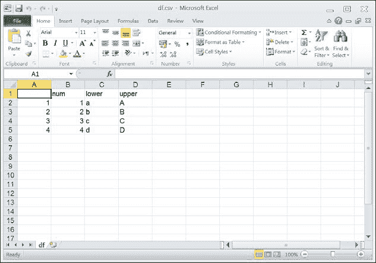

请注意，行名（A 列中的数字 1 到 4）和列名会被添加；需要时也可以禁用此行为。

## 控制代码执行

到目前为止，我们所编写的所有代码段都是按照发送到命令行的顺序依次执行一次的。然而，编程中最重要的主题之一是流程控制——用于控制代码执行顺序的操作。例如，我们可能希望仅在满足某个条件时才执行某个代码段（这被称为条件语句），或者希望反复执行某个代码段多次（这被称为循环）。在本节中，你将学习三种流程控制命令：其中两种用于构建条件语句，一种用于构建循环。

### 用条件语句控制执行

条件语句的目的是对给定代码段的执行进行条件限制。例如，下面代码段中的第二个表达式就是一个使用 `if` 运算符的条件语句：

```r
x = 3
if(x > 2) {print("x is large!")}
[1] "x is large!"
```

条件语句由以下元素组成：

- 条件语句运算符（`if`）
- 括号中的条件（例如 `(x>2)`）
- 代码段左花括号（`{`）
- 条件满足时执行的代码段（例如 `print("x is large!")`）
- 代码段右花括号（`}`）
- 可选地，`else` 运算符（`else`）
- 可选地，代码段左花括号（`{`）
- 可选地，条件不满足时执行的代码
- 可选地，代码段右花括号（`}`）


## 处理表格

重要的是，条件应该是一个返回单个逻辑值的表达式。条件后面的代码段将在该值为 `TRUE` 时执行，如果该值为 `FALSE`，则被忽略。例如，如果 `x` 不大于 2，由于 `print("x is large!")` 表达式不会被执行，因此什么也不会发生：

```r
> x = 0
> if(x > 2) {print("x is large!")}
```

屏幕上不会打印任何内容。

> 与函数定义（参见前一章）和 for 循环（参见下一节）一样，只包含一个表达式的代码不必用花括号 `{` 括起来。

另外，我们可以使用 `else` 运算符来添加另一段代码。当 `if` 中的条件为 `FALSE` 时，`else` 运算符之后的代码段将被执行，如下所示：

```r
> x = 3
> if(x > 2) {print("x is large!")} else {print("x is small!")}
[1] "x is large!"
> x = 1
> if(x > 2) {print("x is large!")} else {print("x is small!")}
[1] "x is small!"
```

还有一个专门用于逐元素处理向量的条件运算符，称为 `ifelse`。使用 `ifelse` 时，我们需要提供三个参数：一个逻辑向量、一个用于 TRUE 的值（yes 参数）以及一个用于 FALSE 的值（no 参数）。我们得到的将是一个与输入逻辑向量等长的新向量，其中 TRUE 和 FALSE 值已被我们提供的替代值所替换。

关于 TRUE 和 FALSE 的替代值，最常用的操作模式有两种：一种是将它们设为长度为 1 的向量（然后它们会被循环使用以填充整个逻辑向量的长度），另一种是将它们设为与逻辑向量等长的向量（然后逻辑向量的元素会被替换为分别来自 yes 或 no 向量的对应元素）。

例如，当我们想根据某个条件将给定向量的值分成两类时，第一种模式很有用：

```r
> dat$mmxt[1:7]
[1]  5.6  9.8  7.2 12.2 11.8 19.6 24.1
> ifelse(dat$mmxt[1:7] < 10, "cold", "warm")
[1] "cold" "cold" "cold" "warm" "warm" "warm" "warm"
```

## 对向量的不同部分应用函数

`tapply` 函数用于对向量的不同部分应用函数，然后将结果合并为单个对象。为此，我们需要为以下三个参数提供对应的值：

-   向量 A，函数将对其进行操作（x）
-   向量 B，用于定义向量 A 的子集（INDEX）
-   将应用于向量 A 子集的函数（FUN）

作为示例，我们将使用一个小型表格，它是 iris 数据集（在 R 中键入 iris 即可获得）中随机抽取的六行子集（原始数据共 150 行）。这些数据是三种不同鸢尾花物种（第五列，Species）的不同植株（行）的四个花部性状（前四列）的测量值。你可以用 iris=iris[sample(1:nrow(iris),6),] 创建类似下面示例的 data.frame 对象（注意，由于是随机抽样，每次得到的具体数值都会不同）。示例中使用的确切表格可在本书网站（iris2.csv）上找到。下面是我们将要使用的 iris 数据集子集：

```
> iris
      Sepal.Length Sepal.Width Petal.Length Petal.Width Species
100          5.7        2.8         4.1        1.3 versicolor
45           5.1        3.8         1.9        0.4 setosa
90           5.5        2.5         4.0        1.3 versicolor
34           5.5        4.2         1.4        0.2 setosa
38           4.9        3.6         1.4        0.1 setosa
101          6.3        3.3         6.0        2.5 virginica
```

使用 tapply，我们可以快速求出每个物种的平均花瓣宽度，如下所示：

```
> x = tapply(iris$Petal.Width, iris$Species, mean)
> x
      setosa versicolor virginica
0.2333333 1.3000000 2.5000000
```

第一个参数 iris$Petal.Width 是我们应用函数的向量。第二个参数 iris$Species 是定义 iris$Petal.Width 子集的向量。基本上，iris$Petal.Width 中与 iris$Species 的每一个唯一值对应的位置上的所有元素都被视为一组。最后一个参数是我们应用于 iris$Petal.Width 子集的函数；在本例中是 mean 函数。因此，iris$Petal.Width 向量被分成三个子集，对每个子集计算平均值，然后将结果再次合并。

`tapply` 返回的对象是一个 `array`，这是一个带有额外属性的向量，该属性说明了其维度的数量和大小。一维数组就是我们这里得到的结果，在用法上与向量完全相同。然而，`tapply` 返回的对象之所以是数组，是因为在某些情况下（这里我们不讨论），返回的对象会有多个维度，因此无法用向量表示（例如，当应用的函数返回多个值时，如 `range` 函数）。我们将在下一章进一步详细阐述二维（`matrix`）和三维（`array`）这类类似向量的对象。

请注意，该数组使用分组向量中的值来命名，因此我们可以使用其名称访问任意感兴趣的值，如下所示：

```
> x["setosa"]
  setosa
  0.2333333
```

此外，如果愿意，我们可以使用 `as.numeric` 将结果转换为向量，如下所示：

```
> as.numeric(x)
[1] 0.2333333 1.3000000 2.5000000
```

如前所述，`apply` 函数族在目的和概念上与循环类似，但语法更简单、更清晰。例如，上面的操作也可以用 `for` 循环来完成，尽管代码会更长（而且可以说更不清晰）：

```
> x = NULL
> for(i in unique(iris$Species)) {
+ x = c(x, mean(iris$Petal.Width[iris$Species == i]))
+ }
> names(x) = unique(iris$Species)
> x
versicolor  setosa  virginica
1.3000000 0.2333333 2.5000000
```

在这里，我们创建一个空对象（使用 `NULL`，这是 R 中表示空对象的特殊值），然后使用循环遍历 `iris$Species` 中的唯一值，每次将 `iris$Petal.Width` 的均值添加到 x 中对应的物种上。最后，我们使用 `names` 函数编辑结果向量的 names 属性，以添加唯一的物种名称。


让我们再看一个使用 tapply 处理气候数据的示例。假设我们想了解有多少个站点（以及哪些站点）在其各自的降水量时间序列中至少有一个缺失值。对于单个站点（例如名为 "IZANA SP" 的站点），我们可以按如下方式检查其 tpcp 列是否包含至少一个 NA 值：

```
> any(is.na(dat[dat$station_name == "IZANA SP", "tpcp"]))
[1] TRUE
```

返回值为 TRUE，表示答案是肯定的。请注意，该操作包含三个步骤。我们首先创建了 dat 的一个子集（包含站点名为 "IZANA SP" 且列名为 "tpcp" 的行）。由于该子集是从单个列创建的，因此会自动简化为向量。其次，我们使用 is.na 函数检查每个元素是否为 NA。最后，我们使用 any 函数检查结果逻辑向量中是否至少有一个元素为 TRUE。

要立即对所有站点执行此操作，我们可以使用 tapply：

```
> result = tapply(
+ dat$tpcp,
+ dat$station_name,
+ function(x) any(is.na(x)))
```

这次，我们在 tapply 函数中使用的值向量是 dat$tpcp（因为我们想在降水数据中查找缺失值），而定义子集的向量是 dat$station_name（因为我们想分别对每个站点的数据应用函数）。最后，我们应用的函数是一个用户自定义函数；为了简洁，其定义被包含在 tapply 函数调用中。该函数接受一个参数（x），并根据 x 是否至少包含一个 NA 值返回 TRUE 或 FALSE，与我们在上一段代码中的做法相同。

结果数组指示每个站点是否至少有一个降水量测量值缺失。以下是其前十个元素：

```
> result[1:10]
        A CORUNA ALVEDRO SP             A CORUNA SP
                    FALSE                     FALSE
    ALBACETE LOS LLANOS SP         ALBACETE OBS. SP
                    FALSE                     FALSE
      ALMERIA AEROPUERTO SP        ASTURIAS AVILES SP
                    FALSE                     FALSE
                AVILA SP BADAJOZ TALAVERA LA REAL SP
```


## 对表格的行或列应用函数

我们将要遇到的 `apply` 家族的第二个函数是 `apply`。该函数也用于对数据的子集应用某个函数，但它不是基于分组对象定义子集，而是在数组（或类似数组的对象，例如仅包含数值值的 `data.frame` 对象）的边际上进行操作。例如，对表格的每一行或每一列应用函数就是此类操作。我们目前将限制在此类二维操作上。在第 6 章 *修改栅格和分析栅格时间序列* 中，我们将看到一个涉及三个维度的 `apply` 示例。

与 `tapply` 类似，`apply` 的第一个参数是我们希望基于其进行计算的对象（`x`），第三个参数是我们希望应用的函数（`FUN`）。第二个参数（`MARGIN`）则定义了我们希望在该维度上应用函数（而不是像 `tapply` 中那样指定输入的子集）。例如，`data.frame` 对象（以及将在下一章介绍的矩阵）有两个维度：行（维度编号 1）和列（维度编号 2）。当输入具有两个以上的维度（例如在三维数组中）时，我们也可以在第三个维度上应用函数，以此类推，尽管在实践中具有超过三个维度的数组并不常见。

让我们回到我们的 `iris` 示例，看看 `apply` 如何工作。使用 `apply`，我们可以通过对第一维度（即行）的值取平均，从而找出每五个个体植物的平均测量值，如下所示：

```
> apply(iris[, 1:4], 1, mean)
    100   45   90   34   38  101
  3.475 2.800 3.325 2.825 2.500 4.525
```

我们也可以通过对第二维度（即列）的值取平均，从而找出每四个测量性状的平均测量值，如下所示：

```
> apply(iris[, 1:4], 2, mean)
  Sepal.Length Sepal.Width Petal.Length Petal.Width
    5.5000000   3.3666667    3.1333333    0.9666667
```

请注意，我们仅使用 `iris` 对象的数值部分（第 1 到 4 列），因为我们应用的函数（`mean`）作用于数值向量。

我们还可以向 `apply` 传递额外的参数，这些参数将被传递给我们应用的具体函数。例如，`mean` 函数有一个额外的参数 `na.rm`，我们可以在 `apply` 函数调用中将其设置为 `TRUE`。在这种情况下，我们就可以例如在排除缺失值的情况下求出列均值：

```
> iris[3,2] = NA
> iris
    Sepal.Length Sepal.Width Petal.Length Petal.Width   Species
100          5.7        2.8         4.1        1.3 versicolor
45           5.1        3.8         1.9        0.4 setosa
90           5.5         NA         4.0        1.3 versicolor
34           5.5        4.2         1.4        0.2 setosa
38           4.9        3.6         1.4        0.1 setosa
101          6.3        3.3         6.0        2.5 virginica
> apply(iris[, 1:4], 2, mean)
Sepal.Length Sepal.Width Petal.Length Petal.Width
    5.5000000        NA     3.1333333    0.9666667
> apply(iris[, 1:4], 2, mean, na.rm = TRUE)
Sepal.Length Sepal.Width Petal.Length Petal.Width
    5.5000000   3.5400000     3.1333333    0.9666667
```

这里，我们首先向 `iris` 表中引入了一个 `NA` 值，然后对列应用 `mean` 函数，先使用默认参数（`na.rm = FALSE`），然后将 `na.rm` 设置为 `TRUE`。请注意，传递额外参数的方式在 `tapply` 中也可以同样使用。

## 通过连接、重塑和聚合从表格进行推断

在本节中，你将学习涉及表格的几种更高级操作。特别是包括表格的重塑以及表格对信息的连接。所介绍的方法与前面介绍的方法一起，将构成一个相当强大的工具箱，足以满足你在本书中将使用的所有与表格相关的操作。由于你将使用来自贡献包的函数，你首先将学习如何下载和安装它们。接下来的三个小节将分别介绍用于重塑、聚合和连接表格的函数。

## 使用贡献包

R 中所有预定义对象（如我们迄今使用的函数和类）都收集在库或 *包* 中（在 R 术语中）。为了使用某个包中定义的对象，它首先需要被加载到内存中。这是通过 `library` 函数完成的。到目前为止，我们没有使用 `library` 函数，那么我们为什么能够使用我们一直使用的所有函数呢？答案是 R 安装文件 (~30 个，截至 2014 年 5 月) 中分发了多个包，其中一些在启动 R 时会自动加载到计算机内存中（这些称为基础 R 包）；否则，如果我们想使用其函数，就需要将包加载到内存中。例如，如果我们想使用 `lattice` 包（见上一章）的图形函数，该包随 R 自动安装，我们需要先执行以下表达式：

```
> library("lattice")
```

`library` 函数的参数是我们希望加载的所需包的名称。

默认情况下，`library` 函数也可以接受不带括号的包名，因此我们可以输入 `library(lattice)` 而不是之前的表达式。

除了预装的包之外，还有许多贡献包（~5500 个，截至 2014 年 5 月）位于 Comprehensive R Archive Network（CRAN），这是一个存储官方 R 包最新版本的 FTP 和 Web 服务器网络（非官方包或正在开发中的包可从 GitHub 等各种其他在线来源获得）。要使用 CRAN 上的其中一个包，我们首先必须将其下载到计算机上，这可以在 R 中使用 `install.packages` 函数自动完成。例如，要安装 `reshape2` 包（我们将很快使用），我们需要执行以下表达式：

```
> install.packages("reshape2")
```

我们将在本章中使用的另一个贡献包称为 `plyr`。因此，有必要在执行即将到来的代码示例之前，使用 `install.packages` 函数分别下载 `reshape2` 和 `plyr`（每个包一次），并使用 `library` 函数分别将它们加载到内存中。

要检查有多少个站点至少有一个缺失值，我们可以简单地使用 `sum` 函数（见上一章）：

```
> sum(result)
[1] 11
```

答案是 11 个站点在其 `tpcp` 列中有至少一个 NA 值。要查看这些站点是哪些，我们可以用数组本身对 `result` 数组进行子集化（请注意，由于该数组中的 TRUE 值恰好定义了我们正在寻找的子集）：

```
> result[result]
COLMENAR VIEJO FAMET SP      CORDOBA AEROPUERTO SP
TRUE                         TRUE
GUADALAJARA SP               IZANA SP
TRUE                         TRUE
JAEN SP PALENCIA OBSERVATORIO SP
TRUE                         TRUE
PAMPLONA OBSERVATORIO SP     PAMPLONA SP
TRUE                         TRUE
ROTA SP                      SANTANDER CENTRO SP
TRUE                         TRUE
TARIFA SP
TRUE
```

此时数组的值并不重要（因为它们都是 TRUE）；我们实际上只对元素的名称感兴趣。数组（或就此而言向量的）名称属性可以用我们已经见过的 `names` 函数提取，如下所示：

```
> names(result[result])
[1] "COLMENAR VIEJO FAMET SP"  "CORDOBA AEROPUERTO SP"
[3] "GUADALAJARA SP"           "IZANA SP"
[5] "JAEN SP"                 "PALENCIA OBSERVATORIO SP"
[7] "PAMPLONA OBSERVATORIO SP" "PAMPLONA SP"
[9] "ROTA SP"                 "SANTANDER CENTRO SP"
[11] "TARIFA SP"
```

这些是我们正在寻找的站点的名称，以字符向量的形式给出。

```
FALSE                          FALSE
BARCELONA AEROPUERTO SP         BARCELONA SP
FALSE                          FALSE
```


## 使用表格


> 为节省空间，从现在开始，`install.packages` 命令将不会作为代码段的一部分书写，也不会在每次使用包时都重复使用 `library` 加载包的命令。相反，每当代码段需要一个新贡献的包时，你应确保相应的包已加载。

请记住，下载一个包（使用 `install.packages` 函数）是一次性操作（除非包的新版本发布且我们希望重新安装）。另一方面，将包加载到内存中（使用 `library` 函数）是我们需要在每个新的 R 会话中执行的操作。


以下是关于包安装的更多提示：

- 包安装也可以通过 RGui 和 RStudio 中的菜单访问
- 当触发包安装时，用户会被提示选择一个 CRAN 镜像来下载包
- 当安装新版本的 R 时，所有包都需要重新安装

## 使用 melt 和 dcast 在长格式和宽格式之间转换

在本节和下一节中，你将学习几种有用的重塑数据的方法。重塑操作是数据分析过程中的必经步骤，因为在大部分时间里，我们处理的数据结构与使用特定函数或软件类型所需的结构不同。在数据重塑中，我们改变数据的形式（可能通过聚合减少其数量），但不改变数据本身。例如，Excel 中的 PivotTable 工具就是用于数据重塑的工具之一。

我们将在本节和后续章节中使用的函数属于贡献包 reshape2 和 plyr。 在 R 中执行所展示操作还有其他方法；其中一些方法仅使用基础包。然而，这里展示的方法被认为更直观、更灵活。由其作者 Hadley Wickham 对这两个包的介绍可在《Journal of Statistical Software》期刊中找到（见附录 B，参考文献）。请注意，其中一篇论文涉及 reshape 包（而不是后来开发的更高效的 reshape2 包），但 reshape 和 reshape2 的原理相同，因此该论文对 reshape2 用户也非常相关。Paul Murrell 在优秀著作《Introduction to Data Technologies》（2009）中提供了使用（主要是）基础包进行 R 数据操作的好介绍（该书也可在网上获取）。

你将要学习到的第一个操作是在宽格式和长格式之间转换。宽表格为每个测量变量包含一列。例如，我们的 dat 表就是宽格式，因为它有一个站点名称列、一个降水量列、一个最低温度列，等等。长表格是其中一列保存变量名，另一列保存测量值的表格。从宽格式切换到长格式时，我们通常对中间形式感兴趣，其中一些变量在列中，而其他变量在保存变量名的单列中标识。在 reshape2 术语中，前者称为标识符变量（id.vars），后者称为测量变量（measure.vars）。使用示例会更清楚。

我们之前看到的 iris 数据集也处于宽格式。要将其转换为长格式，我们可以使用 melt 函数，该函数用于将宽格式转换为长格式。使用 melt 时，我们需要指定要重塑的 data.frame 对象，以及 ID 和测量变量的身份（作为字符向量）。事实上，我们可以只指定 ID 或测量变量，函数会假设其余列属于另一类。例如，在这种特定情况下，最合理的方法是使用 species 作为 ID 变量（因为它描述了每个测量单元），并将花朵尺寸性状作为测量变量（因为它们是对每个测量单元进行的独立测量）。让我们看一下以下示例：

```
> library(reshape2)
> iris_melt = melt(iris, id.vars = "Species")
```

## 使用表格

结果表格的前几行打印如下：

```
```text
> head(iris_melt)
      Species     variable value
1 versicolor Sepal.Length   5.7
2     setosa Sepal.Length   5.1
3 versicolor Sepal.Length   5.5
4     setosa Sepal.Length   5.5
5     setosa Sepal.Length   4.9
6  virginica Sepal.Length   6.3
```
```

我们可以看到 ID 变量（本例中只有一个，Species）保留了其作为列之一的状态。其余列，即测量变量（本例中有四个），消失了；取而代之的是创建了两个新列（variable 和 value），分别保存测量变量名称和值。行数现在为 150（为原始行数的四倍，150），因为 ID 部分被复制了四次，每次对应一个测量变量。

类似地，我们可以使用 melt 函数将气候数据表 dat 转换为长格式，指定 tpcp、mmxt 和 mmnt 列包含测量变量。我们将其分配给名为 dat_melt 的不同对象：

```
```text
> dat_melt = melt(dat, measure.vars = c("tpcp","mmxt","mmnt"))
> head(dat_melt)
             station station_name elevation latitude longitude
1 GHCND:SP000060010       IZANA SP       2371  28.3089  -16.4992
2 GHCND:SP000060010       IZANA SP       2371  28.3089  -16.4992
3 GHCND:SP000060010       IZANA SP       2371  28.3089  -16.4992
4 GHCND:SP000060010       IZANA SP       2371  28.3089  -16.4992
5 GHCND:SP000060010       IZANA SP       2371  28.3089  -16.4992
6 GHCND:SP000060010       IZANA SP       2371  28.3089  -16.4992
          date month year variable value
1   1984-01-01     1 1984     tpcp  51.4
2   1984-02-01     2 1984     tpcp   0.0
3   1984-03-01     3 1984     tpcp  68.7
4   1984-04-01     4 1984     tpcp  13.6
5   1984-05-01     5 1984     tpcp  21.4
6   1984-06-01     6 1984     tpcp   6.5
```
```

我们可以检查并看到熔化后的表格 dat_melt 的行数正好是原始表格 dat 的三倍。

## 使用表格

或者，我们可以让月份形成新的列，如下所示：

```
> dat2 = dcast(dat_melt, station+station_name+variable+year~month)
> head(dat2)
        station      station_name variable year    1    2    3
1 GHCND:SP000003195 MADRID RETIRO SP     tpcp 1984 25.3 37.2 58.0
2 GHCND:SP000003195 MADRID RETIRO SP     tpcp 1985 67.8 45.1  6.0
3 GHCND:SP000003195 MADRID RETIRO SP     tpcp 1986 10.6 57.0 22.2
4 GHCND:SP000003195 MADRID RETIRO SP     tpcp 1987 93.3 42.9  6.7
5 GHCND:SP000003195 MADRID RETIRO SP     tpcp 1988 60.0 20.9  1.1
6 GHCND:SP000003195 MADRID RETIRO SP     tpcp 1989  9.9 19.5 23.8

             4    5    6    7    8    9   10   11   12
1         39.2 82.4 35.6  0.0  7.1  7.1 30.1 161.0 11.3
2         36.8 29.9 24.1  5.4  0.0  0.0  0.0  39.9 83.8
3         57.3 12.0  1.0 37.1 16.4 47.5 93.8  13.6 19.0
4         63.1 58.4  7.8 43.9 14.5 11.9 58.5  64.8 79.1
5         96.6 46.5 49.8  9.5  0.0  0.0 79.2  50.1  0.2
6         52.2 97.7 12.7 13.3  3.2 37.5  5.9 146.4 138.6
```

> 请注意，这次我们省略了一些变量从结果表中（elevation、latitude 等），并使月份的水平（共有 12 个）出现在单独的列中，各列的单元格中包含每个月的相应气候变量值。这种形式非常适合回答诸如每个站点哪个月最暖和这样的问题（例如使用 apply）。

我们迄今为止执行的转换操作都涉及在结果表中保留所有原始数据。当我们指示创建无法包含所有原始数据的表时会发生什么？在这种情况下，会进行聚合，我们需要指定用于聚合的函数（否则，默认函数 length 将被使用）。例如，我们可以按年份计算西班牙的平均气候条件，如下所示：

```
> dat2 = dcast(dat_melt, year ~ variable, mean, na.rm = TRUE)
> head(dat2)
   year       tpcp      tmxt      mmnt
1  1984 54.34180 19.38194  9.381115
2  1985 45.13103 20.31096  9.793890
3  1986 47.55329 19.75327  9.681250
4  1987 57.09826 20.31684 10.350206
5  1988 47.78863 20.07662  9.934514
6  1989 54.82944 20.97615 10.654617
```


使用 dcast 进行聚合的一个缺点是，我们必须对所有变量应用相同的函数。在下一节中，您将学习一种更灵活的聚合方法。

## 使用 ddply 进行聚合

plyr 包中有几个函数用于对数据子集应用操作，然后将子集再次组合成单个对象。这可能听起来很熟悉；事实上，plyr 包旨在作为 apply 和其他 R 基础函数的替代方案，在许多情况下是更简单的方案。该包中最常用的函数之一，也是您将在本节中学习的函数，名为 ddply。

> 名为 dplyr 和 tidyr 的新软件包最近出现在 CRAN 上；它们旨在作为 plyr 和（部分）reshape2 的更快、更高效的替代方案。由于这些软件包目前仍在开发中，因此本书中的示例不会使用它们。

ddply 函数作用于 data.frame 对象并返回一个新的 data.frame。它首先根据一个或多个列中的唯一水平将表格拆分为子集。然后，对于新 data.frame 对象中的每个新列，使用每个子集的数据计算单个值。用户明确规定如何完成此操作；更重要的是，结果表中的新列可以基于原始表中多个列的值来计算。

让我们在 iris 数据集上演示 ddply 的功能。我们将按物种计算花朵花瓣和萼片的平均面积大小：

```
> library(plyr)
> ddply(iris,
+ .(Species),
+ summarize,
+ sepal_area = mean(Sepal.Length * Sepal.Width),
+ petal_area = mean(Petal.Length * Petal.Width))
     Species sepal_area petal_area
1     setosa      20.04  0.3933333
2 versicolor        NA  5.2650000
3  virginica      20.79 15.0000000
```

正如我们所见，ddply 函数调用包含几个参数：

- 输入的 `data.frame`（例如，`iris`）。
- 用于定义子集的列名，放在括号内并以 `.` 开头（例如，`.(Species)`）。如果有多个名称，则用逗号分隔。
- 操作模式；可能的方法如下：
  - `summarize`：新列构成一个新的聚合表
  - `transform`：新列被追加回输入表
- 第四个及以后的参数（第五个、第六个，依此类推）是用户指定的表达式，用于根据原始列中的值计算新列。

因此，上述函数调用表示我们希望根据 `Species` 列中的唯一值将 `iris` 表拆分为子集，并创建一个新的 `data.frame` 对象，其中包含一个指定水平（`Species`）的列和两个新列 `sepal_area` 和 `petal_area`。这些列将包含相应性状的长度和宽度乘积的平均值。请注意，`versicolor` 物种的 `sepal_area` 列的 NA 值是由于我们之前插入的 NA 值造成的。

创建新表的指令由单词 `summarize` 给出。如果我们把 `summarize` 替换为 `transform`，新列的值将被添加到输入表中，而不是创建一个新的（聚合）表，如下所示：

```
> ddply(iris,
+ .(Species),
+ transform,
+ sepal_area = mean(Sepal.Length * Sepal.Width),
+ petal_area = mean(Petal.Length * Petal.Width))
  Sepal.Length Sepal.Width Petal.Length Petal.Width  Species
1          5.1         3.8          1.9         0.4   setosa
2          5.5         4.2          1.4         0.2   setosa
3          4.9         3.6          1.4         0.1   setosa
4          5.7         2.8          4.1         1.3 versicolor
5          5.5          NA          4.0         1.3 versicolor
6          6.3         3.3          6.0         2.5 virginica
  sepal_area petal_area
1      20.04  0.3933333
2      20.04  0.3933333
```

正如您所看到的，原始表被保留了；只是我们新计算的两列（`sepal_area` 和 `petal_area`）被连接到了右侧。请注意，这些列中的值是子集（物种）的平均值。因此，在每个子集内，这些值都是重复的。

作为另一个示例，我们现在将使用 `dply` 将气候数据表从月时间尺度聚合到年时间尺度。换句话说，我们希望获得气候变量的年平均值（对于温度）或年总和（对于降水量）。为此，我们将首先筛选掉那些并非 12 个月全部存在的变量/年份组合。例如，如果 "IZANA SP" 站点 1985 年的月最低温度数据只有 11 个月（而不是 12 个月），我们希望完全删除该站点该年份的最低温度数据，以减少年平均值的偏差。为此，我们需要找出每个站点/年份/变量组合有多少个非缺失值。我们将使用 `dply` 来处理我们融合后的 `dat_melt` 表：

```
```r
> dat3 = dply(dat_melt,
+   .(station, year, variable),
+   + transform,
+   + months_available = length(value[!is.na(value)]))
> head(dat3)

                 station       station_name elevation latitude longitude
1 GHCND:SP000003195 MADRID RETIRO SP       667  40.4117   -3.6781
2 GHCND:SP000003195 MADRID RETIRO SP       667  40.4117   -3.6781
3 GHCND:SP000003195 MADRID RETIRO SP       667  40.4117   -3.6781
4 GHCND:SP000003195 MADRID RETIRO SP       667  40.4117   -3.6781
5 GHCND:SP000003195 MADRID RETIRO SP       667  40.4117   -3.6781
6 GHCND:SP000003195 MADRID RETIRO SP       667  40.4117   -3.6781

         date month year variable value months_available
1 1984-01-01     1 1984     tpcp  25.3                12
2 1984-02-01     2 1984     tpcp  37.2                12
3 1984-03-01     3 1984     tpcp  58.0                12
4 1984-04-01     4 1984     tpcp  39.2                12
5 1984-05-01     5 1984     tpcp  82.4                12
6 1984-06-01     6 1984     tpcp  35.6                12
```
```

## 处理表格

我们刚刚创建的新表 `dat3` 包含来自 `dat_melt` 的所有数据（因为使用了 transform），此外还有新的 `months_available` 列，其中包含相应 `(station,year,variable)` 子集的非 NA 元素数量。使用这一列，我们现在可以删除那些数据少于 12 个月的站点/年份/变量子集：

```
```r
> nrow(dat3)
[1] 85608
> dat3 = dat3[dat3$months_available == 12, ]
> nrow(dat3)
[1] 80976
```
```

总共删除了 4,632 行。现在我们可以聚合 `dat3` 表，因为我们知道年值将始终基于 12 个月的数据。我们将分两步完成。

首先，我们将创建一个仅包含每个气象站位置数据（纬度、经度和海拔列）的表。这样的表通常很有用，例如，用于绘制站点的空间位置（我们将在*第 7 章，组合矢量数据集和栅格数据集*中这样做）：

```
```r
> spain_stations = ddply(dat3,
+ .(station),
+ summarize,
+ latitude = latitude[1],
+ longitude = longitude[1],
+ elevation = elevation[1])
> head(spain_stations)
              station latitude longitude elevation
1 GHCND:SP000003195  40.4117   -3.6781       667
2 GHCND:SP000004452  38.8831   -6.8292       185
3 GHCND:SP000006155  36.6667   -4.4881         7
4 GHCND:SP000008027  43.3075   -2.0392       251
5 GHCND:SP000008181  41.2928    2.0697         4
6 GHCND:SP000008202  40.9592   -5.4981       790
```
```

在这里，聚合仅由 `station` 列执行；因此，我们得到一个相当短的表，每个气象站一行（总共 96 行）：

```
```r
> nrow(spain_stations)
[1] 96
```
```

请注意，使用 `latitude=latitude[1]`，我们用通俗的语言表达：取你看到的第一个纬度值，并将其分配给每个站点的聚合表。由于给定站点的位置应随时间保持不变，我们可以取任何纬度值。然而，我们并不确切知道每个站点有多少行数据（实际上，在这种特定情况下，我们确实知道至少有 12 行，否则该站点的数据不可能构成完整的 12 个月序列，并且会被完全删除）；因此，选择第一个值是一个合理的选择。

我们将把这个 `data.frame` 对象保存到文件中，因为我们将在后续章节中使用它：

```
write.csv(spain_stations, "C:\\Data\\spain_stations.csv",
          row.names = FALSE)
```

附加参数 `row.names` 指示我们是否希望将行名保存为 CSV 文件中的附加列（在本例中，我们不希望）。

接下来，我们将按站点/变量/年份组合聚合气候数据本身。在这里，我们的目的是计算每个月的总和（对于降雨量）或每个月的平均值（对于温度）。当变量为 `tpcp` 时，我们将使用 `ifelse` 计算 12 个值的总和，否则计算平均值（当变量为 `mxtx` 或 `mntt` 时）。让我们看下面的示例：

```
spain_annual = ddply(dat3,
  .(station, variable, year),
  + summarise,
  + value = ifelse(variable[1] == "tpcp",
  + sum(value, na.rm = TRUE),
  + mean(value, na.rm = TRUE)))
> head(spain_annual)
       station variable year value
1 GHCND:SP000003195     tpcp 1984 494.3
2 GHCND:SP000003195     tpcp 1985 338.8
3 GHCND:SP000003195     tpcp 1986 387.5
4 GHCND:SP000003195     tpcp 1987 544.9
5 GHCND:SP000003195     tpcp 1988 413.9
6 GHCND:SP000003195     tpcp 1989 560.7
```

请注意，我们再次只考虑变量列中的第一个元素（`variable[1]`）来决定是使用求和函数还是均值函数，因为根据定义，在给定的站点/年份/变量组合内，变量列的所有值都是相同的。


我们将把这个 data.frame 对象保存到文件中以备后用：

```
> write.csv(spain_annual, "C:\\Data\\spain_annual.csv",
+ row.names = FALSE)
```

处理表格数据的最后一个练习，是看看我们如何将 spain_stations 和 spain_annual 表连接成一张单一的表，同时包含站点坐标和气候数据。为此，你首先需要学习如何连接表格，我们将在下一节中进行介绍。

## 使用 join 连接表格

连接表格是数据分析中另一种常见的操作。从事空间数据处理的人可能熟悉将外部表（如 Excel 文件）中的数据与空间数据集的属性表（如 ESRI Shapefile）连接起来的任务，这就是连接操作的一个例子。

plyr 库提供了一个非常便捷的函数 join，用于连接 data.frame 对象。这里再次说明，在 R 中还有其他方法可以完成此任务，例如使用基础包中的 merge 函数。然而，除了简单之外，join 的一个重要优势是它总是保留所连接的 data.frame 对象中行的原始顺序。这一特性在之后执行前面提到的将表格连接到空间数据集属性的任务时尤其重要（参见第 5 章“使用点、线和多边形”）。

join 函数的前两个参数是 x 和 y，分别指定要连接的两个 data.frame 对象的名称；第三个参数是 by，指定根据哪个（哪些）列进行连接。另外两个参数的默认值表示我们希望执行左连接（type="left"，保留 x 的所有行，与保留 y 的所有行的“右”连接相对），并保留所有记录，即使存在重复值（match="all"），这是我们在大多数情况下所希望的（更多细节请参阅 ?join）。

例如，假设我们有一个表，每一行对应一个日期，我们想创建一个新列来指示该日期所属的季节（冬季、春季、夏季或秋季）。一种方法是创建一个表来指示每个月所属的季节，然后根据共同的月份列将第二个表连接到第一个表。

## 使用表格

|  |  |  |
|---|---|---|
| 1 | 12 | 冬季 |
| 2 | 1 | 冬季 |
| 3 | 2 | 冬季 |
| 4 | 3 | 春季 |
| 5 | 4 | 春季 |
| 6 | 5 | 春季 |
| 7 | 6 | 夏季 |
| 8 | 7 | 夏季 |
| 9 | 8 | 夏季 |
| 10 | 9 | 秋季 |
| 11 | 10 | 秋季 |
| 12 | 11 | 秋季 |

季节表现在指示给定月份属于哪个季节。最后一步是将两个表（dates 和 seasons）连接起来。下面的表达式表示我们希望按月份将 seasons 表连接到 dates 表：

```
> dates = join(dates, seasons, "month")
> head(dates)
    image day month year     date season
1     1  18    2 2000 2000-02-18 winter
2     2   5    3 2000 2000-03-05 spring
3     3  21    3 2000 2000-03-21 spring
4     4   6    4 2000 2000-04-06 spring
5     5  22    4 2000 2000-04-22 spring
6     6   8    5 2000 2000-05-08 spring
```

我们将在后续章节的多个示例中使用这个表。

回到我们的气候数据示例，现在我们将连接在上一节中得到的两个表：站点坐标汇总（spain_stations）和年度气候数据汇总（spain_annual）。得到的 data.frame 对象将被命名为 combined，如下面的表达式所示：

```
> combined = join(spain_stations,
+ spain_annual,
+ by = "station",
+ type = "right")
```

请注意，这里我们使用了 type="right" 选项，因为我们希望保留第二个表 spain_annual 中的所有行（而不是像上一个示例那样保留第一个表中的所有行）。

## 使用栅格

在本章中，我们将进入 R 中空间数据分析的领域。我们首先介绍用于在 R 中存储栅格数据的类的属性和使用原则。为此，我们将先介绍与栅格在概念上相关的更简单（非空间）结构：矩阵和数组。然后，我们将介绍 `raster` 包中定义的用于表示空间栅格数据的更复杂的类。你将学习创建、取子集和保存这些类的对象，以及查询手头栅格的特征。之后，你将学习涉及栅格的两个基本操作：叠加和重分类。同时，我们还会看到一些在 R 中可视化栅格数据的示例，以帮助我们更好地理解所拥有的数据。

在本章中，我们将介绍以下主题：

- 使用矩阵表示二维数值集合
- 使用数组表示三维数值集合
- 在 `raster` 包中使用类来表示单波段和多波段栅格
- 读取和写入栅格文件
- 探索给定栅格对象的属性
- R 中栅格的基本可视化
- 对栅格取子集
- 将栅格对象转换为更简单的数据结构，反之亦然
- 执行栅格代数运算
- 对栅格值进行重分类

## 使用矩阵和数组类

栅格本质上是一个带有空间参考信息的矩阵。类似地，多波段栅格本质上是一个带有空间参考信息的三维数组。因此，在学习空间栅格之前，我们将在本节中介绍一些关于使用这些（更简单的）对象——矩阵和数组——的预备知识。此外，正如我们稍后将看到的，矩阵和数组是 R 中用途广泛的常见数据结构。

### 使用矩阵表示二维数据

矩阵对象是元素的二维集合，所有元素类型相同（与 data.frame 对象不同；参见上一章），并且所有行（当然，所有列亦然）的元素数量相同。矩阵对象在 R 中有许多用途。例如，某些函数将矩阵作为其参数（如用于栅格滤波的 focal 函数），或返回矩阵（如用于提取栅格值的 extract 函数；我们将在后续章节中遇到这两个函数）。

可以使用 matrix 函数创建矩阵对象，方法是指定其值（以向量的形式）和维度，如下所示：

```
> matrix(1:6, ncol = 3)
      [,1] [,2] [,3]
[1,]    1    3    5
[2,]    2    4    6
```

matrix 函数的前四个参数如下：

- data：矩阵的值向量（例如，1:6）
- nrow：行数
- ncol：列数（例如，3）
- byrow：矩阵是按列填充（FALSE，默认值）还是按行填充（TRUE）

nrow 和 ncol 参数分别决定行数和列数。我们可以指定这两个参数中的任意一个，另一个将根据元素总数计算得出。让我们看下面的示例：

```
> matrix(1:6, nrow = 3)
      [,1] [,2]
[1,]    1    4
[2,]    2    5
[3,]    3    6
```

```
> matrix(1:6, nrow = 2)
      [,1] [,2] [,3]
[1,]    1    3    5
[2,]    2    4    6
```

请注意，当分配的单元格数量小于或大于用于填充矩阵的向量中的值数量时，向量将分别被舍弃或循环使用。让我们看下面的示例：

```
> matrix(12:1, ncol = 4, nrow = 2)
      [,1] [,2] [,3] [,4]
[1,]   12   10    8    6
[2,]   11    9    7    5
> matrix(12:1, ncol = 4, nrow = 4)
      [,1] [,2] [,3] [,4]
[1,]   12    8    4   12
[2,]   11    7    3   11
[3,]   10    6    2   10
[4,]    9    5    1    9
```

有几个有用的函数用于检查矩阵的属性。你在第 1 章“R 环境”和第 2 章“使用向量和时间序列”中已经熟悉了它们，因为它们与我们在向量和 data.frame 对象中使用的函数类似。例如，length 函数返回矩阵所拥有的元素数量，如下所示：

```
> x = matrix(7:12, ncol = 3, byrow = TRUE)
> x
     [,1] [,2] [,3]
[1,]    7    8    9
[2,]   10   11   12
> length(x)
[1] 6
```

nrow 和 ncol 函数分别返回行数和列数，如下所示：

```
> nrow(x)
[1] 2
> ncol(x)
[1] 3
```

dim 函数同时返回两者（行数和列数）：

```
> dim(x)
[1] 2 3
```


使用 `as.vector` 函数，我们可以将矩阵转换为向量，如下所示（请注意，向量中的值始终按列排序）：

```
> as.vector(x)
[1]  7 10  8 11  9 12
```

与我们之前看到的 data.frame 对象类似，我们可以使用二维索引对矩阵进行子集化。例如，要获取矩阵 x 中占据第一列和第三列的值，我们将使用以下表达式：

```
> x[, c(1,3)]
     [,1] [,2]
[1,]    7    9
[2,]   10   12
```

要获取矩阵 x 中占据第二行的值，我们将使用以下表达式：

```
> x[2, ]
[1] 10 11 12
```

前面的示例演示了，如果从单行或单列中检索值，则 resulting 对象将被简化为向量。将 `drop` 参数设置为 FALSE 将抑制此行为，与我们对 data.frame 对象所见的情况类似（参见上一章）：

```
> x[2, , drop = FALSE]
     [,1] [,2] [,3]
[1,]   10   11   12
```

使用赋值运算符也可以对给定矩阵的子集进行新值的赋值。例如，我们可以创建一个空的 3 x 3 矩阵 m，然后按如下方式填充其部分单元格：

```
> m = matrix(NA, ncol = 3, nrow = 3)
> m
     [,1] [,2] [,3]
[1,]   NA   NA   NA
[2,]   NA   NA   NA
[3,]   NA   NA   NA
> m[2:3, 1:2] = matrix(1:4, nrow = 2)
> m
     [,1] [,2] [,3]
[1,]   NA   NA   NA
[2,]    1    3   NA
[3,]    2    4   NA
```

我们也可以使用 `apply` 函数对矩阵的行或列进行计算，与 data.frame 对象的方式完全相同（参见上一章）。例如，我们可以按如下方式计算矩阵 x 中所有列的均值：

```
> apply(x, 2, mean)
[1]  8.5  9.5 10.5
```

事实上，有两个专门的函数名为 `rowMeans` 和 `colMeans`，分别用于计算行均值和列均值的特定任务。因此，例如，以下表达式给出的结果与前一个表达式完全相同：

```
> colMeans(x)
[1]  8.5  9.5 10.5
```

## 使用数组表示超过两个维度

虽然向量用于表示一维元素集合（参见第 2 章，处理向量和时间序列），矩阵是表示二维元素集合的专用类（参见上一节），但数组类更通用。它用于表示具有任意数量维度（包括一维和二维）的元素集合。

我们可以使用 `array` 函数创建一个数组对象（例如三维的）：

```
> y = array(1:24, c(2,2,3))
> y
, , 1

      [,1] [,2]
[1,]    1    3
[2,]    2    4

, , 2

      [,1] [,2]
[1,]    5    7
[2,]    6    8

, , 3

      [,1] [,2]
[1,]    9   11
[2,]   10   12
```

## 处理栅格

我们输入的第一个参数 `1:24` 定义了值，而第二个参数 `c(2,2,3)` 定义了维度的数量及其长度。与使用 `matrix` 函数创建矩阵不同，使用 `array` 函数时我们需要显式指定所有维度的长度（否则默认会创建一个一维对象）。在前面的示例中，我们希望有三个维度——两行、两列和三层（使用栅格术语；参见下一节）。因此，我们使用长度为 3 的向量将其长度指定为 `(2,2,3)`。

自然地，三维数组具有三维索引系统。例如，我们可以按如下方式访问数组 y 中的 `(2,1,3)` 元素：

```
> y[2,1,3]
[1] 10
```

处理数组与处理向量和矩阵非常相似，我们之前看到的许多函数的应用也是直观的。例如，我们可以使用 `apply` 函数查找每一层（或第三维度）中所有元素的均值：

```
> apply(y, 3, mean)
[1]  2.5  6.5  10.5
```

我们将在 *第 6 章，修改栅格和分析栅格时间序列* 中看到一个涉及 `rowMeans` 函数和三维数组对象的示例。

## raster 包中栅格的数据结构

栅格是与特定地理范围相对应的数值矩形网格。如前所述，空间引用是将栅格与我们之前看到的更简单的數據结构（矩阵和数组）区分开来的原因。栅格可以在每个单元中具有单个值（单波段或单层栅格——类似于矩阵）或多个值（多波段或多层栅格——类似于数组）。栅格在概念上与矢量图层不同，矢量图层是表示非网格化对象（如空间点、线和多边形）的数据结构（这些将在下一章介绍）。

在本書中，我们将使用 raster 包中的类来表示栅格。该包不随 R 安装一起提供，因此我们首先需要使用 `install.packages` 安装它（参见上一章）。我们还需要安装 `rgdal` 包，因为 raster 包中的函数在某些任务（例如输入/输出操作）中使用 rgdal 中定义的功能。此时强烈建议查看 R 空间数据分析包的官方概述（http://cran.r-project.org/web/views/Spatial.html）。该网页有助于了解前面提到的 raster 和 rgdal 包（以及将在后续章节中介绍的包）在 R 中可用的更广泛的空间数据分析工具生态系统中的位置。

> `rgdal` 包代表 Geospatial Data Abstraction Library（GDAL）对 R 的扩展，是处理空间数据非常重要的一包，我们将在多个上下文中介绍它。GDAL 这个名字可能对一些读者来说很熟悉；GDAL 是一个 C 库，在其他软件（如 QGIS）和编程语言（如 Python）中经常使用。事实上，有四个 C 库提供了在 R 中通过 R 函数接口处理空间数据的核心功能。它们是 GDAL、OGR、PROJ.4（可通过 rgdal 包中的函数使用）和 GEOS（可通过 rgeos 包中的函数使用）。

本章的其余部分将介绍 raster 包的基本用法，并通过两个遥感数据的真实示例进行说明。该包的更高级功能以及另一种常见栅格数据类型数字高程模型（DEM）的示例将在后续章节中介绍。我们将在第 8 章，点数据的空间插值中创建第三种栅格——来自空间插值的预测表面。

> 与 GIS 软件类似，raster 包具有处理无法容纳在 RAM 中的大栅格的能力（在这种情况下，例如，数据会自动分块处理，结果写入磁盘上的临时文件）。

raster 包提供的功能范围的全面概述也可以在其随附的入门教程中找到（http://cran.r-project.org/web/packages/raster/vignettes/Raster.pdf）。

## 创建单波段栅格

raster 包中有三个类用于表示空间栅格。它们是 RasterLayer、RasterStack 和 RasterBrick。第一个类用于表示单波段栅格（参见以下示例），而最后两个类用于表示多波段栅格（参见下一节）。

RasterLayer 类表示单波段栅格。可以使用 raster 函数以多种方式创建新的 RasterLayer 对象。例如，可以按如下方式将矩阵对象转换为 RasterLayer 对象：

```
> library(raster)
> r1 = raster(x)
> r1
class      : RasterLayer
dimensions : 2, 3, 6  (nrow, ncol, ncell)
resolution : 0.3333333, 0.5  (x, y)
extent     : 0, 1, 0, 1  (xmin, xmax, ymin, ymax)
coord. ref. : NA
data source : in memory
names      : layer
values     : 7, 12  (min, max)
```

我们看到 RasterLayer 对象的打印方法与我们迄今为止看到的不同。与打印对象所包含的所有值不同，会给出特定 RasterLayer 对象的某些属性的摘要。我们稍后将看到如何直接访问其中一些属性。现在值得重申的是，RasterLayer 对象（与矩阵不同）具有空间参考信息，即一定的分辨率、范围和坐标参考系统（CRS）。自然地，我们刚刚从普通数值矩阵创建的特定栅格 r 没有 CRS，其分辨率和范围已由 raster 函数自动生成（范围在 x 和 y 轴上都在 0 到 1 之间；分辨率相应计算）。

在 R 中创建栅格对象的更常见方法是從文件中读取栅格数据。例如，假设 raster 和 rgdal 包已安装在我们的系统上，并且栅格文件 landsat_15_10_1998.tif 存在于 C:\Data 目录中，则以下表达式将读取其第一个波段的内容并将其分配给名为 band1 的 RasterLayer 类对象：

```
> band1 = raster("C:\\Data\\landsat_15_10_1998.tif")
```


从磁盘读取文件，如前所述，是通过 `rgdal` 包完成的（如果尚未加载，在使用 `raster` 函数读取文件时会自动加载）。目前支持约 ~100 种输入格式（加载 `rgdal` 后输入 `getGDALDriverNames()$name` 可获取列表）。其中包括例如经常使用的 GeoTIFF（`*.tif` 或 `*.tiff`），我们将在本书示例中使用，以及 ERDAS IMAGINE 图像（`*.img`）格式。

打印栅格波段 band1 的属性并将其与前一示例中的 r1 进行比较，将证明这次 `RasterLayer` 对象 band1 中确实具有有意义的空间参考信息，如以下示例所示：

```
```r
> band1
class       : RasterLayer
band        : 1 (of 6 bands)
dimensions  : 960, 791, 759360 (nrow, ncol, ncell)
resolution  : 30, 30 (x, y)
extent      : 663945, 687675, 3459375, 3488175 (xmin, xmax, ymin, ymax)
coord. ref. : +proj=utm +zone=36 +ellps=WGS84 +units=m +no_defs
data source : C:\Data\landsat_15_10_1998.tif
names       : landsat_15_10_1998
values      : 0.01737053, 0.5723241 (min, max)
```
```

空间参考信息存储在 GeoTIFF 文件中，并在创建时纳入 `RasterLayer` 对象。我们可以看到栅格波段 band1 具有投影的 CRS，具体为 UTM Zone 36N 坐标系统。因此，其分辨率为 30 x 30，单位为米。我们还可以看到它是 `landsat_15_10_1998.tif` 文件包含的六个波段之一。

输入文件 `landsat_15_10_1998.tif` 实际上是以色列中部一幅 Landsat 卫星图像的子集，其中原始值已转换为反射率（在给定波长下，从表面反射的入射电磁辐射的比例）。原始图像拍摄于 1998 年 10 月 15 日，可免费获取于 http://earthexplorer.usgs.gov/。`landsat_15_10_1998.tif` 文件包含六个波段（Landsat 波段 1-5 和 7），覆盖面积约为 ~24 x ~29 公里（原始图像覆盖 170 x 183 公里）。前四个波段对应蓝、绿、红和 **近红外 (NIR)**，而后两个波段属于电磁波谱的 **短波红外 (SWIR)** 部分。另有两幅拍摄于 1998 年后约 2 年和 5 年的同一区域 Landsat 图像，也作为本书记载的示例数据集提供（`landsat_04_10_2000.tif` 和 `landsat_11_09_2003.tif` 文件）。

```
coord. ref. : +proj=utm +zone=36 +ellps=WGS84 +units=m +no_defs
data source : C:\Data\landsat_04_10_2000.tif
names      : landsat_04_10_2000.1, landsat_04_10_2000.2, landsat$
min values :        3.109737e-05,        2.019792e-02,        $
max values :        0.6080654,        0.6905138,        $
```

这次，我们的 RasterBrick 对象 l_00 包含了 landsat_04_10_2000.tif 文件中的全部六个波段。

下表总结了前面提到的三个类的属性：

| Class | Function | Bands | Storage |
|---|---|---|---|
| RasterLayer | raster | 1 | Disk/RAM |
| RasterStack | stack | Greater than 1 | Disk/RAM |
| RasterBrick | brick | Greater than 1 | Disk/RAM, single file |

一旦我们拥有多波段栅格对象（例如 RasterStack），就可以使用双方括号 [[ 操作符访问单个波段。通过在双方括号内提供波段索引的数值向量，我们可以从多波段栅格中获取波段子集。当索引长度为 1 时，我们得到一个包含单个波段的 RasterLayer 对象。例如，使用表达式 l_00[[2]]，我们得到一个包含第二个波段的 RasterLayer 对象，如下所示：

```
> class(l_00[[2]])
[1] "RasterLayer"
attr(,"package")
[1] "raster"
```

当索引长度大于 1 时，我们得到一个包含所选特定波段的多波段对象。例如，使用表达式 l_00[[1:3]]，我们得到一个仅包含波段 1-3 的 RasterStack 对象：

```
> class(l_00[[1:3]])
[1] "RasterStack"
attr(,"package")
[1] "raster"
```

## 写入栅格文件

栅格对象可使用 writeRaster 函数写入磁盘。目前支持九种格式的写入。例如，要将我们最近创建的 RasterStack 对象以不同格式写回磁盘（例如 ERDAS IMAGINE 图像，*.img），我们将运行以下表达式：

```
> writeRaster(l_00,
+ "C:\\Data\\landsat_04_10_2000.img",
+ format = "HFA",
+ overwrite = FALSE)
```

请注意，我们指定了四个参数的值：

- 要写入的对象（l_00）
- 要写入的文件路径和名称（"C:\\Data\\landsat_04_10_2000.img"）
- 所选格式（见 ?writeRaster 获取缩写列表）（format="HFA"）
- 文件已存在时是否覆盖（overwrite=FALSE）

## 探索栅格的属性

在本节中，我们将回顾用于查询栅格对象属性并在适当时修改这些属性的一些函数。访问和修改栅格值（这也可以视为栅格的一个属性）将在下一节中介绍。

栅格的行数、列数和层数可分别使用函数 nrow、ncol 和 nlayers 获取：

```
> nrow(l_00)
[1] 960
> ncol(l_00)
[1] 791
> nlayers(l_00)
[1] 6
```

正如我们在其他上下文中看到的那样，dim 函数一次返回所有维度的长度，如下所示：

```
> dim(l_00)
[1] 960 791  6
```

单元格数（等于行数乘以列数）可使用 ncell 函数获取：

```
```r
> ncell(l_00)
[1] 759360
```
```

对于空间参考属性，res 和 extent 函数返回栅格的分辨率和范围，而 proj4string 函数返回 CRS 信息。让我们逐个函数看看它们的工作方式：

```
```r
> res(l_00)
[1] 30 30
```
```

res 的输出是一个长度为 2 的向量，其值分别表示 *x* 和 *y* 轴上的分辨率（通常相等）。以下是查询栅格范围的示例：

```
```r
> extent(l_00)
class      : Extent
xmin       : 663945
xmax       : 687675
ymin       : 3459375
ymax       : 3488175
```
```

extent 函数返回的对象是 Extent 类的对象。此类对象定义一个矩形边界框，并有多种用途，例如根据另一栅格的范围裁剪栅格（使用 crop 函数，如我们在后续章节中将看到的）。

proj4string 函数返回的对象是一个字符向量（长度为 1），以 PROJ.4 格式保存 CRS 信息：

```
```r
> proj4string(l_00)
[1] "+proj=utm +zone=36 +ellps=WGS84 +units=m +no_defs"
```
```

某些方法（例如下一章将介绍的矢量图层的重投影）需要 CRS 信息作为 CRS 类的对象，而非字符值。CRS 对象可以通过将函数 CRS 应用于 PROJ.4 字符字符串以简单方式创建。CRS 函数定义在 sp 包中——这是在 R 中处理空间数据另一个非常重要的包（它会随 raster 包一起自动加载），并将在下一章中介绍。

## 处理栅格

CRS 对象包含完全相同的信息，只是形式不同：

```
```r
> CRS(proj4string(l_00))
CRS arguments:
  +proj=utm +zone=36 +ellps=WGS84 +units=m +no_defs
```
```

使用 CRS 类的一个优点是确保特定字符字符串对应于有效的 CRS（否则 CRS 函数会触发错误）。

有时，我们希望修改空间对象的 CRS 信息（或在缺失时分配一个）。例如，将 CRS 组件赋值为 NA 等同于清除 CRS 信息：

```
```r
> proj4string(l_00) = NA
> proj4string(l_00)
[1] NA
```
```

当栅格未指定 CRS 时，我们可以为其分配一个。一种方法是使用适当的 PROJ.4 字符字符串（可从另一资源如 http://www.spatialreference.org/ 获取）。以下是如何操作的示例：

```
```r
> proj4string(l_00) =
+ CRS("+proj=utm +zone=36 +ellps=WGS84 +units=m +no_defs")
> proj4string(l_00)
[1] "+proj=utm +zone=36 +ellps=WGS84 +units=m +no_defs"
```
```

从另一个空间对象传输 CRS 信息通常更方便（这类似于从另一图层导入 CRS，是 GIS 软件中的常见操作），而不是查找其特定参数。例如，我们可以将栅格对象 l_00 的 CRS 数据赋值为从磁盘读取的另一幅 Landsat 卫星图像的 CRS：

```
```r
> l1 = raster("C:\\Data\\landsat_15_10_1998.tif")
> proj4string(l_00) = CRS(proj4string(l1))
```
```

图形显示通常是感知给定栅格属性最有帮助的方式。例如，两个基本函数 plot 和 hist 可以初步了解栅格值的分布。plot 函数应用于栅格对象时，会生成每个波段值的简单地图。对于更高级的可视化，我们将使用 levelplot 函数（在以下示例中）和 ggplot2 包（第 9 章《空间数据的进阶可视化》中）。hist 函数显示栅格中每个波段值的直方图。


在绘图之前，我们将使用 names 函数修改栅格 l_00 的另一个属性——波段名称，以便在图形输出中，每个相应影像旁边显示更合适的名称。自动生成的名称通常很不方便；例如，它们可能由文件名加上不同波段的序号组成：

```
> names(l_00)
[1] "landsat_04_10_2000.1" "landsat_04_10_2000.2"
[3] "landsat_04_10_2000.3" "landsat_04_10_2000.4"
[5] "landsat_04_10_2000.5" "landsat_04_10_2000.6"
```

我们可以按如下方式赋予更短的名称：

```
> names(l_00) = paste("Band", 1:6, sep = "_")
> names(l_00)
[1] "Band_1" "Band_2" "Band_3" "Band_4" "Band_5" "Band_6"
```

现在，使用表达式 hist(l_00)，我们将生成栅格 l_00 每个波段值的直方图，如下图所示：

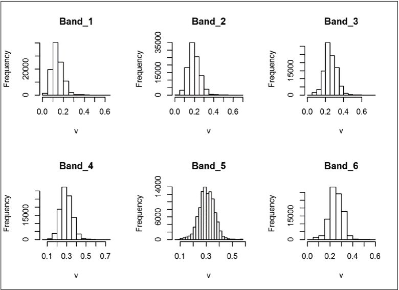

在 R 中，栅格数据可视化的扩展功能可通过多个贡献包获得。例如，`rasterVis` 包中的 `levelplot` 函数（它是 `lattice` 包中 `levelplot` 函数的修改版）默认使用单一色标显示给定栅格的所有波段（与 `plot` 不同），而这通常是我们想要做的。请注意，`levelplot` 函数有大量用于修改绘图外观的附加参数，并且 `rasterVis` 包还包含其他几个用于可视化栅格的有用函数，我们不会一一介绍（相反，你将在第 9 章《*空间数据的高级可视化*》中了解如何使用 `ggplot2` 包生成自定义图形输出）。感兴趣的读者可参阅 `rasterVis` 包的教程（http://oscarperpinan.github.io/rastervis/）以及该包作者 Oscar Perpinan Lamigueiro 所著的*《用 R 展示时间序列、空间和时空数据》*（CRC Press，2014）。

`levelplot` 的两个非常有用的参数是 `par.settings`（用于决定色标，例如使用 `RdBuTheme` 可获得蓝-红色标）和 `contour`（用于决定是否显示等高线）。让我们看下面的示例：

```
> library(rasterVis)
> levelplot(l_00, par.settings = RdBuTheme, contour = FALSE)
```

生成下图所示的图形输出：

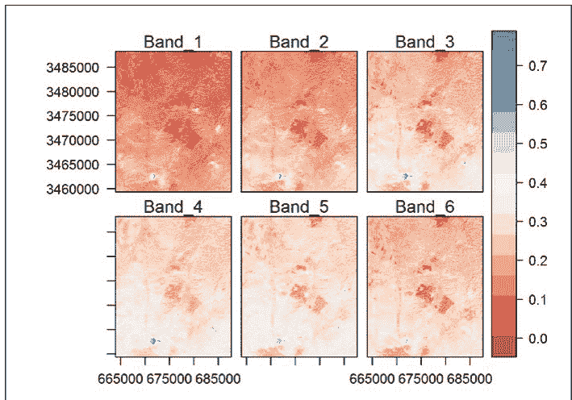

上面的截图显示了每个 Landsat 波段的反射率值，范围从 0（完全黑暗）到 1（完全反射）。要生成所谓的真彩色影像，我们需要组合波段 1-3（蓝、绿、红），这将在下一章中展示。

## 栅格数据子集

在许多情况下，我们希望访问给定栅格的值，要么进行涉及这些值的计算（例如，计算频率表），要么进行赋值（例如，更改栅格中的某个值；参见第 1 章“R 环境”中的代码部分）。在本节中，我们将介绍实现此目的的不同方法。

作为示例，我们将使用另一个多波段栅格 modis.tif。首先，我们将其赋给名为 r 的 RasterBrick 对象，并打印其属性，如下所示：

```
> r = brick("C:\\Data\\modis.tif")
> r
class       : RasterBrick
dimensions  : 100, 100, 10000, 280  (nrow, ncol, ncell, nlayers)
resolution  : 500, 500  (x, y)
extent      : 660000, 710000, 3445000, 3495000  (xmin, xmax, ymin)
coord. ref. : +proj=utm +zone=36 +datum=WGS84 +units=m +no_defs +$
data source : C:\Data\modis.tif
names       : modis.1, modis.2, modis.3, modis.4, modis.5, modis.$
```

modis.tif 文件包含来自 Terra-MODIS 卫星 MOD13A1 产品的归一化植被指数（NDVI）值。与 Landsat 一样，原始的 MOD13A1 数据可在 http://earthexplorer.usgs.gov/ 免费获取。modis.tif 影像覆盖面积 2,500 平方公里，空间分辨率为 500 米。与 Landsat 不同，这里的波段并不对应卫星传感器的不同波长，而是对应不同的影像获取日期。换句话说，我们拥有一个 NDVI 影像的时间序列。共有 280 个波段，对应 2000 年 2 月 18 日至 2012 年 4 月 6 日之间的时间段（每年 23 幅影像，每幅大约对应 16 天的时间间隔）。在预处理过程中，数据不可靠的像元（栅格单元）（例如由于云层导致）被赋值为 NA。

NDVI 是一种常用的遥感指数，用于量化绿色植被的丰度（其取值范围为 -1 到 1，越接近 1 表示植被越茂盛）。NDVI 基于红光和近红外波段的反射率计算。我们将在本章稍后以 Landsat 影像为例，准确了解其计算方法。

## 栅格数据操作

为了检查 modis.tif 栅格的地理位置，我们可以使用 plotKML 包，该包提供了一套函数，可将 R 中的空间数据导出为 KML 或 KMZ 格式，并自动在 Google Earth 中显示。最简单的示例是，仅使用默认参数，对栅格 r 的某个波段（例如波段 1）调用 plotKML 函数，以打开 Google Earth 并显示该波段。因此，表达式 plotKML(r[[1]]) 将自动打开 Google Earth，放大到栅格 r[[1]] 的位置，并使用色标显示其值（前提是已加载 R 包 plotKML 和 animation，且已安装 Google Earth 软件）。下面的截图展示了我们将看到的结果：

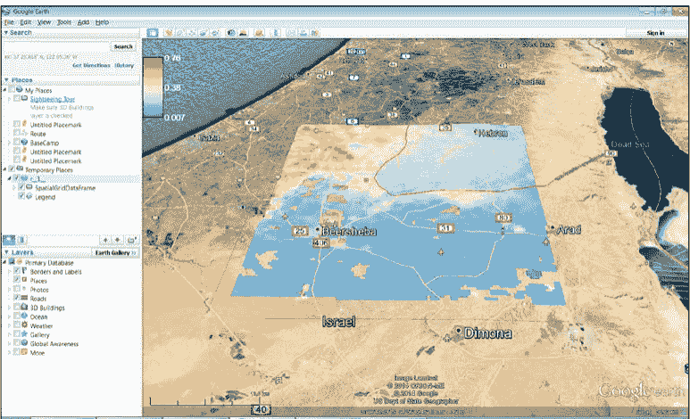

为了随后在 Google Earth 中显示结果，plotKML 函数实际上已在当前工作目录中写入了一个 KML 文件。工作目录是 R 用于导入和导出文件的默认路径。可以使用函数 getwd 和 setwd 分别查询和修改。例如：

```
> getwd()
[1] "C:/Users/Michael Dorman/Documents"
> setwd("C:\\Data")
> getwd()
[1] "C:/Data"
```

使用工作目录可以节省编写绝对文件路径所花的时间，但也可能使代码不够具体，因此本书将不采用这种方式。

在带有信息量丰富的参考图层上进行交互式可视化（例如在 Google Earth 中），对于初步检查我们所拥有的空间数据非常有用。例如，我们现在可以清楚地看到，栅格内的 NDVI 梯度——从西北方向的相对较高值到东南方向的相对较低值——是由其位于相对湿润的地中海气候区（植被较为茂盛）与干旱的内盖夫沙漠（植被稀少）之间的过渡地带所致。

感兴趣的读者可参考 Hengl、Roudier、Beaudette 和 Pebesma（2014）发表在《Journal of Statistical Software》上的论文，或在线教程（http://gsif.isric.org/doku.php?id=wiki:tutorial_plotkml），以了解 plotKML 包所提供各类方法的更多细节和启发式示例。

## 以向量形式访问栅格值

回到栅格值访问的主题，最简单的方法是使用 [ 运算符，这与我们对向量使用的方式完全相同。使用 [ 访问栅格值时，值将从左上角开始向右排列，然后沿第二行继续，依此类推，直到到达右下角。例如，要查找 r 栅格第一层的前五个值，我们将使用以下表达式：

```
> r[[1]][1:5]
[1] 0.4242 0.3995 0.4190 0.4272 0.4285
```

请注意，引用波段的索引 [[ 在前，引用像元的索引 [ 在后。两者都可以省略，这样将返回相应维度的所有元素，而不是子集（例如，我们之前看到过，r[[1]] 返回整个第一波段）。

当使用 [ 运算符但省略像元值的索引时（如 []），我们会得到一个包含所有栅格值的向量。例如，我们可以利用这个向量计算第一个获取日期（2000 年 2 月 18 日）的 NDVI 平均值。

```
> mean(r[[1]][], na.rm = TRUE)
[1] 0.2302056
```

结果是 0.23。


## 使用矩阵记法访问栅格值

由于栅格波段是一个二维对象，因此使用二维记法访问其值通常更有用。与矩阵对象一样，二维索引的第一个元素指的是行，第二个元素指的是列。例如，栅格 `r[[1]]` 在向量意义上的值 1-5 占据第 1 行，第 1-5 列。我们可以使用如下的二维记法引用这些相同的值：

```
> r[[1]] [1, 1:5]
[1] 0.4242 0.3995 0.4190 0.4272 0.4285
```

请注意，即使我们使用二维记法对栅格进行子集化，返回的值仍然是一维数值向量的形式。

## 涉及多个波段的子集

在前两节中，我们访问的是局限于单个波段的栅格值的子集。当我们同时对栅格的行/列和波段维度进行子集化时会发生什么？在这种情况下，我们得到的是一个矩阵对象，而不是向量，其中列对应波段，行对应栅格单元。例如，使用以下表达式，我们引用的是占据第 1 行、第 1-5 列以及第 1-3 层的值：

```
> r[[1:3]] [1, 1:5]
      modis.1 modis.2 modis.3
[1,]  0.4242  0.4518  0.4211
[2,]  0.3995  0.3334  0.4123
[3,]  0.4190  0.3430  0.4314
[4,]  0.4272  0.3430  0.4761
[5,]  0.4285  0.5814  0.4761
```

因此，我们得到一个矩阵，其中有三列（对应第 1-3 层）和五行（对应请求的五个单元，按从左上角向右的顺序排列）。事实上，矩阵的第一列中的值与我们在前两个示例中得到的向量的值相同。

作为另一个例子，我们可以通过这次省略波段索引（从而同时引用所有波段）来检查单个像素随时间变化的 NDVI 情况——例如第 45 行、第 33 列：

```
> v = r[45, 33][1, ]
```

请注意，使用 `r[45,33]` 时，我们得到一个矩阵对象，其中有 280 列（因为我们访问了栅格 `r` 的全部 280 个波段）以及一行（因为我们访问了单个单元）。然后，通过 `[1,]` 部分，我们选择该矩阵中唯一的第一行，包含 (45,33) 单元在所有波段中的值。正如我们之前所见，单个矩阵行默认会被简化为向量。最后，我们将 NDVI 值向量赋给 `v`。

要绘制现在保存在 `v` 中的 NDVI 时间序列，我们将使用 `dates` 表中的日期列（参见上一章），该表列出了 `r` 中每个波段的获取日期。我们还将使用 `plot` 函数的 `xlab` 和 `ylab` 参数分别指定 x 轴和 y 轴的标签：

```
> plot(v ~ dates$date, type = "l", xlab = "Time", ylab = "NDVI")
```

生成的图形输出如下图所示：

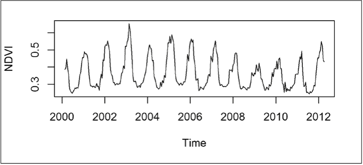

我们可以看到 NDVI 在年际尺度上的周期性行为；NDVI 在冬季（雨季）增加，此时植被更茂盛，而在夏季（旱季）下降，此时植被枯萎。从 2009 年到 2011 年观察到的低于平常的 NDVI 值是由于该地区当时经历的干旱期所致。

在过去三节中我们看到的所有子集方法中，结果都会自动转换为更简单的对象，要么是向量（处理单个波段的值时），要么是矩阵（处理多个波段的值时）。如果我们想抑制这种简化，可以指定 `drop=FALSE`，与我们之前看到的对 `data.frame` 对象（参见上一章）和 `matrix` 对象的子集处理方式相同。在下面的示例中，使用 `drop=FALSE` 会得到一个名为 `u` 的子集 `RasterBrick` 对象，该对象具有原始栅格 `r` 的前两行、两列和三层：

```
> u = r[[1:3]][1:2, 1:2, drop = FALSE]
```

绘制该对象将证明 `u` 确实是一个 2 x 2 栅格，包含三层。以下表达式绘制栅格 `u`：

```
> levelplot(u, layout = c(3,1), par.settings = RdBuTheme)
```

使用 `layout` 参数，我们指定波段应在绘图区域内按单行三列排列。以下截图显示了绘图的外观：

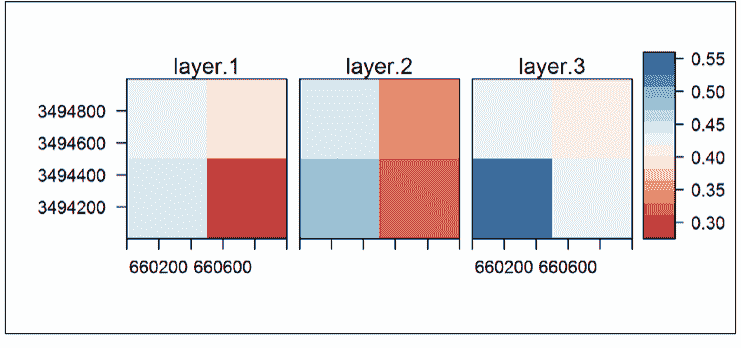

## 将栅格转换为矩阵或数组

有时，将栅格转换为更简单的数据结构，如矩阵或数组，会很有用。其原因之一是执行更快的计算（参见第 6 章，修改栅格和分析栅格时间序列）。转换可以通过诸如 `as.matrix` 和 `as.array` 等函数实现。

例如，栅格的单个波段可以按如下方式转换为矩阵：

```
> as.matrix(u[[1]])
     [,1]   [,2]
[1,] 0.4242 0.3995
[2,] 0.4495 0.2925
```

多波段栅格可以按如下方式转换为数组：

```
> as.array(u[[1:2]])
, , 1

     [,1]   [,2]
[1,] 0.4242 0.3995
[2,] 0.4495 0.2925

, , 2

     [,1]  [,2]
[1,] 0.4518 0.3334
[2,] 0.4846 0.3223
```

如果我们尝试使用 `as.matrix` 将多波段栅格转换为矩阵，我们将得到一个矩阵，其行代表单元，列代表波段，正如我们在栅格子集化上下文中之前看到的那样：

```
> as.matrix(u[[1:2]])
      layer.1 layer.2
[1,]  0.4242  0.4518
[2,]  0.3995  0.3334
[3,]  0.4495  0.4846
[4,]  0.2925  0.3223
```

## 栅格叠加和重分类

在本节中，我们将介绍涉及栅格的两种基本操作：在重叠栅格之间执行数学运算以及将栅格的值重分类为新的聚合类别。

### 栅格代数和叠加操作

在许多情况下，当我们有两个或多个重叠栅格时，我们希望对这些栅格中重叠像素的每一对、三元组等应用某个函数。结果我们将得到一个新的栅格，其中每个像素的值是该函数在输入栅格的相应像素上的结果。此类操作也称为栅格代数，通常在使用直接的算术记法时使用（例如 `r+s`，其中 `r` 和 `s` 是栅格），或称为叠加操作。

栅格代数表达式中可以使用众多函数，包括算术运算符（例如 `+`、`-`、`*` 和 `/`）、逻辑运算符（例如 `>`、`>=`、`<`、`<=`、`==` 和 `!`）以及一些简单函数（例如 `min`、`max` 和 `sum`）。数值也可以与栅格结合（前提是表达式中的第一个对象是栅格），在这种情况下，数值会被循环使用，仿佛形成一个所有值都等于给定数值的栅格。例如，如果 `r` 是一个栅格，`r+1` 将产生一个新的栅格，其中 1 被循环并加到栅格 `r` 的每个值上。类似地，表达式 `r*2` 将产生一个栅格，其中每个值乘以 2。单波段栅格也可以与多波段栅格结合，在这种情况下，单波段栅格会被循环使用。

例如，以下表达式将为我们提供一个新的栅格，其中包含栅格 `r` 的 280 个层中每个像素观察到的最小 NDVI 值，排除 `NA` 值：

```
> min_ndvi = min(r, na.rm = TRUE)
```


在我们希望对栅格的值应用某个函数（而不是执行叠加操作）的情况下，我们需要对栅格值的向量而不是栅格对象本身应用相应的函数。

例如，要找出栅格 `r` 的第一个波段中所有单元的最小值，我们必须使用以下表达式：

```
> min(r[[1]][], na.rm = TRUE)
[1] 0.007
```

对栅格本身应用 `min` 函数，使用 `min(r[[1]], na.rm=TRUE)`，是一个叠加操作。这不是我们想要在此情况下做的事情，因为叠加会给出一个新栅格，其中每个单元包含输入栅格所有波段中观察到的最小值。结果将是 `r[[1]]` 本身，因为只有一层可供选择。

使用 `range` 函数对多波段栅格 `r` 进行操作将为我们提供一个具有两个波段的新栅格（因为该函数返回长度为 2 的向量），一个包含每个像素观察到的最小值，另一个包含每个像素观察到的最大值：

```
> range_ndvi = range(r, na.rm = TRUE)
```

我们可以通过使用 `levelplot` 函数绘制 `range_ndvi` 结果来检查它（这次使用 `contour=TRUE` 显示轮廓）：

```
> levelplot(range_ndvi, par.settings = RdBuTheme, contour = TRUE)
```


例如，我们可以编写一个名为 `prop_na` 的函数，它接受一个数值向量，并返回该向量中 `NA` 值所占的比例（如果向量中没有 `NA` 值，则为 0；如果向量完全由 `NA` 值组成，则为 1）。下面的代码部分定义了 `prop_na` 函数，并通过一个简单示例演示其按预期工作：

```r
> prop_na = function(x) length(x[is.na(x)]) / length(x)
> prop_na(c(10,3,NA,2))
[1] 0.25
```

现在，我们可以利用 `calc` 对 `r` 中的所有图层执行一个使用 `prop_na` 函数的叠加操作，如下所示：

```r
> prop_na_r = calc(r, fun = prop_na)
```

生成的对象 `prop_na_r` 是一个单波段栅格，其中每个像素的值反映了多波段栅格 `r` 各波段中缺失值的比例。

再举一个例子，我们将基于 Landsat 影像 `l_00` 计算一幅 NDVI 图像。NDVI 定义为近红外波段与红光波段反射率（在 Landsat 中分别对应波段 4 和波段 3）之差除以它们的和。我们可以先定义一个名为 `ndvi` 的函数，该函数在给定一个向量时，根据其第四个和第三个元素计算 NDVI（假设它们分别对应近红外和红光）。

```r
> ndvi = function(x) (x[4] - x[3]) / (x[4] + x[3])
```

然后，我们可以使用 `calc` 将该函数应用于 Landsat 多波段栅格 `l_00`：

```r
> ndvi_00 = calc(l_00, fun = ndvi)
```

我们将使用 `levelplot` 显示结果。请注意，当绘制单个图层时，沿绘图边缘会显示行和列的平均值剖面（通过指定 `margin=FALSE` 可以禁用此行为）：

```r
> levelplot(ndvi_00, par.settings = RdBuTheme, contour = FALSE)
```

生成如下图形输出：

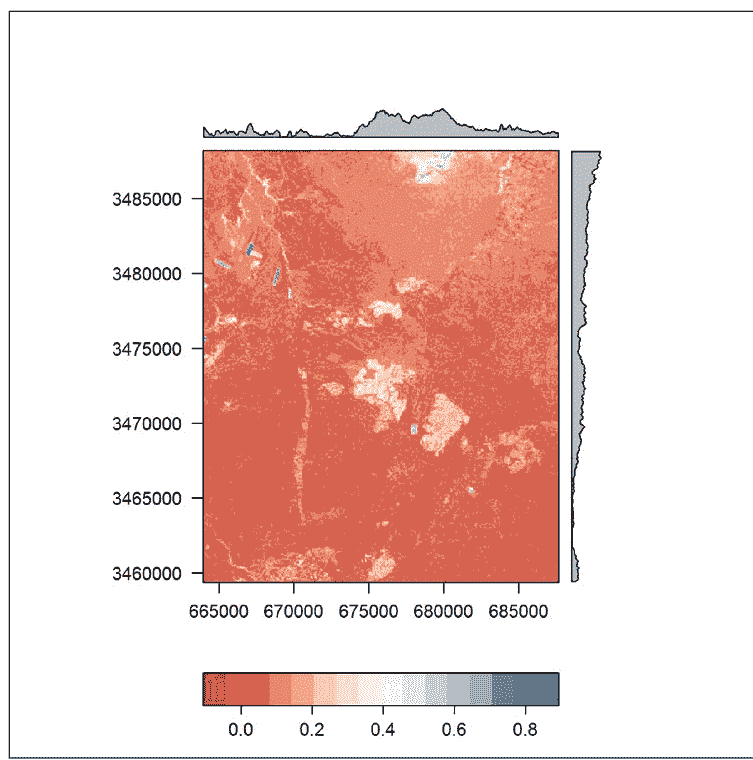

该 Landsat 影像拍摄于旱季，该地区属于半干旱气候；因此，除少数地点外，绿色植被覆盖稀少。例如，前一张截图中部大致位置的两个较大的白色/浅蓝色斑块，是名为 Lahav 和 Kramim 的人工松林（主要是阿勒颇松）。阿勒颇松是一种常绿树种；因此，即使在旱季，森林区域仍保持相对较高的 NDVI 值。我们稍后将在其他示例中再次回到这两片森林。

## 处理栅格

当对栅格应用逻辑运算符时，我们会得到具有逻辑值（`TRUE` 或 `FALSE`）的栅格。然而，正如我们在逻辑向量（第 2 章，*处理向量与时间序列*）中所看到的，当对逻辑栅格执行算术运算时，逻辑值会在运算前转换为数值（1 或 0）。例如，如果我们想找出栅格 `r` 的第一层包含多少个缺失值，可以使用以下表达式：

```r
> sum(is.na(r[[1]])[])
[1] 721
```

请注意，使用 `is.na(r[[1]])` 时，我们首先创建了一个逻辑栅格，其中 `r[[1]]` 中为 `NA` 的像素其值为 `TRUE`，否则为 `FALSE`。然后，通过 `[]` 我们从这个逻辑栅格中获取了值向量。最后，通过 `sum` 我们找出了该向量包含多少个 `TRUE` 值。答案是 `r` 的第一层中有 721 个 `NA` 值。

逻辑栅格还可用于选择另一个重叠栅格中的部分值，并为所得子集赋予新值。例如，如果我们想填充 `r[[1]]` 中的缺失值，比如用所有非缺失值的均值来填充，我们可以这样做：

```r
> temp = r[[1]]
> temp[is.na(temp)] = mean(temp[], na.rm = TRUE)
```

请注意，我们首先将 `r` 的第一个波段赋给一个名为 `temp` 的新对象，这样就不会改变原始栅格对象的值。然后，我们创建了一个名为 `is.na(temp)` 的逻辑栅格，用来对 `temp` 中的 `NA` 值进行子集化，并将所有其他像元的均值赋给该子集。将新栅格 `temp` 与原始栅格 `r[[1]]` 并排绘制后，确实可以看到缺失值——在下方截图的左面板中显示为白色（在上方截图的 Google Earth 可视化中显示为透明）——已被均匀填充：

```r
> levelplot(stack(r[[1]], temp),
+ par.settings = RdBuTheme, contour = FALSE)
```

下面的截图显示了图形输出：

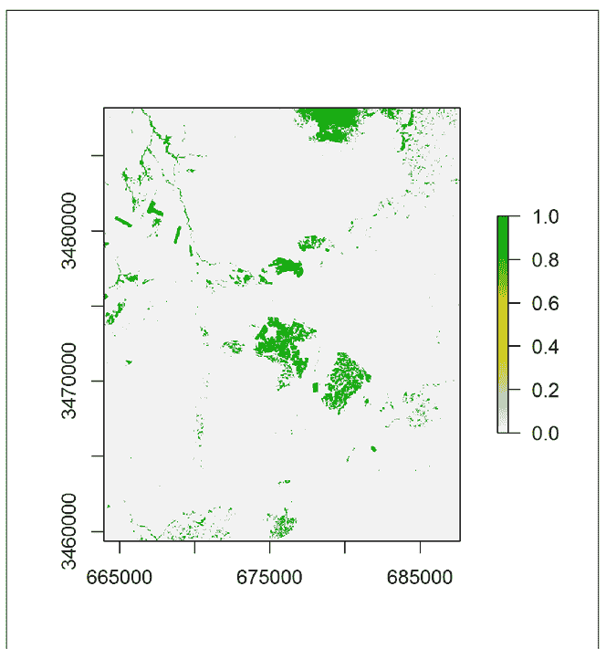

事实上，`raster` 包中有一个专门用于重分类的函数，名为 `reclassify`。该函数接受一个栅格（我们希望对其进行重分类）和一个数值向量或矩阵（指定重分类规则）。例如，如果我们提供一个数值向量，它应由三元组数值组成，指定分类规则：从值、到值、新值、从值、到值、新值，依此类推。使用特殊值 `Inf`（表示无穷大）来指定给定范围的开放边界通常很方便。例如，要指定 ≤0.2 的范围，我们会说从 `-Inf` 到 `0.2`。因此，举例来说，我们可以用以下表达式创建 `l_rec` 栅格，而不是使用上一个示例中所示的三个表达式：

```r
> l_rec = reclassify(ndvi_00, c(-Inf, 0.2, 0, 0.2, Inf, 1))
```

这里，用通俗的语言来说，我们要求将从 -∞ 到 0.2（默认右闭合，因此包括 0.2，即 ≤0.2）的值转换为 0，并将从 0.2 到 ∞ 的值转换为 1。

### 总结

在本章中，我们介绍了在 R 中处理栅格数据的基本方法。我们现在知道了如何将栅格数据导入 R 环境并从 R 环境导出，如何检查手头的栅格对象，以及如何执行简单的计算来修改这些对象。我们还介绍了几种在 R 中可视化显示栅格数据的方法。

下一章在结构和目的上将与本章非常相似；只是我们将介绍另一种主要类型的空间数据——矢量图层。
