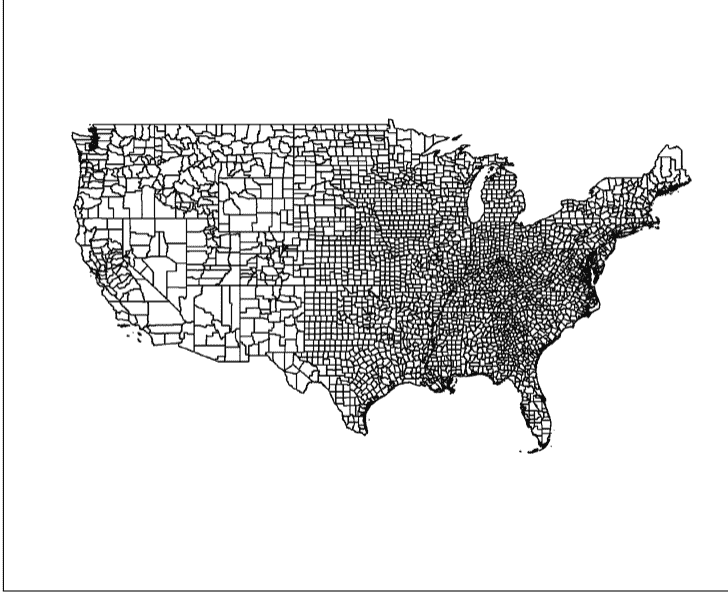
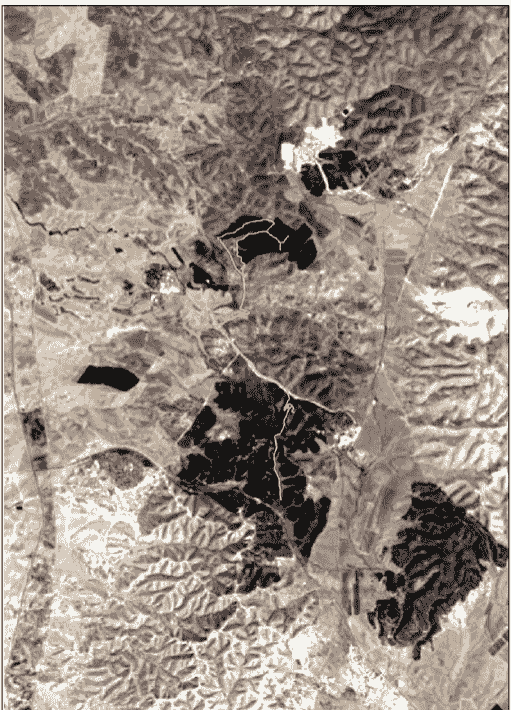
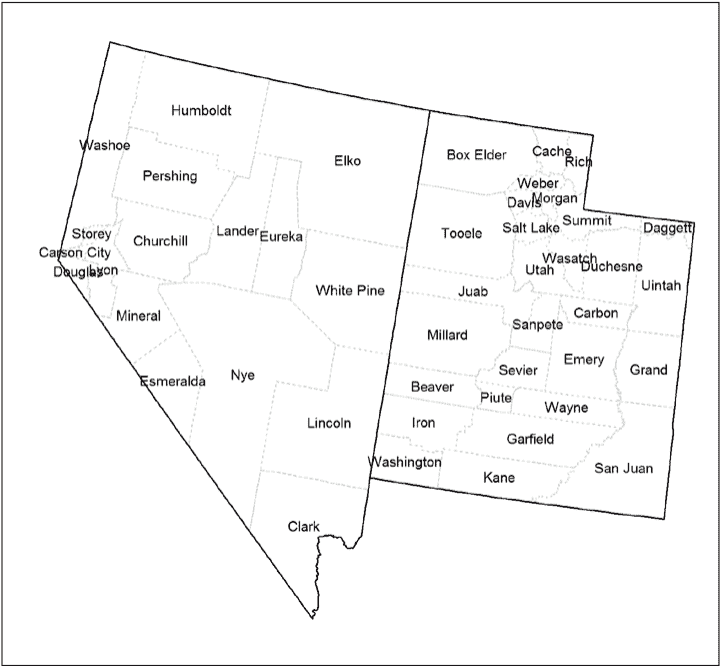
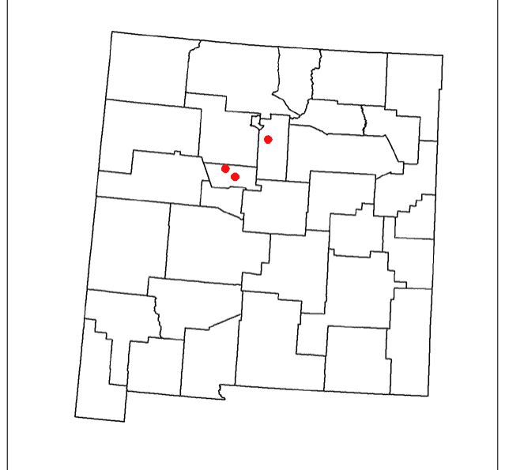
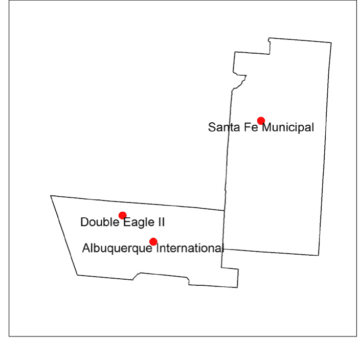
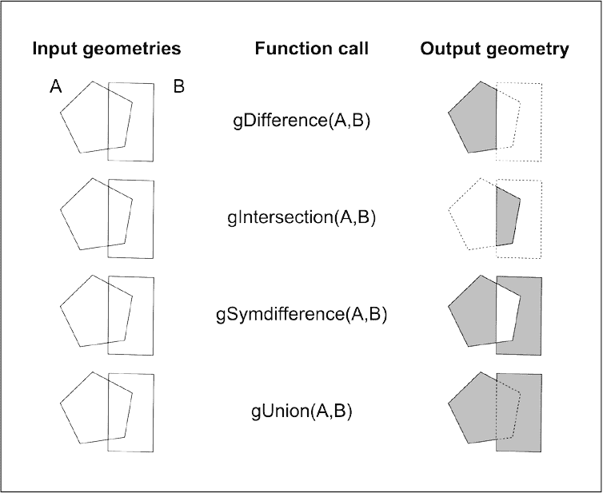
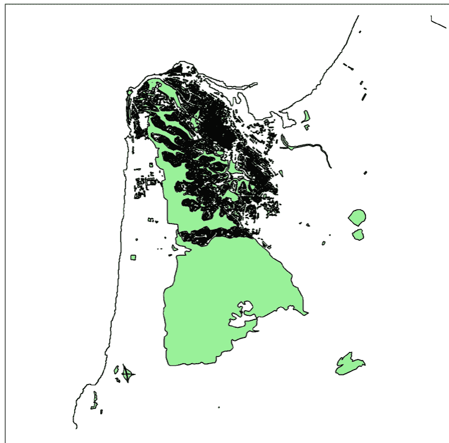
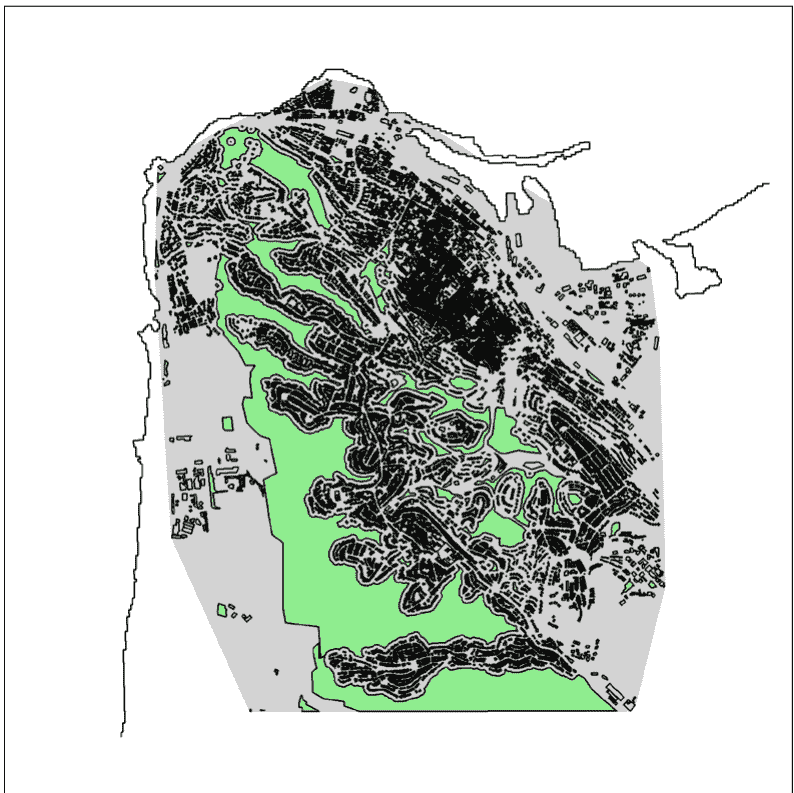

# 5 处理点、线和多边形

在本章中，我们将介绍第二种主要空间数据类型——矢量图层（点、线和多边形）的基本用法。在 GIS 术语中，这些数据有时被称为矢量，但我们将使用术语“矢量图层”来区别于 R 中的向量（参见第 2 章，*处理向量与时间序列*）。我们将回顾 `sp` 包中定义的矢量图层类的架构。然后，将使用 `sp`、`rgdal` 和 `rgeos` 包展示涉及矢量图层的最常见操作示例。

在本章中，我们将涵盖以下主题：

- `sp` 包中空间矢量图层（点、线和多边形）的类
- 通过地理编码创建点图层
- 读写矢量图层文件
- 探索矢量图层的属性
- 访问和修改属性表
- 重投影矢量图层
- 计算派生几何属性（例如，多边形面积）
- 查询一对图层之间的关系（例如，相交）
- 基于单个图层或一对图层创建新图层
- 基于位置或公共列将数据连接到属性表

### R 中矢量图层的数据结构

空间矢量图层有两个组成部分：几何和属性表。几何部分保存空间坐标以及关于它们在不同要素中排列的信息，而属性表保存关于每个要素的附加信息。例如，在首都城市的点图层中，伦敦的记录可能由几何部分（点坐标，如北纬 51.5072°，西经 0.1275°）和属性表中的一行组成，该行保存关于每个城市的附加数据（例如，人口规模、建成区面积等）。

矢量图层中的几何部分是必需的，有三种几何类型：点、线和多边形。属性表是可选的。`sp` 包中定义了六种空间矢量图层类型的类，它们构成了这两种属性的所有可能组合。下表总结了这些类：

| 几何类型 | 属性表 | 类 |
|---|---|---|
| 点 | 无 | SpatialPoints |
| 点 | 有 | SpatialPointsDataFrame |
| 线 | 无 | SpatialLines |
| 线 | 有 | SpatialLinesDataFrame |
| 多边形 | 无 | SpatialPolygons |
| 多边形 | 有 | SpatialPolygonsDataFrame |

连同 `raster` 包中的三类栅格类（在上一章中介绍），这些构成了适用于 R 中广泛空间分析应用的常用类集合。

> 在 R 中确实存在其他用于空间矢量图层（和栅格）的类。它们通常与用于专门数据分析任务的包相关联。然而，方便的是，相对于 `sp` 和 `raster` 包中非常受欢迎的类（我们在本书中一直使用），通常有成熟的方法在这些类之间进行对象转换。例如，`ppp` 类（`spatstat` 包）用于表示点模式（事件位置和观察该模式的窗口），以便对此类模式使用统计分析工具。可以使用 `maptools` 包将 `SpatialPoints` 对象转换为 `ppp` 对象，反之亦然。


## 使用点、线和多边形

在本节中，我们将通过一个示例了解如何为三种几何类型——点、线和多边形——分别创建矢量图层。下一节将介绍检查空间矢量图层的方法，而本章最后三节将介绍如何在矢量图层上执行一些更高级的操作。关于 sp 包及其空间矢量类的更多信息，可参阅 Springer 出版的书籍 *应用空间数据分析（R语言）*（第二版于2013年出版），作者为 Roger Bivand、Edzer Pebesma 和 Virgilio Gómez-Rubio。

### 点

点是最简单的空间对象类型，因为点的几何组成部分只是一个 (x,y) 坐标。一组 (x,y) 坐标连同 CRS 信息构成一个空间点图层，在 R 中可以用 `SpatialPoints` 对象表示。如果我们还有一个属性表，其中每一行对应一个点，则该图层可以用 `SpatialPointsDataFrame` 对象表示。

在我们的第一个示例中，我们将通过地理编码（将地址转换为地理坐标的过程）创建一个 `SpatialPointsDataFrame` 对象。我们将经历以下中间步骤：

1. 创建我们想要进行地理编码的地址向量。
2. 对地址进行地理编码，获取每个地址地理坐标的 `data.frame` 对象。
3. 将位置名称添加为额外的一列。
4. 将 `data.frame` 对象转换为 `SpatialPointsDataFrame` 对象。
5. 添加 CRS 信息。

在本示例中，我们将对新墨西哥州三个机场的地址进行地理编码：

- 阿尔伯克基国际机场
- 双鹰II机场
- 圣菲市政机场

对于地理编码步骤（第2步），我们将使用 Google Maps API，可通过 R 中的 ggmap 包访问。ggmap 包用于空间数据可视化的其他功能将在 *第9章 空间数据高级可视化* 中介绍。有关包功能的概述，请参阅 Kahle, D. 和 Wickham, H. 于2013年发表的关于 ggmap 的介绍性论文（*ggmap：使用ggplot2进行空间可视化*）。

我们的第一步是创建一个包含机场地址的字符向量。地址的顺序与前面列出的机场名称一致：

```r
> addresses = c(
+ "2200 Sunport Blvd, Albuquerque, NM 87106, USA",
+ "7401 Paseo Del Volcan Northwest Albuquerque, NM 87121, USA",
+ "121 Aviation Dr, Santa Fe, NM 87507, USA")
```


> 请注意，Google Maps API（我们将用于地理编码）也可以搜索位置名称（例如白宫）或不完整的地址，但结果会不太确定（两个不同的地方可能有相同的名称，但不可能有相同的地址）。这里使用精确地址是为了确保读者能获得与本书正文相同的结果。

我们准备好进行第二步，现在加载 ggmap 包并使用 geocode 函数对地址进行地理编码。该函数接受一个地址向量（例如我们刚刚创建的地址），并返回一个包含匹配地理坐标的 data.frame 对象：

```r
> library(ggmap)
> airports = geocode(addresses)
> airports
       lon      lat
1 -106.6168 35.04918
2 -106.7947 35.15559
3 -106.0731 35.62866
```


> geocode 函数访问 Google Maps API。因此，需要互联网连接。使用 Google Maps API 还意味着同意 Google Maps API 服务条款（https://developers.google.com/maps/terms），并且（使用免费服务选项时）在24小时内的查询次数限制为2,500次。一个很有前景的替代方案是 geocodeHERE 包，它提供对 HERE Geocoding API（https://developer.here.com/geocoder）的访问，该 API 的每日查询限额更高，为10,000次。

现在我们有了一个名为 `airports` 的 data.frame 对象，其中包含三个机场的经度（lon）和纬度（lat）。

在第三步中，我们将机场名称添加到 `airports` 中一个名为 `name` 的额外列中，如下所示：

```r
> airports$name = c("Albuquerque International",
+ "Double Eagle II",
+ "Santa Fe Municipal")
> airports
        lon        lat                     name
1 -106.6168 35.04918 Albuquerque International
2 -106.7947 35.15559             Double Eagle II
3 -106.0731 35.62866             Santa Fe Municipal
```

生成的 `data.frame` 对象包含了创建 `SpatialPointsDataFrame` 对象所需的一切：其中几何组件将是机场坐标，属性表将有一个包含机场名称的列。这是我们的第四步。使用 `sp` 包的 `coordinates` 函数，通过使用结构为 `~x_coord+y_coord` 的公式对象指定包含坐标的列。在我们的例子中，x 坐标是经度（`lon`），y 坐标是纬度（`lat`），因此公式采用以下形式：

```r
> library(sp)
> coordinates(airports) = ~ lon + lat
```

最后一条表达式将 `airports` 从 `data.frame` 对象转换为 `SpatialPointsDataFrame` 对象。我们可以使用 `class` 函数确认转换已经发生，如下所示：

```r
> class(airports)
[1] "SpatialPointsDataFrame"
attr(,"package")
[1] "sp"
```

在该对象上使用 print 方法会显示，它包含的信息与之前完全相同；只是 lon 和 lat 列现在被识别为空间坐标，如下面的输出所示：

```r
> airports
             coordinates                    name
1 (-106.6168, 35.04918) Albuquerque International
2 (-106.7947, 35.15559)             Double Eagle II
3 (-106.0731, 35.62866)             Santa Fe Municipal
```

最后一步是指定 airports 的 CRS，这是一个地理 CRS：

```r
> proj4string(airports) = CRS("+proj=longlat +datum=WGS84")
```

airports 矢量图层现在已完成。

写入 Spatial*DataFrame 对象（即 SpatialPointsDataFrame、SpatialLinesDataFrame 和 SpatialPolygonsDataFrame 对象）可以使用 rgdal 包中的 writeOGR 函数完成。在下面的示例以及本书大多数其他示例中，我们将使用流行的 ESRI Shapefile 格式进行矢量图层的输入和输出。

我们可以将 SpatialPointsDataFrame 对象 airports 导出为磁盘上的 Shapefile，如下所示：

```r
> library(rgdal)
> writeOGR(airports, "C:\\Data", "airports", "ESRI Shapefile")
```

提供给 writeOGR 函数前四个参数的四个参数如下：

- obj：要写入的对象名称（例如 airports）
- dsn：文件将要写入的目录路径（例如 "C:\\Data"）
- layer：图层名称（例如 "airports"）
- driver：驱动程序名称（例如 "ESRI Shapefile"）

> 由于 Shapefile 数据集由多个单独的文件组成（至少三个：*.shp、*.shx 和 *.dbf），在使用 ESRI Shapefile 驱动程序进行读写时，我们指定目录（dsn）和不带扩展名的文件名（layer）。在之前的示例中，使用 dsn="C:\\Data" 和 layer="airports"，四个文件被写入 C:\Data 目录：airports.dbf、airports.prj、airports.shp 和 airports.shx。对于其他驱动程序，dsn 和 layer 参数的含义可能不同（参见下一节和 ?writeOGR）。

为了将刚刚写入的文件读回 R 中的 SpatialPointsDataFrame 对象，我们可以使用 readOGR 函数（同样在 rgdal 包中可用）。读取矢量图层时，我们只需提供 dsn 和 layer 参数（分别是路径和图层名称）。此外，我们可以通过指定 `stringsAsFactors=FALSE`，让属性表中的字符值不被转换为因子（参见第3章“使用表格”）：

```r
> airports = readOGR("C:\\Data",
+ "airports",
+ stringsAsFactors = FALSE)
```


## 处理点、线和多边形

显然，构成 Shapefile 的所有 airports.* 文件都需要位于同一目录（本例中为 C:\Data 目录）中，图层才能被正确读取。

### 线

线和多边形图层在两个方面比点图层更复杂。首先，单独的线或多边形由一组点定义，而不是单个点。具体来说，线是一组从第一个点连接到最后一个点的点。多边形的定义类似，只是最后一个点与第一个点相同。每条线或多边形中的点数不是固定的，而是取决于形状的复杂度（更复杂的形状将由更多点来定义）。其次，单个线或多边形要素（对应属性表中的单个条目）可以由多个单独的线或多个单独的多边形组成。例如，在某个国家边界图层中，美国要素将由多个多边形组成，因为美国本土、阿拉斯加以及夏威夷各岛彼此分离。


> 另一个特定于多边形图层的复杂情况是空洞的存在。单个要素可以由外部边界多边形和空洞多边形组成。例如，在北美陆地面积图层中，空洞多边形可能代表五大湖。空洞多边形内部又可以有内部多边形（例如五大湖中的岛屿），依此类推。

由于其复杂性，手动从原始坐标定义线和多边形图层的情况要少得多。相反，它们通常要么从外部来源导入（例如读取 Shapefile），要么由其他对象创建（例如基于 DEM 栅格创建的等高线）。

作为 `SpatialLinesDataFrame` 的示例，我们将读取一个包含来自 GPS 设备的轨迹记录的 GPS 交换格式（GPX）文件。与 Shapefile 不同，对于 GPX 文件，`dsn` 参数是文件本身，而 `layer` 参数指向我们想要读取的数据组件（例如 `"tracks"` 或 `"track_points"`；参见 `?readOGR`）。特定的文件 `GPS_log.gpx` 包含 GPS 日志，记录的是在记录模式下驾驶 GPS 设备绕行 Lahav 和 Dvira 森林的经过。我们如下读取该文件：

```r
> track = readOGR("C:\\Data\\GPS_log.gpx","tracks")
```

使用 `class` 函数，我们可以证明 `track` 是一个 `SpatialLinesDataFrame` 对象：

```text
> class(track)
[1] "SpatialLinesDataFrame"
attr(,"package")
[1] "sp"
```

### 多边形

作为多边形数据的示例，我们将读取另一个外部文件；这次是一个名为 `USA_2_GADM_fips` 的 Shapefile。该文件由对应于美国第二级行政区划（县）的多边形组成，并带有多个属性，例如县名和**联邦信息处理标准（FIPS）**代码。我们将生成的 `SpatialPolygonsDataFrame` 赋给名为 `county` 的对象，以便在本章后续示例中使用：

```r
> county = readOGR("C:\\Data", "USA_2_GADM_fips",
+ stringsAsFactors = FALSE)
```

总而言之，到目前为止，我们见证了在 R 中创建空间矢量图层的两种方法：从一组 (x,y) 坐标（适用于点）和从文件（适用于点、线和多边形）。第三种方法——从栅格数据派生矢量图层——将在*第 7 章“组合矢量与栅格数据集”*中介绍。

### 探索矢量图层属性与子集化

本节将致力于检查空间矢量图层的属性，并根据其属性表进行子集化。所介绍的一些操作将与上一章中针对栅格介绍的操作类似（例如绘图和查询 CRS 信息），而另一些操作通常仅与矢量图层相关（例如计算面积和根据属性表创建子集）。很快就会发现，许多涉及矢量图层属性表的操作与对 `data.frame` 对象的操作方便地类似。

#### 检查矢量图层属性

summary 函数会生成关于矢量图层属性的有用文本摘要，包括其类、边界框坐标、CRS 和属性表列类型。例如，对 airports 使用 summary 会产生以下文本输出：

```text
> summary(airports)
Object of class SpatialPointsDataFrame
Coordinates:
                min         max
lon -106.79467 -106.07308
lat    35.04918    35.62866
Is projected: FALSE
proj4string : [+proj=longlat +datum=WGS84]
Number of points: 3
Data attributes:
      Length      Class      Mode
          3 character character
```

此输出中列出的所有属性也可以使用函数访问，在某些情况下还可以修改。例如，与我们在上一章中已经看到的栅格数据类似，`proj4string` 函数返回矢量图层的 PROJ.4 格式 CRS 定义。对 airports 使用 `proj4string` 会返回 WGS84 CRS 的定义：

```text
> proj4string(airports)
[1] "+proj=longlat +datum=WGS84"
```

关于几何部分，`length` 函数返回图层包含的要素数量。例如，airports 包含三个点（三个机场），如下输出所示：

```text
> length(airports)
[1] 3
```

空间图层也总是有行名，这些行名在内部用作 ID 变量，用于将几何与属性表条目匹配。因此，行名的数量等于要素的数量：

```text
> row.names(airports)
[1] "1" "2" "3"
```

`dimensions` 函数返回空间维度的数量：

```text
> dimensions(airports)
[1] 2
```

> 在本书中，我们只处理二维矢量图层（平面上的几何）。三维图层也可以用于表示某些类型的数据，例如具有 (x,y) 坐标和 (z) 高程的点。

#### 访问矢量图层的属性表

矢量图层的属性表实际上是一个 `data.frame` 对象，一些适用于 `data.frame` 对象的函数已经被定义，以便也能直接一致地应用于矢量图层。例如，应用于矢量图层的 `nrow`、`ncol` 和 `dim` 函数将参照其属性表返回维度：

```text
> nrow(county)
[1] 3145
> ncol(county)
[1] 4
> dim(county)
[1] 3145    4
```

我们看到 `county` 的属性表有 3,145 行（因此该图层有 3,145 个要素）和四列。这些列包含以下信息：

- `NAME_1`：第一级名称（例如州名）
- `NAME_2`：第二级名称（例如县名）
- `TYPE_2`：要素类型（例如 “County” 或 “Water body”）
- `FIPS`：FIPS 代码

属性表的单个列或其子集可以使用 `$` 和 `[` 运算符访问。例如，`county` 中前 10 个要素的第二级名称（位于 `NAME_2` 列）可以按如下方式获得：

```text
> county$NAME_2[1:10]
[1] "Litchfield" "Hartford"    "Tolland"    "Windham"
[5] "Siskiyou"  "Del Norte"   "Modoc"       "New London"
[9] "Fairfield" "Middlesex"
```

再举一个例子，我们可以通过列出 `TYPE_2` 列中的唯一值来检查 `county` 图层包含的要素类型：

```text
> unique(county$TYPE_2)
  [1] "County"          "District"          "Borough"
  [4] "Census Area"     "Municipality"      "City And Borough"
  [7] "City And County" "Water body"        "Parish"
 [10] "Independent City"
```

空间矢量图层的整个属性表可以直接使用 `@` 运算符访问。`@` 运算符用于按名称从对象中提取槽，使用 `对象名@槽名` 的表示形式。


> 更具体地说，`@` 运算符适用于所谓的 S4 类对象，我们处理的所有栅格和矢量图层都是 S4 类；而 S3 类对象的组件则使用不同的方法（`$` 运算符）访问。S3 与 S4 的区别涉及内部类结构，超出了本书的讨论范围。更多信息请参阅《Advanced R》，Wickham, H., CRC Press, 2014（http://adv-r.had.co.nz/OO-essentials.html）。

sp 包中定义的空间矢量类的属性表槽被称为 `data`。因此，在矢量图层名称后添加 `@data` 将返回其属性表（如果有的话）。

例如，以下表达式返回 `airports` 的属性表：

```text
> airports@data
                name
1 Albuquerque International
2          Double Eagle II
3       Santa Fe Municipal
```

另一个例子，我们可以使用 `head` 函数应用于 `county@data` 来打印 `county` 属性表中的前几行：

```text
> head(county@data)
        NAME_1      NAME_2 TYPE_2  FIPS
0 Connecticut Litchfield County 09005
1 Connecticut   Hartford County 09003
2 Connecticut    Tolland County 09013
3 Connecticut   Windham County 09015
4 California   Siskiyou County 06093
5 California  Del Norte County 06015
```


## 使用点、线和多边形

正如我们将在本章后面看到的，矢量图层的属性表也可以通过赋值进行修改，类似于单独的 `data.frame` 对象。新的属性表列可以使用 `$` 运算符创建并填充，或者整个属性表可以被修改（例如，某些列可以被删除或连接）并重新分配到数据槽。

所有其他空间矢量（以及栅格）对象的组件也包含在槽中，因此，可以使用 `@` 运算符访问。使用 `str` 函数，我们可以获得描述对象结构的树。让我们来看下面的例子：

```
```r
> str(airports)
Formal class 'SpatialPointsDataFrame' [package "sp"] with 5 slots
..@ data       :'data.frame': 3 obs. of  1 variable:
.. ..$ name: chr [1:3] "Albuquerque International" "Double Eagle$
..@ coords.nrs : int [1:2] 1 2
..@ coords     : num [1:3, 1:2] -106.6 -106.8 -106.1 35 35.2 ...
.. ..- attr(*, "dimnames")=List of 2
.. .. ..$ : NULL
.. .. ..$ : chr [1:2] "lon" "lat"
..@ bbox       : num [1:2, 1:2] -106.8 35 -106.1 35.6
.. ..- attr(*, "dimnames")=List of 2
.. .. ..$ : chr [1:2] "lon" "lat"
.. .. ..$ : chr [1:2] "min" "max"
..@ proj4string:Formal class 'CRS' [package "sp"] with 1 slot
.. .. ..@ projargs: chr "+proj=longlat +datum=WGS84"
```
```

> 使用这样的树，我们可以找到对象的所有数据组件。那么，为什么在 R 中通常提倡使用专用函数（例如 `proj4string`），而不是直接访问相关属性（例如 `airports@proj4string@projargs`）？一个原因是，通过函数操作使我们的代码在面对类定义变化时更具鲁棒性。换句话说，如果某个包的未来版本中某个类的内部架构发生变化（例如，槽 x 现在命名为 y），用户可能甚至不会注意到，因为对该类操作的所有相关函数的代码也会相应更改，而使用 `@x` 的访问将不再起作用。在本书中，访问矢量图层的属性表（使用 `@data`）将是我们唯一的直接访问。例外是必要的，因为否则某些对属性表的操作是不可行的。


矢量图层的属性表也可以完全移除，通过将 `Spatial*DataFrame` 对象转换为 `Spatial*` 对象。这种转换可以使用 `as` 函数完成，指定对象名称和我们想要转换成的类。例如，我们可以将 `airports`，一个 `SpatialPointsDataFrame` 对象，转换为 `SpatialPoints` 对象如下：

```
airports_sp = as(airports, "SpatialPoints")
```

由于 `SpatialPoints` 对象没有数据槽，尝试访问它时会发生错误：

```
airports_sp@data
Error: no slot of name "data" for this object of class "SpatialPoints"
```

我们也可以使用 `as` 函数执行从 `SpatialPoints` 对象到 `SpatialPointsDataFrame` 对象的反向转换。自然地， resulting 对象的属性表将为空（因为 `SpatialPoints` 对象没有属性表）：

```
as(airports_sp, "SpatialPointsDataFrame")@data
data frame with 0 columns and 0 rows
```

## 子集化矢量图层

我们可以根据其属性表对矢量图层进行子集化，使用与子集化 `data.frame` 对象相同的记法。选择要保留哪些要素可以通过在 `[` 运算符内提供数值或逻辑向量来完成。

例如，要获取仅属于美国本土的县要素的子集，我们需要排除阿拉斯加州和夏威夷州对应的要素。这可以通过创建一个逻辑向量（对保存州名的 `county$NAME_1` 列应用条件）并将该向量作为 `county` 的行索引提供给 `[` 运算符来完成，如下所示：

```
county = county[
+ county$NAME_1 != "Alaska" &
+ county$NAME_1 != "Hawaii", ]
```

> 请记住以下利用 `%in%` 运算符的替代方法：
> 
> ```r
> county = county[
> + !(county$NAME_1 %in%
> + c("Alaska", "Hawaii")), ]
> ```

同样，我们可以通过排除水体多边形来仅保留陆地面积：

```
> county = county[county$TYPE_2 != "Water body", ]
```

让我们使用 plot 函数检查 resulting 图层。表达式 plot(county) 产生的图形输出如下图所示：



正如我们所见，plot 函数默认使用黑色线条绘制多边形边界。在后续示例中，我们将尝试使用该函数的几个参数来修改绘图的显示。

## 矢量图层的几何计算

在前面的章节中，我们介绍了查询矢量图层的即时可用属性（例如 CRS 定义或属性表），以及仅涉及属性表组件的矢量图层修改（例如移除属性表或根据其进行子集化）。在接下来的两个部分中，你将学习检查和修改矢量图层的几何组件。在本节中，将介绍涉及单个矢量图层的操作，例如重投影和面积计算。在下一节中，我们将处理涉及一对矢量图层的操作。

### 重投影矢量图层

重投影是将空间对象的全部坐标从一个 CRS 转换为另一个 CRS。注意在指定 CRS 时的区别（我们之前对 airports 这样做），其中仅修改与图层关联的 CRS 定义，而坐标保持不变。矢量图层的重投影使用 rgdal 包中的 spTransform 函数完成。该函数接受两个参数：要重投影的图层和目标 CRS。

例如，以下表达式将 county 图层（当前定义在地理 CRS 中）转换为美国国家地图集等面积投影：

```
> newProj = CRS("+proj=laea +lat_0=45 +lon_0=-100
+ +x_0=0 +y_0=0 +a=6370997 +b=6370997 +units=m +no_defs")
> county = spTransform(county, newProj)
```

请注意，前面的操作包含两个步骤。第一个表达式通过将 CRS 函数应用于对应于美国国家地图集等面积投影的 PROJ.4 字符字符串，创建了名为 newProj 的 CRS 类对象。其次，county 图层已使用 spTransform 函数重投影到 newProj CRS。

> PROJ.4 字符串可以从其他对象（参见上一章）或数据库（如 http://www.spatialreference.org/）获得。前面使用的 PROJ.4 字符串，例如，复制自 http://spatialreference.org/ref/epsg/us-national-atlas-equal-area/proj4/。

以下屏幕截图显示了 GPS 路线（黄色）在真彩色 Landsat 图像上方的图形输出，该输出是在最后两个表达式的结果下生成的：



我们使用的附加 plotRGB 参数 stretch 和 ext 分别指定拉伸类型和所需范围。拉伸本质上是从栅格值（在这种情况下介于 0 和 1 之间）到 RGB 颜色模型值（介于 0，即最暗，和 255，即最亮之间）的转换。最简单的选项是 lin，表示线性拉伸。将 Extent 对象提供给 ext 参数允许我们放大并仅绘制栅格的一部分。在这种情况下，我们使用 track 图层的范围，加上四周 10 公里缓冲区，使用表达式 extent(track)+10000（请注意，所有与距离相关的计算均以 CRS 单位进行；在这种情况下，为米）。当添加第二层（track）时，我们使用 col 参数指定所需线条颜色；在这种情况下为 "yellow"。


R 在图形输出中使用颜色和颜色渐变方面具有出色的能力，这大多超出了本书的范围。简而言之，在 R 中指定颜色主要有三种方法：

- **颜色名称：** 例如，`"yellow"`
- **调色板上的位置：** 例如，`rainbow(12)[3]`，它给出 12 色彩虹调色板中的第三种颜色，这是一种黄色的颜色
- **RGB 颜色模型中的位置：** 例如，`rgb(1,1,0)`，它返回十六进制代码 `"#FFFF00"`，对应于纯黄色

就本书的目的而言，第一种方法，即使用预定义的颜色名称，将大多足够（可用的颜色列表可通过表达式 `colors()` 获得）。事实上，我们也在使用调色板，只是通过 `levelplot` 等图形函数间接使用（参见上一章）。我们将在 *第 9 章，高级空间数据可视化* 中看到如何直接使用调色板的一个示例。

## 处理矢量图层的几何属性

空间对象具有与其几何形状相关的广泛属性；其中一些作为数据结构本身的一部分即可立即获得（例如，点图层中点的坐标）；另一些则可通过几何计算得出（例如，多边形的面积大小）。

点图层的坐标可使用 coordinates 函数获得：

```
> coordinates(airports)
          lon      lat
[1,] -106.6168 35.04918
[2,] -106.7947 35.15559
[3,] -106.0731 35.62866
```

结果是一个矩阵对象，其行数对应于图层包含的点数。

为了推导更复杂的属性，rgeos 包，即 R 接口到 Geometry Engine Open Source（GEOS），提供了用于涉及矢量图层的几何操作的各种函数。可用的几何操作可以根据其产生的输出概念上分为三组：

- **数值：** 由汇总几何属性的函数获得（例如，计算面积大小）
- **逻辑值：** 由评估某个几何属性是否成立（例如，给定几何是否有效）的函数，或对象之间的关系（例如，特征 A 是否与特征 B 相交）获得
- **空间图层：** 由基于输入图层创建新图层的函数获得（例如，找到多边形质心）或基于一对图层（例如，找到特征 A 与特征 B 的相交区域）

本章将为每种类型的这些操作提供若干示例函数，而一些附加函数仅供参考提及。

> 有关 rgeos 包提供的完整函数列表，请参阅位于 http://cran.r-project.org/web/packages/rgeos/rgeos.pdf 的包帮助页面。

作为返回数值的一个函数的示例，gArea 函数可用于计算多边形的面积大小。例如，我们可以按如下方式计算县多边形覆盖的面积：

```
> library(rgeos)
> gArea(county) / 1000^2
[1] 7784859
```

面积以投影的单位给出，在本例中为 m²；将结果除以 1000² 将面积数值转换为 km² 单位。根据 Wikipedia，美国本土的陆地面积为 7,663,942 km²，这与我们的结果足够接近（鉴于 CRS 和详细程度会影响计算）。

如果我们想计算每个要素（在本例中为每个县）的面积，而非整个图层的面积，则需要指定 byid=TRUE。byid 参数决定我们是否希望按 ID 进行计算，即分别对每个要素进行计算。该参数存在于 rgeos 包的许多函数中，具有相同的功能，如我们在后续示例中将看到的。以下表达式返回 county 图层中每个要素的面积的数值向量，以 km² 为单位。该向量立即被分配到 county 图层中的一个新列，名为 area：

```
> county$area = gArea(county, byid = TRUE) / 1000^2
```

现在，县的属性表包含一个额外的列，其中包含每个县的面积大小。我们可以通过打印属性表的前几行来确认这一点：

```
> head(county@data)
      NAME_1      NAME_2 TYPE_2  FIPS    area
0 Connecticut Litchfield County 09005 2451.876
1 Connecticut   Hartford County 09003 1941.110
2 Connecticut    Tolland County 09013 1077.789
3 Connecticut    Windham County 09015 1350.476
4  California   Siskiyou County 06093 16416.572
5  California  Del Norte County 06015 2626.707
```

作为创建一个新空间图层的操作的示例，我们将把县多边形溶解为州多边形。为简单起见，我们将在 county 的一个子集上执行溶解，仅包括两个州：内华达州和犹他州。首先，我们将创建该子集并将其分配给名为 county_nv_ut 的新对象：

```
> county_nv_ut = county[county$NAME_1 %in% c("Nevada", "Utah"), ]
```

现在，我们将使用 gUnaryUnion 函数溶解 county_nv_ut 多边形。传递给此函数的两个参数是要溶解的图层和 ID，一个定义应被聚合的要素的向量（所有具有相同级别的要素将被溶解为一个）。如果省略 id 参数，则所有多边形将被溶解为一个，如我们在后续示例中将看到的。以下是溶解我们当前图层的代码：

```
> states = gUnaryUnion(county_nv_ut, id = county_nv_ut$NAME_1)
```

在当前情况下，州名列（NAME_1）被作为 ID 传递，因此，形成单个州的所有县都被溶解为州多边形。由于 rgeos 处理矢量图层的几何组件，gUnaryUnion（以及正如我们将看到的，本包中的其他函数）的返回对象没有属性表。在本例中，例如，虽然输入的 county_nv_ut 是一个 SpatialPolygonsDataFrame 对象，但输出的 states 是一个 SpatialPolygons 对象。那么，我们将如何知道哪个多边形对应哪个州呢？答案是信息记录在结果图层的 ID 代码中，可以使用 row.names 函数获得。使用此函数，我们可以发现 states 中的第一个要素对应于 "Nevada"，第二个对应于 "Utah"：

```
> row.names(states)
[1] "Nevada" "Utah"
```

为了更好地理解我们刚才所做的事情，将溶解后的州多边形叠加在原始的 county_nv_ut 多边形上进行可视化会很有帮助。我们可以使用两次 plot 函数调用（第二次指定 add=TRUE）生成一个简单的图：

```
> plot(county_nv_ut, border = "lightgrey", lty = "dotted")
> plot(states, add = TRUE)
```

请注意，plot 的 border 参数用于指示多边形边框颜色（而不是 col，后者在多边形的情况下指的是填充颜色）。另一个参数是 lty（代表线型），它指定我们希望县边界为虚线。

> R 中有六种线型可用。请参阅 ?par 帮助页面中关于 lty 参数的条目上的完整列表。

由于我们尚未完成，因此未呈现结果输出。我们的图中的一个额外图层将由县名称的标签组成。文本标签可以使用 text 函数添加到使用 plot 创建的图像中。使用 text 时，我们需要提供一组定义标签将被绘制的位置的坐标（例如，使用具有两列的矩阵对象，分别对应 x 和 y），以及在每个坐标处要写入的文本（例如，使用字符向量）。

最直接的选择是将标签放置在每个县的质心处。为此，我们首先必须使用 rgeos 的另一个基于单个输入图层返回新图层的函数 gCentroid 找到质心坐标：

```
> county_ctr = gCentroid(county_nv_ut, byid = TRUE)
```


生成的 `SpatialPoints` 对象被赋值为 `county_ctr`。由于指定了 `byid=TRUE`，该图层包含各个县的质心，而不是整个 `county_nv_ut` 图层的质心。

我们可以将 `county_ctr` 与标签向量一起提供给 `text` 函数，该标签向量来自 `county_nv_ut` 的 `NAME_2` 列。附加参数 `cex` 以相对单位定义标签的字体大小（为默认大小的 1.5 倍）：

```
> text(county_ctr, county_nv_ut$NAME_2, cex = 1.5)
```

由两个 `plot` 函数和一个 `text` 函数调用产生的最终图形输出显示在以下屏幕截图中：



该图显示了溶解后的州多边形（黑色）、原始县多边形（点状灰色）以及县名（文本标签）。

rgeos 包中的许多函数无法处理从拓扑角度看无效的几何图形。例如，提到多边形时，有效的图层不包含自相交的多边形（边界与自身相交的多边形）。可以使用 `gIsValid` 函数检查给定图层是否有效，该函数对有效要素返回 TRUE（默认情况下针对整个图层，或在指定 `byid=TRUE` 时针对每个要素分别返回）。然而，搜索和解决拓扑错误最好以交互方式进行。因此，GIS 软件（如 QGIS）比 R 更适合此任务。

## 向量图层之间的空间关系

在本节中，您将学习如何执行涉及一对向量图层的操作。这类操作在空间数据分析中非常常见。我们经常想知道，例如：

- 不同度假村距离最近海岸线的距离是多少？
- 哪些房屋位于地震震中半径 x 范围内？
- 受威胁物种栖息地的哪些部分包含在受保护的自然保护区内？

所有这些操作都需要对来自两个不同图层的要素进行叠加，尽管，正如我们之前所见，结果可以是：

- 一个数值（度假村到最近海岸线的距离为 50 米）
- 一个逻辑值（房屋位于地震震中 10 公里范围内）
- 一个空间图层（定义受威胁物种自然分布与自然保护区之间相交区域的多边形）

在本节中，我们将看到这三种操作的所有示例。

### 查询向量图层之间的关系

查询两个图层之间的关系是必需的，当我们希望执行以下操作之一时：

- 将一个要素的属性表数据分配给另一个要素（例如，多边形 A 获取与其相交的多边形 B 的属性表条目）
- 检查要素之间是否存在特定关系（例如，如果多边形 A 完全位于多边形 B 内，则返回 TRUE，否则返回 FALSE）

在 GIS 术语中，第一种操作有时被称为空间连接或按空间位置连接。在 R 中实现它的方法将使用 `airports` 和 `county` 图层进行演示。第二种操作（检查关系）将使用另一个示例进行演示，该示例涉及伦敦的建筑物和自然区域图层。

`over` 函数提供了一致的功能，可根据它们的相交情况将一个空间对象的属性表数据连接至另一个空间对象。所有九种可能的关系类型均被允许（点/线/多边形与点/线/多边形），要么通过 `sp` 包（点-点、点-多边形和多边形-点），要么通过 `rgeos`（所有其他组合）。`over` 函数接受两个空间图层（参数 x 和 y）。函数调用 `over(x,y)` 然后返回——对于第一个图层（x）中的所有要素——与之相交的第二个图层（y）的属性表条目（如果图层没有属性表，则为索引）。相关的语法 `x[y,]`，当 x 和 y 都是向量图层时，可作为 `over` 的快捷方式，当我们有兴趣根据相交情况对向量图层 x 进行子集化时。最后的函数调用仅返回 x 中与 y 中的要素相交的那些要素。

如前所述，我们查询图层之间关系的第一个示例将涉及 `airports` 和 county 图层。第一步预备工作，如同往常一样，是将两个图层带到共同的 CRS。在本例中，我们将 `airports` 重投影到 `county` 的 CRS：

```
> airports = spTransform(airports, CRS(proj4string(county)))
```

我们现在将在 county 图层之上绘制机场，以便直观检查它们的关系，以便我们知道稍后会有什么预期。由于我们已经知道所有三个机场都位于新墨西哥州，因此我们将使用 county 的子集 nm，该子集仅包含新墨西哥州的县：

```
> nm = county[county$NAME_1 == "New Mexico", ]
> plot(nm)
> plot(airports, col = "red", pch = 16, add = TRUE)
```

请注意，我们使用了 plot 函数的另一个参数 `pch` 来选择不同的点形状（16 对应于实心圆，而默认参数是加号 +）。

共有 26 种点形状可用。可能的形状及其代码列在 `?points` 帮助页面中。

以下屏幕截图显示了产生的图形输出：



我们可以看到，其中两个机场落在（因此，按定义也相交于）同一个县内，而第三个机场落在另一个县内。使用 `over` 并以 airports 和 nm 的顺序调用将返回以下输出：

```
> over(airports, nm)
      NAME_1   NAME_2 TYPE_2  FIPS    area
1 New Mexico Bernalillo County 35001 3023.909
2 New Mexico Bernalillo County 35001 3023.909
3 New Mexico   Santa Fe County 35049 4944.339
```

确实，我们看到前两行是相同的，因为前两个机场位于同一个县（伯纳利洛县）。为了具体检查哪个机场落在每个县内，我们可以将 `over` 的结果与 airports 的属性表绑定：

```
> cbind(airports@data, over(airports, nm))
                         name       NAME_1       NAME_2 TYPE_2  FIPS
1 Albuquerque International New Mexico Bernalillo County 35001
2                 Double Eagle II New Mexico Bernalillo County 35001
3              Santa Fe Municipal New Mexico     Santa Fe County 35049
                         area
1 3023.909
2 3023.909
3 4944.339
```

现在我们可以看出 Albuquerque International 和 Double Eagle II 机场位于伯纳利洛县内，而 Santa Fe Municipal 机场位于圣达菲县内。为了永久地将县信息合并到 airports 的属性表中，我们可以将合并后的表重新赋给 airports 的属性表槽，使用类似 `airports@data=cbind(airports@data,over(airports,nm))` 的表达式。

检查相反的关系（当 nm 是 x 而 airports 是 y 时），我们例如可以使用表达式 `nm[airports,]` 对那些与至少一个机场相交的县进行子集化。如前所述，使用 `[` 与两个向量图层实际上是保留 x 中与 y 相交的那些要素的快捷方式。在本例中，等效的 `over` 表达式将是 `nm[!is.na(over(nm,airports)$name),]`，但使用 `nm[airports,]` 显然更方便。

我们可以绘制 `nm[airports,]` 子集来演示其行为：

```
> plot(nm[airports, ])
> plot(airports, add = TRUE, col = "red", pch = 16, cex = 1.5)
> text(airports, airports$name, pos = 1)
```

`text` 函数的附加 `pos` 参数控制文本相对于点坐标的位置（我们之前见过的默认行为是将文本居中放置在坐标点本身上，`pos=1` 时文本放置在点下方；请参阅 `?text` 了解所有选项）。以下屏幕截图显示了由三次函数调用产生的图形输出：



我们可以看到 `nm[airports,]` 确实仅由与 airports 相交的那些 `nm` 要素组成。


如果我们尝试将 `airports` 属性表中的条目与 `nm` 进行匹配（使用 `over(nm, airports)`），在存在多个匹配的情况下，每个县只会返回与它相交的第一个机场。如果我们希望保留所有匹配结果，则需要在 `over` 函数调用中指定 `returnList=TRUE`。不过，返回的对象将是 `list` 对象，因为保存长度可变的元素集合需要 `list` 而不是 `data.frame` 对象。R 中许多更高级的用法需要这种灵活性，都涉及 `list` 对象。然而，这个主题超出了本书的范围。关于列表的更多信息，可以在 R 官方介绍文档中找到：http://cran.r-project.org/doc/manuals/r-release/R-intro.pdf，以及大多数 R 入门书籍中。

作为查询多边形-多边形关系的一个示例，我们将使用另一个涉及三个多边形 Shapefile 的例子：

- 英格兰和威尔士的行政区（`CTYUA_DEC_2013_EW_BFE.shp`）
- 大伦敦的建筑物（`london_buildings.shp`）
- 大伦敦的自然区域（`london_natural.shp`）

这些数据集下载自可免费访问的在线资源，分别来自国家统计局网站 https://geoportal.statistics.gov.uk/（行政区）或 OpenStreetMap（建筑物和自然区域）。

首先，我们将这些文件读入 R，并将它们统一到同一个 CRS。我们将从行政区图层开始，从磁盘读取并将其命名为 `boundary`：

```
> boundary = readOGR("C:\\Data", "CTYUA_DEC_2013_EW_BFE")
```

使用 `proj4string` 函数可以显示 `boundary` 的 CRS——英国国家网格。请注意，由于结果字符串较长，无法在一行内显示，因此以下输出中对其进行了缩写：

```
> proj4string(boundary)
[1] "+proj=tmerc +lat_0=49 +lon_0=-2 +k=0.9996012717 +x_0=400000 ..."
```

接下来，我们将读取两个 OpenStreetMap 图层：

```
> buildings = readOGR("C:\\Data", "london_buildings")
> natural = readOGR("C:\\Data", "london_natural")
```

这两个图层都是在地理坐标系（CRS）中定义的，如下所示：

```
> proj4string(buildings)
[1] "+proj=longlat +datum=WGS84 +no_defs +ellps=WGS84 +towgs84=0,..."
> proj4string(natural)
[1] "+proj=longlat +datum=WGS84 +no_defs +ellps=WGS84 +towgs84=0,..."
```

我们将 `buildings` 和 `natural` 图层重新投影到 `boundary` 的 CRS：

```
> buildings = spTransform(buildings, CRS(proj4string(boundary)))
> natural = spTransform(natural, CRS(proj4string(boundary)))
```

现在初步准备工作已完成，我们可以继续练习。我们的目标是为伦敦金融城内的每栋建筑物分配其到泰晤士河的距离。为此，我们将依次执行以下中间步骤：

1. 创建 `buildings` 的子集，仅保留伦敦金融城内的建筑物。
2. 创建 `natural` 的子集，仅保留河岸。
3. 将河岸要素融合为一个要素。
4. 计算每个建筑物要素到河岸的距离。

行政区边界图层附带一个说明文件（`CTYUA_2013_EW_BFE.docx` 产品规范，该文件也提供在本书的网站上），我们可以从中找到不同行政区的名称定义在该图层属性表的 `CTYUA13NM` 列中。利用这一列，我们将创建一个名为 `city` 的子集，仅包含定义伦敦行政区区域的单个多边形：

```
> city = boundary[boundary$CTYUA13NM == "City of London", ]
```

使用 `city` 多边形，我们将创建 `buildings` 的一个子集，仅保留那些位于伦敦金融城内的建筑物。如果我们关心的是相交关系（换句话说，完全或部分位于城市多边形内的建筑物），我们可以使用前面已经展示过的 `[` 或 `over` 方法。为了评估其他类型的关系，`rgeos` 包提供了十多个额外的函数：`gContains`、`gContainsProperly`、`gCovers`、`gCoveredBy`、`gCrosses`、`gDisjoint`、`gEquals`、`gEqualsExact`、`gIntersects`、`gTouches`、`gOverlaps` 和 `gWithin`。这些函数的名称已经暗示了它们用于评估的关系；精确定义可在每个函数的相应帮助页面中找到。由于在我们的示例中，我们关心的是创建 `buildings` 要素中被 `city` 包含的子集，因此我们将使用评估包含关系的函数——`gContains`。

根据 `gContains` 的帮助页面，表达式 `gContains(city, buildings)` 将对包含在 `city` 内的建筑物要素返回 `TRUE`。为了分别评估每个要素的关系，需要指定 `byid=TRUE`：

```r
> in_city = gContains(city, buildings, byid = TRUE)
```

结果 `in_city` 是一个二维矩阵，其中行对应建筑物要素（大伦敦共有 210,937 栋建筑物），列对应城市要素（只有一个要素，即伦敦金融城；如果 `city` 中有多个要素，则会有更多列）：

```r
> class(in_city)
[1] "matrix"
> head(in_city)
     119
0 FALSE
1 FALSE
2 FALSE
3 FALSE
4 FALSE
5 FALSE
```

此矩阵的第一列（也是唯一一列）是一个逻辑向量，指定每栋建筑物相对于城市多边形的包含状态。使用该向量作为 `buildings` 的行索引，可以创建只包含 `city` 内建筑物的子集：

```r
> buildings = buildings[in_city[, 1], ]
```

第一步现已完成。回到 `natural` 图层，我们将筛选出类型为 `"riverbank"` 的多边形（在伦敦金融城附近对应的就是泰晤士河）：

```r
> river = natural[natural$type == "riverbank", ]
```

作为第三步，我们将融合不同的河流分段，因为我们关心的是到河流任何部分的最短距离，而不是到其特定部分的距离。如前文县域示例所示，融合可以通过 `gUnaryUnion` 实现。这次不指定 `id` 参数，这样所有几何图形将融合为一个：

```r
> river = gUnaryUnion(river)
```

## 创建新的几何图形

`rgeos` 包提供了四个函数用于基于一对已有的图层创建新图层：`gDifference`、`gIntersection`、`gSymdifference` 和 `gUnion`。这些函数的用法与查询关系的函数非常相似，因为它们的主要参数也是一对图层和 `byid` 参数。区别在于它们返回的不是逻辑值或匹配的属性表条目（基于所检查的关系是否成立），而是一个新图层。下图演示了每种情况下新几何图形的生成方式：



请注意，`gUnion` 函数的工作方式与 `gUnaryUnion` 类似——区别在于 `gUnion` 函数融合的是来自两个不同图层的几何图形，而 `gUnaryUnion` 函数则作用于单个图层的几何图形。

## 处理点、线和多边形

我们的下一个示例将使用其中两个函数：`gIntersection` 和 `gDifference`。我们还将使用三个新图层：海法（Haifa）的建筑物、自然区域和行政区边界。建筑物和自然区域图层与伦敦示例一样来自 OpenStreetMap 数据，而以色列的行政区边界将通过 R 直接从全球行政区边界数据集下载。为了避免与伦敦示例中的同名对象 `buildings` 和 `natural` 混淆，建筑物和自然区域图层将分别命名为 `haifa_buildings` 和 `haifa_natural`。

我们的目标是创建一个包含海法建筑物附近自然区域的多边形，但排除那些距离最近建筑物 50 米以内的自然区域。我们将按照四个中间步骤进行：

1. 将图层读入 R，并将它们统一到同一个 CRS。
2. 创建一个包含所有建筑物的包围多边形（凸包）。
3. 根据包围多边形裁剪自然区域。
4. 移除距离建筑物 50 米以内的自然区域。

作为第一步，我们将读取海法的建筑物和自然区域图层：

```r
> haifa_buildings = readOGR("C:\\Data", "haifa_buildings")
> haifa_natural = readOGR("C:\\Data", "haifa_natural")
```

涉及的第三个图层，即行政区边界，将从 `http://www.gadm.org/` 上的全球行政区数据库（GADM）下载，可通过 `raster` 包中的 `getData` 函数访问：

```r
> israel_adm = getData("GADM", country = "ISR", level = 1)
```

此处使用的 `getData` 参数如下：

- `name`：数据集名称（例如 `"GADM"`，代表 GADM 数据集；使用另一个数据集 `"SRTM"` 将在下一章演示）
- `country`（与 `name="GADM"` 选项相关）：国家 ISO3 代码（可通过 `getData("ISO3")` 获取国家代码列表）
- `level`（与 `name="GADM"` 选项相关）：行政细分级别（0：国家，1：第一级细分，依此类推）


实际上，我们之前使用的县级图层同样来自GADM数据集（只是在其属性表中添加了FIPS代码）。伦敦示例中没有使用GADM，是因为它不如国家统计局图层精确。

我们不需要整个`israel_adm`图层，而只需要一个子集，即包含海法市的海法行政区：

```
> haifa_adm = israel_adm[israel_adm$NAME_1 == "Haifa", ]
```

在进行几何计算之前，与往常一样，所有三个图层（`haifa_adm`、`haifa_buildings`和`haifa_natural`）都将被重新投影到同一CRS。本示例中，我们将使用UTM Zone 36N CRS。我们可以从之前某个示例中读入R的Landsat影像对象`l_03`获取其参数：

```
> haifa_adm =
+ spTransform(haifa_adm, CRS(proj4string(l_03)))
> haifa_buildings =
+ spTransform(haifa_buildings, CRS(proj4string(l_03)))
> haifa_natural =
+ spTransform(haifa_natural, CRS(proj4string(l_03)))
```

完成第一步后，我们先花点时间绘制这三个图层，看看它们的样子：

```
> plot(haifa_natural, col = "lightgreen")
> plot(haifa_buildings, add = TRUE)
> plot(haifa_adm, add = TRUE)
```

最终图形输出（见下图）显示了海法行政区边界（`haifa_adm`，此处标记了地中海海岸线）、海法建筑（`haifa_buildings`）和自然区域（`haifa_natural`，以绿色显示）：



继续第二步，我们将创建一个凸包多边形，赋给`buildings_ch`，以界定建筑周围的研究区域。凸包是包含一组特定要素的最小凸多边形（见下图的灰色多边形）。可以使用`gConvexHull`函数创建凸包：

```
> buildings_ch = gConvexHull(haifa_buildings)
```

凸包跨越了地中海。然而，我们只想保留`buildings_ch`中位于`haifa_adm`范围内的区域（即陆地区域）。这可以通过对`buildings_ch`和`haifa_adm`使用`gIntersection`函数来实现：

```
buildings_ch = gIntersection(buildings_ch, haifa_adm)
```

现在边界多边形`buildings_ch`已设置好，我们进入第三步。转向`haifa_natural`图层，我们将使用`gUnaryUnion`将其所有多边形合并为一个多边形（因为我们不关心区分不同类型的自然区域），这与我们在伦敦示例中的做法类似：

```
haifa_natural = gUnaryUnion(haifa_natural)
```

然后，使用另一次`gIntersection`函数调用，以`buildings_ch`只保留研究区域内的自然区域：

```
haifa_natural = gIntersection(haifa_natural, buildings_ch)
```

接下来的是我们的第四步：移除`haifa_natural`中距离最近建筑50米以内的区域。为此，我们首先使用`gBuffer`函数（通过`width`指定缓冲区大小）在`haifa_buildings`周围创建一个50米缓冲区多边形：

```
buildings_50m = gBuffer(haifa_buildings, width = 50)
```

然后，使用`gDifference`函数计算`haifa_natural`中不在`haifa_buildings`的50米缓冲区内的区域：

```
haifa_natural = gDifference(haifa_natural, buildings_50m)
```

这样我们就完成了。为了查看结果图层，我们将使用下面一系列`plot`函数调用，将全部四个图层（`buildings_ch`、`haifa_adm`、`haifa_natural`和`haifa_buildings`）一起绘制：

```
plot(buildings_ch, col = "lightgrey", border = "lightgrey")
plot(haifa_adm, add = TRUE)
plot(haifa_natural, col = "lightgreen", add = TRUE)
plot(haifa_buildings, add = TRUE)
```

最终图形输出如下截图所示：



在上面的截图中，我们可以看到灰色的边界多边形`buildings_ch`、黑色的行政边界和建筑，以及绿色的自然区域（即边界多边形内且距建筑50米范围之外的部分）。在后续章节的若干示例中，我们将继续使用由此创建的海法图层。

## 计算几何图形间的距离

现在让我们回到伦敦示例，完成其第四步（即距离计算）。通过将`byid`设置为TRUE，可以使用`gDistance`函数计算一个图层中每个要素到另一个图层中每个要素的距离。下面的表达式计算`buildings`中每个要素到`river`中每个要素的距离：

```
> dist = gDistance(buildings, river, byid = TRUE)
```

如`gContains`示例中所见，结果是一个矩阵：

```
> class(dist)
[1] "matrix"
```

矩阵的行对应于`river`要素，列对应于`buildings`要素。如下面的`dim`输出所示，伦敦金融城有1,583个建筑要素和1个河流要素（请记住我们已将分开的河岸要素合并为一个）：

```
> dim(dist)
[1]    1 1583
```

选择`dist`的第一行（也是唯一一行）将得到一个数值向量，包含每个建筑到最近河岸的距离。通过下面的表达式，我们可以将这些距离赋给`buildings`属性表中的一个新列`dist_river`：

```
> buildings$dist_river = dist[1, ]
```

查看属性表可以发现，我们现在确实为伦敦金融城的每个建筑都添加了一条“距河流距离”的记录：

```
> head(buildings@data)
        osm_id                         name             type dist_river
16  4076420                 St Brides place_of_worship    313.1239
56  4364085 Sainsbury's Head Office                     block    683.5640
137 4959489             30 St Mary Axe                 attraction    653.4159
138 4959510              Bank of England                    office    583.7244
139 4959544             St Paul's Cathedral               cathedral    287.7122
140 4959629              Liverpool Street                train_station 1009.8070
```

我们将等到*第9章：空间数据高级可视化*再以图形方式展示这一结果，届时还会学习一些额外的可视化方法。

## 将几何图形与表格数据连接

在本节中，我们要将空间矢量图层的属性表与普通表格数据连接（这与基于空间位置连接另一个图层的属性表不同）。在空间分析实践中，我们经常同时拥有一个空间图层和补充性的表格数据作为独立对象，但希望将它们结合起来使用。例如，在本示例中，美国人口普查的县级人口数据（一个CSV文件）将与定义县级几何的县图层关联，以计算县级人口密度。为了做到后者，我们需要知道每个县的人口数量（来自普查表）和面积大小（来自矢量图层），而唯一的方法是将这两个数据集连接起来。

我们将执行的中间步骤如下：

- 1. 读取美国人口普查数据。
- 2. 提取我们感兴趣的那部分数据。
- 3. 准备一个共同的键，用于将普查数据与县图层连接。
- 4. 连接！
- 5. 计算人口密度。

我们的第一步是将美国人口普查数据读入R。

> 美国人口普查数据下载自美国人口普查局，网址是 https://www.census.gov/popest/data/counties/totals/2012/CO-EST2012-alldata.html。

CSV文件CO-EST2012-Alldata.csv以原始形式提供在本书网站上。下面的表达式读取其内容，并将其赋给名为`dat`的data.frame对象：

```
> dat = read.csv("C:\\Data\\CO-EST2012-Alldata.csv")
```

表达式`colnames(dat)`显示该表多达52个变量。为节省篇幅，这里只打印前15个值：

```
> colnames(dat)[1:15]
  [1] "SUMLEV"      "REGION"      "DIVISION"
  [4] "STATE"       "COUNTY"      "STNAME"
  [7] "CTYNAME"     "CENSUS2010POP" "ESTIMATESBASE2010"
 [10] "POPESTIMATE2010" "POPESTIMATE2011" "POPESTIMATE2012"
 [13] "NPOPCHG_2010" "NPOPCHG_2011" "NPOPCHG_2012"
```


检查表格还会发现，除了县级条目外，它还包含整个州的小计条目。这些条目在县列中的值为 0。由于我们感兴趣的是县，而不是州，因此需要删除这些条目：

```
> dat = dat[dat$county != 0, ]
```

在完成第一步和第二步后，我们将创建一个用于县图层和 dat 表格连接的键。最不麻烦的选择是使用 FIPS 代码作为键，因为不同数据集中的县名可能略有不同。

县图层中我们已经有 FIPS 列。例如，前 10 个要素的 FIPS 代码如下：

```
> county$FIPS[1:10]
  [1] "09005" "09003" "09013" "09015" "06093" "06015" "06049"
  [8] "09011" "09001" "09007"
```

这些五位代码包含州代码（第 1 到 2 位）和县代码（第 3 到 5 位）。正如我们所见，当州代码或县代码少于两位或三位时，其前面会加上零。例如，第一个县多边形的 FIPS 代码为 09005，这意味着其州代码为 9（康涅狄格州）而县代码为 5（利奇菲尔德县）。然而，在 dat 表格中，州和县的 FIPS 代码被保留为没有前导零的单独数值（9 和 5）。为了使值与县图层匹配，我们需要执行以下步骤：

+   1. 在州列中添加前导零以获得统一的两位代码。
+   2. 在县列中添加前导零以获得统一的三位代码。
+   3. 将州列和县列粘贴在一起以获得 FIPS 代码。

前两步可以使用 formatC 函数执行。该函数可以处理多种格式化任务，包括我们需要的任务——用前导零填充向量的值，以获得统一的字符长度。在这种特定情况下，我们需要指定三个参数：要操作的值向量、所需的最终字符数（width 参数）以及格式修饰符“0”（flag 参数，其中“0”表示用前导零填充的场景；参见 ?formatC）：

```
> dat$state = formatC(dat$state, width = 2, flag = "0")
> dat$county = formatC(dat$county, width = 3, flag = "0")
```

我们可以检查修改后的州和县列的前几个值，以确保获得了预期结果：

```
> dat$state[1:10]
[1] "01" "01" "01" "01" "01" "01" "01" "01" "01" "01"
> dat$county[1:10]
[1] "001" "003" "005" "007" "009" "011" "013" "015" "017" "019"
```

请注意，数值已被自动转换为字符，因为数值不能有前导零。

最后，我们将州和县代码粘贴到县 FIPS 代码中，并将其分配给名为 FIPS 的新列：

```
> dat$FIPS = paste0(dat$state, dat$county)
```

现在，dat$FIPS 中的格式与 county$FIPS 中看到的格式相同：

```
> dat$FIPS[1:10]
[1] "01001" "01003" "01005" "01007" "01009" "01011" "01013"
[8] "01015" "01017" "01019"
```

我们准备进入第四步——将县的属性表与 dat 表格连接。事实上，我们将使用 dat 的一个子集，其中只包含两列：FIPS（因为连接将基于它）和 census2010pop（因为这些是我们感兴趣的数据），因为州和县列在此时对我们没有用处。连接操作使用 plyr 包中的 join 函数完成（参见第 3 章，Working with Tables）：

```
> library(plyr)
> county@data = join(county@data,
+ dat[, colnames(dat) %in% c("FIPS", "census2010pop")],
+ by = "FIPS")
```

> 使用 county@data 作为 join 中的第一个参数以及正在使用的连接类型（默认为“left”），可确保 county@data 中的所有条目都按其原始顺序保留（无论它们在 dat 中是否有匹配项）。这极其重要，因为 county@data 的行对应于县多边形。因此，更改行的顺序会导致属性表与空间要素之间出现不一致。关于矢量图层，使用 join(county@data, x, type="left") 之类的操作是安全的，而手动修改 @data 组件涉及更改行顺序的操作（例如删除单行）通常应避免。

结果，我们现在在县的属性表中有了匹配的 census2010pop 条目：

```
> head(county@data)
      NAME_1      NAME_2 TYPE_2  FIPS      area census2010pop
1 Connecticut Litchfield County 09005 2451.876      189927
2 Connecticut   Hartford County 09003 1941.110      894014
3 Connecticut    Tolland County 09013 1077.789      152691
4 Connecticut    Windham County 09015 1350.476      118428
5 California   Siskiyou County 06093 16416.572      44900
6 California   Del Norte County 06015 2626.707      28610
```

我们可以检查并发现，县图层中只有一个条目无法与 dat 中的 census2010pop 条目匹配（因此 census2010pop 列中为 NA）。该条目对应于弗吉尼亚州的 Clifton Forge City：

```
> county@data[is.na(county$census2010pop),
+ c("NAME_1", "NAME_2")]
      NAME_1          NAME_2
2591 Virginia Clifton Forge City
```

我们的第五步也是最后一步将是计算每个县的人口密度，通过将人口规模（census2010pop 列）除以县面积（area 列）。结果可以分配给县属性表中的一个新列，命名为 density：

```
> county$density = county$census2010pop / county$area
```

检查属性表显示，新的列，即每平方公里平均人口密度，确实已添加到县图层中：

```
> head(county@data)
      NAME_1      NAME_2 TYPE_2  FIPS      area census2010pop
1 Connecticut Litchfield County 09005 2451.876      189927
2 Connecticut   Hartford County 09003 1941.110      894014
3 Connecticut    Tolland County 09013 1077.789      152691
4 Connecticut    Windham County 09015 1350.476      118428
5 California   Siskiyou County 06093 16416.572      44900
6 California   Del Norte County 06015 2626.707      28610
density
1 77.461920
2 460.568482
3 141.670638
4 87.693548
5 2.735041
6 10.891965
```

准备县人口密度地图的工作推迟到第 9 章，Advanced Visualization of Spatial Data 时再进行。

## 总结

在本章中，我们介绍了在 R 中处理矢量图层涉及的基本操作。首先，我们回顾了在 R 中表示空间矢量图层的类，并探讨了两种将空间矢量数据引入 R 的方法（地理编码和从文件读取）。其次，我们讨论了如何检查和修改矢量图层的属性表，如何根据其属性表创建图层的子集，以及如何将新数据连接至属性表（来自单独的表或来自另一个矢量图层）。第三，介绍了矢量图层的几何相关操作的主要类型，包括计算几何属性、评估图层之间的关系以及基于现有图层创建新图层。

在下一章中，我们将更详细地探讨栅格，检查栅格的几何相关修改（例如重投影）、利用高程栅格（例如 DEM）以及处理时空栅格数据（例如卫星图像的时间序列数据）。稍后，在第 7 章，Combining Vector and Raster Datasets 中，我们将讨论与栅格和矢量数据之间的相互关系相关的几个常见程序。
