# 6 修改栅格并分析栅格时间序列
Modifying Rasters and
Analyzing Raster Time Series

在本章中，我们将继续介绍 *Chapter 4, Working with Rasters* 中介绍的材料，转向更高级的操作。这些操作涉及栅格几何属性的修改或栅格上的方向和距离相关计算；主要使用 `raster` 包中的附加函数。本章最后一节将介绍与时空遥感数据分析相关的示例，以演示如何构建更复杂、定制的栅格处理程序。

在本章中，我们将使用我们在 *Chapter 3, Working with Tables* 和 *Chapter 4, Working with Rasters* 中之前创建的对象。

在本章中，我们将涵盖以下主题：

+   - Modifying the geometry of raster layers
+   - Applying focal filters
+   - Clumping patches of connected cells
+   - Resampling and reprojection of rasters
+   - Performing topography-related calculations on elevation data
+   - Aggregating spatio-temporal raster data


## 改变栅格的空间范围或分辨率

关于栅格几何，到目前为止我们只处理过通过选择特定的行和列组合来手动缩小栅格范围的操作（参见*第4章，使用栅格*）。在本章中，我们将回顾更多操作，这些操作使我们能够根据具体需求自由修改数据集的栅格几何。

在本节中，我们将看到如何在修改底层网格排列的情况下改变栅格的范围或分辨率。这类操作包括合并栅格、裁剪，以及栅格像元的聚合/拆分。在下一节中，我们将看到如何通过重采样和重投影来修改底层网格（以及可能的CRS）。

在本章最初的一些示例中，我们将使用海法（Haifa）周边区域的DEM，并试验修改栅格的范围和分辨率。DEM是存储高程值的栅格，因此它代表了所覆盖区域的地形。创建DEM的方法有很多，包括从有限的 elevation 测量点（如点位或等高线）进行插值，或使用**光探测与测距（LIDAR）**或立体摄影等仪器对地表进行连续测量。这里，我们将使用2000年创建的近全球DEM的一部分，这项任务被称为**航天飞机雷达地形测绘任务（SRTM）**。在该任务中，高程数据是通过奋进号航天飞机上搭载的仪器收集的，覆盖了地球南北纬60度以内的地表。

SRTM数据可以免费在线获取（访问`http://srtm.csi.cgiar.org/`）。也可以通过R直接访问，方法是使用raster包中的getData函数（上一章我们已经使用该函数获取了海法行政区划边界图层）。SRTM DEM被划分为经度/纬度各5×5度的瓦片，可以分别下载。使用getData时，我们需要将数据集名称设置为"SRTM"，并指定感兴趣的地理坐标（经度和纬度）。返回的对象是一个覆盖相应瓦片的RasterLayer。

顺便提一句，海法的经度为34.99度（你可以使用 geocode("Haifa") 快速查看；参见上一章），因此它位于两个5×5度瓦片的交界处。为了覆盖海法，我们将下载两个瓦片：

- 经度30-35，纬度30-35
- 经度35-40，纬度30-35

某些栅格操作（例如合并或重投影）可能非常耗时。对于merge函数以及raster包中的许多其他函数而言，一个有用的额外参数是progress。将progress设置为"text"或"window"，可以在函数代码运行期间显示进度条（在文本输出中或在一个单独的窗口中）。这样，用户可以评估给定操作需要花费多少时间（并有可能修改代码，绕过极为耗时的步骤）。rasterOptions(progress="text")表达式会在当前R会话中全局地将progress参数设置为"text"。

我们现在有了覆盖经度30-40、纬度30-35整个区域的DEM（如下一张截图所示）。下一步，我们将提取海法周边感兴趣的区域。我们将该区域定义为haifa_buildings的边界框（参见上一章），并在四边各扩展0.25度。为此，我们将使用extent函数计算haifa_buildings的边界框，然后加上0.25度，如下所示。在此之前，我们将再次读取haifa_buildings图层，以使其处于地理CRS中：

```
> haifa_buildings = readOGR("C:\\Data", "haifa_buildings")
> haifa_surrounding = extent(haifa_buildings) + 0.25
```

创建的对象haifa_surrounding是一个Extent对象，定义了我们的矩形感兴趣区域。我们使用一对plot函数调用来绘制dem和Extent对象：

```
> plot(dem)
> plot(haifa_surrounding, add = TRUE)
```

图形输出如下图所示：

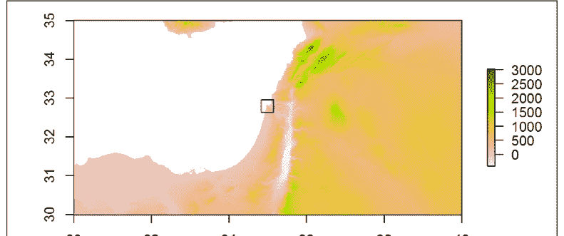

两个合并后的瓦片看起来完全对齐，这是可以预料的，因为它们来自同一个（更大的）DEM。黑色矩形勾勒出以海法为中心的感兴趣区域，该区域确实与35度经线相交。

## 裁剪与修剪

裁剪是通过选择一定范围的行和列，从现有栅格生成一个较小栅格的操作。虽然在第4章，使用栅格中使用的手动子集方法也被视为裁剪，但在实践中，我们通常希望通过将栅格与另一个空间图层叠加来选择所需的行和列范围，而不是手动输入行和列索引。

crop函数接收一个栅格和一个Extent对象，返回一个具有所需范围的较小栅格。除了Extent对象，也可以提供一个栅格或矢量图层，这种情况下会提取它们的范围用于裁剪。例如，以下表达式根据haifa_surrounding裁剪dem：

```
> dem = crop(dem, haifa_surrounding)
```

为了检查效果，我们可以使用plot(dem)表达式再次可视化栅格。下面的截图显示了由此产生的图形输出：

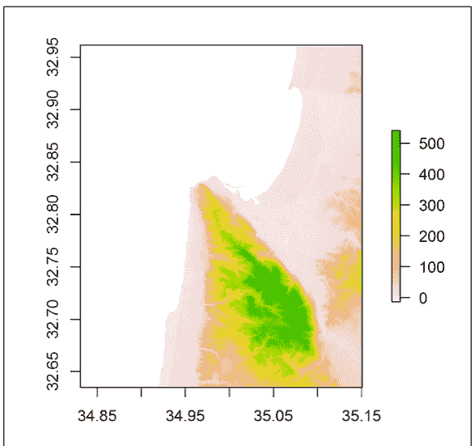

## 修改栅格并分析栅格时间序列

上一张截图下半部分的高海拔区域是卡梅尔山（Mount Carmel）。海法市位于其北坡。

在栅格裁剪的语境中，另一个有用的函数是`trim`。该函数会移除栅格中值全部相同的外侧行和列。例如，使用`trim(x)`，我们可以自动从栅格x中移除不必要的NA边缘。

> 栅格（在R中，以及一般而言）按定义是矩形的；当数值覆盖非矩形区域时，通常用NA值包围感兴趣区域（例如上一张截图中的地中海区域）。`crop`和`trim`都用于通过移除边缘的整行和整列，从现有栅格中切割出更小的矩形范围。当我们希望处理非矩形形状时，实际上需要用NA填充不需要的区域，这可以通过`mask`函数实现（我们将在下一章中看到）。

## 聚合与解聚

聚合是通过将原始栅格中的矩形像元集合分组为新栅格中的单个更大像元，从而创建低分辨率栅格的过程。当我们愿意损失细节以换取处理效率或降噪时，聚合可能是必要的。例如，MODIS卫星数据产品以多种空间（和时间）分辨率发布，从250米到5600米不等，其中低分辨率产品通常是由原始高分辨率数据聚合而来的。低分辨率数据很有用，因为随着所分析的空间和时间范围增大，使用高分辨率数据变得越来越不可行（也没有必要）。例如，在250米分辨率下对全球尺度的NDVI时间趋势进行分析将涉及海量数据；对于这样的任务，5600米分辨率更为合理（这会将数据量减少到原来的1/500！）。此外，低分辨率产品通常具有更高的可信度，因为在聚合过程中，噪声像元会被平均掉。

aggregate函数接收一个输入栅格和聚合因子fact，通过将相邻像元分组为新像元来执行聚合。聚合因子以原始像元为单位控制新栅格像元的大小。它可以是单个整数（此时两个轴上的聚合程度相同），也可以是长度为2的向量（此时在x轴和y轴上应用不同的聚合程度）。例如，使用fact=8表示原始栅格中每组8×8的像元都会成为新栅格中的单个像元。使用fact=c(5,10)表示每个5×10的矩形像元集（x轴方向5个，y轴方向10个）成为一个像元。此外，fun参数指定使用哪个函数根据现有值计算新值（默认为mean），na.rm参数指定在计算前是否从每组中移除NA值（默认为TRUE）。为了演示aggregate的行为，我们将把它应用到dem栅格上，对8×8和16×16的像元集进行聚合：

```
> dem_agg8 = aggregate(dem, fact = 8)
> dem_agg16 = aggregate(dem, fact = 16)
```

以下表达式依次绘制原始dem以及聚合结果dem_agg8和dem_agg16，并使用main参数指定相应的图标题：

```
> plot(dem, main = "Original image")
> plot(dem_agg8, main = "8x8 aggregated")
> plot(dem_agg16, main = "16x16 aggregated")
```

下面的截图显示了从左到右的各个结果图：

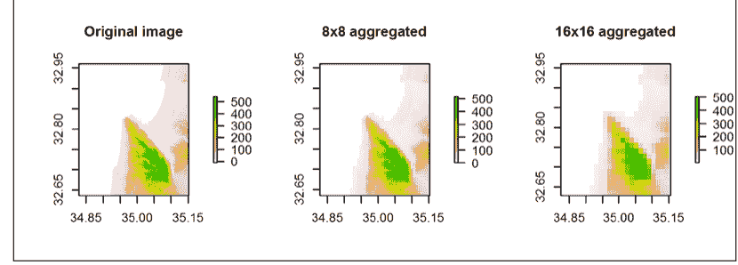

可以看到，随着聚合程度的提高，上图变得越来越模糊。


与聚合相反的操作是解聚；可以使用 disaggregate 函数来执行。例如，表达式 `disaggregate(dem_agg8,fact=8)` 会生成一个与 dem 分辨率相同的更高分辨率栅格。然而，聚合中丢失的信息无法恢复（每组 8*8 相邻像元将具有相同的值），并且解聚后的栅格在视觉上看起来与 dem_agg8 完全相同。

## 栅格重采样与重投影

在本节中，我们将把给定栅格的值从其自身网格传输到另一个网格。此操作称为重采样。栅格重投影是一个紧密相关的操作；它基本上是将栅格重采样到具有不同于原始栅格 CRS 的网格上。

## 栅格重采样

可以使用 `resample` 函数执行栅格重采样。该函数的必需参数如下：

- 要对其值进行重采样的栅格 (x)
- 定义值将被传输到的网格的栅格 (y)
- 重采样方法 (`method`)

`resample` 函数目前提供两种重采样方法。我们使用的方法决定了新栅格中的像元根据旧栅格的值获取其值的方式：

- `"ngb"`：最近邻；分配最近像元的值
- `"bilinear"`：双线性插值；分配四个最近像元的加权平均值（默认）

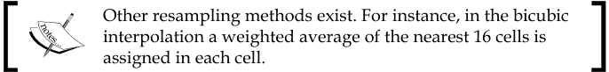

最近邻插值保留原始值，仅根据邻近关系将它们传输到新网格，而使用多个像元加权平均的重采样方法（如双线性插值）不可避免地会修改原始值，从而生成更平滑的图像。因此，在需要保留原始值的情况下，建议使用最近邻重采样方法。例如，在整数表示不同覆盖类型的分类栅格中，计算类别的加权平均值是没有意义的。例如，在一个具有两个类别（比如1代表森林，2代表牧场）的栅格中，四个像元值的平均值通常既不等于1也不等于2，这使得生成的图像毫无意义。另一方面，当视觉外观是主要考虑因素时，建议使用双线性插值和类似的加权平均方法。

对于我们的重采样示例，我们将使用两幅 NDVI 影像：一幅来自 Landsat，另一幅来自 MODIS。由于 Landsat 和 MODIS 影像定义在相同的 CRS 中且彼此重叠（MODIS 影像范围涵盖 Landsat 影像范围）——尽管它们的分辨率差异很大（Landsat 影像分辨率为 30 m，而 MODIS 分辨率为 500 m）——我们可以用其中一个对另一个进行重采样。在接下来的三个示例中，我们将执行以下步骤：

- 1. 将原始 Landsat 影像与根据 MODIS 网格重采样后的影像进行比较。
- 2. 将原始 MODIS 影像与根据 Landsat 网格重采样后的影像进行比较。
- 3. 使用两种方法比较 MODIS 影像的重采样结果：最近邻和双线性插值。

对于 Landsat NDVI 影像，我们将使用之前基于 2000 年 10 月 4 日获取的影像计算得到的 `ndvi_00` 栅格。至于 MODIS，栅格 `r` 包含 2000 年 2 月 18 日至 2012 年 4 月 6 日期间的 280 幅 NDVI 影像（参见*第 4 章，使用栅格*）。为了使比较更有意义，我们将选择最接近 2000 年 10 月 4 日的获取日期。使用 MODIS 获取日期的 `dates$date` 向量（正如我们在*第 3 章，使用表格*中看到的），我们可以通过执行以下步骤找出最接近 2000 年 10 月 4 日的日期的索引：

- 1. 计算 `dates$date` 中每个日期与 2000 年 10 月 4 日之间的差值向量。
- 2. 使用 `abs` 函数计算绝对差值。
- 3. 使用 `which.min` 找到最小差值对应的索引。

这三个步骤可以用一行代码完成，如下所示：

```
> l_date = which.min(abs(dates$date - as.Date("2000-10-04")))
```

结果赋值给 l_date，它是 MODIS 影像中获取日期最接近 2000 年 10 月 4 日的索引，等于 15：

```
> l_date
[1] 15
```

因此，在示例中，我们将使用 r[[l_date]]，即多波段栅格 r 的第十五个图层（相应的获取日期是 2000 年 9 月 29 日，如 dates$date[l_date] 所示）。

在我们的第一个示例中，我们将使用最近邻方法将 Landsat 影像 ndvi_00 重采样到 r[[l_date]] 影像的 MODIS 网格，如下所示：

```
> l_resample = resample(ndvi_00, r[[l_date]], method = "ngb")
```

让我们通过绘图来比较原始 Landsat 影像 ndvi_00 和重采样影像 l_resample，如下所示：

```
> plot(ndvi_00, main = "Original Landsat image")
> plot(l_resample, ext = extent(ndvi_00),
+ main = "Resampled to MODIS")
```

注意，在绘制 l_resample 时，我们为 ext 参数提供了原始 Landsat 影像 ndvi_00 的范围，以放大重叠区域。实际上，l_resample 影像比 ndvi_00 更大（其范围与 r[[l_date]] 相同），但所有不与 ndvi_00 重叠的像元都被赋值为 NA。

得到的两幅影像如下图所示：

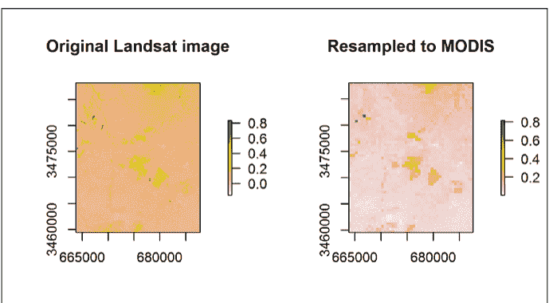

在左侧，我们可以看到细节丰富的 30 米分辨率 ndvi_00 影像；在右侧，我们看到粗糙的 500 米分辨率影像，其中 ndvi_00 最近像元的值被分配给 r[[l_date]] 中的每个像元。


> 当原始栅格比重采样结果细致得多时（如前面的示例），会发生相当大的数据丢失。这是因为在新图像中，只有一个（最近邻）或少数几个（双线性插值）30 米像元的值决定了更大的 500 米像元的值，在我们这个特定示例中就是如此。当重采样导致栅格分辨率大幅降低时，按多边形进行聚合和分区提取（我们将在下一章中看到）是更理想的解决方案。

相反的操作是将 MODIS NDVI 值从 r[[l_date]] 重采样到 ndvi_00 的 Landsat 网格，同样使用最近邻方法：

```
> r_resample = resample(r[[l_date]], ndvi_00, method = "ngb")
```

在这种情况下，结果 r_resample 的范围比原始 MODIS 影像 r[[l_date]] 小；其范围与 ndvi_00 相同。为了更方便地将它们并排显示，我们首先将 r_resample 扩展到与 r[[l_date]] 的范围匹配。这可以使用 extend 函数来完成，该函数根据一个 Extent 对象（或可从中派生 Extent 对象的对象，如 RasterLayer）扩展栅格。extend 函数会根据需要添加 NA 行和列以增大栅格范围；因此，从某种意义上说，它是 trim 的反向操作：

```
> r_resample = extend(r_resample, r[[l_date]])
```

现在我们将绘制第二个重采样示例的结果：原始 MODIS 影像 r[[l_date]] 和重采样影像 r_resample。在绘制 r[[l_date]] 时，我们将添加一个围绕 ndvi_00 范围的矩形以帮助比较：

```
> plot(r[[l_date]], main = "Original MODIS image")
> plot(extent(ndvi_00), add = TRUE)
> plot(r_resample, main = "Resampled to Landsat")
```

## 修改栅格和分析栅格时间序列

得到的两幅影像如下图所示：

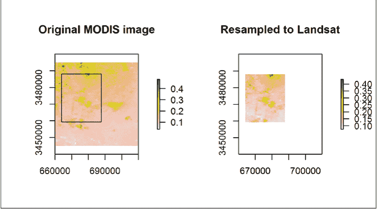

正如我们所见，重采样影像在视觉上与原始影像的相应部分相同，尽管其分辨率为 30 米，而原始影像分辨率为 500 米。原因是，与 MODIS 影像中单个 500 米像元重合的每组 30 米 Landsat 像元都会获得该单个像元的值。因此，即使底层分辨率高得多，看起来仍像拥有 500 米像元。

如果我们想让图像看起来更平滑该怎么办？在这种情况下，我们可以使用双线性插值方法而不是最近邻方法。让我们将上一个示例中的重采样操作执行两次，分别使用最近邻方法（与我们刚才所做的方式相同，这次将结果赋值给 r_resample_ngb）和双线性插值方法（将结果赋值给 r_resample_bil）。然后将结果合并到一个双波段栅格中，图层名称指定重采样方法：

```
> r_resample_ngb = resample(r[[l_date]], ndvi_00, method = "ngb")
> r_resample_bil = resample(r[[l_date]], ndvi_00,
+ method = "bilinear")
> resample_results = stack(r_resample_ngb, r_resample_bil)
> names(resample_results) = c("Nearest neighbor",
+ "Bilinear interpolation")
```


我们将使用 rasterVis 包的 levelplot 函数来绘制结果。设置 contour=TRUE 可以启用轮廓线，以突出不同方法之间的差异：

```
```r
> library(rasterVis)
> levelplot(resample_results,
+ par.settings = RdBuTheme,
+ contour = TRUE)
```
```

以下截图显示了图形输出：

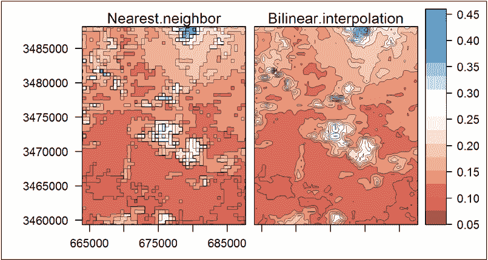

正如我们在前一个最近邻重采样示例中看到的（左图），与单个 500 米像素重叠的相邻单元组会获得相同的值，因此轮廓线遵循 MODIS 像素的粗粒度模式。相比之下，使用双线性插值（右图）时，每个 30 m 单元都会获得距离它最近的四个 MODIS 像素的平均值，按各自的距离加权；因此，大多数（如果不是全部）单元值都是唯一的，图像也更加平滑。

## 栅格重投影

如前所述，栅格重投影——与矢量图层重投影不同——涉及重采样。与矢量图层不同，矢量图层中所有点都是独立的，因此其坐标可以单独转换到新的 CRS（参见上一章），而转换到不同 CRS 的栅格像素坐标将不会在该 CRS 上形成合法的网格（即，所有相邻像素之间距离相等且平行于 CRS x 和 y 轴的网格）；因此栅格需要重采样。因此，栅格重投影包括两个步骤：将栅格像素坐标重投影到新的 CRS（类似于重投影矢量图层），并将像素值重采样到新的 CRS 中定义的网格。

在栅格重投影中定义新网格主要有两种方法：我们可以只提供新的 CRS 定义，让网格自动生成；或者我们可以提供自己特定的网格。在后一种情况下，该过程与重采样非常相似；唯一的变化是新网格的 CRS 与原始栅格不同。

在 R 中，`projectRaster` 函数提供了栅格重投影功能，并支持前面提到的两种定义新网格的方式。在第一种情况下，当我们希望网格自动生成时，我们需要提供：
- 要重投影的栅格（`from`）
- 目标 CRS，作为 PROJ.4 字符串（`crs`）
- 可选的所需分辨率（`res`）

在第二种情况下，当我们希望自己定义网格时，我们需要提供：
- 要重投影的栅格（`from`）
- 定义目标网格的栅格（`to`）

在两种情况下，我们还需要指定重采样方法，即 "ngb" 或 "bilinear"（默认值）。

作为示例，我们将把 `dem` 从其地理 CRS 重投影到 UTM Zone 36N 投影。相应的 PROJ.4 字符串，如我们在前几章中所做的那样，将从另一个栅格（`r`）中获取。在重投影之前，让我们打印出 `dem` 当前的属性，以便之后与重投影结果的属性进行比较：

```
> dem
class      : RasterLayer
dimensions : 390, 384, 149760  (nrow, ncol, ncell)
resolution : 0.0008333333, 0.000833333  (x, y)
```

```
extent      : 34.83083, 35.15083, 32.63583, 32.96083  (xmin, xmax)
coord. ref. : +proj=longlat +datum=WGS84 +ellps=WGS84 +towgs84=0,
data source : in memory
names       : layer
values      : -14, 541  (min, max)
```

我们看到，dem 确实定义在地理 CRS 中，分辨率为 0.0008333333 度，经度和纬度。

如果我们对投影后的 dem 与现有图层对齐没有特殊要求，可以采用第一种重投影方法，只提供 CRS，让网格自动生成。我们还可以提供可选的 res 参数，主要是为了确保 x 和 y 轴的分辨率相等（例如 90 m）。你可以尝试在不指定 res 的情况下执行以下表达式，以验证此情况下默认生成的网格在 x 和 y 轴上的分辨率为 78 m 和 92.4 m：

```
> dem = projectRaster(from = dem,
+ crs = proj4string(r),
+ method = "ngb",
+ res = 90)
```

打印重投影后 dem 的属性会显示出若干差异：

```
> dem
class       : RasterLayer
dimensions  : 417, 351, 146367  (nrow, ncol, ncell)
resolution  : 90, 90  (x, y)
extent      : 670666.3, 702256.3, 3611918, 3649448  (xmin, xmax, 
coord. ref. : +proj=utm +zone=36 +datum=WGS84 +units=m +no_defs +
data source : in memory
names       : layer
values      : -14, 541  (min, max)
```

我们可以看到 CRS 定义已更改为 UTM Zone 36N。此外，范围、分辨率和尺寸现在都不同，并表征了已生成的新的网格。

使用 plot (dem) 绘制新的栅格会产生以下图形输出：

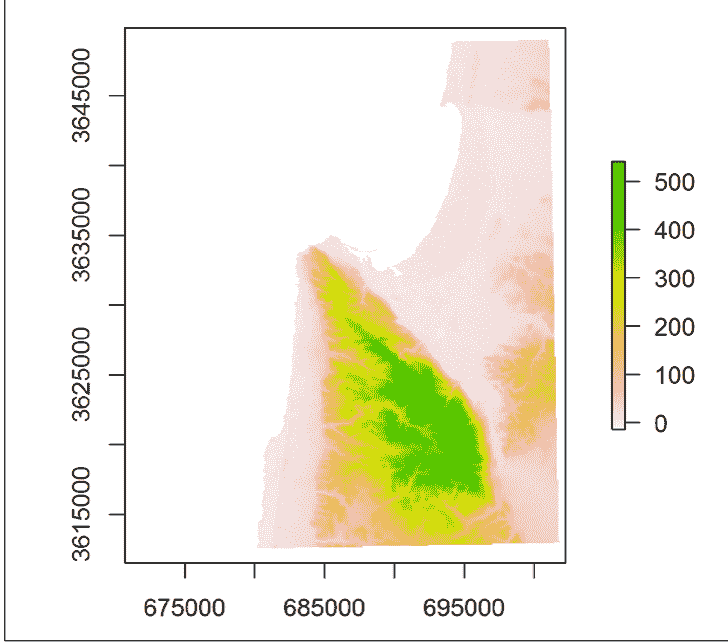

UTM Zone 36N 坐标现在显示在坐标轴上。此外，你可能已经注意到投影后的 dem 图像并不完全平行于坐标轴，因为 UTM 网格并不严格平行于地理网格。由于栅格必须是矩形的（参见前面的截图），因此在图像边缘周围生成了由 NA 值组成的空区域。

## 过滤和聚类

在本节和下一节中，我们将从改变栅格几何形状的主题转向相邻栅格单元值之间的关系主题。这些关系可以用多种方法总结为新的栅格形式。在本节中，我们将介绍两种这样的方法：焦点滤波和聚类。

焦点滤波涉及为栅格中的每个单元（焦点单元）分配一个函数的结果，该函数的输入是围绕焦点单元的邻域单元值集合（包括其自身）。邻域大小是预先确定的（例如，常用的 3*3 邻域），输入栅格以移动窗口方式扫描，直到完全覆盖。有许多适当的函数可用于各种目的的滤波器。例如，使用均值函数（也称为低通滤波器）会使图像看起来更平滑，而使用查找最常见值的函数（也称为多数滤波器）对于减少分类栅格中的噪声很有用。

focal 函数用于在 RasterLayer 对象上应用焦点滤波器。该函数的三个主要参数如下：
- 要滤波的 RasterLayer 对象（x）
- 定义邻域和单元权重的矩阵（w）
- 要应用于邻域的函数（fun）

w 参数应为定义邻域的矩阵。它应具有奇数维（例如 3*3 或 7*5），因为其中心定义了焦点单元位置。矩阵值定义了在传递到焦点函数之前应用于单元值的权重。然而，使用权重是可选的——所有值都等于 1 的矩阵意味着没有权重。也可以使用 0 的权重来创建非对称和/或非矩形窗口。fun 参数应为要应用于邻域值的函数（默认为 sum）。

对于滤波示例，我们将返回到 1_rec，这是一个基于 2000 年 10 月 4 日获得的 Landsat 图像的重新分类 NDVI 栅格（NDVI≤0.2 为 0，NDVI>0.2 为 1）（有关更多信息，请参阅第 4 章《使用栅格》）。该栅格显示了更密集植被区域的位置（例如种植的松树林）；然而，图像相当颗粒化，在原本连续的高植被（1）区域内出现了 0 值。

## 修改栅格和分析栅格时间序列

为了增加连续性，我们将通过将具有至少一个直接相邻 1 邻居的单元全部转换为 1 来缓冲 NDVI>0.2 区域，从而减少植被区域之间或内部的 0 值间隙。此操作可以通过使用 3*3 窗口和无权重的 max 函数应用焦点滤波器来完成。使用 max，每个单元获得其 3*3 邻域的最大值。因此，0 单元要么保留其值（如果九个邻居都是 0），要么转换为 1（如果其至少一个邻居为 1）。所有 1 单元都保留其值，因为它们至少有一个 1 邻居（单元本身）。由于我们不需要权重，我们将为 w 参数使用由纯 1 组成的 3*3 矩阵。这可以按如下方式创建：

```
```r
> matrix(1, nrow = 3, ncol = 3)
     [,1] [,2] [,3]
[1,]    1    1    1
[2,]    1    1    1
[3,]    1    1    1
```
```

因此，应用于 l_rec 的滤波器的完整表达式如下：

```
```r
> l_rec_focal = focal(l_rec,
+ w = matrix(1, nrow = 3, ncol = 3),
+ fun = max)
```
```

结果被赋给 l_rec_focal；将其与原始 l_rec 栅格进行比较可以显示植被区域的缓冲情况（参见下一张截图）。

我们关于单元邻居的第二个操作示例是聚类。在聚类中，我们感兴趣的是检测具有相同值的单元斑块。例如，你可能想了解有多少个斑块、其大小分布、它们相对于其他栅格值的属性等等。聚类可以使用 clump 函数执行，该函数返回一个新的栅格，其中为输入栅格中具有相同值的每个连接的单元斑块分配一个唯一的 ID（0 或 NA 的值除外，这些值被忽略并用作背景）。该操作仅对分类栅格有用——在连续栅格中，大多数单元通常具有唯一的值。因此，无法形成大于一个单元的斑块。

clump 函数接受一个 RasterLayer 对象并返回一个栅格，其中每个相似值的斑块都有一个唯一 ID。指定 gaps=FALSE 将强制这些 ID 为连续的整数，从 1 开始到 n（其中 n 是斑块总数）。例如，让我们对 l_rec_focal 的 1 区域进行聚类：

```
```r
> l_rec_focal_clump = clump(l_rec_focal, gaps = FALSE)
```
```


结果 `l_rec_focal_clump` 是一个栅格，其中 0 区域被转换为 NA（并用作背景），而所有属于连续 1 斑块的像元都获得了唯一的 ID。检查 `l_rec_focal_clump` 包含多少个唯一的非 NA 值（例如，使用表达式 `max(l_rec_focal_clump[], na.rm=TRUE)`）会显示我们有 507 个独立的 NDVI>0.2 斑块。如果我们跳过过滤步骤并对 `l_rec` 进行聚类，我们会得到 1,258 个斑块。

> 运行 clump 需要 igraph 包，因此请确保已安装。

让我们可视化过滤和聚类结果以及原始栅格：

```
> plot(l_rec, main = "Original image")
> plot(l_rec_focal, main = "Filtered")
> plot(l_rec_focal_clump, main = "Clumped")
```

以下屏幕截图分别从左到右显示了 `l_rec`、`l_rec_focal` 和 `l_rec_focal_clump` 的图：

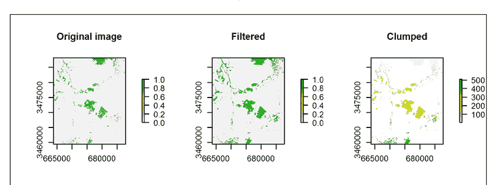

我们可以看到，过滤使 NDVI>0.2 区域变厚，而聚类则为每个斑块分配了 ID（从 1 到 507）。在下一章中，我们将继续使用 `l_rec_focal_clump` 来了解这些斑块如何转换为多边形以及如何分离感兴趣的斑块。

## 修改栅格和分析栅格时间序列

### 利用高程数据进行地形相关计算

从 DEM 推导地形相关变量是地形分析中的核心任务。为此开发了许多函数和算法，不同的 GIS 软件包包含不同的工具集。raster 包目前提供了几种基本的地形分析函数（本节将展示其中三个示例）。

> 通过与开源 GIS 软件的接口，R 中可获得多种地形分析（和其他）算法，例如 SAGA GIS（使用 RSAGA 包）和 GRASS GIS（使用 spgrass6 包）。要使用这些工具，您需要下载并安装（免费提供的）相应软件，但该主题超出了本书的范围，本书侧重于独立的 R 功能。


### 坡度和坡向计算

地形坡度和坡向的计算是最基本的 DEM 分析程序之一。这两个变量本身具有许多用途（例如，由于与太阳辐射负荷相关，坡向是一个重要的环境指标），并且可作为后续计算的输入（例如，坡度是计算地形湿度指数的参数之一）。两者都是通过将高程栅格中每个像元的高程与其 8 个邻居的高程进行比较（在 3×3 邻域中）来计算的。

terrain 函数可在提供 DEM 栅格和相应选项（“slope”或“aspect”）时计算坡度和坡向（以及其他几个地形特征）。让我们看一下以下示例：

```
> slope = terrain(dem, "slope")
> aspect = terrain(dem, "aspect")
```

我们现在有了坡度和坡向栅格，默认单位为弧度（使用 units="degrees" 将以度为单位给出结果）。我们可以使用以下表达式检查结果的外观：

```
> plot(stack(slope, aspect))
```

例如，使用我们之前计算的坡度和坡向图层，以下表达式根据太阳高度角 20 度、太阳方向 235 度创建阴影图层：

```
> hill = hillshade(slope, aspect, 20, 235)
```

现在，使用以下表达式，我们将使用灰度（由 `par.settings` 参数 `GrTheme` 指示）绘制生成的 hill 栅格：

```
> levelplot(hill, par.settings = GrTheme, margin = FALSE)
```

以下屏幕截图显示了图形输出：

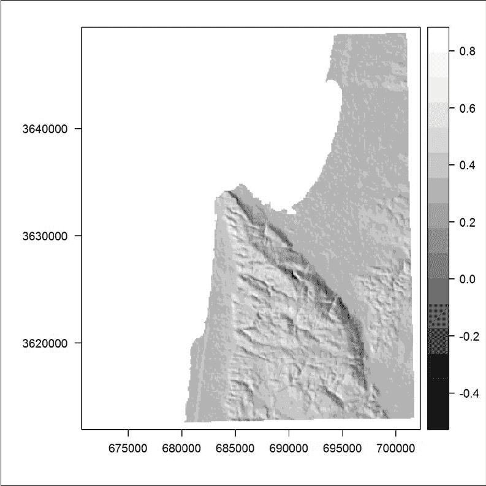

该图像清楚地显示了卡梅尔山的起伏。由于光源位于西南方（太阳方向：235°）并且在地平线上方角度较低（太阳高度：20°），山脉的东北坡处于阴影中，而西坡则被照亮。

### 聚合时空栅格数据

时空数据，例如 MODIS 影像、时间序列或多个站点（参见 *第 3 章，使用表格*）的气象记录，由于其三维特性，对分析和可视化提出了挑战。简化此类数据的一种方法是执行空间和/或时间维度的聚合（简化时空数据的另一种方法是，例如聚类分析）。

在本节中，我们将尝试两种方法来聚合多波段栅格 `r` 中的数据，以便从不同角度了解该栅格覆盖的地理区域内 NDVI 的时空行为。

> > `spacetime` 包中定义了用于各种类型时空数据的更专业的类和方法（包括聚合）。该包的概述可在其创建者 Pebesma E. 2012 年的介绍性论文 “*spacetime: Spatio-Temporal Data in R*” 中找到。

### 时间维度

在第一个示例中，我们将沿时间维度（即图层）对 `r` 进行聚合。事实上，我们之前使用 overlay 和 range 函数绘制 `r` 中每个像素的最小值和最大值（参见 *第 4 章，使用栅格*，了解更多信息）的示例也是聚合的一个示例。然而，如果您想了解不同时间序列部分的特性，而不是聚合所有图层，会怎样？在这种情况下，您必须执行多次 overlay 操作，然后将结果组合成多波段栅格。这正是我们接下来要做的事情。

假设我们有兴趣检查研究区域内季节性 NDVI 平均值。在这种情况下，我们需要对每个季节的所有图层使用 mean 函数执行 overlay，然后将结果组合成一个四波段栅格（其中每个图层对应四个季节中的一个）。从概念上讲，最简单的方法是使用 `for` 循环遍历四个季节，每次选择 `r` 的适当图层，对这些图层应用 `overlay`，并保留结果以最终形成多波段栅格。

作为构建循环的初步步骤，我们将定义一个包含季节名称的字符向量（seasons）和一个空的 RasterStack 对象（season_means）。seasons 向量将定义循环迭代，而 season_means 将用于保存结果：

```
> seasons = c("winter", "spring", "summer", "fall")
> season_means = stack()
```

现在，我们准备执行 for 循环：

```
> for(i in seasons) {
+ season_means = stack(season_means,
+ overlay(r[[which(dates$season == i)]],
+ fun = function(x) mean(x, na.rm = TRUE)))
+ }
```

循环代码部分执行四次（因为 seasons 中的元素数为四），每次将下一个季节名称赋给 i。代码将 `r` 中相关图层的平均值（使用我们之前创建的 dates$season 向量选择；参考第 3 章，使用表格）添加到 season_means。因此，在第一次循环迭代中，`r` 中“winter”图层的平均值被添加到空的 season_means；第二次迭代中，“spring”的平均值被添加到 season_means（此时已有 1 个图层），依此类推，直到涵盖全部四个季节。

现在结果 season_means 已准备就绪，我们可以为方便起见为各图层添加季节名称：

```
> names(season_means) = seasons
```

我们将使用 levelplot 函数查看结果：

```
> levelplot(season_means, par.settings=RdBuTheme, contour=TRUE)
```

以下屏幕截图显示了图形输出：

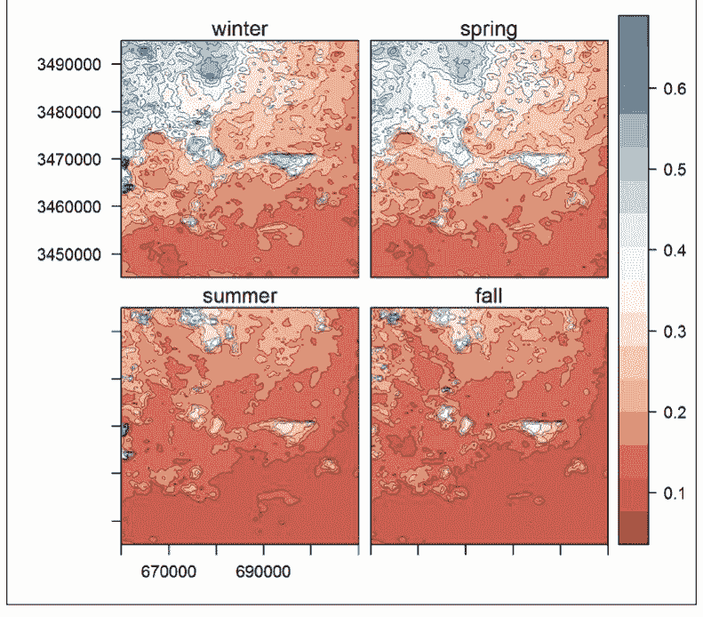

前面的屏幕截图显示了每个季节的平均 NDVI。我们可以看到，NDVI 在冬季和春季通常较高，在夏季和秋季较低。图像还显示，某些区域（例如图像的西北角）在雨季的 NDVI 远高于旱季，而其他区域（例如图像中央的三个斑块）在夏季也保持相对较高的 NDVI 值。前者实际上是由于雨季降雨相对更充足而农作物和天然草本植被繁茂的区域，而后者是种植的常绿松林，在旱季植被活动仍能维持。


另一种聚合栅格图层的方法，无需构造循环，就是使用`stackApply`函数。类似于`tapply`可以对向量的不同部分应用函数（我们在*第3章，处理表*中讨论过），`stackApply`函数被定义为对多波段栅格中的不同图层部分应用函数。与`tapply`类似，`stackApply`的三个主要参数如下：

- 输入的多波段栅格（x）
- 定义图层分组的索引向量（indices）
- 应用于每组的函数（fun）

与`tapply`不同，索引向量必须由从1开始的连续整数组成。`stackApply`的另一个参数是`na.rm`，用于控制是否从计算中移除NA值。

例如，我们可以按如下方式计算月度NDVI平均值：

```r
> month_means = stackApply(r,
+ indices = dates$month,
+ fun = mean,
+ na.rm = TRUE)
```

如前面的示例一样，我们将结果的图层命名为`month_means`：

```r
> names(month_means) = month.abb
```

> 字符向量`month.abb`是R中预定义的一个；它包含三个字母的月份缩写名称："Jan"、"Feb"、"Mar"等等。

我们可以使用`levelplot`可视化结果：

```r
> levelplot(month_means, par.settings = RdBuTheme, contour = TRUE)
```

以下截图显示了图形输出：

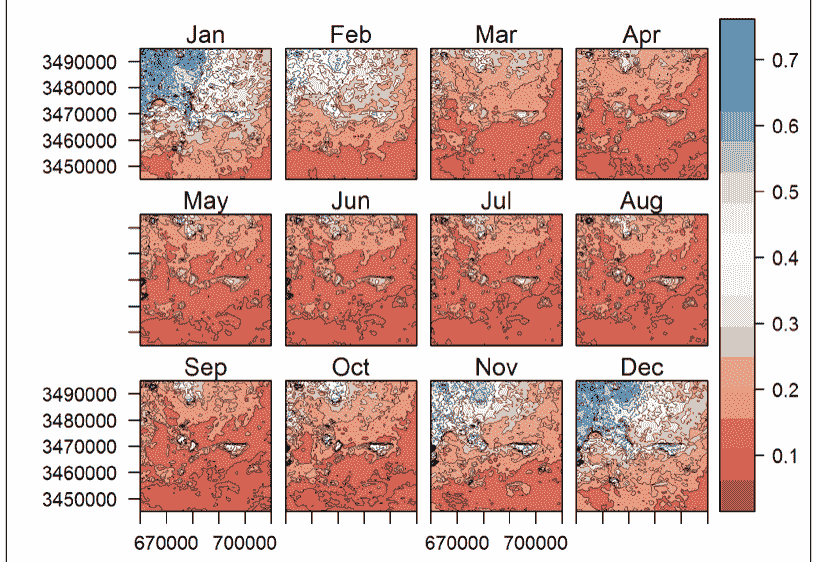

上面的截图以月度尺度而非季节尺度更详细地显示了NDVI动态。我们可以看到，NDVI在10月至11月左右开始增加，在2月至3月左右下降。在4月至9月（旱季），NDVI几乎保持恒定。

利用月度平均值，我们可以得出其他有信息量的产物。例如，通过以下`overlay`函数调用，我们可以创建一个栅格，显示每个位置观察到最低NDVI值的月份：

```r
> min_month = overlay(month_means, fun = which.min)
```

为了节省篇幅，这里不绘制结果图。

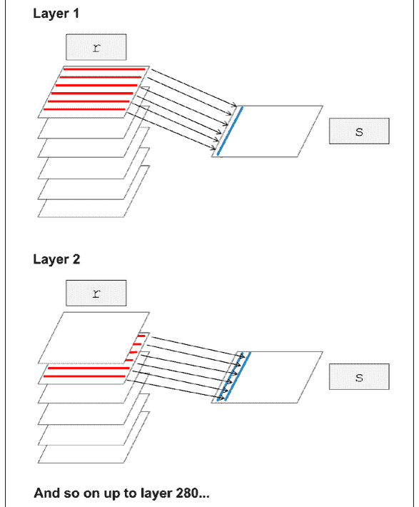

正如我们在上图中所见，目标是创建一个新的栅格s，其中每一列保存来自r的行平均向量。换句话说，s的每一行代表r的一行（或空间中的y轴位置），而s的每一列代表r的一个图层（或时间位置）。我们将分两步执行该操作：首先，创建空栅格s（具有所需维度）；其次，用值填充它。我们还将看到完成该任务的两种不同方式：使用for循环和使用apply。

正如我们在上图中所见，s中的行数应等于r中的行数，而s中的列数应等于r中的图层数。除了设置行数和列数之外，使用参数xmn、xmx、ymn和ymx，我们将设置x和y轴上的最小和最大坐标（以避免默认情况，即x轴上-180到180，y轴上-90到90）。x和y轴上的坐标范围分别为0到280和0到100；此外，由于列数和行数相应地为280和100，栅格分辨率在两个轴上均为1（任意单位）：

```r
> s = raster(nrows = nrow(r), ncols = nlayers(r),
+ xmn = 0, xmx = nlayers(r), ymn = 0, ymx = nrow(r))
```

现在栅格s已准备好，我们需要用值填充它。按照我们的第一种for循环方法，我们将定义一个名为raster_rowMeans的新函数，当提供栅格(x)和图层索引(layer)时，它返回该图层中的行均值向量。该函数实际上由一个表达式组成，因为它只是将基础函数rowMeans应用于从给定图层获取的值矩阵（使用as.matrix获取）：

```r
> raster_rowMeans = function(x, layer) {
+ rowMeans(as.matrix(x[[layer]]),
+ na.rm = TRUE)
+ }
```

现在，剩下要做的就是遍历r的图层，每次计算当前图层中的行均值（使用raster_rowMeans函数），并将得到的向量赋值给s的相应列（正如上图所示）：

```r
> for(i in 1:nlayers(r)) {
+ s[,i] = raster_rowMeans(r, i)
+ }
```

现在s已填充了适当的值，我们可以使用levelplot函数来显示它。levelplot函数的附加at参数设置颜色级别和等高线之间的断点。我们使用它来略微减少等高线的数量，使图像更清晰：

```r
> levelplot(s,
+ par.settings = RdBuTheme,
+ contour = TRUE,
+ margin = FALSE,
+ at = seq(0,0.6,0.05))
```

图形输出如下截图所示：

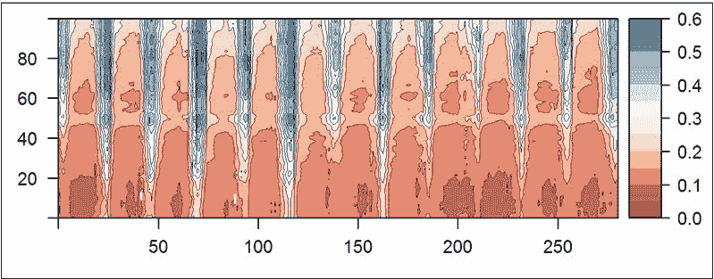

上面的截图显示了每个时间点（$x$轴）和空间南北位置（$y$轴）的平均NDVI。有两个明显的模式：首先，沿着$x$轴（时间），我们可以看到NDVI在干湿季节交替之间的周期性行为。然而，也存在年际差异——在某些年份，NDVI高于或低于平均值——这是由于气候条件的变化以及因此导致的植被活动的变化。其次，沿着$y$轴（南北位置），我们可以看到NDVI梯度，从相对湿润的条件（因此北部NDVI较高）到较干燥的条件；因此，我们还可以看到南部NDVI较低且更稳定。

第二种获得相同结果的方法将用更少的代码定义，尽管它在概念上可能更难理解。该任务的第一步，定义空栅格$s$，是相同的：

```r
> s = raster(nrows = nrow(r), ncols = nlayers(r),
+ xmn = 0, xmx = nlayers(r), ymn = 0, ymx = nrow(r))
```

然而，第二步则不同。我们将不使用for循环遍历r的图层，而是将r转换为三维数组并利用apply函数。前者通过as.array函数完成：

```r
> r_array = as.array(r)
```

结果`r_array`是一个数组对象，其中第一个维度对应r的行，第二个维度对应r的列，第三个维度对应r的图层。因此，我们可以使用apply在第三个维度上利用rowMeans，获取每个第三维元素（图层）的行均值向量，这正是我们需要的。结果矩阵的值可以直接传输到s：

```r
> s[] = apply(r_array, 3, rowMeans, na.rm = TRUE)
```

我们刚刚创建的栅格s与之前创建（并绘制）的栅格相同。虽然产生了相同的结果，但两种方法之间的一个重要区别在于执行速度。与数组上的apply操作（通常非常快）相比，使用循环一次访问一个栅格图层较慢。例如，在编写本书所用的电脑上，使用第一种方法计算s的值大约需要1.8分钟，而使用第二种方法只需2.6秒（即大约快40倍！）。因此，在进行密集计算之前，将栅格转换为更简单的对象（矩阵或数组）通常是很有用的。

## 总结

在本章中，你学习了在R中处理栅格图层的其他方法和步骤。我们现在知道如何裁剪、聚合或重投影栅格，以使其达到所需的范围、分辨率和CRS。我们讨论了如何应用焦点滤波和聚类来突出栅格中感兴趣的模式。我们还讨论了如何从DEM中得出与地形相关的变量，以及如何聚合时空栅格数据。

在下一章中，你将了解栅格与矢量图层之间的接口，以及两者在空间分析中结合的不同方式。


生成的图形输出如下截图所示：

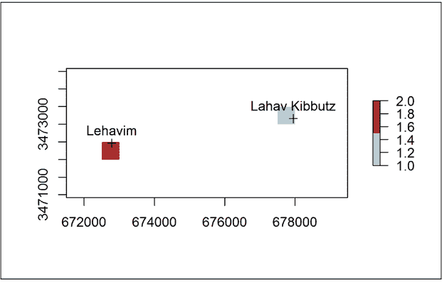

我们看到的白色背景对应 `towns_r` 中被 NA 填充的区域。这些栅格单元中没有落入任何城镇点。两个彩色像素是已赋值的两个单元。浅蓝色像素被赋值为 1（对应 Lahav Kibbutz），而棕色像素被赋值为 2（对应 Lehavim）。

> `rasterize` 的另外两个有用参数是 `field` 和 `fun`。
> 
> 使用 `field`，我们可以覆盖栅格值的默认分配，并提供一个单一数值、向量或属性表列名来决定取值（后者示例见*第 8 章，点数据的空间插值*）。例如，使用 `rasterize(towns, r, field=c(3,4))` 表达式将生成一个栅格，其中 Lahav Kibbutz 的值为 3，Lehavim 的值为 4。
> 
> `fun` 参数决定分配栅格值的方法，并且仅在某些栅格单元与多个要素重叠时才相关。它可以提供为一个函数，也可以是预定义的字符值之一：`"first"`、`"last"`、`"count"`、`"sum"`、`"min"` 或 `"max"`（默认值为 `"last"`）。例如，`rasterize(towns, r, fun="count")` 表达式生成的栅格会显示每个 500 米单元中有多少个城镇（在我们的例子中，这不太有启发性——栅格将有两个 1 值，因为两个单独单元中各只有一个城镇）。

生成的图形输出如下截图所示：

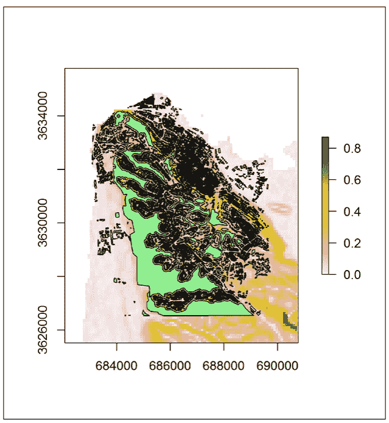

上面的图形输出与第 5 章“处理点、线和多边形”中熟悉的内容一致（见该章最后一张截图）；唯一的区别是现在坡度栅格显示在背景中。该区域似乎以多变的地形为特征。自然区域和建成区域是否具有不同的地形坡度？这个问题引出了我们的下一个任务——分别提取自然区域和建筑物所覆盖的坡度像素，以比较它们的值分布。

我们将用来完成此任务的 `mask` 函数需要两个主要参数：

- 要被掩膜的栅格（x）
- 决定哪些值要被掩膜的对象（mask）

`mask` 参数可以是重叠的栅格（在这种情况下，x 中与 mask 中 NA 对应的值会被赋为 NA），也可以是矢量图层（在这种情况下，x 中不与 mask 中任何要素重合的值会被赋为 NA）。因此，以下表达式基于 `slope` 生成一个新栅格，其中所有未被 `haifa_natural` 覆盖的像素都被掩膜（即赋为 NA）：

```
> natural_mask = mask(slope, haifa_natural)
```

> 上述表达式与以下表达式类似：
> > natural_mask = mask(slope,
> > + rasterize(haifa_natural, slope))

为了方便起见，我们将使用 `haifa_ext` 对结果 `natural_mask` 进行裁剪：

```
> natural_mask = crop(natural_mask, haifa_ext)
```

我们将对 `haifa_buildings` 重复完全相同的过程，以同样获得 `buildings_mask` 栅格：

```
> buildings_mask = mask(slope, haifa_buildings)
> buildings_mask = crop(buildings_mask, haifa_ext)
```

现在让我们并排绘制 `natural_mask` 和 `buildings_mask`，观察掩膜是如何执行的：

```
> plot(stack(natural_mask, buildings_mask))
```

生成的图形输出如下截图所示：

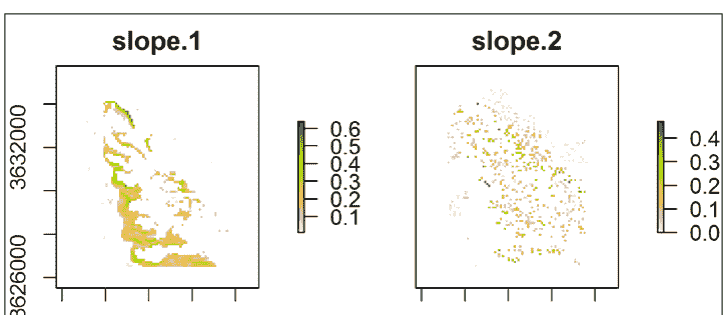

观察这两个结果后，我们可以看到，`natural_mask`（左面板）主要由连续的非 NA 区域块组成，而 `buildings_mask`（右面板）则由包含少量像素的非常小的非 NA 块组成。这种行为的原因是，使用多边形图层进行掩膜时，仅保留那些单元中心落在多边形内部的单元值。这一行为适用于 `haifa_natural`，它主要由大块多边形组成，每个多边形包含许多单元。然而，对于 `haifa_buildings`，被保留的像素仅是那些中心落在 `haifa_buildings` 中某个建筑物多边形内部的像素。这显然低估了建成区域。一个简单的解决方法是改为使用建筑物质心进行掩膜，这样 `haifa_buildings` 的质心所落入的像素就会被保留。为此，我们将创建一个名为 `buildings_ctr` 的点图层来构建质心：

```
> buildings_ctr = gCentroid(haifa_buildings, byid = TRUE)
```

现在，我们将使用该图层重复掩膜过程：

```
> buildings_mask = mask(slope, buildings_ctr)
> buildings_mask = crop(buildings_mask, haifa_ext)
```

让我们再次绘制结果，看看差异：

```
> plot(stack(natural_mask, buildings_mask))
```

图形输出如下截图所示：

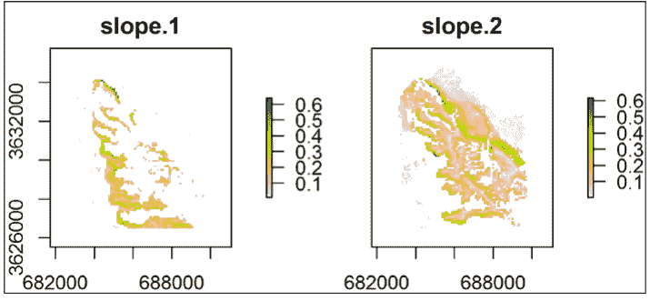

这次，`buildings_mask` 中有更多像素未被掩膜，因为与至少一个建筑物的质心重合的所有像素都被保留了（如之前的城镇栅格化示例）。

我们将在第 9 章“空间数据的高级可视化”中继续这个示例，用直方图展示两个栅格的值分布。

## 从栅格创建矢量图层

与上一节中介绍的栅格化相反的操作，是从栅格数据创建矢量图层。以矢量图层的形式从栅格中提取感兴趣要素的过程，常常出于与栅格化类似的原因而必要——当栅格中保存的数据在特定的后续分析或可视化任务情境下，用矢量图层表示更好时。我们可能会遇到需要从栅格创建点、线和多边形的场景。在本节中，我们将各看一个示例。

### 栅格转点

在栅格转点中，每个栅格单元中心（不包括 NA 单元）都被转换为一个点。生成的点图层具有一个属性表，其中包含相应栅格单元的值。

可以使用 `rasterToPoints` 函数完成向点的转换。该函数有一个名为 `spatial` 的参数，决定返回的对象是 `SpatialPointsDataFrame` 还是仅保存坐标和相应单元值的矩阵（`spatial=FALSE`，默认值）。因此，为了我们的目的，务必记住指定 `spatial=TRUE`。

作为栅格示例，让我们创建栅格 `r` 的一个子集，仅包含第 1-2 层、第 1-3 行和第 1-3 列：

```
> u = r[[1:2]][1:3, 1:3, drop = FALSE]
```

为了让示例更具启发性，我们将在某些单元中放置 NA，看看这如何影响栅格转点：

```
> u[2, 3] = NA
> u[[1]][3, 2] = NA
```

现在，我们将应用 `rasterToPoints` 从 `u` 创建一个名为 `u_pnt` 的 `SpatialPointsDataFrame` 对象：

```
> u_pnt = rasterToPoints(u, spatial = TRUE)
```

让我们以 `u` 的第一层作为背景，目视检查结果：

```
> plot(u[[1]])
> plot(u_pnt, add = TRUE)
```

图形输出如下截图所示：

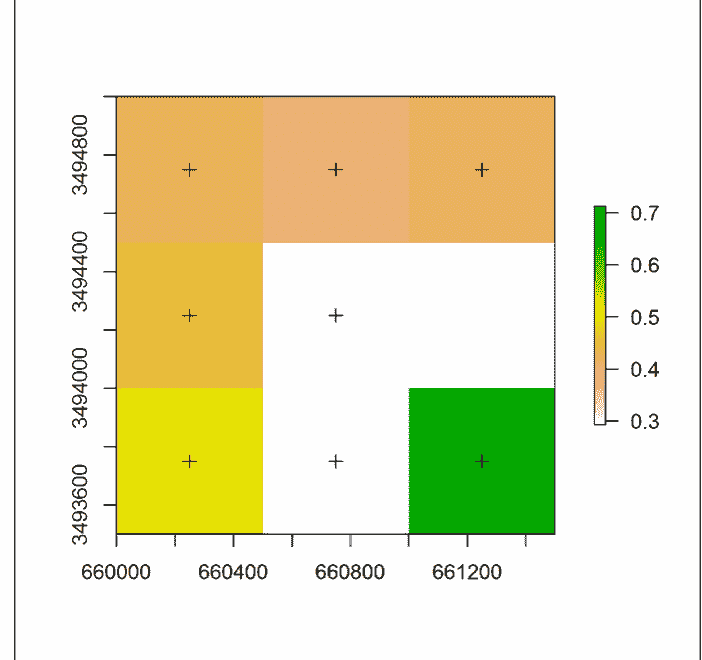

我们可以看到，在每个栅格单元的中心都生成了一个点，除了位置 (2,3) 的单元，我们为两层都赋了 NA。然而，在 (3,2) 位置，只有一层（第一层）被赋了 NA；因此，那里仍然生成了一个点要素。

`u_pnt` 的属性表有八行（因为有八个点）和两列（对应于两个栅格层）。

```
> u_pnt@data
layer.1 layer.2
1  0.4242  0.4518
2  0.3995  0.3334
3  0.4190  0.3430
4  0.4495  0.4846
```


```
5   0.2925  0.3223
6   0.4998  0.5841
7     NA    0.5841
8   0.7126  0.5086
```

可以看到，第七个点要素，即对应（3,2）栅格位置的那个点，在第 1 层确实包含一个 NA 值。

## 栅格转等高线

从栅格创建点（见上一节）和多边形（见下一节）相对简单。前者在像元中心生成点，后者则根据像元边界绘制矩形多边形。另一方面，从栅格创建线可以使用多种针对特定用途设计的算法。基于栅格生成线的两种常见操作是：构建等高线（连接栅格上等值位置的线）和查找最低成本路径（当通行成本由栅格值定义时，沿着最省力的路线从一处到另一处的线）。在本节中，我们将看一个创建等高线的示例（对最低成本路径计算感兴趣的读者可参考 `gdistance` 包，该包在 R 中提供了此功能）。

作为示例，我们将从海法 DEM（`dem`；见上一章）创建等高线。可以使用 `rasterToContour` 函数创建等高线。该函数接受一个 `RasterLayer` 对象，并返回一个包含等高线的 `SpatialLinesDataFrame` 对象。`rasterToContour` 函数内部使用基础函数 `contourLines`，参数可以作为 `rasterToContour` 函数调用的一部分传递给后者。例如，使用 `levels` 参数，我们可以指定生成等高线的断点（而不是让系统自动确定）。

栅格 `dem` 包含从 -14 米到 541 米的高程值：

```
> range(dem[], na.rm = TRUE)
[1] -14 541
```

因此，我们可以选择在 0、100、200、……、500 米处生成六条等高线：

```
> dem_contour = rasterToContour(dem, levels = seq(0, 500, 100))
```

让我们看一下 `dem_contour` 的属性表：

```
> dem_contour@data
    level
C_1     0
C_2   100
C_3   200
C_4   300
C_5   400
C_6   500
```

确实，该图层由六个线要素组成——每个我们通过 `levels` 参数指定的断点对应一个要素。

## 栅格转多边形

如前所述，栅格转多边形涉及在每个栅格像元的位置生成矩形多边形（同样，排除 NA 像元）。与栅格转点类似，生成的属性表包含每个多边形的相应栅格值。转换为多边形在分类栅格中最有用，当我们想要生成定义特定区域的多边形，以便利用这类数据相关的分析工具（如从其他栅格提取值、几何编辑和叠加分析）时。

可以使用读者可能已经猜到的函数 `rasterToPolygons` 从栅格创建多边形。该函数中一个有用的选项是立即根据属性表中的值对生成的多边形进行融合；也就是说，所有具有相同值的多边形被融合成一个要素。此功能内部使用 `rgeos` 包，可以通过指定 `dissolve=TRUE` 来触发。

在上一章中，我们准备了一个名为 `l_rec_focal_clump` 的栅格，这是一个分类栅格，包含连续编号的 NDVI>0.2 斑块。在下一个示例中（我们将在本章开始，并在第 9 章“空间数据高级可视化”中完成），我们将基于所有 Landsat（三个日期）和 MODIS（280 个日期）卫星影像，目视比较 Lahav 和 Kramim 森林的平均 NDVI 时间序列（见前面）。在本章中，我们将仅通过以下中间步骤准备必要的数据：

1. 创建 Lahav 和 Kramim 森林多边形图层。
2. 从卫星影像中提取 NDVI 值。
3. 创建一个可在以后传递给绘图函数的 `data.frame` 对象。

图形输出如下截图所示：

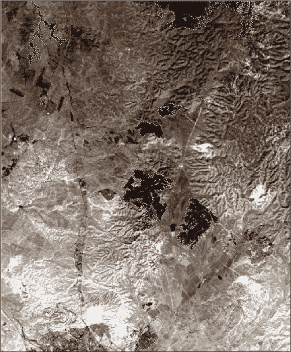

上面的截图显示了研究区域内连续的 NDVI>0.2 斑块，面积为 1 平方公里或更大。其中两个，正如预期的那样，是我们想要检查的森林。我们如何选择它们？显然，我们可以将 `pol` 导出为 Shapefile，在 GIS 软件（如 QGIS）中交互式选择感兴趣的要素，然后将结果重新导入 R 以继续分析。`raster` 包也提供了一些交互式选择的功能（这里我们不涉及）；例如，一个名为 `click` 的函数可用于获取我们在图形窗口中点击的 `pol` 要素的属性，例如上述截图中的那个窗口。然而，鉴于本书的目的，我们将尝试编写代码以自动进行选择，无需进一步的用户输入。

要编写进行选择的代码，我们必须选择某个标准（空间或非空间的），以区分感兴趣的要素。例如，在这种情况下，我们可以看到我们想要选择的 `pol` 要素是那些最靠近 Lahav Kibbutz 的要素。因此，我们可以利用 `towns` 点图层（见前面）计算每个多边形到 Lahav Kibbutz 的距离，并选择最接近的两个。

使用 `gDistance` 函数（见第 5 章“处理点、线和多边形”），我们首先找出 `pol` 中每个多边形与 `towns` 中每个点之间的距离：

```
> dist_towns = gDistance(towns, pol, byid = TRUE)
> dist_towns
          1        2
112 14524.94060 12697.151
114  5484.66695  7529.195
137  3863.12168  5308.062
203    29.48651  1119.090
240  1910.61525  6372.634
371 11687.63594 11276.683
445 12751.21123 14371.268
460 14860.25487 12300.319
```

返回的矩阵名为 `dist_towns`，包含成对距离，行对应 `pol` 要素，列对应 `towns` 要素。由于 Lahav Kibbutz 对应第一个 `towns` 要素（列 "1"），我们已经可以看到第四个和第五个 `pol` 要素（行 "203" 和 "240"）是最接近的，因此对应 Lahav 和 Kramim 森林。我们可以简单地使用它们的 ID——`pol[c("203","240"),]` 来子集这两个森林。然而，像往常一样，我们寻找的是通用代码，在这种情况下，它将选择两个最近的要素，而不考虑特定的 ID 或行索引。为此，我们可以使用 `order` 函数，我们之前还没有遇到过。该函数在给定一个数值向量时，根据元素值按递增顺序返回元素索引。例如，将 `order` 应用于 `dist_towns` 的第一列，我们可以看到该列中最小的元素位于第四行，第二小的位于第五行，第三小的位于第三行，依此类推：

```
> dist_order = order(dist_towns[, 1])
> dist_order
[1] 4 5 3 2 6 7 1 8
```

图形输出如下截图所示：

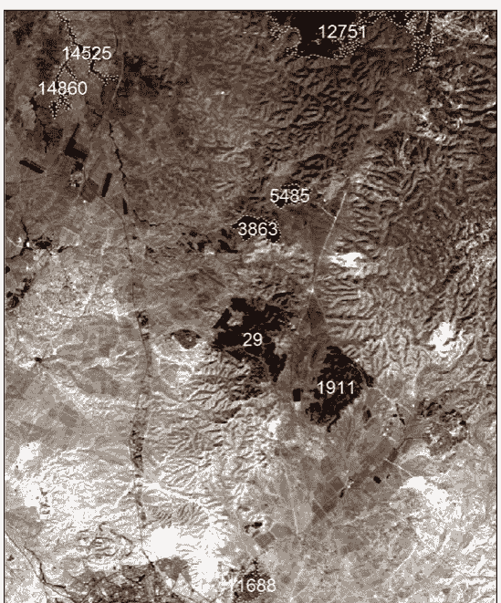

上面的截图表明我们确实正确选择了感兴趣的要素。

我们还可以根据已知信息将森林名称赋给 `forests` 的属性表：`forests` 的第一个要素（ID "203"）较大且更靠近 Lahav Kibbutz，对应 Lahav 森林，而第二个要素（ID "240"）对应 Kramim。

```
> forests$name = c("Lahav", "Kramim")
> forests@data
    clumps  area  name
203    281 9.5274  Lahav
240    314 6.7842  Kramim
```

现在我们有了一个名为 `forests` 的多边形图层，其中有两个要素描绘了 Lahav 和 Kramim 森林，并在属性表中相应命名。在下一节中，我们将继续提取这些森林的 NDVI 数据。

## 基于矢量图层提取栅格值

到目前为止，我们已经涵盖了将矢量图层转换为栅格以及将栅格转换为矢量图层的操作。涉及矢量图层和栅格的第三种操作——也是本节的重点——是根据矢量图层提取栅格值。我们通常有兴趣使用点、线或多边形要素来减少或汇总栅格数据，这时该操作就很有用了。例如，我们可能希望计算 GPS 轨迹所覆盖的高程剖面（栅格到线的提取）或给定森林的平均 NDVI（栅格到多边形的提取）。在本节中，我们将看到两个示例，分别涉及按点提取和按多边形提取。

### 按点提取

根据任何类型的矢量图层提取栅格值都可以使用 `extract` 函数完成。该函数的前两个参数如下：

- 要提取值的栅格（x）
- 定义要提取值的位置（y）的对象（通常是矢量图层）

按点提取值是最简单的提取场景，返回的对象可以是以下两者之一：

- *向量* —— 当从单波段栅格提取值时
- *矩阵* —— 当从多波段栅格提取值时

作为将单波段栅格值提取到点的示例，我们将使用之前创建的 `spain_stations.csv` 文件（见第 3 章“处理表格”），其中包含西班牙 96 个气象站的空间位置记录表。我们将基于此表创建一个 `SpatialPointsDataFrame` 对象，然后使用它从西班牙 DEM 中提取高程值。DEM 将从本书网站上提供的一个名为 `spain_elev.tif` 的文件中获取。


## 组合矢量与栅格数据集

首先，我们将 DEM 文件读入 R。顺便提一下，该文件是通过将使用 `getData` 下载的 SRTM 瓦片合并而成——正如我们在上一章中创建海法 DEM 时所做的那样——随后进行了重投影、掩膜，并聚合到 900 米分辨率。

```r
> dem_spain = raster("C:\\Data\\spain_elev.tif")
```

现在，我们从 `spain_stations.csv` 中读取站点记录：

```r
> stations = read.csv("C:\\Data\\spain_stations.csv",
+ stringsAsFactors = FALSE)
```

您还记得，站点位置存储在经度和纬度列中；因此，可以将 `data.frame` 对象提升为 `SpatialPointsDataFrame` 对象，如下所示：

```r
> coordinates(stations) = ~ longitude + latitude
```

站点坐标以度为单位，依据地理 CRS 给出。因此，我们将定义该 CRS，然后将 `stations` 重投影以匹配 `dem_spain` 的 CRS（UTM 30N 分区），如下所示：

```r
> proj4string(stations) = CRS("+proj=longlat +datum=WGS84")
> stations = spTransform(stations, CRS(proj4string(dem_spain)))
```

让我们将站点绘制在 dem_spain 之上，以查看它们的位置是否确实匹配：

```r
> plot(dem_spain)
> plot(stations, add = TRUE)
```

图形输出如下截图所示：

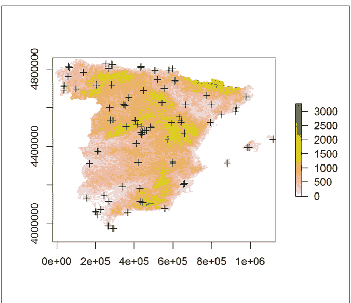

我们在这里看到的是西班牙的高程图（`dem_spain` 栅格），上面叠加了站点位置（`stations` 点图层）。这些站点似乎或多或少均匀地覆盖了该国的整个区域。请注意，有些站点没有显示，因为它们位于加那利群岛，因此超出了 `dem_spain` 栅格的范围。

为了提取每个站点下方的高程值，我们使用 `extract` 函数，以栅格和点作为前两个参数。由于返回的对象将是一个数值向量，包含每个站点对应的高程值，我们可以直接将其赋值给 `stations` 中名为 `elev_dem` 的新列：

```r
> stations$elev_dem = extract(dem_spain, stations)
```

检查 `stations` 的属性表，可以看到每个站点现在有两个高程条目。分别是随气象记录一起提供的原始高程值（`elevation` 列）以及我们刚刚从 DEM 中获取的高程值（`elev_dem` 列）：

```r
> head(stations@data)
          station elevation elev_dem
1 GHCND:SP000003195       667   651.96
2 GHCND:SP000004452       185   184.24
3 GHCND:SP000006155         7     5.80
4 GHCND:SP000008027       251   212.44
5 GHCND:SP000008181         4     3.55
6 GHCND:SP000008202       790   787.28
```

更仔细地检查该表会发现，有些站点在 `elev_dem` 列中被赋值为 NA，原因可能是它们位于西班牙边境附近（顺便一提，也超出了 DEM 的范围），或者因为它们位于加那利群岛（`dem_spain` 栅格完全未覆盖该区域）。

将两个信息源中的一组向量相对于另一组向量绘图，查看它们的一致程度，将会很有趣：

```r
> plot(elev_dem ~ elevation, stations,
+ xlim = c(0, 2000),
+ ylim = c(0, 2000),
+ xlab = "Elevation from station record (m)",
+ ylab = "Elevation from DEM (m)")
```

> 请注意，`plot(elev_dem ~ elevation, stations)` 表达式类似于 `plot(stations$elev_dem ~ stations$elevation)`。在后一种语法中，向量名称是显式提供的；而在前一种（通常更方便）中，公式引用了 `data.frame` 对象中的列，该对象作为第二个参数提供。

为了使评估更方便，我们还将使用 `abline` 函数，该函数可以在现有图形上添加一条直线。指定线条位置的一种方式是提供其截距 (a) 和斜率 (b)。我们将添加一条 1:1 线（即截距为 0、斜率为 1 的线），以查看 `elevation` 和 `elev_dem` 记录的匹配程度：

```r
> abline(a = 0, b = 1, lty = "dotted")
```

图形输出如下截图所示：

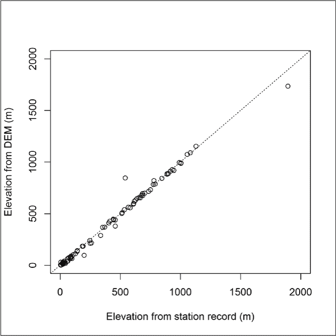

每个点对应一个站点，我们可以分别在 *x* 轴和 *y* 轴上看到相应的 `elevation` 和 `elev_dem` 值。不出所料，这两个信息源之间的吻合度非常好，除了少数站点稍微偏离 1:1 线。

继续进行第三步，我们希望将来自 `l_forests` 和 `r_forests` 的信息合并到一个 data.frame 对象中，所有 NDVI 值放在单独的一列，并用附加列描述测量特征（date、sat 和 forest）。从 `l_forests` 矩阵开始，我们将首先转置它（使用 `t` 函数）并将其转换为 `data.frame` 对象（使用 `as.data.frame` 函数）：

```r
> l_forests = as.data.frame(t(l_forests))
> l_forests

                 V1        V2
layer.1 0.3053538 0.2840073
layer.2 0.2487563 0.2190098
layer.3 0.2844870 0.2433260
```

现在，我们可以设置适当的列名（森林名称），并创建用于日期（从 `l_dates` 获得）和卫星（“Landsat”）的新列，如下所示：

```r
> colnames(l_forests) = forests$name
> l_forests$date = l_dates
> l_forests$sat = "Landsat"
```

新的 `l_forests` 矩阵如下所示：

```r
> l_forests

             Lahav   Kramim        date      sat
layer.1 0.3053538 0.2840073 1998-10-15 Landsat
layer.2 0.2487563 0.2190098 2000-10-04 Landsat
layer.3 0.2844870 0.2433260 2003-09-11 Landsat
```

对 `r_forests` 重复完全相同的过程（获取日期取自 `dates$date`，卫星名称设置为“MODIS”）：

```r
> r_forests = as.data.frame(t(r_forests))
> colnames(r_forests) = forests$name
> r_forests$date = dates$date
> r_forests$sat = "MODIS"
```

现在，我们可以使用 `rbind` 将两个 `data.frame` 对象合并在一起：

```r
> forests_ndvi = rbind(l_forests, r_forests)
```

合并后的 `data.frame` 对象，我们将其命名为 `forests_ndvi`，包含来自两颗卫星的两个森林的所有平均 NDVI 记录，共 283 个日期（来自 Landsat 的 3 个日期和来自 MODIS 的 280 个日期）。其前几行打印如下：

```text
> head(forests_ndvi)
                 Lahav    Kramim          date      sat
layer.1 0.3053538 0.2840073 1998-10-15 Landsat
layer.2 0.2487563 0.2190098 2000-10-04 Landsat
layer.3 0.2844870 0.2433260 2003-09-11 Landsat
modis.1 0.3725111 0.3416607 2000-02-18 MODIS
modis.2 0.3959158 0.3850857 2000-03-05 MODIS
modis.3 0.4102210 0.3956179 2000-03-21 MODIS
```

剩下要做的就是将 `data.frame` 对象转换为长格式（参见*第3章，使用表格*），为森林身份创建另一列，并将 NDVI 值转移到指定的值列。这可以使用 `reshape2` 包中的 `melt` 函数来完成：

```r
> library(reshape2)
> forests_ndvi = melt(forests_ndvi,
+ measure.vars = forests$name,
+ variable.name = "forest",
+ value.name = "ndvi")
```

请注意，这里的测量变量是“Lahav”和“Kramim”，其余变量被视为 ID 变量。我们没有手动输入测量变量的列名，而是传递了 `forests$name` 向量，其中已经包含了所需的名称：

```text
> forests$name
[1] "Lahav" "Kramim"
```

`melt` 函数调用中的附加参数 `variable.name` 和 `value.name` 用于指定新建的变量列和值列的名称（分别替换默认名称“variable”和“value”）。最终表格如下所示：

```text
> head(forests_ndvi)
                 date      sat forest       ndvi
1 1998-10-15 Landsat Lahav 0.3053538
2 2000-10-04 Landsat Lahav 0.2487563
3 2003-09-11 Landsat Lahav 0.2844870
4 2000-02-18 MODIS   Lahav 0.3725111
5 2000-03-05 MODIS   Lahav 0.3959158
6 2000-03-21 MODIS   Lahav 0.4102210
```


在*第9章“空间数据高级可视化”*中，我们将使用该表来绘制这两个森林中NDVI随时间变化的图。这种形式的表，其中：

- 每个变量构成一列
- 每个观测构成一行
- 只有一种观测单元类型

构成了所谓的*整洁数据表*（参见Hadley Wickham关于此主题的论文，2014）。正如我们将看到的，将数据整理成这种形式通常是使用更复杂的绘图函数（如`ggplot2`包中的函数）所必需的。

### 小结

在本章中，我们弥合了前几章中分别处理的两种主要空间数据类型（栅格和矢量图层）之间的差距。现在我们知道了如何从矢量图层转换为栅格，反之亦然，并且可以在需要时将几何和数据组件从一个数据模型转移到另一个数据模型。我们还看到了如何根据矢量图层从栅格中提取栅格值，这是许多涉及栅格数据的分析任务中的基本步骤。

至此，我们结束了对R中基本空间数据分析工具实现的回顾。我们现在知道如何在R中处理栅格和矢量图层——包括导入、转换和以各种方式组合。在接下来的两章中，将介绍R用于空间数据分析的更专业应用的示例；具体来说，就是空间插值和空间数据可视化。

## 点数据的空间插值

空间插值是地统计分析方法的一个例子，具有广泛的应用。在本章中，我们将通过插值气象点测量数据以创建西班牙年温度图的示例，学习如何在R中进行空间插值。

本次练习的目的有两个。首先，我们将了解几种常见的插值方法如何在R中实际应用。例如，我们将看到R中如何使用专门的类来表示输入数据和/或统计分析结果，并见证这种方法的优势。其次，我们将看到如何通过使用循环来自动化复杂的任务（如空间插值），并重复执行这些任务，以完成原本不可行的任务。

> 在本章中，我们将使用之前在*第3章“使用表格”*中创建的对象。

在本章中，我们将涵盖以下主题：

- 对点数据进行空间插值
- 计算经验变异函数
- 自动拟合变异函数模型
- 计算预测的**均方根误差（RMSE）**

### 对点数据进行空间插值

空间插值是在未测量位置预测某个感兴趣现象行为的过程。为此，我们需要一个空间预测模型——一组根据校准数据获得预测值的程序。通常遇到的两种校准数据类型是：

- **实地测量**：仅在有限位置（通常是点）可用，例如西班牙气象站的观测数据
- **协变量**：在感兴趣区域内的每个位置均可用，例如西班牙DEM的高程数据

我们选择的空间预测模型使用校准数据进行校准。然后，该模型可用于计算任何位置（通常是点）的感兴趣现象的预测水平。公认的两种主要空间插值方法是：

- **确定性模型**：在该模型中，模型参数值是任意确定的
- **统计模型**：在该模型中，模型参数值是根据特定校准数据客观估计的

简而言之，虽然两种模型都使用校准数据进行预测，但确定性模型使用预定义的固定公式来计算给定校准数据的预测值；另一方面，统计模型两次使用校准数据，首先对模型本身进行微调，然后（如同确定性模型一样）计算预测值。确定性模型的例子包括**反距离加权（IDW）**插值和样条插值。统计模型的例子包括克里金法和普通回归。

> 本章的目的是从实践的角度介绍空间插值。全面涵盖空间插值技术背后的统计理论和方程远远超出了本书的范围。熟悉空间插值主题的读者，希望能从本章获得关于这类统计工具在R中如何应用的视角。不熟悉空间插值主题的读者，可以参考Tomislav Hengl于2009年出版的《地统计制图实用指南》前两章中不太技术性的概述（可在网上获取），作为补充参考。对这一特定主题不感兴趣的读者可以跳到本章的最后一张图片及其后的几段，其中描述了我们在下一章将使用的数据集。

```
+ stations@data = join(stations@data, annual, by = "station")
+ # (6) 移除不完整的记录
+ stations = stations[complete.cases(stations@data), ]
+ # (7) 转换到所需的CRS
+ spTransform(stations, CRS(new_proj))
+ }
```

> 请注意，stations和annual参数是仅在函数代码执行时存在的局部对象；它们与全局环境中的spain_annual和spain_stations对象无关，这些对象保持不变（参见第2章“使用向量和时间序列”）。

将函数读入内存后，让我们试一下。例如，以下函数调用创建一个SpatialPointsDataFrame对象，其中包含在dem_spain的CRS中定义的2002年平均年最低温度：

```
> dat = create_pnt(stations = spain_stations,
+ annual = spain_annual,
+ year = 2002,
+ variable = "mmnt",
+ new_proj = proj4string(dem_spain))
```

我们可以检查结果对象dat的属性表的前几行，以确认它确实包含2002年的最低温度值（“mmnt”）：

```
> head(dat@data)
          station elevation variable year     value
1 GHCND:SP000003195       667     mmnt 2002 10.475000
2 GHCND:SP000004452       185     mmnt 2002 10.775000
3 GHCND:SP000006155         7     mmnt 2002 14.491667
4 GHCND:SP000008027       251     mmnt 2002 11.100000
5 GHCND:SP000008181         4     mmnt 2002 11.608333
6 GHCND:SP000008202       790     mmnt 2002  5.983333
```

由于加那利群岛的站点被完全移除（见步骤3），并且没有2002年最低温度记录的站点随后被过滤掉（见步骤6），点图层中的要素数量始终小于96，并且在不同年份/变量组合之间有所不同。例如，dat包含75个点：

```
> nrow(dat)
[1] 75
```

结果是一个最近邻预测表面，每个像素的值是该位置的预测温度。让我们看看它是什么样子，使用以下表达式：

```
> plot(grid)
> plot(dat, add = TRUE)
```

图形输出如下面的截图所示：

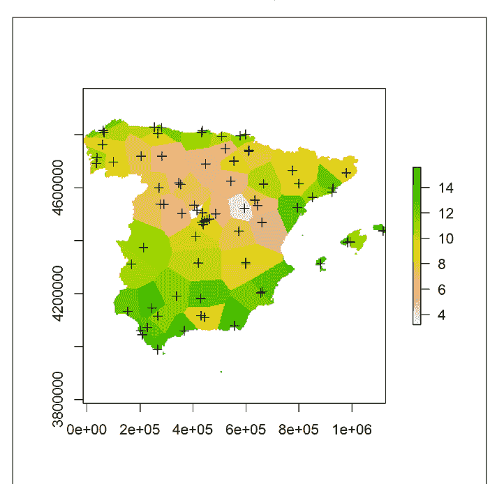

前面的截图清楚地表明，最近邻插值方法实际上将感兴趣区域划分成了离散的子区域。每个子区域包括所有比任何其他测量点（即某个气象站）更靠近给定测量点的位置。事实上，我们也可以通过创建定义这些子区域的多边形并将其栅格化来进行最近邻插值，以产生相同的结果。在GIS的语境中，这样的多边形被称为泰森多边形或沃罗诺伊多边形（感兴趣的读者会在R中找到至少一种创建它们的方法；例如，使用`spatstat`包中的`dirichlet`函数）。

如前所述，最近邻插值很少用于预测自然现象在空间中的行为。例如，假设每个气象站周围的多边形离散区域具有均匀的温度，并且它们之间的边界处温度急剧升高或降低（如前面的截图所示），这显然是不现实的。实际上，温度从一个地方到另一个地方或多或少是逐渐变化的。为了描述这种渐变的过渡，我们需要使用更精细的方法，例如后续章节中描述的那些方法。

### IDW插值

我们接下来将采用的三种插值方法——IDW、普通克里金法（OK）和泛克里金法（UK）——都使用相同的主要过程，其中给定点的预测值被确定为测量点值的加权平均值。此外，每个测量值的权重始终是其与我们要预测的点之间距离的函数（附近点通常对预测值有更高的权重或影响，而距离较远的点权重较低）。在这个框架内，最近邻插值实际上是一个极端的特例，其中最近点的权重为1，而所有其他点的权重为0。

为了更好理解本章的后续内容，我们可以预先说明这三种方法之间的差异涉及两个属性：趋势和权重定义。趋势本质上是一个附加函数，独立于测量点的值，被加到后者（测量点值）的加权平均值上。在IDW中，趋势为0；在OK中，趋势是一个常数，因此在这两种情况下对预测模式都没有影响。然而，在UK中，趋势是额外协变量的函数。关于权重，在IDW中它们是任意确定的（因此该方法被认为是确定性的）；相反，在OK和UK中，权重是从数据本身估计的（因此这些方法被认为是统计性的）。


`gstat` 包的核心是一个名为 `gstat` 的函数，用于生成（同样名为 `gstat` 的类的）对象，这些对象包含执行空间插值（以及交叉验证等其他操作）所需的全部信息。在 `gstat` 函数接受的众多参数中，实际上并没有一个参数可以用来指定所需的插值方法。相反，当对 `gstat` 对象触发插值时，方法会根据对象包含的输入数据来确定。在本章中，我们仅探讨 `gstat` 的部分功能，使用其三个参数：

- `formula`：定义因变量和自变量的公式（`formula` 类的对象）
- `data`：已测量的点数据（`SpatialPointsDataFrame` 对象；它也可以是 `data.frame` 对象，但我们将不使用该选项）
- `model`：变异函数模型（`variogramModel` 类的对象）

这三个参数根据以下决策树决定使用 IDW、OK 还是 UK：

- 如果没有变异函数模型（`model = NULL`，默认情况），则使用 IDW
- 如果向 `model` 传递了变异函数模型，并且公式：
  - 不包含自变量，则使用 OK
  - 至少包含一个自变量，则使用 UK

我们的因变量列是 `value`，在 R 中，按惯例，仅含截距的模型（即没有自变量的模型）公式由 `~ 1` 指定。因此，以下表达式创建一个 `gstat` 对象（名为 `g`），其中包含基于 `dat` 中的实测数据使用 IDW 预测最低温度所需的信息：

```
> library(gstat)
> g = gstat(formula = value ~ 1, data = dat)
```

打印 `g` 会显示其包含信息的摘要，如下所示：

```
> print(g)
data:
var1 : formula = value ~ 1 ; data dim = 75 x 5
```

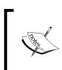

> 请注意，这只是一个摘要；实际上，`g` 还包含 `dat` 对象本身，包括实测值和自变量（如果有），因为它充当实际执行插值所需的校准数据。

## 点数据的空间插值

要进行插值，我们现在需要做的是提供我们想要预测的点。方便的是，`raster` 包中包含一个名为 `interpolate` 的函数，给定一个栅格（`object` 参数）和一个空间预测模型（`model` 参数），它会生成一个带有预测值的新栅格。这样，我们就不需要像在最近邻插值中那样手动进行栅格的转换。例如，以下表达式使用 `g` 中保存的模型和校准数据，为 `dem_spain` 定义的网格进行温度预测：

```
> z = interpolate(dem_spain, g)
```

这里需要注意两点：

- 首先，正如你记得的，本书为了节省篇幅省略了文本消息。然而，在 R 中运行上述表达式的读者会在屏幕上看到消息 `[inverse distance weighted interpolation]`。这向用户确认 `gstat` 确实选择了预期类型的模型。
- 其次，重要的是要理解，如果我们不使用协变量（即模型公式中的自变量），`dem_spain` 栅格仅用作一个网格，指向我们想要计算预测值的位置（栅格值在插值中不起作用）。这与 UK 插值不同，在 UK 插值中，栅格既用于指向预测位置，又为每个位置提供协变量值。

绘制预测表面 `z` 将显示所有栅格单元（包括 NA 单元）都生成了预测值。通常，对更具体的范围进行预测是合理的，例如西班牙的陆地面积。我们可以使用 `mask` 来移除不必要的预测：

```
> z = mask(z, dem_spain)
```

现在，让我们使用以下两个表达式绘制预测值栅格，并将站点位置叠加在上面：

```
> plot(z)
> plot(dat, add = TRUE)
```

交叉验证结果的属性表列含义如下：

- `var1.pred`：预测值
- `var1.var`：方差（仅用于克里金法）
- `observed`：观测值
- `residual`：残差，即观测值与预测值之差
- `zscore`：Z 分数（仅用于克里金法）
- `fold`：交叉验证计数

就我们此处而言，重要的列是 `residual` —— 观测值与预测值之间的差异。基于残差，我们可以评估预测值与观测值的差距，换句话说，即预测精度。观测值与预测值一致性的最简单且最常用的指标之一是 RMSE。给定一组预测-观测值对，RMSE 的计算如下：

$$RMSE = \sqrt{\frac{\sum_{i=1}^{n} (pred_i - obs_i)^2}{n}} \quad (3)$$

这里，RMSE 是均方根误差，n 是点的总数，pred_i 和 obs_i 分别是点 i 处的预测值和观测值。预测值与观测值之间的差异越小，RMSE 就越低，表明模型越准确。在给定相同输入数据的情况下，我们可以比较不同模型之间的 RMSE 值，以选择最准确的模型。将方程 (3) 转换为 R 语法，我们可以根据 `cv` 的属性表计算 RMSE，如下所示：

```
> sqrt( sum( (-cv$residual)^2 )/nrow(cv) )
[1] 1.88049
```

本例中的 RMSE 等于 1.88049。请注意，该表达式由 `-cv$residual` 向量（相当于 `cv$var1.pred - cv$observed`）平方后求和，再除以总点数，最后对结果取平方根。

为方便起见，我们可以将该表达式封装到我们自己的函数中，在给定 `gstat.cv` 输出时计算 RMSE：

```
> rmse = function(x) sqrt(sum((-x$residual)^2)/nrow(x))
> rmse(cv)
[1] 1.88049
```

我们稍后会使用这个函数。


你可能已经注意到，我们最初定义的 `gstat` 对象（`g`）在这里被用于两个不同且独立的目的。首先，计算预测值（使用 `interpolate` 函数），然后执行交叉验证（使用 `gstat.cv` 函数）。这并非偶然，而是 R 中所有（或大多数）统计过程所共有的典型面向对象行为。这种方法相较于统计或 GIS 软件中常见的基于菜单的方法更具优势——在那些软件中，我们通过在一组对话框中进行选择来执行给定的分析，并获得一组结果（其中一些我们并不需要，而另一些则缺失，因为工具创建者没有包含它们）。相反，在 R 中应用统计函数时，我们通常会得到一个包含执行分析所需全部数据的对象（如 `g`），或者一个包含全面结果集的对象（如 `cv`）。然后，我们可以通过应用特定函数从这些对象中提取我们感兴趣的结果。此外，我们可以创建自己的函数来执行计算或提取有意义的数据，而无需依赖已定义的内置方法（例如我们之前定义的 `rmse` 函数）。有兴趣将 R 用作通用统计分析工具箱的读者会反复遇到这种方法。例如，`lm` 函数用于在 R 中执行普通线性回归；对返回的 `lm` 类对象，可以应用许多函数（如 `summary`、`residuals` 和 `plot`）来提取我们感兴趣的信息。

下面的截图显示了我们的绘图结果：

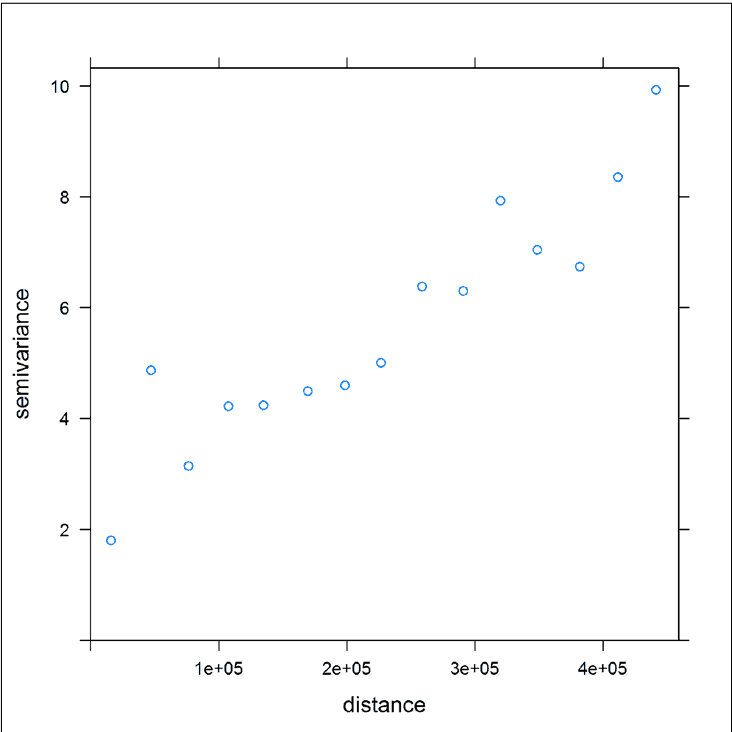

我们可以看到，半方差随距离增加而增大。这意味着当考虑相距更远的站点时，温度值更加多样化。换句话说，温度在空间上是自相关的。


如前所述，变异函数模型是拟合到经验变异函数上的一个函数。有若干特定函数足以描述经验变异函数的特征行为（半方差随距离增加，通常在某个点达到饱和）。这些函数，例如球状函数和指数函数，通常用作变异函数模型（输入 `vgm()` 可查看 `gstat` 中实现的函数列表，或使用 `show.vgms()` 进行可视化）。除了选择这些函数之一，我们还需要确定其具体参数。根据经验变异函数选择变异函数模型（一个函数及其参数集）主要有三种方法，它们并不互斥：

- 手动设置函数及其参数（例如，使用 `gstat` 包中的 `vgm` 函数）
- 通过交互式改变函数类型及其参数，观察其外观变化，将函数目视拟合到经验变异函数上（例如，使用 `geoR` 包中的 `eyefit` 函数）
- 统计上选择使某种拟合优度准则最小化的函数和参数（例如，使用 `gstat` 包中的 `fit.variogram` 函数、`geoR` 包中的 `variofit` 函数，或 `automap` 包中的 `autofitVariogram` 函数）

由于我们在此采用简单、实用的方法，我们将使用第三种选项，即让计算机选择最贴合经验变异函数的函数。此外，我们将绕过提供函数类型和初始参数估计值（例如在 `fit.variogram` 中要求的）这一要求，而使用一个名为 `autofitVariogram` 的包装函数，它自动为我们优化这一决策。

`autofitVariogram` 函数定义在 `automap` 包中。它接受 `formula` 和 `data` 参数（命名为 `input_data`），与 `gstat` 类似。因此，以下表达式将变异函数模型拟合到我们的数据：

```r
> library(automap)
> v = autofitVariogram(formula = value ~ 1, input_data = dat)
```

绘制返回的 `autofitVariogram` 类对象，会生成一个包含经验变异函数和拟合在其上的变异函数模型的图：

```r
> plot(v)
```

结果输出如下截图所示：

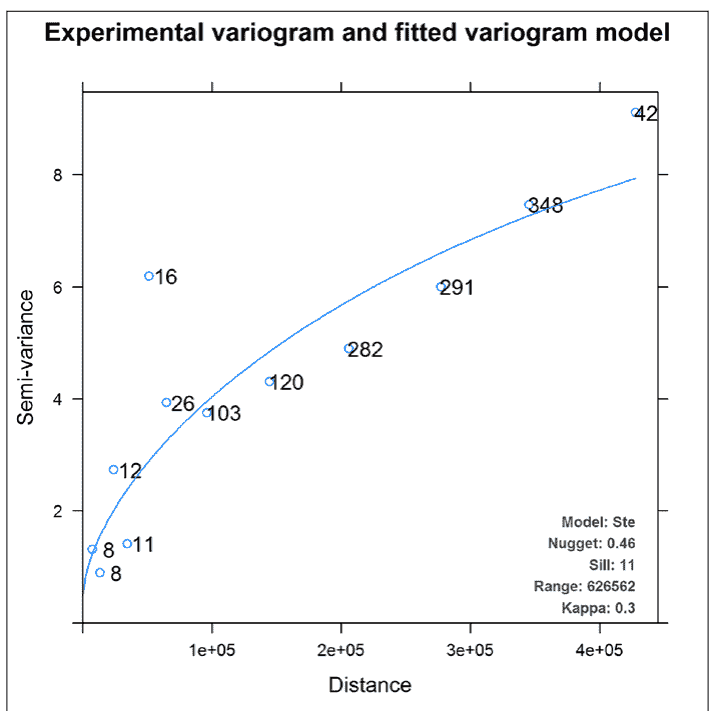

这些点再次显示了经验变异函数，而连续线则是拟合的变异函数模型。例如，在这种情况下，选中的模型是“Matérn, M. Stein 参数化”（代码名“Ste”），其四个参数值显示在图像右下角。对象 `v` 包含多个组成部分，例如经验变异函数数据点以及样本变异函数与拟合变异函数模型之间的平方和。我们感兴趣的组成部分是拟合的变异函数模型。该组成部分名为 `var_model`，可以使用 `$` 运算符，通过表达式 `v$var_model` 访问（这一行为源于 `autofitVariogram` 类构建在列表之上，而列表元素可以像 `data.frame` 列一样用 `$` 访问）。

## 点数据的空间插值

这里重要的是，`v` 的 `v$var_model` 组成部分是一个 `variogramModel` 类对象，其中包含定义变异模型函数的类型和参数。`variogramModel` 对象可以传递给 `gstat` 函数以指示变异函数模型。因此，我们可以创建一个包含执行 OK 插值所需全部信息的对象，如下所示：

```r
> g = gstat(formula = value ~ 1, data = dat, model = v$var_model)
> g
data:
var1 : formula = value ~ 1 ; data dim = 75 x 5
variograms:
```

|       | model | psill      | range    | kappa |
|-------|-------|------------|----------|-------|
| var1[1] | Nug | 0.4594258 | 0.0      | 0.0   |
| var1[2] | Ste | 10.9549186 | 626562.4 | 0.3   |

打印输出显示该对象确实包含一个变异函数模型。我们现在可以使用 `interpolate` 函数生成预测的 OK 表面，并使用 `mask` 函数裁剪感兴趣的区域，方法与 IDW 插值中完全相同：

```r
> z = interpolate(dem_spain, g)
> z = mask(z, dem_spain)
```

在 R 中执行上述表达式的读者这次应该在屏幕上看到 `[using ordinary kriging]` 消息。

让我们使用以下表达式绘制插值结果：

```r
> plot(z)
> plot(dat, add = TRUE)
```

有时，给定海拔下的温度低于通常值，有时又高于通常值。我们能否创建一个模型，使其先使用海拔预测温度，再使用附近的气象测量值进行微调？UK 正是这样做的：它将站点值的加权平均值（如同 OK 所做）添加到由基于协变量的线性函数（此处为海拔）所定义的总体趋势面上。

要使用以海拔为协变量的 UK 对温度数据进行插值，与 OK 过程相比，我们需要做两个主要修改：

- 变异函数模型是根据所谓的残差变异函数构建的，该函数描绘了所选趋势残差的空间自相关性。
- 预测值基于邻近测量值（如同 OK）和协变量两者计算；因此，我们想要预测的每个点都必须附带其各自的协变量值。

从变异函数模型开始，与 OK 不同，我们的公式现在包含海拔作为自变量：

```r
> v = autofitVariogram(formula = value ~ elevation,
+ input_data = dat)
```

绘制新的 `v` 对象将显示经验变异函数和变异函数模型都与之前不同，因为它们现在涉及的是海拔趋势的残差。接下来，我们需要创建 `gstat` 对象，该对象包含执行 UK 插值所需的信息，将 `value ~ elevation` 作为公式，`v$var_model` 作为变异函数模型：

```r
> g = gstat(formula = value ~ elevation,
+ data = dat,
+ model = v$var_model)
> g
data:
var1 : formula = value ~ elevation ; data dim = 75 x 5
variograms:
```

|       | model | psill     | range    | kappa |
|-------|-------|-----------|----------|-------|
| var1[1] | Nug | 0.7410872 | 0.00     | 0.0   |
| var1[2] | Ste | 0.9696567 | 35781.93 | 0.2   |

图形输出如下截图所示：

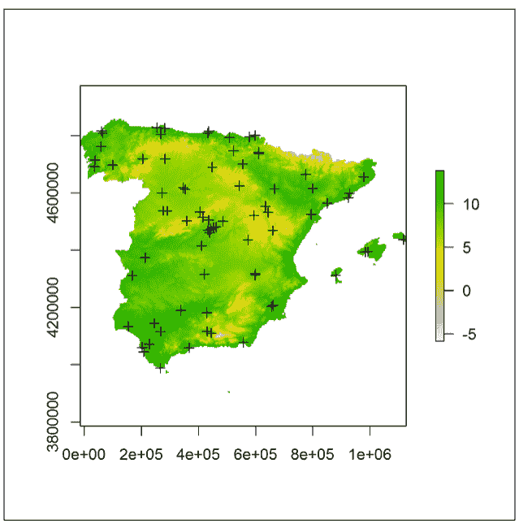

上面的截图很明显与西班牙的 DEM 相似。事实上，它显示了西班牙的海拔剖面，已转换为温度单位（基于气象站数据使用线性关系），并再次使用站点数据进行了局部校准。这就是 UK 结果的常见样貌。

让我们也检验一下 UK 预测模型的 RMSE：

```r
> cv = gstat.cv(g)
> rmse(cv)
[1] 1.455196
```

我们看到，在此例中，UK 的 RMSE 甚至低于 OK。这一结果表明，使用 `value ~ elevation` 趋势进一步提高了预测精度。

## 绘制西班牙的年温度图

在前面几节中，我们看到了如何使用多种方法在 R 中对点数据进行空间插值，包括 IDW、OK 和 UK。我们还了解到，就 2002 年最低温度而言，UK 在精度方面优于其他两种方法，其 LOOCV RMSE 值为 1.46，而 IDW 和 OK 分别为 1.88 和 1.68。在本节中，我们将看到如何自动化空间插值，以便通过一次代码执行命令生成不同年份的一组温度图。为此，我们将构建两个循环：

- 第一个循环将遍历 20 个点图层（10 年 × 2 个变量），每次使用三种方法（IDW、OK 和 UK）之一计算预测中的 LOOCV RMSE。根据结果，我们将选择这三种方法中（平均）最精确的一种。
- 然后我们将构建第二个循环，使用所选方法生成西班牙的预测温度图（5 年——2006-2010）。

我们将从第一个任务开始，即系统地评估不同年份、变量和方法之间的 RMSE。一个对此类任务非常有用的函数名为 `expand.grid`，它将帮助我们跟踪检验过程。给定一组向量，`expand.grid` 返回一个 `data.frame` 对象，其中包含每个向量元素的所有可能组合。例如，以下表达式创建一个名为 `cv_results` 的 `data.frame` 对象，包含四列（`variable`、`year`、`method` 和 `rmse`）：

```r
> cv_results = expand.grid(
+ variable = c("mmnt", "mmxt"),
+ year = 2001:2010,
+ method = c("IDW", "OK", "UK"),
+ rmse = NA)
```

由于只有三列有多个可能元素，且 2 个变量 × 10 年 × 3 种方法 = 60 种独特组合方式，`cv_results` 有 60 行。该 `data.frame` 对象的前几行如下所示：

```r
> head(cv_results)
```

| 行号 | 变量   | 年份 | 方法 | rmse |
|-----|----------|------|--------|------|
| 1   | mmnt     | 2001 | IDW    | NA   |
| 2   | mmxt     | 2001 | IDW    | NA   |
| 3   | mmnt     | 2002 | IDW    | NA   |
| 4   | mmxt     | 2002 | IDW    | NA   |
| 5   | mmnt     | 2003 | IDW    | NA   |
| 6   | mmxt     | 2003 | IDW    | NA   |


```
+ v_mod =
+ autofitVariogram(
+ formula = form,
+ input_data = dat)$var_model}
+ # (3) Create gstat object
+ g = gstat(formula = form, data = dat, model = v_mod)
+ # (4) Perform cross-validation
+ cv = gstat.cv(g)
+ # (5) Calculate RMSE and assign to cv_results
+ cv_results$rmse[i] = rmse(cv)
+ }
```

注意，在步骤 2 中，使用了嵌套的条件语句，以便根据所使用的插值方法确定 form 和 v_mod。我们可以将此特定代码段执行的流程写成决策树的形式：

+   - 如果方法为 "IDW"，则 form 为 value~1 且 v_mod 为 NULL
+   - 否则：
+     - 如果方法为 "OK"，则 form 为 value~1
+     - 如果方法为 "UK"，则 form 为 value~elevation
+     - v_mod 根据 form 计算得出

一旦循环执行完成（这可能需要几分钟），cv_results 的 rmse 列将用得到的 RMSE 值填充，而不是 NA 值：

```
> head(cv_results)
     variable year method    rmse
1      mmnt 2001    IDW 1.942872
2      mmxt 2001    IDW 1.594996
3      mmnt 2002    IDW 1.880490
4      mmxt 2002    IDW 1.570574
5      mmnt 2003    IDW 1.912887
6      mmxt 2003    IDW 1.605938
```

注意，例如，第三行表格中的 RMSE 值（1.880490），它对应于 "mmnt" 在 2002 年的 IDW 插值，正如预期的那样，与我们之前手动得到的结果相同。利用此 RMSE 表可以进行多种有趣的比较。如前所述，我们主要感兴趣的是在 10 年和两个变量上，平均而言哪种插值方法最准确。要找出答案，我们可以使用 tapply：

```
> tapply(cv_results$rmse, cv_results$method, mean)
        IDW        OK        UK
1.773243 1.908957 1.458997
```

结果显示，平均而言，UK 在三种方法中预测误差最低。有趣的是，OK 的平均准确性低于 IDW，尽管在我们之前看到的特定例子中情况正好相反。基于此结果，UK 将成为我们制作西班牙年平均气温图的首选方法。

> 需要注意的是，比较交叉验证 RMSE 只有在对同一数据的不同空间预测模型之间才有意义。否则，RMSE 可能更高或更低，不仅因为预测误差不同，还因为预测值本身处于不同的尺度。例如，在我们的案例中，降水量（"tpcp"）预测的 RMSE 会远高于温度预测的 RMSE（你可以尝试看看），仅仅因为西班牙通常观测到的年降水量（以 mm 计）比温度（以摄氏度计）高出一个数量级。然而，这并不意味着相对于测量变量本身的尺度，降水的预测模型就不如准确。

我们准备继续，使用另一个循环来计算预测值（而不是我们刚刚完成的交叉验证）。同样，做此操作的一种井然有序的方式是构建一个描述我们每个空间插值所需参数集的表格，然后遍历该表格并依次执行所需的操作。我们将再次使用 expand.grid 函数，这次仅产生两个变量的所有组合：year（2006-2010 的 5 年）和 variable（"mmnt" 和 "mmxt"）。方法将保持未指定，因为我们已经决定它应始终为 UK。

```
> spainT_tab = expand.grid(
+ year = 2006:2010,
+ variable = c("mmnt", "mmxt"))
```

由此产生的表格，命名为 `spainT_tab`，如下所示：

```
> spainT_tab
  year variable
1  2006      mmnt
2  2007      mmnt
3  2008      mmnt
4  2009      mmnt
5  2010      mmnt
6  2006      mmxt
7  2007      mmxt
8  2008      mmxt
9  2009      mmxt
10 2010      mmxt
```

我们准备创建第二个循环，该循环将遍历 `spainT_tab` 的行，并对相应的温度数据进行空间插值。由于我们的结果将是栅格（而不是交叉验证循环中那样为数值），因此它们不能附加到表格本身。相反，我们将把结果堆叠成一个多波段栅格，其中每个图层对应 `spainT_tab` 中的一行。换句话说，`spainT_tab` 将作为结果多波段栅格的补充表格发挥作用（正如 `dates` 对栅格 `r` 所起的作用；参见第 4 章，Working with Rasters）。为了构建栅格，我们将首先创建一个空的 `RasterStack`，在循环执行期间插值结果将被附加到其中：

```
> spainT = stack()
```

循环将遍历 `spainT_tab` 的行，每次执行以下操作集：

+   1. 根据 `spainT_tab` 的当前行创建名为 `dat` 的点图层，并设置变量和年份。
+   2. 拟合变异函数模型（`v`）。
+   3. 根据 `dat` 和 `v` 创建 `gstat` 对象（`g`）。
+   4. 基于 `g` 和 `dem_spain` 使用 `interpolate` 计算预测值栅格（`z`）。
+   5. 根据 `dem_spain` 对 `z` 进行掩膜处理并将结果附加到 `spainT`。

当我们只对年际差异感兴趣时，最合理的做法是找出特征年平均气温状态，找出每个年份状态与特征状态的偏差，然后比较偏差图像而不是原始图像。从总体趋势中计算偏差是突出我们数据中感兴趣模式的非常常见做法，并且有许多方法可以找到总体趋势以及每个观测值与其的偏差。在这里，我们将采用最简单的方法——每个像素中的特征温度将定义为该像素中观测到的 5 年平均值，而偏差将等于每个观测值与平均值的算术差。

由于我们需要分别处理最低和最高温度数据，我们将首先创建两个向量来标识每种情况下相关的 `spainT` 图层：

```
```r
> mmnt_layers = which(spainT_tab$variable == "mmnt")
> mmnt_layers
[1] 1 2 3 4 5
> mmxt_layers = which(spainT_tab$variable == "mmxt")
> mmxt_layers
[1]  6  7  8  9 10
```
```

我们还将创建一个新的双波段 RasterStack，命名为 means，用于保存其第一和第二图层中的最低和最高平均温度模式。两个图层也将相应命名为（"mmnt" 和 "mmxt"）：

```
```r
> means = stack(mean(spainT[[mmnt_layers]]),
+ mean(spainT[[mmxt_layers]]))
> names(means) = c("mmnt", "mmxt")
```
```

现在我们有了均值，唯一需要做的就是从 spainT 中的每一组图层中减去适当的均值（从图层 1-5 中减去最低温度的均值，从图层 6-10 中减去最高温度的均值）。有许多方法可以做到这一点。例如，我们可以将 spainT 栅格分为两部分，从每个子堆栈中减去相应的均值，然后再次合并它们。然而，更优雅且可扩展到任意数量类别的方法是，通过复制创建具有与 spainT 相同图层数目的新 means 栅格，其中相关均值占据其图层。换句话说，我们需要一个栅格，其中 means[[1]] 被复制五次（占据图层 1-5），并且 means[[2]] 被复制五次（占据图层 6-10）。为此，我们可以利用栅格图层也可以按名称选择这一事实。因此，以下表达式取 "mmnt" 和 "mmxt" 图层并根据 spainT_tab$variable 列进行复制：

```
```r
> means = means[[spainT_tab$variable]]
```
```


## 点数据的空间插值

这给出了我们期望的结果，一个 10 波段栅格，其中包含最低或最高温度的平均值，根据 spainT_tab（从而与 spainT 匹配）。图层名称显示，确实前五个图层对应于最低温度，最后五个图层对应于最高温度：

```
> names(means)
[1] "mmnt.1" "mmnt.2" "mmnt.3" "mmnt.4" "mmnt.5" "mmxt.1"
[7] "mmxt.2" "mmxt.3" "mmxt.4" "mmxt.5"
```

剩下的工作就是简单地将一个 10 波段栅格从另一个中减去：

```
> spainT = spainT - means
```

我们现在在新的 spainT 栅格中拥有的是最低或最高温度相对于五年平均模式的温度偏差。我们可以检查并看到偏差在 -4 和 +4 摄氏度范围内，围绕 2006-2010 年的相应 5 年均值：

```
> range(spainT[], na.rm = TRUE)
[1] -4.020094  3.200148
```

绘制这些偏差将帮助我们更清楚地看到温度相对于平均模式在何处偏高或偏低，以及偏离的幅度是多少。这次，我们还将指示轮廓应以 1°C 的间隔绘制：

```
> levelplot(spainT,
+ par.settings = "BuRdTheme",
+ layout = c(5,2),
+ contour = TRUE,
+ at = c(-4:-1,1:4))
```

图形输出显示在以下屏幕截图中：

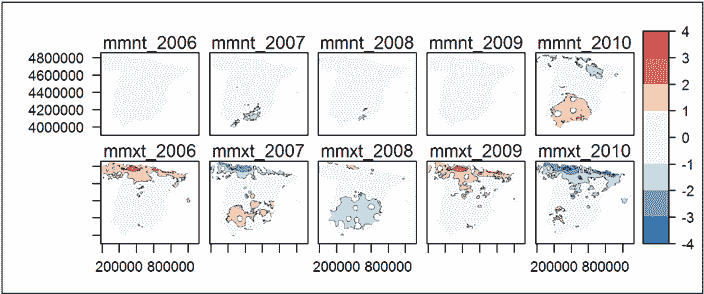

这一次，我们可以很容易地注意到，例如，2010 年的最低温度在西班牙南部高于平均水平，而该国北部的最高温度低于平均水平。

这是我们根据本节开头指定的目标所寻找的最终产品。然而，我们还没有完成。在下一章中，我们将使用 spainT 作为示例数据集之一，同时讨论如何使用 ggplot2 包生成绘图。由于 ggplot2 是一个通用图形包，输入数据必须作为 data.frame 对象提供。此外，数据表应为整洁格式（参见上一章），以便方便利用该包提供的所有可能性。这在当前情况下意味着什么？这意味着我们需要一个 data.frame 对象，其中包含 spainT 中当前持有的所有数据，每个列对应一个变量，每个行对应一个观测值。在这种情况下，变量如下：

- x 坐标
- y 坐标
- 变量
- 年份
- 预测温度

这样的 data.frame 对象中的每一行将对应于 spainT 中单个图层的单个像素。

幸运的是，as.data.frame 函数（我们在上一章中遇到过，当将矩阵转换为 data.frame 时）也具有将栅格转换为 data.frame 对象的方法。通过设置 xy=TRUE，我们指定希望表格不仅包含栅格值（来自其所有图层），还包含相应的空间坐标：

```
> spainT = as.data.frame(spainT, xy = TRUE)
> head(spainT)
          x      y mmnt_2006 mmnt_2007 mmnt_2008 mmnt_2009
1 -11957.925 4857128        NA        NA        NA        NA
2  -8357.925 4857128        NA        NA        NA        NA
3  -4757.925 4857128        NA        NA        NA        NA
4  -1157.925 4857128        NA        NA        NA        NA
5   2442.075 4857128        NA        NA        NA        NA
6   6042.075 4857128        NA        NA        NA        NA
  mmnt_2010 mmxt_2006 mmxt_2007 mmxt_2008 mmxt_2009 mmxt_2010
1        NA        NA        NA        NA        NA        NA
```

该表中的每一行代表一个单一像素，而其空间坐标和各图层中的值在各自的列中指定。然而，从前几行中，我们可以看到 NA 单元格也被包含在内。由于它们无论如何都不会被绘制，我们可以立即排除它们：

```
spainT = spainT[complete.cases(spainT), ]
head(spainT)

             x       y  mmnt_2006   mmnt_2007   mmnt_2008   mmnt_2009
33  103242.08 4857128  0.7383187 -0.070727914  0.008270229  0.5218489
34  106842.08 4857128  0.7392765 -0.055515954  0.024604441  0.5227165
38  121242.08 4857128  0.7458803 -0.018719502  0.063198494  0.5252469
39  124842.08 4857128  0.7456079  0.002858330  0.084895939  0.5240072
40  128442.08 4857128  0.7454912  0.023069161  0.105275777  0.5226526
347  92442.08 4853528  0.7061661 -0.006305609  0.051584103  0.5112048

     mmnt_2010  mmxt_2006  mmxt_2007  mmxt_2008  mmxt_2009  mmxt_2010
33  -1.197710    2.012048  -2.361182   1.122896   1.941084  -2.714846
34  -1.231081    1.988164  -2.341944   1.118404   1.918249  -2.682873
38  -1.315606    1.932082  -2.291416   1.103507   1.857861  -2.620334
39  -1.357369    1.894492  -2.252492   1.094646   1.809158  -2.545804
40  -1.396489    1.859306  -2.215895   1.086683   1.763085  -2.493179
347 -1.262649    1.870778  -2.157029   1.059672   1.696265  -2.469685
```

要将此 data.frame 对象带入期望的形式，还有两件事需要完成：

- 首先，我们需要将表格转换为长格式，创建一个 value 列并将所有其他变量保留在单独的独立列中。这可以通过 `melt` 函数实现（参见 *第 3 章，处理表格*，了解更多详细信息），指定 "x" 和 "y" 列作为 ID 变量，以便其他列被转移到单个变量列中：

```
library(reshape2)
spainT = melt(spainT, id.vars = c("x", "y"))
head(spainT)

       x        y  variable      value
1 103242.08 4857128 mmnt_2006 0.7383187
2 106842.08 4857128 mmnt_2006 0.7392765
3 121242.08 4857128 mmnt_2006 0.7458803
4 124842.08 4857128 mmnt_2006 0.7456079
5 128442.08 4857128 mmnt_2006 0.7454912
6  92442.08 4853528 mmnt_2006 0.7061661
```

- 其次，我们需要将 variable 列拆分为两个：变量本身（`mmnt` 或 `mmxt`）和年份（2006、2007、2008、2009 或 2010）。使用 `substr` 进行子字符串提取（参见 *第 2 章，处理向量和时间序列*，了解更多信息）对此很有帮助，因为我们可以看出 `spainT$variable` 的每个元素中字符 1-4 一致地对应于变量，而字符 6-9 对应于年份（为了确定，还有其他方法可以在不太方便的情况下提取子字符串；例如，在本上下文中可以使用 `strsplit` 函数）。使用以下两个表达式，我们首先创建一个新的（数值）列保存年份值，然后修改 `variable` 列以仅保留变量名称：

```
spainT$year = as.numeric(substr(spainT$variable, 6, 9))
spainT$variable = substr(spainT$variable, 1, 4)
head(spainT)
```

|   | x        | y        | variable | value     | year |
|---|----------|----------|----------|-----------|------|
| 1 | 103242.08 | 4857128  | mmnt     | 0.7383187 | 2006 |
| 2 | 106842.08 | 4857128  | mmnt     | 0.7392765 | 2006 |
| 3 | 121242.08 | 4857128  | mmnt     | 0.7458803 | 2006 |
| 4 | 124842.08 | 4857128  | mmnt     | 0.7456079 | 2006 |
| 5 | 128442.08 | 4857128  | mmnt     | 0.7454912 | 2006 |
| 6 | 92442.08  | 4853528  | mmnt     | 0.7061661 | 2006 |

最终的 `data.frame` 对象现在已完成。

## 摘要

总之，在本章中，你学习了如何使用四种不同方法将点数据在空间上插值以生成连续栅格。其中第一种，最近邻插值，我们自己编写代码，而其他三种（IDW、OK 和 UK）使用 gstat 和 automap 包中的函数应用。你还学习了如何执行 LOOCV 来计算 RMSE 并评估预测精度。最后，我们看到了两个如何自动化复杂过程以在参数集数组上重复执行它的示例。

在下一章中，你将学习如何在 R 中使用 ggplot2 生成涉及空间数据的更精细绘图。


