# 9 空间数据的高级可视化

空间数据的可视化在中间分析步骤（检查初步结果并确保我们走在正确轨道上）和最终产品（向同事或在出版物中展示我们的结果）中都至关重要。在本章中，我们将可视化前几章创建的各种数据集，为此前介绍的案例研究画上句号。在此过程中，你将学习如何在 R 中生成精美且自定义的图形输出。

本章大部分内容将集中于流行的图形包 `ggplot2`。我们首先介绍该包所遵循的特殊语法背后的逻辑。随后，我们将通过示例回顾如何使用该包生成和自定义空间及非空间绘图。接着，我们将介绍 `ggmap` 包，它可以自动从网络下载静态地图，并可用于补充由 `ggplot2` 生成的绘图。最后，我们将使用 `lattice` 包稍微尝试一下**三维（3D）**可视化。

在本章中，我们将涵盖以下主题：

- 使用 `ggplot2` 生成出版级质量的绘图
- 使用 `ggmap` 添加静态地图作为背景
- 使用 `lattice` 生成三维绘图

> [在本章中，我们将使用前几章创建的对象。]

## 使用 ggplot2 和 ggmap 绘图

在本节中，你将学习如何使用 ggplot2 和 ggmap 可视化空间数据。本节结构如下。首先，我们将通过一个简单的时间序列图示例来回顾 ggplot2 框架，因为（正如你马上会看到的）其语法与我们目前使用的其他绘图方法相当不同。之后，我们将稍微练习生成普通的非空间绘图。接下来，我们将看到如何保存 ggplot2 绘图以供后续使用，包括在 R 环境内和外部文件中。最后，最后两个小节将讨论从本书角度来看最重要的内容。在这两个小节中，我们将看到如何将空间数据并入 ggplot2 可视化以生成地图，以及如何使用 ggmap 便捷地下载此类地图的参考背景图像。

在深入 ggplot2 的细节之前，重要的是要说明：要使用这个包，我们的输入数据需要包含在一个 data.frame 对象中，并且需要是整洁的（有关更多信息，请参阅第 7 章“组合矢量与栅格数据集”）。因此，在实践中，使用 ggplot2 绘图时有两个步骤：

- 将数据转换为适当的形式
- 创建绘图

在一些后续示例中，当数据已经是正确形状时，我们将跳过第一步，直接创建绘图。否则，我们必须先重塑数据（使用前几章已熟悉的方法），然后才利用 ggplot2 创建绘图本身。

### ggplot2 概述

理解 ggplot2 底层逻辑的最佳方式是通过示例。我们的第一个示例将重现我们在第 2 章“处理矢量与时间序列”中创建的时间序列图，当时我们演示了 R 中三种图形系统之间的差异。如你所记得的，我们使用了以下 data.frame 对象（虽然当时并不知道它是一个 data.frame 对象），它表示温度测量的时间序列。该 data.frame 对象的 time 列包含日期，而 tmax 列包含每日最高温度：

```
> head(dat)
       time tmax
1 2006-01-01 13.3
2 2006-01-02 14.4
3 2006-01-03 15.6
4 2006-01-04 14.4
5 2006-01-05 10.6
6 2006-01-06 12.8
```

我们使用了以下表达式，用 ggplot2 生成了该时间序列最简单的折线图：

```
> library(ggplot2)
> ggplot(dat, aes(x = time, y = tmax)) +
+ geom_line()
```

虽然以下截图已经出现在第 2 章“处理矢量与时间序列”中，但这里再次提供，因为我们将花一些时间讨论该示例：

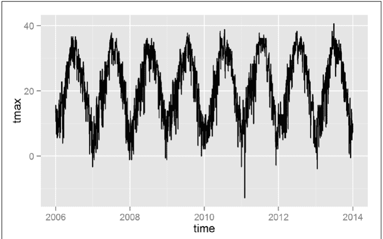

我们现在将简要回顾 ggplot2 语法的主要特征，并参考前面的示例。在本章后面，我们将使用前几章的其他数据集生成更多绘图。这样，到本章结束时，我们将回顾使用 ggplot2 可视化空间数据的最重要概念和操作方法。

ggplot2 包非常灵活。由于函数和用法选项丰富，它能够生成的绘图种类主要受限于用户的知识和专业技能。然而，这种丰富性可能让初学者不知所措。此外，ggplot2 的语法在概念上和实际操作上都很难一开始就掌握。尽管如此，克服了最初困难的人会得到巨大的回报。

本章的目的是通过示例介绍使用 ggplot2 显示空间数据时需要注意的一些最重要要点。显然，我们无法涵盖所有绘图类型及其可选修改（即使是一本独立的书也无法完成这样的任务）。我们能做的是提供足以定位的初始知识。后续使用 ggplot2 将不可避免地需要反复试验，以及在线寻求帮助。此外，以下有关 ggplot2 的信息来源非常值得推荐：


- 幸运的是，ggplot2 包附带了一套非常全面的帮助页面（http://docs.ggplot2.org/），其中介绍了所有函数和参数——在大多数情况下还附有代码和图形输出示例。
- 温斯顿·张（Winston Chang）的书《R 图形菜谱》（R Graphics Cookbook），奥莱利媒体，2012 年出版，以精确配方形式提供了关于使用 ggplot2 进行可视化的广泛内容（尽管涉及空间数据的示例相对较少）。
- 对 ggplot2 理论背景更感兴趣的读者可以参阅包作者 Wickham, H. 所著的引人入胜的书《ggplot2：数据分析的优雅图形》（ggplot2: Elegant Graphics for Data Analysis），Springer，2009 年。该书中的一些代码部分略有过时（自该书出版以来，该包已发展演变），但这并不影响该书的有用性。

用于使用 ggplot2 创建绘图的每个表达式都由几个组件组成，我们很快就会看到。它从 ggplot 函数调用开始（例如 ggplot(dat, aes(x=time, y=tmax))），随后是附加图层的定义和设置。

使用 ggplot2 创建的每个绘图的核心是图层，每个图层必须与给定的几何对象以及用于绘制该图层的数据相关联。没有图层的绘图是无法生成的，因为没有什么可显示：

```
> ggplot(dat, aes(x = time, y = tmax))
Error: No layers in plot
```

图层使用 `+` 运算符添加到绘图中，用于创建图层的数据以及美学映射（数据与图层美学外观之间的关联）既可以在 ggplot 函数中作为参数指定（将该绘图的全局参数设置），也可以在相应的图层函数中作为参数指定（仅将该图层的局部参数设置）。

创建图层最直接的方法是使用 layer 函数，我们可以在其中（相当冗长地）指定所有图层特征。例如，前面的绘图也可以用以下表达式生成，这表明 geom_line 是一个具有预定义的“线”几何对象和“恒等”统计变换（这意味着没有统计变换；值按原样使用）的图层，以及其他保持隐藏的默认定义（例如线条颜色的 colour="black"）：

```
ggplot(data = dat, aes(x = time, y = tmax)) +
  layer(geom = "line", stat = "identity")
```

然而，在实践中，图层通常使用预定义的图层函数而不是 layer 函数来指定。这些函数名以 geom（如 geom_line）或 stat（如 stat_contour）开头。这两种函数类型之间没有概念上的区别；区别仅在于它们的默认设置——后者强调统计变换，而前者则不强调；因此，每种函数类型对于给定目的可能更易于使用。但应该记住，任何给定图层的设置都可以被覆盖，因此在许多情况下，geom 和 stat 图层在期望结果方面是多余的。例如，完全相同的等高线图层可以用 geom_contour 或 stat_contour 中的任何一个生成。

一般来说，每个图层由以下五个组件组成：

- 图层遵循的几何对象（这已包含在图层函数名中，例如 geom_line）
- 提供数据的 data.frame 对象（例如 dat）
- 数据与图层外观之间关联的定义，即 aes 函数内的美学映射（例如 aes(x=time,y=tmax)），或与数据无关的外观定义，即 aes 函数外的美学设置
- 在美学映射之前对数据进行操作的统计变换（我们这里不会使用）
- 用于处理重叠图形对象的位置调整（我们这里不会使用）


一个用于创建图层（例如 `geom_line`）的函数已经包含了对 `geom`（几何图形）和 `stat`（统计变换）参数的默认值；在实践中很少需要覆盖这些默认值。对于本章的目的而言，我们也不需要处理位置调整；这些在非空间图（如直方图和箱线图）中最有用。因此，我们通常只会在 ggplot2 的图层中修改两个参数——数据和美学映射（以及可选的美学设置）。例如，前面的 `tmax` 随 `time` 变化的图只有一层，该层的几何类型为“线”。用于创建该层的函数因此命名为 `geom_line`。`time` 和 `tmax` 值来自的 `data.frame` 对象是 `dat`，其中 `time` 映射到 x（x 轴美学）而 `tmax` 映射到 y（y 轴美学）。

下表列出了本章中我们将使用的特定图层函数，以便生成几种常见的图层类型。该表还显示了每个函数的必需和可选参数集。给定图层的必需参数（或美学）控制其几何图形，因此在没有它们的情况下图层无法绘制。例如，`geom_line` 函数需要一组 x 和 y 坐标，因为没有这些就无法绘制线。正如我们将看到的，实践中必需参数始终映射到我们数据中的变量（在 `aes` 函数调用中的赋值形式）。另一方面，可选参数可以映射到数据中的变量、以常量值设置或未指定（在这种情况下，它们被设置为其默认常量值，例如 `geom_line` 的 `colour="black"`，使线条具有默认的黑色）。

| Function name | Required parameters | Optional parameters |
|---|---|---|
| `geom_line` | x, y | alpha, colour, linetype, size |
| `geom_histogram` | x | alpha, colour, fill, linetype, size, weight |
| `geom_point` | x, y | alpha, colour, fill, shape, size |
| `geom_text` | label, x, y | alpha, angle, colour, family, fontface, hjust, lineheight, size, vjust |
| `geom_path` | x, y | alpha, colour, linetype, size |
| `geom_contour` | x, y | alpha, colour, linetype, size, weight |
| `geom_density2d` | x, y | alpha, colour, linetype, size |
| `geom_polygon` | x, y | alpha, colour, fill, linetype, size |
| `geom_raster` | x, y | alpha, fill |

## Advanced Visualization of Spatial Data

必须理解的是，为了生成一个最小的图，我们只需要指定一个数据集、一个图层以及图层必需参数的映射（例如 `geom_line` 中的 x 和 y）。其他图层参数（例如 colour 或 size）、比例、面化和主题都是可选的。例如，下面的表达式添加了一个颜色设置和两个比例定义，但它产生的图与前面的截图完全相同，因为我们添加的所有组件都已由默认值指定：

```
ggplot(dat, aes(x = time, y = tmax)) +
geom_line(colour = "black") +
scale_x_date() +
scale_y_continuous()
```

前述表达式中使用的两个比例设置（`scale_x_date()` 和 `scale_y_continuous()`）没有效果，因为连续变量（例如 tmax）默认绘制在连续比例上，而日期变量（例如 time）默认绘制在日期比例上。此外，我们还有一个美学设置（`colour="black"`）也没有效果。与美学映射（始终包含在 aes 函数中）相反，美学设置将图层链接到与给定列中的数据无关的常量美学值。在前述表达式中，我们将 `geom_line` 图层的线条颜色设置为黑色，使用 `colour="black"`。再次，由于“black”是 ggplot2 中线条颜色的默认值，因此此设置不会影响图的外观。

我们生成的图如果要用于出版物，还需要一点润色。一般来说，某些图调整与数据无关（例如更改背景颜色），而其他调整则与数据间接相关（例如更改栅格的颜色比例）。首先，我们希望有合适的轴标题（例如 x 轴的“Time”而不是“time”），最好不要更改数据列名本身。在许多情况下，期刊可能需要更干净的外观，因此我们可能还希望删除灰色背景和网格线。后两者分别可使用比例和主题规范进行修改。

通过 `theme` 函数，我们可以控制图的非数据元素的整体外观，例如图标题、轴标签样式、刻度线长度、背景颜色等。这可以通过两种方式完成，它们不是互斥的而是累加的：

- 可以指定所谓的完整主题，一次性以预定义方式控制所有元素。ggplot2 中目前预定义的主题包括 `theme_grey`、`theme_bw`、`theme_linedraw`、`theme_light`、`theme_minimal` 和 `theme_classic`。您可以在以下代码段中将 `theme_bw` 替换为其中每一个，以查看它们各自的外观。
- 可以使用 `theme` 函数修改单个元素，指定元素名称和所需参数。例如，添加 `theme(panel.grid=element_blank())` 可消除网格线。目前有 50 个主题元素（例如 `panel.grid`），可通过 `theme` 函数进行修改（请参阅 `?theme` 获取完整列表）。关于主题需要注意三点重要事项：
  - 每个主题元素的值都可以使用适当的函数设置（`element_blank`、`element_line`、`element_rect` 或 `element_text`）。例如，要设置 `axis.title`，我们将使用 `element_text`，但要修改 `panel_grid`，我们将使用 `element_line`（除非我们完全想消除它，在这种情况下我们将使用 `element_blank`）。请参阅 `?theme` 以了解特定情况下适当的元素函数。
  - 在 `element` 函数内部，我们可以提供想要为该特定元素修改的特征列表。例如，`element_line(colour="red",linetype="dotted")` 用于 `panel.grid` 将使网格线变为红色并带点线。如同往常一样，所有未指定的属性仍保持其默认值。
  - 一些元素属性会从其他元素继承。例如，使用 `panel.grid=element_blank()` 时，修改 `panel.grid.minor` 和 `panel.grid.major`（分别表示次要和主要网格线）的特征就没有意义，因为两者的属性都被 `panel.grid` 覆盖。

用于修改比例的函数以 `scale` 开头，其后是美学属性和比例类型。例如，`scale_x_date` 将 x 轴位置美学属性设置为日期类型。`scale` 函数内的参数控制比例的附加属性，而比例类型由函数名称决定。例如，`name` 参数决定沿相应轴或图例显示的比例名称。我们希望为其设置比例的每个美学都需要一个单独的比例函数（例如 `scale_x_date()` 和 `scale_y_continuous()`）。

作为示例，在下面的代码中我们修改了时间序列图的几个主题和比例属性：

```
> ggplot(dat, aes(x = time, y = tmax)) +
+ geom_line() +
+ scale_x_date(name = "Time") +
+ scale_y_continuous(
+ name =
+ expression(paste("Maximum temperature (", degree, "C)") ) +
+ theme_bw() +
+ theme(panel.grid = element_blank())
```

如您可能注意到的，前述代码中 y 轴标签以特殊方式指定，使用 expression(paste("Maximum temperature (", degree, "C)"))。这样做的原因是引入度数（°）符号到 y 轴标题中（请参阅以下截图）。expression 函数返回一个类为 expression 的对象，可用于在 R 中打印数学符号和注释。它与 paste 结合使用，以便同时包含常规字符和数学符号。在本例中，文本由“Maximum temperature (”和“C)”部分组成，而数学部分是 degree，它代表 ° 符号。可能注释的完整列表及其语法可在 ?plotmath 帮助页面上获得。

以下截图显示了我们图的这个新版本的外观：

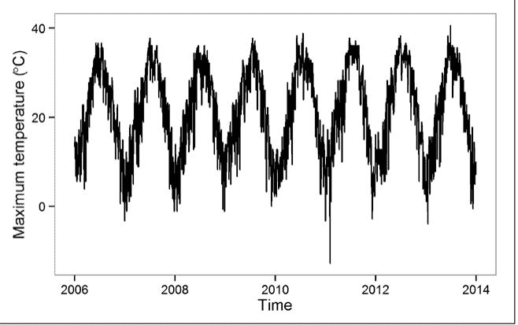


我们可以看到图现在是黑白的（得益于 `theme_bw`），没有网格线（得益于 `theme(panel.grid=element_blank())`）并且具有合适的坐标轴标签（得益于 `scale` 指定）。


> 有时，需要一点交互式微调来在 R 的图形输出中引入非标准元素或格式。例如，我们可能希望在前面的图上放置一个箭头标记（例如 ↓）并加上注释（例如 *这是一个特别寒冷的日子*）。虽然几乎所有内容都可以通过 `ggplot2` 语法实现（包括后一个例子），但在某些情况下，使用 Inkscape（可免费从 http://www.inkscape.org/ 获取）或 Adobe Illustrator 等图形编辑器手动进行最终调整可能更有优势。为此，最好使用 `ggsave` 将图导出为矢量图形文件（例如 PDF 或 SVG），然后在图形编辑器中对其进行处理。

## 绘制非空间数据

由于我们的主要关注点是绘制空间数据，在本节中，我们将仅介绍两个普通（非空间）图的例子。本章后续的大多数例子将涉及生成空间图，也就是地图。

我们将从线图开始，但比前一个例子更复杂一些。正如 *第 7 章，组合矢量和栅格数据集* 中所承诺的，我们将直观地比较两个森林（Lahav 和 Kramim）中 NDVI 轨迹的差异，数据来源为两个卫星（Landsat 和 MODIS）。为此，我们将在单个图中显示四个相关的时间序列。我们将用不同的颜色标记每个森林的数据以便区分它们。此外，我们将为来自两个卫星的数据使用不同的 `geom` 函数——来自 MODIS 的数据（每个森林有 280 个数据点）最好用 `geom_line` 显示，而来自 Landsat 的数据（每个森林只有三个数据点）将用 `geom_point` 显示。

就 `ggplot2` 语法而言，我们输入表 `forests_ndvi` 中的数据将被分为两部分：

- `forests_ndvi[forests_ndvi$sat == "MODIS", ]`
- `forests_ndvi[forests_ndvi$sat == "Landsat", ]`

`forests_ndvi` 的第一个子集将作为 `data` 参数传递给 `geom_line`，而第二个子集将作为 `data` 参数传递给 `geom_point`。至于美学映射（`aes` 函数内的赋值表达式），x 将映射到 `date`，y 映射到 `ndvi`，在两个图层中都如此（NDVI 被绘制为时间的函数）。此外，`colour`（在 `geom_line` 中）和 `fill`（在 `geom_point` 中）映射到 `forest`，因为我们希望用不同的颜色显示每个森林的时间序列。点图层中使用了一个美学设置实例（`shape=21`），将点形状定义为 21（对应于填充圆；参见 ?points）。除了这两个图层之外，还提供了六个 ggplot 组件来指定各种比例设置（仅其名称，在本例中）和主题设置（无网格线，图例位置为“顶部”）。请注意，`fill` 和 `colour` 的比例是离散的（`scale_fill_discrete` 和 `scale_colour_discrete`），这对于森林名称等分类变量是合适的。

> 分配的颜色是自动生成的。也可以使用手动比例显式指定每个组将采用的颜色。我们在这里不讨论这一点；感兴趣的读者可以查看 ?scale_colour_manual 中的示例，了解如何指定自己选择的单个颜色。

因此，生成图的整个表达式采用以下形式：

```r
> ggplot() +
+ geom_line(
+ data = forests_ndvi[forests_ndvi$sat == "MODIS", ],
+ aes(x = date, y = ndvi, colour = forest)) +
+ geom_point(
+ data = forests_ndvi[forests_ndvi$sat == "Landsat", ],
+ aes(x = date, y = ndvi, fill = forest), shape = 21) +
+ scale_x_date("Time") +
+ scale_y_continuous("NDVI") +
+ scale_fill_discrete("Forest") +
+ scale_colour_discrete("Forest") +
+ theme_bw() +
+ theme(panel.grid = element_blank(),
+ legend.position = "top")
```

然后，我们将两个表用 `rbind` 绑定成一个表：

```r
> slopes = rbind(nat, build)
> head(slopes)
```

|    | cover | slope |
|----|-------|-------|
| 1 | Natural | 0.3740864 |
| 2 | Natural | 0.3918563 |
| 3 | Natural | 0.4300925 |
| 4 | Natural | 0.4843213 |
| 5 | Natural | 0.5266151 |
| 6 | Natural | 0.3173897 |

数据已准备好绘制。这次，我们感兴趣的是直观比较分布。最明显的方法是将两个变量的直方图并排绘制。在 ggplot2 中，直方图图层可以用 `geom_histogram` 创建，仅指定一个美学——x。为了在单个图中生成两个直方图，我们还将使用分面。

分面，如前所述，是在单个图形输出中为数据的不同子集生成众多相同类型的图。例如，在本例中，我们希望并排创建两个直方图：一个用于“Buildings”覆盖类型，另一个用于“Natural”覆盖类型。使用分面的原因——除了节省多次运行相同代码的麻烦之外——是所有子图具有相似的外观和共同的坐标轴，从而使比较更容易。ggplot2 中有两种生成分面的函数；它们之间的区别在于子图在几何上的排列方式：

- `facet_wrap`：用于创建面板的连续条带，同时（可选）指定行数或列数（使用 `nrow` 和 `ncol`）。这最适用于创建众多相同类型的子图。
- `facet_grid`：用于创建面板的二维网格，其中行和列定义给定变量的不同水平。这最适用于子图由两个变量的组合定义的情况。

`facet_wrap` 和 `facet_grid` 的最重要参数是定义用于创建分面的分组因子（s）的公式。使用 `facet_wrap`，我们可以仅指定一个因子（例如，`facet_wrap(~group)`），因为分面形成一维条带。使用 `facet_grid`，我们可以指定两个因子：一个用于行，另一个用于列（例如，`facet_grid(group_row~group_column)`）。如果我们希望使用 `facet_grid` 根据单个因子创建分面，可以用点（.）替换其中一个变量。例如，`facet_grid(group_row~.)` 将导致分面的垂直条带（因为没有列因子），而 `facet_grid(.~group_column)` 将导致分面的水平条带（因为没有行因子）。

为了澄清这一点，最好举一个例子。以下代码根据分组变量 `cover` 使用 `facet_grid` 生成两个直方图分面。由于我们只有一个分组因子，我们将列分组标记为 `.` 以获得垂直条带（在本章后面，在西班牙温度地图示例中，我们将使用具有两个分组因子的 `facet_grid`）：

```r
> ggplot(slopes, aes(x = slope)) +
+ geom_histogram() +
+ facet_grid(cover ~ .) +
+ scale_x_continuous("Slope (radians)") +
+ scale_y_continuous("Count") +
+ theme_bw()
```

生成的图显示在以下屏幕截图的 *左侧*。由于在这种情况下我们只有一个分组变量，相同的图也可以用 `facet_wrap` 生成。将 `facet_grid(cover~.)` 替换为 `facet_wrap(~cover,ncol=1)` 会生成相同的图，只是分面标签方案略有不同；后一个图显示在以下屏幕截图的 *右侧*。请注意，在这两种情况下，分面共享一个共同的 *x* 轴。

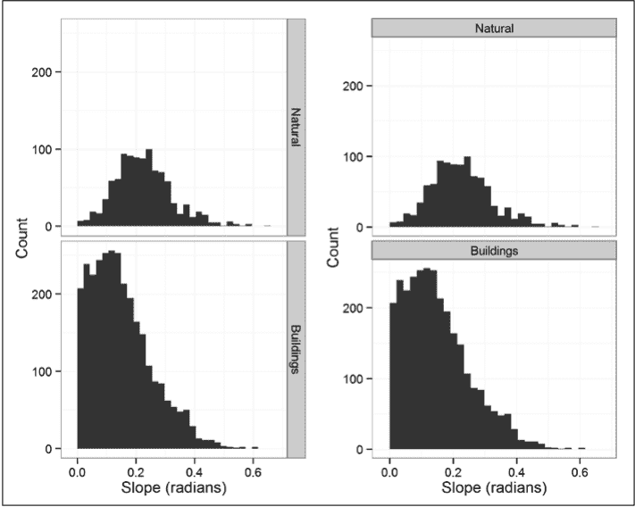

从这些直方图可以看出，大多数建筑物位于相对平坦的地形上，而大多数自然区域占据更陡的坡度，这是有道理的。

> 使用 tapply 和 slopes 表定量比较坡度分布的特性是直接的。例如，`tapply(slopes$slope, slopes$cover, mean)` 将显示“Natural”和“Buildings”覆盖类型的平均坡度分别为 0.23 和 0.15。用其他函数（例如 min、max 和 sd）替换 mean 将得出其他特性。

## 保存 ggplot2 图

除了通常将图形输出保存到文件的方法（参见 *第 2 章，使用矢量和时间序列*），还有一个专门的函数 `ggsave` 用于保存 ggplot2 图。例如，本章中的第一张图像就是从 PNG 文件中提取到本书的，该文件使用 `ggsave` 如下获得：

```r
> ggplot(dat, aes(x = time, y = tmax)) +
+ geom_line()
> ggsave("C:\\Data\\43670S_09_01.png", width = 5.5, height = 3.5)
```

`ggsave` 函数默认保存最后在图形窗口中绘制的 ggplot 对象。因此，唯一强制性的参数是文件路径。路径中提供的扩展名决定文件格式（本例中为 PNG 图像；有关可能格式的列表，请参阅 ?ggsave）。图尺寸采用当前活动图形窗口的尺寸，除非通过 width 和 height 参数显式指定。例如，在本例中，宽度等于 5.5 英寸（英寸是默认单位，cm 和 mm 也是可能的），因为这是信纸格式中常用的文本宽度。

> 将 ggplot2 输出保存为 PDF 时，建议指定 `useDingbats=FALSE`。这可以避免与绘图渲染相关的潜在问题，因为默认情况下圆会被转换为文本对象，而我们更希望将其保留为几何对象。

ggplot 对象也可以分配并保存在内存中：

```r
> tmax_line = ggplot(dat, aes(x = time, y = tmax)) +
+ geom_line()
```


从最后几个示例中可以明显看出，应用于此类对象的 `print` 方法会在图形窗口中绘制它。完整的 ggplot2 图形或单独图层（我们稍后将看到）的赋值至少有两个有用的用途：

- 我们可以使用 `ggsave` 保存图形，将图形对象作为参数传入，这样我们就不必等待图形在图形窗口中无缘无故地绘制出来。这样，我们也不需要记住最后生成的是哪个图形。例如，在 `tmax_line` 对象创建之后，我们可以按如下方式保存它描述的图形：

```r
> ggsave(plot = tmax_line,
+ filename = "C:\\Data\\4367OS_09_01.png",
+ width = 5.5,
+ height = 3.5)
```

- 我们可以定义有用的图层和/或设置组合，以便在生成一系列具有某些共同组件的图形时反复使用，省去输入整个组件集合的麻烦。完整的主题（如 `theme_bw`）也服务于这一目的。例如，以下表达式生成了我们在本章第一幅图中看到的相同图形：

```r
> tmax1 = ggplot(dat, aes(x = time, y = tmax))
> tmax2 = geom_line()
> tmax1 + tmax2
```

## 绘制空间数据

到目前为止，在本章中，我们介绍了 ggplot2 包，并用几个简单的非空间示例简要回顾了它的语法。在接下来的两节中，我们将转向稍微复杂一些的示例，现在涉及空间数据。你马上会看到，用 ggplot2 制作地图在概念上与其他任何类型的图形制作没有区别（因为空间数据在概念上也不不同于任何其他类型的数据）。

实际上，地图只是一个二维图，包含点、线、多边形和/或栅格，其绘图空间通过给定的 CRS 对应到地理空间。由于绘图空间与地理空间绑定，地图在 x 轴和 y 轴之间具有特定的纵横比（1:1）。换句话说，我们不能拉伸地图使其更宽或更窄，因为这会扭曲 x 和 y 方向上距离之间的正确比例（例如，与本章前面看到的 `tmax` 时间序列图不同，该图可以按我们喜欢的任何方式拉伸并且仍然有意义）。你可能已经注意到，在前几章中应用于空间矢量图层或栅格的 `plot` 方法也会生成具有恒定 1:1 纵横比的图形。区别在于，在 ggplot2 中，输入数据以 `data.frame` 对象形式出现，因此该函数无法知道数据是空间数据。因此，我们需要使用 `coord_equal` 函数手动指定纵横比应为恒定值。

总结这些考虑，用 ggplot2 生成的地图就像用这个包生成的任何其他图形一样，但有以下两个特征：

- 该图通过给定的 CRS 表示地理空间，并包含点、线、多边形和/或栅格形式的空间数据
- x 轴和 y 轴的缩放比例固定为 1:1（使用 `coord_equal`）

> 应该注意的是，ggplot2（以及将在下一节介绍的 ggmap）并不是所有空间数据可视化任务的最佳选择。例如，需要大量标注（如标签、比例尺和指北针）或特殊显示优化算法（如减少街道名称标签与其他地图元素之间的重叠）的地图，在传统 GIS 软件中更容易处理。就地图制作而言，ggplot2 的优势在以下与 R 自身优势相当类似的情况下变得决定性：
> - 自动化：当我们想要自动生成大量高质量地图时，例如使用分面或循环
> - 可重复性：当我们想要确保在不同数据集、不同时间或不同用户之间精确复制相同的地图时
> - 一体化环境：当我们想要在图上显示 R 中计算出的某些元素（如空间插值预测）或集成 R 的其他功能（如从 Web 下载实时数据）时，无需在不同软件之间传输数据

现在，从总体上定义了将 ggplot2 用于空间数据的框架后，让我们进入实际应用。到目前为止，我们见证了空间矢量图层和栅格最好使用特殊类（如 `SpatialPolygonsDataFrame` 或 `RasterLayer`）在 R 中表示。我们如何将这些数据结构转换为 `data.frame` 对象以传递给 ggplot？点和栅格图层可以使用 `as.data.frame` 函数直接转换为 `data.frame` 对象（例如，在上一章中，我们将 `spain` 栅格转换为 `data.frame` 对象）。然而，如前所述，线和多边形比点和栅格更复杂，因为每条线或多边形几何图形由可变数量的点组成。点连接的顺序也是数据的一个组成部分，负责正确的几何图形绘制。因此，表示线或多边形图层的 `data.frame` 对象必须具有 x 和 y 坐标列（就像点和栅格的 `data.frame` 对象一样），还必须有一个分组列（用于表示哪组点形成给定的线或多边形）和一个排序列（用于指定在绘制给定线或多边形时点连接的顺序）。方便的是，ggplot2 中已经定义了一个名为 `fortify` 的函数，用于将线图层和多边形图层转换为 `data.frame` 对象，同时保留这些属性。

例如，在*第5章“使用点、线和多边形”*的末尾，我们创建了一个名为`county`的`SpatialPolygonsDataFrame`对象，该对象包含美国各县的边界以及属性表中每个县的平均人口密度（density列）。为了将`county`中的数据转换为`data.frame`形式，以便ggplot随时可以使用，我们需要应用`fortify`函数。`fortify`的`region`参数用于指定属性表中哪一列对应于单个要素。由于FIPS列标识了属性表中的唯一县，我们可以将其用作region：

```r
> county_f = fortify(county, region = "FIPS")
> head(county_f)
```

|   | long | lat | order | hole | piece | group | id |
|---:|---:|---:|---:|:---|---:|---:|:---|
| 1 | 1225972 | -1274991 | 1 | FALSE | 1 | 01001.1 | 01001 |
| 2 | 1234371 | -1274114 | 2 | FALSE | 1 | 01001.1 | 01001 |
| 3 | 1244907 | -1272280 | 3 | FALSE | 1 | 01001.1 | 01001 |
| 4 | 1244132 | -1267496 | 4 | FALSE | 1 | 01001.1 | 01001 |
| 5 | 1265116 | -1263940 | 5 | FALSE | 1 | 01001.1 | 01001 |
| 6 | 1265318 | -1263907 | 6 | FALSE | 1 | 01001.1 | 01001 |

```r
> head(states_f)
```

|   | long | lat | order | hole | piece | group | id |
|---:|---:|---:|---:|:---|---:|---:|:---|
| 1 | 1076104 | -1034268 | 1 | FALSE | 1 | Alabama.1 | Alabama |
| 2 | 1085410 | -1033146 | 2 | FALSE | 1 | Alabama.1 | Alabama |
| 3 | 1093749 | -1031892 | 3 | FALSE | 1 | Alabama.1 | Alabama |
| 4 | 1107308 | -1030032 | 4 | FALSE | 1 | Alabama.1 | Alabama |
| 5 | 1108666 | -1029851 | 5 | FALSE | 1 | Alabama.1 | Alabama |
| 6 | 1112841 | -1029288 | 6 | FALSE | 1 | Alabama.1 | Alabama |

要绘制使用 `fortify` 创建的空间图层（无论是线的还是多边形的，我们将在后面看到），我们需要将 x 和 y 美学分别映射到 `long` 和 `lat` 列。此外，我们需要将 `group` 列映射到 group 美学，以便每个几何图形单独绘制。例如，加利福尼亚要素由多个几何图形组成（大陆加上太平洋中的几个岛屿），ggplot 需要知道哪些点根据 `group` 列（"California.1"、"California.2" 等）形成单独的多边形。如果我们想给每个州赋予某些美学，我们可以使用 `id` 列（所有加利福尼亚多边形共享 "California" 标签）。

> group 美学也可以应用于非空间图层和除 `geom_polygon` 之外的图层。当没有其他美学（如颜色或填充）完成此工作时，它用于识别各个几何图形以便单独绘制它们。例如，在下面的截图中，我们不希望每个几何图形（如加利福尼亚的每个岛屿）具有独特的外观，但我们仍然希望这些几何图形分别绘制，而不是用一条线将它们全部连接为一个。尝试从以下表达式中移除 `group=group` 部分，你会看到结果一团糟。你也可以尝试 `group=id`，看看它只会搞乱那些由多个几何图形组成的州，而按 `group` 列分组确实是至关重要的。


在当前的示例中，我们将尝试的另一个有用特性是保存一组 ggplot2 组件，以便将它们集成到多个图中，而不必每次输入这些表达式。我们将创建一个名为 `sp_minimal` 的对象，定义我们自己的自定义主题（基于 `theme_bw`，并移除坐标轴名称、标签和刻度标记）：

```r
> sp_minimal =
+ theme_bw() +
+ theme(axis.text = element_blank(),
+       axis.title = element_blank(),
+       axis.ticks = element_blank())
```


## 空间数据的高级可视化

在绘制县级密度之前，我们将从一个更简单的示例开始——仅绘制 states_f 层——以了解如何在 ggplot2 中绘制空间多边形层：

```
```r
> ggplot() +
+ geom_polygon(data = states_f,
+ aes(x = long, y = lat, group = group),
+ colour = "black", fill = NA) +
+ coord_equal() +
+ sp_minimal
```
```

地图的绘制结果如下：

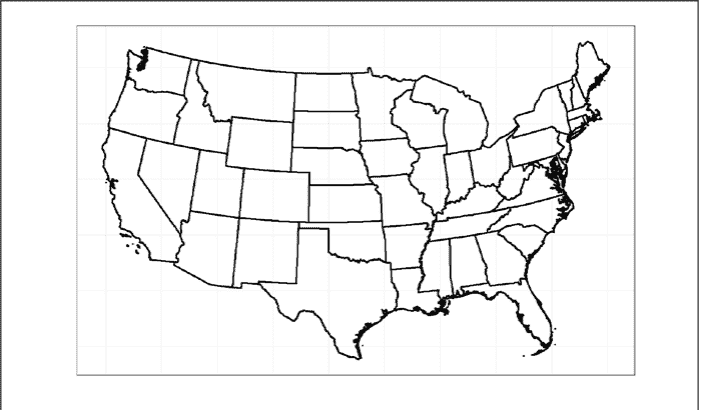

如前面的语法所示，多边形是使用 geom_polygon 根据 long、lat 和 group 数据列绘制的（分别映射到 x、y 和 group 美学属性），颜色和填充多边形被设置为常量值（colour 为 "black"，fill 为 NA；这意味着边框为黑色的空多边形）。另外两个绘图元素是 coord_equal（确保保持 1:1 的纵横比）和我们刚刚定义的 sp_minimal 主题。

现在，我们将通过同时绘制 states_f 和 county_f 两个图层，使事情变得稍微复杂一些。让我们先查看代码和输出。之后，我们将讨论其中涉及的不同组件。以下是生成县人口密度地图的代码：

```
> ggplot() +
+ geom_polygon(data = county_f,
+ colour = NA,
+ aes(x = long, y = lat, group = group, fill = density)) +
+ geom_polygon(data = states_f,
+ colour = "white", size = 0.25, fill = NA,
+ aes(x = long, y = lat, group = group)) +
+ scale_fill_gradientn(
+ name = expression(paste("Density (",km^-2,")")),
+ colours = rev(rainbow(7)),
+ trans = "log10",
+ labels = as.character,
+ breaks = 10^(-1:5)) +
+ coord_equal() +
+ sp_minimal
```

以下截图显示了 resulting plot 的外观：

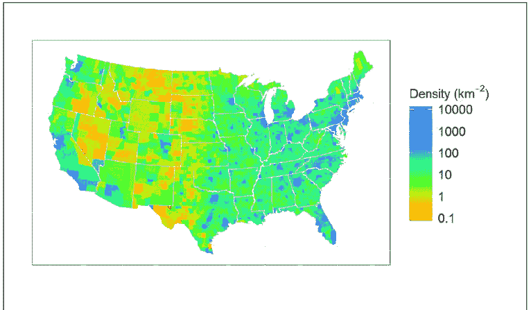

阅读前面的代码，首先可以看出，该图是通过组合以下五个组件制作的：

- `geom_polygon`（使用 `county_f`）
- `geom_polygon`（使用 `states_f`）
- `scale_fill_gradientn`
- `coord_equal`
- `sp_minimal`

两个 `geom_polygon` 层，分别代表“states”和 `county` 层，根据我们在本可视化中的需求以不同方式绘制。关于这些层需要注意的第一件事是它们的出现顺序：`county_f` 层在 `states_f` 之前添加。这不是巧合；图层在屏幕上绘制的顺序与它们在代码中提供的顺序相同。由于州和县边界显然重叠，并且我们希望将州边界绘制在县边界之上（否则州边界将不可见），因此按正确的顺序指定图层非常重要。

`states_f` 层的参数与前一个示例中的相同；只是我们将多边形边框设为白色（使用 `colour="white"`）且较细（使用 `size=0.25`）。至于 `county_f` 层，边框的颜色（而非 `fill`）被设置为 `NA`，从而得到无边框的多边形，并且 `fill` 被映射到 `density`。后者确实是我们制作的地图的定义特征：将 `county_f` 多边形的 `fill` 美学属性映射到 `density` 赋予不同人口密度不同的颜色，这正是制作此图的全部目的。

我们将 `fill` 映射到 `density`，但哪个颜色分配给哪个密度级别呢？如前所述，`scale` 函数决定了数据中的值如何与美学外观相匹配。因此，除非我们对默认比例尺满意（这种情况经常并非如此），否则我们必须自行设置比例尺特征。例如，我们已经在森林 NDVI 时间序列示例中使用了 `scale_colour_discrete`（适用于离散变量）。在本示例中，`scale_fill_gradientn` 函数，如其名称所示，被用于将 `fill` 比例尺类型设置为 `gradientn`。后者只是多种可能的 `fill` 比例尺类型之一（同样适用于 `colour` 美学属性；请参阅 `http://docs.ggplot2.org/` 获取完整列表）。对于连续变量，`ggplot2` 提供了三种颜色比例尺类型，可以使用以下函数指定：

- `scale_fill_gradient`：双色渐变，渐变端颜色使用 `high` 和 `low` 指定（请参阅本章后面 Haifa 建筑密度示例）
- `scale_fill_gradient2`：三色渐变，`low`、`med` 和 `high` 颜色指定（请参阅本章后面 London 建筑距离河流示例）
- `scale_fill_gradientn`：自定义 n 色渐变，使用 `colours` 向量指定

在 R 中创建要提供给 `scale_colour_gradientn` 的 `colours` 参数以及其他图形函数的颜色向量的方式有多种。我们在本示例中使用的最简单的方法是使用其中一个预定义的调色板函数，该函数可以接受数值作为参数并以等间隔产生一系列颜色（以 RGB 代码返回）。这些函数可用于多种目的：

- `rainbow`
- `heat.colors`
- `terrain.colors`
- `topo.colors`
- `cm.colors`

在本章的示例中，我们使用 `rainbow` 和 `terrain.colors`。欢迎尝试另外三种调色板，看看它们的效果如何。这些函数返回的颜色代码本身很少有用。相反，它们作为调色板传递给 `scale_colour_gradientn` 等图形函数。

```
> rainbow(3)
[1] "#FF0000FF" "#00FF00FF" "#0000FFFF"
```

在你有不同调色板想法且未被这些函数涵盖的情况下，可以使用 RColorBrewer 包（提供更多调色板）或 base R 中可用的 `colorRampPalette` 函数（可用于创建自定义调色板；请参阅本章最后一个示例）。

对我们使用的 `scale_fill_gradientn` 函数参数做一个简短的解释：

- `name=expression(paste("Density (",km^-2", ")"))`：name 参数指定比例尺名称及其在图例中的显示方式。我们再次使用了 `expression` 函数，这次是在上标中添加 -2（请参阅前面的截图）。
- `colours=rainbow(7)`：指定用于创建调色板的颜色向量。在这里，指定七种颜色效果良好，彩虹调色板提供的全部变化都得到了体现。可能需要反复试验才能确定每种情况下足够使用的颜色数量。
- `trans="log10"`：trans 参数可以传递给 ggplot2 中的任何连续比例尺函数。它用于指定数据的数学变换。在本特定示例中，我们使用对数比例尺（"log10"）来突出不同县之间人口密度的差异，这是必要的，因为县密度分布高度不均匀，有许多低密度县和少数高密度县。你可以尝试删除 `trans`、`labels` 和 `breaks` 参数，然后再次运行之前的代码，看看为什么默认的线性比例尺在此情况下不合适。有许多有用的内置变换类型，以及定义自定义变换的方法，但这超出了本书的范围。
- `labels=as.character` 和 `breaks=10^(-1:5)`：breaks 参数指定生成刻度和标签的断点，而 labels 参数指定标签本身或（像本例中一样）用于格式化标签的函数。在本例中，默认情况下，R 以数学符号打印 `10^(-1:5)` 标签向量（`1e-01`、`1e+00`、`1e+01` 等）。通过将数值转换为字符（使用 `as.character`）来避免这种情况，以获得更全面的标签（`0.1`、`1`、`10` 等）。

生成前面图的代码部分中的最后两个组件——`coord_equal` 和 `sp_minimal`——已在之前的图中用过，因此我们在此不再重复其含义。

最后，参考图本身，我们可以看到美国东部一半地区和太平洋沿岸人口稠密县的集中。向西内陆的美国西部，人口密度普遍较低。

接下来进入第二种空间数据结构——栅格，我们将在接下来的几个示例中尝试 Haifa DEM 地图的各种变化。作为数据源，我们将采用 dem 和 hill 栅格（请参阅 *第 6 章，修改栅格和分析栅格时间序列*）。来自这两个栅格的数据将被转移到一个包含四列的单个 `data.frame` 对象中：单元格坐标（x 和 y）、高程值（elev）和山体阴影值（hill）。请注意，在这种情况下，我们使用 `data.frame` 函数来执行此操作，为每个栅格分别提供坐标和值向量（依赖于两个栅格几何上相同这一事实，因为 `hill` 是由 `dem` 派生的）。同样好的做法是堆叠两个栅格，然后使用 `as.data.frame(..., xy=TRUE)` 将结果转换为 `data.frame` 对象：


```
> dem_hill = data.frame(coordinates(dem),
+ elev = dem[],
+ hill = hill[])
> dem_hill = dem_hill[complete.cases(dem_hill), ]
> head(dem_hill)
          x        y elev      hill
2421 698971.3 3648863   19 0.3533017
2422 699061.3 3648863   20 0.3408402
2423 699151.3 3648863   19 0.3402018
2424 699241.3 3648863   19 0.3451085
2425 699331.3 3648863   20 0.3439193
2426 699421.3 3648863   21 0.3368811
```

现在我们有了 dem_hill 表格，我们可以使用 geom_raster 层来绘制数据。geom_raster 函数需要 x、y 和 fill 美学来绘制栅格，如以下代码和图像所示。此外，由于我们将制作多个版本的海法 DEM 绘图，最好将此基本绘图保存为 ggplot 对象（此处命名为 haifa_relief），以便我们之后可以通过添加额外图层来更新它：

```
> haifa_relief = ggplot(dem_hill, aes(x = x, y = y)) +
+ geom_raster(aes(fill = elev)) +
+ scale_fill_gradientn("Elevation (m)",
+ colours = terrain.colors(10)) +
+ coord_equal() +
+ theme_bw() +
+ theme(axis.title = element_blank(),
+ axis.text.y = element_text(angle = 90, hjust = 0.5))
> haifa_relief
```

使用的语法与之前的示例类似，只是我们使用 geom_raster 而不是 geom_polygon；x 和 y 映射到空间坐标，而 fill 映射到栅格值。请注意 geom_raster 将 aes(fill=elev) 作为参数，而缺失的部分（data、x 和 y）默认情况下会从 ggplot 参数集中传递。正如我们马上就会看到的，这种操作模式在我们想要添加另一个图层（本例中为 hillshade）并使用相同的参数时非常方便，这样我们就不需要再次输入它们。这次的主题组件指定 y 轴标签应旋转 90°（这在地图中经常使用）。生成的绘图显示在以下屏幕截图的左面板中。请注意所使用的颜色比例（terrain.colors）特别适用于显示地形。

现在我们有了基本的高程图像，我们可以尝试在上面叠加的各种额外组件。例如，hillshade 计算为我们提供了给定地形和太阳位置的理论阴影程度层（参见第 6 章《修改栅格和分析栅格时间序列》）。我们可以将阴影值添加为全黑栅格，并具有各种透明度级别（使阴影区域不那么透明，从而更暗）。这将在制图学中创造出一种三维图像的错觉，也称为阴影起伏。为了创建阴影，我们需要添加另一个栅格图层，其中黑像素的透明度美学映射到 hill 值。透明度在 ggplot2 以及 R 中的其他图形函数中由名为 alpha 的参数决定，其范围从 0 到 1，0 为完全透明，1 为完全不透明。限制 alpha 比例的最大值至 0.5，使用 range 参数可确保我们在阴影较重的区域不会得到完全黑色的像素：

```
> haifa_relief_shade = haifa_relief +
+ geom_raster(aes(alpha = hill), fill = "black") +
+ scale_alpha_continuous("Hillshade", range = c(0.5, 0))
> haifa_relief_shade
```

生成的绘图显示在以下屏幕截图的右面板中。将两幅图像并排查看可以演示阴影的效果。

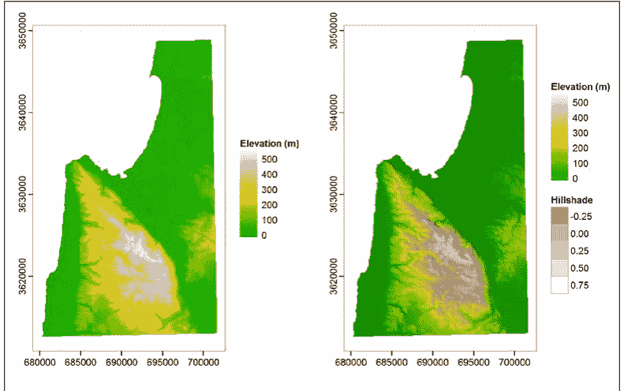

谈到地形，我们可能还想向此绘图中添加的另一个特征是等高线。我们已经从栅格间接计算了等高线（例如在第 4 章《使用栅格》中使用 levelplot 显示它们）和直接计算（使用 rasterToContour 创建等高线图层，在第 7 章《结合矢量和栅格数据集》中）。在这里，我们正在查看使用 ggplot2 基于栅格计算等高线的另一种间接方法。要添加等高线图层，我们可以使用 geom_contour 函数，将其 z 美学映射到高程，以便根据它计算等高线：

```
> haifa_relief_shade +
+ geom_contour(aes(z = elev), colour = "black", alpha = 0.3)
```

以下屏幕截图显示了生成的图形输出，显示了海法阴影起伏之上半透明的等高线：

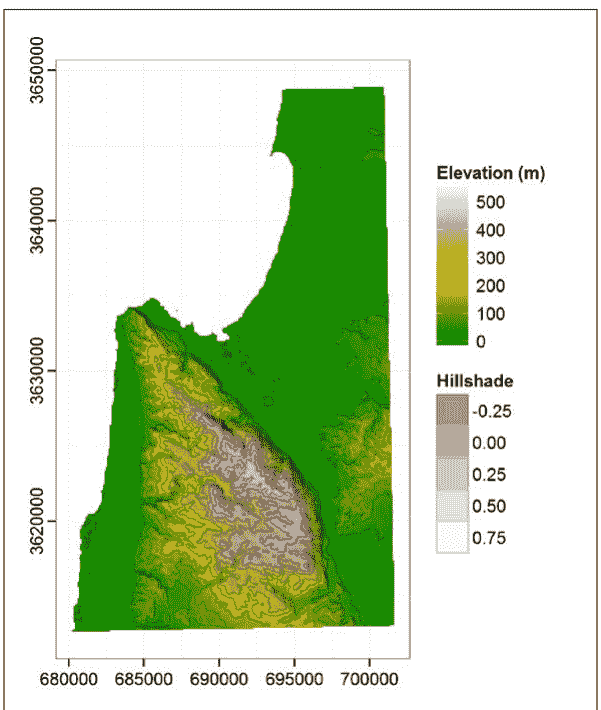

在前面的示例中，我们基于现有栅格的值生成了等高线图（本例中为海法 DEM）。另一种常见的显示等高线的绘图类型是等高线表示点模式中事件的平均密度的绘图。创建密度等高线是减少信息量并使点模式可视化更易理解的常见方法。例如，当我们有很多点相互重叠时，可能很难辨别密度较大和较小的区域。绘制等高线是解决此问题的可能方案。

从点模式创建密度等高线的常用程序是二维核密度估计，可通过基础 R 函数 kde2d 获得。geom_density2d 函数是后者的 ggplot2 适配，使用 kde2d 计算的密度曲面创建等高线。

作为 geom_density2d 的示例，我们将绘制显示海法建筑物平均密度的等高线。

> 需要注意的是，实际上密度估计仅对映射的点模式有意义，即对研究区域内所有事件都已检测到的点模式。当检测不完整时，密度估计显然会在每个位置以未知程度产生偏差。在我们的例子中，例如，如果海法建筑物的 OpenStreetMap 层不完整，则基于它的密度估计将不会很有用，因为它将以未知且可变程度包含低估。

由于密度估计需要点模式，我们需要通过查找建筑物质心将建筑物层转换为点层：

```
> haifa_buildings_ctr = gCentroid(haifa_buildings, byid = TRUE)
> haifa_buildings_ctr = as.data.frame(haifa_buildings_ctr)
> head(haifa_buildings_ctr)
      x       y
1 684013.4 3629679
2 688023.0 3629752
3 687645.0 3627410
4 685913.9 3631217
5 683144.4 3633649
6 683515.3 3628980
```

采用 haifa_relief_shade 绘图，我们现在将添加建筑物点模式（使用 geom_point）和基于该模式的密度等高线（使用 geom_density2d）。使用 scale_x_continuous 和 scale_y_continuous 的 limits 参数，我们还将范围限制在以 haifa_buildings_ctr 为中心的窗口内。此外，等高线的 colour 美学映射到 ..level..，它对应于等高线断点。level 变量被 .. 包围，这是向 ggplot2 发出信号我们指的是由图层本身生成的变量，而不是 data.frame 中存在的变量的一种特殊方式：

```
> haifa_relief_shade +
+ geom_contour(aes(z = elev), colour = "black", alpha = 0.3) +
+ geom_point(data = haifa_buildings_ctr, size = 0.5) +
+ geom_density2d(data = haifa_buildings_ctr,
+ aes(colour = ..level..)) +
+ scale_colour_gradient("Density", low = "blue", high = "red") +
+ scale_x_continuous(
+ limits = c(min(haifa_buildings_ctr$x)-2000,
+ max(haifa_buildings_ctr$x)+2000)) +
+ scale_y_continuous(
+ limits = c(min(haifa_buildings_ctr$y)-2000,
+ max(haifa_buildings_ctr$y)+2000))
```

以下屏幕截图显示了图形输出：

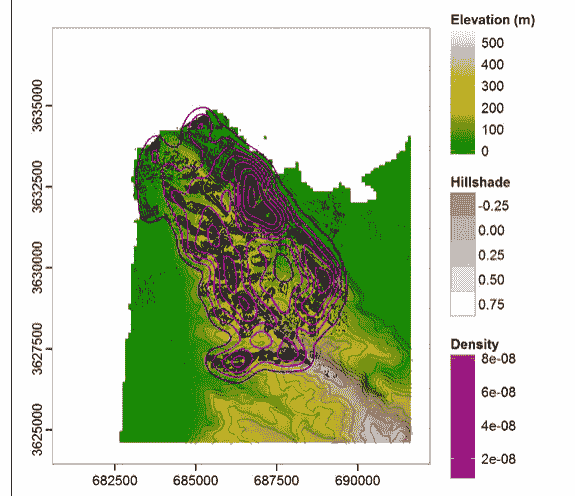

在前面的屏幕截图中，我们看到三种不同的图例，因为有三种不同的比例：高程、hillshade 和建筑物密度。根据此地图（再次假设所有建筑物都已绘制），我们可以看出每单位面积单个建筑物的最高密度出现在迦密山东坡。

本节的最后一个示例将是绘制插值标准化温度图的时序图，我们在上一章中创建了该图。我们已经费心地将数据重塑为整洁的表格；因此，我们不需要进行任何初步处理步骤。使用 spainT 表和以下代码段，我们使用 ggplot2 重现了与上一章中 rasterVis 版本类似的绘图：

```
> ggplot(spainT, aes(x = x, y = y, fill = value)) +
+ geom_raster() +
+ scale_fill_gradient2(
+ expression(paste("Value (", degree, "C)")),
+ low = "blue", high = "red", limits = c(-4,4)) +
+ geom_contour(
+ aes(z = value),
+ colour = "black", size = 0.1, breaks = c(-4:-1,1:4)) +
+ coord_equal() +
+ facet_grid(variable ~ year) +
+ sp_minimal
```

以下屏幕截图显示了图形输出：

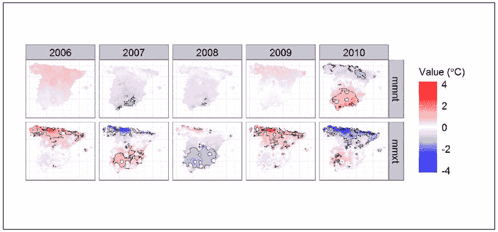


注意我们再次使用了我们自制的 `sp_minimal` 主题来消除坐标轴标注。`geom_contour` 函数已被用来生成等高线，类似于海法 DEM 高程等高线，只是现在我们指定了精确的断点向量，指定了等高线将生成的具体位置。使用 `facet_grid(variable~year)`，我们按 `variable` 将分面排列在行中，按 `year` 排列在列中。

## 从网络添加静态地图

如今，制图师和空间分析师幸运地拥有多种在线资源用于地图创建。我们已经使用了可自由获取的卫星影像、DEM 和行政边界数据集，例如。然而，恢复和处理此类数据集并不总是快速直接的任务。我们可能需要弄清所涉空间位置，搜索可用资源，将其导入 R，等等。另一方面，Google Maps 和 OpenStreetMap 等多个应用程序提供了整个地球的现成地图，具有多种功能，如果每次想要为快速可视化创建背景时自行收集这些功能是不合理的（卫星和航空影像、道路、边界、城镇名称等等）。

`ggmap` 包是 `ggplot2` 的扩展，提供了一个简单的接口来从此类在线资源下载静态地图，并轻松地将其作为背景纳入 `ggplot2` 框架中创建地图时。我们已经使用 `ggmap` 包进行地理编码（参见第 5 章，*使用点、线和多边形*），并提到了 Kahle 和 Wickham（2013）关于该包的介绍性论文。

> 通过静态地图，我们指的是不能通过滚动、放大和缩小等操作进行操纵的地图，与响应此类用户反馈的动态地图相对。整个 `ggplot2` 框架，从这个意义上说，可以被称为静态绘图。应该注意的是，动态图和地图（甚至整个 Web 应用程序；参见 `shiny` 包）也可以在 R 中生成。就动态地图而言，例如，我们已经看到过一个简短的例子，使用 Google Earth 软件作为 R 中动态空间数据显示的平台，使用 `plotKML` 包（参见第 4 章，*使用栅格*）。另一个例子是 `plotGoogleMaps` 包，可用于在 Web 浏览器中交互式 Google Maps 上显示来自 R 的空间数据。

ggmap 中的静态地图集成在实践中相当简单。使用 `ggmap` 包的 `get_map` 函数，我们首先需要下载所需的背景图像。然后，我们可以使用同一包的 `ggmap` 函数将该图像用作背景图层。任何额外的图层和组件都可以像添加到使用 `ggplot` 启动的绘图一样添加到使用 `ggmap` 启动的绘图中。

我们第一个使用 ggmap 的示例将是显示伦敦市的建筑物及其与泰晤士河的距离，正如我们在第 5 章 *使用点、线和多边形* 中承诺的那样。由于使用 `ggmap` 获得的图层始终定义在地理 CRS 中，我们必须首先将要绘制的两个相关图层重新投影到此类 CRS 中。我们将在本例中绘制的图层如下：

- buildings: 伦敦市建筑物
- city: 伦敦市边界多边形

以下表达式将这些图层重新投影并分别保存为新对象 `buildings_geo` 和 `city_geo`：

```r
> buildings_geo = spTransform(buildings,
+ CRS("+proj=longlat +datum=WGS84"))
> city_geo = spTransform(city,
+ CRS("+proj=longlat +datum=WGS84"))
```

要指定我们希望使用 `get_map` 下载地图的位置，我们可以使用建筑物图层质心的坐标，以以下方式获得：

```r
> buildings_ctr = coordinates(gCentroid(buildings_geo))
> buildings_ctr
```

|   | x | y |
|---:|---:|---:|
| 1 | -0.09222641 | 51.51499 |

接下来，我们将对 `buildings_geo` 图层进行 fortify，以便数据以 `data.frame` 对象的形式可用。在本例中，区域是 `osm_id` 属性表列，其中包含唯一的建筑物标识符：

```r
> buildings_f = fortify(buildings_geo, region = "osm_id")
> head(buildings_f)
```

|   | long | lat | order | hole | piece | group | id |
|---:|---:|---:|---:|---:|---:|---:|---:|
| 1 | -0.09962729 | 51.51428 | 1 | FALSE | 1 | 100684524.1 | 100684524 |
| 2 | -0.09952849 | 51.51429 | 2 | FALSE | 1 | 100684524.1 | 100684524 |
| 3 | -0.09942449 | 51.51429 | 3 | FALSE | 1 | 100684524.1 | 100684524 |
| 4 | -0.09941299 | 51.51424 | 4 | FALSE | 1 | 100684524.1 | 100684524 |
| 5 | -0.09951839 | 51.51423 | 5 | FALSE | 1 | 100684524.1 | 100684524 |
| 6 | -0.09961579 | 51.51422 | 6 | FALSE | 1 | 100684524.1 | 100684524 |

与县示例中看到的一样，`fortify` 移除了属性表；因此，我们需要手动将其重新附加：

```r
> colnames(buildings_f)[which(colnames(buildings_f) == "id")] =
+ "osm_id"
> buildings_f = join(buildings_f, buildings@data, "osm_id")
> head(buildings_f)
```

|   | long | lat | order | hole | piece | group | osm_id | name | type | dist_river |
|---:|---:|---:|---:|---:|---:|---:|---:|---|---:|---:|
| 1 | -0.09962729 | 51.51428 | 1 | FALSE | 1 | 100684524.1 | 100684524 | Temple Bar | &lt;NA&gt; | 378.7606 |
| 2 | -0.09952849 | 51.51429 | 2 | FALSE | 1 | 100684524.1 | 100684524 | Temple Bar | &lt;NA&gt; | 378.7606 |
| 3 | -0.09942449 | 51.51429 | 3 | FALSE | 1 | 100684524.1 | 100684524 | Temple Bar | &lt;NA&gt; | 378.7606 |
| 4 | -0.09941299 | 51.51424 | 4 | FALSE | 1 | 100684524.1 | 100684524 | Temple Bar | &lt;NA&gt; | 378.7606 |
| 5 | -0.09951839 | 51.51423 | 5 | FALSE | 1 | 100684524.1 | 100684524 | Temple Bar | &lt;NA&gt; | 378.7606 |
| 6 | -0.09961579 | 51.51422 | 6 | FALSE | 1 | 100684524.1 | 100684524 | Temple Bar | &lt;NA&gt; | 378.7606 |

正如输出所示，每个建筑物现在再次与一个 `dist_river` 值相关联。

最后，我们也将对 `city_geo` 多边形进行 `fortify`。由于它没有感兴趣的属性数据，在这种情况下我们不需要将任何内容连接回 resulting 数据框对象：

```r
> city_f = fortify(city_geo, region = "CTYUA13NM")
> head(city_f)
```

|   | long | lat | order | hole | piece | group | id |
|---:|---:|---:|---:|---:|---:|---:|---:|
| 1 | -0.09671385 | 51.52319 | 1 | FALSE | 1 | City of London.1 | City of London |
| 2 | -0.09669776 | 51.52316 | 2 | FALSE | 1 | City of London.1 | City of London |
| 3 | -0.09664868 | 51.52317 | 3 | FALSE | 1 | City of London.1 | City of London |
| 4 | -0.09662369 | 51.52318 | 4 | FALSE | 1 | City of London.1 | City of London |
| 5 | -0.09646984 | 51.52282 | 5 | FALSE | 1 | City of London.1 | City of London |
| 6 | -0.09601742 | 51.52295 | 6 | FALSE | 1 | City of London.1 | City of London |

检查本例中的 group 列将显示它在所有行中具有相同的值（"City of London.1"），因为 city 图层由单个多边形组成。

图层已准备就绪。剩下的就是下载背景并生成地图。要下载背景，我们将使用 `get_map` 函数。为了有效地使用此函数，我们需要为仅这三个参数提供参数：

- location: 要下载的地图的中心，可以是经度/纬度对。

- maptype: 要下载的地图类型。这是源特定的，但对于 Google Maps（默认数据源），"terrain"、"satellite"、"roadmap" 和 "hybrid" 适用。以下屏幕截图显示了 "hybrid" 地图的示例；"satellite" 示例请参见以下屏幕截图之后。

  > 默认数据源，也是我们在此使用的，是 Google Maps。请注意，`get_map` 在此类情况下使用 Google Static Maps API 下载图像，并且使用此函数即表示您同意 Google Maps API 服务条款（https://developers.google.com/maps/terms）。可以通过修改 `get_map` 的 `source` 参数来选择其他数据源，可能的源为 Google Maps（"google"）、OpenStreetMap（"osm"）、Stamen Maps（"stamen"）或 CloudMade 地图（"cloudmade"）。详情请参阅 `?get_map`。

- zoom: 缩放级别；介于 3 和 21 之间的整数（默认值是 10）。给定地图的最佳缩放值是通过尝试更高的或更低的放大倍数并检查结果来确定的。

在我们的例子中，要获取由照片地图组成的伦敦市静态地图，并在其上标记道路和其他特征（"hybrid" 地图），我们可以使用以下表达式：

```r
> city_map = get_map(location = buildings_ctr,
+ maptype = "hybrid",
+ zoom = 14)
```


现在，仅单独绘制这张地图（例如检查缩放参数的效果）可以通过简单地输入 `ggmap(city_map)` 来完成，它默认返回一个 ggplot 对象，并在图形窗口中绘制——我们之前已经看到过。然而，要添加基于 `buildings_f` 和 `city_f` 对象的补充图层，我们需要使用两个 `geom_polygon` 函数调用将其合并进来。在本例中还引入了一些细微的设置，具体如下：

- 为了使用柔和的颜色，获得更美观的颜色比例，使用了 `scales` 包的 `muted` 函数
- 强制图例标题 `"Distance to river (m)"` 换行是通过使用换行符 `\n` 实现的
- 使用 `labs` 函数可以轻松修改轴标题，而无需使用 `scale` 函数修改比例本身

生成伦敦市建筑地图的代码如下所示：

```
```r
library(scales)
ggmap(city_map) +
+ geom_polygon(data = buildings_f,
+ aes(x = long, y = lat, group = group,
+ fill = dist_river),
+ size = 0.1, colour = "black") +
+ geom_polygon(data = city_f,
+ aes(x = long, y = lat, group = group),
+ colour = "yellow", fill = NA) +
+ scale_fill_gradient2("Distance\nto river (m)",
+ low = muted("blue"), high = muted("red"),
+ midpoint = 500) +
+ labs(x = "Longitude", y = "Latitude")
```
```

生成的地图如下所示的屏幕截图：

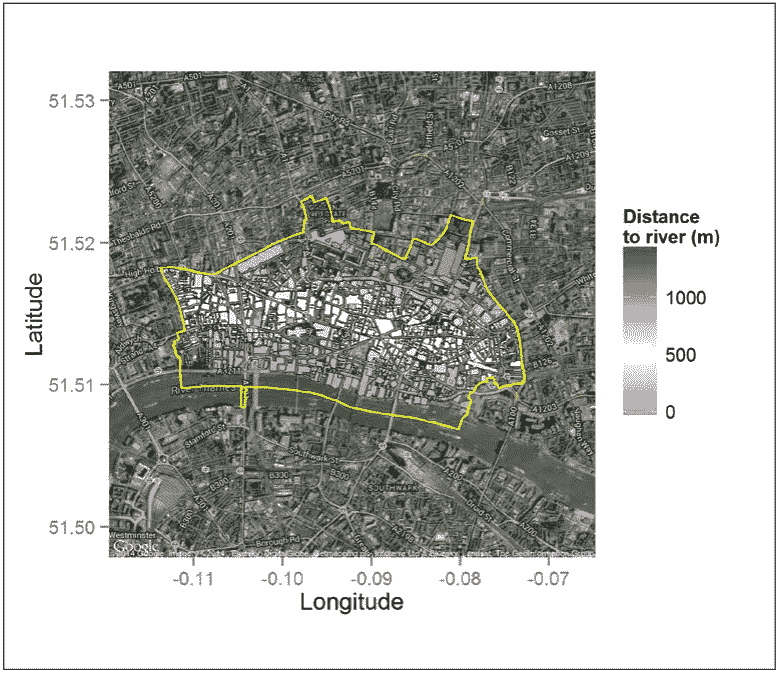

该地图显示了从 Google Maps 下载的伦敦最新“混合”地图，其上叠加了伦敦市边界（黄色）和建筑物（根据其与泰晤士河的距离以蓝至红色显示）。

为了进一步练习使用 ggmap，我们将创建一个包含所有三种矢量图层类型——点、线和多边形——以及从网络下载的静态地图的另一张地图，其组成部分如下：

- 一个“卫星”静态地图背景
- towns：两个城镇位置的点图层（参见第 7 章，组合矢量和栅格数据集）

- `track`：一条 GPS 轨迹的线图层（参见 *第 5 章，处理点、线和多边形*）
- `forests`：两个种植林地的多边形图层（参见 *第 7 章，组合矢量和栅格数据集*）

与前一个示例一样，我们首先需要将所有这些图层带到地理 CRS：

```
> towns_geo = spTransform(towns,
+ CRS("+proj=longlat +datum=WGS84"))
> track_geo = spTransform(track,
+ CRS("+proj=longlat +datum=WGS84"))
> forests_geo = spTransform(forests,
+ CRS("+proj=longlat +datum=WGS84"))
```

接下来，我们需要对线和多边形图层（`track_geo` 和 `forests_geo`）使用 `fortify`，以便将它们转换为 `data.frame` 形式。点图层，如前所述，其结构比线和多边形简单得多，因此它们没有 `fortify` 方法。相反，我们始终可以手动构建一个 `data.frame` 对象来表示点图层。在本例中，例如，`towns_geo` 是一个 `SpatialPoints` 对象，而 `towns_names` 是一个字符向量。使用 `coordinates` 函数和 `data.frame`，我们可以将它们合并为一个 `data.frame` 对象：

```
> towns_f = data.frame(coordinates(towns_geo), name = towns_names)
> towns_f
      lon      lat      name
1 34.87131 31.37936 Lahav Kibbutz
2 34.81695 31.37383        Lehavim
> track_f = fortify(track_geo)
> head(track_f)
     long      lat order piece group id
1 34.85472 31.36520     1     1   0.1  0
2 34.85464 31.36540     2     1   0.1  0
3 34.85458 31.36559     3     1   0.1  0
4 34.85454 31.36519     4     1   0.1  0
5 34.85443 31.36639     5     1   0.1  0
6 34.85445 31.36733     6     1   0.1  0
> forests_f = fortify(forests_geo, region = "name")
> head(forests_f)
     long      lat order hole piece   group    id
1 34.87591 31.33830     1 FALSE     1 Kramim.1 Kramim
2 34.87559 31.33831     2 FALSE     1 Kramim.1 Kramim
3 34.87560 31.33858     3 FALSE     1 Kramim.1 Kramim
```

```
4 34.87528 31.33858    4 FALSE    1 Kramim.1 Kramim
5 34.87529 31.33885    5 FALSE    1 Kramim.1 Kramim
6 34.87529 31.33912    6 FALSE    1 Kramim.1 Kramim
```

这三个 data.frame 对象（towns_f、track_f 和 forests_f）现在已在内存中。缺少的唯一组件只是背景静态地图，可以使用 get_map 按如下方式下载：

```
> forests_ctr = coordinates(gCentroid(forests_geo))
> forests_map = get_map(location = forests_ctr,
+ mapt ype = "satellite",
+ zoom = 12)
```

以下代码用于将所有这些组件组合成一个单一的绘图。请注意，track_f 是通过 geom_path 图层引入的（这是空间线的适当几何图形），而 forests_f 是使用 geom_polygon 引入的。点图层 towns_f 添加为 geom_text 图层，而不是 geom_point，以便将城镇位置显示为名称标签而不是点。geom_text 的 label 美学控制与每个点关联的文本，在我们的例子中是包含城镇名称的 name 列。

```
> ggmap(forests_map) +
+ geom_polygon(data = forests_f,
+ aes(x = long, y = lat, group = group, colour = id),
+ fill = NA) +
+ geom_path(data = track_f,
+ aes(x = long, y = lat),
+ colour = "yellow") +
+ geom_text(data = towns_f,
+ aes(x = lon, y = lat, label = name),
+ colour = "white", size = 2.5, fontface = "bold") +
+ scale_colour_discrete("Forest") +
+ labs(x = "Longitude", y = "Latitude")
```

生成的地图如下所示的屏幕截图中所示：

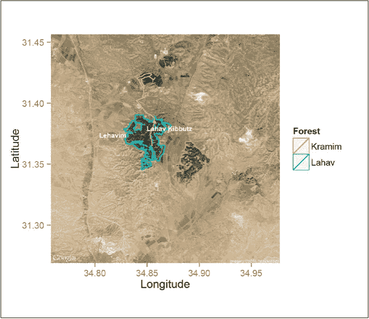

该地图显示了城镇位置（作为白色文本标签）、GPS 轨迹（作为黄色线）以及森林边界（作为多边形，边框颜色根据森林身份）。

## 使用 lattice 进行 3D 绘图

三维可视化虽然对于某些目的来说是不理想的（例如在科学文献中精确解释很重要），但仍然可以特别令人印象深刻且美观。在本节中，我们将使用 lattice 创建空间和非空间数据的三维绘图，这是 ggplot2 无法实现的，因为它只允许二维绘图。lattice 图形框架和语法与 ggplot2 一样复杂，单节内容远不足以全面回顾该主题。我们在这里的目的要谦虚得多：展示可以实现的一些内容，并激发感兴趣的读者进一步调查。有关 lattice 的更多信息，读者可参考包作者 Deepayan Sarkar 的权威概述，Lattice: Multivariate Data Visualization with R, Springer，于 2008 年出版。

正如第 2 章《处理向量和时间序列》中已提到的，lattice 是一个 R 包，定义了 R 中的图形系统（除了 base R 和 ggplot2）。事实上，我们已经间接使用过 lattice，因为 rasterVis 包中的 levelplot 函数是 lattice 中同名函数的改编。

> 值得注意的是，lattice 并不是 R 中可用于三维可视化的唯一包。最著名的替代方案是 base R 函数 persp，可用于创建与我们将使用 lattice 创建的绘图类似的绘图，以及 rgl 包，允许您创建动态、可旋转的 3D 绘图。


一般来说，有两种主要类型的三维绘图。我们可以绘制点（也称为点云或 3D 散点图）或网格/曲面。在这两种情况下，输入数据均以 (x,y,z) 坐标集的形式给出，但要创建网格，这些点需要在 x 和 y 轴上等间距，而点云则没有此类限制。例如，在统计学中，我们可能有一个包含两个自变量和一个因变量的数据集，我们可能希望绘制观察到的数据点（作为 3D 空间中的点）、回归模型生成的预测曲面（作为 3D 网格），或两者兼而有之。在 lattice 中，cloud 函数可用于创建三维散点图，而 wireframe 函数可用于绘制三维网格。在接下来的两个示例中，我们将集中于 wireframe，但请记住，点可以用 cloud 以基本相同的方式绘制。


我们的第一个示例将使用已经熟悉的海法DEM，这次我们将为该栅格创建一个三维表示。将数据传递给 lattice 的最佳方式是通过 data.frame 对象（尽管与 ggplot2 不同，其他选项也是可行的）。要创建三维图形，data.frame 需要包含三列，分别保存 x、y、z 坐标。以下代码段在 DEM 经过五倍聚合（以使网格更稀疏、视觉上更简单）后，创建一个名为 dem_df 的 data.frame：

```
> dem_df = as.data.frame(aggregate(dem, 5), xy = TRUE)
> dem_df = dem_df[complete.cases(dem_df), ]
> colnames(dem_df)[3] = "z"
> head(dem_df)
          x       y     z
123 693841.3 3648773  4.000000
124 694291.3 3648773  5.647059
125 694741.3 3648773  7.250000
126 695191.3 3648773  6.500000
127 695641.3 3648773  9.550000
128 696091.3 3648773 11.300000
```

在应用 wireframe 之前，我们需要确定三维图形的正确长宽比。包含图形的三维盒子尺寸的默认长宽比为 1:1:1，对应于 x、y、z 轴的长度，因此盒子呈立方体。该比例通过 wireframe 的 aspect 参数指定，该参数接受一个包含 y/x 和 z/x 比值的二元素向量（默认为 c(1,1)）。对于 dem_df 而言，数据在三个轴上都表示地理距离。除非我们的 DEM 恰好是一个立方体地理范围，否则这些长宽比是不合适的。例如，与 ggplot2 生成的二维图形类似，我们通常希望 x 和 y 轴上的单元尺寸相等。要做到这一点，我们需要 y/x 比值与 y 和 x 坐标范围的比值相对应。例如，如果我们的 DEM 表示 x 轴上 100 米、y 轴上 200 米的矩形，为了用 wireframe 正确表示它，我们必须指定 y/x 长宽比为 2（200/100）。在我们的例子中，每个轴上的取值范围如下：

```
> x_range = diff(range(dem_df$x, na.rm = TRUE))
> x_range
[1] 21600
> y_range = diff(range(dem_df$y, na.rm = TRUE))
> y_range
[1] 36000
> z_range = diff(range(dem_df$z, na.rm = TRUE))
> z_range
[1] 527.0933
```

因此，正确的 y/x 比值等于 y_range/x_range，即 1.666667。至于 z/x 比值，由于 z 轴范围为 527.0933（即 DEM 最低点与最高点之间的高差，单位为米），远小于 x 轴或 y 轴的范围，如果按照高程与 x-y 距离之间的真实比例（z_range/x_range 或 0.02440247）绘制三维图形，生成的图像会非常扁平，地形起伏几乎无法显现。除非我们制作的是一幅小范围且地形非常陡峭的图像，否则在三维地形图中使用夸大的 z 与 x-y 距离比值是非常常见的做法，这样能使地形更加直观。选择 z/x 长宽比实际上是一个品味问题。对于这个特定的图形，我们选择了七倍夸张，但更低或更高的值也是合适的。显然，当此类图像用于出版物时，必须声明使用了垂直夸张。

既然我们已经确定了要使用的长宽比，现在就可以对 dem_df 应用 wireframe 了。让我们先看一下代码和生成的图像，然后解释其组成部分：

```
> library(lattice)
> wireframe(z ~ x * y,
+ data = dem_df,
+ drape = TRUE,
+ colorkey = TRUE,
+ col.regions = terrain.colors(100),
+ screen = list(z = 165, x = -60, y = 0),
+ aspect = c(y_range/x_range, 7*(z_range/x_range)),
+ zoom = 1.1)
```

下面的截图显示了图形输出：

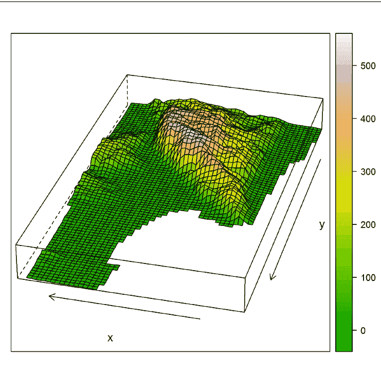

首先要注意的是，`lattice` 语法与基础 R 绘图类似，即每种图形类型都有相应的绘图函数（如 `plot` 或 `wireframe`），并且每个函数都有一组参数，覆盖该图形类型所有可修改的元素。这与 `ggplot2` 的方法截然不同，后者的图形是通过多次函数调用逐层构建的，而不是使用单个函数。

至于我们在这里使用的参数集（这只是 wireframe 全部参数中的一小部分），以下是对每个参数的简要说明：

- **`x:`** 当 `data` 是 `data.frame` 对象时，该参数应为一个指定要使用的列的公式，即一个 `formula` 对象，其中因变量位于 `~` 运算符左侧，自变量位于右侧，并用 `*` 分隔（例如，`z ~ x * y` 表示我们绘制 `z` 作为 `x` 和 `y` 的函数）。
- **`data:`** 提供值的 `data.frame`。
- **`drape:`** 决定表面是否用颜色覆盖（`TRUE`）还是保持为相交线的简单骨架（`FALSE`）。
- **`colorkey:`** 决定是否在图形旁边绘制图例（`TRUE`）或不绘制（`FALSE`）。
- **`col.regions:`** 用于绘制表面的颜色向量，类似于 `ggplot2` 中的 `colours` 参数。
- **`screen:`** 一组定义视角的参数，通过指定相对于原点的 x、y、z 旋转来设置视向（要想得到一组给出理想透视效果的角度，确实需要反复试错）。
- **`aspect:`** 包含图形的三维盒子的长宽比。前面已经讨论过这个参数的作用。在本例中，通过 `7*(z_range/x_range)` 将真实的 z/x 比值乘以 7，从而指定 z 轴七倍夸张。
- **`zoom:`** 用于放大或缩小图形的比例因子。

重要的是要记住，三维图形适用于展示任何类型的三维数据集，而不仅仅是地形表面。例如，回到我们从 MODIS 影像时间序列创建的空间-时间数据集 s（参见第 6 章“修改栅格与分析栅格时间序列”），我们可以用以下方式生成三维图像：

- x 轴为时间
- y 轴为空间（本例中为 y 坐标）
- z 轴为 NDVI

与前面的示例类似，我们首先必须从栅格 s 创建一个 data.frame 对象，并将其命名为 s_df。通过结合使用 as.matrix 和 as.data.frame，我们可以将 s 转换为一个 data.frame，其列对应 s 的列，行对应 s 的行（请记住，直接在栅格上使用 as.data.frame 会得到行表示栅格单元格的 data.frame，这不是我们在这里想要的）：

```
> s_df = as.data.frame(as.matrix(s))
```

由于我们知道 s 的列代表影像获取日期，我们可以将日期赋为列名：

```
> colnames(s_df) = dates$date
> s_df[1:5, 1:5]
      2000-02-18 2000-03-05 2000-03-21 2000-04-06 2000-04-22
1     0.341684  0.397015  0.408640  0.416793  0.359633
2     0.341664  0.396391  0.428758  0.427817  0.352741
3     0.349044  0.405022  0.426911  0.429224  0.352297
4     0.351129  0.413696  0.434334  0.417303  0.344761
5     0.358012  0.408954  0.439244  0.411540  0.344320
```

由于我们还知道 s 的行对应 y 轴空间坐标，我们可以将这些坐标赋给一个额外的列（名为 coord）。要获取栅格 y 坐标的向量，可以使用 raster 包中的 yFromRow 函数。之后剩下要做的就是融合 data.frame，以便将日期从单独的列移动到同一列中：

```
> s_df$coord = yFromRow(s)
> s_df = melt(s_df,
+ id.vars = "coord",
+ variable.name = "date",
+ value.name = "ndvi")
> head(s_df)
  coord       date     ndvi
1 3494750 2000-02-18 0.341684
2 3494250 2000-02-18 0.341664
3 3493750 2000-02-18 0.349044
4 3493250 2000-02-18 0.351129
5 3492750 2000-02-18 0.358012
6 3492250 2000-02-18 0.342920
```

我们在这里得到的是一个表示规则（在 x-y 方向上）三维网格的 data.frame，因此原则上一切已准备好应用 wireframe。然而遗憾的是，lattice 没有自动的方法来格式化日期值并绘制合适的刻度线和标签（例如我们之前在使用 ggplot2 的 scale_x_date 时所看到的那样）。因此，我们不得不放弃 s_df 中 date 列的 Date 格式。由于我们拥有的是年度尺度的序列，一种生成合适标签的简单方法是将日期转换为表示年份小数的数值。例如，2000-1-1 可以变为 2000，2000-1-2 可以变为 2000+1/365=2000.003，依此类推。虽然编写一个自己的函数来进行这种计算并不困难，但 lubridate 包中已经有一个函数可以做到这一点，名为 decimal_date：

```
> library(lubridate)
> s_df$date = decimal_date(as.Date(s_df$date))
> head(s_df)
     coord    date     ndvi
1 3494750 2000.131 0.341684
2 3494250 2000.131 0.341664
3 3493750 2000.131 0.349044
4 3493250 2000.131 0.351129
5 3492750 2000.131 0.358012
6 3492250 2000.131 0.342920
```

> lubridate 包包含一组非常有用的便捷函数，可以比基础 R 包更轻松地处理日期和时间。有关该包的更多信息，请参阅 Grolemund 和 Wickham（2011）的介绍性论文。

现在可以将生成的 data.frame 传递给 wireframe：

```
> wireframe(ndvi ~ date * coord,
+ data = s_df,
+ drape = TRUE,
+ arrows = FALSE,
+ col.regions =
+ colorRampPalette(c("darkred","white","darkblue"))(100),
+ screen = list(z = 15, x = -55, y = 10),
+ aspect = c(0.3, 0.2),
+ panel.aspect = c(0.45),
+ lty = 0,
+ scales = list(arrows = FALSE, cex = 0.6),
+ xlab = list("Time"),
+ ylab = list("Y", cex = 0),
+ zlab = list("NDVI", cex = 0),
+ zoom = 0.95)
```


## 总结

在本章中，你学习了在 R 中使用 ggplot2、ggmap 和 lattice 包进行空间数据高级可视化的一些最有用的方法。展示了如何使用这些工具在 R 环境中完成空间分析流程，并创建可发表的结果地图和图表。在此背景下，指出并非所有事情都能在 R 中完成，有时我们需要迁移到传统的 GIS 软件或图形编辑器，以交互式地定制图形输出。尽管如此，R 中的可视化极其灵活，同时也带来了编程的所有好处。一旦你对本章介绍的技术更加熟悉，R 几乎不可避免地会成为数据可视化的首选工具。我衷心希望，在完成本书后，你对 R 中的地理空间数据分析也有同样的感受。
