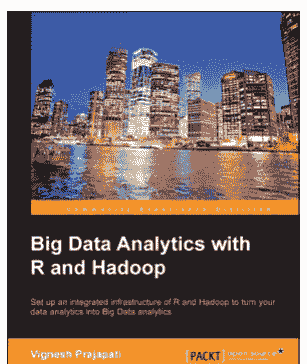
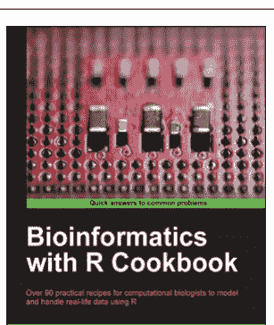
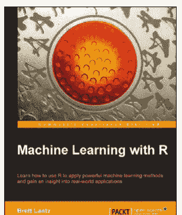
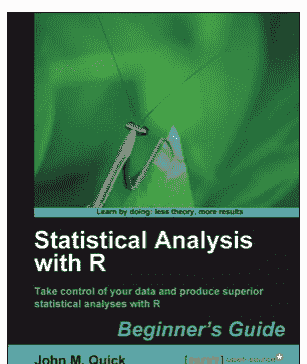

# B
Cited References

现在我们已经涵盖了所有内容，让我们看一些进一步阅读的外部参考资料：

- Bivand, R. S., Pebesma, E. J., and Gómez-Rubio, V. *Applied Spatial Data Analysis with R Second Edition.* Springer. 2013.
- Chang, W. *R Graphics Cookbook.* O'Reilly Media. 2012.
- Cowpertwait, P. S. P. and Metcalfe, A. V. *Introductory Time Series with R.* Springer. 2009.
- Diggle, P. and Ribeiro, P. J. *Model-based Geostatistics.* Springer. 2007.
- Grolemund, G. and Wickham, H. "Dates and Times Made Easy with lubridate". Journal of Statistical Software. 2011. http://www.jstatsoft.org/v40/i03/paper.
- Hengl, T. "A practical guide to geostatistical mapping of environmental variables". JRC Scientific and Technical Reports. 2007. http://spatial-analyst.net/book/.
- Hengl, T., Roudier, P., Beaudette, D., and Pebesma, E. "plotKML: Scientific Visualization of Spatio-Temporal Data". Journal of Statistical Software. 2014. http://cran.r-project.org/web/packages/plotKML/vignettes/jss1079.pdf.
- Kahle, D. and Wickham, H. "ggmap: Spatial Visualization with ggplot2". The R Journal. 2013. http://journal.r-project.org/archive/2013-1/kahle-wickham.pdf.
- Lamigueiro, O. P. *Displaying Time Series, Spatial, and Space-Time Data with R.* CRC Press. 2014.
- Murrell, P. *Introduction to Data Technologies.* CRC Press. 2009. https://www.stat.auckland.ac.nz/~paul/ItDT/.

## 引用参考文献

- Pebesma, E. "spacetime: R中的时空数据". 统计软件杂志. 2012年. http://www.jstatsoft.org/v51/i07/paper.
- Sarkar, D. *Lattice: 使用R进行多元数据可视化*. Springer出版社. 2008年.
- Van der Loo, M. P. J. 和 de Jonge, E. *学习RStudio进行R统计计算*. Packt出版社. 2012年.
- Wickham, H. "使用reshape包重塑数据". 统计软件杂志. 2007年. http://www.jstatsoft.org/v21/i12/paper.
- Wickham, H. *ggplot2: 数据分析的优雅图形*. Springer出版社. 2009年.
- Wickham, H. "数据分析的拆分-应用-合并策略". 统计软件杂志. 2011年. http://www.jstatsoft.org/v40/i01/paper.
- Wickham, H. "整洁数据". 统计软件杂志. 2014年. http://www.jstatsoft.org/v59/i10/paper.
- Wickham, H. *高级R*. CRC出版社. 2014年. http://adv-r.had.co.nz/.

## 索引

### 符号

### A

3D 绘图
  使用 lattice 创建 322-329
%in% 运算符 35
: 运算符 38

abline 函数 233
美学映射 285
aggregate 函数 185
西班牙年气温
  映射 268-278
apply 函数
  用于自动计算 78
  使用方法 83, 84
参数
  为参数设置默认值 47
数组
  栅格转换 122, 123
  用于表示多个二维数据 105, 106
  使用方法 102
赋值运算符 (=)
  关于 31
  用于保存对象 30, 31
as.vector 函数 104
矢量图层属性表
  访问 142-145
autofitVariogram 函数 260

### B

### C

基础图形
  用于显示向量 56-59

计算
  在向量上执行含缺失值的计算 45
计算器
  将R用作计算器 9-11
校准数据，空间插值
  协变量 242
  实地测量 242
字符值
  转换为日期 50-53
聚类分组 195-197
代码执行
  使用条件语句控制 75-77
  控制 75
  使用循环 77, 78
逗号分隔值文件。参见 CSV 文件
R综合档案网络 (CRAN) 85
条件语句
  用于控制代码执行 75-77
贡献包
  使用方法 85, 86
坐标参考系 (CRS) 108
协变量
  关于 242

  在通用克里金（UK）插值中使用 264-267
CSV 文件
  从其中读取气候数据 49
  写入 data.frame 对象 74
  创建表格 67, 68

### D

数据字段
  计算 73
data.frame 类
  用于表格数据表示 64
data.frame 对象
  检查对象结构 68, 69
  子集操作 70-72
  写入 CSV 文件 74
R 数据结构
  在结构中存储数据 23
  向量 28
日期序列
  将字符值转换为日期 50
  从CSV文件读取气候数据 49
  基于日期进行子集操作 55
  使用方法 48
dcast
  用于长格式和宽格式之间的转换 86-90
ddply 函数
  用于聚合 91-96
默认向量
  创建 39
确定性模型
  关于 242
  示例 242
数字高程模型 (DEM) 107, 335

### E

相等条件运算符 (==) 31
错误消息
  处理 20
表达式
  算术运算符 15, 18
  错误消息 20
  求值 15
  使用函数 18
  帮助页面 21
  逻辑运算符 15-18
  警告 20
extend 函数 189
外部数据集 331-335
外部参考资料 337
extract 函数 232

### F

facet_grid 函数 294
分面 287
facet_wrap 函数 294
联邦信息处理标准 (FIPS) 140
焦点过滤 196
focal 函数 195
fortify 函数 299
函数
  关于 45
  调用以执行操作 23
  为参数设置默认值 47
  定义 46
  使用方法 18
  与多个参数一起使用 37
函数调用
  提供多个参数 37, 38

### G

gDifference 函数 165, 169
gDistance 函数 171, 227
geocode 函数 136
geom_contour 函数 287
geom_density2d 函数 287
矢量图层的几何属性
  逻辑值 152
  数值 152
  空间图层 152
  处理方法 151-155
矢量图层几何体
  与表格数据连接 172-177
  线 139
点 135
多边形 140
开源几何引擎 (GEOS) 152
地理空间数据抽象库 (GDAL) 107
ggmap
  用于绘图 282
ggplot2
  一体化环境 298
  自动化 298
  概述 282-291
  预定义主题 288
  可重现性 298
  保存 296, 297
  URL 284
  用于绘图 282
ggsave 函数 296
gIntersection 函数 165-169
gIsValid 函数 156
GPS 交换格式 (GPX) 139
图形函数
  关于 56
  R 中的图形系统 60, 61
  保存输出 59
  用于显示向量 58, 59
R 中的图形系统
  基础图形 60
  ggplot2 60
  lattice 60
gstat.cv 函数 255

### H

hillShade 函数 199, 201
山体阴影图层 199

### I

Inkscape
  URL 291
集成开发环境 (IDE) 11
插值方法
  反距离加权（IDW）插值 249
  普通克里金（OK）插值 249
  通用克里金（UK）插值 249
反距离加权（IDW）插值
  使用方法 249-257

### J

连接操作
  用于连接表格 96-99

### L

lattice
  关于 60, 61
  用于创建 3D 绘图 322-329
图层
  构成部分 285
  函数 286
留一交叉验证 (LOOCV) 255
length 函数 40
levelplot 函数 116
光探测与测距 (LIDAR) 180
线 139
R 逻辑运算符 16, 17
逻辑向量
  用于向量子集操作 42
循环
  用于执行代码段 77, 78

### M

mask 函数 217
矩阵
  栅格转换 122, 123
  用于表示二维数据 102-105
  使用方法 102
matrix 函数参数
  byrow 102
  data 102
  ncol 102
  nrow 102
melt 函数
  用于长格式和宽格式之间的转换 86-90
merge 函数 181
缺失值
  处理 43
  检测向量中的缺失值 44
  对数据的影响 43
  用于在向量上执行计算 45
多波段栅格
  创建 110, 111

### N

最近邻插值
  使用方法 246-249
近红外 (NIR) 109
非空间数据
  绘图 291-296
归一化植被指数 (NDVI) 117
非数值 (NaN) 20
索引数值向量
  用于向量子集操作 40, 41

### O

对象
  从内存中删除 32
  使用赋值运算符保存 30, 31
R 对象类型
  关于 21, 22
  在数据结构中存储数据 23
  函数 23
  示例会话 23-25
普通克里金（OK）插值
  关于 249
  使用方法 258-262
叠加操作，栅格 123-128

### P

paste 函数 35
plotRGB 函数 149
点数据
  空间插值 242-245
点
  关于 135-138
  用于栅格值提取 230-234
多边形
  关于 140
  用于栅格值提取 235-238
R 预定义符号
  FALSE 20
  Inf 20
  NA 20
  NULL 20
projectRaster 函数 192

### R

R
  下载 8
  安装 7, 8
  对象类型 21
  URL 8
  用作计算器 9, 10
R 符号
  %b 52
  %B 52
  %d 52
  %m 52
  %y 52
  %Y 52
栅格
  关于 102
  聚合 184, 185
  代数 123
  从矢量图层创建 212
  裁剪 183, 184
  数据结构 107
  解聚 184, 186
  写入文件 112
  合并 182
  创建多波段栅格 110
  多图层子集 120, 121
  叠加操作 123
  探索属性 112-116
  重分类 123
  更改分辨率 180, 181
  创建单波段栅格 108
  更改空间范围 180, 181
  子集操作 117-119
  转换为数组 122, 123
  转换为矩阵 122, 123
  修剪 183, 184
  以向量形式访问值 119
  使用矩阵符号访问值 120
  掩膜处理值 216-219
  重分类值 129-131
  从中创建矢量图层 220
栅格代数 123-128
栅格文件
  写入 112
rasterize 函数
  关于 212, 214
  字段参数 215
  fun 参数 215
栅格重投影
  关于 186, 192-194
  使用 projectRaster 函数 192
栅格重采样
  关于 186-191
  使用 resample 函数 186, 187
栅格到等高线转换 222-224
栅格到点转换 220-222
栅格到多边形转换 224-230
栅格值提取
  使用点 230-234
  使用多边形 235-238
rasterVis 包
  URL 116
栅格值
  以向量形式访问 119
  使用矩阵符号访问 120
  重分类 129-131
R 代码
  编辑方法 11-13
向量循环利用原则 36, 37
重复向量
  创建 39
resample 函数 186
R 图形用户界面 (RGui) 9
均方根误差 (RMSE) 241
row.names 函数 154
RStudio
  安装 14
  URL 14, 15
  使用方法 14

### S

尺度 287
sep 参数 35
seq 函数 37
多个参数
  与函数一起使用 37
短波红外 (SWIR) 109
航天飞机雷达地形测绘任务 (SRTM) 180
单波段栅格
  创建 108, 109
空间数据
  绘图 297-313
空间维度 206-210
点数据的空间插值
  关于 242
  在通用克里金（UK）插值中使用协变量 264
  使用反距离加权（IDW）插值 249
  使用最近邻插值 246
  使用普通克里金（OK）插值 258
  执行 242-245
空间预测模型
  校准 242
  确定性模型 242
  选择 243
  统计模型 242
空间栅格
  表示 108

spatial relations, between vector layer
  about 156
  distances between
    geometries, calculating 171
  new geometries, creating 165-170
  relations, querying 157-164
spatio-temporal raster data
  aggregating 201
  spatial dimensions 206-209
  time dimension 201-206
SRTM data
  URL 180
static maps
  adding, from Web 313-321
statistical model
  about 242
  examples 242
stringsAsFactors parameter 65
substrings 39
T
table
  creating, from CSV file 66-68
  creating, from separate vectors 64, 65
  data fields, calculating 73
  data.frame object structure,
    examining 68, 69
  data.frame object, subsetting 70-72
  data.frame object, writing to CSV file 74
tables
  aggregating 84
  contributed packages, using 85, 86
  joining, with join operation 96-99
  reshaping 84
tabular data
  geometries, joining with 172
  representing, with data.frame class 64
tapply function
  used, for applying function 79-82
  used, for automated calculations 78
text function 154
themes 287
Thiessen polygon 249
time dimension 201-206
time series
  examining 54
  working with 48
Tinn-R text editor
  URL 13
topographic aspect
  calculating 198
topographic slope
  calculating 198
topography-related calculations
  aspect, calculating 198
  elevation data, using 198
  hillshade layer 199, 201
  slope, calculating 198
trim function 184
two-dimensional data
  representing, with matrix 102-105
U
Universal Kriging (UK) interpolation
  about 249
  covariates, using 264-267
V
values
  masking, in raster 216-219
vector layer
  attribute table, accessing 142-145
  geometrical calculations 147
  geometrical properties,
    working with 151-156
  relations, querying between 157-163
  reprojecting 147-151
  spatial relations 156
  subsetting 145, 146
vector layer, properties
  attribute table 134
  attribute table, accessing 143
  creating, from raster 220
  data structures 134
  examining 141
  exploring 140
  geometry component 134
  properties, exploring 140
  raster, creating from 212
  rasterizing 212-215
  raster-to-contours conversion 222, 223
  raster-to-points conversion 220-222
  raster-to-polygons conversion 224-230
  subsetting 140
vectors
  about 28
  assignment operator, used for
    saving object 30, 31
  default vectors, creating 39
  displaying, with base graphics 56-59
  element-by-element operations 34, 35
  missing values, detecting 44
  missing values, used for performing
    calculations 45
  objects, removing from memory 32
  properties, summarizing 32-34
raster values, accessing as 119
recycling principle 36, 37
repetitive vectors, creating 39
subsetting 40
subsetting, with logical vectors 42
subsetting, with numeric
  vectors of indices 40, 41
types 28, 29
vectors, types
  logical vector 29
  sequential numeric vectors 28
Voronoi polygon 249

W

warning
  dealing with 20
Web
  static maps, adding 313-321

# 感谢您购买
Learning R for Geospatial Analysis

# 关于 Packt Publishing

Packt，发音为 'packed'，于 2004 年 4 月出版了第一本书 *Mastering phpMyAdmin for Effective MySQL Management*，随后继续专注于出版关于特定技术和解决方案的高度聚焦的书籍。

我们的书籍和出版物分享了您同行的 IT 专业人士在适应和定制当今系统、应用程序和框架方面的经验。我们的解决方案型书籍为您提供定制您正在使用的软件和技术以完成工作的知识和能力。Packt 的书籍比您过去看到的 IT 书籍更具体、更少泛泛而谈。我们的独特商业模式使我们能够为您提供更集中的信息，让您获得更多所需了解的内容，而非不需要的内容。

Packt 是一家现代而独特的出版公司，专注于为开发者、管理员和新手社区生产高质量的前沿书籍。有关更多信息，请访问我们的网站 www.packtpub.com。

# 关于 Packt Open Source

2010 年，Packt 推出了两个新品牌 Packt Open Source 和 Packt Enterprise，以便继续专注于专业化。本书是 Packt Open Source 品牌的一部分，该品牌出版关于以开源许可证构建的软件的书籍，并为从高级开发者到初级网页设计师的任何人提供信息。Open Source 品牌还运营着 Packt 的 Open Source 版税计划，通过该计划，Packt 为每本售出书籍所介绍的开源项目支付版税。

# 为 Packt 撰写

我们欢迎所有有兴趣撰写的作者的咨询。书稿提案应发送至 author@packtpub.com。如果您的书稿想法仍处于早期阶段，您希望在撰写正式书稿提案之前先讨论，那么请联系我们；我们的编辑之一会与您联系。

我们不仅寻找已出版的作者；如果您拥有强大的技术技能但没有写作经验，我们经验丰富的编辑可以帮助您发展写作事业，或为您提供专业知识的额外回报。

# PACKT open source
PUBLISHING
community experience distilled

# Big Data Analytics with R and Hadoop

ISBN: 978-1-78216-328-2      Paperback: 238 pages

Set up an integrated infrastructure of R and Hadoop to turn your data analytics into Big Data analytics

+   1. Write Hadoop MapReduce within R.
+   2. Learn data analytics with R and the Hadoop platform.
+   3. Handle HDFS data within R.
+   4. Understand Hadoop streaming with R.

# Bioinformatics with R Cookbook

ISBN: 978-1-78328-313-2      Paperback: 340 pages

Over 90 practical recipes for computational biologists to model and handle real-life data using R

+   1. Use the existing R packages to handle biological data.
+   2. Represent biological data with attractive visualizations.
+   3. An easy-to-follow guide to handle real-life problems in bioinformatics such as next-generation sequencing and microarray analysis.

# PACKT PUBLISHING open source community experience distilled

# Machine Learning with R

ISBN: 978-1-78216-214-8      Paperback: 396 pages

Learn how to use R to apply powerful machine learning methods and gain an insight into real-world applications

+   1. Harness the power of R for statistical computing and data science.
+   2. Use R to apply common machine learning algorithms with real-world applications.
+   3. Prepare, examine, and visualize data for analysis.
+   4. Understand how to choose between machine learning models.

# Statistical Analysis with R

ISBN: 978-1-84951-208-4      Paperback: 300 pages

Take control of your data and produce superior statistical analyses with R

+   1. An easy introduction for people who are new to R, with plenty of strong examples for you to work through.
+   2. This book will take you on a journey to learn R as the strategist for an ancient Chinese kingdom!
+   3. A step-by-step guide to understand R, its benefits, and how to use it to maximize the impact of your data analysis.

Please check www.PacktPub.com for information on our titles

