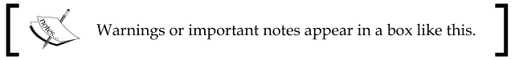

### 前言

《Learning Raphaël JS Vector Graphics》带你探索 Raphaël JavaScript 库及其在当今在线环境中的潜在应用。虽然它是一本“迷你”书，但绝非功能有限。本书涵盖了该库的所有主要方面及其应用，读完本书后，你将能够在浏览器中创建矢量图形和交互式应用程序。

### 本书内容

第 1 章，图形 Web，介绍了 Raphaël：它是什么，它的应用，以及它在 Web 环境中的相关性。

第 2 章，使用 Raphaël 进行基础绘图，探讨如何绘制和装饰基本图形元素。

第 3 章，绘制路径，介绍使用路径绘制和操作更复杂形状的方法。

第 4 章，变换和事件处理，介绍图形元素的变换、基础事件处理、Events 库以及拖放功能。

第 5 章，矢量动画，探讨如何通过动画让元素“活”起来。我们将探讨不同的图形动画方式，并以示例引导。

第 6 章，处理现有 SVG，介绍如何使用 Raphaël 处理现有 SVG，包括 Inkscape 概述和栅格地图讨论。

第 7 章，创建社交媒体可视化套件，探讨基于前面章节所学内容构建四个社交媒体数据可视化演示。

### 适合读者

本书适合所有对前端技术感兴趣的开发者。
非常适合那些希望在 Web 浏览器中创建交互式应用程序或矢量图形的人。

假设读者具备 JavaScript 的基础理解或熟悉度。

### 约定

在本书中，你会发现多种文本样式，用于区分不同类型的信息。以下是一些示例及其含义说明。

正文中的代码词显示如下："使用命令小写形式的等效路径为 "M 50,150 q 175,-130 350,0"，其中 (x, y) 和 (x1, y1) 参数是相对距离..."

代码块显示如下：

```
var bBox = path.getBBox(); // width/height of icon
var xTranslation = (bBox.width + 4) * i;
var yTranslation = (bBox.height + 4) * j;
path.transform(['T', xTranslation, yTranslation]);
```

当我们希望引起你对代码块中特定部分的注意时，相关行或项目将以粗体显示：

```
paths[i].animate({
    subtend: [360, cx, cy, r]
}, interval, function() {
    paths[i].remove();
    setTimeout(function() {
        update(i);
    });
});
```




### 读者反馈

我们始终欢迎读者反馈。请告诉我们你对本书的看法——你喜欢或不喜欢的地方。读者反馈对我们开发真正让你受益的书籍非常重要。

如需发送一般反馈，只需发送电子邮件至 <feedback@packtpub.com>，并在邮件主题中注明书名。

如果你在某个主题上有专业知识，并有兴趣撰写或参与编写书籍，请参阅我们在 www.packtpub.com/authors 上的作者指南。

### 客户支持

既然你是 Packt 图书的自豪拥有者，我们有许多资源可以帮助你充分利用购买。

### 下载示例代码

你可以从 http://www.packtpub.com 的账户中下载所有已购买 Packt 图书的示例代码文件。如果你在其他地方购买了本书，可以访问 http://www.packtpub.com/support 并注册，以便文件直接发送到你的邮箱。

本书中每个代码示例的演示可在 http://raphaelsj vectorgraphics.com 找到。我们强烈建议读者在阅读本书的同时打开演示，以便更好地理解所涵盖的内容。

### 下载本书的彩色图片

我们还提供一个包含本书中截图/图表彩色图片的 PDF 文件。彩色图片将帮助你更好地理解输出/结果的变化。

你可以从 http://www.packtpub.com/sites/default/ files/downloads/9161OS_Images.pdf 下载此文件。

### 勘误

尽管我们已尽力确保内容的准确性，但错误难免会发生。如果你在我们的某本书中发现错误——无论是文本还是代码中的错误——我们将不胜感激如果你能将其报告给我们。这样做，你可以帮助其他读者避免沮丧，并帮助我们改进本书的后续版本。如果你发现任何勘误，请访问 http://www.packtpub. com/support，选择你的书，点击 **errata submission form** 链接，并输入你的勘误详细信息。一旦你的勘误得到验证，你的提交将被接受，勘误将上传到我们的网站，或添加到该书名下勘误部分的任何现有勘误列表中。

### 盗版

互联网上受版权材料的盗版是跨所有媒体的持续问题。在 Packt，我们非常重视对我们的版权和许可的保护。如果你在互联网上以任何形式发现我们作品的非法副本，请立即向我们提供位置地址或网站名称，以便我们可以采取补救措施。

请通过 <copyright@packtpub.com> 与我们联系，并提供涉嫌盗版材料的链接。

我们感谢你在保护我们的作者以及我们为你提供有价值内容的能力方面提供的帮助。

### 问题

如果你在本书的任何方面遇到问题，可以通过 <questions@packtpub.com> 联系我们，我们将尽力解决。
