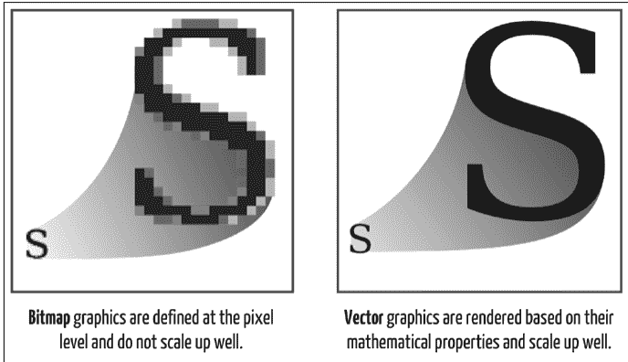

# 第 1 章 图形 Web

在当今的在线环境中，在 Web 浏览器中绘制图形非常重要。虽然在经验科学、数学和印刷媒体中长期存在有效表达信息的需求，但自 Web 出现以来，这种需求获得了新的生命力。随着我们现在生成的海量数据以及我们可以用来与用户通信的大量设备的存在，在线可视化数据的愿望和能力都有所提升。此外，浏览器已从进入信息世界的便捷入口发展成为真正的交互式媒体渠道。

已出现许多技术来实现基于浏览器的绘图，包括但不限于 VML 和 SVG、HTML5 Canvas 和 WebGL。每种技术通常适用于特定目的——VML 和 SVG 用于 2D 矢量绘图，HTML5 Canvas 用于位图绘图，WebGL 用于 3D 图形渲染。

本书介绍了使用 **Raphaël** 进行 2D 矢量绘图，Raphaël 是一个轻量级、开源的 JavaScript 库，它使用 SVG 和 VML 在浏览器中绘制矢量图形。它提供了一系列方便的方法，用于路径绘制、矢量变换、通过 DOM 实现的交互性以及路径动画，并支持位图图像嵌入和文本绘制。该库通过这些方法大大简化了绘图过程，充当底层（SVG 和 VML）规范的 _适配器_。

虽然在本书中，我们会力求让读者了解 SVG 规范，因为这将帮助我们充分发挥库的全部功能，但不需要深入理解 SVG 的工作原理，而且根本不涉及 VML。Raphaël 负责在 SVG/VML 规范级别输出图形，这意味着我们只需要关注如何使用该库本身。


## 图形化 Web

该库的创建者兼 JavaScript 大师，**Dmitry Baranovskiy**，在 http://raphaeljs.com/ 上对 Raphaël 进行了出色的文档编写，我们将在本书过程中广泛参考该文档，以便在浏览器中制作高品质的定制矢量图形。

在本章中，我们将：

- 讨论 Web 上的矢量绘图
- 更多地了解 Raphaël 和 SVG 规范
- 查看 Raphaël 的一些潜在应用
- 下载 Raphaël 库

### Web 上的矢量绘图

矢量图形由许多基本几何对象组成，例如点、线、图形和多边形。每个单独的对象由数学表达式表示，而不是某个固定的物理点。缩放矢量图形意味着更改构成对象的数学属性，而不是对象本身，因此不会损失质量。固定点（即位图）图形受特定分辨率的限制，这意味着当它们被放大时，质量会丢失：



来源：Wikimedia Commons
(http://en.wikipedia.org/wiki/File:Bitmap_VS_SVG.svg)

所有图形最终都在固定点（即像素）级别呈现。毕竟，你的显示器是数百万个这些点的总和。位图和矢量图形之间的区别在于，对于矢量图形，呈现是在_最后一刻_完成的。放大位图意味着基于现有像素创建新像素，而对于矢量图形，像素是基于对象的抽象数学定义，在最终图形呈现的分辨率下创建的。

Web 上的矢量绘图主要采用以下两种形式：

- **矢量标记语言 (VML)** 由微软制定并于 1998 年提交给 W3C，描述了一种基于 XML 的文件格式，可用于在 Internet Explorer 5 到 9 版本中创建矢量图形
- **可缩放矢量图形 (SVG)** 由 W3C 自身于 2001 年提出，描述了一种基于 XML 的文件格式，已被所有主要现代浏览器采用，包括 Firefox、Google Chrome、Safari 和 Opera

确实，Internet Explorer 的第 9 版和第 10 版对 SVG 提供原生支持，VML 已被弃用，取而代之的是 SVG。

### 矢量绘图库

有许多可用于绘制矢量图形的 JavaScript 库。除了 Raphaël，两个流行的库是 **Paper.js** (`http://paperjs.org`) 和 **D3.js** (`http://d3js.org`)。每个库最适合不同的任务，你使用哪个取决于你想要实现什么。

下表总结了 Raphaël、Paper.js 和 D3.js 库：

| 库 | IE 6, 7, 8 支持 | 开箱即用（通用）可视化 | 低级（定制）可视化 |
|---------|-------------------|------------------------------------------|-----------------------------------|
| Raphaël | 是               | 否                                       | 是                               |
| D3.js   | 否                | 是                                      | 否                                |
| Paper.js| 否                | 否                                       | 否                                |

Raphaël 特别适合创建定制矢量图形，因为它为 SVG 规范提供了低级 API。它非常擅长处理基本矢量图形，并为处理现有 SVG 图像提供了空间。D3.js 使创建数据可视化变得简单，因为其 API 非常面向数学运算和数据操作，但在处理较低级别的矢量图形时，它不提供与 Raphaël 相同的灵活性。Paper.js 使用 HTML5 Canvas 进行矢量图形绘制，因此在操作矢量方面较少，但它确实具有非常好的图像操作和路径处理功能。

Raphaël 是唯一支持 VML 规范的框架，并在不支持原生 SVG 的浏览器（IE 6、7 和 8）中回退到使用 VML（从技术上讲，Paper.js 可以在旧浏览器上工作，但该项目不支持它们）。尽管开发者社区做出了最大努力，支持旧浏览器仍然是许多公司的要求。

### SVG 规范

SVG 是当今 Web 上实现的最广泛的矢量图形规范。所有现代浏览器都对该格式提供全面支持，最新的移动浏览器至少提供对 SVG 的基本支持（包括 Safari 3.2 及更高版本、Blackberry 浏览器和 Android 版 Chrome）。

SVG 指定了一种基于 XML 的文件格式，用于创建矢量图形。例如，定义一条从某个任意坐标系统中 x=50、y=50 的点到 x=10、y=10 的点的黑色实线，宽度为 1 的基本路径，由以下代码描述：

```
<path d="M50 50 L10 10" stroke-width="1" stroke="#000" />
```

除了路径，SVG 还支持形状绘制、文本、填充和渐变、动画以及交互，SVG 图像可以响应用户触发的事件。你可以在 http://raphaeljsvectorgraphics.com/the-graphical-web/raw-svg/ 上查看一些 SVG 示例。

Raphaël 广泛使用基于 XML 的语言，在本书过程中你将熟悉 SVG 的一些语法，尤其是与路径绘制相关的部分。

### 使用 Raphaël 而非直接编写 SVG

除了浏览器支持之外，使用 Raphaël 而非编写原始 SVG 的一个好理由是，它使矢量绘图_更容易_。例如，使用原始 SVG 绘制一个矩形并将其宽度从 50 像素动画化到 100 像素：

```
<rect x="10" y="10" width="50" height="30">
  <animate attributeType="XML"
           attributeName="width"
           to="100"
           fill="freeze"
           dur="1s" />
</rect>
```

这里我们使用 `<rect>` 元素在 (10, 10) 处绘制一个宽度为 50、高度为 30 的矩形。嵌套的 `<animate>` 元素随后定义了矩形宽度在一秒内动画化到总宽度 100，其中 `fill="freeze"` 用于在动画完成后保留矩形的状态（否则其宽度将被重置为 50）。考虑到我们想要实现的目标相当简单，这相当冗长。Raphaël 中的等效动画由以下代码实现：

```
var rect = paper.rect(10, 10, 50, 30);
rect.animate({
  width: 100
}, 1000);
```

这里，`animate` 和 `rect` 方法更加简洁。

Raphaël 还与其他库（例如 jQuery）集成良好，因为它体积小巧且命名空间合适（它只创建一个名为 Raphael 的全局变量）。

### Raphaël 的应用

Raphaël 已被用于各种项目，从 _Town Hall @ the White House_ 事件期间的地图可视化（`http://askobama.twitter.com/`）到 **Ebocs** (`http://www.dejapong.com/ebocs/`) 等在线游戏。前者展示了该库的一个流行应用，即制图，而后者是该库在创建低精灵（位图图像）数量的游戏方面可行但不太常见的应用。

Raphaël 特别适合制图，因为该库使我们能够为 DOM 元素添加交互性，并可以在不损失质量的情况下缩放图形。一个很好的示例可以在 http://raphaeljs.com/australia.html 找到，其中演示了澳大利亚的交互式分级色图（我们将在第 6 章“使用现有 SVG”中介绍如何创建分级色图）。

该库还有其他一些更微妙的应用。虽然 CSS3 变得越来越普遍，但许多属性尚未在所有浏览器中统一，旧浏览器中几乎没有或根本没有支持。在某些情况下，使用 Raphaël 实现相同效果可能更适合你正在进行的项目。一个关于图像转换的演示可以在 http://raphaeljsvectorgraphics.com/the-graphical-web/css3-raphael-transforms/ 找到。

### 下载 Raphaël

在本书过程中，我们将使用 Raphaël 2.1.0 版，这是撰写本书时该库的最新版本。该库的最新版本可以从 http://raphaeljs.com 下载。该项目托管在 GitHub 上，网址为 https://github.com/DmitryBaranovskiy/raphael/，旧版本的库标记在 https://github.com/DmitryBaranovskiy/raphael/tags，以防你需要它们。

建议在开始新项目时下载库的压缩版和未压缩版。在开发过程中，你应该使用 Raphaël 的未压缩版：你可能希望参考源代码中的特定方法，并且调试消息在未压缩版中更有意义。对于生产环境，你应该始终使用压缩版。压缩版的文件大小显著更小，使用它将减少服务器负载并缩短页面响应时间。

你可以通过 gzip 压缩进一步减小 Raphaël 的大小。你的 Web 服务器通常负责压缩静态内容。例如，Apache 的 mod_gzip 可以压缩 HTML、文本、CSS 和 JavaScript 文件（有关更多信息，请查阅 Web 服务器的文档）。


### 创建 Raphaël JavaScript 应用程序

学习如何利用新技术最重要的方面是理解驱动它的概念。本书将在适当的地方使用代码示例，但会省略大量不必要的代码，以便专注于手头任务的核心方面。在适当的时候，您应该参考随本书附带的源代码和网站（http://raphaeljsvectorgraphics.com）。

### 项目结构和优化

本书中的项目将相当独立，因此项目结构将保持相当简单。随着您自己的项目不断增长，您应该仔细关注项目结构。

您还应该考虑在将工作推送到生产环境时合并和压缩 CSS 和 JavaScript 文件。这将提高网站或应用程序的响应速度并减少 Web 服务器的负载。实现此目的的有用工具包括 **minify**（http://code.google.com/p/minify/）和 Google 的 **Closure Tools**（https://developers.google.com/closure/）。

### 摘要

人们常指出，浏览器中的矢量绘图是一项未被充分利用的技术。开发人员通常对该技术的演示印象深刻，但并不总是确定它可以被应用到何种程度。希望阅读本章后，您能更好地理解 Raphaël 的功能以及它能够解决的问题类型。

在下一章中，我们将探讨使用 Raphaël 进行基本绘图，并在浏览器中创建我们的第一批矢量图形。
