# 2 使用 Raphaël 进行基本绘图

Raphaël 支持三种基本类型的图形元素：形状、图像和文本。形状可以是预定义的形状，例如矩形、圆形或椭圆，也可以是线条、曲线和路径的组合。矢量图形本质上就是这些形状的总和，在接下来的两章中，我们将基于它们创建许多有趣的图形。图像可以是位图图像（如 .png 或 .jpeg）或现有的 SVG 图像，Raphaël 可以以许多与形状相同的方式操作图像。

形状和文本可以进行绘制，即填充和描边（添加轮廓）。填充可以是单一颜色，也可以是线性或径向渐变。描边只能用单一颜色填充，但形状的描边方式是可修改的。

已绘制形状的示例可以在 http://raphaeljsvectorgraphics.com/basic-drawing/shapes-and-attributes 上查看。

在本章中，我们将：

- 将浏览器视为绘图的上下文
- 绘制基本形状
- 将填充、描边和其他属性应用于元素
- 将渐变填充应用于元素
- 使用自定义文本并探索嵌入自定义字体

## 绘图上下文

为了能够绘制图形，我们需要定义一个可呈现内容的空间。就像艺术家一样，我们需要一张可以绘图的画布。浏览器窗口的可见区域，即 **视口**，定义了我们可以绘制 **画布** 的区域。

SVG 规范将绘图区域本身称为视口。严格来说，视口是任何矩形观看区域。我们始终将浏览器窗口称为 _视口_，将我们的绘图区域称为 _画布_（不要与 HTML5 Canvas 混淆）。

我们可以使用 `Raphael` 构造函数创建画布，如下所示：

```
var paper = Raphael(50, 100, 500, 300);
```

这将在视口左侧 50px、顶部 100px 处创建一个宽 500px、高 300px 的画布，如下图所示。`paper` 变量保存对 `Paper` 对象的引用，该对象就是我们的画布，我们将使用它进行所有后续绘图：

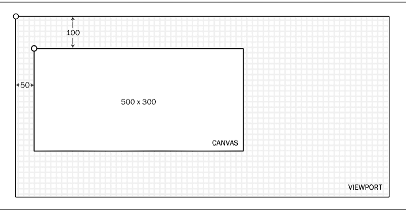

更常见的是，我们希望使用现有的 DOM 元素作为画布的容器，而不是视口。在这种情况下，不需要左/右（x-/ y-）偏移量，因为画布始终会在元素的左上角呈现。考虑以下元素：

```
<div id="my-canvas"></div>
```

我们将使用以下代码创建宽 500px、高 300px 的画布：

```
var paper = Raphael('my-canvas', 500, 300);
```

使用这种构造函数形式时，当第一个参数为字符串时，我们始终传递元素 ID。或者，我们可以将 DOM 元素作为第一个参数传递，如下所示：

```
Raphael(document.getElementById('my-canvas'), 500, 300);
```

## 画布坐标

下图说明了使用 `Raphael` 构造函数创建的画布的默认坐标系统。画布的 **原点** 定义为 _x_ 和 _y_ 均等于零的点。画布上 _x_ = 300 且 _y_ = 200 的点，即矢量表示法中的 (300, 200)，是相对于原点 _x_ 点向右 300px、相对于原点 _y_ 点向下 200px 的点，如下图所示：

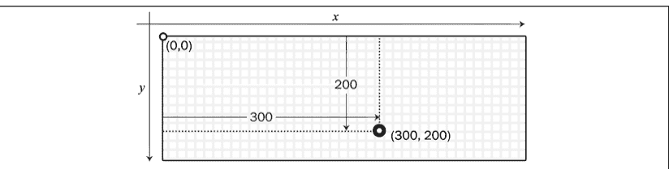

同样，(-125, 50) 处的点相对于原点在 _x_ 和 _y_ 方向上的位置，如下图所示：

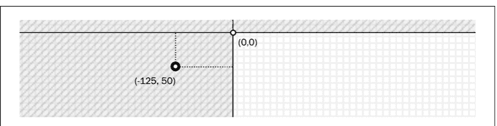

## 绘制基本形状

Raphaël 提供了 `rect`、`circle` 和 `ellipse` 方法来绘制基本形状。这些是我们创建画布时返回的 `Paper` 对象的方法。例如，`rect` 方法的语法如下（摘自 Raphaël 文档 http://raphaeljs.com/reference.html#Paper.rect）：

```
Paper.rect(x, y, width, height, [r]);
```

`x` 和 `y` 坐标描述矩形的左上角点，第五个参数 `r` 是圆角的半径，方括号表示它是可选的（默认情况下圆角半径为 0）。在 x = 200px、y = 150px 处创建宽 50px、高 100px 的矩形，如下所示：

```
var paper = Raphael('my-canvas', 500, 300);
var rectangle = paper.rect(200, 150, 50, 100);
```

同样，我们可以通过以下方式创建宽 75px、圆角半径 15px 的正方形：

```
var square = paper.rect(300, 150, 75, 75, 15);
```

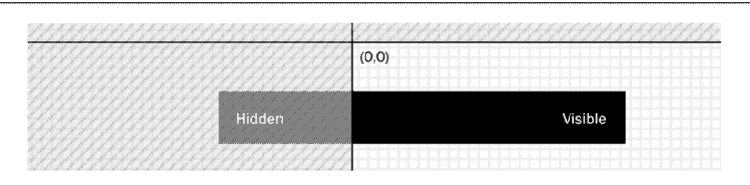

请注意，在负 `x` 或 `y` 点绘制的图形将从画布可见区域之外开始绘制，这意味着它们会被部分或完全隐藏，如下图所示：

两个矩形在下图中显示。请注意，绘图是从矩形的左上角沿正 _x_ 和 _y_ 方向进行的：

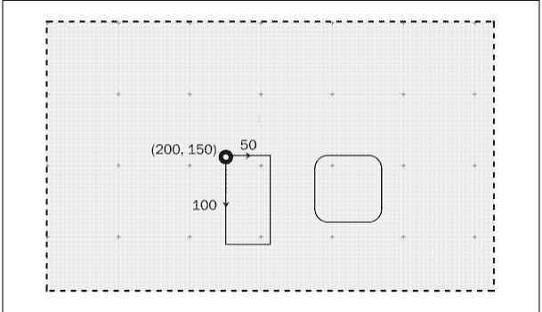

圆的语法（http://raphaeljs.com/reference.html#Paper.circle）为：
Paper.circle(x, y, r);

虽然矩形的 _x_ 和 _y_ 坐标描述其左上角点，但对于圆形，它们定义其 **中心** 点。第三个参数 _r_ 是圆的半径。在 _x = 100_、_y = 100_ 处绘制半径为 50px 的圆，如下所示：
var paper = Raphael('my-canvas', 500, 300);
var circle = paper.circle(100, 100, 50);

椭圆的语法（http://raphaeljs.com/reference.html#Paper.ellipse）与圆非常相似，只是我们分别指定 x 和 y 半径：
Paper.ellipse(x, y, x-radius, y-radius);

x 半径是 y 半径两倍的椭圆如下所示：
var ellipse = paper.ellipse(300, 100, 100, 50)


应该清楚，圆实际上只是椭圆的一种特殊情况，其中 x 半径等于 y 半径。生成的圆和椭圆如下图所示：

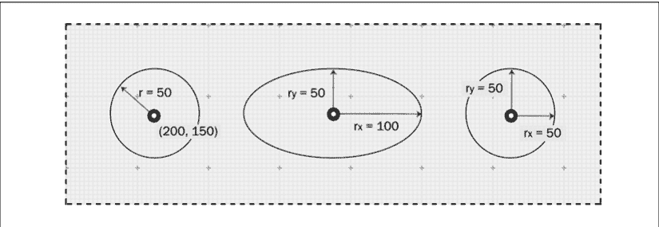

Raphaël 的文档详尽，可在 http://raphaeljs.com/reference.html 查阅。为了全面掌握本书中使用的方法，强烈建议广泛参考该文档。

## 嵌入图像

Raphaël 允许我们将位图（.jpg 或 .png）图像嵌入到画布中。它通过 Paper 对象的 image 方法实现。以下代码演示了嵌入 .jpg 图像：

```
var paper = Raphael('my-canvas', 600, 252);
paper.image('stella.jpg', 15, 15, 144, 192);
```

.jpg 图像位于 (15, 15)，其宽度和高度分别缩放为 144px 和 192px。

## 元素属性

我们绘制的形状可以应用填充、描边以及许多其他属性。当我们创建一个形状时，会返回一个 Element 对象。该对象有一个 attr 方法，接受若干键值对属性。在本节中，我们将探讨可以使用此方法应用于绘图的各种属性（参见 http://raphaeljs.com/reference.html#Element.attr）。

## 基本填充

为了给元素添加背景，我们使用 `fill` 属性进行填充。
对于单色填充，格式遵循 CSS 规范（即，`#rrggbb` 或 `#rgb` 简写，`rgb(r, g, b)` 字符串或颜色关键字，例如 `navy`）。例如，要将矩形填充为黑色，可以编写：

```
var rect = paper.rect(200, 50, 200, 100);
rect.attr({fill: '#000'});
var square = paper.rect(450, 50, 50, 50);
square.attr({fill: 'rgb(0, 0, 0)'});
```

同样，要将圆形填充为粉色，可以编写：

```
var circle = paper.circle(100, 100, 50);
circle.attr({fill: 'pink'});
```

结果如下所示：

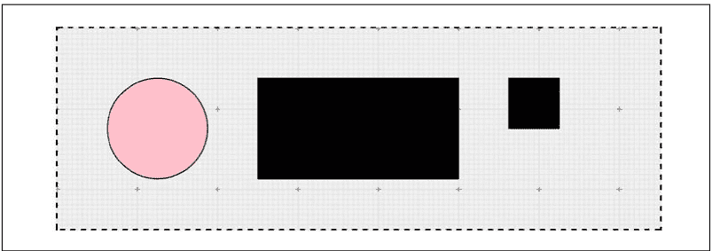

## 图像填充

Raphaël 还允许你使用图像填充元素。考虑以下代码：

```
var circle = paper.circle(100, 100, 80);
circle.attr({fill: 'url(bg_pattern.png)'});
```

这将创建一个圆形，其填充为名为 `bg_pattern.png` 的模式图像，如下图所示。图像填充始终在 `x` 和 `y` 方向重复：

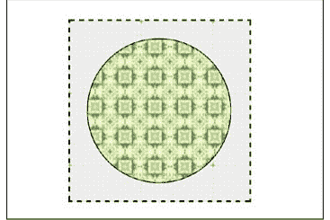

## 应用描边

元素可以有多种不同的描边属性。最常见的是 `stroke` 和 `stroke-width` 属性。`stroke` 属性采用符合 CSS 规范的字符串颜色值，而 `stroke-width` 是以像素为单位的数字。以下代码的效果是给圆形应用 10px 宽的石灰绿色描边：

```
var circle = paper.circle(100, 100, 70);
circle.attr({
    fill: '#09c',
    stroke: 'limegreen',
    'stroke-width': 10
});
```

生成的圆形如下所示：

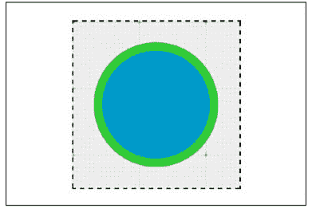

描边是居中绘制的，这意味着可见描边宽度的一半在元素内部，另一半在元素外部。

你会注意到本章前面的一些示例中，即使我们没有应用属性，它们仍然被描边了。这是因为默认的 stroke-width 值为 1px。要在绘制形状时移除描边，必须始终指定 stroke-width 值为 'none'。

其他一些有用的描边属性包括 stroke-dasharray 和 stroke-linejoin，如下所示。前者允许我们指定由虚线、点和空格组成的模式，生成的描边将使用它们绘制，而后者决定路径线条应如何连接在一起：

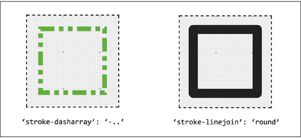

你可以在 http://raphaeljs.com/reference.html#Element.attr 和 http://www.w3.org/TR/SVG/painting.html#StrokeProperties 上了解更多关于不同描边属性的信息。

## 其他属性

除了描边和填充之外，创建元素时可能还想使用许多其他属性。我们将在本节中演示其中一些。

## href

我们创建的元素已注册到 DOM 中，指定 href 属性允许它们表现为超链接。例如：

```
var rect = paper.rect(30, 30, 140, 140);
rect.attr({
    href: 'http://www.packtpub.com'
});
```

这将创建一个矩形，点击时会链接到 Packt Publishing 网站。

## opacity

元素的不透明度可以设置为 0（完全透明）到 1（完全不透明）之间的值。我们还可以使用 `stroke-opacity` 和 `fill-opacity` 属性分别设置描边和填充的不透明度：

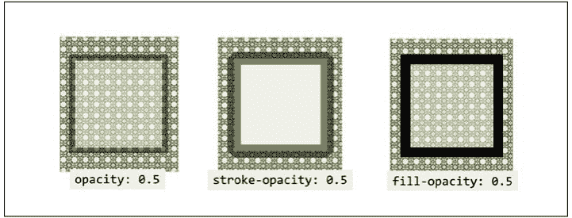

描边始终居中绘制的一个不幸副作用是，一半的描边与填充重叠，这意味着 `stroke-opacity` 的适用性有限。

> 将 'stroke-opacity': 0.5 与与填充颜色匹配的描边颜色结合使用，可以使形状边缘非常平滑，实际上对其进行抗锯齿处理。

## clip-rect

Raphaël 支持使用 `clip-rect` 属性对元素进行矩形裁剪。裁剪允许我们只显示元素的一部分。我们定义矩形裁剪区域如下：

```javascript
var circle = paper.circle(100, 100, 80, 80);
circle.attr({
    fill: 'pink',
    'stroke-width': 0,
    'clip-rect': '20 20 80 80'
});
```

这将创建一个半径为 80px、中心位于点 (100, 100) 的圆。`clip-rect` 属性定义一个矩形区域，由空格分隔的字符串形式如下：

```
"x y width height"
```

这将只显示圆中被矩形裁剪区域 '20 20 80 80' 重叠的部分：

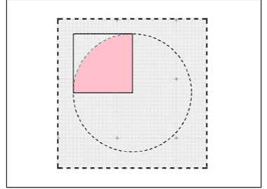

## 应用渐变

Raphaël 支持对元素应用线性和径向渐变填充。要实现这一点，我们不在 fill 属性上指定颜色字符串，而是指定以下形式的字符串以创建线性渐变：

```
`<angle>-<color>[-<color>[:<offset>]]*-<color>`
```

以下语法用于创建径向渐变：

```
`r[(<fx>, <fy>)]<color>[-<color>[:<offset>]]*-<color>`
```

这种语法最好通过示例来说明。

## 线性渐变

最基本的线性渐变填充形式如下：

```
`<angle>-<color1>-<color2>`
```

这指定了一个从 color1 到 color2 按 angle 度角绘制的渐变。例如：

```javascript
var rect = paper.rect(20, 20, 160, 160);
rect.attr({
	'stroke-width': 0,
	fill: '0-#f00-#000'
});
```

这将绘制一个矩形，其线性渐变从红色到黑色，角度为 0 度，如下图左侧所示。右侧的矩形使用填充值 '90-#f00-#000' 创建，这次渐变以 90 度角绘制：

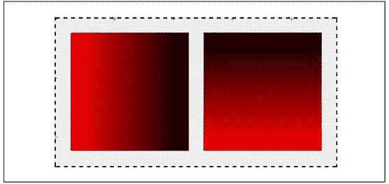

请注意，绘制角度是从正 x 轴逆时针定义的，如下图所示，适用于从蓝色到白色的 45 度渐变：

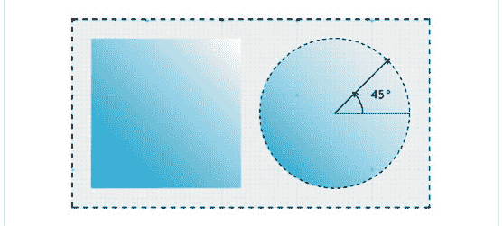

线性渐变可以由任意数量的颜色组成，颜色构成渐变的点定义为 **offsets**。这就是以下语法的含义：

[-<color>[:<offset>]]*

这里可以创建任意数量的 -color:offset 组合。例如，考虑使用以下字符串创建的渐变：

fill: "0-#00a9e0-#323490:20-#ea1688:40-#eb2e2e:60-#fde92d:80-#009e54"

这将创建类似彩虹的图案，如下图所示。每种颜色相对于前一种颜色偏移额外的 20 个百分点。第一种和最后一种颜色的隐含偏移量分别为 0 个百分点和 100 个百分点：

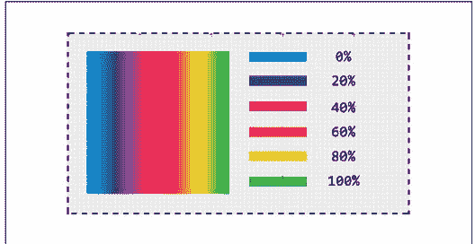

从技术上讲，由于每个偏移量之间的差异对所有颜色都相等（20 个百分点），我们可以在前面示例的字符串中省略偏移量值。以下表达式描述的渐变产生相同的结果：

```
"0-#00a9e0-#323490-#ea1688-#eb2e2e-#fde92d-#009e54"
```

## 径向渐变

径向渐变与线性渐变类似，只是它们从元素上的固定点（默认为元素中心点）_向外辐射_绘制。最基本的径向渐变由语法 `r<color>-<color>` 给出。例如：

```
var circle = paper.circle(100, 100, 80); circle.attr({
'stroke-width': 0,
fill: 'r#fff-#000'
});
```


这描述了一个从中心白色到边缘黑色的渐变圆：

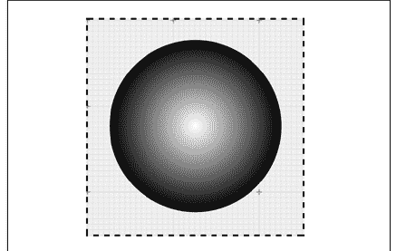

与线性渐变一样，我们可以为每个颜色定义多个颜色及可选偏移量。例如，字符串 ‘r:#fff-#f00-#00f:90-#000’ 创建了一个从白色到红色再到蓝色的径向渐变，在 90% 的偏移处过渡到边缘的黑色。

绘制径向渐变的起点，称为**焦点**，可以使用 `(<fx>, <fy>)` 语法指定，其中 `fx` 和 `fy` 的值在 0 到 1 之间。元素的中心点的焦点定义为 (0.5, 0.5)。减小或增大 `fx` 值会将焦点在 `x` 轴上向左或向右移动，而增大或减小 `fy` 值会将焦点在 `y` 轴上向上或向下移动。下图显示了改变 `fx` 和 `fy` 的值如何影响焦点的位置：

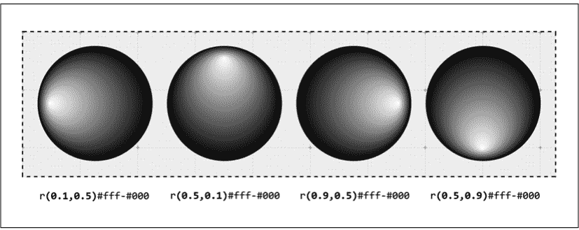

> 注意，由于 VML 中的一个错误，径向渐变不能应用于 `Path` 元素（参见第 3 章，绘制路径），因此实际上仅适用于本章介绍的基本形状。

## 分组元素

有时我们希望将相同的属性、变换或动画应用于 _多个_ 元素。我们可以在 Raphaël 中使用 set 方法对元素进行分组。请考虑以下形状：

```javascript
var paper = Raphael('my-canvas', 540, 200);
var circle = paper.circle(100, 100, 80);
var rect = paper.rect(205, 40, 120, 120);
var ellipse = paper.ellipse(430, 100, 80, 60);
```

通过创建一个包含对所有这些形状引用的 **set**，我们可以通过在 **set 上** 调用 `attr` 方法而不是对每个单独元素调用，将相同的属性应用于所有形状。我们创建一个包含所有元素的 set，并将其引用保存在名为 `group` 的变量中，如下所示：

```javascript
var group = paper.set();
group.push(circle, rect, ellipse);
```

然后我们将以下属性应用于刚刚创建的 set：

```javascript
group.attr({
    fill: '180-#09c-#fff:30-#f00',
    stroke: '#000',
    'stroke-width': 5
});
```

结果如下所示：

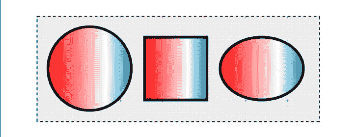

## 使用文本

在画布上绘制文本，而不是作为带有 CSS 样式的 HTML 标记，允许我们像对待其他形状一样对其进行动画和变换。文本使用 `text` 方法创建，其属性（如 `size` 和 `font-family`）可作为属性进行修改。`text` 方法的定义如下，其中 `text` 参数是我们的文本字符串，并接受标准转义序列 `\n` 作为输入，这会将后续文本放在新行上：

Paper.text(x, y, text)

以下代码使用此方法创建两段文本，然后将它们分组到一个 set 中，以便对两个元素应用 `font-size` 和 `font-family` 属性：

```javascript
var text1 = paper.text(0, 15, 'I am text anchored start.');
text1.attr({
    'text-anchor': 'start',
});
var text2 = paper.text(270, 100, 'I am text\nanchored middle');
text2.attr({
    'text-anchor': 'middle'
});
var group = paper.set(text1, text2);
group.attr({
    'font-size': 20,
    'font-family': 'serif'
});
```

## 嵌入自定义字体

字体转换器和渲染器 Cufón 已被 @font-face 取代，用于常规 Web 字体渲染。但是，由 Cufón 生成的字体具有完全定义的路径，并与 Raphaël 无缝集成，这意味着我们可以以许多与形状相同的方式来操作此类字体。此演示可以在 http://raphaeljsvectorgraphics.com/the-graphical-web/custom-fonts 上查看。

Cufón 支持从 **TrueType (TTF)、OpenType (OTF)、Printer Font Binary (PFB) 和 PostScript** 字体文件生成自定义字体。要使用 Cufón 生成自定义字体，请访问 http://cufon.shoqolate.com/generate/ 并填写字体生成表单。确保在标题 **Customization (for 3rd-party scripts only)** 下的文本框中输入 Raphael.registerFont（或单击其旁边的小 Raphaël 标志），如下图所示：

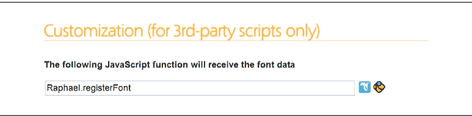

生成的字体将是一个 JavaScript 文件。您应该在 Raphaël 库之后将其包含在 HTML 文档中，即如下所示：

`<script type="text/javascript" src="raphael.min.js"></script>
<script type="text/javascript" src="MyFont.font.js"></script>`

要在画布上使用该字体，您将使用 print 方法（http://raphaeljs.com/reference.html#Paper.print）。例如，嵌入名为 Pacifico.font.js 的字体：

`<script type="text/javascript" src="Pacifico.font.js"></script>`

我们使用自定义字体在画布上打印文本，如下所示：

```javascript
var text = paper.print(
    50,
    50,
    'Vi veri veniversum vivus vici',
    paper.getFont('Pacifico'),
    38
);
```

这将在画布上的点 (50, 50) 绘制字体大小为 38px 的自定义文本。`getFont` 方法只是引用您嵌入的字体系列的名称，而 Cufón 应该已经负责将字体注册到 Raphaël 中。

属性可以以与我们已经对形状和文本应用属性的相同方式应用于自定义字体文本。例如：

```javascript
text.attr({
    fill: '315-#000-#666',
    'stroke-width': 0
});
```

这将生成如下所示的文本：

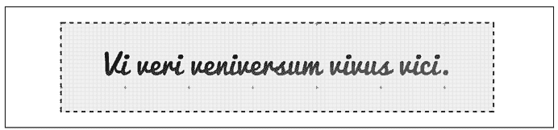

## 总结

在本章中，我们在特定绘图区域或画布的背景下介绍了 Raphaël 中的许多基本绘图和绘画示例。您现在应该能够使用该库绘制基本矢量图形，并探索 http://raphaeljs.com 上的文档。

在下一章中，我们将探讨使用路径绘制更复杂的元素。
