# 3 绘制路径

绘制和操作路径的能力是 Raphaël 的一项非常强大的功能。在上一章中，我们根据路径的几何属性（如宽度、高度和半径）绘制了基本形状。路径允许我们通过定义由线条、弧线和曲线连接的点来绘制各种形状，这些点代表形状本身的轮廓。

路径（如基本形状）是 _元素_，这意味着用户交互、绘制、变换和动画都可以应用于路径。Raphaël 提供了许多用于绘制和操作路径的方法，因此这将是本书其余部分的重点。

绘制路径的语法由 SVG 规范定义。理解此语法对于创建复杂形状至关重要，在本章过程中，我们将对其非常熟悉。

为了让您了解可以使用路径实现什么，`http://raphaeljs.com/chart.html` 上的演示将向您展示如何使用平滑曲线连接数据点，这在图表应用程序中很常见。确实，复杂的 SVG 插图（例如，使用 Adobe Illustrator 或 Inkscape 等图形包创建的插图）由许多路径组成，一个有趣的演示可以在 `http://raphaeljs.com/tiger.html` 上查看。

本章对路径的覆盖非常全面，因此建议您在每节结束时停下来回顾和实验所涵盖的概念。在本章中，我们将探讨以下主题：

- 路径绘制背后的概念
- moveto、lineto 和 closepath 命令
- 绘制二次和三次贝塞尔曲线
- 弧线绘制命令
- Raphaël 中用于处理路径的实用方法
- 由数据插值示例的 Catmull-Rom 曲线

## 路径绘制概念

在纸上用笔绘制的过程可以分解为以下步骤：

1. 您将笔放在纸上的某个特定点上。
2. 您按下笔并从这一点自由移动到另一点。
3. 您将笔保持在此点，或者抬起笔并将其放在纸上的另一点上。
4. 重复该过程，直到您完成绘制。

路径绘制的工作方式大致相同。您放置笔的点，称为 **当前点**，定义了路径的起点，而笔的自由移动描述了路径本身。

考虑绘制一个 arbelos 形状。我们首先将笔放在画布上的点 (100, 180)，并绘制一条弧线到点 (380, 180)，如下所示：

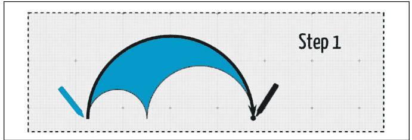

然后我们从点 (380, 180) 创建一条弧线到点 (200, 180)：

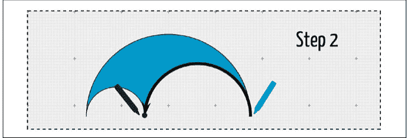


最后，我们创建一条回到点 (100, 180) 的弧线以完成路径：

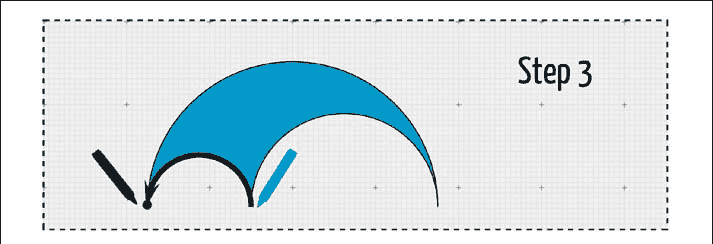

阿贝洛斯的示例演示了单个路径的绘制，在绘制过程中我们任何时候都没有抬起笔。如果我们抬起笔，随后的绘制在技术上将在主路径元素上创建 **子路径**。在示例中，将三角形作为子路径创建的效果是 _添加_ 到我们的单个路径元素。还要注意，fill 属性应用于 _整体_ 路径，而不是单个子路径：

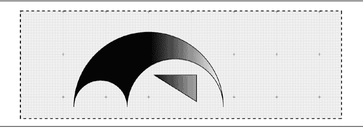

## 路径绘制命令

路径基于按定义顺序执行的多个绘制命令。命令表达为一个字母，该字母可以是大写，表示后续绘制在绘图上下文中使用绝对坐标，也可以是小写，表示后续绘制使用相对于当前点的坐标。大多数命令将参数作为参数来确定命令的行为。例如，考虑以下路径字符串：
"M100,180 a140,140,0,0,1,280,0"

## 绘制路径

此路径字符串用于绘制上一节中的阿贝洛斯。绘制使用 `M` 命令开始，随后的弧线使用 `a` 命令绘制。

我们在 Raphaël 中使用 `path` 方法绘制路径，该方法接受路径字符串或数组作为参数。数组通常是定义路径更方便且更易读的方式。考虑以下代码：

```
var xStart = 100;
var yStart = 180;
var path = paper.path([
	'M', xStart, yStart,
	'a', 140, 140, 0, 0, 1, 280, 0
]);
```

这将绘制前一路径字符串描述的路径。数组格式更易读，也是处理分配给 xStart 和 yStart 变量的参数值的更清晰方式。

> 为了简洁起见，我们将在本书中交替使用这两种格式来定义路径。

## moveto 命令

**moveto** 命令建立一个新的当前点。在上一节详细介绍的笔类比中，发出 moveto 命令的效果是将笔从页面上抬起并放置在给定点。所有路径都以 moveto 命令开始。

moveto 命令具有以下语法：

| 命令 | 参数 | 示例 |
|---------|------------|---------|
| M 或 m | (x, y)+ | M 50,50 100,100 |

在阿贝洛斯示例中，`M 100,180` 的效果是将笔放置在 x = 100, y = 180 的点。随后的命令将这些坐标用作绘制的起点。

您可能已经注意到，moveto 语法允许我们重复 `x` 和 `y` 参数（由 `+` 符号表示）。例如，考虑以下路径：

`"M 50,50 100,150"`

第一个 (x, y) 对将笔移动到画布上的点 (50, 50)，正如我们所期望的那样。然而，第二个 (x, y) 对的效果是绘制一条线到点 (100, 150)，并移动当前点。这种行为意味着 moveto 命令可以用于绘制多边形。以下代码仅使用 moveto 命令绘制一个顶点位于 (250, 50)、(200, 100) 和 (300, 100) 的三角形：

```
var path = paper.path([
 'M', 250, 50
 200, 100,
 300, 100,
 250, 50
 ]);
```

您应该注意到，提到的所有 (x, y) 点都是绝对的，即相对于画布的原点定义。如果我们指定命令的小写变体 m，则每个连续的 (x, y) 对将相对于前一个点（但请注意，第一个 (x, y) 对始终使用绝对坐标定位，无论 M 命令的大小写如何）。使用相对坐标定义的相同三角形由路径字符串 m 250,50 -50,50 100,0 -50,-50 描述。

以下是 moveto 命令的多个示例：

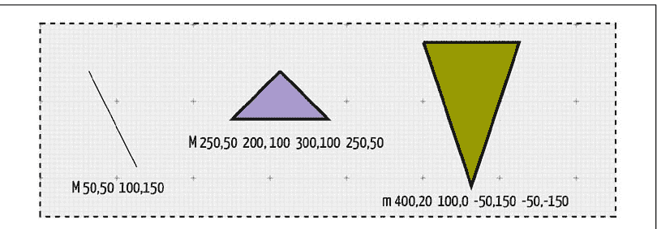

## lineto 命令

**lineto** 命令从当前点绘制直线到指定点。有三个 lineto 命令：

- `L` 用于绘制到任何 (x, y) 点的线
- `H` 用于在 x 中绘制水平线
- `V` 用于在 y 中绘制垂直线

| 命令 | 参数 | 示例 |
|---|---|---|
| L 或 l | (x, y) + | L 100 100 |
| H 或 h | x+ | H 75 |
| V 或 v | y+ | V -75 |

例如，从点 (10, 10) 到点 (75, 100) 的线将绘制如下：

var line = paper.path(['M', 10, 10, 'L', 75, 100]);

请注意，因为我们使用大写命令 L，线是从点 (0, 0) 绘制的，而不是相对于我们的起点 (10, 10)。如果我们使用小写变体 l，线将从 (10, 10) 绘制到点 (10 + 75, 10 + 100) = (85, 110)。

通过重复参数，我们可以绘制多边形（就像我们在上一节中使用 moveto 时一样，只不过 lineto 可以从任何当前点指定，而不仅仅是 moveto 点）。例如，从点 (200, 15) 开始的边长为 100 的正六边形可以绘制如下：

var sideLength = 100;
var x = sideLength * Math.cos(Raphael.rad(60));
var y = sideLength * Math.sin(Raphael.rad(60));

var hexagon = paper.path(
['M', 250, 15,
'l', sideLength, 0,
x, y,
-x, y,
-sideLength, 0,
-x, -y,
x, -y,
x
]);

我们利用六边形的外角为 60 度（如下图所示）的事实，结合三角函数 sin 和 cos 来计算我们想要绘制到的点的 x 和 y 坐标。从点 (250, 15) 开始，我们绘制一条在 x 方向相对 250 像素、y 方向 0 像素的线；然后我们绘制一条相对于该点在 x 方向 x 像素、y 方向 y 像素的线。由于六边形是正六边形，对于 y 大于零的边（除顶边和底边外），相对 x 和 y 点的大小相等，因此我们能够以 x 和 y 的倍数绘制回起点。

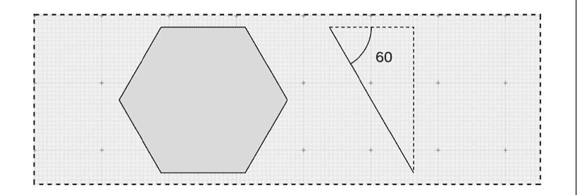

请注意，在 JavaScript 中，三角函数期望传入以弧度为单位的角度值，因此我们使用 `Raphael` 对象上的 `rad` 实用方法将 60 度转换为弧度。

## closepath 命令

**closepath** 命令从当前点绘制一条直线到当前子路径的起点。在六边形示例中，尽管我们绘制回了起点，但路径的起点和终点并未连接。当对路径应用较大的 `stroke-width` 值时，效果很明显，如下所示：

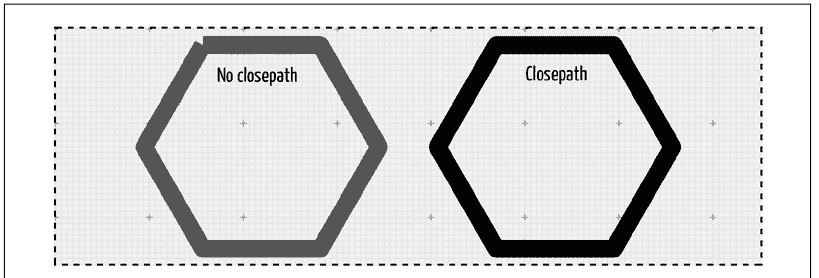

## 绘制路径

closepath 命令字符是 z，不接受任何参数。由于在前一个示例中我们绘制了一条直线回到终点，我们可以改用 closepath 命令关闭路径，如下所示：

```
var hexagon = paper.path(
 ['M', 250, 15,
 'l', sideLength, 0,
 x, y,
 -x, y,
 -sideLength, 0,
 -x, -y,
 'z' // 代替绘制到 (x, -y) 的线
 ]
);
```

在这种情况下，路径的起点和终点已连接。请注意，closepath 命令可以是大写或小写，但这对其行为没有影响。

## 绘制曲线

有三种类型的曲线路径：二次贝塞尔曲线、三次贝塞尔曲线和弧线。贝塞尔曲线是定义在起点和终点之间的曲线，但其方向可以通过使用控制点来确定，而弧线是椭圆周长的一部分。

## 二次贝塞尔曲线

二次贝塞尔曲线是两点之间具有一个控制点的曲线。要理解二次贝塞尔曲线的绘制方式，您应该尝试 http://www.jasondavies.com/animated-bezier/ 上的动画演示。如图所示，曲线从点 P0 绘制到点 P2，并带有控制点 P1。控制点 P1 相对于 P0 和 P2 决定了曲线弯曲的程度：从开始到结束，曲线最初朝向控制点 P1 的方向，然后从 P1 的方向弯曲到终点 P2。

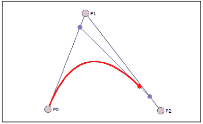

www.it-ebooks.info


有两个二次贝塞尔曲线命令，其语法如下：

| 命令 | 参数 | 示例 |
|---------|------------|---------|
| Q 或 q | (x1, y1, x, y)+ | Q 100 50 200 250 |
| T 或 t | (x y)+ | T 400 250 |

q 命令（或用于相对点的 q）描述从路径上的当前点到点 (x, y) 并使用 (x1, y1) 作为控制点绘制的曲线。例如，请考虑以下代码：

```
paper.path(['M', 50, 150, 'Q', 225, 20, 400, 150]);
```

这将绘制所示的二次贝塞尔曲线。使用命令小写形式的等效路径为 "M 50,150 q 175,-130 350,0"，其中 (x, y) 和 (x1, y1) 参数是相对于起点 (50, 100) 的相对距离：

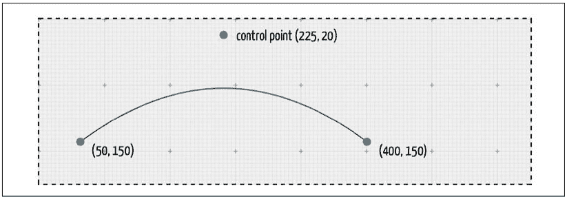

移动控制点会影响路径的绘制方式。例如，路径 "M 50, 150 Q 100,40 400,150" 显示为：

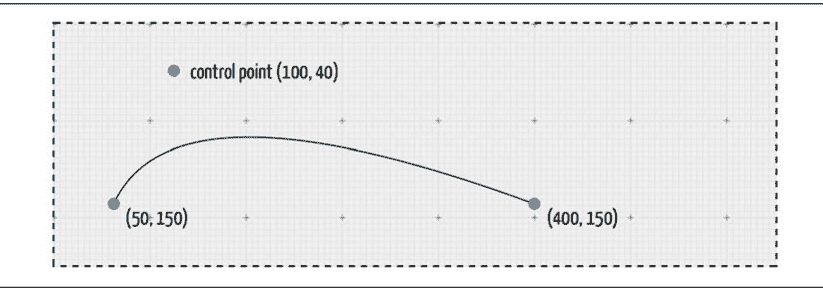

## 绘制路径

与我们迄今遇到的其他命令一样，参数可以重复，这使我们可以绘制多个连接的二次贝塞尔曲线。请考虑以下代码：

```
paper.path([
	'M', 50, 150
	'Q', 225, 20, 400, 150,
	575, 20, 750, 150
]);
```

这将从 (400, 150) 绘制第二条曲线到点 (750, 150)，控制点位于 (575, 20)：

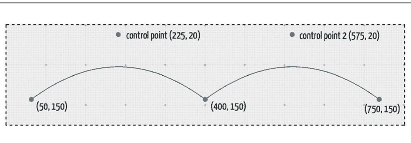

`T` 或 `t` 命令是一种简写，不指定控制点坐标。相反，控制点自动确定为前一个控制点的反射。请考虑以下代码绘制的路径：

```
paper.path([
	'M', 50, 150,
	'Q', 225, 20, 400, 150,
	'T', 750, 150
]);
```

这将创建如下截图所示的两条曲线。由 `T` 绘制的路径起点处的当前点为 (400, 150)。相对于此点，前一个控制点 (225, 20) 的反射为 (575, 280)：

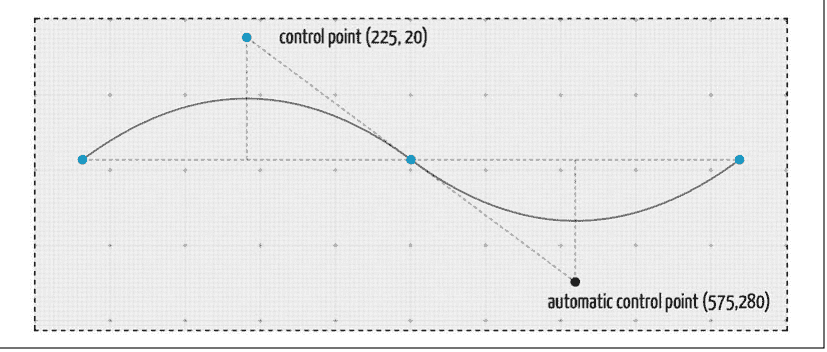

## 三次贝塞尔曲线

绘制三次贝塞尔曲线的原理与二次贝塞尔曲线类似，只是三次贝塞尔曲线有两个控制点。同样，为了理解三次贝塞尔曲线的绘制方式，您应该查看 http://www.jasondavies.com/animated-bezier/ 上的动画演示。三次贝塞尔曲线的路径（在截图中以红色突出显示）从 P0 开始，朝 P1 方向前进，然后从 P2 方向到达终点 P3：

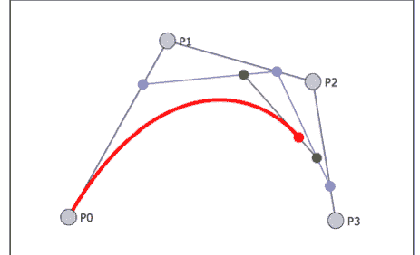

有两个三次贝塞尔曲线命令，其语法如下表所示：

| 命令 | 参数 | 示例 |
|---|---|---|
| C 或 c | (x1, y1, x2, y2, x, y)+ | C 150 25 350 50 500 300 |
| S 或 s | (x2, y2, x y)+ | t 200 -100 200 50 |

## 绘制路径

c 命令要求我们指定两个控制点。以下代码的效果是从点 (200, 20) 绘制一条曲线到 (200, 120)，经过控制点 (400, 140) 和 (400, 180)。请注意，我们还关闭了路径并应用了 fill 属性：

```
paper.path([
	'M', 200, 20,
	'C', 400, 140, 400, 180, 200, 120,
	'z'
]).attr({fill: '#222'});
```

结果如下所示：

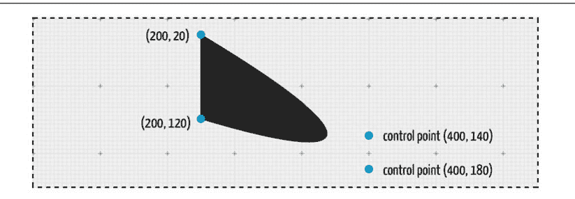

s 命令与 T 命令类似，会自动创建关于当前点反射的控制点。它实际做的是将第二个控制点关于当前点反射，这成为我们新子路径的第一个控制点，我们现在需要为其指定第二个控制点。此处给出的代码通过使用 s 命令绘制子路径来扩展前面的示例：

```
paper.path([
	'M', 200, 20,
	'C', 400, 140, 400, 180, 200, 120,
	'S', 0, 100, 200, 220,
	'z'
]);
```

s 路径从当前点 (200, 120) 开始，在 (200, 220) 结束，如所示。我们第一条曲线的第二个控制点定义在 (400, 180)，它关于当前点反射，从而创建一个位于 (0, 60) 的控制点。然后我们指定了一个位于 (0, 100) 的第二个控制点：

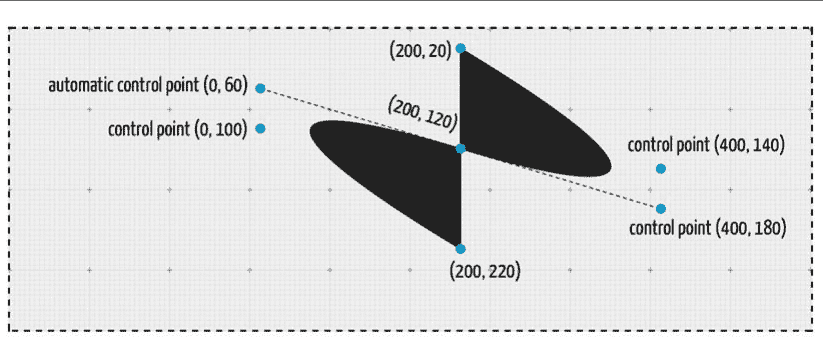

使用贝塞尔曲线最困难的地方在于决定在哪里定义控制点。通常通过以下方法之一来解决：

- 试错法
- 数学计算
- 使用 Inkscape 等图形包来辅助绘制

## 绘制弧线

绘制弧线的语法是所有绘制命令中最复杂的。这是因为当我们从一个点绘制弧线到另一个点时，有四种可能的弧线路径可供选择，如下所示——有两个椭圆，其圆周上可以位于起点和终点。前两个弧线称为**次要**弧线，而后两个弧线称为**主要**弧线。生成的弧线也受从起点到终点的角度方向的影响：

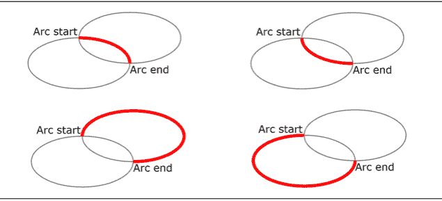

绘制弧线的语法如下表所示：

| 命令 | 参数 | 示例 |
|---|---|---|
| A 或 a | (rx, ry, x-rotation, large-arc-flag, sweep-flag, x, y)+ | a 25 50 0 1 0 100 200 |

下表描述了各个参数：

| 参数 | 描述 |
|---|---|
| rx 和 ry | 由于弧线是椭圆的一部分，它在 x 和 y 方向上都有半径 |
| x-rotation | 绘制弧线的椭圆的逆时针旋转（以度为单位的值） |
| large-arc-flag | 我们的弧线是作为主要（1）还是次要（0）弧线绘制 |
| sweep-flag | 弧线是以正（1）即顺时针，还是负（0）即逆时针的角度方向绘制 |
| x 和 y | 我们弧线的终点 |

这些参数或许最好通过示例来说明。请考虑绘制 sweep-flag 等于 1 的主要弧线路径：

```
paper.path([
	'M', 50, 60,
	'a', 150, 80, 0, 1, 1, 0, 80
]);
```

我们首先移动到当前点 (50, 60)，然后绘制一个 x 半径为 150、y 半径为 80 的弧线。我们将 x-rotation 值设置为 0，并通过将 large-arc-flag 设置为 1 来识别我们正在绘制大弧线。sweep-flag 值等于 1，我们使用小写形式，即 A 命令的相对变体，这意味着我们的最终 x 和 y 参数 (0, 80) 是相对于起点的单位，即：x 方向额外 0 像素，y 方向额外 60 像素，从而得到终点坐标 (50, 140)。生成的弧线如下所示。

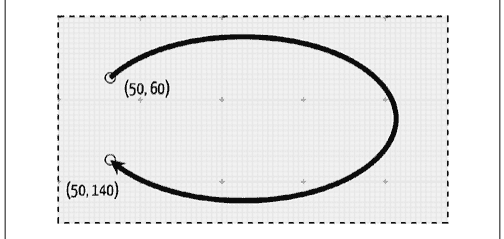

如果我们指定 `large-arc-flag` 值等于 0，则通过 (50, 60) 和 (50, 140) 的椭圆的次要弧线将如下绘制：

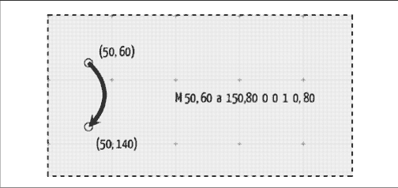

如果我们指定 `sweep-flag` 等于 0，例如，对于由 `M 350,60 a 150,80 0 1 0 0,80` 描述的路径（在主要弧线的情况下）或 `M 350,60 a 150,80 0 0 0 0,80`（在次要弧线的情况下），弧线将以逆时针方向绘制。

以下图像描述了以逆时针方向绘制的主要弧线（`large-arc-flag = 1`）：

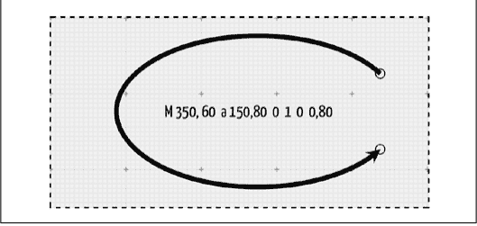

以下图表描述了以逆时针方向绘制的次要弧线（large-arc-flag = 0）：

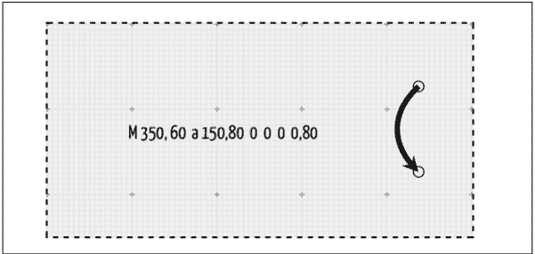

## 用于处理路径的实用方法

Raphaël 提供了一些方便的实用方法来处理路径。我们将通过示例演示这些方法。

## Element.getTotalLength()

通过组合一个主要弧线和一个三次贝塞尔曲线，我们可以按以下方式绘制一个保龄球瓶形状：

```
var pin = paper.path({
 'M', 130, 350,
 'A', 100, 180, 0, 1, 0, 210, 350,
 'C', 290, 100, 50, 100, 130, 350,
 'z'
});
```

此路径从 (130, 350) 开始，弧线到 (210, 350)，然后使用贝塞尔控制点 (290,100) 和 (50, 100) 曲线返回起点。我们使用 getTotalLength 方法获取路径的总长度。我们检索此值，然后在画布上以两位小数显示它，如下所示：

```
var totalLength = pin.getTotalLength();
paper.text(
 180, 50,
 "Total Length: " + totalLength.toPrecision(2)
);
```


## Element.getPointAtLength(length)

我们可以使用 getPointAtLength 方法获取路径上任意一点的 _x_ 和 _y_ 坐标。该方法返回一个带有 _x_ 和 _y_ 属性的对象。沿用上一节中的保龄球瓶示例，我们在路径总长度的八分之一和二分之一处绘制两个圆点，如下所示：

```
var totalLength = pin.getTotalLength();
p1 = pin.getPointAtLength(totalLength / 8);
p2 = pin.getPointAtLength(totalLength / 2);
paper.circle(p1.x, p1.y, 10);
paper.circle(p2.x, p2.y, 10);
```

getPointAtLength 返回的对象的另一个属性是 alpha 属性。它返回相对于 x 轴的正角度，由指定点处的梯度或导数线所张成，如图所示：

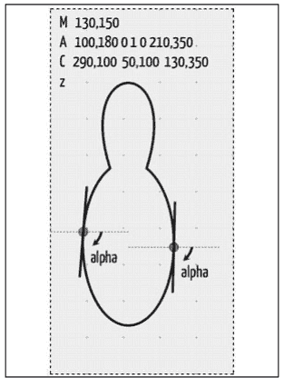

了解某点处的导数很有用，因为它告诉我们在该特定点处弧在 _x_ 和 _y_ 方向上变化的程度。

## Element.getSubpath(from, to)

给定一个路径元素，`getSubpath` 方法计算其路径中一段子路径的路径字符串。给定路径上的两个点，它返回描述原始路径中仅这两个点之间的路径字符串。考虑点 (100, 100) 和 (300, 100) 之间的三次贝塞尔曲线，其锚点位于 (100, 200) 和 (300, 0)：

```
var path = paper.path([
	'M', 100, 100, 'c', 0, 100, 200, -100, 200, 0
]);
path.attr('stroke-width', 5);
```

我们检索从路径长度四分之一处到总长度一半处的子路径，如下所示：

```
var totalLength = path.getTotalLength();
var subPath = path.getSubpath(
	totalLength / 4, totalLength / 2
);
```

`getSubpath` 方法返回一个可重复使用的路径字符串。例如：
`paper.path(subPath).attr('stroke-width', 15);`

这段代码绘制了原始路径的一段更短、更粗的部分，如图所示：

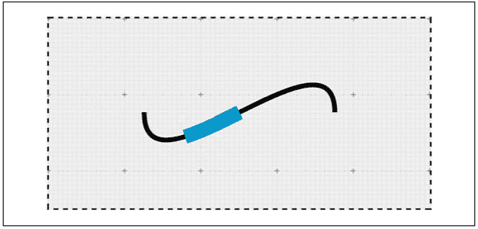

> `Raphael` 对象上还有许多其他实用方法，在转换和动画的上下文中处理贝塞尔曲线时特别有用。我们将在本书剩余部分更详细地介绍其中一些方法。

## Catmull-Rom 曲线

在需要绘制通过一组指定点的曲线的情况下，Catmull-Rom 曲线通常很合适。Catmull-Rom 曲线常用于图表（即数据绘图）和游戏（例如，沿预定义轨迹移动角色）。

Raphaël 提供了一个路径命令来方便地绘制 Catmull-Rom 曲线。绘制 Catmull-Rom 曲线的语法如下：

| 命令 | 参数 | 示例 |
|---------|------------|---------|
| R 或 r | x1,y1 (xi, yi)+ | a 25 50 0 1 0 100 200 |

点 (x1, y1) 是曲线应经过的第二个点，而 (xi, yi) 点是每个后续点。第一个点应始终是我们的当前点，曲线从该点开始。

为了说明 Catmull-Rom 曲线，请考虑存储在数组中的以下数据点：

```
var data = [
	{x: 50, y: 250},		{x: 100, y: 100},		{x: 150, y: 150},
	{x: 200, y: 140},		{x: 250, y: 250},		{x: 300, y: 200},
	{x: 350, y: 180},		{x: 400, y: 230}
];
```

要绘制这些数据点，我们遍历数组并在每个 x 和 y 位置绘制一个圆（请注意，点被分组到一个集合中，这使得向它们应用属性更加容易）：

```
var plottedPoints = paper.set();
for(var i = 0, num = data.length; i < num; i+=1) {
	var point = data[i];
	plottedPoints.push(paper.circle(point.x, point.y, 5));
};
plottedPoints.attr({fill: '#09c', 'stroke-width':0});
```

在构建路径字符串或路径数组时，我们使用 M 命令将第一个数据点设为当前点，并追加 R 命令以开始绘制 Catmull-Rom 曲线：

```
var path = ['M', data[0].x, data[0].y];
path.push('R');
```

然后我们遍历所有剩余点（除第一个点外的所有点），并将它们的值追加到路径数组中：

```javascript
for(var i = 1, num = data.length; i < num; i+=1) {
  path.push(data[i].x);
  path.push(data[i].y);
}
var curve = paper.path( path );
```

使用 `path` 命令绘制的结果曲线如图所示：

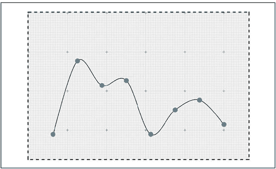

## 摘要

我们现在已经介绍了 Raphaël 中的所有主要绘图方法，您应该熟悉用于绘制路径的语法。此时，尝试我们介绍过的路径命令和实用方法来创建您自己的独特图形绝对值得一试。

我们现在准备好开始研究与绘图进行交互和操作了。到目前为止，我们创建的图形只绘制一次且不会改变。在下一章中，我们将研究响应用户触发的事件以及转换我们创建的元素。
