# 4 转换和事件处理

在花费了前两章绘制静态图形之后，我们现在将开始研究如何转换它们以及如何在浏览器中与它们进行交互。

当您在 Raphaël 中创建一个元素时，您实际上是在创建一个 **文档对象模型 (DOM)** 对象。与您已经熟悉的 DOM 对象一样，绘制在画布上的元素在用户与之交互时会触发事件。Raphaël 提供了一些方便的跨浏览器方法来与元素进行交互，还提供了便于拖放功能的方法。

转换同样灵活：Raphaël 允许我们使用 **转换字符串** 的概念轻松地转换（平移、缩放和旋转）元素。

在本章中，我们将同时研究事件处理和转换，结合库的这两个方面来产生交互式图形。总体而言，我们将涵盖：

- transform 方法和基本转换
- 矩阵转换
- 注册和注销基本事件处理程序
- 实现拖放功能

## 基本转换和事件处理

我们在 Raphaël 中使用元素上的 `transform` 方法执行转换，该方法接受一个转换字符串作为参数。转换字符串定义要在特定元素上执行的一系列转换。

您也可以使用 `transform` 属性转换元素和集合。当我们同时更改多个属性时，这通常很方便。您将在第 5 章 矢量动画 中看到此示例。

### 基本转换

与路径字符串一样，转换字符串由许多命令组成，按其应被解释的顺序排列。基本命令的语法如下，其中括号表示可选参数：

| 命令 | 参数 | 示例 |
|---------|------------|---------|
| T 或 t | x, y | t 50,100 |
| R 或 r | 顺时针旋转角度，(旋转点_x_, 旋转点_y_) | R 45,0,0 |
| S 或 s | scale_x, scale_y, (缩放点_x_, 缩放点_y_) 或 scale_factor, (缩放点_x_, 缩放点_y_) | S 2,4.5,75,125 |

与路径字符串一样，转换字符串有大写和小写变体。大写变体意味着无论之前的转换如何，我们都会进行转换，而小写变体会考虑之前的转换。以下示例演示了基本转换。

## 平移

首先，考虑绘制一个三角形并使用 `clone` 方法创建其副本：

```
var triangle = paper.path("M 150 20 1 100 160 1 -200 0 z").attr({
 'stroke-dasharray': '- ',
 'stroke-width': 5
});
```

```
var triangleCopy = triangle.clone(); // 克隆我们的对象
triangleCopy.attr({
 'stroke-dasharray': ''
});
```

克隆后，复制的三角形具有与原始三角形相同的所有属性，因此我们取消设置 `stroke-dasharray` 以使其具有实心轮廓。然后我们在 x 轴上执行 300px 的平移，在 y 轴上执行 0px 的平移，如下所示：

```
triangleCopy.transform("T 300 0");
```

这会将我们克隆的三角形在 `x` 方向上移动，如下图所示：

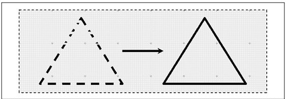

请注意，虽然 `clone` 方法很方便，但已知在克隆多个元素时会对性能产生不利影响。在克隆多个元素时，建议使用原始路径创建新元素。

## 旋转

现在创建另一个克隆的三角形，并使用以下转换字符串对其进行转换，这会使三角形在 x 轴上平移 350px，在 y 轴上平移 -35px 后，绕其中心点（当我们不指定旋转点时的默认值）顺时针旋转 45 度。

```
triangleCopy.transform("t 350 -35 r 45");
```


## 转换与事件处理

在此，我们已合并命令。在此示例中，转换是相互独立的，这意味着每个命令的大小写无关紧要。但是，请考虑绕点旋转：

```
triangleCopy.transform("t 100 0 r 180 220 100");
```

此转换首先将我们的三角形在 _x_ 方向上平移 100px，然后顺时针旋转 180 度。我们的旋转点 (220, 100) 并非三角形旋转的点，因为旋转点实际上在 _x_ 方向上平移了 100px 到新点 (320, 100)。此处需要注意的重要点是，**小写转换命令会考虑之前的转换**：

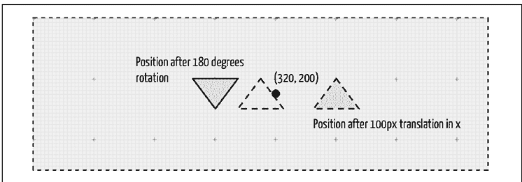

在绝对旋转命令 R 的情况下，绕点 (220, 100) 的旋转同样发生在平移之后，但结果与下图所示截然不同。转换字符串 `t 100,0 R 180,220,100` 始终绕点 (220, 100) 旋转元素，与之前的转换无关：

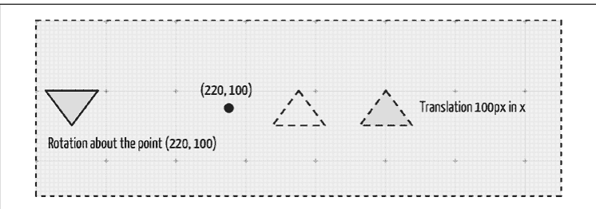

## 缩放

缩放可以在所有点上均等地关于缩放点进行，也可以在 x 和 y 方向上按因子进行。t 300 0 s 0.5 转换的缩放将所有点按其原始大小的 0.5 倍关于元素中心点进行缩放，如下所示：

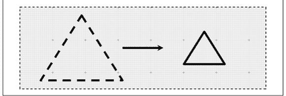

转换字符串 t 310 0 s 1.2 0.5 在 x 和 y 方向上按因子进行缩放，将元素在 x 方向上缩放 1.2 倍，在 y 方向上缩放 0.5 倍，如下所示：

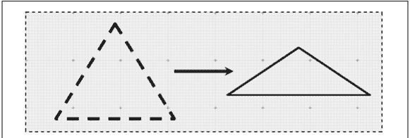

## 基本事件处理

Raphaël 支持在元素上注册和注销一整套事件处理程序。我们鼓励您尝试可用的事件处理程序，其中一些我们将通过示例演示。

## 注册基本事件处理程序

我们将演示在 salinon 图形上注册双击、鼠标悬停和鼠标移出事件处理方法。首先，我们可以按以下方式绘制 salinon：

```
var salinon = paper.path([
    'M', 100, 200,
    'a', 150, 150, 0, 0, 1, 300, 0,
    50, 50, 0, 0, 0, -100, 0,
    50, 50, 0, 0, 1, -100, 0,
    50, 50, 0, 0, 0, -100, 0
]);
```

然后我们按以下方式定义上述事件处理程序，其中每个程序在元素上创建一个转换：

```
salinon.mouseover(function() {
    this.transform('R 180');
});
salinon.dblclick(function() {
    this.transform('r 45');
});
salinon.mouseout(function() {
    this.transform('');
});
```

这产生的效果是：

- 当将鼠标移到元素上时，它将旋转 180 度
- 当双击元素时，它将旋转 45 度
- 当将鼠标移出元素时，转换将被重置

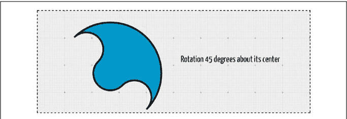

关于转换的重置，向 transform 方法传递空字符串的效果是将图形返回到其原始位置。

您会发现，运行前面的代码时，45 度旋转是相对于其初始位置执行的，而不是相对于 180 度旋转定义的位置。这是因为 transform 方法的每次调用都相对于元素的原始状态。但是，如果我们想要从元素的当前状态（即前一次 transform 调用所产生的状态）转换元素，我们可以在转换命令前加上省略号，以追加新的转换。请考虑以下转换：

```
salinon.click(function() {
    this.transform('t 300 0 R 180');
});
salinon.dblclick(function() {
    this.transform('...t 200 0 r 45');
});
```

第一个转换在单击时调用，将元素在 x 方向上平移 300px，并顺时针旋转 180 度。第二个转换在双击时调用，其起始命令前加有省略号，将在当前旋转的基础上再平移 200px 并顺时针旋转 45 度。请注意，x 方向上的额外 100px 平移是在负 x 方向上，这是因为我们考虑了之前的 180 度旋转。这意味着我们的 salion 现在“面向”相反的方向。

请注意，this 关键字指的是绑定事件处理程序的元素。

## 注销基本事件处理程序

为了注销事件处理程序，Raphaël 为我们提供了方法，其名称是注册事件处理程序的名称加上 "un-" 前缀。例如，click 事件处理程序使用 unclick 来注销。

注销事件处理程序是您已注册事件处理程序的元素的方法，并将事件处理函数作为参数接受。请考虑一个正方形，在单击时相对于其当前位置顺时针旋转 15 度：

```
var square = paper.rect(50, 50, 100, 100);
var clickHandler = function() {
    this.transform('...r 15');
};
square.click(clickHandler);
```

我们在当前作用域中定义了一个事件处理程序 clickHandler，并将其作为参数传递给 click 方法以注册它。我们按以下方式在正方形上注销 click 事件处理程序：

```
circle.dblclick(function() {
    square.unclick(clickHandler);
}
```

这产生的效果是，当圆被双击时，clickHandler 不再被调用。

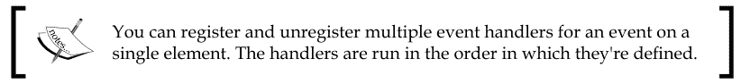

## 使用矩阵

**矩阵**是按行和列排列的元素矩形数组。在引用矩阵大小时，惯例是先指定行数，因此 3 行 2 列的矩阵，例如，将是：

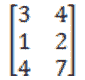

矩阵中的每个元素可以被视为将某个点映射到另一个点的组件。例如，点 (_x_, _y_) 可以映射到 (_p_, _q_)，如下所示：

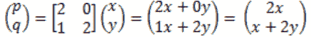

此矩阵定义了 2D 空间中一个点到新 2D 空间点的转换。新 _x_ 点 _p_ 被缩放 2 倍，而新 _y_ 点 _q_ 被缩放 2 倍并按原始 _x_ 平移（这种效果称为**剪切**）。

## 转换矩阵

Raphaël 中的转换称为**仿射变换**。其思想是将 2D 空间中的每个点视为 3D 空间中的点，这使我们能够使用矩阵表示转换。3D 点固定为 1，因此 (_x_, _y_) 点表示为 (_x_, _y_, 1)，即它在第三维上不变。

在此表示法中，由转换产生的点 (_p_, _q_) 如下推导：

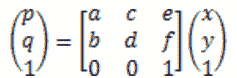

元素 _a_、_b_、_c_、_d_、_e_ 和 _f_ 根据赋予它们的值表示各种转换。

## 使用转换矩阵

创建转换时，您可以使用语法 `"M a, b, c, d, e, f"` 将矩阵参数直接传递给转换字符串。这产生的效果是将转换矩阵应用于元素上的每个点。

## 使用转换矩阵执行剪切

剪切转换的矩阵如下：

```
⎡a c e⎤   ⎡1   Sx  0⎤
⎢b d f⎥ = ⎢Sy   1  0⎥
⎣0 0 1⎦   ⎣0   0   1⎦
```

Sx 和 Sy 分别表示 x 和 y 点被剪切的因子。例如，将转换字符串 "m 1 0 0.5 1 0 0"（Sx = 0.5, Sy = 0）应用于正方形，其效果是将其在 x 方向上转换为菱形：

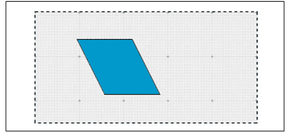

通常，我们希望相对于 x 轴和 y 轴分别按角度应用剪切。这在 http://raphaeljsvectorgraphics.com/the-graphical-web/css3-raphael-transforms 上有演示。为了实现这一点，我们使用以下转换矩阵：

```
⎡a   c   e⎤   ⎡1   tan(α)   0⎤
⎢b   d   f⎥ = ⎢tan(β)   1   0⎥
⎣0   0   1⎦   ⎣0   0   1⎦
```

在此形式中，角度 β 是相对于 x 轴顺时针的剪切角度（产生 y 方向上的剪切结果），α 是相对于 y 轴逆时针的剪切角度（产生 x 方向上的剪切结果）。请考虑对正方形进行以下转换：
Square.transform(
	['m', 1, 0, Math.tan(Raphael.rad(25)), 1, 0, 0]
	);
相对于 y 轴应用了 25 度的转换，产生 x 方向上的剪切。


## 拖放功能

拖放功能是 Raphaël 的一个强大功能。特别是，我们对拖动事件有很好的控制，这使我们能够创建更易用的应用程序。

## Element.drag() 方法

元素的 drag 方法具有以下语法：

```
Element.drag(
    onmove, onstart, onend, [mcontext], [scontext], [econtext]
)
```

onmove、onstart 和 onend 函数是在拖动元素生命周期中调用的回调函数，而 mcontext、scontext 和 econtext 定义了这些函数作用域中的 this 变量（默认为正在拖动的元素）。

## onstart 事件处理程序

当元素拖动首次启动时，会调用 onstart 事件处理程序。它通常用作初始化程序，用于标记我们正在修改的元素的起始 x 和 y 点。

## onend 事件处理程序

当元素拖动结束时，会调用 onend 事件处理程序，例如，在将元素从一个点移动到另一个点后释放鼠标时。它通常用于：

- 拖动后重新初始化元素
- 检查绘图上下文中元素的当前位置
- 定义拖放后应发生的任何其他操作

## onmove 事件处理程序

每次拖动过程中移动元素时，都会调用 onmove 事件处理程序。它具有 dx 和 dy 参数，分别描述元素在 x 和 y 方向上拖动的量。

## 拖放示例

例如，考虑拖动一个正方形。我们首先定义元素，并在 `onstart` 事件处理程序中保留其起始 _x_ 和 _y_ 位置的引用。为了突出显示我们的元素处于“拖动”状态，我们还将其涂成粉色。在我们的 `onend` 事件处理程序中，我们将填充重置为黑色，以指示拖动已结束：

```
var startX, startY;
function onstart() {
    startX = this.attr('x');
    startY = this.attr('y');
    this.attr('fill', 'pink');
}

function onend() {
    this.attr('fill', '#000');
}
```

我们的 `onmove` 事件处理程序负责根据原始 _x_ 和 _y_ 位置加上 `dx` 和 `dy` 来设置元素的 _x_ 和 _y_ 位置，如下所示：

```
function onmove(dx, dy) {
    this.attr({
        x: startX + dx,
        y: startY + dy
    });
}
```

最后，我们在元素上调用 drag，传入各个事件处理程序：

```
square.drag(onmove, onstart, onend);
```

生成的变换在本章附带的示例代码中演示。

> 请注意，`dx` 和 `dy` 在数学中通常用于指代 _x_ 和 _y_ 的微小变化。每次调用 `onmove` 事件处理程序时，其 `dx` 和 `dy` 参数将具有表示每个方向微小变化的值。

## 放置元素

在拖动元素结束时，我们可以执行检查，以查看它相对于其他元素的位置。**放置**本质上是检查我们的元素是否落在某个特定边界内。

## 边界框重叠

每个元素都有一个边界框，它定义了包含元素所有点的最小矩形区域。通过检查两个边界框是否重叠，我们可以确定元素是否被“放置”到了另一个元素上。

考虑与我们的正方形一起定义一个目标矩形：

```
var target = paper.rect(400, 100, 200, 200);
var square = paper.rect(100, 100, 100, 100);
```

我们的 `onstart` 和 `onmove` 事件处理程序按上一节中的示例定义，分别负责初始化和移动。

这次，在我们的 `onend` 事件处理程序中，我们使用 `getBBox` 方法获取正方形和目标元素的边界框，然后使用 `isBBoxIntersect` 检查元素是否重叠：

```
function onend() {
    var bbox = this.getBBox(),
        targetBBox = target.getBBox();

    if(Raphael.isBBoxIntersect(bbox, targetBBox)) {
        this.undrag();
        this.attr({
            x: 450,
            y: 150
        });
    }
}
```

当元素重叠时，我们通过调用 `undrag` 并将其 `x` 和 `y` 位置设置为落在目标边界框内的某些任意值，来删除元素上的所有 `drag` 事件处理程序。

## 边界框在边界框内

虽然 `isBBoxIntersect` 方法很方便，但我们有时需要知道元素上的所有点是否在另一个元素内。回到前面的示例，我们可以使用 `isPointInsideBBox` 方法检查正方形边界框的左上角顶点和右下角顶点是否落在目标边界框内，如下所示：

```javascript
function onend() {
    var targetBBox = target.getBBox();
    var topLeftVertex = {
        x: this.attr('x'),
        y: this.attr('y')
    };
    var bottomRightVertex = {
        x: this.attr('x') + this.attr('width'),
        y: this.attr('y') + this.attr('height')
    };

    var point1InsideBox = Raphael.isPointInsideBBox(
        targetBBox, topLeftVertex.x, topLeftVertex.y
    );
    var point2InsideBox = Raphael.isPointInsideBBox(
        targetBBox, bottomRightVertex.x, bottomRightVertex.y
    );
    if(point1InsideBox && point2InsideBox) {
        this.undrag();
        this.attr({ x: 450, y: 150 });
    }
}
```

正方形的左上角顶点由其 x 和 y 属性定义，而右下角顶点由 (x, y) 点加上元素的宽度和高度描述。只有当两个点都位于目标边界框内时，我们才会取消初始化 `drag` 事件处理。

这种方法对于其整体形状由矩形边界框准确定义的目标元素效果很好。在那些形状不太适合由矩形边界框定义的情况下，会寻求更合适的数学方法。

## 摘要

在本章中，我们涵盖了与事件处理和变换相关的大量内容。您应该熟悉我们能够与绘图交互并随意转换它们的一些方法。

我们现在处于绝佳的位置，可以通过动画让我们的绘图真正“活”起来，并将在下一章中这样做。
