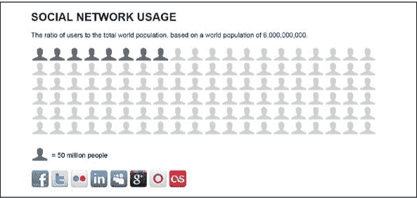
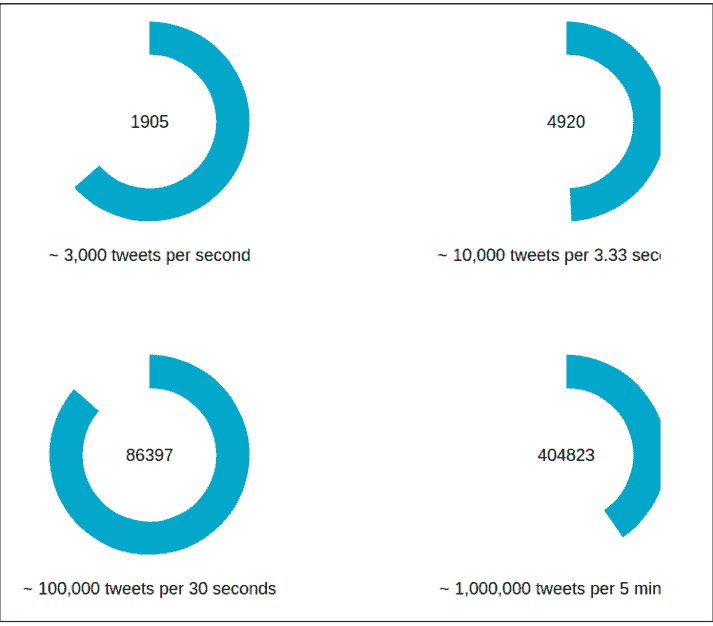
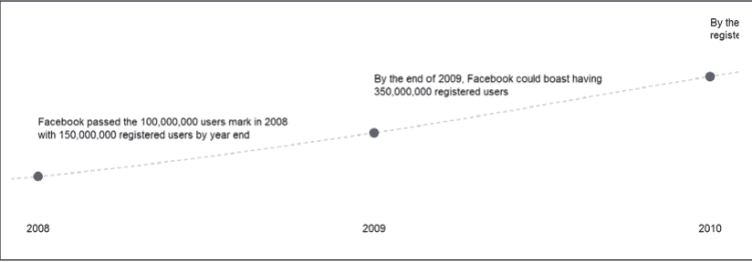
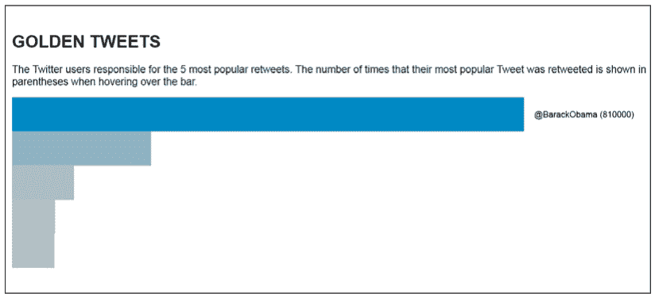

## 创建社交媒体可视化套件

我们现在已经介绍了 Raphaël JavaScript 库的所有主要方面，在本章中，我们将探讨基于社交媒体统计数据创建数据可视化演示。

近年来，数据可视化真正兴起。随着我们试图理解并传达可用的海量数据，在线信息图表和数据相关展示的数量继续增长。话虽如此，现有的许多优秀示例都是 _静态_ 的，利用矢量绘图库创建动态和交互式数据可视化有很大的空间，这使得 Raphaël 库成为一种非常真实且有效的应用。

在本章中，我们将探讨：

- 创建社交网络使用统计数据可视化
- 创建显示推文数量随时间变化的动态环形图
- 讨论 Raphaël 库的未来

### 社交网络使用

人们可以通过计算机网络进行通信和交互的想法可以追溯到，嗯，万维网之前（第一封网络电子邮件发送于 1971 年），但真正在过去十年左右，我们开始看到社交网络的广泛且确实巨大的使用。Facebook 目前是世界上最大的社交网络，拥有十亿注册用户，而 Twitter 和 Google+ 等平台各拥有近五亿用户。


## 创建社交媒体可视化套件

在本节中，我们将创建一个交互式可视化，类似于直方图/面积图，通过将社交网络用户数量与总世界人口（六十亿）进行比较，来展示这些数字有多么显著。它将使用一种常见的技术，即在选择相关社交网络时，通过高亮显示图标来指示用户相对于所有世界公民的比例。最终结果如下所示：



## 开始使用

要开始，我们首先创建一个基本的 HTML 文件，其中包含社交媒体图标图片的标记，并在 `body` 标签闭合之前包含所有相关的 JavaScript 文件。我们将在 `social-network-usage.js` 文件中编写 JavaScript：

```html
<body>
<h1>Social Network Usage</h1>
<p>The ratio of users to the total world population,
based on a world population of 6,000,000,000.</h1>
<div id="world-population-usage"></div>
<div class="networks">


</div>
<script type="text/javascript"
src="raphael-2.1.0.min.js"></script>
<script type="text/javascript"
src="jquery-1.9.1.min.js"></script>
<script type="text/javascript"
src="social-network-usage.js"></script>
</body>
```

当点击社交媒体图标时，高亮显示的人数将更新以反映该网络的总用户数。这些图标由 komodomedia.com 提供，并随本书附带的源代码一起分发。

## 使用 jQuery

你会注意到在上一节的标记中，我们包含了 jQuery JavaScript 库。这将用于在本章中方便地进行 DOM 交互。

你可以从 http://jquery.com/ 下载 jQuery。编写时的最新版本是 1.9.1，我们将在本章中使用该版本。

对于不熟悉 jQuery 的人，网上有许多资源可供参考。你的首选应该是 http://docs.jquery.com/。

## 社交网络使用数据

本可视化使用的数据取自 http://en.wikipedia.org/wiki/List_of_social_networking_websites，其中使用量基于注册用户数量进行测量，并且该数字四舍五入到最近的 5000 万用户：

| 社交网络 | 注册用户数量（四舍五入到最近的 50,000,000） |
|---|---|
| Facebook | 1,000,000,000 |
| Twitter | 500,000,000 |
| Flickr | 50,000,000 |
| LinkedIn | 150,000,000 |
| Myspace | 50,000,000 |
| Google+ | 400,000,000 |
| Orkut | 100,000,000 |
| last.fm | 50,000,000 |

我们将此数据定义为一个对象，其中键对应于前面标记中定义的类名，值为注册用户数量：

```javascript
var usage = {
    facebook: 1000000000,
    twitter: 500000000,
    flickr: 50000000,
    linkedin: 150000000,
    myspace: 50000000,
    googleplus: 400000000,
    orkut: 100000000,
    lastfm: 50000000
};
```

## 绘制人形图标

像往常一样，我们定义画布并将其引用存储在 `paper` 变量中。根据我们使用的图标的默认宽度和高度，一个宽 770px、高 220px 的画布非常适合我们的目的：

```javascript
var paper = Raphael('world-population-usage', 770, 220);
```

我们使用的人形图标由 Dmitry Baranovskiy 提供，他创建了不少于 266 个作为路径的图标，可在 http://raphaeljs.com/icons/ 上找到。该页面上的每个图标都带有一个相关的路径字符串，我们可以直接在代码中使用。我们将其中一个路径字符串的引用保存在名为 `personPath` 的变量中，以便重复使用（注意，此处显示的路径为了简洁而被截断）：

```javascript
var personPath = "M20.771,12.364c0,0,0.849-3.51 ..."
```

鉴于此，我们现在绘制 120 个这样的图标，每行 20 个，共六行。每个图标代表 5000 万人，这意味着 120 个图标代表 60 亿的世界人口：

```javascript
var people = paper.set();
for(var j = 0; j < 6; j+=1) {
    for(var i = 0; i < 20; i+=1) {
        var path = paper.path(personPath).attr({
            fill: '#666',
            'stroke-width': 0,
            opacity: 0.3
        });
        var bBox = path.getBBox(); // width/height of icon
        var xTranslation = (bBox.width + 4) * i;
        var yTranslation = (bBox.height + 4) * j;
        path.transform('T', xTranslation, yTranslation);
        people.push(path);
    }
}
```

在给定的代码中，我们遍历 i 列和 j 行。我们使用 path 方法绘制图标，然后获取其边界框，以确定其占据的空间宽度和高度。然后我们将图标按此宽度和高度加上每次迭代的 4px 小间距进行平移。我们希望在 x 方向上平移图标的宽度数量由列索引 i 决定，而在 y 方向上平移图标的高度数量由行索引 j 决定：

```javascript
var xTranslation = (bBox.width + 4) * i;
var yTranslation = (bBox.height + 4) * j;
```

最后，我们将创建的人形路径存储在名为 people 的集合中。这将允许我们根据点击的社交媒体图标对所有人进行操作：
people.push(path);

请注意，每个图标的不透明度为 0.3，这将使我们能够区分社交网络用户和构成世界人口的非用户。

## 响应图标点击

我们在标记中定义的每个社交媒体图标上注册一个点击事件处理程序。当点击图标时，我们将对在上一节中创建的 people 集合进行操作：

```javascript
$(' .networks img').click(function() {
    // Operate on people Set
});
```

点击时，我们结束 people 集合中存储的所有路径上的任何现有动画，并将不透明度重置为 0.3。stop 方法防止动画继续到其目标属性，并且是防止未来动画与正在进行的动画冲突所必需的：

```javascript
people.stop().attr({opacity: 0.3});
```

然后我们获取被点击元素的类名，并使用它来获取该特定社交网络的用户数量：

```javascript
var className = $(this).attr('class');
var numPeople = Math.ceil(
  people.length * (usage[className] / 6000000000)
);
```

由于类名映射到我们 `usage` 对象中存储的使用值，我们将使用量计算为总人口的比例，然后将此数字乘以我们 `people` 集合中的人总数。这将给出一个 0 到 120 之间的值，即基于每个图标 5000 万用户应高亮显示的图标数量。`ceil` 方法将此值向上舍入到最近的一个人。

在确定需要高亮显示的图标数量后，我们使用集合对象的 `forEach` 方法遍历它们：

```javascript
people.forEach(function(o) {
  if(o.id < numPeople) {
    o.animate({opacity: 1}, 500);
    return true;
  }
  return false;
});
```

`forEach` 方法将集合中的对象传递给它作为第一个参数接受的函数。该对象有一个 `id` 属性，对应于其在集合中的索引位置。它是一个基于零的 ID，这意味着我们可以在循环期间比较其值，看它是否小于 `numPeople` 变量（即应高亮显示的数量）。如果是，我们将其动画化为不透明度 1，以区别于所有其他不透明度为 0.3 的定义图标。遍历 `people` 集合中所有路径所需的时间可以忽略不计，这意味着所有动画似乎同时发生。例如，当点击 Facebook 图标时，`people` 集合中的前 20 个图标将动画化为不透明度 1。

## 绘制图例

最后，为了识别一个图标相当于 5000 万人，我们重新绘制人形路径并添加一些伴随文本：

```javascript
var keyPerson = paper.path(personPath).attr({
  fill: '#666',
  'stroke-width': 0
});
var bBox = keyPerson.getBBox();
```


## 按时间分布的推文

此人物路径在画布上的位置是任意的。我们将其放置在路径边界框高度的八倍处，使其刚好出现在六行人物的下方。

平均每秒约有 3,000 条推文，这意味着在 5 分钟内大约会产生一百万条推文。在本节中，我们将创建一个有趣的动画环形图可视化，利用路径弧来说明特定数量的推文被创建所需的时间：



### 开始使用

我们的 HTML 标记定义了一个画布，页面加载时我们将在其中绘制四条动画弧路径。我们将在 tweets-by-time.js 中编写 JavaScript：

```html
<h1>Tweets with respect to time</h1>
<p>There are approximately 3,000 tweets every ...</p>
<div id="tweets-timed"></div>
<script type="text/javascript"
 src="raphael-2.1.0-min.js"></script>
<script type="text/javascript"
 src="jquery-1.9.1.min.js"></script>
<script type="text/javascript"
 src="tweets-by-time.js"></script>
```

我们定义了一个宽度为 770px、高度为 450px 的绘图画布，以容纳这些计时器：

```javascript
var paper = Raphael('tweets-timed', 770, 450);
```

我们还定义了两个数组，用于保存我们将要绘制的路径的引用以及与时间相关的推文计数：

```javascript
var paths = Array(), counts = Array();
```

### 按时间分布的推文数据

基于每秒约 3,000 条推文，我们定义了以下数值的计时器：

| 时间间隔   | 推文数量 |
|-----------------|------------------|
| 1 秒        | 3,000            |
| 3.333 秒   | 10,000           |
| 30 秒      | 100,000          |
| 5 分钟       | 1,000,000        |

在我们的 JavaScript 文件中，我们创建了一个包含这些值的数组对象，以及一些相关文本和弧路径的中心 x、中心 y 和半径：

```javascript
var timers = [
 {
  cx: 225,
  cy: 100,
  r: 50,
```

```
interval: 1000,
total: 3000,
text: '~ 3,000 tweets per second'
},
// ...
```

出于简洁起见，此代码被截断。完整代码请下载本书附带的源代码。

### subtend 自定义属性

弧线的弯曲程度，即 _subtend_（所对的角度），取决于动画过程中经过的时间。起初，弧线所对的扇区长度为零，逐渐增加，直到弧线所对的角度达到 360 度。

为了实现这一点，我们定义了一个名为 `subtend` 的自定义属性，它根据特定时间下弧线的角度以及其固有的中心 _x_、中心 _y_ 和半径属性来返回一个路径。曲线终点的 _x_ 和 _y_ 坐标随其所对的角度呈正弦变化，这意味着我们可以定义一条从起点（中心点的 _x_ 坐标和中心点的 _y_ 坐标减去半径）开始弧形的路径，如下所示：

```
paper.customAttributes.subtend = function(angle, cx, cy, r) {
var x = cx + r * Math.cos(Raphael.rad(90 - angle));
var y = cy - r * Math.sin(Raphael.rad(90 - angle));
var path = [
'M', cx, cy - r,
'A', r, r, 0, +(angle > 180), 1, x, y
];
return {
path: path
};
};
```

请注意，子路径定义 `'A', r, r, 0, +(angle > 180), 1, x, y` 描述了一个半径固定为 `r` 的弧，当所对角度小于或等于 180 度时，其大弧标志为 0（此时我们要绘制可用弧中的较小者），当角度大于 180 度时，其大弧标志为 1（此时我们要绘制较大的弧）。

### counts 自定义属性

我们的可视化将根据动画经过的比例（表示为 0 到 1 之间的因子）以及该计时器的推文总数，以文本形式显示推文数量。我们定义了 counts 自定义属性，以文本形式返回经过时间与总推文数的比率，如下所示：

```
paper.customAttributes.counts = function(ratio, total) {
    return {
        text: Math.round(ratio * total)
    };
};
```

### 更新计时器

当计时器的动画初次开始，或者在遍历完整的 360 度（一次动画的长度）后被重置时，我们会运行一个更新方法，该方法负责设置弧的“起始”值。弧从 0 度开始，并被赋予 20px 的描边，从而产生时钟弧形效果：

```
function update(i) {
    // Get properties from our timers data array
    var cx = timers[i].cx, cy = timers[i].cy,
        radius = timers[i].r, interval = timers[i].interval;

    // Draw a new path for this particular timer
    paths[i] = paper.path().attr({
        subend: [0, cx, cy, radius],
        'stroke-width': 20,
        stroke: '#009ec4'
    });

    animate(i, cx, cy, radius, timers[i].interval);
}
```

辅助方法 animate 在此函数末尾被调用，以便将我们的动画从 0 度初始化到 360 度。请注意，我们的路径存储在 paths 数组中，以便我们稍后可以通过索引引用它们。

### animate 辅助方法

`animate` 函数的目的是对以下内容进行动画处理：

+   - 弧线从其初始弧路径到最终弧路径
+   - 经过的时间间隔内计数的推文数量

在给出的代码中，我们将弧线动画化为所对 360 度，并将文本计数作为推文总数的比例进行动画化：

```
function animate(i, cx, cy, r, interval) {
    // Animate the path
    paths[i].animate({
        subtend: [360, cx, cy, r]
    }, interval, function() {
        paths[i].remove();
        setTimeout(function() {
            update(i);
        });
    });
    // Animate the counts
    counts[i].animate({
        counts: [1, timers[i].total]
    }, interval, function() {
        counts[i].attr({
            'counts': [0, timers[i].total]
        });
    });
}
```

`animate` 方法在我们 `timers` 数组中指定的持续时间内运行，基于作为第一个参数传递的计时器的索引。请注意，当弧线的动画完成时，我们会再次运行 `update` 函数以重新启动整个过程。同样，`counts` 文本会被重置为 0。

### 遍历我们的计时器并启动动画

为了初始化动画，我们遍历我们的计时器，将我们的 `counts` 文本定义为初始值 `0`，位于弧线的中心 x 和中心 y 点。然后我们对每个计时器运行 `update` 函数，其效果是以我们讨论过的递归方式对弧线进行动画处理。

```
for(var i = 0, ii = timers.length; i < ii; i+=1) {
	(function(i) {
		// Draw descriptive text beneath the timer
		paper.text(timers[i].cx, timers[i].cy + timers[i].r + 30,
		timers[i].text);
		// Define counts text
		counts[i] = paper.text(
			timers[i].cx, timers[i].cy, '0'
		).attr({
			'counts': [0, timers[i].total]
		});
		update(i);
	})(i);
}
```

### 补充材料

另外两个数据可视化演示已在 `http://raphaeljsvectorgraphics.com` 上编写，并作为补充材料提供给您。

### 按年份划分的 Facebook 使用情况

创建了一个简单的时间轴可视化，以展示用户数量随年份的增长。时间轴是一条 Catmull-Rom 曲线，可以沿 x 方向平移，如下面的屏幕截图所示：



此可视化的补充材料可在 http://raphaeljsvectorgraphics.com/book/supplementary/facebook-usage-by-year 获取。

### 黄金推文

Twitter 在 2012 年底发表了一篇文章，讨论了一些被转发次数最多的推文。这些推文被营销为 _黄金推文_，因为它们鼓励了高水平的参与。

创建了一个柱状图可视化，以表示这些推文被转发的次数：



此可视化的补充材料可在 http://raphaeljsvectorgraphics.com/book/supplementary/golden-tweets 获取。

[ 109 ]


### Raphaël 的未来

Raphaël 的当前维护者 Tomás Alabés 友好地联系了我，提供了关于该库未来的相关信息。展望未来，我们预计该库的采用率将提高，并且正在实施一些变更，以便实现 Raphaël 更开放的开源协作。

### 里程碑

Raphaël 项目目前有四个里程碑，如下表所示：

| 版本 | 里程碑 |
|---------|-----------|
| 2.1.1 | 解决社区贡献的错误修复 |
| 2.2.0 | 引入贡献者拉取请求中的增强功能 |
| 2.2.1 | 解决社区创建的问题中的错误修复 |
| 2.3.0 | 开发社区创建的问题中建议的增强功能 |

如您所见，Raphaël 的即将发布的版本将解决许多现有的错误修复，但也许更有趣的是，开始实施由社区贡献或建议的功能。这使得该库变得稳固，并持续发展。

### 长期目标

Tomás 特别渴望鼓励 Raphaël 的开源协作。他已经开始向源代码（https://github.com/DmitryBaranovskiy/raphael/）提交提交，这将有助于促进更广泛的协作。

此外，当 VML 兼容浏览器开始失去市场份额且支持它们不再是要求时，该库将开始专注于 SVG，这将带来许多功能和改进，而这些功能和改进受到 VML 的限制。

### 摘要

读完本书后，您希望能够牢牢掌握 Raphaël 库的功能，并了解它可以使用的一些方式以及绘制矢量图形和可视化数据所采用的方法。请提醒您探索该库的文档，尝试其所有可用功能，并投入时间研究驱动未来应用程序的概念，无论这些应用程序是数据可视化、游戏开发还是制图。任何库的真正力量都取决于使用它的人。

希望您阅读本书的乐趣与我编写它一样多。
