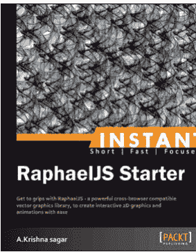
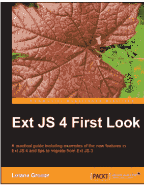

## Ext JS 4 初探

ISBN: 978-1-84951-666-2        平装本: 340 页

一本实用指南，包含 Ext JS 4 新功能的示例以及从 Ext JS 3 迁移的技巧

- 根据本指南中提供的示例，轻松将 Ext JS 3 应用程序迁移到 Ext JS 4
- 包含大量图表、插图和分步说明，用于开发实际应用程序
- 由示例驱动，并解释事物的工作原理

请查看 [www.PacktPub.com](https://www.PacktPub.com) 了解我们书名的信息

