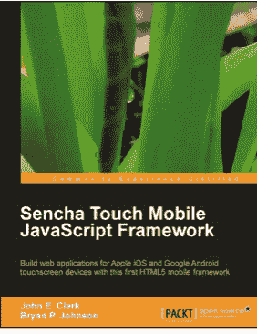
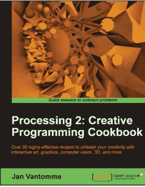

## Processing 2：创意编程食谱

ISBN: 978-1-84951-794-2        平装本: 306 页

超过 90 个高效食谱，通过交互式艺术、图形、计算机视觉、3D 等释放你的创造力

- 探索 Processing 语言，包含大量用于计算艺术和图形的实用食谱
- 广泛涵盖主题，包括交互式艺术、计算机视觉、可视化、3D 绘图以及 Processing 中的更多内容
- 创建交互式艺术装置，并学习将你的作品导出用于打印、屏幕、互联网和移动设备

请查看 **[www.PacktPub.com](https://www.PacktPub.com)** 了解我们书名的信息

