# 使用响应式设计、Bootstrap 和 D3.js 入门

理解数据的最佳方法是对其进行可视化，并使用交互式可视化进行探索。在本书中，我们将使用最新的技术和 Web 技术构建此类交互式可视化（实际上是许多可视化）。为了使信息在所有设备上都可访问，我们将使可视化具有响应性。然而，在开始之前，我们需要了解这实际上意味着什么。我们还希望重用一些现有框架，不仅要出色地完成工作，还要高效地工作。

本章将介绍我们在全书中将使用的方法、技术和框架，并帮助您理解我们使用它们来创建数据可视化的原因以及它们如何协同工作。

在本章中，您将学习以下内容：

- 响应式设计究竟是什么，以及如何将其应用于创建适用于所有不同屏幕尺寸和分辨率的可视化
- 什么是媒体查询，以及如何使用它为各种设备设计可视化
- 我们为什么以及如何使用 Bootstrap 在现有组件上构建可视化
- 我们为什么在 Web 上使用矢量图形，例如 SVG
- 我们为什么使用 D3.js 进行数据操作和图形创作

首先，您将了解响应式设计以及如何使用它为各种屏幕尺寸和分辨率设计可视化。然后，我们将讨论一些关键技术的重要性，例如 CSS3（尤其是媒体查询）和 HTML5（尤其是视口 meta 标签）。

在下一章中，我们将了解流行的 CSS 和 HTML 框架 Bootstrap。如果您从未听说过它，请不要担心；它帮助我们在现有且经过充分验证的组件（例如网格和 LESS 媒体查询）上构建应用程序。

在本章的最后一节中，您将了解浏览器中的可缩放矢量图形（SVG）；您将了解为什么以及何时使用矢量图形进行可视化是非常好的选择。然后，我们将简要介绍 D3.js，这是一个用于数据转换和图形生成的多功能 JavaScript 库。在本章结束时，您将了解为什么 SVG 是为 Web 设计交互式响应式可视化的绝佳选择。

## 什么是响应式设计？

响应式设计是一种用于设计能够根据用户设备调整其外观和行为的应用程序的方法。它使应用程序在所有不同设备上都看起来和感觉良好，并且通常使它们在所有设备上都可用。

响应式设计的一个重要范式是在整个应用程序中使用相对尺寸，而不是固定宽度、高度、边距、内边距和字体大小，以使设计适应各种类型的设备。

对于 Web 浏览器，响应式设计是通过 CSS3 和 HTML5 功能实现的，例如媒体查询、视口 meta 标签和新的尺寸单位。

## 使用媒体查询的条件 CSS

媒体查询在 CSS3 中引入，作为媒体类型的更灵活的扩展。它们允许开发人员仅在语句（所谓的查询）与某个 CSS 属性（所谓的媒体特性）和媒体类型匹配时应用条件 CSS 样式。典型的媒体查询具有以下结构：

```
@media [Media Type [and|not|only]] (Media Feature) {
   ...
}
```

以下是可用作媒体特性的属性的一小部分：

- width、min-width 和 max-width
- height、min-height 和 max-height
- device-width、min-device-width 和 max-device-width
- device-height、min-device-height 和 max-device-height
- resolution、min-resolution 和 max-resolution

媒体特性和类型的完整列表可在 MDN 上找到 https://developer.mozilla.org/de/docs/Web/CSS/Media_Queries/Using_media_queries。

在响应式设计中，我们主要关心查询 min-width 或 max-width 属性，以便为宽度不同的设备应用不同的样式。

让我们看一个示例，其中我们可以根据浏览器窗口的最小宽度应用不同的背景颜色：

```
div {
  background-color: blue;
}

@media screen and (min-width: 992px) {
  div {
    background-color: red;
  }
}
```

在前面的示例中，只要浏览器窗口的宽度大于或等于 992 像素，页面中所有 div 元素的背景颜色都为红色（参见下图）：

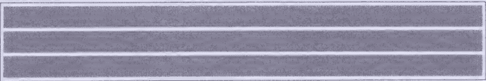

浏览器窗口宽度大于 992 像素


一旦窗口宽度小于 992 px，div 元素的背景色就会变为蓝色（见下图）：

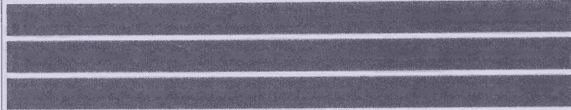

宽度小于 992px 的浏览器窗口

如下图所示，媒体查询受所有主流浏览器以及从版本 9 开始的 Internet Explorer 支持：

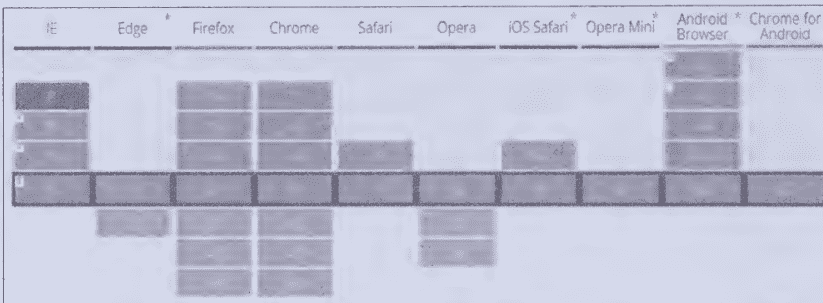

跨浏览器兼容性媒体查询来自 http://caniuse.com/#feat=css-mediaqueries

## 理解断点

在响应式设计中，当某个布局和媒体查询生效时，我们称之为一个 **状态**，而我们称从一个状态过渡到另一个状态为 **断点**。

让我们看一个示例。首先，我们为以下设备定义一些屏幕尺寸：

- 小于 768px 用于手机
- 768px-992px 用于平板电脑
- 992px-1200px 用于台式机
- 大于等于 1200px 用于大型设备和电视

## 为这些设备尺寸使用媒体查询创建 CSS 代码片段：

```
/* phones, default no query */
/* tablets */
@media (min-width: 768px) { ... }
/* desktops */
@media (min-width: 992px) { ...}
/* large devices */
@media (min-width: 1200px) { ... }
```

在上述代码中，我们定义了四个状态，这些状态之间有三个断点，每个状态对应一个典型的屏幕尺寸和设备类型。

我们还可以通过在查看响应式网页时缩小浏览器窗口来观察这些断点；我们会观察到设计在某个浏览器窗口宽度时如何“断裂”。在下图中，断点被可视化为虚线，显示了一个状态转变为另一个状态的时刻：

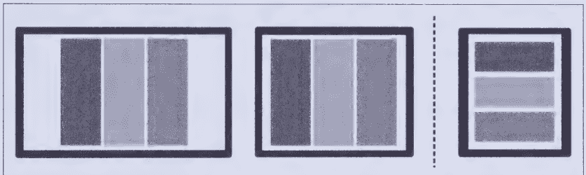

响应式设计中的断点

我们在查看下图中的 Google Plus 网页时也可以观察到同样的效果。在前两张图中，浏览器窗口大小在变化，但三列布局保持不变。在第三张图中，设计断裂为仅包含两列的新布局：

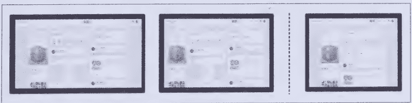

Google Plus 页面的断点

### 拥有正确的视口

跨越移动和桌面设备，存在大量不同的像素密度和屏幕分辨率。分辨率更高的显示器会将页面渲染得比分辨率较低的显示器小得多；这立即导致可读性问题。为防止这种效果并将更大的页面适配到更小的屏幕，引入了一个虚拟窗口——即所谓的视口（网页的可见区域）。这使得网站能够以正确的像素分辨率渲染并缩放到整个设备宽度以实现最大可访问性；但是，开发者无法控制这个特定于设备的设置。后来，在 HTML5 中，引入了视口 meta 标签，以便开发者能够完全控制这些视口设置。

今天，针对移动设备优化的应用程序通常在网页的 head 部分定义以下视口标签，以便正常渲染网站并将内容缩放到设备宽度：

```
<meta name="viewport" content="width=device-width, initial-scale=1">
```

> 有关所有有效视口选项的更多信息，请参阅 MDN 上的 https://developer.mozilla.org/en-US/docs/Mozilla/Mobile/Viewport_meta_tag。

### 相对单位 – %, REM, 和 EM

在处理响应式设计时，使用相对单位来根据父元素描述元素的尺寸始终是个好主意。因此，当父容器改变大小时，所有子元素都会相应调整其尺寸。

用于相对尺寸的最流行单位是 %，它基于下一个绝对定位的父元素的某个百分比来定义尺寸。

但是，还有更有用的单位来描述相对尺寸；例如，以下两个单位基于 font-size：

- em：相对于元素的字体大小
- rem：相对于根元素的字体大小

这些单位有一个很大的优点；它们会受到浏览器字体大小设置变化的影响。一个简单的例子是，当用户增大浏览器字体大小时，内边距的自适应调整。

> 关于所有不同 CSS 单位的简短总结和解释，请参阅 MDN 上的 https://developer.mozilla.org/de/docs/Web/CSS/length。

### 移动设备优先设计

响应式应用程序应该在大量设备（具有大量不同的屏幕尺寸和分辨率）上看起来和感觉都很棒（或者至少能正常工作）；它们通常既在移动设备上运行，也在大屏电视上运行。因此，在项目开始时，每个开发者都必须选择一种设计响应式应用的方法来掌握这种过渡；一般来说，我们区分以下方法：

- 移动设备优先
- 桌面设备优先

在桌面设备优先方法中，我们首先为桌面设备和鼠标输入进行设计，然后调整并缩小设计以适应移动设备和触控交互。这通常会导致 Web 应用程序在移动设备上的功能受限，因为屏幕尺寸小得多且缺乏触控支持。

在移动设备优先方法中，我们首先为移动设备和触控交互进行设计，然后调整并放大设计以适应更大的设备和鼠标交互。这种方法确保移动设备支持完整的功能集，甚至可以在桌面客户端上使用。

这两种方法如今都同样正确、被接受且流行。唯一的例外是，由于近年来访问 Web 的移动设备数量增加，移动设备优先成为一个热门词汇。在整本书中，我们将选择移动设备优先的方法，并针对移动设备和触控支持进行设计。但是，我们当然会扩展可视化效果以支持鼠标输入和更大的屏幕。这就是响应式设计的全部内容。

### Bootstrap – 一个流行的移动设备优先 CSS 框架

如果我们想要创建响应式移动设备优先 Web 应用程序，通常不希望从零开始并重新实现常见的模式和组件；我们更愿意重用一些经过良好测试的现有组件。

Bootstrap 是一个由前 Twitter 员工构建的非常流行的 HTML 和 CSS 框架，用于轻松、快速和现代的前端开发；它提供了大量的响应式 CSS 和 LESS 布局，以及庞大的 HTML 和 JavaScript 组件集合。得益于其 MIT 许可证，它可以用于开源和商业软件。

当前稳定版本 3.3.5 包含具有以下功能的 LESS 样式：

- 容器和栅格（静态和流式）
- 响应式辅助类（在不同断点上隐藏和显示元素）
- LESS mixin 和变量声明
- 常见组件（如表单、输入字段和表格）的样式
- 图标、HTML 和 JavaScript 组件

> 功能完整列表可在 Bootstrap 网站 http://getbootstrap.com/ 上找到。

全新的 4 版本（目前处于 alpha 阶段）将附带 SASS 布局以及许多其他出色的功能和改进：

> GitHub 上还有一个针对 SASS 预编译器的官方分支，地址为 https://github.com/twbs/bootstrap-sass。

- 所有单位都使用 rem 和 em
- 添加了新的 xl 栅格层级
- 可选的 flexbox 支持
- 提供了 Reboot 模块以重置默认浏览器样式

> 新功能完整列表可在 Bootstrap 博客 http://blog.getbootstrap.com/2015/08/19/bootstrap-4-alpha/ 上找到。

在整本书中，除非另有说明，我们将对所有示例和解释使用 Bootstrap 3.3.5 版本（带 LESS）。在适当的时候，我们还会提供关于最新版本的一些提示。

### 引入 Bootstrap

确保已安装 Bower 包管理器；可以通过在终端中运行以下命令来完成：

```
npm install -g bower
```

关于 Bower 包管理器的更多信息可以在其网站 http://bower.io/ 上找到。

在整本书中，我们将仅使用 Bootstrap 的 CSS 组件，因此只需要将 bootstrap.css 文件引入项目。有多种方法可以做到这一点：

- 使用名为 bower 的包管理器（推荐）——首先，通过在终端中运行以下命令获取库：bower install bootstrap#3.3.5。然后，在网页的 head 部分从 bower_components/ 目录链接压缩的 CSS 文件：<link rel="stylesheet" href="bower_components/bootstrap/dist/css/bootstrap.min.css">。

- 使用内容分发网络（CDN），例如 MaxCDN（这在开发期间需要活动的 Internet 连接）。只需在网页的 head 部分包含来自 CDN 的压缩 CSS 文件：<link rel="stylesheet" href="https://maxcdn.bootstrapcdn.com/bootstrap/3.3.5/css/bootstrap.min.css">。

- 手动，从 GitHub (https://github.com/twbs/bootstrap/releases) 下载 3.3.5 版本并将其解压到 libs/ 目录。然后，在网页的 head 部分从 libs/ 目录链接压缩的 CSS 文件：<link rel="stylesheet" href="libs/bootstrap/dist/css/bootstrap.min.css">。

我强烈建议使用 bower 包管理器来管理您的前端依赖项（或类似的工具，例如 npm 或 component）。但是，在本书的示例中，出于简单性考虑，我们将直接从 MaxCDN 链接 Bootstrap；因此，本书源代码中的所有示例都需要活动的 Internet 连接。

### 查找其他资源

Bootstrap 的终极资源是可在 http://getbootstrap.com/getting-started/ 上找到的文档。在此，您还可以找到使用 Bootstrap 框架的示例和模板。


有关更多详细信息和示例，我建议阅读 Istvan Novak 所著的《Unraveling Bootstrap 3.3》一书。

## 了解网格布局

在应用程序或可视化中组织元素的常用组件是网格布局。特别是对于响应式设计，我们主要关注根据客户端屏幕分辨率调整列数的网格布局。下图展示了一个响应式网格布局示例，在桌面设备上每行有三列，在移动设备上每行有一列：

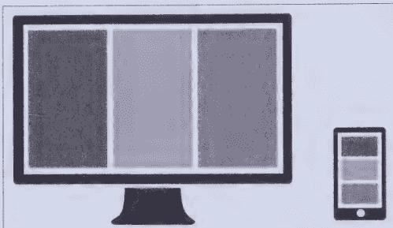

然后我们区分两种不同的响应式网格，它们会根据客户端屏幕分辨率调整列数：

- 每个断点具有固定宽度的常规网格（参见下图左侧）
- 始终缩放至当前断点全宽度的流式网格（参见下图右侧）

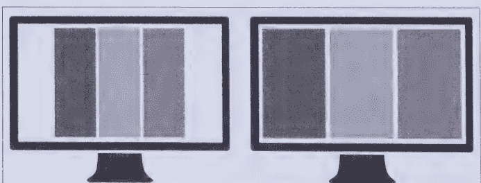

实际上，自己构建网格系统非常简单；首先我们来看看如何创建流式网格布局，之后，我们将更好地理解如何使用 Bootstrap 组件快速且正确地完成工作。

如果将网格视为（灵活的）表格布局，我们需要两个基本组件：行和列。一种常用的方法是使用 12 列网格，将行宽度划分为 12 列，并定义列组合，这些组合加起来等于 12 的全宽。下图说明了其中一些组合：12 个宽度为 1 的列、6 个宽度为 2 的列、4 个宽度为 3 的列，依此类推。其他加起来等于 12 的组合也被允许，例如 2、6 和 4，或者 1、10 和 1，以及更多。

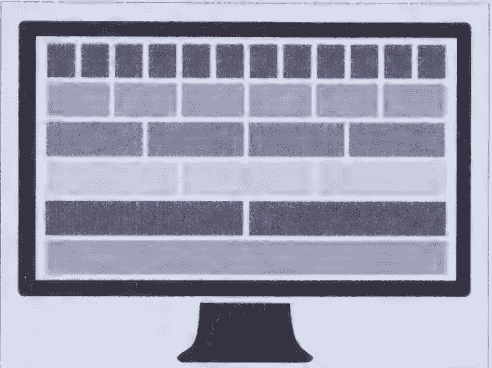

具有 12 列的网格布局

让我们开始构建 .row 类，该类延伸至父元素的全宽：

```
.row {
    position: relative;
    width: 100%;
}
```

接下来，我们想要创建列类 .col-1、.col-2、... 和 .col-12，这些类定义列相对于行宽度的百分比宽度。我们使用 float 属性定义文本换行，并为单元格添加填充。float 属性表示块元素不应出现在原始流中，而应“浮动”在左侧。这样，我们可以将元素排列在同一行，而不是将其放入正常文本流中：

```
[class*="col-"] {
    float: left;
    padding: 1em;
}
.col-1 {
width: 8.33333333%;
}
.col-2 {
width: 16.66666667%;
}
.col-3 {
width: 25%;
}
.col-4 {
width: 33.33333333%;
}
.col-5 {
width: 41.66666667%;
}
.col-6 {
width: 50%;
}
.col-7 {
width: 58.33333333%;
}
.col-8 {
width: 66.66666667%;
}
.col-9 {
width: 75%;
}
.col-10 {
width: 83.33333333%;
}
.col-11 {
width: 91.66666667%;
}
.col-12 {
width: 100%;
}
```

在前面的代码中，我们可以看到可以使用名为 [class*="col-"] 的通配符属性选择器一次性选择所有列（即所有包含 col- 字母的类）。宽度必须根据列类型定义。

前一示例中唯一的问题是，默认情况下（box-sizing: content-box），列的填充大小会与 width 属性相加以确定元素的计算宽度。所有元素的总宽度加上填充大小将超出父元素 100% 的宽度。使用 box-sizing: border-box 属性，我们可以禁用此行为，使元素的计算宽度等于 width 属性：

```
[class*="col-"] {
  -webkit-box-sizing: border-box;
  -moz-box-sizing: border-box;
  box-sizing: border-box;
}
```

最后，我们需要在每个行之后清除列的文本换行属性。我们可以通过在每个 .row 类之后添加一个 clearfix 伪元素来实现：

```
.row:after {
  content: " ";
  display: block;
  clear: both;
}
```

这已经是基本网格系统的一个不错实现。让我们测试此布局并创建一个包含以下内容的 HTML 页面：

```
<div class="row">
  <div class="col-1">.col-1</div>
  <div class="col-1">.col-1</div>
  <div class="col-1">.col-1</div>
  <div class="col-1">.col-1</div>
  <div class="col-1">.col-1</div>
  <div class="col-1">.col-1</div>
  <div class="col-1">.col-1</div>
  <div class="col-1">.col-1</div>
  <div class="col-1">.col-1</div>
  <div class="col-1">.col-1</div>
  <div class="col-1">.col-1</div>
  <div class="col-1">.col-1</div>
  <div class="col-1">.col-1</div>
</div>
<div class="row">
  <div class="col-2">.col-2</div>
  <div class="col-2">.col-2</div>
  <div class="col-2">.col-2</div>
  <div class="col-2">.col-2</div>
  <div class="col-2">.col-2</div>
  <div class="col-2">.col-2</div>
  <div class="col-2">.col-2</div>
</div>
<div class="row">
<div class="col-3">.col-3</div>
<div class="col-3">.col-3</div>
<div class="col-3">.col-3</div>
<div class="col-3">.col-3</div>
</div>
<div class="row">
<div class="col-4">.col-4</div>
<div class="col-4">.col-4</div>
<div class="col-4">.col-4</div>
</div>
<div class="row">
<div class="col-6">.col-6</div>
<div class="col-6">.col-6</div>
</div>
<div class="row">
<div class="col-12">.col-12</div>
</div>
```

如果添加一些颜色（完整示例可在书籍的代码文件中找到）并在浏览器中打开 HTML 页面，我们将得到类似于下图的布局：

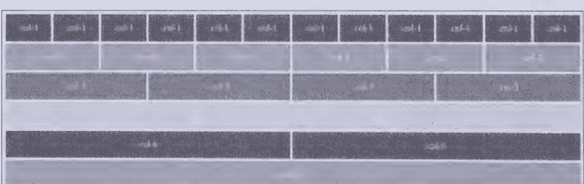

简单网格布局的浏览器输出

让我们来看看 Bootstrap 提供的响应式网格系统，它与我们刚刚创建的非常相似。Bootstrap 为四种设备类型（即所谓的网格等级）定义了媒体查询，以及响应式断点对应的典型视口宽度（像素）：

- 超小型设备（xs，如手机）的默认设置
- 小型设备（sm，如平板电脑和横向模式的手机）的 ≥768px
- 中型设备（md，如台式机）的 ≥992px
- 大型设备（lg，如大型台式机和电视）的 ≥1200px

> 在 Bootstrap 4 中，断点现在使用 em 单位定义：
> - 超小型设备的默认设置
> - 小型设备的 ≥34em
> - 中型设备的 ≥48em
> - 大型设备的 ≥62em
> - 超大型设备的 ≥75em

网格需要三个不同的组件：

- 它需要一个带有 `.container` 类（用于固定宽度）或 `.container-fluid` 类（用于流式容器）的 `container` 元素
- 它需要一个带有 `.row` 类的 `row` 元素
- 它需要一个或多个 `column` 元素：
  - `.col-xs-1, .col-xs-2, ..., .col-xs-12`
  - `.col-sm-1, .col-sm-2, ..., .col-sm-12`
  - `.col-md-1, .col-md-2, ..., .col-md-12`
  - `.col-lg-1, .col-lg-2, ..., .col-lg-12`

> Bootstrap 4 为超大型设备添加了另一个 `.col-xl-*` 类。

让我们来看一些代码。首先，我们需要将 Bootstrap CSS 添加到网页的标题中：

```
<!DOCTYPE html>
<html>
<head>
<link rel="stylesheet" href="https://maxcdn.bootstrapcdn.com/bootstrap/bootstrap/3.3.5/css/bootstrap.min.css">
<title>Simple Grid System</title>
...
</head>
<body>
...
</body>
</html>
```

现在，我们可以根据前面的示例添加网格布局，但这一次，我们需要将其包装在流式容器中：

```
<div class="container-fluid">
<div class="row">
<div class="col-lg-1">.col-lg-1</div>
<div class="col-lg-1">.col-lg-1</div>
...
</div>
<div class="row">
...
</div>
</div>
```

如果打开网页并查看浏览器输出，我们将看到类似于下图的示例：

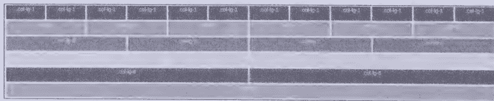

使用 Bootstrap 的网格布局浏览器输出

我们注意到，上图与本节开头创建的网格布局非常相似。代码中唯一的微小区别是用于包装行的 `.container` 元素以及 `.col-lg-*` 类的使用。然而，Bootstrap 的网格是响应式的，列会根据断点和浏览器宽度进行排列。如果将浏览器窗口大小减小到小于 1200px，我们会看到网格跳转到不同的布局。我们可以在下图中看到此效果：

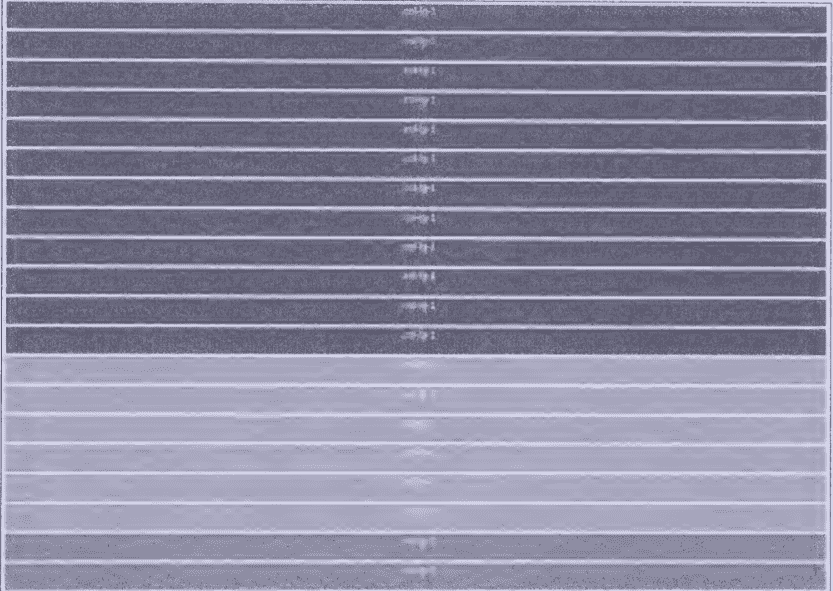

浏览器窗口大小小于 1200px 时的网格布局浏览器输出

原因是浏览器窗口不再处于超大型设备（大于 1200px）的状态，而是跳转到了较小的状态。因此，`col-lg-*` 列不再应用，它们显示为行的全宽度。现在我们可以开始定义某些列组合，以创建灵活的响应式网格：

```
<div class="container-fluid">
    <div class="row">
        <div class="col-lg-3 col-md-6 col-sm-12"></div>
        <div class="col-lg-3 col-md-6 col-sm-12"></div>
        <div class="col-lg-3 col-md-6 col-sm-12"></div>
        <div class="col-lg-3 col-md-6 col-sm-12"></div>
```


<div class="col-lg-3 col-md-6 col-sm-12"></div>
</div>
<div class="row">
...
</div>
</div>

## 在不同屏幕分辨率下隐藏元素

Bootstrap 还提供了非常实用且响应式的实用工具类，用于在特定浏览器宽度下隐藏元素。这些类根据媒体查询断点命名：

- .hidden-xs
- .hidden-sm
- .hidden-md
- .hidden-lg

在手机竖屏模式下隐藏元素只需为元素添加一个类；让我们看看下面的示例：

```
<ul class="nav">
    <li><a href="#menu">Menu</a></li>
    <li class="hidden-xs"><a href="#link">Link</a></li>
</ul>
```

在特定浏览器宽度下显示元素的类，根据元素的 CSS display 属性，在每个断点中都有三种不同的变体：

- .visible-*-block
- .visible-*-inline
- .visible-*-inline-block

> 之所以需要这些额外的类型，是因为当显示模式从 none 变为 block 时，会出现不想要的换行和行为。因此，Bootstrap 强制用户通过类名指定显示属性。

对于这三种块，所有断点类都可用：

- .visible-xs-*
- .visible-sm-*
- .visible-md-*
- .visible-lg-*

仅在特定设备宽度下显示元素也非常简单：

```
<ul class="nav">
  <li><a href="#menu">Menu</a></li>
  <li class="visible-xs-block"><a href="#link">Link</a></li>
</ul>
```

> Bootstrap 4 仅在所有断点上提供 .hidden-*-down 和 .hidden-*-up 类来隐藏特定设备类型的元素。

## 在 LESS 中使用 Bootstrap 的媒体查询

Bootstrap 的样式表是用 LESS 编写的，我们可以轻松使用预定义的断点和媒体查询。

> LESS 是一种类似于 CSS 的预处理器语言，用于编写支持嵌套、变量、函数、混入等功能的样式表。LESS 文件在开发过程中通过 LESS 编译器编译为 CSS 文件。如果你从未听说过 LESS，现在正是通过 http://lesscss.org/ 了解它的好时机。

请确保已安装 LESS 编译器；可以通过在终端中运行以下命令来完成：

```
npm install -g less
```

首先，我们创建一个 style.less 文件，并在文件开头导入 Bootstrap 的 variables.less 文件。这样我们就可以在整个文件中复用 Bootstrap 为颜色、尺寸和配置所做的声明：

```
/* style.less */
@import "bower_components/bootstrap/less/variables.less";
```

现在，我们可以在 LESS 文件中使用 Bootstrap 的媒体查询断点。让我们为所有 div 容器添加一些特定于设备的内边距：

```
/* Extra small devices */
/* No media query since this is the default in Bootstrap */
div {
	padding: 4em;
}

/* Small devices */
@media (min-width: @screen-sm-min) {
	div {
		padding: 8em;
	}
}

/* Medium devices */
@media (min-width: @screen-md-min) {
	div {
		padding: 16em;
	}
}

/* Large devices */
@media (min-width: @screen-lg-min) {
	div {
		padding: 24em;
	}
}
```

现在，我们使用 LESS 编译器，通过在终端中运行以下命令将样式表编译为 CSS：

```
lessc style.less style.css
```

生成的 CSS 类似于此：

```
/* Extra small devices */
/* No media query since this is the default in Bootstrap */
div {
	padding: 4em;
}
/* Small devices */
@media (min-width: 768px) {
	div {
		padding: 8em;
	}
}
/* Medium devices */
@media (min-width: 992px) {
    div {
        padding: 16em;
    }
}
/* Large devices */
@media (min-width: 1200px) {
    div {
        padding: 24em;
    }
}
```

完美！这意味着我们现在可以在 LESS 样式中使用预定义的断点了。

有时，将样式限制在一小组设备上也是必要的。因此，也可以在 LESS 中使用 max-width 媒体查询。同样，以下代码片段取自 Bootstrap 文档 http://getbootstrap.com/css/#grid-media-queries：

```
@media (max-width: @screen-xs-max) { ... }
@media (min-width: @screen-sm-min) and (max-width: @screen-sm-max) {
... }
@media (min-width: @screen-md-min) and (max-width: @screen-md-max) {
... }
@media (min-width: @screen-lg-min) { ... }
```

当我们想为单一设备类型定义样式，而不是为所有屏幕宽度大于或等于定义值的设备定义样式时，这会很有用。
