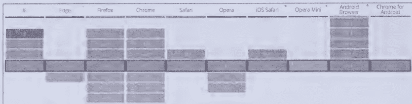
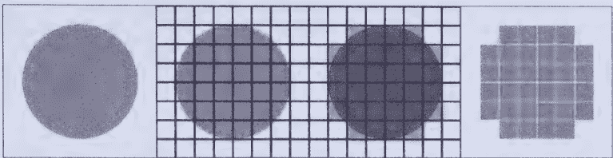
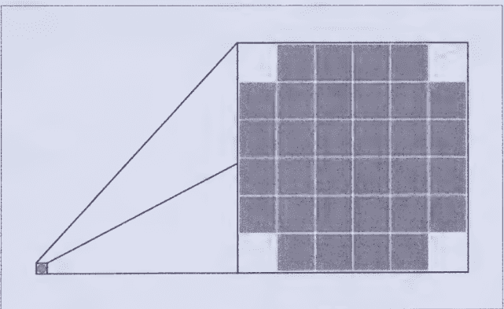
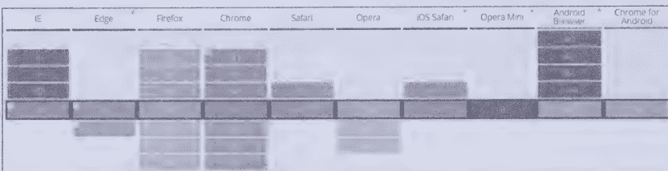
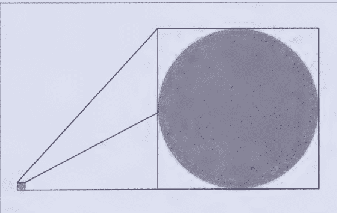

# 浏览器中的矢量图形与 SVG

现在，是时候创建我们的第一个可视化了。在 HTML5 中，我们有大量选项可以直接在浏览器中创建图形：

- Canvas API（例如使用 Paper.js、Processing.js 等）
- WebGL API（例如使用 Three.js、Pixi.js 等）
- SVG 规范（例如使用 RaphaëlJS、D3.js 等）

为了更好地了解哪种技术最适合我们实现响应式可视化的目的，我们需要仔细审视并讨论它们的优缺点。

## 使用 Canvas 实现光栅/像素图形

Canvas 是一种用于在浏览器中创建光栅图形（通常称为像素图形）的 JavaScript API。正如我们在下图中所见，它得到所有主要浏览器以及从第 9 版开始的 Internet Explorer 的支持：

> > 你可以在 MDN 上找到关于 Canvas API 的详细信息：https://developer.mozilla.org/en/docs/Web/API/Canvas_API。



像素图形是一种包含特定分辨率下图像中每个像素颜色所有信息的图像。假设我们有一个 8 x 8 像素的图像，这 64 个像素中的每一个都包含其颜色信息；我们在此图像中绘制一个圆：

```html
<canvas id="canvas"></canvas>
<script>
  var canvas = document.getElementById("canvas");
  var ctx = canvas.getContext("2d");
  var centerX = 10, centerY = 10, radius = 10;
  ctx.beginPath();
  ctx.arc(centerX, centerY, radius, 0, 2 * Math.PI, false);
  ctx.fillStyle = "red";
  ctx.fill();
</script>
```

在下图中，可以看到所谓的光栅化过程如何定义圆形哪些像素被着色（蓝色区域的像素）以及哪些像素保持透明（白色区域的像素）：



8 x 8 像素圆形的光栅化



如果以高分辨率显示此图像（参见左侧的下图），我们会看到边缘清晰的小圆。另一方面，如果放大图像，我们会看到一个非常像素化的 8 x 8 像素图像（参见右侧的下图）；这种效果直接由依赖分辨率的光栅化过程引起：

像素图形，左侧：高分辨率，右侧：放大

这种效果使得使用像素图形进行响应式设计变得非常困难；我们必须始终针对当前分辨率和屏幕大小生成并重新加载可视化。

另一个缺点是，最终图像由像素组成，这使得很难将事件监听器（如 mouseover 或 click 事件）附加到图像的某些组件上。原因是图像中未编码形状或组件，仅包含每个像素的颜色值。

## 使用 WebGL 实现硬件加速的像素图形

WebGL 是一种基于 OpenGL ES 2 的 JavaScript API，用于在浏览器中创建硬件加速的 3D 像素图形。这种技术非常强大，可通过所谓的着色器访问客户端的 GPU；最终可视化通过 Canvas 元素在浏览器中公开。然而，如下图所示，浏览器支持情况并不理想；移动设备仅部分支持该 API，Internet Explorer 仅从第 11 版开始支持。

> > 你可以在 MDN 上找到关于 WebGL API 的更详细信息：https://developer.mozilla.org/en/docs/Web/API/WebGL_API。



来自 http://caniuse.com/#feat=webgl 的 WebGL 跨浏览器兼容性

由于 WebGL 使用 Canvas 元素，它并未解决我们在 Canvas 部分讨论过的像素图形的任何局限性。因此，我们将接着探讨另一种图像表示形式。

## 使用 SVG 实现矢量图形

SVG 是一种用于创建和组合矢量图形的 XML 规范。得益于 HTML5，这些图形可以简单地嵌入 HTML 页面，由浏览器在每种屏幕分辨率下呈现并以完美清晰的方式显示。如下图所示，跨浏览器兼容性在所有主要浏览器以及从第 9 版开始的 Internet Explorer 中都非常好：


| IE | Edge | Firefox | Chrome | Safari | Opera | iOS Safari | Opera Mini | Android Browser | Chrome for Android |
|---|---|---|---|---|---|---|---|---|---|
| | | | | | | | | | |

SVG 的跨浏览器兼容性（来自 http://caniuse.com/#feat=svg）

矢量图形是图像，其中关于图像的所有信息都被编码为图像元素的几何形状（如矩形、圆形、椭圆、路径和文本）的数值表达式。浏览器始终使用这些信息以尽可能最佳的分辨率绘制和渲染图形。在下图中，我们可以看到一个高分辨率的圆形矢量图，而右侧是图像的缩放视图。可以清楚地看到，缩放后的图像显示边缘完美清晰；这种无损缩放效果源于浏览器的分辨率相关渲染。

> 您可以在 W3 网站上找到有关 SVG 规范的详细信息：http://www.w3.org/Graphics/SVG/.



矢量图，左：高分辨率，右：缩放

更多优势源于这样一个事实：可视化的元素只是简单地嵌入到 HTML 页面中。现在，我们可以轻松地在图形的每个组件上附加原生 JavaScript 事件监听器，例如 `mouseover` 或 `click` 事件，并使用 CSS 对其进行样式设置，与应用程序的其余部分一起。

另一个巨大的好处是，我们可以直接查看 Web 浏览器的开发者控制台，随意操作并调试可视化。我们可以单击图像的每个元素以查看其附加的事件处理程序，并可以实时修改 CSS 样式。任何处理过 OpenGL 或 WebGL 调试的人都会同意，在开发 Web 可视化时，这是一种你不能错过的便利。

现在，我们已经有很多理由支持使用 SVG 进行响应式跨浏览器可视化：

- 调试简单，因为图形的源代码只是简单地嵌入到 HTML 文档中
- 所有屏幕分辨率下渲染清晰，因为浏览器根据客户端的屏幕分辨率渲染图形
- 所有主流浏览器均具备跨浏览器兼容性
- 使用 CSS 对可视化进行样式设置
- 原生 JavaScript 事件处理程序可以附加到图像的所有元素
- 在开发者工具中调试和实时编辑可视化

## 使用 D3.js 创建图形

D3.js（Data-Driven Documents 的缩写）是由 Mike Bostock 和斯坦福可视化小组的其他成员构建的 JavaScript 库，用于 DOM 操作、数据转换和图形创建。它使用类似 jQuery 的数据驱动方法，并利用现代浏览器和基础 Web 标准（如 HTML、CSS 和 SVG）的所有功能。

D3.js 是开源的，并托管在 GitHub（https://github.com/mbostock/d3）上，采用略作修改的 BSD 3 条款许可证；因此，它可以在开源和商业产品中使用，无需发布任何修改。GitHub 本身使用 D3.js 来可视化存储库的贡献历史。

在本书中，我们将使用稳定版本 3.5.6，但大多数示例也应适用于不同的次要版本。

## 引入 D3.js

将 D3.js 引入项目有多种方式：

- 使用名为 bower 的包管理器（推荐），通过在终端中运行 bower install d3#3.5.6 命令获取库。然后，在网页的 head 部分引用 bower_components/ 目录中的压缩 CSS 文件：<link rel="stylesheet" href="bower_components/d3/d3.min.css">。

- 使用 CDN，例如 cdnjs（开发期间需要活跃的互联网连接），在网页的 head 部分引用 CDN 中的压缩 CSS 文件：<link rel="stylesheet" href="https://cdnjs.cloudflare.com/ajax/libs/d3/3.5.6/d3.min.js">。

- 从 GitHub（https://github.com/mbostock/d3/releases）手动下载 3.5.6 版本并解压到 libs/ 目录。然后，在网页的 head 部分引用 libs/ 目录中的压缩 CSS 文件 <link rel="stylesheet" href="libs/d3/d3.min.css">。

我强烈建议使用名为 bower 的包管理器来管理前端依赖项。但是，在本书的示例中，我们将出于简单性直接从 cdnjs 链接 D3.js；因此，本书源中的所有示例都需要活跃的互联网连接。

## 查找其他资源

D3.js 的终极资源是 GitHub 项目的 WIKI 页面，可在 https://github.com/mbostock/d3/wiki 找到。在这里，您还将找到示例和 API 的详细描述。

另一个绝佳的示例资源是 Mike Bostock 的页面 http://bl.ocks.org/mbostock 和他的博客 http://bost.ocks.org/mike/。

有关更多详细信息和示例，我建议阅读 Pablo Navarro Castillo 编写的 Mastering D3.js 一书。

## 总结

在本章中，我们简要介绍了响应式设计、媒体查询和视口设置。您了解了相对单位以及用于响应式应用程序的移动优先设计方法。

随后，我们介绍了 Bootstrap 并亲自实现了一个简单的栅格系统。这帮助我们了解了 Bootstrap 中响应式流式栅格的工作原理。我们看到了内置的响应式实用程序以及 LESS 中的媒体查询。

在本书的最后一部分，我们通过比较 Canvas、WebGL 和 SVG 在响应式设计中的优势，讨论了位图和矢量图形之间的区别。我们认识到 SVG 非常适合实现响应式可视化。最后，我们简要介绍了 D3.js。

在下一章中，我们将开始使用 D3.js，并使用数据连接、动态属性和简单变换实现一个简单的图形。

## 下载示例代码

您可以从 http://www.packtpub.com 的帐户中下载本书的示例代码文件。如果您在其他地方购买了本书，可以访问 http://www.packtpub.com/support 并注册，以便文件直接通过电子邮件发送给您。

您可以按照以下步骤下载代码文件：


- 使用您的电子邮件地址和密码登录或注册我们的网站。
- 将鼠标指针悬停在顶部的 SUPPORT 选项卡上。
- 单击 Code Downloads & Errata。
- 在搜索框中输入书名。
- 选择要下载代码文件的图书。
- 从下拉菜单中选择购买本书的渠道。
- 单击 Code Download。

文件下载完成后，请确保使用最新版本的以下工具解压或提取文件夹：

- 适用于 Windows 的 WinRAR / 7-Zip
- 适用于 Mac 的 Zipeg / iZip / UnRarX
- 适用于 Linux 的 7-Zip / PeaZip
