# 使用 D3.js 和 SVG 创建柱状图

在本章中，您将学习如何创建柱状图，包括合适的轴和比例尺——这需要一些 D3 的基础知识，我们也将在此介绍。您将学习以下内容：

- 如何使用 D3 选择和转换 DOM 元素
- 如何将 D3 与 SVG 元素一起使用
- 如何使用数据驱动方法创建可视化
- 如何使用数据绑定和数据连接
- 如何使用动态属性
- 如何绘制线条、区域和弧
- 如何使用比例尺
- 如何绘制轴
- 如何创建柱状图

首先，我们将从 HTML 元素的一些简单 DOM 选择和转换开始，并继续使用 D3 创建 SVG 元素。我们还将看到如何将数据绑定到 DOM 以及使用数据连接和动态属性应用数据驱动转换。

在第二部分中，我们将看到 D3 中一个内置的 SVG 抽象——所谓的生成器函数——尤其是线条、区域和弧生成器。与手动修改 SVG 路径元素的 d 属性相比，这些抽象极大地简化了形状的处理。


在下一节中，你将学习如何使用轴生成器创建坐标轴。我们需要沿坐标轴对数据集中的数据点进行缩放；因此，我们还将探讨比例尺。你将了解线性比例尺、用于非数值数据的序数比例尺，以及用于时间序列数据的时间比例尺。

在最后一节中，我们将运用所有所学知识，创建一个包含条形（当然）、坐标轴、比例尺和标签的简单柱状图。

## D3.js 入门

在本章中，我们将使用 D3.js 和 SVG 创建第一个柱状图；不过，为了达到这一目标，我们需要先了解一些基础知识。这些基本概念非常重要，因为它们将赋予你为脑海中几乎所有事物创建可视化的自由。你了解和掌握的越多，就能用 D3 做出越多“疯狂”的事情。

D3.js 是一个用于数据驱动的 DOM 操作的强大 JavaScript 库，包含用于操作 SVG 元素的预定义抽象、转换和辅助工具。这使其成为使用 Web 标准和现代浏览器完整功能编写交互式数据可视化组件的绝佳库。

如果你觉得这个定义充满了花哨的流行词，请不要担心，因为在本节中，我们将逐一讲解它们。你将完全理解它们的含义，以及为什么 D3 和 SVG 组合在一起能够创建可视化效果。

## 选择和操作 DOM 元素

D3 允许我们在 DOM 树中选择、追加、插入和删除元素。如果你之前使用过其他 JavaScript 框架（例如 jQuery），这些函数会让你感到非常熟悉。

让我们看一些示例，了解 D3 中的工作原理。我们在 HTML 中定义了一个简单的购物清单，包含几个需要购买的项目：

```
<ul>
<li>Ham</li>
<li>Cheese</li>
<li>Butter</li>
<li>Bread</li>
</ul>
```

要在 DOM 树中选择元素，D3 提供了 `d3.select(selector)` 和 `d3.selectAll(selector)` 方法，它们返回一个 **选择集** 对象。第一个函数的选择集包含一个只有一个元素的数组，而第二个函数的选择集包含一个含有多个元素的数组；两个函数都以 CSS3 选择器字符串作为参数（例如，`#id`、`.class`、`tagName`、`:pseudo` 等）。

> 有关选择集的更多信息，请参阅 D3 Github 页面 https://github.com/mbostock/d3/wiki/Selections。有关 CSS3 选择器的更多信息，请参阅 MDN https://developer.mozilla.org/en-US/docs/Web/Guide/CSS/Getting_started/Selectors。

在底层，D3 使用原生的 `document.querySelector(selector)` 和 `document.querySelectorAll(selector)` 函数：

> 有关这些函数的更多信息，请参阅 MDN https://developer.mozilla.org/en/docs/Web/API/Document/querySelector 和 https://developer.mozilla.org/en/docs/Web/API/Document/querySelectorAll。

```
var $ul = d3.select('ul');
var $li = d3.selectAll('li');
```

在前面的代码中，我们为 ul 元素创建了 $ul 选择集，并创建了包含所有 li 元素的 $li 选择集。

> 在本书中，我们将使用这种约定，为选择集添加 $ 前缀；这样可以让你更容易识别选择集。

一旦有了选择集，我们就可以向 DOM 添加更多元素。一种可能性是使用 `selection.append(tagName)` 方法在选择集末尾追加一个新的 DOM 节点；我们需要通过标签名指定要追加的元素类型（例如，`div`、`p`、`span`、`li`、`ul` 等）：

```
var $li1 = $ul.append('li');
$li1.text('Milk');
```

在前面的代码中，我们可以看到 `selection.append(tagName)` 方法返回一个包含刚刚创建的元素的选择集。然后我们使用 `selection.text(content)` 方法将节点的内部文本设置为 'Milk'。我们还可以使用 `selection.insert(tagName, selector)` 方法在某个位置之前插入元素：

```
var $el2 = $ul.insert('li', ':last-child');
$el2.text('Beer');
```

在前面的代码中，我们将带有 Eggs 文本的 li 元素插入到名为 $ul 的列表选择集的最后一个子元素之前。如果要从 DOM 中删除元素，可以调用 `selection.remove()` 方法：

```
$ul.select(':first-child').remove();
```

我们通过调用 `selection.remove()` 函数来删除列表的第一个子元素。然而，我们发现可以直接在 `selection.select()` 方法返回的对象上调用函数，而不是创建一个包含该元素的新变量。这种技术称为 **函数链式调用**，在使用 D3 时经常被采用。我们还可以链式调用前面示例中的 `selection.insert()` 和 `selection.append()` 函数，并直接在返回的选择集上应用 `selection.text()` 方法。

我们可能只想给最后一个元素加删除线，而不是删除它。`selection.attr(name, value)` 函数允许我们修改所选元素的任何属性：

```
$ul.select(':first-child')
.attr('class', 'strike-through');
```

在前面的代码中，我们使用了 `selection.attr(name, value)` 方法来访问 class 属性并将其设置为 strike-through。如果我们现在在标题中定义一个类样式，会看到第一个元素的文本中有一条贯穿线

```
<style>
.strike-through {
text-decoration: line-through;
}
</style>
```

另外，我们还可以使用 `selection.classed(className, hasClass)` 方法为选择集添加或删除类：

```
$ul.select(':first-child')
.classed('strike-through', true);
```

在前面的代码中，我们发现只提到了一个类，当你想要切换某个类并保持其他类不变时，这非常方便。

> 在底层，D3 使用原生的 element.setAttribute(name, value) 和 element.setAttributeNS(namespace, name, value) 函数来访问 HTML 和 SVG 属性。这使得 D3 非常强大，因为它直接使用底层的 Web 标准，而不是在其之上实现一个抽象层。

## 操作 SVG 元素

到目前为止，我们只使用 D3 来操作 HTML 节点；如果将此功能与 jQuery 相比，你并没有学到任何新东西或花哨的东西。好消息是，我们还可以将所有 D3 函数应用于 SVG 元素，因为这些元素同样嵌入在 DOM 树中。

让我们创建一个包含我们元素的小型 SVG 场景；我们还可以为 svg 元素添加一些样式以提高可见性：

```
<style>
svg {
	border: 1px dashed black;
	background-color: #efefef;
}
</style>
<svg width="800" height="400"></svg>
```

现在，我们可以再次使用 selection.append() 和 selection.attr() 函数向场景添加元素并定义其属性。与前面的示例类似，我们也会将函数链式调用在一起，而不是为新元素创建变量：

```
// Select the SVG element
var $svg = d3.select('svg');

// Append a new circle element
$svg.append('circle')
	.attr({
	cx: 75,
	cy: 75,
	r: 50,
	fill: 'red'
	});
```

在前面的示例中，我们可以与操作 HTML 元素时完全相同的方式来选择和操作 SVG 元素。我们还观察到 selection.attr() 函数接受一个包含多个 name: value 对的对象。在使用 SVG 元素时，这非常方便，因为我们经常需要一次定义多个属性。下图显示了此示例在浏览器中的输出：


带有一个圆形的简单 SVG 场景

## 数据驱动的转换

在前一节中，我们看到 SVG 元素的开箱即用处理使 D3 比 jQuery 等框架更适合创建可视化效果。但这并不是两个框架之间的唯一区别。D3 最重要、也最独特的功能之一是数据连接（data joining）。数据连接是 D3 的核心概念，对大多数人来说，这是学习 D3 时最难理解的地方。然而，它只是数据绑定的扩展，同时也考虑了当前的选择集。你很快就会发现，这是一个非常合乎逻辑而非神秘的功能。

## 数据绑定与动态属性

D3 代表数据驱动的文档；但什么是数据驱动方法？数据驱动意味着可视化是通过数据本身隐式定义的，而不是通过显式遍历数据。


让我们看一个使用显式循环在场景中绘制多个圆圈的示例。
我们使用与上一个示例相同的 SVG 场景：

```
// Explicit for loop
for (var i=0;i<5;i++){
$svg.append('circle')
.attr({
cx: 125 * (i + 1),
cy: 75,
r: 50,
fill: 'red'
});
}
```

在前面的示例中，我们使用显式循环遍历五个数字来绘制五个项目。下图显示了前面示例在 Web 浏览器中的输出：

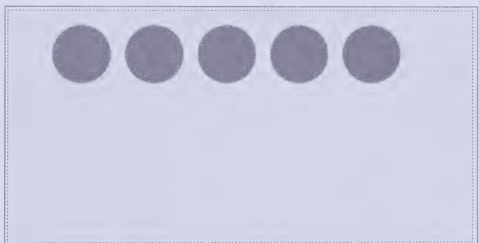

显然，如果我们处理的是数据集（可能是从应用程序日志中提取的示例），我们不想使用 for() 循环，而是想直接使用 forEach() 循环遍历数据数组。让我们创建一个包含 (0, 5) 范围内整数的伪数据数组（包含 0，但不再包含 5），使用 d3.range(stop) 函数：

```
// Create a pseudo dataset
var data = d3.range(5);
```

```
// Explicit forEach loop
data.forEach(function(d, i) {
$svg.append('circle')
.attr({
cx: 125 * (d + 1),
cy: 75,
r: 50,
fill: 'red'
});
});
```

前面的代码已经比原始的 for() 循环简洁了一些。我们观察到回调函数有两个属性——d 和 i。通常，d 是数组中当前元素的引用，i 是数组中当前元素的索引。太棒了！让我们添加最后一步，将循环转换为数据驱动的实现：

```
// Create a pseudo dataset
var data = d3.range(5);

// Data-driven approach
$svg.selectAll('circle')
.data(data)
.enter()
.append('circle')
.attr({
cy: 75,
r: 50,
fill: 'red'
})

.attr('cx', function(d, i) { return 125 * (d + 1) });
```

首先，我想请您注意 .data(data) 方法；此函数用于将数据数组绑定到 Selection。我们将在接下来的章节中更详细地讨论此函数和前面的 .enter() 函数。我要指出的第二行是 .attr('cx', function(d, i) { ... }); 这就是所谓的动态属性——一种将由绑定数据数组动态计算的属性，其中 d 和 i 参数的用法与前面 forEach 回调中完全相同。

让我们总结一下数据驱动的方法。我们将数据数组绑定到 DOM 元素的选择集，并使用动态属性根据绑定的数据定义元素的属性。因此，我们不再需要遍历数据集。但是，前面的示例比这要复杂一点，原因是数据连接。

## 数据连接 – 下一级的数据绑定

正如我们在前面的示例中所见，`selection.data(data)` 函数将数据集绑定到选择集——至少这是我们迄今为止所涵盖的内容。更准确地说，该函数不仅仅如此；它在选择集和数据集之间创建了一个连接。在下图中，我们可以看到数据连接的样子：

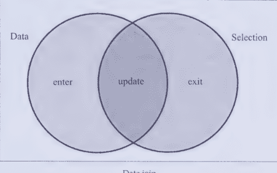

我们可以通过简单比较数据集（前面图中的红色圆圈）与 DOM 元素的选择集（前面图中的蓝色圆圈）来思考数据连接。在将数据集的元素与选择集中的元素进行比较后，我们得到三组可能的元素：

- 进入集：这些元素存在于数据集中，但不存在于选择集中，因此我们要创建它们
- 更新集：这些元素既存在于数据集中，也存在于选择集中，因此我们要更新它们
- 退出集：这些元素存在于选择集中，但不存在于数据集中，因此我们要删除它们

为了更好地理解此过程，我们将通过一些代码来演示。我们将再次使用与前面示例相同的 HTML 设置。首先，我们创建一个数据集并将其与选择集连接：

```
// Create a dataset
var data = d3.range(3);

// Create a data join
var $circles = $svg.selectAll('circle')
.data(data);
```

在前面的示例中，我们首先在 [0, 3) 范围内创建一个数据集。然后，我们创建所有 `circle` 元素的选择集并将其与数据集连接。在这种情况下，场景中没有 `circle` 元素，因此选择集为空。这意味着进入集将包含所有三个数据集元素；更新集和退出集将为空。

> 在本书中，我们将使用将数据连接前缀为两个 $ 符号的约定；这将使您更容易发现连接并将其与选择集区分开来。

我们现在可以使用 `join.enter()` 函数来返回进入集（数据数组）的元素并将其添加到 DOM 中：

```
// Get the enter set
$$circles.enter()
.append('circle')
.attr({cy: 75, r: 50})
.attr('cx', function(d, i) { return 125 * (d + 1) });
```

调用 `join.enter()` 函数会将元素从进入集中移除并添加到更新集中。想象一下，进入集是一个数组，存储了当前选择集中不存在的数据集中的所有值。调用 `.enter()` 后，通常希望将元素添加到 DOM 中。这就是 D3 自动假设这一点并将进入集中的所有值移动到更新集中的原因。现在，调用 `.enter()` 后，进入集变为空，更新集包含进入集中的所有值。我们可以将数据连接用作选择集来检索更新集：

```
// Modify the update set
$$circles.attr('fill', 'blue');
```

前面的代码会将所有圆圈都着色为蓝色，因为数据集中的所有元素现在都存在于 HTML 元素的选择集中。

最后，我们将从数据集中删除一个元素，并再次将数据与选择集连接；然后，我们可以通过调用 `join.exit()` 函数来访问退出集，从而从选择集中删除该元素：

```
// Remove an element from the dataset
data.splice(0, 1);

// Create a data join
$$circles = $svg.selectAll('circle')
.data(data);

// Get the exit set
$$circles.exit()
.remove();
```

在前面的代码中，我们可以看到，只需将数据集再次与选择集连接即可获得更新的集合。这非常强大，因为我们可以使用一个函数来定义元素在屏幕上应该如何绘制。要更新元素，我们将使用更新后的数据集再次调用该函数；我们只需要定义新元素、现有元素和删除元素的处理方式即可。

为了总结数据连接部分，我将列出我们用于访问数据连接三个集合的三个函数：

- 进入集：selection.data(data).enter()
- 更新集：selection.data(data)
- 退出集：selection.data(data).exit()

下图可视化了前两个步骤。我们从图左侧的空选择集开始；场景中尚无圆圈。然后，我们将数据集连接到这个空选择集；我们得到一个包含三个元素的进入集。对于进入集中的每个元素，我们在场景中创建一个圆圈，并使用 cx 属性的动态属性配置其位置。

如果我们现在要更新圆圈，可以直接将数据连接用作选择集。这将返回一个包含所有三个圆圈的更新集。

| 选择集 | 数据 | 进入 | 选择集 | 数据 | 更新 | 选择集 | 选择集 |
|---|---|---|---|---|---|---|---|
| | 0 | → | | 0 | → | 圆圈 | 圆圈 |
| | 1 | → | | 1 | → | 圆圈 | 圆圈 |
| | 2 | → | | 2 | → | 圆圈 | 圆圈 |

数据连接：进入集和更新集

在下图中，我们从数据集中删除一个元素，查看更新集和退出集中会发生什么。在前一个操作后，我们的选择集包含了三个圆圈元素。如果从数据集中删除最后一个元素，更新集将只包含两个元素。选择集的最后一个元素现在将处于退出集中，并在下一步中从选择集中删除：

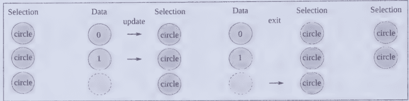

## 使用更新模式

要了解应该使用哪个集合来更新特定元素有点困难。因此，我们可以使用所谓的 **更新模式**，它定义了元素可以更新的顺序。

让我们创建一个函数来说明此模式：

```
function draw(data) {
  // Create a data join
  var $$circles = $$svg.selectAll('circle')
    .data(data);

  // Only previously existing elements
  $$circles.attr('fill', 'blue');

  // Only new elements
  $$circles.enter()
    .append('circle');

  // All elements
  $$circles.attr('fill', 'red');

  // Only removed elements
  $$circles.exit()
    .remove();
}
```


## 为元素定义标识符

如果我们多次使用不同的数据参数执行前面的函数，就可以恰当地定义以下元素的处理方式：

- 仅旧（先前存在的）元素
- 仅新元素
- 所有元素
- 仅删除的元素

> 在 Mike Bostock 的 Bl.ocks 页面上有三个关于更新模式的绝佳示例。我建议您查看所有三个示例，并尝试理解示例中到底发生了什么：
>
> - http://bl.ocks.org/mbostock/3808218
> - http://bl.ocks.org/mbostock/3808221
> - http://bl.ocks.org/mbostock/3808234

如果我们查看 selection.data(data, keyFn) 方法的 API 文档，可以看到该函数接受第二个名为 keyFn 的参数。使用此 keyFn 参数，可以定义一个访问器函数，以在数据连接中标识数组的元素。

让我们看一个示例，其中我们使用在上一节中实现的 draw(data) 函数：

```
// Create 4 elements
draw([0, 1, 2, 3]);
// Update 4 elements
draw([1, 2, 3, 4]);
```

如果我们不定义 keyFn 参数，D3 会使用数据数组的索引作为元素的标识符。在前面的示例中，函数首先创建四个圆；在第二步中，它更新这四个圆。不过，如果仔细观察，会发现部分数据是相同的，只是向左移动了。因此，我们更希望的行为是：0 从选择集中移除，[1, 2, 3] 保持不变，4 被添加到选择集中。我们可以使用数组值作为标识符，而非数组索引，来实现这一行为。让我们定义一个自定义 keyFn，它返回数组元素作为标识符。

```
var $$circles = $svg.selectAll('circle')
.data(data, function(d, i){ return d; });
```

在前面的示例中，我们以与动态属性中使用的回调函数相同的方式定义标识符函数。

## 使用 D3 绘制形状

D3 是创建 Web 可视化的优秀库，因为它在处理 SVG 元素时包含许多有用的抽象。在本节中，我们将介绍一些用于绘制形状的 SVG 抽象。这些绘制形状的抽象在 D3 中称为生成器；在创建可视化时，我们将主要使用线条、区域和弧形生成器。

> 所有 SVG 形状抽象都可以在 D3 的 GitHub 页面上找到 https://github.com/mbostock/d3/wiki/API-Reference#d3svg-svg。

### 绘制线条和曲线

如果您曾使用过 SVG 路径元素和 d 属性来创建自定义形状或贝塞尔曲线，那么您就知道这并不像应该的那样容易。那些从未使用过 SVG 路径元素的人只需要知道，您将需要学习一种特殊语法来定义和连接贝塞尔曲线的控制点。

> 您可以在 MDN 上找到有关 d 属性的更多信息 https://developer.mozilla.org/en-US/docs/Web/SVG/Attribute/d。

幸运的是，D3 提供了一个出色的抽象来绘制线条。让我们看一个简单的示例。首先，让我们创建一个包含一些点的 x 和 y 坐标的数据集：

```
var data = [
    [100, 100], [200, 350], [300, 50],
    [400, 200], [500, 250], [600, 40], [700, 100]
];
```

现在，我们想要创建一个线条生成器，它将数据点的第一个元素作为 x 坐标，第二个值作为 y 坐标：

```
var line = d3.svg.line()
    .x(function(d, i) { return d[0]; })
    .y(function(d, i) { return d[1]; });
```

完美！这就是我们的线条生成器。其优势在于我们只需定义线条生成器的结构，即在数据集中哪里可以找到 x 和 y 坐标，然后就可以绘制任何遵循相同结构的数据集。让我们绘制线条；我们需要使用 selection.datum() 方法将特定数据绑定到选择集。与之前讨论的数据连接不同，此函数不会计算连接，而仅返回一个选择集。然后，我们可以将线条生成器应用于路径的 d 属性，它将隐式查找绑定的数据并创建适当的 d 字符串：

```
$svg.datum(data)
.append("path")
.attr("d", line);
```

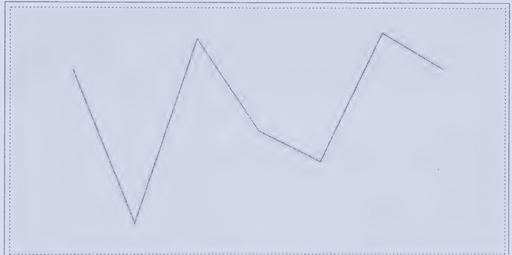

简单线条生成器的输出

在上一个示例中，您学习了如何创建仅将数据集中的点连接在一起的简单线条生成器。现在，我们可以轻松地在线条生成器上定义插值方法，以绘制平滑线条：

```
var line = d3.svg.line()
.x(function(d, i) { return d[0]; })
.y(function(d, i) { return d[1]; })
.interpolate('cardinal');
```

在前面的示例中，我们使用了 `cardinal` 插值，这是一种类似于贝塞尔曲线中使用的插值技术。如果我们观察下图中的结果线条，可以看到数据点之间的线条现在已经插值：

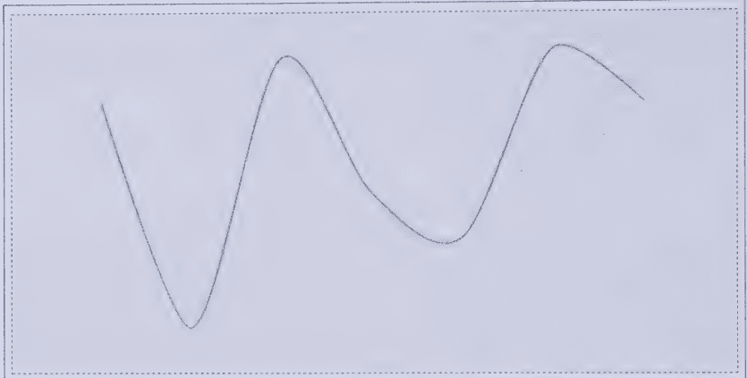

插值线条的输出

插值的平滑度可以通过 `.tension(value)` 函数控制。在下图中，我们可以看到张力为 1（即锯齿状内线）到张力为 0.5（即平滑外线）的区别：

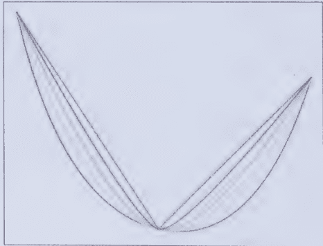

具有不同张力值的线条

### 绘制曲线之间的区域

与线条生成器类似，D3 还提供了一个区域生成器，允许我们使用 2 个 y 坐标：y0 和 y1。首先，让我们创建一个数据集，其中数据点的第一个元素包含 x 值，第二个元素为第一个 y 坐标，第三个元素为第二个 y 坐标：

```
var data = [
	[100, 100, 100], [200, 350, 200], [300, 50, 50],
	[400, 200, 350], [500, 250, 375], [600, 40, 100], [700, 100, 100]
];
```

现在，我们可以创建一个与前一个示例类似的区域生成器：

```
var area = d3.svg.area()
	.x(function(d, i) { return d[0]; })
	.y0(function(d, i) { return d[1]; })
	.y1(function(d, i) { return d[2]; })
	.interpolate('cardinal');
```

最后，我们将区域生成器应用于路径元素的 d 属性：

```
$svg.datum(data)
	.append("path")
	.attr("d", area);
```

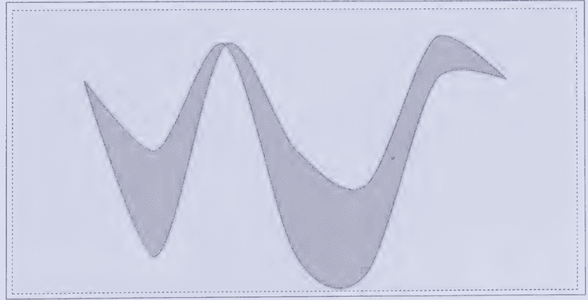

区域生成器的输出

### 绘制弧形

可视化中常用的第三种复杂形状是弧形。D3 还为此提供了一个生成器函数，以便轻松使用极坐标绘制弧形。同样，如果您以前在 SVG 中处理过弧形，那么得知这个生成器您可能会非常高兴。

让我们创建一个弧形生成器：

```
var arc = d3.svg.arc()
.innerRadius(40)
.outerRadius(100)
.startAngle(0)
.endAngle(Math.PI);
```

在前面的代码中，我们可以看到可以定义弧形的内半径和外半径以及起始角度和结束角度（弧度）。与前一个示例类似，我们现在可以为路径元素生成 d 属性：

```
$svg.append("path")
.attr("d", arc)
.attr("transform", "translate(200, 200)");
```

在前一个示例中，我们观察到需要将弧形稍微平移才能使其可见。示例在 Web 浏览器中的输出如下图所示：


弧形生成器的输出

D3 在生成器函数上提供了更多有用的方法，例如 arc.centroid() 方法。该函数返回弧形的中心，非常适合与弧形一起显示标签。

## 创建比例尺和坐标轴

D3 常被误认为是图表库，但这并不完全正确。D3 提供了大量内置函数，以便轻松创建交互式图表；然而，它并不是图表库。这些典型的内置图表辅助工具之一是密切相关的比例尺和坐标轴生成器。您将在本节中了解它们。

在本节结束时，我们希望能够绘制如下图所示的简单坐标轴。因此，我们需要将数据集缩放到特定的像素范围（使用比例尺），并为坐标轴创建所有 SVG 元素（使用坐标轴生成器）：


D3 中的坐标轴

### 使用比例尺将数据值映射到像素范围

在处理图形和可视化时，比例尺的概念非常重要。将值从某个定义域缩放到某个像素范围是一项常见任务。我们需要它们来创建坐标轴上的刻度值，并需要它们将数据点缩放到图表区域。

下图更好地说明了这一问题。假设我们想要将数据集中某个值域（例如仅正值）映射到图表中的某个像素范围（例如从 20px 到 460px）。比例尺在 D3 中正好提供了这种功能：

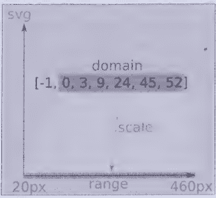

D3 中的比例尺


我要再次强调 D3 中的命名约定。当我们谈论数据集的某个范围时，使用 domain 这个术语；当我们谈论某个像素范围时，使用 range 这个术语。每当我们想要应用线性变换（如上图所示）时，我们都会说 *线性* 标尺。

## 用于线性映射的线性标尺

让我们来看看最简单的映射——线性变换，并根据上图创建一个：

```
var scale = d3.scale.linear()
.domain([0, 52])
.range([20, 460]);
```

在前面的代码中，我们可以看到可以使用 `d3.scale.linear()` 函数创建一个标识标尺（将 domain [0, 1] 映射到 range [0, 1]），然后为该标尺指定一个 domain 和一个 range。

让我们看看这个标尺对象是如何工作的；实际上，我们可以直接将其作为函数调用，它将把数据集中的任何值缩放到像素范围。让我们试一下，使用这个标尺映射整个数据集：

```
console.log([0, 3, 9, 24, 45, 52].map(scale));
```

如果我们在开发者工具控制台中检查输出，会得到类似以下的数组：

```
[20, 45.38461538461539, 96.15384615384615, 223.0769230769231,
400.7692307692308, 460]
```

从前面函数的输出可以看到，输入数组中的每个值都通过标尺函数被转换到了新的像素范围。

## 用于非数值数据映射的序数标尺

通常，我们需要处理非数值——即所谓的序数数据；如果我们观察一个柱状图，通常会有属于某个标签而非特定 x 值的值。在这种情况下，使用序数标尺将这些非数值映射到像素范围是非常合适的。

首先，让我们创建一个简单的：

```
var data = ['Bread', 'Eggs', 'Milk', 'Beer'];
var scale = d3.scale.ordinal()
.domain(data)
.range([0, 1, 2, 3]);
```

在前面的示例中，我们首先创建一个数据集，并将其定义为序数标尺的 domain。第二步，我们定义数据值应投影到的 range。如果我们映射整个数据集，结果等于我们定义的 range：

```
console.log(data.map(scale));
// [ 0, 1, 2, 3 ]
```

如果我们想要为离散点定义一个连续的像素范围，可以改用 .rangePoints() 方法。让我们看一个示例：

```
var scale = d3.scale.ordinal()
  .domain(data)
  .rangePoints([0, 10]);

console.log(data.map(scale));
// [ 0, 3.333333333333335, 6.666666666666667, 10 ]
```

此外，我们还可以定义一个考虑柱状图结构的 range——即 .rangeBands() 方法。这个函数考虑了这样一个事实：我们需要将柱子向左移动一个柱宽的一半，以匹配刻度值。

```
var scale = d3.scale.ordinal()
  .domain(data)
  .rangeBands([0, 10]);

console.log(data.map(scale));
// [ 0, 2.5, 5, 7.5 ]
```

## 用于时间序列数据映射的时间标尺

最后，处理时间序列数据时，还有一种标尺，它将 JavaScript Date 对象映射到像素范围。让我们看一个示例；首先，我们定义一个 Date 对象数组：

```
var data = [
  new Date(2015, 8, 1),
  new Date(2015, 8, 2),
  new Date(2015, 8, 3),
  new Date(2015, 8, 4)
];
```

现在，我们可以定义标尺；我们将使用 d3.extent(data) 函数来返回数据的 [min, max] 值：

```
var scale = d3.time.scale()
.domain(d3.extent(data))
.range([20, 460]);
```

如果我们将数据集映射到新范围，我们会得到落在 [20, 460] 范围内的值：

```
console.log(data.map(scale));
// [20, 166.666666666666, 313.333333333333, 460]
```

## 创建坐标轴

在 D3 中创建坐标轴时，我们希望使用标尺提供的功能将数据集映射到一系列像素。在下图中，我们可以看到来自开发者工具的示例以及坐标轴最终效果的样子：

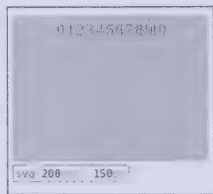

开发者工具中选定的 D3 坐标轴

首先，我们需要为坐标轴定义一个处理映射的标尺：

```
var scale = d3.scale.linear()
.domain([0, 10])
.range([20, 380]);
```

现在，我们可以创建一个坐标轴生成器，它的工作方式与之前提到的生成器非常相似：

```
var axis = d3.svg.axis()
.scale(scale);
```

最后，我们可以通过将生成器函数传递到我们想要创建坐标轴的任何（空）选择的 .call() 方法来绘制坐标轴：

```
d3.select('svg')
.call(axis);
```

就这样，没有魔法，没有困难。

> D3 在处理坐标轴时拥有大量内置功能。绝对值得查看 https://github.com/mbostock/d3/wiki/SVG-Axes 维基页面中的相应部分。

## 一个简单的柱状图

恭喜，你已经掌握了构建第一个柱状图所需的所有知识；而这正是我们将在本节中做的。在下图中，我们将创建一个带有坐标轴、标尺、柱子和标签的柱状图。

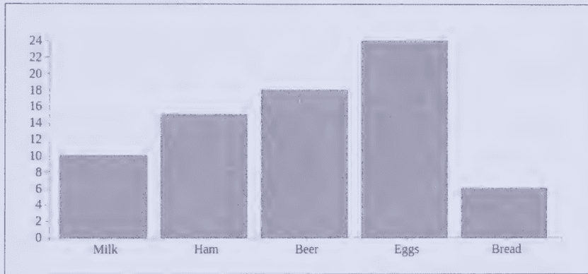

一个简单的柱状图

让我们从一个简单的设置开始——一个从 bower 组件目录加载 D3 库的空白 HTML 页面。此外，我们在头部中为路径元素定义了 crispEdges 渲染：

```
<!DOCTYPE html>
<html>
<head>
<title>Bar Chart</title>
<script src="bower_components/d3/d3.min.js"></script>
<style>
.axis path, .axis line {
    fill: none;
    stroke: #999;
    shape-rendering: crispEdges;
}
.data rect {
stroke: red;
fill: rgba(255, 0, 0, 0.5);
}
</style>
</head>
<body>
<script>
// Our code goes here
</script>
</body>
</html>
```

现在，我们可以开始在 script 元素中编写 JavaScript 并初始化图表尺寸和数据：

```
// Define the dimensions
var width = 800;
var height= 400;

// Define the inner margins
var pad = 75;

// Define the data
var data = [
{y: 10, label: 'Milk'},
{y: 15, label: 'Ham'},
{y: 18, label: 'Beer'},
{y: 24, label: 'Eggs'},
{y: 6, label: 'Bread'}
];
```

下一步，我们可以创建 svg 元素并正确设置其尺寸：

```
var $svg = d3.select('body')
.append('svg')
.attr({
width: width,
height: height
});
```

与前面的示例一样，$svg 变量再次引用带有 svg 根元素的选择集。让我们为数据和坐标轴创建一个容器：

```
var $axesGroup = $svg.append('g').attr('class', 'axis');
var $dataGroup = $svg.append('g').attr('class', 'data');
```

现在，我们回头看一下数据集，并为 x 值定义一个名为 xKey 的访问器函数，为 y 值定义一个名为 yKey 的访问器函数。当我们需要在数据集中访问这些值时，这些函数将很有用：

```
var xKey = function(d){ return d.label; };
var yKey = function(d){ return d.y; };
```

有了这两个函数，我们可以通过简单调用 data.map(xKey) 或 data.map(yKey) 轻松将数据集映射到仅包含 x 或 y 值的数组。让我们为 x 轴创建一个标尺。这个标尺将标签（序数值）映射到图表的水平像素范围：

```
var xScale = d3.scale.ordinal()
    .domain(data.map(xKey))
    .rangeRoundBands([pad, width - pad], 0.1);
```

在前面的代码中，我们使用数据集的 x 值作为 domain，并使用 .rangeRoundBands() 方法将其投影到名为 [pad, width - pad] 的非重叠带中的 range。现在，我们可以继续为 y 轴创建一个标尺；这将是一个简单的线性标尺：

```
var yScale = d3.scale.linear()
    .domain([0, d3.max(data, yKey)])
    .range([height - pad, pad]);
```

这个标尺比前面的序数标尺简单一些；我们只是将 [0, max] 作为 domain 进行映射，其中 max 是数据集中最大的 y 值。然后，我们将其投影到 [height - pad, pad] 的像素范围。有人可能会奇怪，为什么我们改变了 y 标尺 range 值的顺序。这是因为 SVG 中坐标系统的方向：y 坐标轴上的 0 位于顶部，而在我们的图表中，0 值应该映射到底部。

让我们继续创建坐标轴生成器；我们需要一个用于 x 轴，另一个用于 y 轴。在 x 轴中，我们可以通过在 .ticks() 方法中指定来定义刻度数量。它应该等于数据集中的元素数量。y 轴应该垂直方向定位，刻度值位于左侧。我们可以使用 .orient() 方法来指定这一点：

```
var xAxis = d3.svg.axis()
    .scale(xScale)


.ticks(data.length);

```
var yAxis = d3.svg.axis()
  .scale(yScale)
  .orient('left');
```

创建坐标轴生成器后，我们就可以绘制坐标轴了。只需将坐标轴生成器传递给空容器选择集上的 `.call()` 方法即可。我们还需要将坐标轴移动到图表中的适当位置。x 轴应位于底部，y 轴应位于左侧：

```
$axesGroup.append('g')
  .attr('class', 'x axis')
  .attr('transform', 'translate(0, ' + (height - pad) + ')')
  .call(xAxis);
```

```
$axesGroup.append('g')
  .attr('class', 'y axis')
  .attr('transform', 'translate(' + pad + ')')
  .call(yAxis);
```

让我们在浏览器中查看前面代码的输出；我们将能够看到坐标轴：

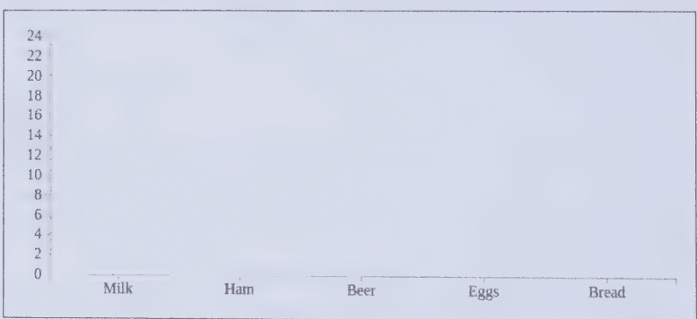

图表的坐标轴

前面的图显示，目前为止一切看起来都很好。太棒了，我们快完成了。最后，我们可以开始在图表中绘制柱状图了。在开始绘制柱状图之前，我们需要定义柱状图的宽度，即最大宽度除以柱状图的数量：

```
var barWidth = (width - 2*pad) / (data.length + 1);
```

现在，我们可以使用数据集的 x 值作为标识符来创建柱状图的数据连接：

```
var $bars = $dataGroup.selectAll('rect')
.data(data, xKey);
```

我们可以继续为 enter 集合中的所有元素创建 rect 节点：

```
$bars.enter()
.append('rect');
```

接下来，我们只需对数据集的值使用缩放函数，即可将矩形移动到图表中的适当位置：

```
$bars
.attr('x', function(d) { return xScale(d.label); })
.attr('y', function(d) { return yScale(d.y); })
.attr('height', function(d) { return yScale(0) - yScale(d.y); })
.attr('width', barWidth);
```

请注意，由于 SVG 坐标系统，我们需要通过从上到下绘制来定义柱状图的 y 值和高度。最后，为了完整性，我们还添加数据连接的最后一步，并移除 exit 集合中的所有元素：

```
$bars.exit()
.remove();
```

在此示例中，我们永远不会从图表中移除柱状图，但将前面几行代码包含到你的代码中是一种良好的实践。一旦你将代码放入函数并多次调用它，这将非常有用。

让我们对图表做一点调整，以更好地贴合响应式可视化主题。一般来说，每当我们定义静态像素值时，结果在某些设备上都会显示效果不佳。那么，我们可以更改什么呢？嗯，永远不要使用显式静态像素值，而应使用从父元素提取的相对值。

如果我们遵循此策略，可以使用 body 元素的宽度作为图表宽度。所有其他值（高度和填充）都可以相对于图表宽度来定义：

```
var $body = d3.select('body');

// Define the dimensions
var width = $body[0][0].clientWidth;
var height = width * 0.5;

// Define the padding
var pad = width * 0.1;
```

如果我们用这些新计算出的尺寸替换旧尺寸，图表在每个打开网页的设备上都会显示效果良好。太棒了！我对你在本章中取得的进展感到非常高兴；你可以为自己感到非常自豪。你已经构建了你的第一个（几乎）响应式柱状图！

## 摘要

在本章中，你学习了如何选择 DOM 元素，并使用数据连接和动态属性进行数据驱动的转换。我们还了解了如何使用形状和坐标轴生成器函数来快速创建常见形状，例如线条或区域。

在本章结束时，我们构建了第一个简单的（几乎）响应式柱状图。柱状图在页面加载时已适应浏览器窗口的宽度，但在更改浏览器尺寸时不会重新计算。

在下一章中，我们将探讨加载、过滤和分组数据。这非常重要，因为我们几乎总是需要以特定格式（例如 CSV）加载远程数据，然后在之后对其进行处理、过滤或分组，以便进行可视化。
