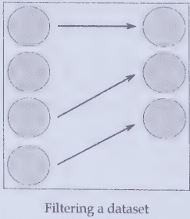
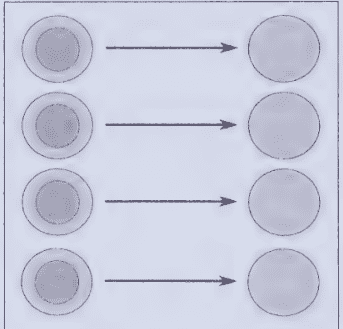
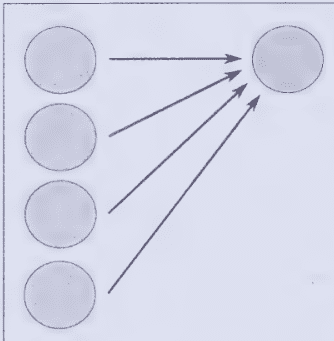
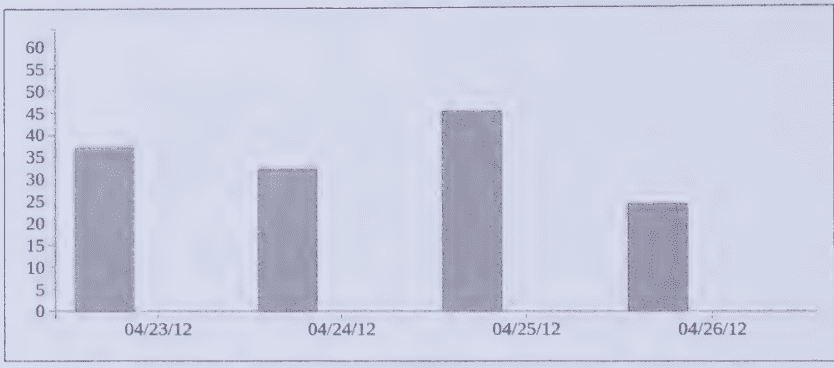
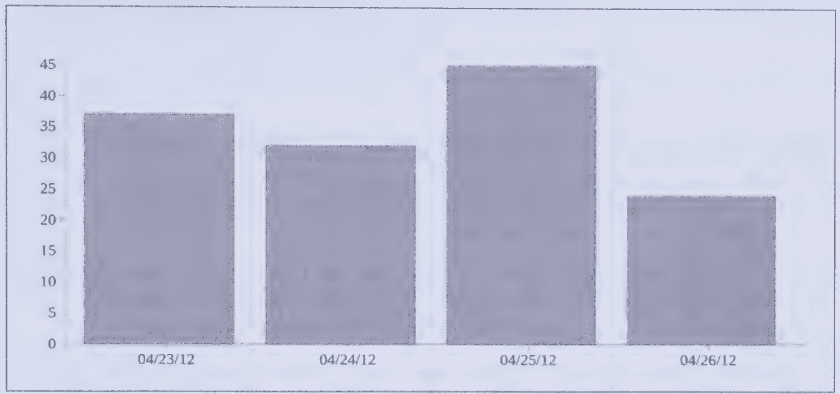
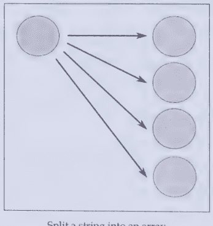
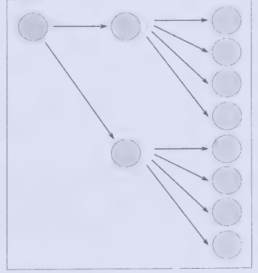
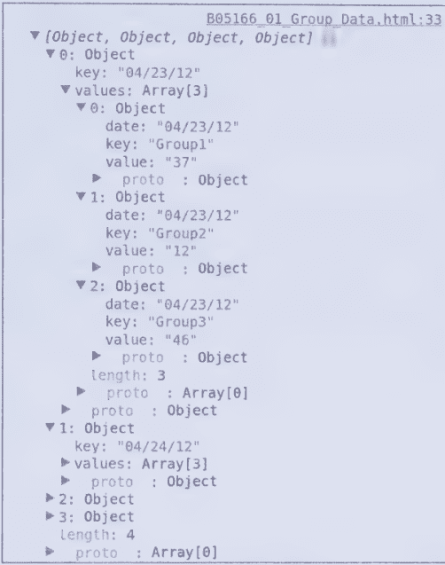
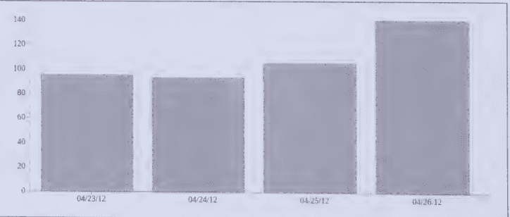

# 加载、过滤和分组数据

在上一章中，你学习了如何绘制简单的柱状图。在本章中，你将学习如何使用此图表从远程位置加载、解析和显示真实数据。在本章中，你将学习以下内容：

- 为什么需要预处理我们的数据
- 如何过滤异常值
- 如何将数据映射到另一种表示形式
- 如何聚合信息
- 如何使用 D3 加载数据
- 如何使用正则表达式解析字符串
- 如何解析日期字符串
- 如何格式化数字
- 如何分组平面数据

首先，我们将从一些始终必要的基本预处理步骤开始。我们将使用 `filter` 函数从数据集中过滤异常值和意外值；我们还将使用 map 函数来访问数组元素的内部属性。

然后，你将了解 reduce 函数以及它们如何帮助从数据中聚合和提取信息。我们将实现自己的简单 reduce 函数，还将查看 D3 中提供的 reduce 函数。

接下来，你将学习如何从远程位置加载数据。剧透警告，使用 D3 这将非常容易。但是，我们需要确保加载的数据可以被 JavaScript 理解，因此，我们有时需要解析文件。你将学习使用正则表达式将字符串分割成块，这些块可以通过 JavaScript 作为数组来访问。

然后，我们将探讨解析和格式化日期、时间和数值。这非常重要，因为当我们处理文本文件中的日期时，它们始终表示为字符串，而不是 JavaScript 对象。

在最后一部分，你将了解分组平面数据结构，例如包含层次信息的 CSV，将其转换为嵌套的 JavaScript 对象。结合前一部分，我们将能够从数据集中提取任何想要的信息，并在图表中绘制出来。

### 预处理数据

在本章中，你将了解预处理，以及它在处理现实世界数据时是一个重要步骤。如果我们想要设计一个能够处理不同远程数据源的可靠可视化，我们需要确保预先处理数据。数据集可能包含异常值、可能存在噪声、可能具有不同的表示形式、可能包含嵌套对象、可能是平面的，等等。你可以看到这个列表非常长。

因此，每当我们处理真实数据时，都需要在将其用于可视化之前对其进行处理；此步骤称为预处理。

### 过滤数据以移除异常值

作为第一个预处理步骤，我们将探讨过滤器。过滤器是数组运算符，返回包含原始元素子集的数组。在下图中，我们看到了此类操作的示例：



让我们尝试一个示例。我们从远程数据源加载以下数组：

```
var data = [
 {x: 1, y: 6},
 {x: 2, y: undefined},
 {x: 3, y: 4},
 {x: 4, y: 2},
 {x: undefined, y: 3},
 {x: 5, y: 3},
 {x: 6, y: 7},
 ];
```

我们看到前面的数据集包含一些未定义的值。每当我们处理真实数据时，都应该预期某些数据值未定义或格式不正确。如果我们想要从数组中移除这些值，可以使用 array.filter(filterFn) 运算符。名为 filterFn 的过滤函数将针对数据集中的每个元素进行求值，并且需要返回 true 或 false。在这里，false 表示该元素不会出现在返回的数组中。让我们编写一个只返回有效对象的过滤函数：

```
var filtered = data.filter(function(d, i){
 if (d.x !== undefined && d.y !== undefined) {
 return true;
 }
 return false;
});
```

在前面的代码中，我们看到一个典型的过滤函数，如果 d.x 和 d.y 已定义则返回 true，否则返回 false。但是，我们可以更优雅地编写此函数，直接返回 if 表达式：

```
var filtered = data.filter(function(d, i){
 return d.x !== undefined && d.y !== undefined;
});
```

> 处理数值时要小心隐式类型强制转换。如果你改为写 d.x && d.y，则会将数值隐式转换为布尔值。当你将数值 0 转换为布尔值时，猜猜会得到什么类型的布尔值？没错，你会得到 false。


这看起来更短更简洁了，太棒了！现在，我们还可以创建一个筛选器，只返回 y 值大于某个特定数值的数据点，如下例所示：

```
var filtered = data.filter(function(d, i) {
  return d.y > 5;
});
```

## 将数据映射以访问内部属性

你想要可视化的值经常以某种方式嵌套在数组对象中，隐藏在内部。你可以通过将整个数组映射为不同的数组表示形式，轻松访问这些数据。此映射操作在下图中可视化：



将一个数据集映射到不同的表示

让我们看一个示例数据集，我们希望从数据点中提取计数：

```
var data = [
  {x: 1, inner: {count: 5}},
  {x: 2, inner: {count: 4}},
  {x: 3, inner: {count: 1}},
  {x: 4, inner: {count: 8}},
  {x: 5, inner: {count: 3}},
  {x: 6, inner: {count: 5}}
];
```

在前面的数据集中，我们看到信息嵌套在 inner 对象的 count 属性中。我们可以使用带有名为 mapFn 的映射函数的 array.map(mapFn) 方法，为新数组表示中的每个元素返回元素：

```
var mapped = data.map(function(d, i){
 return {
 x: d.x, y: d.inner.count
 }
 });
```

映射后的数组现在包含带有 x 和 y 属性的对象，你可以像前一章所学的那样使用它们来生成可视化。虽然这看起来非常简单，但许多人在正确应用 map 函数方面存在问题。

## 聚合数据以提取有价值的信息

数据可视化中另一个重要的预处理步骤是聚合数据集的值。其一般想法是 reduce 函数。在下图中，我们可以看到 reduce 函数的示意图；它是一个数组操作，为多个元素返回一个单一值。



将数据集缩减为一个值

Reduce 函数帮助我们聚合想要可视化的值。让我们看一个简单的示例，我们希望显示 inner 对象中的计数：

```
var data = [
    {x: 1, inner: [5, 1, 1]},
    {x: 2, inner: [2, 1, 1]},
    {x: 3, inner: [5, 3, 2]},
    {x: 4, inner: [3, 5, 4]},
    {x: 5, inner: [4, 1, 2]},
    {x: 6, inner: [5, 3, 1]}
];
```

在前面的数据集中，我们希望聚合 inner 属性的值以便可视化它们；我们想使用聚合的总和。现在我们可以结合 map 操作和 array.reduce(reduceFn, startValue) 将数据集转换为良好的表示形式。缩减函数 reduceFn 是一个带有四个参数的函数：previous、current、arr 和 index，它为下一个元素返回一个值。我们还可以分配一个 startValue 来表示数组中第一个元素的 previous 属性。让我们看一个非常简单的缩减函数，即简单的求和：

```
function sum(a, b) {
    return a + b;
}
```

现在，我们可以使用 reduce 函数对 inner 属性中的所有值求和：

```
var reduced = data.map(function(d, i) {
    return {
        x: d.x, y: d.inner.reduce(sum, 0)
    }
});
```

同样，生成的数组由带有 x 和 y 属性的对象组成，但 y 属性现在包含所有 inner 值的总和。

我们还可以嵌套 map 和 reduce 操作，以聚合更多嵌套数据。让我们看一个嵌套数据集的示例：

```
var data = [
    {x: 1, inner: [{count: 5}, {count: 1}, {count: 1}, ...]},
    {x: 2, inner: [{count: 2}, {count: 1}, {count: 1}, ...]},
    {x: 3, inner: [{count: 5}, {count: 3}, {count: 2}, ...]},
    {x: 4, inner: [{count: 3}, {count: 5}, {count: 4}, ...]},
    {x: 5, inner: [{count: 4}, {count: 1}, {count: 2}, ...]},
    {x: 6, inner: [{count: 5}, {count: 3}, {count: 1}, ...]}
];
```

现在，我们需要将 `inner` 值映射为一个数组，然后就可以被 reduce 函数使用：

```
var reduced = data.map(function(d, i){
    return {
        x: d.x, y: d.inner
            .map(function(d){
                return d.count;
            }).reduce(sum, 0)
    }
});
```

在前面的代码中，我们首先使用一个 map 返回 count 属性的元素；然后我们在返回的数组上应用 reduce 函数。你已经可以看到，通过嵌套预处理函数，我们可以从数据集中聚合和提取大量数据。

### D3.js 中的 Reduce 函数

你可能已经想知道，D3 自带许多方便的 reduce 函数，可以应用于数组。但是，使用 d3 函数时，你始终需要将数组作为参数传递。在所有 d3 reduce 函数中，你可以使用 `accessor` 函数，它在执行 reduce 操作之前传递给一个 map 操作。这与前面的示例完全相同。

我们可以使用以下任一方法提取数据集的极值：

- d3.min(arr, accessor),
- d3.max(arr, accessor)
- d3.extent(arr, accessor)

让我们看最后一个示例：

```
var data = [
    {x: 1, inner: {count: 5}},
    {x: 2, inner: {count: 4}},
    {x: 3, inner: {count: 1}},
    {x: 4, inner: {count: 8}},
    {x: 5, inner: {count: 3}},
    {x: 6, inner: {count: 5}}
];
var extent = d3.extent(data, function(d, i){
    return d.x;
});
```

前面的代码中的 extent 函数返回名为 [min, max] 的数组，包含数据集中最小和最大的 x 值。

要从数据集中提取其他统计信息，我们可以使用以下内容：

- d3.mean(arr, accessor),
- d3.median(arr, accessor),
- d3.variance(arr, accessor)
- d3.deviation(arr, accessor)

> filter、map 和 reduce 函数起源于函数式编程，因为它们作用于输入数组，独立于状态或上下文对其进行转换，并在最后输出一个新数组。与简单循环相比，使用 reduce 函数的好处在于你在局部作用域中执行代码，而在循环中，你仍然在同一作用域中并维护状态。
> 关于性能，filter、map 和 reduce 函数通常比自定义循环的替代方案快不了多少。这主要取决于 JavaScript 引擎及其优化这些函数的方式。但是，正如我之前所说，它们允许开发人员编写更优雅、更简洁的代码，因为它们在独立于状态的分离作用域中工作。如果这引起了你的兴趣，你肯定应该了解更多关于函数式编程的内容！

### 加载和解析远程数据

在本节中，我们希望可视化真实数据，而不是示例数据集；因此，我们需要了解如何从远程位置加载数据。在 JavaScript 中，你可以使用原生 XMLHttpRequest (XHR) 对象在应用程序中获取数据。D3 不仅为原生 XHR 调用实现了一个包装器，还为加载不同数据类型并自动解析它们实现了包装器。

以下是 D3 中一些高级包装器的列表：

- d3.text(url[, mimeType[, callback]]): 从 URL 加载带有 mimeType 的纯文本文件；数据作为字符串传递给回调，在回调中必须手动完成解析
- d3.json(url[, callback]): 从 URL 加载并解析 JSON 文件；数据作为对象传递给回调
- d3.xml(url[, mimeType[, callback]]): 从 URL 加载并解析 XML 文件，数据作为对象传递给回调
- d3.html(url[, callback]): 从 URL 加载并解析 HTML 文件；数据作为对象传递给回调
- d3.csv(url[, accessor[, callback]]): 从 URL 加载并解析 CSV（逗号分隔）文件；数据作为对象传递给回调，并可使用 accessor 函数自动映射
- d3.tsv(url[, accessor[, callback]]): 从 URL 加载并解析 TSV（制表符分隔）文件；数据作为对象传递给回调，并可使用 accessor 函数自动映射

当所有数据加载完毕后，会调用回调函数；数据将作为参数提供给回调函数。

> 如果我们尝试从本地机器加载数据，很可能会收到 **跨域请求** 错误。这是现代浏览器的一项安全策略，用于防止将本地数据加载到浏览器中。但是，我们可以使用静态文件服务器，例如名为 `http-server` 的 node 包或名为 `python -m SimpleHTTPServer 8000` 的 python 命令。
>
> 如果你不想启动 Web 服务器来避免这个安全问题，也可以在浏览器设置或启动时禁用它：
> - 在 Firefox 中，在地址栏输入 `about:config` 并将 `security.fileuri.strict_origin_policy` 设置为 `false`
> - 在 Chrome 和 Chromium 中，关闭所有打开的实例，然后启动名为 `chrome.exe --allow-file-access-from-files` 或 `chromium-browser --allow-file-access-from-files` 的新会话

我们可以看到，借助内置的数据加载函数，使用 D3 加载远程数据非常简单。让我们看一个示例；我们将加载一个 CSV 文件：

```
// data source: Mike Bostock
var url = 'https://gist.githubusercontent.com/mbostock/32.../data.csv';
d3.csv(url, function(data) {
    draw(data);
});
```

在前面的代码中，我们使用了一个 draw 函数，它包含了我们在前一章中开发的柱状图的代码。你也可以查看所有代码示例的源代码，以查看完整的函数。


The CSV file contains a few lines similar to the following code:

```
key,value,date
Group1,37,04/23/12
Group2,12,04/23/12
Group3,46,04/23/12
Group1,32,04/24/12
Group2,19,04/24/12
```

If we run the previous code, the resulting chart looks like the following figure:



Bar chart with remote data

In the preceding chart, we see quite some errors that happen when we simply try to plot a dataset as it is. There exist multiple data points per day — one for each group—but we are only plotting one. This is an amazing example, why, even in very small and trivial datasets we need some kind of preprocessing for the data.

Let's, for example, filter out only the data for the key called Group1. To do so, we only have to use a small filter function on the data:

```
d3.csv(url, function(data) {
  draw(data.filter(function(d) {
      return d.key == 'Group1';
  }));
});
```

In the preceding example, we use a filter that returns `true` if the `key` property matches `'Group1'`. In the following figure, we can see the result of the example:



Plotting data from Group 1

This already looks very interesting and much better than the previous example. However, we are only plotting the data from the first group. We will learn how to aggregate the data from all groups in the last sections of this chapter.

Another interesting observation from the previous figure is that we simply plot the raw date values as we read them from the remote location. We use them as strings, which makes them very uncomfortable to work with. Here is where parsing date values comes in quite handy.

## Parsing any string data

Data visualizations often display data from multiple sources; therefore, we cannot guarantee that the datasets will always be in a CSV, TSV, or even JSON format. To load and parse raw data, for example, unformatted log data, we can use the `d3.text` function and parse the dataset on our own.

Let's look at a typical access log entry from a web server. It contains timestamps and user agents of the visitors of a website:

```
66.249.64.129 - - [22/Nov/2014:01:56:01 +0100] "GET / HTTP/1.1" 302
487 "-" "Mozilla/5.0 (compatible; Googlebot/2.1; +http://www.google.com/bot.html)"
```

There are some questions that come into one's mind if he/she wants to plot the preceding data. How should one aggregate the data? Do we want to sum all visitors per minute, per hour, or per day, or do we just want to sum the visitors by browser or by country of origin? Once we've parsed the data into a readable format, we can easily do all of the preceding things (you will learn this in the last section of the chapter). However, we first need to parse the string into a format that JavaScript can use.

### Splitting strings using Regular Expressions

The first step in processing a string is always splitting it into smaller chunks of words. If the log entries have been created by a program, they usually have some kind of structure but very often a very strange one.

If we take a closer look at the entries in the log file, we can see that single log entries are separated by a newline character called \n. Well, we actually don't see the character, but we can see the line breaks only at the end of the complete log entry.

We also observe that the - and " characters are some sort of separators between the logical parts of the entry. To split the string properly, we always have to find these separators. Now, we can use Regular Expressions and the string.split(expr) function to split the string into an array of smaller chunks. In the following figure, we can see this operation visualized:



Let's see this in action and split the log file into an array of log entries:

```
var lines = data.split(/\n/g);
```

Now, we can use the map function to access the inner elements of the line array and split them into logical chunks:

```
var lines = data.split(/\n/g)
.map(function(line) {
return line.split(/[-"]/g);
});
```

In the preceding code, we use the two Regular Expressions called /\n/g and /[-"]/g. In the first one, we simply look for matches of the \n character, and in the second one, we look for either the - or " character. In both cases, we use the greedy flag to search the whole string rather than stopping at the first occurrence.

> More information about Regular Expressions in JavaScript can be found on MDN at https://developer.mozilla.org/en/docs/Web/JavaScript/Reference/Global_Objects/RegExp.
> Usually, it is very tricky to get Regular Expressions to work properly. I recommend using a tool such as https://regex101.com/ to evaluate your expression before you throw them into your code.

The following figure visualizes how we are processing the string. The first split happens from the blue to the red layer. Then, we use map to split all of the elements from the red to the green layer. This all happens in the previous four lines of the code:



Splitting nested strings into arrays

You can already see that by nesting multiple split functions, you can split the string into an array of substrings that contain your information. In the next step, we need to parse date time values from different string representation into the JavaScript representation.

### Parsing dates from strings

As we saw already in the example of the log data, we will often have to deal with time series data in a specific string format. To transform, compare, and display Dates properly throughout the visualization, we have to first parse the string to a valid JavaScript Date object. Fortunately, D3 includes a powerful datetime parser to convert datetime strings into Date objects and vice versa.

To create such a formatter, we have to use the d3.time.format() function, which returns a formatter. We can then either use the formatter as a function to format Date objects or use the .parse() method to parse the datetime strings. Let's take a look at an example:

```
// Create a formatter
var formatter = d3.time.format('%Y-%m-%d');
// Parse a string to a Date object
formatter.parse("2015-01-01");
// Thu Jan 01 2015 00:00:00 GMT+0100 (CET)
```

As we've already discussed, we can also use the formatter function to convert Date objects into strings in order to style and format them:

```
// Create a formatter
var formatter = d3.time.format('%Y-%m-%d');
// Format a Date object to a string
formatter(new Date(2015, 0, 1));
// "2015-01-01"
```

> To make yourself familiar with the native Date object, you can take a look at the Mozilla Developer website at https://developer.mozilla.org/de/docs/Web/JavaScript/Reference/Global_Objects/Date.

As we can observe in the preceding code example, D3 uses formatter specifiers to define the format of the datetime string. Here, you can find a list of specifiers that can be used to for declaring the datetime format, which I took from my previous book Data Visualization with D3 and AngularJS by Packt Publishing:

- %a: Abbreviated weekday name
- %A: Full weekday name
- %b: Abbreviated month name
- %B: Full month name
- %c: Date time format %a %b %e %H:%M:%S %Y
- %d: Zero-padded day of month [01, 31]
- %e: Space-padded day of month [ 1, 31]
- %H: Hour in 24-hour format [00, 23]
- %h: Hour in 12-hour format [01, 12]
- %j: Zero-padded day of the year [001, 366]
- %m: Zero-padded month [01, 12]
- %M: Zero-padded minute [00, 59]
- %L: Zero-padded milliseconds [000, 999]
- %p: AM or PM
- %S: Zero-padded second [00, 61]
- %U: Zero-padded week number of the year (Sunday as first day of the week) [00, 53]
- %w: Weekday (starting with Sunday) [0, 6]
- %W: Zero-padded week number of the year (Monday as first day of the week) [00, 53]
- %x: Date format %m/%d/%y
- %X: Time format %H:%M:%S
- %y: Zero-padded year without century [00, 99]
- %Y: Year with century
- %Z: Time zone offset (for example -0700)
- %%: The literal character %

> You can find more information about datetime specifiers on the D3 Github page at https://github.com/mbostock/d3/wiki/Time-Formatting.


## 解析和格式化数值

我们不仅需要处理日期和时间字符串，还需要处理数值。对于整数和浮点数值，可以使用原生函数解析字符串，并使用 D3 数字格式化程序对其进行格式化和样式设置。

整数和浮点数可以通过 `parseInt()` 和 `parseFloat()` 函数轻松解析。不过，有时使用简短的 `+` 符号将字符串转换为数值也很方便。

```
// Parsing strings to numbers
var i = parseInt("5.0", 10);
var f = parseFloat("3.8");
```

```
// Short notation
var s = "932.2";
var j = +s;
```

在前面的代码中，我们看到使用原生函数和简短的 `+` 符号将字符串转换为数字非常方便。我们还观察到，大多数情况下，我们会在 `parseInt` 函数中使用基数 10。

在 D3 中，将数值格式化为字符串与将日期值格式化为字符串非常相似。不过，D3 只能将数字格式化为字符串；对于字符串到数字的转换，可以使用我们刚才讨论过的原生函数。同样，我们需要先使用 `d3.format(specifier)` 函数创建一个格式化程序；然后，可以将格式化程序作为函数来格式化数字。让我们来看一个示例：

```
// Create a formatter
var formatter = d3.format('.2f');
```

```
// Format a number object to a string
formatter(3.12e-1);
// "0.31"
```

specifier 参数再次定义我们要生成的格式化字符串值的结构。它可以采用以下形式组成：

```
[fill] [align] [sign] [symbol] [0] [width] [, ] [.precision] [type]
```

这些选项中的每一个都允许您自定义生成字符串的不同属性。这里，我只想提供所有可能类型说明符的列表，该列表也摘录自我之前由 Packt Publishing 出版的书籍《使用 D3 和 AngularJS 进行数据可视化》：

- e: 指数
- g: 通用
- f: 定点
- d: 整数
- r: 如果指定精度则四舍五入到精度
- %: 百分比
- p: 如果指定精度则四舍五入到精度的百分比
- b: 二进制
- o: 八进制
- x: 十六进制
- X: 带大写字母的十六进制
- c: Unicode 字符
- s: 带 SI 后缀并四舍五入

让我们来看一些使用不同类型说明符的示例：

```
console.log(d3.format('e')(0.3123)); // "3.123e-1"
console.log(d3.format('g')(31.223e3)); // "31223"
console.log(d3.format('f')(31.23)); // "31"
console.log(d3.format('d')(124)); // "124"
console.log(d3.format('%')(0.23)); // "23%"
console.log(d3.format('p')(0.2314)); // "23.14%"
console.log(d3.format('b')(23)); // "10111"
console.log(d3.format('s')(31.223e3)); // "31.223k"
```

> 您可以在 D3 的 GitHub 页面上找有关数字说明符的更多信息：https://github.com/mbostock/d3/wiki/Formatting。

### 分组数据

当我们在互联网上找到数据资源时，大多数时候它具有扁平的数据结构，就像逗号分隔的列表一样。但是，它通常包含层次结构数据。在 D3 中，通过创建数据集的嵌套树结构，可以非常轻松地将数据分组在一起。为了实现这一点，我们可以使用 d3.nest() 运算符。该运算符创建一个 nest 对象，可以通过 .key() 方法进一步定义分组键，并通过 .sortKey() 方法定义排序函数。这些函数也可以重复使用，以在扁平数据结构中创建多个嵌套层。让我们来看看数据集：

```
var values = [
  {
    date: "04/23/12",
    key: "Group1",
    value: "37"
  },
  {
    date: "04/23/12",
    key: "Group2",
    value: "12"
  },
  {
    date: "04/23/12",
    key: "Group3",
    value: "46"
  }, ...
];
```

首先，我们创建一个 nest 函数，然后相应地对数据进行分组：

```
var nest = d3.nest()
  .key(function(d, i){
    return d.date;
  });
```

现在，nest 实现了一个 .entries(data) 方法，它可以将数据集作为输入并返回扁平数据结构的分组结果。如果你好奇，可以查看将前面的 nest 函数应用于我们的数据集的输出。

```
console.log(nest.entries(data));
```

前面的代码在浏览器的开发者工具中显示了类似下图的结果：



数据集上应用的 nest 函数

> 您可以在 D3 的 GitHub 页面上找有关 nest 的更多信息：https://github.com/mbostock/d3/wiki/Arrays#d3_nest。

作为合乎逻辑的下一步，我们现在可以应用 map 和 reduce 函数来计数对象、出现次数和值，并将它们映射到更简单的结构中。将前面的层次结构对象映射到包含 {x, y} 元素的数组中（其中 y 是每个对象的所有值之和）将是一个很好的练习。

让我们将此 nest 函数与 reduce 函数结合使用来绘制类似于前面示例的图表。不过，我们现在希望按天对条目进行分组，并对所有组进行求和。

我们可以通过映射 values 数组中元素的 value 属性并对值求和来继续这样做。我们使用 +string 简写符号将 value 属性转换为数值：

```
draw(nest.entries(data).map(function(d) {
  return {
    date: d.key,
    value: d.values.map(function(d) {
      return +d.value;
    })
  }.reduce(sum, 0)
}));
```

在前面的代码中，我们首先在原始数据集上应用 nest 函数。然后，我们使用 map 函数将下一个处理步骤应用到嵌套组的每个组上。在内部处理步骤中，我们将值数组映射到数字数组，并通过 reduce 函数对其求和。我们可以使用 d3.sum(arr, accessor) 方法以更优雅的方式编写此代码，该方法结合了 map 和 reduce 步骤。结果代码如下：

```
draw(nest.entries(data).map(function(d) {
  return {
    date: d.key,
    value: d3.sum(d.values, function(d) {
      return +d.value;
    })
  }
}));
```

太棒了，这看起来更清晰，而且非常易读。现在，我们可以在下图中看到浏览器的结果：



分组和聚合的值

## 摘要

在本章中，您学习了数据预处理，以便将其显示为可视化内容。我们了解了如何过滤意外数据、如何将数据映射到不同的表示形式，以及如何聚合数据。

我们了解了从远程资源加载数据以及通过正则表达式进行自定义解析。我们了解了如何将字符串拆分为可用于进一步处理的元素数组。最后，您学习了如何使用 D3 将扁平数据分组为嵌套对象。这帮助我们最终从远程数据集中提取出所有所需的信息。

在下一章中，我们将采用先前生成的图表并使其具有响应式。您将了解图表响应式的确切含义，以及如何使用 Bootstrap 实现这一点。
