# 使图表具有响应式
使用 Bootstrap 和媒体查询

在上一章中，您学习了有关从真实来源加载、解析、过滤和分组数据的所有内容。这为我们提供了使用 Bootstrap 和媒体查询在某些真实数据上设计响应式图表所需的一切。在本章中，您将学习以下内容：

- 在浏览器中学习绝对单位和相对单位
- 了解响应式图表的真正含义
- 使用百分比值绘制图表
- 使用 `viewBox` 和 `preserveAspectRatio` 属性缩放图表
- 使用 JavaScript 事件监听器调整图表
- 学习调整数据的分辨率
- 使用 Bootstrap 的媒体查询
- 了解如何在 CSS、LESS 和 JavaScript 中使用媒体查询
- 学习 Bootstrap 栅格系统的用法

首先，我们将讨论现代浏览器中可用的最重要的绝对单位和相对单位。您将学习绝对像素、相对百分比、em、rem 以及更多内容之间的区别。


在下一章中，我们将了解图表实现响应式真正需要什么。将宽度适配到父元素是这些要求之一，你将学习三种不同的实现方式。本节结束后，你将知道何时使用百分比数值、视口缩放或事件监听器。我们还将了解适配数据分辨率——响应式图表的另一个重要属性。

在下一节中，我们将探索媒体查询以及如何使用它们来创建依赖于视口的响应式图表。我们将利用Bootstrap针对最常见设备分辨率的媒体查询定义，通过CSS或LESS将其集成到我们的响应式图表中。最后，我们还将了解如何将媒体查询包含在JavaScript中。

在本书的最后一节中，我们将了解Bootstrap的栅格系统，并学习如何将其与图表无缝集成。这不仅能提供极大的灵活性，还能更轻松地将多个图表组合成一个大型仪表板应用程序。

## 浏览器中的单位和长度

创建响应式设计、网站或图形，在很大程度上取决于浏览器可以解释的单位和长度。我们可以使用相对于父容器的百分比数值，轻松创建填满容器整个宽度的元素；而使用绝对数值达到相同效果可能非常棘手。因此，掌握响应式图形也意味着了解浏览器中所有可用的绝对单位和相对单位。

### 绝对长度单位

在网页设计和开发中，最方便且最流行的方式是使用绝对单位（通常是像素）来定义和测量长度及尺寸。这样做的原因是，设计师和开发人员通常希望指定对象的精确尺寸。名为`px`的像素单位是一种基于物理测量的视觉单位，用于在大约一臂长的距离从设备读取；然而，所有现代浏览器也允许基于物理单位定义长度。下表列出了最常见的绝对单位及其相互关系：

- cm: 厘米 (1 cm = 96 px/2.54)
- mm: 毫米 (1 mm = 1/10 厘米)
- in: 英寸 (1 in = 2.54 cm = 96 px)
- pt: 磅 (1 pt = 1/72 英寸)
- px: 像素 (1 px = 1/96 英寸)

> 关于像素单位起源和含义的更多信息，请参阅CSS3规范：http://www.w3.org/TR/css3-values/#viewport-relative-lengths。

### 相对长度单位

除了绝对长度外，相对长度表示为父元素宽度或高度的百分比。将此作为一种常见技术来设置网页动态元素的样式。传统上，%单位一直是出于上述原因的首选单位。然而，随着CSS3的出现，几种额外的相对单位也进入了浏览器，用于定义相对于元素字体大小的长度。

以下是CSS3规范中指定的某些相对长度单位，不久将在现代浏览器中可用：

- %: 绝对容器宽度/高度的百分比
- em: 元素字体大小的倍数因子
- rem: 根元素字体大小的倍数因子
- vw: 视口宽度的1%
- vh: 视口高度的1%
- vmin: 视口较小尺寸的1%（vw或vh之一）
- vmax: 视口较大尺寸的1%（vw或vh之一）

作为Web开发者，我清楚我们无法真正利用即将支持的技术；但我想指出一种未来对Web开发者将发挥重要作用的单位：rem单位。rem单位根据根节点（本例中为html节点）的字体大小来定义元素的长度，而不是根据当前元素（例如em）的字体大小。

如果使用rem单位来定义布局的长度和间距，它非常强大，因为当用户增大浏览器字体大小时（例如为了可读性），布局也能随之适应。我想提一下，Bootstrap 4将使用em和rem单位替换媒体查询中的所有绝对像素单位，主要正是出于这个原因。

如果查看下图，我们还可以看到rem单位已在所有主流浏览器中得到支持。我建议你开始使用rem单位替换布局和间距中的所有绝对像素单位：

| IE | Edge * | Firefox | Chrome | Safari | Opera | iOS Safari * | Opera Mini * | Android Browser * | Chrome for Android |
|---|---|---|---|---|---|---|---|---|---|
| | | | | | | | | | |

rem单位的跨浏览器兼容性（来源：http://caniuse.com/#feat=rem）

然而，百分比单位并未过时；在合适的时候我们仍可以使用它们。稍后我们将使用它们来绘制基于父元素尺寸的SVG元素。

### 分辨率单位

为了总结相对和绝对单位部分，我想提一下，我们还可以使用不同单位的分辨率。这些分辨率单位可以与min-resolution或max-resolution属性一起在媒体查询中使用：

- dpi: 每英寸点数
- dpcm: 每厘米点数
- dppx: 每px单位点数

### 数学表达式

在CSS中处理有理数或表达式时，我们常常会遇到问题；想象一下定义一个每列宽度为33%的三列栅格，或者需要在CSS文件中计算一个简单表达式。CSS3为此提供了一个简单的解决方案。

calc(exp)计算名为exp的数学表达式，该表达式可以由长度、数值以及称为+、-、/和*的运算符组成。

请注意，+和-运算符必须周围带有空白字符。否则，它们会被解释为第二个数字的符号而非运算符。另外两个运算符*和/不需要空白字符，但我建议你为保持一致性而添加它们。

我们可以在以下代码片段中使用这些表达式：

```
.col-4 {
  width: calc(100% / 3);
}

.col-sp-2 {
  width: calc(50% - 2em);
}
```

前面的示例看起来很棒；然而，如下图所示，我们需要了解浏览器兼容性的限制：

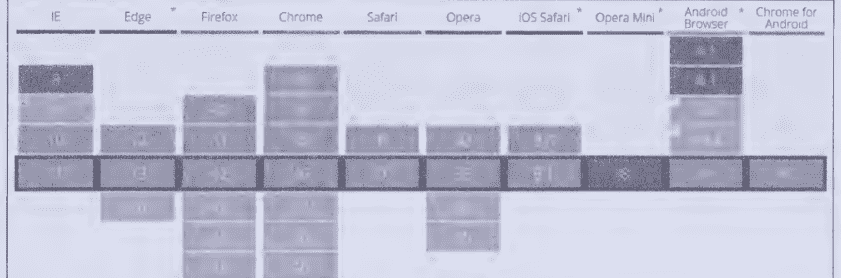

calc()表达式的跨浏览器兼容性（来源：http://caniuse.com/#feat=calc）

## 响应式图表

既然我们已经了解了绝对单位和相对单位的一些基础知识，就可以开始定义、设计和实现响应式图表了。响应式图表是一种能够自动调整其外观和感觉以适应用户设备分辨率的图表；因此，响应式图表需要适配以下属性：

- 尺寸（宽度和高度）
- 数据点的分辨率
- 交互和交互区域

适配尺寸是最明显的事情。图表应始终缩放并适应其父元素的宽度。在上一节中，你学习了相对长度和绝对长度，因此可能认为仅为图表尺寸使用相对数值就足够了。然而，实现此目的有多种方式，各有优劣；在本节中，我们将讨论其中三种。

适配数据分辨率不那么明显，而且常常被忽视。数据点分辨率（每像素的数据点数量）应随之调整，以便在高分辨率设备上看到更多点，在低分辨率屏幕上看到更少点。在本节中，我们将看到，这只能通过使用JavaScript事件监听器并手动重绘/更新整个图表来实现。

适配交互和交互区域不仅对使用不同屏幕分辨率很重要，对使用不同设备也很重要。我们与电视的交互方式与与计算机的不同，在台式机和手机上使用的输入设备也不同。然而，图表应允许适合特定设备和屏幕分辨率的交互和交互区域。你将在下一章中了解更多有关响应式交互的内容。

### 在SVG中使用相对长度

将图表尺寸适配到其父容器的第一种也是最明显的解决方案，是为长度和坐标使用相对数值。这意味着我们只需用相对数值定义一次图表，浏览器将负责在父容器尺寸变化时重新计算所有数值。无需手动重绘图表。

让我们来看看上一章中的柱状图示例。你可以在本书附带的本章代码示例中找到完整源代码。

首先，我们将添加一些CSS样式，将SVG元素缩放至父容器的全宽：

```
.chart {
 height: 16rem;
 position: relative;
}
.chart > svg {
 width: 100%;
 height: 100%;
}
```


接下来，我们将所有比例尺修改为在 [0, 100] 范围内工作，并从两侧减去填充：

```
var xScale = d3.scale.ordinal()
    .domain(flatData.map(xKey))
    .rangeBands([padding, 100 - 2*padding]);
```

```
var yScale = d3.scale.linear()
    .domain([0, d3.max(flatData, yKey)])
    .range([100 - 2*padding, padding]);
```

最后，我们可以像之前一样绘制图表，只需在属性末尾添加百分比符号（%）来指示使用百分比单位：

```
bars
    .attr('x', function(d) { return (xScale(d.x) + i*barWidth) + '%'; })
    .attr('y', function(d) { return yScale(d.y) + '%'; })
    .attr('height', function(d) { return (yScale(0) - yScale(d.y)) + '%'; })
    .attr('width', barWidth + '%')
    .attr('fill', colors(data.key));
```

你可以观察到，绘制柱状图的代码只做了轻微修改。现在它对坐标和属性使用百分比值。然而，这个小改变的效果非常巨大。在下图中，我们可以看到浏览器窗口中图表的结果：

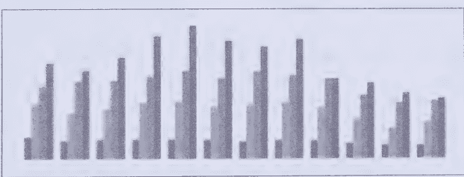

使用相对长度的柱状图

如果我们现在增大浏览器窗口大小，柱状图会很好地缩放以适应父容器的全宽。我们可以在下图中看到缩放后的图表：

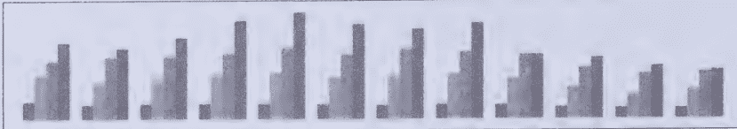

使用相对长度缩放的柱状图

如果你现在还不觉得令人印象深刻，那你最好觉得。在我看来，这很棒，因为它将重新计算 SVG 元素尺寸的所有繁重工作都交给了浏览器。我们不需要关心它们，而这种原生计算为我们提供了最大性能。

之前的示例展示了如何使用百分比值创建简单的柱状图。然而，迄今为止尚未解释的是为什么我们没有向图表添加任何轴和标签。嗯，尽管我们可以利用浏览器的原生重新缩放功能，但我们也需要面对这种技术的局限性：相对值仅允许在标准属性中使用，例如 width、height、x、y、cx、cy，但不允许在 SVG 路径或 transform 函数中使用。

## 关于使用相对长度的结论

虽然这听起来是一个绝佳的解决方案（并且确实对于某些用例非常棒），但它有两个主要缺点：

- 百分比值不被 SVG `transform` 属性和 `path` 元素中的 `d` 属性接受，仅允许在标准属性中使用
- 由于浏览器会自动重新计算所有值，我们无法调整图表数据的分辨率

第一点是最大的缺点，这意味着我们只能使用 `width`、`height`、`x`、`y`、`cx`、`cy` 等标准属性来定位元素。然而，我们仍然可以绘制一个无需 JavaScript 事件监听器即可根据父元素自适应缩放的柱状图。与第一点相比，第二点不再起重要作用，可以通过额外的 JavaScript 事件监听器来规避，但我相信你已经明白我的意思。

## 缩放视口

SVG 有一些强大的功能，例如 viewBox 和 preserveAspectRatio 属性，允许将整个图形自动重新缩放到 SVG 视口。使用这两个属性，我们可以在定义的区域内使用绝对值绘制图表，自动将该区域缩放到父容器，并定义原始尺寸长宽比的处理方式。

让我们从头开始。我们将 SVG 元素的可见区域称为 SVG 视口；通常，我们默认看到标准坐标系。viewBox 属性允许我们将坐标系的某个区域缩放到视口的尺寸。我们通过在坐标系中用左上角和右下角点定义的矩形来指定该区域。

我将通过修改柱状图示例来演示这一点。首先，让我们使用一些绝对尺寸，例如 400x300。在我们的例子中，我们将通过固定宽度和长宽比因子来定义它：

```
var width = 400;
var aspectRatio = 4.0 / 3.0;
var height = width / aspectRatio;
```

我们还保留了之前示例中的 CSS 代码，该代码将 SVG 元素缩放到父容器的全宽。

现在，我们可以使用这些绝对尺寸绘制完整的图表，最后添加 viewBox 属性将图表缩放到视口：

```
var $svg = d3.select(chart).append('svg')
  .attr('viewBox', '0 0 ' + width + ' ' + height)
```

仅此而已。现在，让我们假设我们在一个尺寸与创建图表时所用尺寸大致相同的元素中绘制图表。我们可以在下图中看到这样的结果：

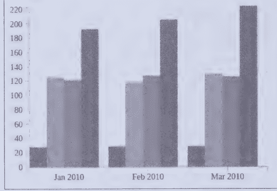

将柱状图缩放到视口

我们观察到图表看起来非常不错，并且完美地缩放到全宽，同时自动保持长宽比。但在此，我们已经可以猜到这个解决方案的一些缺点：

- 长宽比是固定的
- 图表应具有相似的初始坐标，例如包含元素的坐标

第一点应该有点清楚；我们定义了一个长宽比，这就是为什么图表即使在不同元素上重新绘制时也会保持相同的长宽比。然而，第二点对于此实现至关重要。让我们看看下面最初使用 800 x 600 比例创建的图表：

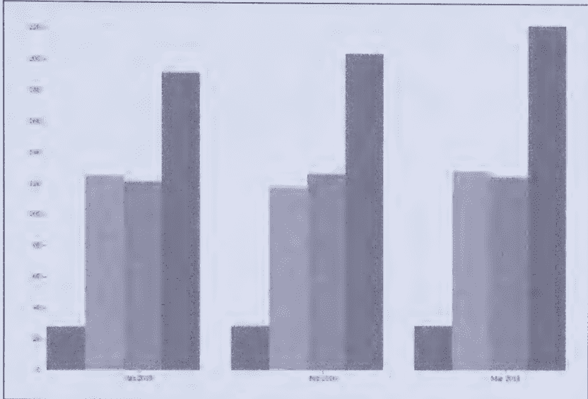

将大图表缩放到小视口

我们可以立即看到，图表被缩小以适应容器的尺寸，因此字体和轴变得无法阅读，因为刻度太小。当我们使用 800 x 600 作为初始比例时，会发生相反的情况。我们可以在下图中看到效果，其中刻度现在大到重叠：

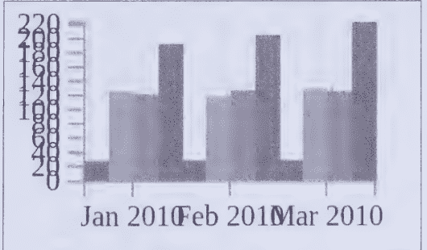

将小图表缩放到大视口

我们在前一个图表中观察到，由于向视口放大，轴和轴刻度被缩放过度。再次注意，对于这种技术，有必要在有用的坐标范围内绘制图表。

### 防止描边缩放

我们可以添加简单选项来防止通过 viewBox 属性引起的转换导致描边缩放。为此，我们需要将以下 CSS 片段添加到图表：

```
.chart path, .chart line, .chart text {
    vector-effect: non-scaling-stroke;
}
```

vector-effect 属性（仅允许 none、inherit 和 non-scaling-stroke 值）是可以精确实现此目的的属性。然而，我真的不明白为什么没有更多支持的值，例如防止字体缩放等等。

下图展示了一个缩小的柱状图示例，其中描边宽度保持不变：

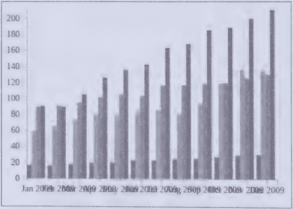

带有重叠轴刻度的图表

好的，现在，让我们再看看这个示例并思考主要缺点——固定的长宽比。通常，用户会调整网页大小以查看更多/更少信息。在这里，例如，轴刻度重叠是因为刻度标签太长或图表宽度太小。但是，如果我们调整窗口大小，图表将放大，输出将类似于下图。它只是在两个维度上缩放并保持长宽比。我们观察到，无法更好地安排数据沿较长的 x 轴，以增强图表的可见性并避免轴上标签的重叠：

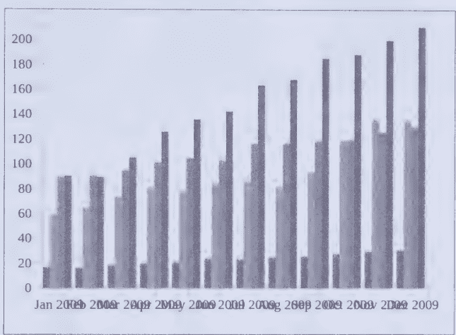

带有重叠轴刻度的缩放图表

我们观察到，图像只是简单地缩放，而不改变长宽比和数据的表示。因此，由于简单的缩放，刻度标签在较大的图表上重叠。

### 保持长宽比

如果我们打算修改缩放图像的长宽比，可以这样做。我们可以额外将 `preserveAspectRatio` 属性设置为 `none` 或某些其他值，以使用不同于 xMidYMid 默认值的其他长宽比缩放图像：

```
var $svg = d3.select(chart).append('svg')
.attr('viewBox', '0 0 ' + width + ' ' + height)
.attr('preserveAspectRatio', 'none');
```


例如，使用无宽高比可以将图像缩放到视口中，而不保留宽高比，如下图所示：

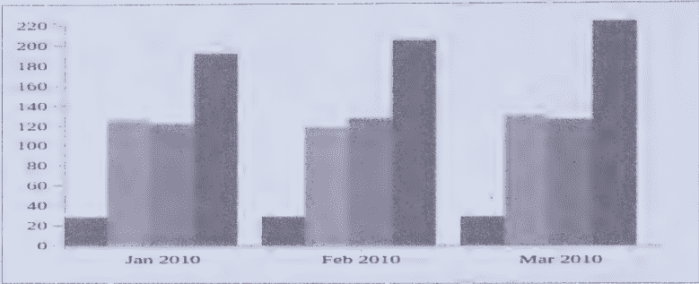

使用 preserveAspectRatio none 缩放的图表

默认情况下，浏览器使用 xMidYMid 设置来缩放图表到最大居中尺寸，同时可能保留原始图表的宽高比：

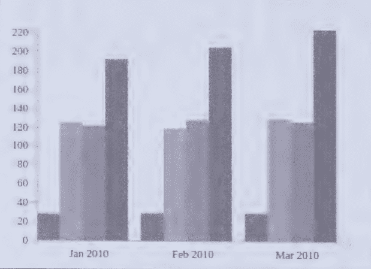

使用 preserveAspectRatio xMidYMid（默认）缩放的图表

## 使用视口缩放的结论

虽然这对于某些用例来说是一个很好的解决方案，但它有两个主要缺点：

- 整个图表始终会被缩放；我们只能防止描边缩放
- 由于浏览器会自动重新计算所有值，我们无法调整图表数据的分辨率

另外，第一点是主要缺点。将图表缩放到视口在某些情况下很棒：然而，它不够灵活，尤其是因为我们也会缩放字体，而且我们需要保留宽高比；因此，我们无法将图表缩放到任意尺寸。此外，我们必须非常小心地使用初始尺寸，使其不太大也不太小，以免将细线缩放得太大或将细节缩放得太小。

与第一点相比，第二点不再起重要作用，可以通过一些额外的 JavaScript 事件监听器来规避。

### 使用 JavaScript resize 事件

最后一个选项是使用 JavaScript 事件处理程序，并在父容器尺寸发生变化时手动重绘图表。使用此技术，我们可以始终测量父容器的宽度（以绝对单位），并使用此长度相应地更新和重绘图表。这为我们在数据分辨率方面提供了极大的灵活性，并且在需要时我们也可以将图表适应到不同的宽高比。

### 原生 resize 事件

理论上，这个解决方案听起来很棒；我们只需监听父容器或 SVG 容器（如果它使用 100% 的宽度）的 resize 事件，然后在元素尺寸发生变化时重绘图表。然而，div 或 svg 元素上并不存在原生的 resize 事件；现代浏览器仅在 window 元素上支持 resize 事件。因此，它仅在浏览器窗口尺寸发生变化时触发。这也意味着，一旦我们从页面中移除了图表，就需要清理监听器。

尽管这是一个限制，但在大多数情况下，我们仍然可以使用 window resize 事件将图表适应到其父容器；我们只需牢记这一点。

让我们始终使用父容器的绝对尺寸来绘制和重绘图表；我们需要在 redraw 函数中定义以下内容：

```
var width = chart.clientWidth;
var height = width / aspectRatio;
```

现在，我们可以向 window 元素添加 resize 事件监听器，并在窗口尺寸发生变化时调用 redraw 函数：

```
window.addEventListener('resize', function(event) {
    redraw();
});
```

这个解决方案的好处是，我们可以在 redraw 函数中做任何我们想做的事情，例如修改宽高比、调整轴标签或修改显示元素的数量。

下图显示了之前图表的缩放版本；我们观察到这次，轴刻度很好地适应了，不再重叠。此外，轴刻度现在占据了所有可用空间：

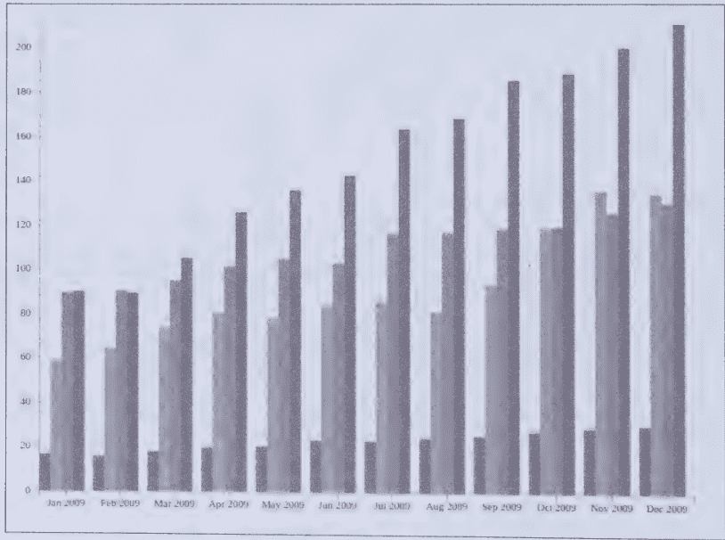

带有调整后轴刻度的缩放图表

## 调整数据分辨率

然而，还有一个问题可以通过这种手动重绘的方式很好地解决：数据分辨率的问题。小图表应该显示多少数据，大图表应该显示多少数据？

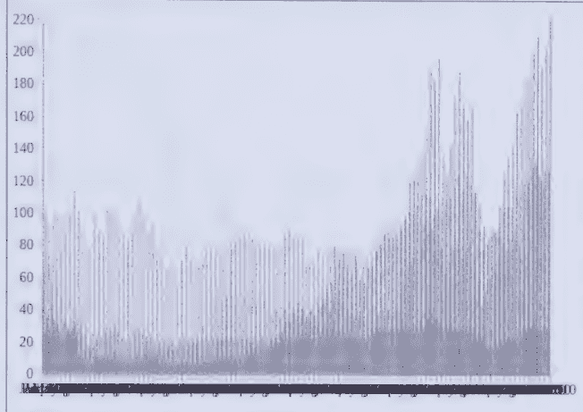

高数据分辨率的小图表

我想你会同意，在前面的图中，对于图形的大小来说，我们显示了太多数据。这很糟糕，并使图表变得无用。此外，我们在重绘过程中确实应该根据小视口调整数据的分辨率。

让我们实现一个函数，它只返回数组中每个 i-第个元素：

```
function adaptResolution(data, resolution) {
    resolution = resolution ? Math.ceil(resolution) : 1;
    return data.filter(function(d, i) {
        return i % resolution == 0;
    });
}
```

太好了，让我们定义一个与宽度相关的数据分辨率并相应地过滤数据：

```
var pixelsPerData = 20;
var resolution = pixelsPerData * (flatData.length) / width;
```

在前面的代码中，我们观察到现在可以定义一个数据点应具有的最小像素数量，并通过调用以下内容相应地移除数据值的数量：

```
var flatDataRes = adaptResolution(flatData, resolution);
```

下图显示了一个包含少量值的小图表，即使非常小，也完全可读：

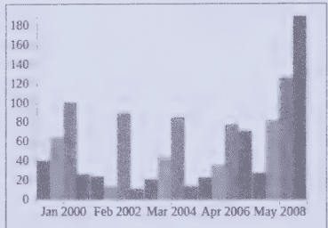

具有适当数据分辨率的小图表

在下一个图中，我们可以看到基于相同数据绘制的相同图表，使用了更大的容器。我们立即观察到数据分辨率相应地调整，使图表看起来很不错：

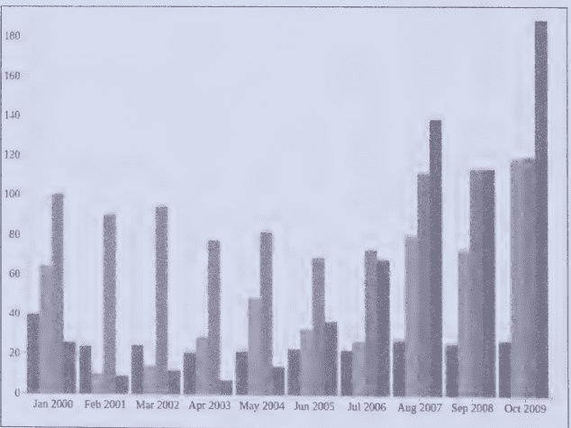

具有适当数据分辨率的大图表

## 使用 resize 事件的结论

这是最灵活的解决方案，因此在许多情况下，它是首选方案。但是，您需要意识到使用此解决方案也存在某些缺点：

- 没有简单的方法来监听父容器的 resize 事件
- 我们需要添加事件监听器
- 我们需要确保事件监听器被正确移除
- 我们需要手动重绘图表

## 使用 Bootstrap 的媒体查询

如我们在第一章中所讨论的，Bootstrap 是一个很棒的库，可以帮助您快速开始新项目。它不仅包含大量有用的 HTML 组件，还包含标准化和标准化的 CSS 样式。其中一种是针对四种典型设备类型（Bootstrap 4 中为五种类型）实现的媒体查询。在本节中，我们将了解如何在我们的样式和脚本中使用这些媒体查询。Bootstrap 的一个伟之处在于，它成功地为 Web 开发人员标准化了典型设备尺寸；因此，初学者可以直接使用它们，而不必反复思考哪个像素宽度可能是平板电脑最常见的宽度。

### CSS 中的媒体查询

使用 Bootstrap 媒体查询的最快方法是直接从编译后的源代码中复制它们。这些查询如下所示：

```
/* Extra small devices (phones, etc. less than 768px) */
/* No media query since this is the default in Bootstrap */

/* Small devices (tablets, etc.) */
@media (min-width: 768px) { ... }

/* Medium devices (desktops, 992px and up) */
@media (min-width: 992px) { ... }

/* Large devices (large desktops, 1200px and up) */
@media (min-width: 1200px) { ... }
```

我们可以轻松地将这些查询添加到我们的 CSS 样式中，并为我们的可视化定义某些属性和样式，例如四个预定义宽度、宽高比、间距等，以使图表的外观适应用户的设备类型。Bootstrap 4 目前处于 alpha 阶段；但是，您可以在 CSS 中开始使用预定义的设备类型。我强烈主张使用 Bootstrap 4 的原因是它转向使用 em 单位而不是像素：

```
// Extra small devices (portrait phones, etc.)
// No media query since this is the default in Bootstrap
```

```
// Small devices (landscape phones, etc.)
@media (min-width: 34em) { ... }
```

```
// Medium devices (tablets, etc.)
@media (min-width: 48em) { ... }
```

```
// Large devices (desktops, etc.)
@media (min-width: 62em) { ... }
```

```
// Extra large devices (large desktops, etc.)
@media (min-width: 75em) { ... }
```

再次强调，这的巨大好处是，当用户增加浏览器的字体大小以增强可读性时，布局可以进行调整。

### LESS/SASS 中的媒体查询

在 Bootstrap 3 中，您可以将媒体查询 mixin 包含到 LESS 文件中，然后将其编译为普通 CSS。

要使用这些 mixin，您必须创建一个 LESS 文件而不是 CSS 文件，并导入 Bootstrap 的 variables.less 文件。在此文件中，Bootstrap 定义了其所有尺寸、颜色和其他变量。让我们创建 style.less 文件并导入 variables.less：

```
// style.less
@import "bower_components/bootstrap/less/variables.less";
```

完美，就是这样。现在，我们可以开始在 LESS 文件中使用 Bootstrap 的设备类型了：

```
/* Extra small devices (phones, etc. less than 768px) */
/* No media query since this is the default in Bootstrap */
```

```
/* Small devices (tablets, etc.) */
@media (min-width: @screen-sm-min) { ... }
```

```
/* Medium devices (desktops, etc. */
```


@media (min-width: @screen-md-min) { ... }

/* Large devices (large desktops, etc.) */
@media (min-width: @screen-lg-min) { ... }

最后，我们需要使用 LESS 编译器将我们的 `style.less` 文件转换为普通 CSS。为此，我们从终端运行以下命令：

```
lessc styles.less styles.css
```

正如我们所见，该命令需要安装名为 `lessc` 的 LESS 编译器。如果您的系统上尚未安装，请继续安装它：

```
npm install -g less
```

> 如果您是 LESS 新手，我建议您阅读 http://lesscss.org/ 上的 LESS 文档。一旦您了解了 LESS，也可以查看非常相似的 SASS 格式，该格式受 Bootstrap 4 青睐。您可以在 http://sass-lang.com/ 上找到 SASS 文档。

我们可以通过以下 mixin 在 SASS 文件中使用 Bootstrap 4 媒体查询：

```
@include media-breakpoint-up(xs) { ... }
@include media-breakpoint-up(sm) { ... }
@include media-breakpoint-up(md) { ... }
@include media-breakpoint-up(lg) { ... }
@include media-breakpoint-up(xl) { ... }
```

依我看来，将 Bootstrap 的 LESS/SASS mixin 包含在可视化样式中是最清晰的解决方案，因为您始终从最新的 Bootstrap 源代码编译 CSS，且无需将 CSS 复制到项目中。

## JavaScript 中的媒体查询

使用 Bootstrap 媒体查询使可视化适应用户设备的另一个绝佳可能性是直接在 JavaScript 中使用它们。原生 `window.matchMedia (mediaQuery)` 函数为您提供了对 JavaScript 的同样控制，就像媒体查询对 CSS 所做的那样。

以下是使用它的示例：

```
if (window.matchMedia("(min-width: 1200px)").matches) {
 /* the viewport is at least 1200 pixels wide */
} else {
 /* the viewport is less than 1200 pixels wide */
}
```

在前面的代码中，我们可以看到这个函数非常易于使用，并为我们的可视化增加了近乎无限的自定义可能性。

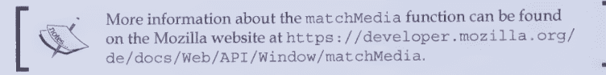

但是，除了直接使用 matchMedia 函数外，我们还可以在原生 API 调用周围使用一个封装器。我可以推荐 Nick Williams 的 enquire.js 库，它允许您为视口变化声明事件监听器。可以通过包管理器 bower 运行以下命令从终端安装它：

```
bower install enquire
```

然后，我们需要将 enquire.js 添加到网站并使用：

```
enquire.register("screen and (min-width:1200px)", {

// triggers when the media query matches.
match : function() {
/* the viewport is at least 1200 pixels wide */
},

// optional; triggers when the media query transitions
unmatch : function() {
/* the viewport is less than 1200 pixels wide */

},
```

在前面的代码中，我们可以看到，现在可以以几乎与监听 resize 事件相同的方式添加 match 和 unmatch 监听器，只是它更加灵活。

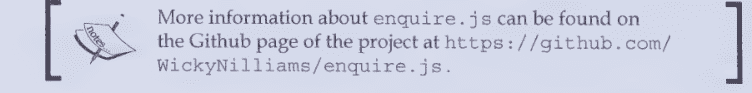

如果我们想使用 Bootstrap 设备类型，可以轻松使用 enquire.js 根据需要实现它们，并为每种设备类型触发事件。但是，我更喜欢非常灵活地使用简单的封装器。

### 使用 Bootstrap 的栅格系统

使图表响应式并与 Bootstrap 完美协作的另一个绝佳且快速的方法是将其集成到 Bootstrap 的栅格系统中。然而，最佳且最清晰的集成方式是关注点分离，使可视化尽可能通用和自适应。

让我们使用带有自定义 resize 事件的柱状图示例，并将其集成到简单的栅格布局中。像往常一样，您可以在代码示例中找到该示例的完整源代码：

```
<div class="container">
 <div class="row">
 <div class="col-md-8">
 <div class="chart" data-url="..." ...>
 </div>
 </div>
 <div class="col-md-4">
 <h2>My Dashboard</h2>
 <p>This is a simple dashboard</p>
 </div>
 </div>
 <div class="row">
 <div class="col-md-4">
 <div class="chart" data-url="..." ...>
 </div>
 </div>
 <div class="col-md-4">
 <div class="chart" data-url="..." ...>
 </div>
 </div>
 <div class="col-md-4">
 <div class="chart" data-url="..." ...>
 </div>
 </div>
 </div>
 </div>
 <div class="row">
 <div class="col-md-6">
 <div class="chart" data-url="..." ...>
 </div>
 </div>
 <div class="col-md-6">
 <div class="chart" data-url="..." ...>
 </div>
 </div>
 </div>
 </div>
```

我们观察到，通过利用父容器的宽度，可以简单地将图表添加为栅格列中的 `div` 元素。这是首选的集成方式，两个组件可以很好地协同工作，但互不依赖。

在下图中，我们可以看到刚刚构建的简单仪表板的截图。我们观察到，可视化已经很好地适应了我们的栅格布局，这使得将它们组合在一起变得容易：

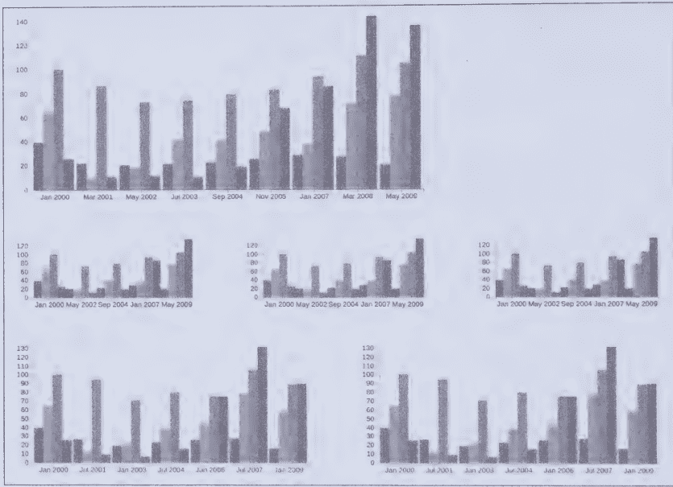

使用 Bootstrap 栅格布局的简单仪表板

## 摘要

在本章中，您了解了在浏览器中定义长度的绝对单位和相对单位的基本知识。请记住，rem 单位起着重要作用，因为它允许布局在用户增加网站字体大小时进行调整。

然后，您了解了如何使用相对单位、视口和 resize 事件根据当前容器大小调整图表大小和数据分辨率。

在前面的部分中，您了解了如何在 CSS、LESS 和 JavaScript 中使用 Bootstrap 媒体查询。最后，我们还了解了如何将图表与 Bootstrap 的栅格系统集成。

在下一章中，我们将继续实现响应式图表，并深入探讨为各种设备和屏幕分辨率创建响应式交互。
