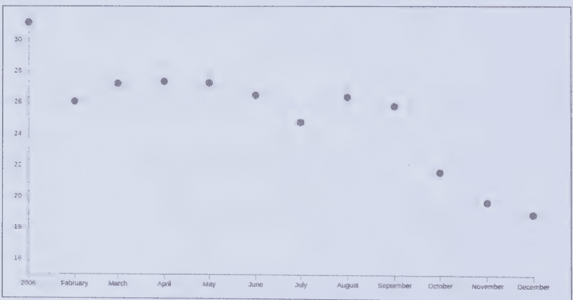
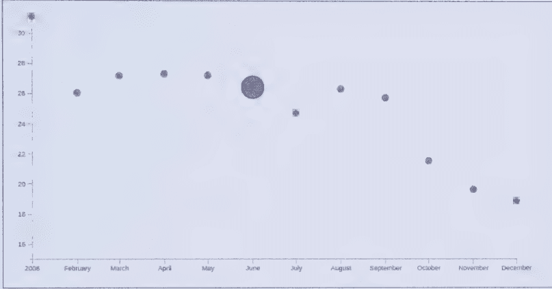
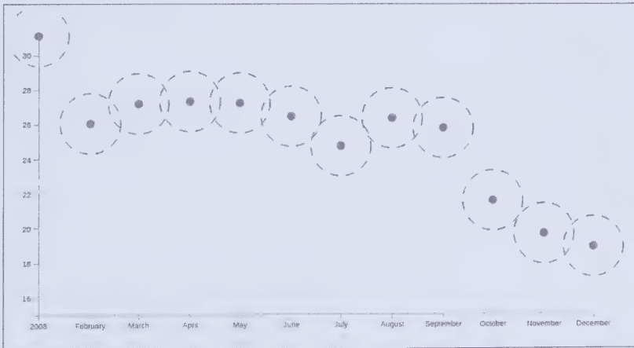
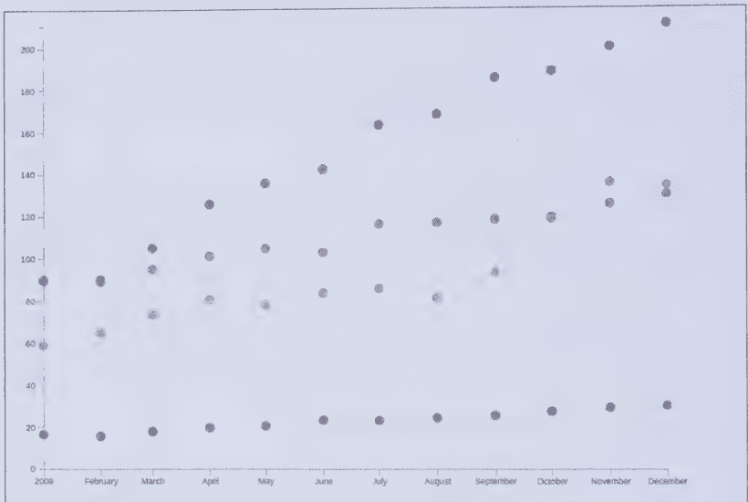
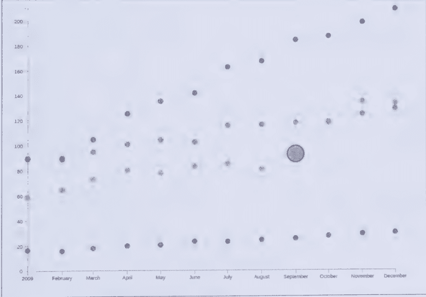
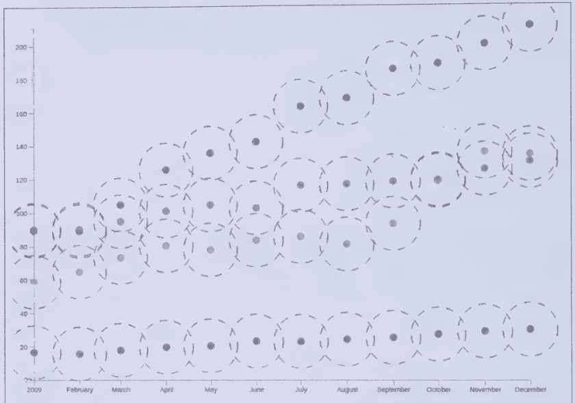
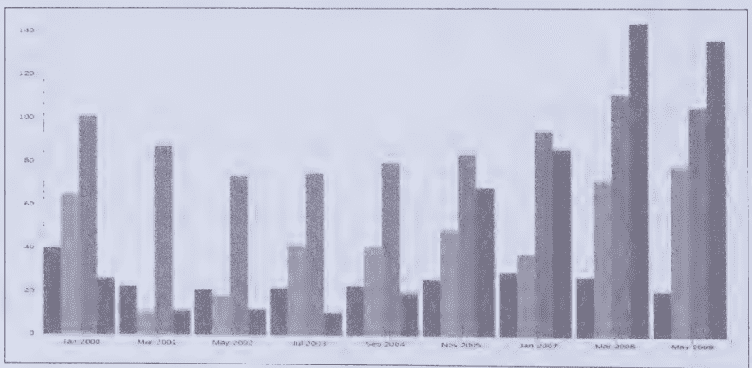
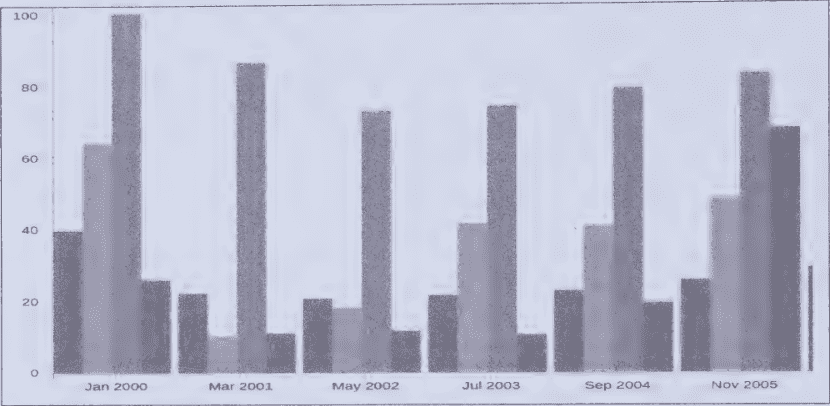

# 构建响应式交互

在上一章中，您学习了如何使图表响应式；这意味着在各种设备上都能 _看起来_ 很好。在本章中，我们将探讨响应式交互；这意味着在各种设备上都能 _感觉_ 很好。在本章中，您将学习以下内容：

- 探索 D3 事件系统
- 使用原生事件和 D3 事件系统
- 理解响应式交互
- 实现交互目标
- 计算数据集中最近的元素
- 了解触摸事件
- 回顾鼠标事件
- 实现简单的缩放行为
- 应用复杂的轴缩放

首先，我们将探讨 JavaScript 中的事件，并理解如何使用事件监听器来分离和集成不同的组件。我们还将看到内部 D3 事件系统并学习如何使用它。事件系统有助于使代码更清晰，并使执行路径更易于跟踪。

然后，我们将探讨响应式事件和交互。我们将看到在不同设备上处理交互的四种不同方式。最重要的规则是，在小屏幕上不要使用非常小的交互目标。

然后，我们将概览原生鼠标和触摸事件及其执行顺序；这将帮助您在设计响应式交互时避免常见陷阱，并充分理解何时需要阻止事件传播默认动作。

在本章的最后一部分中，我们将探讨常见的交互技术，例如缩放和平移。我们将比较简单的放大缩放与更复杂的 x 轴和 y 轴缩放，以了解两者之间的区别。

## 使用事件系统

在我们日常的许多系统和编程语言中，不同实例之间的交互由事件和事件监听器（也称为事件处理程序或回调）处理。通常，应用程序或系统的一部分会触发某个事件，而另一部分——监听此事件的部分——会执行指定事件的事件监听器。

让我们考虑一个 JavaScript 中的简单示例。每当浏览器发生 resize 事件时，我们都想调用 resize 函数。因此，我们必须创建一个事件监听器，它等待（监听）浏览器窗口的 `resize` 事件，并在事件发生时执行 `resize()` 事件监听器。该函数如下：

```
window.addEventListener('resize', function(event) {
    resize();
});
```

这看起来很简单，而且非常容易理解。我们只需要知道哪些元素（在哪些浏览器中）存在哪些事件。您在之前的章节中已经了解到，除了 `window` 元素外，没有其他 DOM 元素会触发 `resize` 事件。这意味着，通常可以在元素上触发的事件列表是标准化且明确定义的。

## D3.js 中的自定义事件

事件系统有助于使用标准化事件集成分离的组件。在处理可视化时，这非常方便。您通常会在可视化中发现大量可重用的组件和部分，它们应该紧密集成，同时又可重用。


以轴为例。在简单的 2D 图表中，你需要两个轴；不过，在 3D 图表或带有两个 y 轴的 2D 图表中，你需要三个轴。当用户缩放图表时，轴的比例会发生变化，以显示数据集更精细的域。同时，显示的数据点也会随之更新。使用事件时，我们可以在所有组件中监听缩放事件并相应地进行更新。最棒的是，无论你的图表中有两个、三个还是没有轴，它都能正常工作。这意味着任意数量的元素（无元素或多个元素）可以自动监听事件，并在发生特定事件时更新，而触发事件的元素不需要知道它们。事件系统可以帮助你构建干净、模块化且解耦的组件，这些组件之间没有直接依赖关系。这就是为什么我强烈建议你使用一个事件系统，甚至可以使用 D3 的事件系统。

考虑到这一点，我鼓励你在可视化中使用事件系统和自定义事件，以标准化可视化中的交互，保持所有功能解耦但集成。在 D3 中创建自定义事件非常简单，因为它提供了所有必要的功能。

让我们看一个简单的示例；这里，我们希望在用户点击柱状图中的柱子时传播 `dataClick` 事件。首先，我们需要创建一个所谓的 `dispatcher`，它知道某个组件的所有事件。在我们的例子中，我们将为整个图表使用一个单一的 dispatcher：

```
// Create dispatcher
var dispatch = d3.dispatch("dataClick");
```

dispatcher 是可以触发事件的代码片段。在前面的代码中，我们初始化一个可以触发 `dataClick` 事件的 dispatcher。除了触发事件，dispatcher 还被其他组件用来监听事件。

接下来，我们创建一个事件监听器，每当事件发生时就会执行它。这段代码通常放在我们希望与图表分离的可重用组件中（轴、网格、图例、缩略图等）：

```
// Register an event listener
dispatch.on("dataClick", function(args) {
  console.log("Data clicked", args);
});
```

在前面的代码中，我们可以看到只需要访问 dispatch 对象即可注册事件监听器。监听事件的方法通常被称为 `on`，其签名为 `.on(eventName, eventHandler)`。我们监听 `dataClick` 事件并注册一个事件处理程序（也称为回调或事件监听器），该处理程序将参数记录到控制台。请注意，我们始终需要确保组件为其他组件提供注册事件处理程序的方法，从而可以访问 dispatch 对象。

最后，我们可以通过在 dispatcher 对象上直接调用事件作为函数来触发事件：

```
// Dispatch event
dispatch.dataClick({foo: 'bar'});
```

在前面的代码中，我们可以看到可以随事件一起发送一些数据。触发事件后，该事件的所有事件监听器都将以事件数据作为参数执行。

再次强调，D3 的事件系统非常适合为你的可视化创建基于事件的架构，我强烈建议你这样做。这使得在应用程序中追踪函数调用、创建可重用且解耦的组件以及标准化不同组件之间的通信变得容易得多。

> 要了解有关 D3 事件系统的更多信息，请访问项目的 Github 页面 https://github.com/mbostock/d3/wiki/Internals#events。

## 响应式事件

让可视化在移动设备上既好看又好用，不仅意味着让它们看起来美观，还意味着让它们手感良好，甚至能够正常工作。只有当你不仅能用鼠标，还能用指尖完成所有交互时，交互式可视化才会感觉良好。在上一章中你了解到，在低分辨率设备上显示过多数据是不好的，因为人们无法再真正区分数据点，这会导致性能和可用性差。为移动设备降低数据分辨率的另一个好理由是，它会自动增大数据点上的交互区域。

## 交互区域

虽然后我们可以使用鼠标指针或数字笔以像素精度进行绘制，但要使用指尖成功交互，我们需要 7 mm 到 9.5 mm 的目标区域。这个区域远大于桌面优化应用中大多数按钮、数据点和元素；因此，与这些应用的交互大多数时候都是不令人满意的。我们必须牢记，如果希望用户与可视化中的数据点进行交互，那么可视化中数据点的交互区域必须足够大。一般来说，有三种方法可以实现这一点：

- 创建更大的目标——因此，更大的数据点
- 在数据点上方创建大的不可见交互目标
- 始终与手指位置最近的数据点进行交互

让数据点足够大以便用指尖交互是一个好的经验法则；然而，在许多情况下，将它们缩放到 9.5 mm 的半径根本不可能。

第一个方法有些显而易见；我们增加可视化中所有元素的大小。虽然后这可能会产生更大的交互目标，但也可能导致丑陋的放大问题、重叠的数据样本等。但是，当可视化中有足够空间时，这是一个足够好的解决方案。

为了最大限度地减少可视化中的放大错误和重叠，我们只是使用重叠的不可见交互目标。虽然后这解决了丑陋重叠 artifacts 的问题，但它没有解决交互目标重叠的问题。当两个目标重叠时，触摸事件始终会由创建最晚的元素接收，没有简单的方法来更改此行为。

解决大交互区域问题没有正确的方法；我个人更喜欢第三种方法：与手指位置最近的数据点进行交互。每当用户触摸可视化时，我们会查找手指位置最近的数据点。我们甚至可以将此技术与围绕数据的不可见交互区域的第二种方法结合起来。我们可以估计手指与数据点中心之间的距离是否小于 9.5 mm（或其他阈值）。这种方法防止了数据点和交互区域的重叠 artifacts；这是一个很好的权衡，但稍微复杂一些且计算开销更大。

# 创建交互目标

让我们来看看这些方法并实现它们！

最快的解决方案是创建比原始数据点大得多的交互目标，覆盖在原始元素上，并且是透明的。这种方法不需要太多更改，因为你可以在元素上使用标准的 `click` 事件处理程序，在开发者工具中查看元素（与之前一样），并通过使其可见来检查交互目标。

要实现这一点，你只需创建大小为 9.5 mm 且 `opacity` 为 0 的圆形。在这里，你附加点击监听器。你可以在随本书提供的代码中找到一个示例。示例的截图与以下部分提供的截图相同。

然而，在某些情况下，尤其是当你处理许多数据点时，你不想用交互元素弄乱你的容器。因此，我们想看看不同且更灵活的解决方案。

## 计算最近的数据点

为了成功应用最近点技术，我们需要从触摸位置计算最近的数据点。让我们思考一下，要从 `svg` 元素上的 `click` 事件监听器中获取最近的元素，我们需要应用哪些步骤：

```
$svg.on('click', function(){
// Get the relative position
var pos = d3.mouse(this);
// Computation goes here
});
```

如前面的代码所示，我们使用带有 `this` 参数的 `d3.mouse` 函数获取手指或鼠标相对于 `svg` 元素的位置（`this` 引用当前的 `svg` 元素）。这会计算并返回手指或鼠标相对于参考元素的相对位置。我们使用 `d3.mouse` 函数而不是 `d3.touch` 或 `d3.touches` 函数，以表明我们只对单个点击位置（用手指）感兴趣，而不是多指触摸手势。

> 要了解有关 `d3.event`、`d3.mouse` 和 `d3.touches` 的更多信息，请访问项目的 Github 页面 `https://github.com/mbostock/d3/wiki/Selections#d3_mouse`。


接下来，我们需要将点击位置的坐标（像素范围内的一个值）转换为数据集的域；这通常通过使用 D3 中的反向比例尺运算符来完成：

```
var xValue = xScale.invert(pos[0]);
```

在前面的代码中，我们重复使用了在第 2 章《使用 D3.js 和 SVG 创建柱状图》中创建的 xScale 对象，以便将像素值映射到数据集 x 值域中的一个值。现在，我们需要找到点击位置的值与数据集中 x 值数组相交的索引。我们可以通过从数组开头（左侧）或结尾（右侧）迭代数组并将值与数组值进行比较来获得它。我们还可以使用 d3.bisector 创建一个正好做到这一点的 bisect 函数：

```
// Create a left bisector
var bisect = d3.bisector(xKey).left;
// Get the index where the intersection occurs
var index = bisect(data, xValue);
```

在前面的函数中，我们重复使用了来自第 2 章《使用 D3.js 和 SVG 创建柱状图》中的 xKey 函数和 data 对象

> 你可以在项目的 Github 页面 https://github.com/mbostock/d3/wiki/Arrays#d3_bisector 上找到有关双分查找器的更多信息。

最后，我们只需检查索引是否存在（因为非裁剪比例尺的默认比例设置），并比较当前值或前一个值哪个更接近点击位置：

```
if (index == 0 || index > data.length) {
return;
}
var d0 = data[index - 1];
var d1 = data[index];
// get the nearest value
var d = xValue - xKey(d0) > xKey(d1) - xValue ? d1 : d0;
```

最后，d 包含数据集中与我们的点击位置最接近的条目。在最后一步中，我们检查数据点是否比某个阈值更近：

```
function distance(x0, x1, y0, y1, r) {
r = r || 0;
return Math.sqrt(Math.pow(x0+r-x1, 2) + Math.pow(y0+r-y1, 2));
}
```

```
var yValue = yScale.invert(pos[1]);
var k = distance(xKey(d), xValue, yKey(d), yValue);
// if k less than 9.5mm
if (k < 9.6/2.54*9.5) {
  // Mark data point as active
}
```

在前面的代码中，我们定义了一个返回二维欧几里得距离的 distance 函数，并将其应用于点击位置和最近数据点的中心点；我们比较了距离是否小于 9.5 毫米（96/2.54 = 1 厘米，9.6/2.54 = 1 毫米）。

在前面的示例中，我们看到根据我们的定义，这能给出准确的结果。但是，请记住，当用户点击数据点时，会进行一次计算（数组迭代/搜索）；根据数据量和数据集的大小，这可能导致卡顿的用户体验。在这种情况下，我们必须直接在数据点上使用简单的点击事件监听器。

让我们来看一个带有一个数据系列的简单散点图，在其中可以看到前面的代码在实际中的效果。在下图中，我们看到了这样的图表：



带有一个系列的散点图

你可以在随书提供的代码示例中找到这个示例。如果你现在在图表上数据点旁边点击，该点将自动被选中。我们可以在下图中看到选中的元素；每当我们点击距离某个点 9.5 毫米以内的位置时，x 轴上最近的点将被选中：



带有高亮元素的散点图

下图突出显示了交互区域：



带有高亮交互区域的散点图

之前的解决方案效果很好，通常用于选择最近的元素；但是，它有一个重大缺点。它仅在 x 轴上计算最近距离，这意味着它无法区分在 y 轴上更接近的元素。最大的问题是处理多个系列或具有相同 x 值的更多数据点，例如下图所示：



带有多个系列的散点图

我们可以使用一个非常简单的方法来解决这个问题：计算每个数据点到点击位置在像素范围内的距离，并选择其中最小的一个。让我们实现此功能，并在 svg 元素上创建点击事件监听器：

```
$svg.on('click', function() {
  // Get the relative position
  var pos = d3.mouse(this);

  // Computation goes here
});
```

现在，我们可以将数据数组转换为相对于点击位置的距离数组；我们使用前面示例中的 distance 函数：

```
var distances = flatData.map(function(d) {
  var x = xScale(xKey(d));
  var y = yScale(yKey(d));
  return distance(x, pos[0], y, pos[1]);
});
```

现在我们可以从数据集中选择最小距离和匹配的元素。

```
var k = d3.min(distances);
var index = distances.indexOf(k);
var d = data[index];
// if k less than 9.5mm
if (k <= 9.6/2.54*9.5) {
// Mark data point as active
}
```

如果我们查看结果，可以看到这个解决方案完美地处理了所有系列中的所有最近元素。在下图中，我们可以看到最近的元素被正确选中；我鼓励你也尝试代码中的示例：



带有高亮元素的散点图

让我们再次显示 9.5 毫米的交互区域；我们可以在下图中看到结果：



带有高亮交互区域的散点图

虽然这个解决方案适用于各种数据、比例尺和坐标轴，但由于距离是在像素范围内测量的，我们需要意识到计算每个数据点到点击位置的距离。根据数据点的数量，处理大型数据集时这可能会导致性能问题。一如既往，这两个示例的混合在这里将是一个很好的解决方案。

在性能与兼容性平衡的解决方案中，我们在点击位置周围绘制一个矩形，并使用双分查找器返回该矩形中的所有元素。然后，我们在该矩形中的所有元素上使用 distance 函数来获取最近的一个。使用这种框方法，我们只需计算部分距离，而不是计算每个数据集中每个点的距离。使用双分查找器对数据集进行切片也比计算所有距离快得多。

## 触摸事件

让我们看看 JavaScript 中的原生事件 API。以下是按正确执行顺序排列的最常见触摸事件列表：

- touchstart：指尖触碰屏幕
- touchmove：指尖在屏幕上移动
- touchend：指尖停止触碰屏幕
- touchcancel：触摸事件被取消

仅凭这个列表，我们可能不明白为什么我们的可视化对触摸输入仍然工作得很好，尽管我们在代码中从未定义过任何 touchstart 事件。如果我们查看本书的代码，大部分看到的是点击事件，但它们是如何被触摸触发的呢？

列表中我们看不到的一种行为叫做模拟处理，它由浏览器自动完成。浏览器仅仅继续将触摸事件作为模拟的鼠标事件进行传播。这意味着屏幕上的每次触摸都会导致完整的触摸执行链以及完整的鼠标执行链；因此，一次触摸会生成一个点击事件。

我们将在最后一章中仔细查看此执行链、默认处理和传播，你将在其中学习如何处理跨浏览器兼容性问题以及同时针对触摸和鼠标进行优化。让我们继续介绍鼠标事件。

有关触摸事件的更多信息可以在 MDN 上找到，网址为 https://developer.mozilla.org/en-US/docs/Web/API/Touch_events。

## 鼠标事件

鼠标事件稍微难处理一些，因为我们不仅需要知道事件的名称，还需要知道正确的执行顺序（乍一看似乎有些任意）。以下是用户在屏幕上双击元素时最常见的鼠标事件列表，按其执行顺序排列：

- mouseenter：鼠标光标进入元素
- mouseover：鼠标光标悬停在元素上
- mousemove：鼠标在元素上移动
- mousedown：鼠标按钮被按下
- mouseup：鼠标按钮被释放
- click：元素被点击


- dblclick: 元素被双击
- mouseleave: 鼠标光标正在离开元素

正如我们所见，简单的鼠标单击也会触发 mouseenter、mouseover 和 mouseleave 事件。每当您处理事件和执行顺序时，我建议您记住或返回此列表并检查执行链。请不要忘记，您始终可以使用 event.preventDefault() 和 event.stopPropagation() 停止传播并阻止默认事件处理。

> 有关鼠标事件的更多信息，可以在 MDN 上找到 https://developer.mozilla.org/en-US/docs/Web/API/MouseEvent。

## 平移和缩放

除了单击可视化中的数据点、条形和元素外，常见的交互还有缩放和平移。这有助于用户从较小的视图切换到数据的更详细视图。考虑到您迄今所学的一切，在缩放时提高数据分辨率也是合理的。用户缩放可视化的程度越高，数据分辨率就越高。

与上一章类似，实现它们的方法有多种。我们将查看不同的可能性，并通过缩放以下图片中的图表来进行比较：



网格布局中的简单条形图

### 简单缩放

让我们先从非常简单的缩放开始。在许多情况下，尤其是当我们使用没有轴的数据表示时，我们希望为用户提供一种简单放大可视化视图的方式。

要实现此效果，我们可以使用 SVG 的原生 transform 函数，例如 scale 和 translate，并将它们应用到包含所有可缩放组件的容器元素上。我们已经可以看到，只要这些组件放在容器内，可缩放组件甚至不参与这种技术。这就是该方法的巨大优势所在——它非常容易添加到可视化中，并且非常容易实现。

让我们使用更多 D3 函数来逐步讲解。首先，我们需要确保所有数据都分组在可视化容器中。因此，我们向图表添加一个简单容器：

```javascript
var $svg = d3.select(chart).append('svg');
var $vis = $svg.append('g').attr('class', 'vis-container');
var $axesGroup = $vis.append('g').attr('class', 'axis-container');
var $dataGroup = $vis.append('g').attr('class', 'data-container');
```

接下来，我们初始化默认缩放因子和平移分量。我们可以使用名为 d3.behavior.zoom() 的内置函数来创建缩放生成器：

```javascript
var translate = [0,0];
var scale = 1;
var zoom = d3.behavior.zoom()
  .on("zoom", function() {
    translate = d3.event.translate;
    scale = d3.event.scale;
    $vis.attr("transform",
      "translate(" + translate + ")scale(" + scale + ")");
  });
```

在前面的示例中，我们创建了一个名为 zoom 的缩放生成器函数，它实现了一个缩放事件监听器函数。当发生缩放或平移时，我们只需根据缩放或平移运动来缩放可视化容器并对其进行平移。最后，我们将缩放生成器应用到一个元素上：

```javascript
$svg.call(zoom);
```

在我们的例子中，我们总是希望将缩放生成器放在 svg 元素上。就这样，只需几行代码就能实现缩放和平移——令人印象深刻。它还能处理捏合缩放操作以及使用鼠标滚轮缩放和平移（通过鼠标和手指）。

让我们查看前面代码的输出；下图显示了使用所提技术缩放的条形图：



使用简单缩放的缩放条形图

我们已经可以看出使用此简单函数的缺点：缩应用于整个可视化，其工作方式类似于图形缩放。这在许多情况下非常有帮助，但当我们处理图表时，沿轴缩放数据会更有帮助。

### 轴缩放

我们可以设置 d3.behavior.zoom 函数的更多选项，并通过修改缩放事件监听器来更改其行为。我们可以告诉内置缩放函数使用缩放对象进行缩放，并且它应该自行处理所有内容。

在这种情况下，我们将 xScale 和 yScale 作为参数添加到 .x() 和 .y() 方法中。因此，每次调用 draw 函数时，算法都会覆盖两个函数的内置缩放范围：

```javascript
var zoom = d3.behavior.zoom()
.x(xScale)
.y(yScale)
.on("zoom", function() {
// Event listeners goes here
});
$svg.call(zoom);
```

最后，添加一个事件处理程序。在此示例中，我们希望更新轴和数据：

```javascript
$xAxis.call(xAxis);
$yAxis.call(yAxis);
nestDataRes.forEach(function(data, i){
 var $bars = $dataGroup.selectAll('rect.g-' + i)
 .data(data.values, xKey);

$bars
 .attr('x', function(d) { return xScale(d.x) + i*barWidth; })
 .attr('y', function(d) { return yScale(d.y); })
 .attr('height', function(d) { return (yScale(0) - yScale(d.y)); })
 .attr('width', barWidth)
 .attr('fill', colors(data.key));
});
```

缩放后的条形图

## 总结

在本章中，您学习了原生事件、事件监听器和事件系统。我们看到，内部 D3 事件系统非常易于使用，我强烈建议您在可视化工具中使用它。它有助于使代码更有条理，并跟随代码中的执行路径。

然后，您学习了交互目标以及如何使用平分法和所有元素相对于点击位置的距离来计算最近元素。

在上一节中，我们实现了缩放和平移等常见交互技术。使用 D3，这些功能可以非常轻松地实现。在下一章中，您将学习如何创建过渡和动画。
