# 设计过渡和动画

在前几章中，您学习了响应式可视化和交互的所有内容。现在，我们希望使用过渡和动画使它们变得美观并栩栩如生。在本章中，您将涵盖以下内容：

- 了解为何在 Web 动画中使用 JavaScript
- 使用 D3 定时器实现简单动画
- 了解插值函数及其在 D3 中的使用方法
- 了解缓动函数及其使用方法
- 理解贝塞尔曲线的概念
- 实现属性和路径过渡
- 了解形状补间的主要问题

在第一节中，您将了解用于为 DOM 元素设置动画的不同 Web 标准，并学习如何比较它们在为可视化设置动画时的优缺点。这将帮助您理解为何我们使用 D3 的内置动画和过渡，而非 SMIL 或 CSS 动画。

在第二节中，我们将介绍 D3 动画的主要概念——定时器、插值和缓动。我们将发现，使用 D3 抽象来实现自定义动画非常方便；然而，对于简单的过渡来说，它过于复杂。

在下一节中，我们将看到使用 D3 进行过渡实际上非常简单。我们只需了解过渡是什么以及如何从过渡构建动画即可。

最后，您将在最后一节中了解形状补间。这是一项相当困难的任务，目前还没有用于形状补间的灵活开源库。您将了解形状补间中的问题和难点以及解决它所需的所有必要信息（也许可以据此开发一个开源 D3 插件，随便说说）。

## 是否存在 Web 动画标准？

D3 的一个优点是它直接使用底层标准，例如 SVG 和 CSS，而不是通过 API 将其抽象化。这使开发人员可以访问 SVG 和 Web 本身中可用的所有功能。说到动画，有人可能会问 Web 动画标准是什么。

在本节中，我们将了解当前存在于 Web 上用于为 SVG 元素设置动画的不同方式和技术。这将帮助您为应用程序和用例选择合适的技术。

## 使用 SMIL 为 SVG 设置动画

同步多媒体集成语言（SMIL）是 Web 上交互式多媒体内容的规范。SMIL 动画是一种使用直接嵌入 DOM 树的 XML 语法为 DOM 元素设置动画的规范。正因如此，它非常适合为 SVG 可视化设置动画。

SVG 的 SMIL 动画可以使用以下元素构建：

- `<animate>`：随时间为单个属性/属性设置动画
- `<set>`：在指定持续时间内设置属性/属性，在动画中设置非数值属性值时很有用
- `<animateMotion>`：沿运动路径为元素设置动画
- `<animateColor>`：随时间为颜色设置动画
- `<animateTransform>`：为 SVG 元素的 transform 属性设置动画

要为 SVG 元素设置动画，我们只需将 SMIL 动画标签放入要为其设置动画的元素中（或使用 `xlink:href` 属性指定目标）。让我们看一个简单示例。如果要沿 x 坐标为矩形设置动画，可以使用：

```svg
<svg width="800" height="400">
<rect x="50" y="50" width="100" height="100">
<animate attributeName="x" from="50" to="650" dur="1s" />
</rect>
</svg>
```


在前面的代码中，我们通过在 rect 元素内放置一个 animate 标签，并通过 attributeName 属性定义应进行动画的属性，来对矩形的 x 属性制作动画。您可以在 code 文件夹中找到此示例的 animate 演示。

与使用 from 和 to 属性不同，通过定义 values 属性，SMIL 也可以正确地对字符串进行插值。这对于为 SVG 路径的 path 元素制作动画非常有用，其中控制点编码为字符串。使用此技术，我们也可以制作形状动画，如下图所示：

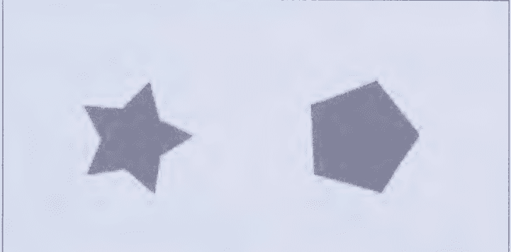

形状动画

下面是一个简单示例，我们对 path 的形状制作动画：

```
<svg width="800" height="600">
<path>
<animate
 attributeName="d"
 dur="3000ms"
 repeatCount="indefinite"
 values="m 7.3867404,14.177924 -0.7836793,-0.735313
-1.050013,0.228716 0.457154,-0.972548 -0.5419939,-0.927944
1.066216,0.134245 0.7150424,-0.802217 0.2018038,1.055516
0.9839143,0.432147 -0.9414944,0.518099 z;
 M 7.3867404,14.177924 6.476792,13.939795 5.5530481,13.671327
5.497234,12.698779 l -0.029026,-0.927944 0.8847042,-0.331372
0.8965542,-0.3366 0.7068801,0.866112 0.478838,0.621551
-0.5390117,0.802204 z;" />
</path>
</svg>
```

在前面的代码中，我们仅将两个元素路径都添加到 values 属性中，就将一个星形转换为一个六边形。请注意，在此简单情况下，动画效果良好，因为我们对两种形状都使用相同数量的控制点。我们将在后面关于形状补间的章节中更详细地讨论这一点。

> > 您可以在 W3C 网站上找到完整的 SMIL 规范，网址为 http://www.w3.org/TR/REC-smil/，以及关于 SMIL Animations 的章节，网址为 http://www.w3.org/TR/2001/REC-smil-animation-20010904/。SMIL SVG Animations 的规范可在 http://www.w3.org/TR/SVG/animate.html 找到。

虽然 SMIL 动画提供了一个极佳的界面来描述（甚至复杂的）SVG 动画，但不要过于兴奋。下图显示，Internet Explorer 和 Edge 不支持 SMIL Animations：

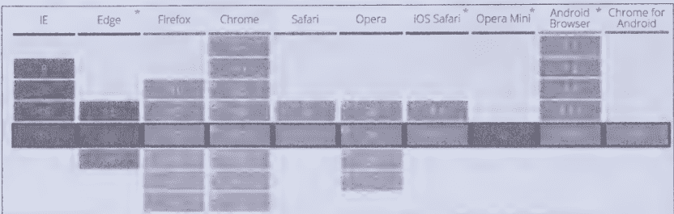

SMIL Animations 的跨浏览器兼容性

尽管 Microsoft 产品中缺乏 SMIL 支持使其在许多项目中不是一个好的选择，但该图中还隐藏着一个更糟糕的消息。在 Chrome 中，SMIL 动画自版本 45 起被标记为弃用，这意味着它们可能在任何后续版本中被移除。Chrome 团队停止支持 SMIL 动画的决定，旨在确立和加强 JavaScript 和 CSS 作为 DOM 动画的 Web 标准。因此，在涉及动画和过渡时，开发人员也应优先选择 Web 标准，例如 CSS 和 JavaScript。

## 使用 CSS 为 HTML 制作动画

近年来，CSS 已成为为 DOM 元素制作动画的事实上的标准。它主要用于随时间转换 HTML 元素，但也可用于为 SVG 元素的属性制作动画。

CSS 中的动画通过 @keyframes 关键字定义。让我们创建一个与之前类似的示例，其中我们希望将矩形从左向右移动：

```
<style>
@keyframes move {
  from {x: 50;}
  to {x: 650;}
}

rect {
  animation-name: move;
  animation-duration: 1s;
}
</style>
<svg width="800" height="400">
<rect x="50" y="50" width="100" height="100"></rect>
</svg>
```

前面的代码与上一节中的第一个示例完全相同。我们观察到，此示例中的动画代码现在已与可视化代码分离，这使得动画代码更具可重用性（如同 CSS 样式）。但这也使得编写更加困难。定义关键帧，然后声明由这些关键帧组成的动画，并不十分直观。

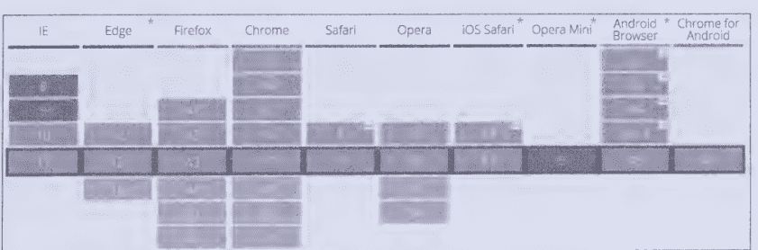

CSS Animations 的跨浏览器兼容性

虽然 CSS 动画是为 HTML 元素制作动画和转换的不错选择，但它们在为 SVG 创建复杂的动画可视化方面限制了我们。在涉及路径插值和形状补间时，我们最好选择 JavaScript 方案。

## 使用 JavaScript 为任何事物制作动画

JavaScript 动画是为 DOM 元素制作动画的最佳且最标准的方式吗？嗯，不完全是。它们允许各种动画：自定义路径插值等等，但它们必须显式修改 DOM。

让我们尝试与之前相同的示例，其中我们对矩形的 x 位置制作动画。因此，我们在 JavaScript 中创建了一个名为 animate() 的小辅助函数：

```
<svg width="800" height="600">
<rect x="50" y="60" width="100" height="100"></rect>
</svg>
<script>
var rects = document.getElementsByTagName('rect');

animate(rects[0], 'x', 50, 650);

function animate(elem, attributeName, startValue, endValue) {
var timeStep = 1;
var valueStep = 5;

var intervalId = setInterval(function() {
var value = parseFloat(elem.getAttribute(attributeName));
elem.setAttribute(attributeName, value + valueStep);

if (value >= endValue) {
elem.setAttribute(attributeName, startValue);
clearInterval(intervalId);
}
}, timeStep);
}
</script>
```

在前面的代码中，我们与前一个示例做完全相同的事情。我们对矩形的 x 位置制作动画，将其移动到右侧。但是，正如您所看到的，我们必须自己编写所有内容，包括时间间隔的处理。我们可以使用浏览器的最高帧率，通过原生 window.requestAnimationFrame(callback) 计时器来改进前面示例的性能。但是，每当我们自己处理计时器时，就必须格外注意正确地启动、暂停和停止它们。

等等，有没有一种叫做 Web 动画 API 的东西，能让前面的代码变得容易得多？没错，正是如此；最后，我们理解了为什么 Chrome 浏览器中弃用了 SMIL。W3C 正在制定一个原生 Web 动画 API 的规范，该 API 原生支持动画并为动画提供易于使用的界面。该规范仍处于草稿阶段，但现在就对它感到兴奋也是个好时机，因为它将为动画带来简洁的界面，并为您的 JavaScript 动画带来不错的性能提升。

让我们看看使用 Web 动画 API 的前面示例：

```
<svg width="800" height="600">
<rect x="50" y="60" width="100" height="100"></rect>
</svg>
<script>
var rects = document.getElementsByTagName('rect');
rects[0].animate([
  { x: 50 },
  { x: 650 }
], {
  duration: 1000,
  fill: 'none'
});
</script>
```

在前面的代码中，我们可以看到，我们在 JavaScript 中直接获得了优美的声明式动画方式，并配合类似 CSS 的原生支持。这将在未来几年成为制作动画的标准方式；然而，如果我们看看现状（如下图所示），情况就不那么乐观了。如前所述，该规范仍处于草稿阶段，因此浏览器支持仍然相当糟糕。这意味着目前我们必须使用 JavaScript 计时器的抽象来制作动画，但我们应该把这个出色的 API 记在心里：

| IE | Edge | Firefox | Chrome | Safari | Opera | iOS Safari | Opera Mini | Android Browser | Chrome for Android |
| :---: | :---: | :---: | :---: | :---: | :---: | :---: | :---: | :---: | :---: |
| | | | | | | | | | |
| | | | | | | | | | |
| | | | | | | | | | |
| | | | | | | | | | |
| | | | | | | | | | |

Web 动画 API 的跨浏览器兼容性


> Web 动画的完整规范及其当前状态可在 Github 上找到 https://w3c.github.io/web-animations/。关于 Web 动画的优秀教程可在 Daniel Wilson 的博客上找到 http://danielcwilson.com/tags/web-animations-api/.

如果没有 Web Animations API，我们就不得不自己实现时序控制（这不是个好主意），或者依赖不同库中的动画抽象。jQuery、AngularJS、GreenSock 等等——它们都提供了在 JavaScript 中为 DOM 元素制作动画的抽象，但我们将为此使用 D3。它还为定时器、动画和过渡提供了强大的抽象，能够与库的其余部分无缝集成。在接下来的章节中，我们将看到这些内容的实际应用。

## 使用 JavaScript 创建动画

在讨论 JavaScript 或 D3 中的动画之前，我们需要确定什么定义了动画。动画是对一个或多个元素进行的一系列带时序的变换，以创建运动效果。

## D3 中的定时器和间隔

动画是带时序的过渡；因此，我们需要跟踪动画中的时间。如果我们要处理大量元素，就不得不手动跟踪大量定时器。幸运的是，D3 通过 d3.timer(tickFn[, delay[, time]]) 方法为定时器和间隔函数提供了抽象。这个定时器函数会在相对延迟后或在绝对日期时间重复调用 tickFn，直到其返回 true。

让我们使用 D3 定时器编写前面的 JavaScript 动画示例：

```
<svg width="800" height="600">
<rect x="50" y="60" width="100" height="100"/></rect>
</svg>
<script>
var rect = d3.select('rect:nth-of-type(1)');

animate(rect, 'x', 50, 650);

function animate(elem, attributeName, startValue, endValue) {
var valueStep = 5;

d3.timer(function(time) {
var value = parseFloat(elem.attr(attributeName));
elem.attr(attributeName, value + valueStep);

if (value >= endValue) {
    elem.attr(attributeName, startValue);
    return true;
    });
}
</script>
```

在前面的代码中，我们只看到了与前一个示例的非常小的变化。最明显的一点是，我们现在处理的是 D3 选择集而不是原生的 HTMLNode 对象；这意味着我们可以使用 `.attr()` 设置器和获取器方法。但是，请注意，我们用 `d3.timer` 方法替换了 `setInterval` 函数，这不仅消除了对 `intervalId` 变量的需求来跟踪定时器，还能以最快可能的帧率自动运行（底层使用 `requestAnimationFrame()`）。我们还可以在 `callback` 函数内部访问 `time` 变量，它存储了动画开始以来的毫秒数。请查看随书提供的代码，以找到这些动画的可执行示例。

在前面的代码中，我们将 `valueStep` 值逐步增加到 `rect` 元素的当前 `x` 属性上。这意味着我们正在对该值进行某种手动（线性）插值。使用 D3 的定时器，我们现在可以轻松地将前面的示例扩展为也使用 D3 的插值而不是手动插值。

> 你可以在项目的 Github 页面上找到关于 D3 定时器的信息 https://github.com/mbostock/d3/wiki/Transitions#timers.

## 使用 D3 插值属性

如前面的示例所示，编写数值的线性插值并不真的困难，即使我们希望此插值持续特定的时间。如果我们想插值非数值，例如颜色值、路径元素 `d` 属性中的坐标，或者如果我们想实现非线性插值（我们将在下一节关于缓动的内容中看到），事情就会变得棘手。

让我们做一个简单的示例，用 D3 插值器替换手动插值；我们可以使用名为 d3.interpolateNumber(a, b) 的内部函数，在两个名为 a 和 b 的数字之间创建数值插值器：

```
<svg width="800" height="600">
<rect x="50" y="60" width="100" height="100"></rect>
</svg>
<script>
var rect = d3.select('rect:nth-of-type(1)');

animate(rect, 'x', 50, 650);

function animate(elem, attributeName, startValue, endValue) {
  var duration = 1000;
  var interpolate = d3.interpolateNumber(startValue, endValue);

  d3.timer(function(time) {
    elem.attr(attributeName, interpolate(time/duration));

    if (time >= duration) {
      elem.attr(attributeName, startValue);
      return true;
    }
  });
}
</script>
```

在前面的代码中，我们观察到 valueStep 变量现在消失了；相反，我们使用 d3.interpolateNumber 函数生成的名为 interpolate(t) 的插值器函数。它是一个参数函数，接受名为 t 的参数，范围为 [0, 1]，用于描述插值的状态。在这里，0 对应初始位置，1 对应最终位置。

D3 提供以下插值生成器：

- d3.interpolateNumber：为两个数值创建插值函数
- d3.interpolateRound：为两个数值创建插值函数，将结果四舍五入到最接近的整数
- d3.interpolateString：为字符串中嵌入的数字创建插值函数
- d3.interpolateRgb、d3.interpolateHsl、d3.interpolateLab、d3.interpolateHcl：为特定颜色空间创建插值函数
- d3.interpolateArray：为两个数组中具有相同索引的值创建插值函数
- d3.interpolateObject：为两个对象中具有相同键的属性创建插值函数
- d3.interpolateTransform：为两个仿射变换创建插值函数，例如 translate、rotate 和 scale
- d3.interpolateZoom：为两个视图创建平滑插值函数，优化用于平滑缩放和平移

根据属性值，如果使用 D3 过渡，D3 会选择合适的插值函数——前提是它对应前面列表中的一种类型。你甚至可以通过将插值器添加到 d3.interpolators 数组来添加自定义插值函数。

> > 你可以在项目的 Github 页面上找到关于 D3 插值的更多信息 https://github.com/mbostock/d3/wiki/Transitions#interpolation.

## 缓动 – 随时间变化的动画进度

到目前为止，我们一直假设自己在进行线性插值，这意味着动画随时间线性进行。让我们看下面的图，其中我们将圆的位置从起始值 0.0 动画化到结束值 1.0。如果动画持续一秒，我们每 0.2 秒拍摄一次快照，我们会看到以下过渡：

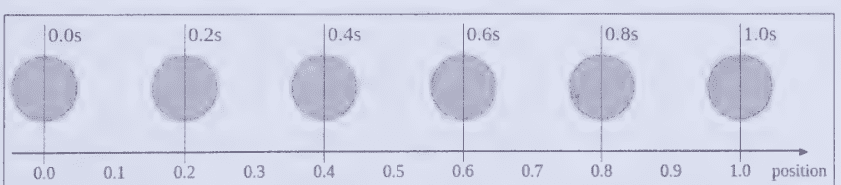

带有线性缓动的简单动画

我们使用术语 *缓动* 来描述动画过程与动画时间之间的关系；在前面的图中，我们谈到了 *线性缓动*。

如果我们观察现实世界中的运动，很少看到线性缓动；原因在于运动和力始终受到阻尼或加速（由重力引起）。如果我们想创建物理上逼真的动画，我们还必须给动画添加阻尼或加速。我们通过修改动画的缓动函数来做到这一点。

下图显示了一个线性缓动函数；因此，它表示线性动画随时间的进度。

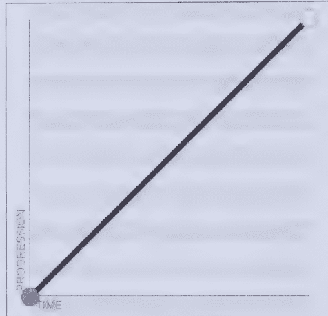

线性缓动函数（来源：http://cubic-bezier.com/#0,0,1,1）

通过修改缓动函数，我们可以修改动画进度以创建更符合物理规律的动画。我们可以在动画结束时加快进度以模拟加速，或减慢进度以模拟阻尼。

> 关于 CSS 和 JavaScript 缓动函数的有用信息可在 http://easings.net/ 上找到。

接下来是可能会让你感到有点棘手的部分。要修改缓动函数，我们通常使用 贝塞尔曲线。嗯，我们也可以使用一些二次方程或抛物线，输出将完全相同。但是，贝塞尔曲线是可以由控制点构建的平滑曲线。如果你不在乎这个，可以安全地跳过下一节，继续学习其他缓动函数；但是，贝塞尔曲线的概念出现的频率会比你预想的更高，因此浏览本节不会有什么坏处。


## 贝塞尔曲线

目标是轻松创建和处理与随时间变化的某个进度对应的多项式函数。创建线性函数（例如前面示例中使用的线性缓动函数）很直接；你在高中数学中学过这一点。然而，当我们考虑二次或三次函数（次数为 2 或 3）时，情况就变得复杂得多。创建描述所需形状的函数不再那么直接了。

让我们来看三次多项式函数的方程：

```
f(x) = a \cdot x^3 + b \cdot x^2 + c \cdot x + d
```

现在，我要求你找到 a、b、c 和 d 参数，使多项式函数经过 (0,0) 点并向 (1,1) 点加速。这与下图中函数的进度类似：

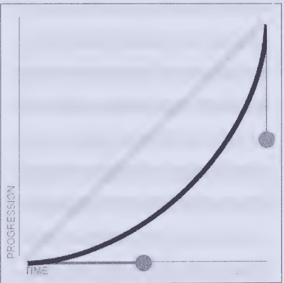

三次缓动函数（来源：http://cubic-bezier.com/#.5,0,1,.5）

你很快就会发现，尽管为前面的图形创建函数并非不可能，但使用简单的多项式函数会非常棘手且不直观。原因在于，系数 a、b、c 或 d 的变化会导致所描述函数出现不可预测的变化。

幸运的是，名为 de Casteljau 和 Bézier 的聪明人士开发了贝塞尔曲线的概念——一种通过所谓的控制点来描述多项式函数的数学模型。贝塞尔曲线是参数多项式函数，由范围在 [0, 1] 之间的参数 t 和一定数量的控制点（三次多项式为四个控制点）来描述。所得函数是控制点之间的插值，在 t=0 时，函数与第一个控制点匹配；在 t=1 时，函数与最后一个控制点匹配。

贝塞尔曲线的通用方程表示如下：

```
f (t) = \sum_{i=0}^{n} B_{i,n} (t) \cdot P_i
```

此处，B 是伯恩斯坦多项式：

```
B_{i,n} (t) = \binom{n}{i} t^i (1-t)^{n-i}
```

前面提到的三次多项式函数现在可以写成参数化贝塞尔曲线：

```
f (t) = (1-t)^3 \cdot P_0 + 3t(1-t)^2 \cdot P_1 + 3t^2 (1-t) \cdot P_2 + t^3 \cdot P_3
```

此处，P0、P1、P2 和 P3 是曲线的控制点。现在，我们只需将控制点移动到所需位置并定义多项式的曲率，即可创建所需的缓动函数。在前面的三次多项式图中，我们可以看到起点和终点固定在 (0,0) 和 (1,1)，其余两个控制点分别为青色和品红色，用于定义缓动函数的进度。

在下图中，我们可以看到，只需定义控制点即可轻松调整三次多项式函数。我们还观察到，曲线经过起点和终点，并在控制点之间平滑插值。我们还可以看到，所得函数（蓝色）仅仅是控制点之间的插值：

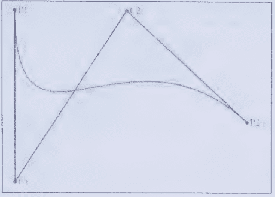

控制点之间插值的贝塞尔曲线

现在，我们拥有了知识和工具，只需定义控制点并使用贝塞尔曲线，即可编写能够想到的所有可能的缓动函数。来自 http://cubic-bezier.com/ 的交互式工具允许你轻松创建自定义贝塞尔曲线和缓动效果。

> 如果你要查找的是缓动函数的实现而不是贝塞尔曲线，请参阅 Dan Rogers 在 Github 上的 jQuery 缓动插件：https://github.com/danro/jquery-easing/blob/master/jquery.easing.js。

## D3 中的缓动函数

D3 支持多种开箱即用的缓动函数，有助于使你的动画和过渡更加逼真。我们可以使用 `d3.ease(type)` 函数创建缓动函数。此处，`type` 是以下缓动类型之一：

- `linear`: 这是线性缓动函数
- `quad`: 这是二次缓动函数
- `cubic`: 这是三次缓动函数
- `sin`: 这是正弦缓动函数
- `exp`: 这是指数缓动函数
- `circle`: 这是四分之一圆缓动函数
- `bounce`: 这是带有弹跳效果的缓动函数

默认情况下，缓动函数使用名为 `in` 的缓动模式；这意味着缓动运动是指元素滑入目标。缓动模式也可以通过在缓动函数名称后附加以下模式之一来修改：

- in: 元素滑入目标
- out: 元素从源滑出
- in-out: 元素从源滑出并滑入目标
- out-in: in-out 的反向缓动

默认缓动函数是 `cubic-in-out`，对应于缓慢滑出和滑入的动画。让我们来看一个简单的示例：

```
<svg width="800" height="600">
<rect x="50" y="60" width="100" height="100"></rect>
</svg>
<script>
var rect = d3.select('rect:nth-of-type(1)');

animate(rect, 'x', 50, 650);

function animate(elem, attributeName, startValue, endValue) {
var duration = 1000;
var interpolate = d3.interpolateNumber(startValue, endValue);
var ease = d3.ease('cubic-in-out');

d3.timer(function(time) {
var t = ease(time/duration);
elem.attr(attributeName, interpolate(t));

if (t >= 1) {
elem.attr(attributeName, startValue);
return true;
}
});
}
</script>
```

在前面的代码中，我们通过调用 `d3.ease('cubic-in-out')` 方法创建缓动函数。现在，我们可以使用该函数根据缓动类型创建和修改插值函数的 `t` 参数。

下图显示了多种缓动类型的概览和比较；你可以在随本书附带的代码中找到动画示例：

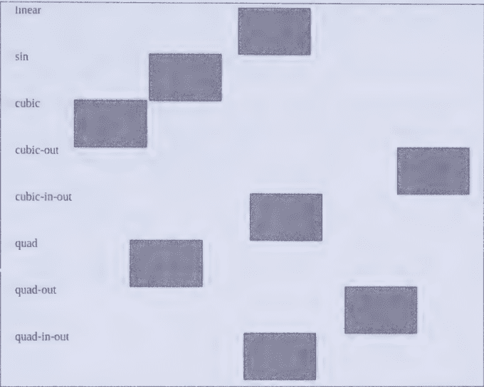

> 你可以在项目的 Github 页面上找到更多关于 D3 缓动函数的信息：https://github.com/mbostock/d3/wiki/Transitions#d3_ease。Katsumi Takano 的 Blocks 上有一个出色的 D3 缓动函数展示：http://bl.ocks.org/hunzy/9929724。

## 过渡

到目前为止，你已经了解了许多关于动画、计时器、插值和缓动的知识，但在 D3 中制作简单动画真的需要所有这些内容吗？不需要；幸运的是，只要我们使用简单的过渡，就不需要。过渡是从起始状态到结束状态的动画。这个术语通常用于泛指动画，反之亦然，但我想强调，过渡是一种仅由两个状态定义的简单动画；此处，这两个状态之间的插值会自动从这些状态生成。

D3 提供了非常强大的过渡创建支持。我们所要做的就是提供起始状态，在选择集上调用 .transition() 方法，最后提供结束状态，D3 将处理其余部分。.transition() 方法将返回一个与选择集非常相似且拥有其大部分方法的对象。此外，它还提供了 .duration(duration)、.delay(delay) 和 .easing(easingType) 函数，用于定义过渡的持续时间、延迟时间和缓动类型。

太好了，让我们看一个使用过渡而不是自定义动画的示例：

```
<svg width="800" height="600">
<rect x="50" y="60" width="100" height="100"></rect>
</svg>
<script>
var rect = d3.select('rect:nth-of-type(1)');

animate(rect, 'x', 50, 650);

function animate(elem, attributeName, startValue, endValue) {
  elem
  .attr(attributeName, startValue)
  .transition()
  .duration(1000)
  .attr(attributeName, endValue);
}
</script>
```

在前面的代码中，我们可以看到在 D3 中将动画实现为简单过渡是多么容易。根据 startValue 和 endValue 属性，D3 会尝试确定需要使用哪种插值方法来创建动画。

让我们来看看柱状图组件的代码；以下是更新柱状图尺寸时最重要的部分代码片段：

```
$$bars
.attr('x', function(d) { return xScale(d.x) + i*barWidth; })
.attr('y', function(d) { return yScale(d.y); })
.attr('height', function(d) { return (yScale(0) - yScale(d.y)); })
.attr('width', barWidth)
.attr('fill', colors(data.key));
```

让我们做一个小调整，使柱状图带有平滑动画自动更新。使用过渡，我们只需定义起始状态和结束状态：

```
$$bars
.attr('x', function(d) { return xScale(d.x) + i*barWidth; })
.attr('y', function(d) { return yScale(0); })
```


.attr('height', 0)
.attr('width', barWidth)
.attr('fill', colors(data.key));

```
$bars
.transition()
.attr('y', function(d) { return yScale(d.y); })
.attr('height', function(d) { return (yScale(0)) - yScale(d.y); });
```

搞定。在前面的代码中，我们将柱状图的默认高度设置为 0，其 y 值在值范围中设置为 0。然后，我们只需对这两个值进行动画处理，就能创建出流畅的动画。在下图中，我们可以看到图表如何更新，柱子仿佛在流畅的动画中生长：

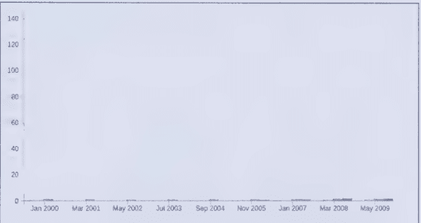

带有更新过渡的图表

在默认过渡时长 250 ms 结束后，图表如下所示——所有柱子均达到最终高度。您可以在源代码中找到带动画的示例：

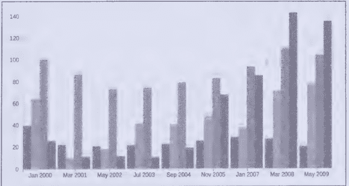

更新过渡后的图表

## 路径过渡变得简单

如果使用 D3 的路径生成器，为形状创建动画也非常简单。我们可以将起始状态定义为一个生成器，将结束状态定义为另一个用于过渡的生成器，D3 会为我们处理其余工作。让我们看一个示例：

```
<svg width="800" height="600">
<path class="area" />
</svg>

<script>

var $path = d3.select('.area');
var points = [
	[0, 0], [100, 10], [200, 250],
	[300, 375], [400, 340], [500, 135],
	[600, 360], [700, 280], [800, 480]
];

var area0 = d3.svg.area()
	.y0(600)
	.y1(600)
	.x(function(d) { return d[0]; })
	.tension(1.0)
	.interpolate('cardinal');

var area1 = d3.svg.area()
	.y0(600)
	.y1(function(d) { return 600 - d[1]; })
	.x(function(d) { return d[0]; })
	.interpolate('cardinal')
	.tension(0.6);

$path.datum(points)
	.attr('d', area0)
	.transition()
	.duration(1000)
	.attr('d', area1);

</script>
```

在前面的示例中，我们定义了一个路径 SVG 元素和一个 JavaScript 中的坐标数组。然后，我们创建了名为 `area0` 和 `area1` 的区域生成器。现在，我们可以使用第一个区域生成器 `area0` 作为起始状态、将 `area1` 作为结束状态，在两个相似形状之间创建动画。下图显示了区域在最初几毫秒后的快照：


带有更新过渡的区域

最后，区域将平滑动画到下图所示的形状；我们所要做的就是定义起始状态和结束状态：

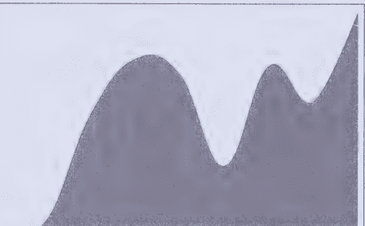

更新过渡后的区域

我要强调的是，前面的动画之所以看起来不错，仅仅是因为两个形状相似。它们具有相同数量的点。如果点的数量不同，内置字符串插值将无法产生优美的结果，而是会因插值问题而产生一些丑陋的伪影（我们将在本章的最后一节讨论此问题）。

## 用于自定义插值的属性和样式缓动

每当内置插值不适用时，我们始终可以为状态过渡使用自定义插值函数。这些自定义插值函数称为 _缓动_，可以通过 `.tween()`、`.attrTween()` 和 `.styleTween()` 方法使用。

后两个函数在您想要为特定属性或样式应用自定义插值函数时非常有用，而 `.tween()` 函数则允许您创建更通用的缓动工厂。缓动是一个必须返回形式为 `function(t) { ... }` 的插值函数的函数。

让我们看一个简单的示例，在其中创建自定义缓动以生成类似黑客帝国的字符动画：

```
<svg width="800" height="600">
<text x="10" y="50"></text>
</svg>

<script>
var textTween = function(value) {
    var l = value.length;
    var randomString = function(length) {
        if (length === 0) {
            return "";
        }
        // generates a random string
        // @src: http://stackoverflow.com/a/10727155
        return Math.round((Math.pow(36, length + 1) - Math.random() *
Math.pow(36, length))).toString(36).slice(1);
    }
    return function() {
        return function(t) {
            var i = Math.floor(t * 1);
            var s = value.substr(0, i) + randomString(l - i);
            this.textContent = s;
        }
    };
};

d3.select('text')
    .transition()
    .duration(2500)
    .ease('linear')
    .tween('text', textTween('Welcome to the matrix...'));
</script>
```

在前面的代码中，我们设置了一个 SVG `text` 元素，并创建了一个带有自定义缓动函数的过渡，该函数由 `textTween()` 调用返回。如前所述，缓动函数必须返回一个插值函数。在我们的插值函数中，我们创建了一个名为 `i` 的索引变量，它包含名为 `value` 的字符串在当前参数 `t`（范围为 [0, 1]）处的索引。索引从 `0` 开始，一直到 `value` 的总长度。然后，我们用随机字符串填充其余字符。最后，我们将结果写入原始 HTML 节点元素的 `textContent` 属性，该属性可以通过 `this` 关键字访问。我们还可以观察到，我们使用了 `linear` 缓动而不是默认的 `cubic-in` 缓动，以使每个字符的动画时长相等。编写缓动时可以使用前一节中看到的所有过渡函数，这真是太好了。

> 有关用法的更多信息，请参阅 Github 上的 D3 文档：https://github.com/mbostock/d3/wiki/Transitions#attrTween。

## 链式过渡

如果我们要构建一系列过渡，可以将过渡链接在一起。使用 D3，将自定义动画创建为一系列链式过渡，比使用计时器和插值器创建自定义动画要容易得多。

在过渡对象上（而不是在选择集上）使用 `.transition()` 方法，我们会创建一个新的链式过渡，它会在前一个过渡停止后自动开始。更准确地说，它会覆盖过渡的延迟值，使其在前一个过渡停止后开始。

让我们看一个简单的示例：

```
<svg width="800" height="600">
<rect width="100" height="100" />
</svg>

<script>
d3.select('rect')
  .attr('x', 10)
  .attr('y', 10)
  .attr('fill', 'steelblue')
  .transition()
  .duration(1000)
  .attr('fill', 'red')
  .attr('x', 500)
  .transition()
  .duration(2500)
  .attr('fill', 'green')
  .attr('y', 500)
  .transition()
  .duration(5000)
  .attr('fill', 'steelblue')
  .attr('x', 10)
  .attr('y', 10);
</script>
```

前面的动画效果很好，每个状态都会依次执行动画。但是，我们需要注意，每个状态中仅覆盖了内部延迟属性，因此除非我们跟踪前一个过渡的时长，否则实际上无法使用 `.delay()` 方法。

每当一个过渡完成时，D3 都会触发 end 事件；我们可以使用此事件来控制动画状态。下面是使用 end 事件的示例：

```
d3.select('rect')
.attr('x', 10)
.attr('y', 10)
.attr('fill', 'steelblue')
.transition()
.duration(1000)
.attr('fill', 'red')
.attr('x', 500)
.each('end', function() {
d3.select(this)
.transition()
.duration(2500)
.attr('fill', 'green')
.attr('y', 500)
.each('end', function() {
d3.select(this)
.transition()
.duration(5000)
.attr('fill', 'steelblue')
.attr('x', 10)
.attr('y', 10);
});
});
```

前面的示例效果更好，因为每当旧的过渡停止时就会启动新的过渡。但是，嵌套的回调树看起来非常糟糕，并且在生产代码中可能带来潜在错误。

迈向完全可链式过渡的一步是为 D3 添加一个小扩展，以允许基于 Promise 的状态过渡。Promise 是对未来值的异步表示，并有一个非常好的特性——它们可以链接在一起形成扁平结构，而不是嵌套的树状结构。

以下是用于基于 Promise 的过渡的辅助函数，它使用 ES6 Promise polyfill 以在所有浏览器中工作（有关 polyfill 及其用途的更多信息，可参阅本书的最后一章）：

```
function add$transition(selection) {
    selection.$transition = function(animationFn) {
        var getPromiseTransition = function() {
            return new Promise(function(resolve, reject) {
                selection.transition()
                .call(animationFn)
                .each("end", function() {
                    resolve(selection);
                });
            });
        };

        if (selection.$progress == undefined) {
            selection.$progress = getPromiseTransition();
        }
        else {
            selection.$progress = selection.$progress
            .then(function() {
                return getPromiseTransition();
            });
        }

        return selection;
    }
}
```

让我们逐一讲解前面的代码。首先，我们向 D3 选择集添加一个新的 `.transition(animationFn)` 方法，以便创建基于 Promise 的异步过渡。接下来，我们来到检查选择集上是否已存在 `$progress` 属性的那一行；该属性始终存储最新的 Promise。如果不存在，我们使用新的过渡 Promise 对其进行初始化；否则，我们从 `.then()` 方法返回一个新的过渡 Promise，该方法会在 Promise 解析后执行。然后，我们用 `.then()` 方法返回的结果（即最新的 Promise）覆盖 `$progress` 属性。


getPromiseTransition() 函数在当前选择集上创建一个新的过渡对象，并在触发 end 事件时解析。在 animationFn 中应用的所有过渡都应用于此状态。现在，我们可以按之前的示例编写如下：

```
var $rect = d3.select('rect');
```

```
$rect
.attr('x', 10)
.attr('y', 10)
.attr('fill', 'steelblue')
.call(add$transition);
```

```
$rect
.$transition(function(s) {
    s.duration(1000)
    .attr('fill', 'red')
    .attr('x', 500);
})
.$transition(function(s) {
    s.duration(2500)
    .attr('fill', 'green')
    .attr('y', 500);
})
.$transition(function(s) {
    s.duration(5000)
    .attr('fill', 'steelblue')
    .attr('x', 10)
    .attr('y', 10);
});
```

这太棒了。我们现在拥有完全功能且封装的可链式过渡。不过，请注意，这只是事件链与 Promise 结合以创建真正状态驱动动画的一个示例。可能还有更优雅的实现方式。

> 您可以在 MDN 上找到有关 ES6 Promise 的更多信息：https://developer.mozilla.org/en-US/docs/Web/JavaScript/Reference/Global_Objects/Promise。

## 形状补间

形状补间是过渡的圣杯。我想让您记住 2011 年 Mike Bostock（D3 的作者）发布的 D3 Show Reel，可在 http://bl.ocks.org/mbostock/1256572 上找到。在此演示中，他通过将图表转换为不同的表现形式，展示了 D3 令人惊叹的形状补间功能。

虽然形状补间看起来非常简单直观，但几乎从来都不容易创建。为什么呢？因为 SMIL 和 D3 等工具使用简单的字符串插值函数，它会提取字符串中的数值并将其插值到结束状态。一旦结束状态字符串与起始状态不同——可能包含不同数量的点、控制点或路径命令——生成的过渡看起来就不会平滑。回到 D3 Show Reel，我们看到的大多数过渡都是相似形状（控制点数量相同的形状）之间的形状补间。

这一点在对任意形状进行补间以及编写可复用补间函数时尤其适用。如果您只是想从一个特定形状快速原型化到另一个形状，也可以为您的情况设计一个快速而粗糙的解决方案。

不幸的是，目前没有任何开源的形状补间库/d3 插件能够处理各种形状。这样的插件需要掌握以下任务：

- 将 `rect`、`ellipse`、`polygon` 等所有形状元素转换为路径元素；只有路径元素才能无缝插值
- 将形状的所有线段转换为三次贝塞尔曲线；有了这些曲线，我们就能创建任意形状
- 细分起始/结束路径中的线段，使两个形状的控制点数量相同；只有点数相同的形状才能无缝插值
- 将起始形状的点对齐到结束形状中最近的点，使过渡看起来更平滑
- 使用任何字符串插值方法（例如 `d3.interpolate`）对两个形状的字符串进行插值
- 优化在 16ms 内运行的函数，以达到 60FPS 的良好效果

如果您有兴趣开发这样的插件，请告知我。

解决形状补间问题还有另一种不错的方法。Christophe Viau 没有编写一个在幕后完成所有工作的插值函数，而是想出了为所谓的超公式形状编写 D3 插件的主意。这些是复杂形状，可以使用超公式（超椭圆公式的更通用版本）和六个参数来构建。这些形状的特性在于它们全部由完全相同数量的线段构成，因此非常适合平滑插值。在下图中，我们可以看到一些可由此公式构建并用于平滑补间的形状：


由超公式构建的形状（来源：http://bl.ocks.org/mbostock/1020902）

> 您可以在 Github 上找到 D3 Superformula 插件：https://github.com/d3/d3-plugins/tree/master/superformula，以及 Mike Bostock 的 Blocks 上的示例：http://bl.ocks.org/mbostock/1020902。

## 摘要

在第一部分中，您了解了动画的 Web 标准。虽然 SMIL 非常酷且强大，但我们应该开始使用 CSS，尤其是 JavaScript 动画。SMIL 动画在 Chrome 中已弃用，Web Animation（JavaScript）API 的规范正在制定中。

在接下来的部分中，您了解了 D3 计时器如何抽象原生 setInterval 函数，以及如何使用和构建自定义插值和缓动函数。最后，我们了解了如何通过过渡在 D3 中构建精美的动画。过渡是在两个预定义状态（起始状态和结束状态）之间的自动动画。通过链式过渡，我们可以再次创建动画。

在最后一部分中，您了解了形状补间以及在自定义形状上使用它的问题。字符串插值函数很“笨”，因此仅适用于相似形状（控制点数量相同的形状）。我们需要转换和细分形状才能进行正确的形状补间。

在第 7 章“使用 GeoJSON 创建地图和地图可视化”中，您将了解地图可视化和地理数据（如 GeoJSON）。我们还将运用迄今为止所学的所有技术。
