# 使用 GeoJSON 创建地图和地图可视化

在上一章中，您了解了过渡和动画；现在，考虑在地理可视化上对要素进行动画，因为我们将研究地图可视化和 GeoJSON。在本章中，您将学习以下内容：

- 了解地图可视化的不同挑战
- 了解几何坐标系
- 了解 GeoJSON 格式
- 了解 GeoJSON 的问题和 TopoJSON 的优势
- 了解 3D 到 2D 的投影
- 熟悉地图可视化的有用工具
- 创建颜色刻度
- 绘制 GeoJSON 要素
- 一次加载多个资源
- 绘制地理网格
- 实现不同类型的地理可视化

在第一部分中，我们将探讨地图可视化的生态系统，并了解处理此类可视化时出现的不同挑战和问题。首先，我们将研究地理坐标系，然后考虑如何将地球投影到 2D 平面上。

在下一部分中，我们将探讨可以在地图上绘制哪种数据以及如何在浏览器中使用这些地理数据。自然，我们将更详细地研究 GeoJSON 及地理要素的表示。然后，我们将讨论 GeoJSON 的问题以及如何使用 TopoJSON 解决这些问题。

在以下部分中，您将熟悉多种对地图可视化有用的工具和技术。我们将实现颜色刻度，使用地理形状生成器从 GeoJSON 要素生成路径，并研究 `queue.js` 模块以一次加载多个资源。

最后，我们将创建不同类型的地图可视化，例如符号地图和分级色调地图。我相信您会喜欢这部分，因为您将能够运用之前学到的所有技术在地图上创建精美的可视化。

## 地图可视化概览

目标是使用 `d3.js` 在交互式和响应式可视化中显示地图数据，类似于以下示例：

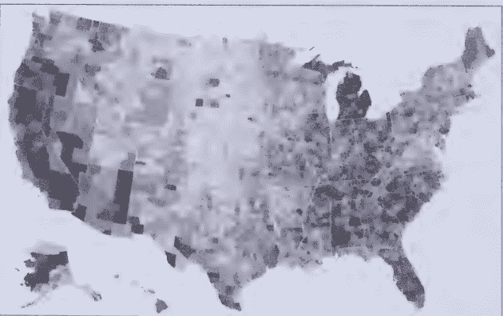

美国的分级色调地图（来源：http://bl.ocks.org/mbostock/4060606）

然而，这并非像绘制简单条形图那样直接的工作。构建地图可视化时需要考虑许多事项，本节将向您介绍这些不同的步骤和技术。让我们立即开始，从条形图的各个组件入手，并了解它们如何与地图可视化相比较。这将为我们解决问题提供足够的知识。


## 地理坐标系

当我们绘制柱状图时，通常先绘制坐标系——精确来说是笛卡尔坐标系——通常表示为坐标轴。该坐标系定义了如何找到绘制柱状图所需的坐标；它显示了我们可以沿其移动的 x 和 y 方向。坐标轴的第二个重要方面是它们定义了图表的比例：数据集中的点需要多接近才能在图表中绘制为像素值。

当我们将轴的概念转换为制图可视化时，我们需要思考用于表示地理点的坐标系。表示世界上某个位置（因此也包括地图上的位置）的标准方法是使用纬度、经度和高度。一般来说，我们不会考虑地球上点的海拔高度，因此只使用前两者进行地理可视化。

纬度和经度均以角度为单位进行测量。纬度从赤道开始测量，范围为 [90°N; 90°S]（称为平行圈的分段），经度从本初子午线开始测量，范围为 [180°W; 180°E]（称为子午线的分段）。下图比较了这两种测量，并显示了等纬度和等经度的圆。由等纬度和等经度形成的网格也称为纬线网：

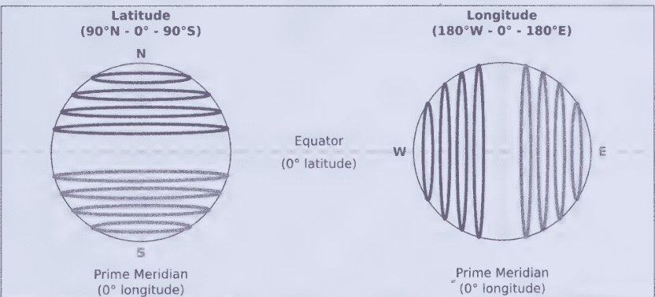

纬度和经度的比较

## 将球体投影到平面地图

现在，我们知道如何精确识别世界表面上的任何点。但是当涉及到在平面地图上可视化这些点时，会出现另一个问题。如果我们想要显示世界（或其部分）的 2D 表示，我们就必须将 3D 球体投影到 2D 平面上。好消息是这可以做到；然而，坏消息是这不可能不扭曲表示。

上小学时，我总是对学校地图册中南极洲的巨大尺寸印象深刻，它看起来类似于下图。然而，几年后，当我第一次听说地理投影以及 3D 世界如何映射到书本的 2D 页面时，我对这个大陆的想象得到了纠正：

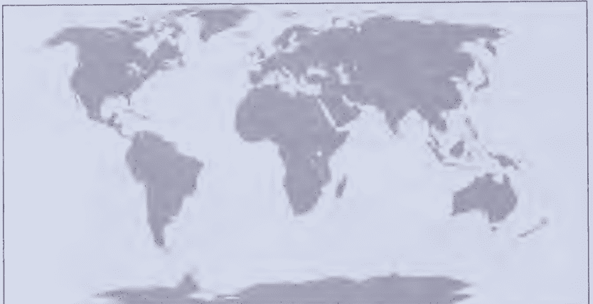

2D 世界地图（来源 wikimedia.org）

我年轻时产生误解的原因是，我没有意识到将世界投影到 2D 地图时会发生扭曲。在下图中，我们看到南极洲与其他大洲相比的真实大小。作为结论，我们可以说，当将球体投影到平面上时，某些属性，例如面积相等、角度相等、距离等，可能会丢失：

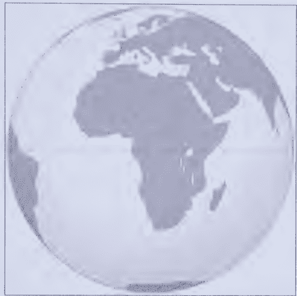

3D 世界地图（来源 wikimedia.org）

## 哪些数据可以在地图上显示？

使用柱状图、折线图、散点图和饼图，我们可以显示各种 1D、2D 和 3D 数据。这些维度可以编码为数值、时间、分类值等，并可以表示为坐标轴上的维度、数据点的大小以及颜色。然而，在处理地理可视化时，我们大多会处理 2D 数据，其中一个维度表示地图上的位置，而剩余维度表示一个值（可以是数值或序数），根据某个颜色标尺以颜色表示。

有多种方式来编码位置：

- ID 值可以表示大洲、国家、州、城市等
- 纬度和经度坐标可以表示地图上的一个点
- 多边形的坐标可以表示地图上的一个区域

为了在地图上的这个特定位置表示值维度，我们通常使用调色板，并根据预定义的颜色范围对数据点进行着色。然而，你应该意识到，使用调色板显示数值在某种程度上是含糊的，因为我们对颜色变化的感知与对大小变化的感知不同。此外，设计师可以通过选择特定的调色板来控制用户的感知。例如，在下图中，我们看到三种不同的可视化，它们都使用不同的调色板显示相同的数据。而左侧和右侧的可视化看起来非常相似，并给用户提供相似的数据理解，中间的可视化则给出了完全不同且矛盾的数据图像。这只需通过反转左侧可视化的调色板来实现。同样，颜色步骤的量化也可能产生巨大影响。在一个示例中，我们可以生成非常平滑的渐变；但使用不同的量化，我们可以在量化之间创建可见的边界：

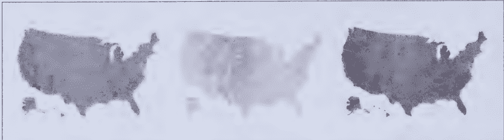

使用不同调色板显示相同数据

由设计师选择与数据相匹配的调色板，以可视化希望用户看到和理解的方面。

## 我们可以开始了吗？

现在，你将很好地了解绘制制图可视化所需的部分和组件。在接下来的章节中，我们将深入细节并使用 D3 实现一些可视化。

到目前为止，我们尚未讨论的唯一部分是哪里可以获取地理可视化的数据，以及数据以何种格式编码。我们将在下一部分立即讨论这个问题。

## 拓扑和地理特征的数据表示

地理数据通常存储在地理信息系统（GIS）数据库和程序中。这些通常是用于设计、存储、操作、分析和显示制图数据的工具。下图显示了世界的不同方面如何抽象为图层并在该系统中管理：

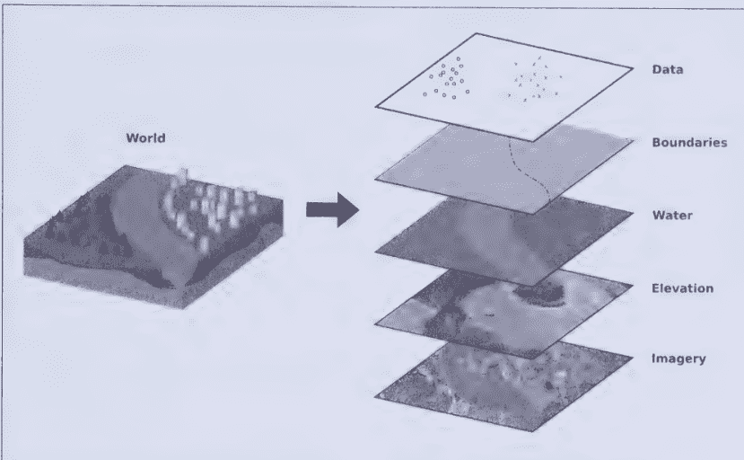

典型的 GIS 抽象

这些系统中的大多数都提供一个接口来单独访问或下载这些图层——即制图数据、统计数据或其他地理数据——以指定的 GIS 格式。存在各种不同的基于像素和矢量的 GIS 格式；然而，我们将研究两个基于 JSON 的矢量格式：GeoJSON 和 TopoJSON。

如果你正在寻找地理数据集，我建议你访问 http://www.data.gov/、http://geocommons.com/ 以及 Robin Wilson 页面上的广泛列表 http://freegisdata.rtwilson.com/。

## GeoJSON – 地理特征的一种格式

JSON 是 JavaScript 的绝佳数据格式，并且与 D3 配合良好。
因此，使用 JSON 格式来存储地理数据是自然而然的选择，而这正是 GeoJSON 所做的。

GeoJSON 是一种非常灵活的格式，可以编码从几何图形、特征到特征集合的任何内容。让我们直接进入并查看一个典型的 GeoJSON 文件：

```
{
    "type": "FeatureCollection",
    "features": [
    {
    "type": "Feature",
    "geometry": {
    "type": "Point", "coordinates": [102.0, 0.5]
    },
    "properties": {
    "prop0": "value0",
    "prop1": {"count": 3}
    }
    }, {
    "type": "Feature",
    "geometry": {
    "type": "LineString",
    "coordinates": [
    [102.0, 0.0], [103.0, 1.0], [104.0, 0.0], [105.0, 1.0]
    ]
    },
    "properties": {
    "prop0": "value1",
    "prop1": {"count": 2}
    }
    }, {
    "type": "Feature",
    "geometry": {
    "type": "Polygon",
    "coordinates": [
    [ [100.0, 0.0], [101.0, 0.0], [101.0, 1.0],
    [100.0, 1.0], [100.0, 0.0] ]
    ]
    },
    "properties": {
    "prop0": "value2",
      "prop1": {"count": 1}
    }
    }
    ]
    }
}
```

在前面的代码中，我们可以看到一个特征集合，其中每个特征包含几何图形、一些属性和类型。在 GeoJSON 中，特征集合由带有属性和特定几何图形的特征组成，而几何图形是由几个基本元素构建的，例如点、线和多边形。

GeoJSON 中的一些有效类型如下：

- Point
- MultiPoint
- LineString
- MultiLineString
- Polygon
- MultiPolygon
- GeometryCollection
- Feature
- FeatureCollection

每当我们处理自定义数据时，都会将 FeatureCollection 用作特征数组。然而，其他类型也是可能的。

> 你可以在 http://geojson.org/geojson-spec.html 上找到完整的 GeoJSON 规范。

我们可以使用 d3.json 函数加载 GeoJSON，就像加载普通 JSON 文件一样。让我们看一个示例：

```
d3.json("data/default.json", function(error, data) {
  if (error) throw error;

  console.log(data.features);
});


在前面的代码中，数据现在包含了我们在前一个示例中看到的完全相同的对象。现在，我们只需从数据中提取相关信息。我们使用 map 函数获取所需的属性：

```
d3.json("data/default.json", function(error, data) {
  if (error) throw error;
  var labels = data.features.map(function(d) {
    return d.properties.prop0;
  });
  var values = data.features.map(function(d) {
    return d.properties.prop1.count;
  });
});
```

在前面的代码中，我们使用 map 来转换和提取相关属性，例如来自要素集合的 `properties` 属性中的 `values` 和 `labels`。请注意，properties 对象的结构不是标准化的，取决于你的 API 的数据结构。在我们的例子中，它包含 `prop0` 和 `prop1` 属性，但也可能包含其他属性。如果某个属性包含嵌套对象，我们也可以使用 `reduce` 函数来聚合这些值。

需要知道的是，我们始终需要从 properties 对象中提取值才能对其进行可视化。

## TopoJSON – 用于 Web 可视化的 GeoJSON

TopoJSON 是一种针对压缩 GeoJSON 拓扑数据进行优化的格式，由 `d3.js` 的主要作者 Mike Bostock 指定并开发。它的开发目的是减少大型 GeoJSON 文件的大小，从而加速 Web 可视化。

如前一节所示，GeoJSON 格式将拓扑存储为多边形点列表；然而，任何内陆边界通常属于多个国家或州。因此，将州的边界框编码为多边形点会导致（大量）冗余信息。根据 Mike Bostock 的说法，TopoJSON 文件比原始 GeoJSON 文件小 80%：

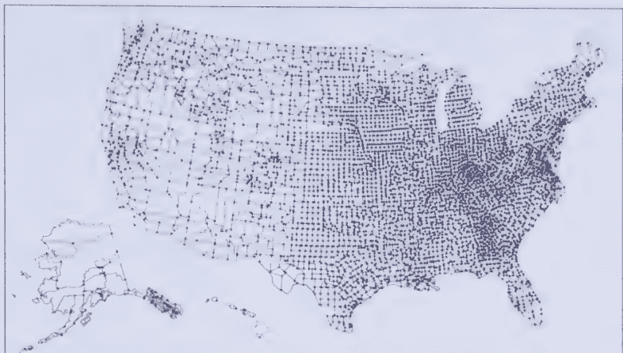

以 TopoJSON 表示的多边形和边界（来源 https://github.com/mbostock/topojson/wiki）

TopoJSON 包含一个服务器 API，负责将 GeoJSON 文件转换为 TopoJSON 格式，该 API 作为 node.js 的命令行工具提供，还有一个客户端 API，用于在浏览器中将 TopoJSON 文件转换回 GeoJSON。

> 你可以在项目的 Github 页面上找到有关 TopoJSON 的更多信息，网址为 https://github.com/mbostock/topojson/wiki/API-Reference。

## 通过服务器 API 将 GeoJSON 转换为 TopoJSON

你可以通过名为 npm 的包管理器安装 TopoJSON 服务器 API；只需在命令行中运行以下内容：

```
npm install topojson
```

最后，当你安装好工具后，可以使用以下语法将名为 input_geo.json 的 GeoJSON 文件转换为名为 output_topo.json 的 TopoJSON 文件：

```
topojson -o output_topo.json input_geo.json
```

> 你可以在项目的 Github 页面上找到命令行工具的完整参考，网址为 https://github.com/mbostock/topojson/wiki/Command-Line-Reference。

## 通过客户端 API 将 TopoJSON 转换为 GeoJSON

一旦你将 GeoJSON 文件转换为小型 TopoJSON 文件，你还需要在浏览器中将其转换回来。因此，我们必须使用客户端 API，它可以通过 `bower`（推荐）或 `npm` 安装，或者直接从 `http://d3js.org/topojson.v1.min.js` 加载。

在浏览器中，我们只需在头部包含该脚本：

```
<script src="bower_components/topojson/topojson.js"></script>
```

然后，我们就可以使用 topojson 对象了。

我们可以通过调用以下内容来访问原始 GeoJSON 文件中的要素和网格：

- `topojson.feature(topology, object)`
- `topojson.mesh(topology, object, [filter])`

现在，我们可以从拓扑文件的大幅减小中获益，而不会丢失有关要素或网格的信息。我建议你始终以这种方式处理输入文件，使它们保持小巧和紧凑；TopoJSON 是实现此目标的绝佳方式。

## 映射和投影

正如我们在本章第一节中已经看到的，将 3D 世界映射到 2D 平面有多种可能的方法；而在所有这些方法中，都会丢失一些信息。

让我们做一个小脑力实验。想想你将球体表面映射到平面上需要做什么。首先，你需要在表面某处挖一个孔。然后，你可以拉伸表面，直到它适应平面。但是，我们现在在挖孔的确切位置引入了一个拓扑违规。我们很容易看出，如果你从地图左侧移出，理论上应该从右侧重新进入；但在我们的 2D 表示中，我们丢失了这个属性，两侧不再相连。第二个问题是，当我们将表面拉伸到平面时，也引入了失真。现在，地图顶部和底部区域似乎变大了；我们无法保持面积的相等性。如果你回到第一节查看 2D 世界地图图，你可以实际看到这些确切的问题。

有人可能会有个绝妙的主意，将整个 3D 球体复制到平面上——就像第一节中 3D 世界地图图所示。然而，这里我们只能看到球体的一面；因此，我们丢失了关于另一面的所有信息。

将球体映射到平面的这种方式称为投影。D3 提供了各种内置投影，适用于各种映射，可在 d3.geo 命名空间下使用。

> 你可以在 Mike Bostock 的博客上找到有关地图的更多信息，网址为 http://bost.ocks.org/mike/map/。

## 等距圆柱投影

还记得我们刚才做的脑力实验吗？要在 D3 中创建这样一个简单的投影，我们可以使用 d3.geo.equirectangular() 函数，它既不保存距离也不保存面积。它是最基本的投影，因为纬线和经线只是简单地映射到欧几里得空间中的纬线和法线。我们可以在下图中看到之前讨论过的失真效果：

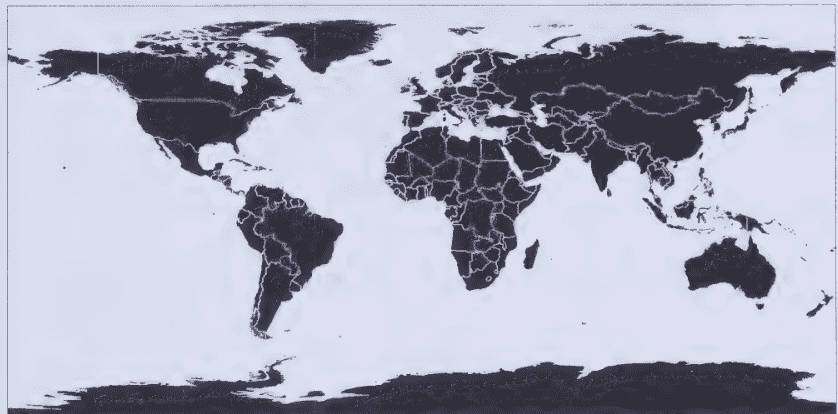

由于不保存面积、角度或距离，它很少用于可视化地理特征。但是，它有时用于将像素值进行栅格重投影到其他表示中。

## 正射投影

现在，我们继续之前的脑力实验。让我们转向将 3D 投影到 2D 平面，称为正射投影。正如我们在下图中看到的，使用正射投影时，我们会丢失关于球体一侧的信息：

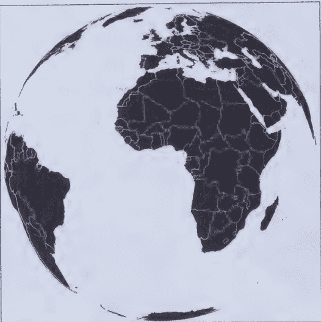

正射投影

我们可以在 D3 中使用 `d3.geo.orthographic()` 函数创建正射投影。

## Albers 投影

Albers 投影将球体映射到等面积圆锥上，其中纬线间距更紧密，南北端和经线间距相等。这种投影常用于在地图上显示东西距离较大的区域的地理特征面积；换句话说，它常用于美国的分级色调图：

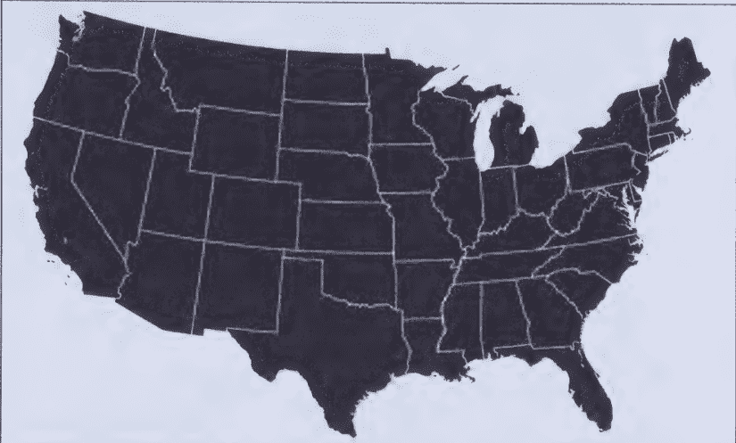

Albers 投影

在 D3 中，我们可以通过以下函数创建 Albers 投影：

```
var projection = d3.geo.conicEqualArea();
```

为了将投影调整到感兴趣的区域，我们可以使用 `projection.parallels([parallels])` 方法指定投影的 Albers 标准纬线。名为 `parallels` 的参数应为两个以度为单位的纬度值的数组，定义感兴趣区域的下限和上限；对于美国，这将是 `[29.5, 45.5]`。D3 还提供 `d3.geo.albers()` 投影，这是一个带有美国预设的 Albers 投影。

在顶部，D3 提供另一个特定于美国的预设，即 `d3.geo.albersUsa()` 投影，如下图所示。我们可以看到，除了以美国为中心的常规投影外，它还显示了阿拉斯加和夏威夷，从而涵盖了美国的所有 50 个州。请注意，阿拉斯加的大小按 0.35 的比例缩放，以便在地图上显示：

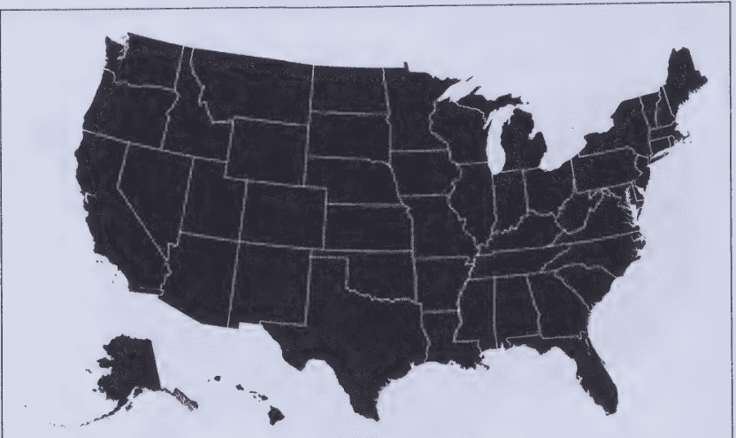

Albers USA 投影

## 球面墨卡托投影

墨卡托投影在局部保存角度，这有个不错的特性：地图上每个点的相对角度是正确的；而且局部比例在任何方向上都保持不变。然而，如下图所示，它在世界范围内引入了巨大的失真：


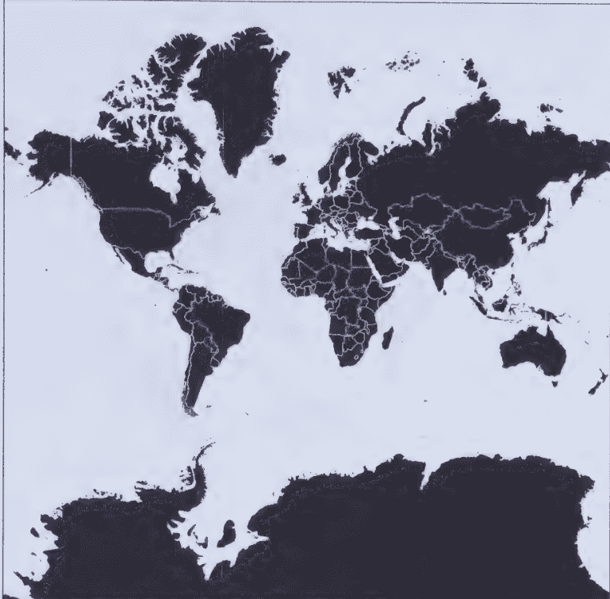

The Mercator projection

由于其局部特性，墨卡托投影常被瓦片地图库使用，例如 Google Maps 和 Leaflet。然而，由于长度失真，不应将其用于分区统计地图。

在 D3 中，通过调用 `d3.geo.mercator()` 函数来创建墨卡托投影。

## Azimuthal Equidistant projection

等距方位投影将投影中心周围的圆映射到 2D 地图上的圆，从而保持从投影中心向方位方向的距离：

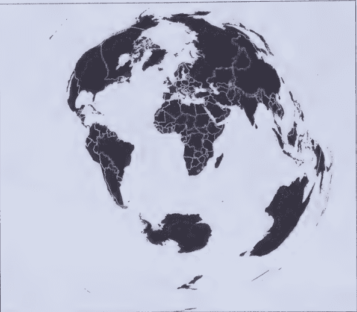

The Azimuthal Equidistant projection

该投影可以通过调用 `d3.geo.azimuthalEquidistant()` 函数生成。在需要显示相对于某个参考点距离的可视化中，它非常有用。

> 在 Github 上可以找到更多投影及详细信息：https://github.com/mbostock/d3/wiki/Geo-Projections。

## Helpful tools for creating maps in D3

绘制地图需要结合 GIS、GeoJSON、投影等方面的知识和深刻理解，以及制作地图的技术和技能。在本节中，我们将介绍几个有助于使用 D3 生成交互式地图的选定工具。

### Color scales

如前一节所述，作者选择的颜色和色标会对读者感知可视化产生巨大影响。因此，我想展示如何在 D3 中高效地创建色标。

比例尺可以使用插值将某个值域的值映射到一组不同的值。我们通常使用它来为轴创建比例尺。然而，轴将值域映射到像素范围。在我们的例子中，我们想将这些比例尺应用于颜色，以将值域映射到颜色范围。我们可以使用这些颜色插值函数来实现这一点：

- d3.interpolateRgb：RGB 和 HEX 值，例如 #00FF00
- d3.interpolateHsl：HSL 值，例如 hsl(120, 100%, 50%)
- d3.interpolateLab：LAB 值
- d3.interpolateHcl：HCL 值

让我们看一个简单示例，将 0 到 5 的值域映射到从橙色到红色的颜色范围：

```
var color = d3.scale.linear()
.interpolate(d3.interpolateRgb)
.domain([0, 5])
.range(['#FFCC66', '#FF0000']);

color(0); // > '#FFCC66'
color(5); // > '#FF0000'
```

在前面的代码中，我们可以简单地使用 `d3.interpolateRgb` 插值函数来为颜色使用比例尺。

除了线性比例尺，我们还可以使用其他比例尺，例如 `d3.scale.log()` 对数比例尺或 `d3.scale.pow()` 指数比例尺。如果处理序数值，也可以使用非数字序数比例尺：

```
var color = d3.scale.ordinal()
.domain(['foo', 'bar', 'baz'])
.range(['red', 'blue', 'green']);
```

在前面的代码中，我们只能将 foo、bar 和 baz 等精确值映射到预定义颜色。如果要与 CSS 一起使用预定义颜色类，应研究量化比例尺，例如 `d3.scale.quantize()` 和 `d3.scale.threshold()`。

如果有兴趣创建漂亮的色标，可以参考 Color Brewer 库：http://colorbrewer2.org/。

如果希望在可视化旁边显示色标，可以使用 John Goodall 开发的出色的 d3 色标插件：https://github.com/jgoodall/d3-colorlegend。

### The geographic shape generator

你已经了解了 GeoJSON 格式支持的不同类型，每种类型定义一种特定几何。在处理这些 GeoJSON 要素时，我们常遇到的问题是使用某个预定义投影将这些形状绘制到地图上。不过，我应该给 Mike Bostock 送花，感谢他开发了地理形状生成器，可通过 `d3.geo.path()` 访问。

D3 地理形状生成器使在地图上绘制 GeoJSON 要素变得非常简单。它可以绘制任何受支持的 GeoJSON 类型，并根据预定义投影将几何输出为 SVG 路径元素的字符串。

让我们看看如何使用此生成器：

```
var projection = d3.geo.albersUsa();
var path = d3.geo.path()
    .projection(projection);
svg.append("path")
      .datum({type: "FeatureCollection", features: features})
      .attr("d", path);
```

在前面的代码中，我们为带有虚拟要素数组的 FeatureCollection 对象生成了路径。请注意，这正是 GeoJSON 格式，使绘制 GeoJSON 要素变得极其简单。

### Graticule – grids on maps

理解地图和投影的重要工具是制图可视化中的网格。网格之所以重要，是因为与笛卡尔坐标系不同，纬线和经线网格不再等间距或相互正交。因此，经纬网包含关于当前投影和地理坐标系的大量有用可视化信息。

让我们看看如何创建这样的经纬网。D3 提供 `d3.geo.graticule()` 函数，用于为地理坐标系生成网格。我们只需将其插入地理形状生成器并稍微设置样式即可：

```
var width = 960,
    height = 960;

var projection = d3.geo.orthographic()
    .scale(width * 0.25)
    .translate([width / 2, height / 2])
    .clipAngle(90)
    .precision(.1);
var path = d3.geo.path()
    .projection(projection);
var graticule = d3.geo.graticule();
var svg = d3.select("body").append("svg")
    .attr("width", width)
    .attr("height", height);
svg.append("path")
    .datum(graticule)
    .attr("class", "graticule")
    .attr("d", path);
```

在前面的代码中，我们创建一个正射投影并将其插入地理路径生成器。最后，我们创建一个经纬网并将其应用于生成器。生成的网格在下图中显示：

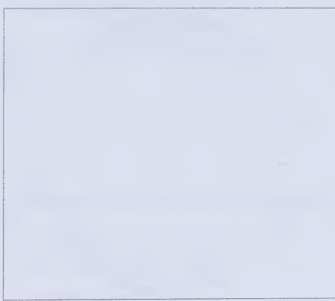

A Graticule of the Orthographic projection

### Loading multiple resources

如前一节所述，除了包含要显示数据的文件外，我们始终需要加载背景地图的几何数据。这有些挑战，因为现在必须等待这（至少）两个文件加载完成后才能绘制可视化。

理想情况下，我们希望并行加载两个资源，并在所有资源可用后执行回调函数。幸运的是，Mike Bostock 在过去几年中非常活跃，编写了实现此功能的实用工具 Queue.js。

可以使用 bower 安装 Queue.js，并从命令行运行以下命令，或从 CDN 加载 Queue.js：

```
bower install queue-async
```

现在，我们可以创建一个队列，并使用 `.defer()` 函数注册加载所有资源的函数。我们将一个函数作为第一个参数传递，Queue.js 会自动将所有其他参数传递给该函数。最后，我们调用 `.await()` 方法，在所有资源加载完成后执行回调并收集所有值。让我们看一个示例：

```
queue()
.defer(d3.text, "path/to/file/file1.txt")
.defer(d3.json, "path/to/file/file2.json")
.defer(d3.csv, "path/to/file/file3.csv")
.await(function(err, file1, file2, file3) {
 console.log(file1, file2, file3);
});
```

在前面的代码中，我们可以看到一次性处理多个资源是多么容易——非常简单，多亏了 Mike Bostock。

> 关于 queue.js 的更多信息可以在项目的 Github 页面上找到：https://github.com/mbostock/queue。

## Types of geographic visualization

根据要显示的值和数量，我们可以从各种可最佳表示数据的可视化中进行选择。通常，我们会在折线图、柱状图、面积图（普通或堆叠）、饼图、散点图等之间进行选择。

很容易理解，制图可视化也是如此。除了选择能够恰当表示数据的投影类型外，我们还可以在不同的可视化类型之间进行选择。本节概述了最常见的制图可视化类型。

好了，理论就讲到这儿了——让我们来画些地图吧！

### Symbol maps

我们的第一张地图将是下图所示的简单符号地图。我们想要显示美国记录的过去 30 天内的所有地震；数据集来自 http://earthquake.usgs.gov/：

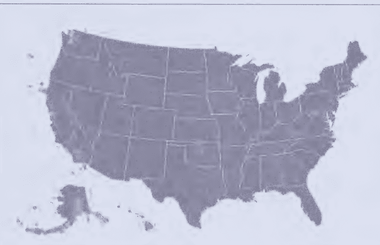

A simple Symbol map

如上图所示，我们希望根据每个地震的震级显示大小和颜色不同的点。让我们开始使用 d3、TopoJSON、Queue.js 和一个简单的响应式 SVG 容器设置一个简单模板：

```
<!DOCTYPE HTML>
<html>
<head>
<script src="bower_components/d3/d3.min.js"></script>
```


```html
<script src="bower_components/topojson/topojson.js"></script>
<script src="bower_components/queue-async/queue.min.js"></script>
<style></style>
</head>
<body>

<script>

var padding = 10,
  body = d3.select("body"),
  width = body.node().clientWidth - padding,
  aspectRatio = 16.0 / 9.0,
  height = width / aspectRatio;

var svg = d3.select("body").append("svg")
  .attr("width", width)
  .attr("height", height);

// The visualization code goes here
</script>
</body>
</html>
```

在前面的代码中，我们使用`clientWidth`属性获取浏览器窗口的大小，并为地图定义16/9的宽高比。我们还将在其他示例中使用此设置。

首先，我们需要创建一个投影并绘制地图；我们将平移和缩放投影，以在容器的全宽上显示地图（请注意，不同投影中的缩放解释不同）：

```
var projection = d3.geo.albersUsa()
  .scale(width)
  .translate([width / 2, height / 2]);
```

接下来，我们也可以使用投影创建路径生成器：

```
var path = d3.geo.path()
  .projection(projection);
```

让我们使用从橙色到红色的简单线性颜色刻度：

```
var color = d3.scale.linear()
  .interpolate(d3.interpolateRgb)
  .domain([0.1, 5])
  .range(['#FFCC66', '#FF0000']);
```

太好了，让我们加载地图和数据，然后绘制地图。为此，我们将使用Mike Bostock在 https://gist.github.com/mbostock/4090848 提供的美国地图的TopoJSON格式：

```
queue()
.defer(d3.json, "data/us.json")
.defer(d3.json, "data/earthquakes.json")
.await(ready);
```

一旦资源可用，ready函数就会被调用。让我们实现它：

```
function ready(error, us, earthquakes) {
  if (error) throw error;

  svg.append("g")
    .attr("class", "counties")
    .selectAll("path")
    .data(topojson.feature(us, us.objects.counties).features)
    .enter().append("path")
    .attr("d", path);

  svg.append("path")
    .datum(topojson.mesh(us, us.objects.states))
    .attr("class", "states")
    .attr("d", path);
}
```

在前面的代码中，延迟函数的所有数据都按调用函数的顺序作为参数传递。美国地图以TopoJSON格式存储。因此，我们需要将其转换回有效的GeoJSON。我们使用topojson.feature()或topojson.mesh()函数来实现这一点。首先，我们将为us.objects.counties集合中的每个县绘制一个路径。接下来，我们将为us.objects.states集合中的所有州绘制一个单一网格。

最后，我们只缺少点；让我们绘制它们：

```
svg.append("g")
  .attr("class", "data")
  .selectAll('circle')
  .data(earthquakes.features)
  .enter().append('circle')
  .attr('r', function(d) {
    return Math.abs(d.properties.mag);
  })
  .attr('fill', function(d) {
    return color(Math.abs(d.properties.mag));
  })
  .attr('transform', function(d) {
    var pos = projection([d.geometry.coordinates[0], d.geometry.coordinates[1]]);
    if (pos) {
        return "translate(" + pos + ")";
    }
  });
```

地震数据格式为GeoJSON，并可在earthquake.features对象中使用。我们为集合中的每个元素绘制一个圆，并调整形状的半径大小和颜色。最后，我们进行一些错误检查，并将圆形转换到地图上的正确位置。我们使用投影函数来实现这一点。就这样，最终结果在前面的图中显示。

## 分区染色地图

在下一个地图中，我们希望显示美国每个县的失业率；该数据集显示按县ID排序的每个县的失业率，数据来自Mike Bostock的 https://gist.github.com/mbostock/4060606。地图结果如下图所示：

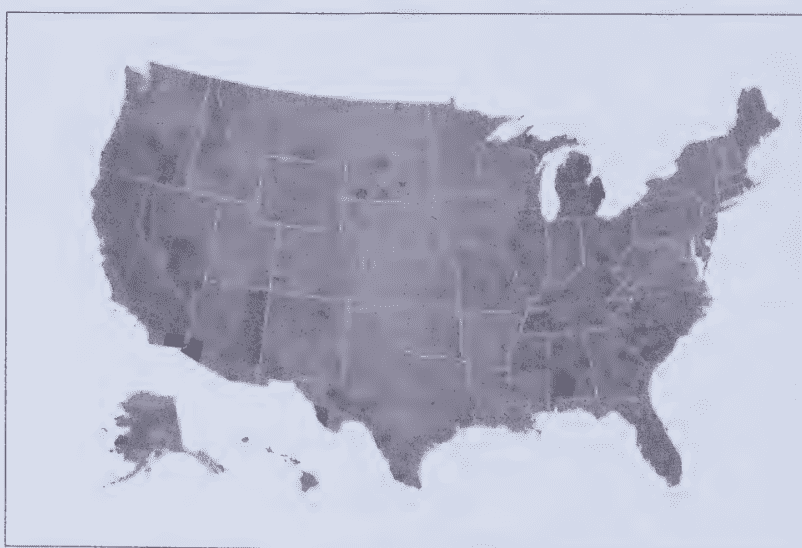

一个简单的分区染色地图

如上图所示，我们希望根据失业率为每个县着色。我们使用与前面示例相同的模板（相同的尺寸和投影）。

让我们创建一个颜色刻度并加载地图和数据；此步骤与前面的示例非常相似：

```
var color = d3.scale.linear()
.domain([0, .15])
.interpolate(d3.interpolateRgb)
.range(["#FF7948","#B93200"]);
queue()
.defer(d3.json, "data/us.json")
.defer(d3.csv, "data/unemployment.csv")
.await(ready);
```

现在，我们可以绘制地图：

```
function ready(error, us, unemployment) {
 if (error) throw error;
 var data = {};
 unemployment.forEach(function(d) {
 data[d.id] = +d.rate;
 });
 svg.append("g")
 .attr("class", "counties")
 .selectAll("path")
 .data(topojson.feature(us, us.objects.counties).features)
 .enter().append("path")
 .attr("fill", function(d) { return color(data[d.id]); })
 .attr("d", path);
 svg.append("path")
 .datum(topojson.mesh(us, us.objects.states))
 .attr("class", "states")
 .attr("d", path);
}
```

在前面的代码中，我们首先将失业率数组转换为一个对象，该对象按县ID作为属性存储失业率。然后，我们绘制各县并根据失业率填充颜色。

## 摘要

在本章中，您学习了使用D3绘制地图可视化所需的所有必要知识。您了解了地理坐标系、经纬网和颜色刻度。

GeoJSON是编码几何要素的重要格式；它可以存储不同类型的几何体和值。但是，它也存储了大量冗余信息；这时TopoJSON就派上用场了。

最后，我们开始绘制不同的地图可视化，例如符号地图和分区染色地图。

在下一章中，您将学习关于测试响应式可视化的内容。
