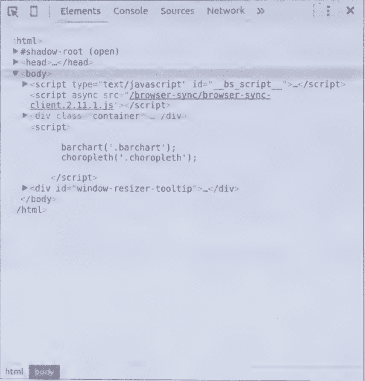
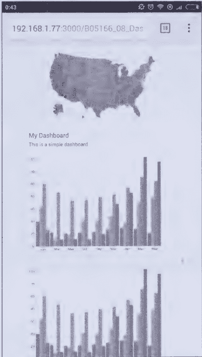
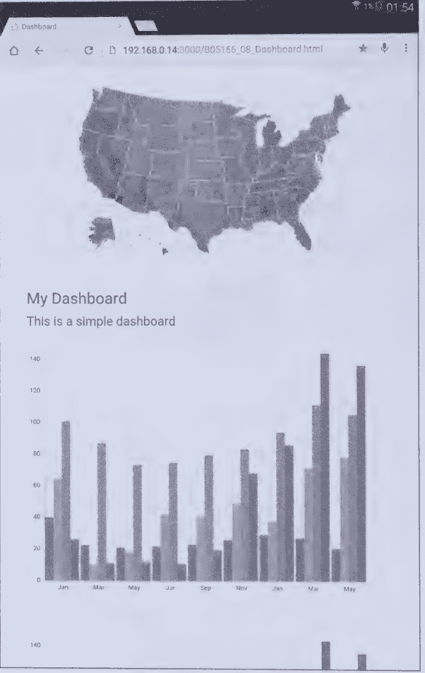
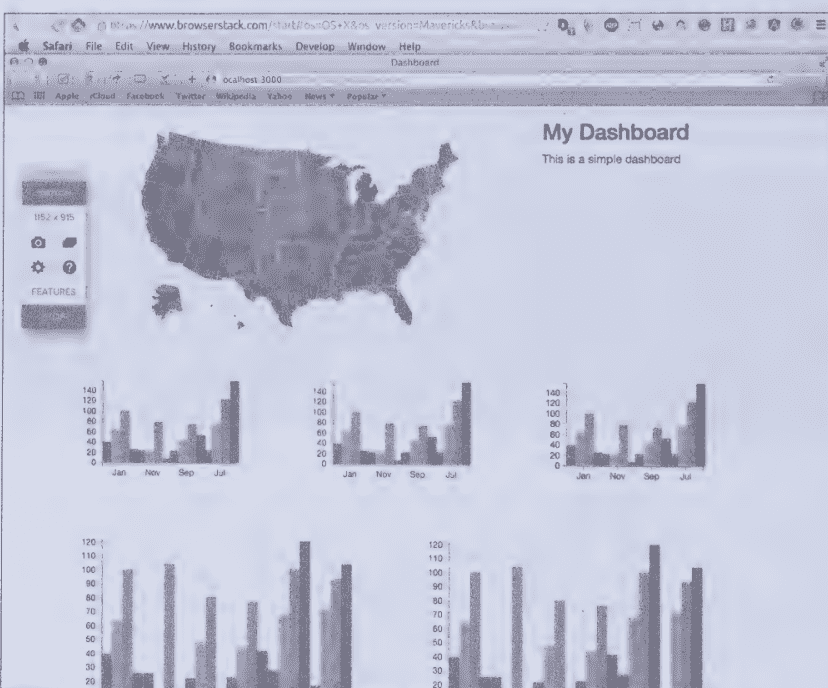
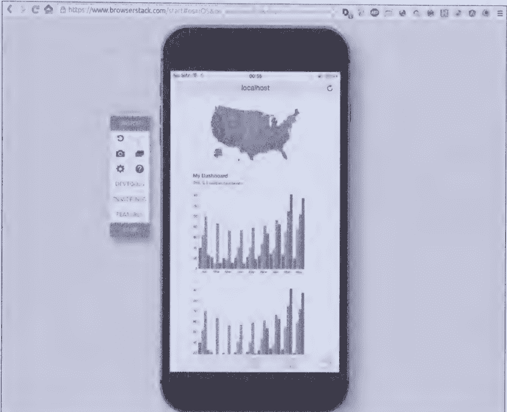
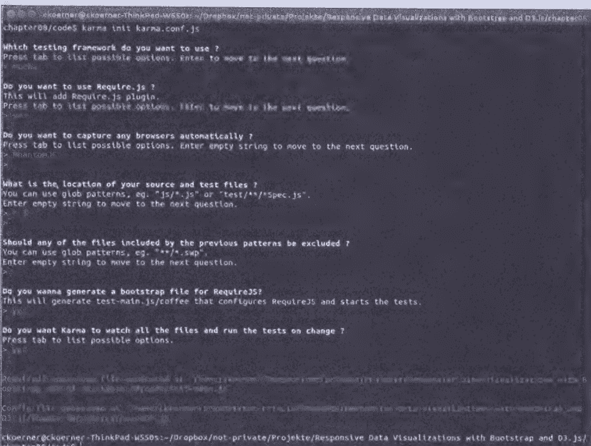
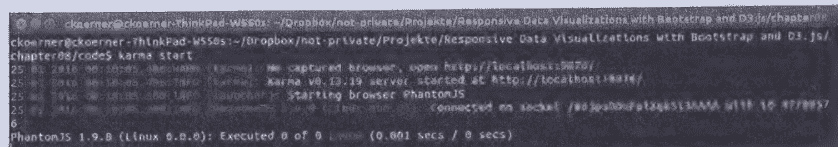
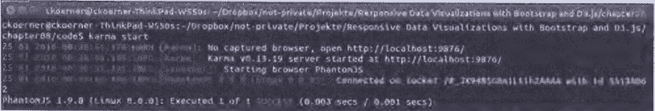
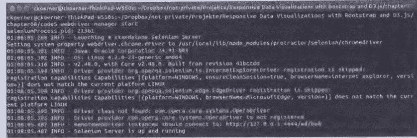

# 测试响应式可视化

在上一章中，您学习了如何使用D3.js、投影和地图创建精彩的地图可视化。现在，是时候研究响应式可视化的测试策略了。在本节中，您将学习以下内容：

- 了解常见的测试策略
- 理解单元测试和集成测试的区别
- 了解可视化中手动测试的重要性
- 了解如何设置手动测试环境
- 设置单元测试和集成测试环境
- 在本地计算机上使用Karma运行单元测试
- 使用TravisCI和Sauce Labs运行集成测试
- 理解不同策略如何协同工作
- 构建符合预算的测试策略

在第一节中，您将了解测试、测试策略和不同类型的测试。您将了解手动测试和自动化测试之间的区别，以及为什么在工作流中拥有出色的手动测试工具至关重要。

在下一节中，我们将更深入地了解这些手动测试和调试工具。我们将了解如何使用Browsersync、Browserstack、设备模式等工具来增强您的本地开发环境。

然后，我们将讨论自动化测试，这是编写可维护代码的重要组成部分。我们不仅将探讨使用Karma进行的本地单元测试，还将探讨使用Protractor、Selenium、Travis CI和Sauce Labs进行的集成测试。

最后，我们将总结当您关心测试和代码质量时，一个出色的开发环境应该是什么样子。

## 测试可视化指南

在本章结束时，您将对响应式可视化的测试策略有清晰的认识；您将了解测试的成本和收益；并且您将能够使用当今可用的最佳工具实施手动和自动化测试。

如果您是软件开发的新手，您可能听说过测试和测试策略，以及许多开发者声称自己痴迷于测试。但是，理解软件开发中的测试驱动开发与手动测试和调试之间的差异，以便比较这些策略的成本和收益，非常重要。如果您已经每天编写测试并对单元测试和集成测试有清晰的策略，您可以跳过本简介并直接跳转到下一节。对于其他人，我向您保证，您将学到一些关于测试的精彩见解和信息，所以请继续！

在测试交互式可视化时，我们身处一个相当困难的领域。一方面，我们编写代码，因此需要确保代码的所有功能都完全按预期工作。另一方面，我们生成的可视化在所有不同设备、操作系统和浏览器中看起来和感觉都应该相同——这只能通过手动评估。目标是结合手动测试和自动化工具的优点，以最大限度地提高生产力和可维护性，并最大限度地减少代码中的错误数量。

> 在本章中，我将提到可能需要付费订阅的工具和服务。我的意图不是向您销售这些服务之一的订阅，而是根据我的经验，介绍用于手动和自动化跨浏览器测试的最佳工具。


## 为什么我应该关心测试？

测试你的代码对于编写出色、无错误且易于维护的软件至关重要。然而，过早编写大量自动化测试会减慢开发速度并影响生产力。因此，我们需要在编写代码、调试和测试之间找到良好的平衡点。

测试极大地提高了代码的可维护性。例如，单元测试可以为开发者提供文档，而且这些文档还可以被执行。每当开发者修改代码或重构代码时，都可以运行测试来查看函数是否仍然按预期工作。这使得代码重构变得更加容易和安全。因此，编写测试对于构建可维护的软件至关重要，并且在维护应用程序时可以节省时间和成本。

测试的目标是确保函数在重构和修改后仍然按预期工作。因此，你的测试应该涵盖所有可能输入参数的组合，并测试所有可能的输出值。通过编写良好的测试，你可以相当确定你的应用程序运行正常。但是，请牢记以下几点：

- 测试永远无法证明没有错误；它只能保证对于给定的测试用例，软件表现符合预期
- 即使你的软件经过非常充分的测试且所有测试都通过，也可能发生错误
- 测试通常在测试环境中进行；请确保你的测试环境尽可能与生产环境相似，尤其是对于集成测试和系统测试

我想强调，开发者应该关注测试质量而非数量。测试质量无法衡量，而数量可以，通过计算实际执行了多少行代码来衡量——这被称为测试覆盖率。如果测试执行了每一个`if`条件，遍历了每一个`for`循环，并到达了每一个`return`语句，那么测试覆盖率为100%。这导致了一个误解：高测试覆盖率（理想情况下为100%）是最重要的目标。

但是，请记住100%的测试覆盖率并不能保证无错误的代码。实际上，它仅仅意味着100%的代码已被执行。它甚至不会告诉我们关于测试质量的任何信息。80%到90%的测试覆盖率配合有意义且良好的测试，应被视为良好的平衡点。

有人可能会问，好的测试与坏的测试相比是什么样子。好的测试是能够发现错误或意外行为的测试（这两者实际上是同一回事）。好的测试试图打破软件，发现意外行为，并测试输入参数的所有可能边界情况。编写测试的人不应该对软件温柔友善，而最好是尝试打破它，因为测试的目的是打破软件。坏的测试仅针对其典型范围内的参数和预期输出来测试软件的行为。

## 测试的不同类型

我已经通过谈论不同的策略让你感到困惑了，所以让我们把它们弄清楚，并看看不同的测试策略。

### 手动测试

当我谈到手动测试时，我的意思是在笔记本电脑或手机上打开应用程序，并在里面随意点击。

如果我们处于软件开发领域，手动测试是绝对不行的。你永远不会依赖手动测试，而总是更喜欢自动化测试，因为它们比手动测试更可靠、可重复且速度快得多。

但是，在UX/UI设计和图形领域，手动测试是快速发现错误的唯一可靠方法——但为什么是这样呢？这是因为在处理图形时，人类更擅长发现视觉错误或交互元素的卡顿。从每个可视化、过渡或动画的开头就编写自动化测试会更加繁琐和耗时。因此，在处理响应式设计或图形时，手动测试你的可视化是开发流程中必要的一个步骤。手动测试有助于快速识别错误并提高生产力。

手动测试响应式应用程序的最简单方法是设置两个Chrome窗口——一个用于测试桌面版本，一个用于测试移动版本（启用移动设备模式）。你始终需要在每个窗口中测试你的应用程序，并在更改时重新加载应用程序。

有人可以通过在本地开发系统中添加Android、iOS或Windows Phone模拟器来增强这种设置；甚至可能在真实硬件上测试应用程序。为了优化手动测试工作流，请向所有设备添加实时重载或浏览器同步功能，以避免在所有设备上手动重新加载。你还可以将云端远程设备农场中的远程设备添加到本地设置中，这样你的应用程序将在某些真实硬件上运行并通过浏览器控制。关于手动测试的部分将帮助你逐步设置这种环境，并详细讨论上述所有选项。

### 自动化测试

当我谈到自动化测试时，我的意思是一个测试脚本，它在没有手动交互的情况下运行多个测试。自动化测试的结果要么是通过（绿色），要么是失败（红色），当_所有测试通过_或_一个（或多个）测试失败_时。理想情况下，人们会在对本地文件进行更改后运行此脚本，以便快速发现功能错误。如果测试脚本很慢，也可以在将更改提交到代码仓库后自动运行它。

在软件开发领域，自动化测试始终是首选的测试方式，因为它是测试代码可靠且可重复的方式。通常，我们将自动化测试分为三种策略：

- 单元测试：测试单个单元（函数），通常称为规格说明书（specs）
- 集成测试：测试单元（多个函数）的集成，通常称为端到端（e2e）测试
- 系统测试：测试整个系统

我们可以得出结论，每种策略都应该在不同阶段和不同约束下应用，这是由于测试设置的复杂性和测试的运行时间。通常，单元测试非常快，可以在源文件每次更改后在本地运行。集成测试和系统测试通常很慢，应该在远程测试环境中运行，例如，在每次提交到源代码仓库后。

可视化中有许多组件可以以自动化的方式进行测试，例如比例尺、映射函数、reducer、元素绘制等，无论是在本地系统还是远程测试环境中。因此，我将在自动化测试部分向你介绍单元测试和集成测试的世界，我们将为可视化组件实现一个典型的自动化测试策略。

在本书中，我们只处理可视化组件；因此，我们将只探讨单元测试和集成测试。它们将在以下部分中描述。

### 半自动化测试

有些测试会自动执行；但是确定它们是否通过或失败无法由程序完成。起初听起来有点可怕，但可以通过一个例子更好地描述。

让我们考虑一个简单的地图可视化。你向可视化添加一个经纬网格，以便用户更容易感知地图中的距离。你的测试脚本生成应用程序的截图，并将其与前一版本的截图进行比较；更准确地说，它计算两张截图之间的绝对差异。这种技术称为**视觉回归测试**。

脚本如何判断网格是故意添加的，还是代码更改导致的错误？它根本无法做到。脚本自动运行；但是，它需要人工交互才能通过测试；这就是我们所谓的半自动化测试。有时，（小的）可视化更改是故意的，有时它们可能由错误引起。无法自动决定哪个更改是预期的。

在良好的数据可视化设置中，我们将生成一组截图，并在开发者每次向源代码仓库提交更改时，向开发者提供带有前一版本绝对差异的图片。为了方便专注于最重要的更改，脚本可以只向开发者显示像素变化超过一定阈值的图片。

### 单元测试

单元测试（或specs）旨在测试代码中最小单元的正确性；因此，它们为代码中所有单元提供了可执行的文档。虽然关于代码中最小单元是什么有争议，但在我看来，最小单元是一个单独的函数。

在数据可视化中，使用函数式方法设计组件是一种好的技术，这样每个函数接收输入、修改它并返回输出。一个好策略是为所有这些函数编写测试。

单元测试只应影响被测试单元的代码，不需要任何其他单元，因此除了被测试单元外，所有内容都应该模拟。模拟是专门为测试创建的对象的副本，（同步）返回预定义结果。让我们想想我们其中一个函数中的`XMLHttpRequest`。我们可以简单地创建一个模拟，为此请求同步返回预定义结果。好处很明显。速度更快，因为我们不需要创建真实的请求。它也是可重复的，并且不依赖于`XHR`的真实结果。

这使我们来到关于单元测试的第二条最重要的陈述：它们应该在源代码每次更改后在本地运行，因此必须非常快速。因此，我们大多数时候在本地开发环境中使用无头浏览器（没有图形）运行单元测试，例如**PhantomJS**。

### 集成测试

集成测试（或e2e）旨在从用户与组件交互的角度测试组件的集成。这意味着它们在真实浏览器中测试多个组件之间的交互，以进行用户交互。


数据可视化的一个好策略是测试每种交互可能性，例如绘制、点击、悬停、缩放、过滤等等。与单元测试相比，我们需要一个真实浏览器（带有鼠标、触摸、滚动等）和多个组件来进行集成测试。因此，测试套件运行速度会比单元测试的慢得多。

一个良好的工作流是在本地开发环境提交更改到仓库之前运行集成测试，以及在开发环境每次向仓库推送更改时都运行。

### 持续集成

如果你有一种设置，其中对仓库的更改会在测试环境中触发测试，我们称之为所谓的 _持续集成_。如果你曾在 Github 上使用过代码，你一定一定注意到某些仓库 Readme 文件上的这些小小的 "Build passing" 徽章。这很可能是来自名为 TravisCI 的服务的构建/测试状态文件，该服务可以与 Github 紧密集成。然而，也有其他提供类似功能和徽章的服务。

除了 TravisCI，还有一个名为 Codeship 的出色持续集成服务。它为你的测试环境提供了更多选项，你甚至可以并行运行测试。

一个良好的数据可视化设置总是使用持续集成。设置起来非常简单，你可以立即查看所有分支的测试状态。

### 测试驱动开发 (TDD)

在过去十年中，TDD 在软件工程师中变得非常流行。这是一种在编写实际代码之前先实现测试的技术。这种方法的目的是在实现函数之前先思考其目的。

TDD 大大提高了代码质量，因为开发人员在实现之前被迫考虑每个函数的确切目的。这对于编写具有明确范围和目的的组件的优秀开发人员来说非常有效。

然而，在数据可视化中，大部分工作是迭代和通过探索完成的；我们添加坐标轴、刻度、颜色，调整尺寸，移动图例，等等。这更像是用代码以编程方式设计图形。我主张，为可视化使用 TDD 是适得其反的，因为你会在尝试可视化时浪费大量时间重写测试。

## 手动测试和调试

让我们从手动测试开始，在开发机器上本地调试响应式应用程序。为此，我创建了一个小型仪表板应用程序，如下面的屏幕截图所示。这张图片是我桌面电脑上 Chrome 窗口的屏幕截图：


带有可视化组件的仪表板应用程序

### 在本地进行测试和调试

在本地运行设备有一个很大的好处：速度非常快，你可以快速看到可视化效果。你可以控制设备；它要么在你手中，要么在你的本地机器上运行。下图显示了典型的本地开发设置：


本地开发设置

### 在 Chrome 桌面浏览器中更改设备模式

快速以不同屏幕分辨率测试应用程序的最快捷、最方便的方法是使用 Chrome 开发者工具中的设备模式设置。你可以先打开开发者工具（按 F12），然后单击左上角的微型手机图标来打开它。在下图中，你可以看到开发者工具带有一个蓝色的小型手机，这意味着设备模式已启用：



Chrome 中的开发者工具

一旦我们激活设备模式，浏览器窗口的背景就会变成灰色网格，并且只显示移动设备典型分辨率中的框架。在下面的屏幕截图中，我们可以看到 iPad 预设的活动设备模式：


带有 iPad 设备模式设置的仪表板应用程序

很容易理解为什么这种测试方式非常优雅；它非常快，我们可以留在本地环境中并使用一直使用的所有调试工具。但是，我们应该意识到，设备模式只调整窗口以适应目标设备的屏幕尺寸和分辨率，但不模拟浏览器。因此，设备模式只能让我们测试不同的屏幕分辨率，而不能测试跨浏览器兼容性。

> 你可以在 Chrome 开发者网站上找到更多关于设备模式的信息，网址为 https://developer.chrome.com/devtools/docs/device-mode。

### 模拟移动设备

接下来，我们可以论证，我们不仅想要模拟目标设备的浏览器屏幕，还要模拟设备本身并使用设备模拟器。那些已经为 Android 或 iOS 开发软件的人可能已经安装了官方模拟器。在系统级别进行模拟可以在测试跨浏览器兼容性时获得更准确的结果，因为模拟了运行目标系统真实移动浏览器的系统架构。

然而，使用模拟器有一些缺点。最重要的是，目前没有办法在不使用虚拟机或双启动的情况下在同一操作系统上安装 Android、iOS 和 Windows 模拟器；其次，使用模拟器极其缓慢。坦白说，我没有测试过最新版本的官方模拟器；但上次我使用它们时，根本太慢，无法日常工作。

启动模拟器需要很多时间，运行它们占用主机 PC 太多资源。但是，如果你的目标平台是例如 Android，并且你已经安装了 Android 环境，那么这可能是一个不错的选择。

> 你可以在 Android 网站上找到更多关于 Android 模拟器的资源，网址为 http://tools.android.com/tech-docs/emulator。如果你使用 Android 并寻找更快的模拟器，应该看看 Genymotion，网址为 https://www.genymotion.com。

### 使用 Browsersync 同步真实设备

我更喜欢在真实设备上测试我的代码，我的办公室里就有：三台 Android 手机、一台 Android 平板电脑和一台 Windows 手机。这些 Android 手机都安装了不同的主要版本的 Android。

在这些设备上打开相同的可视化并进行测试是一件麻烦事。这会花费太多时间。幸运的是，有一个名为 Browsersync 的惊人工具，它可以让你将当前页面同步到所有连接的设备，推送 URL，自动重新加载页面，并镜像点击和滚动。我真的不知道开发人员没有这样的工具怎么能保持高效。

它只需要在你的主机计算机（即你的本地开发桌面机器）上安装，通过从命令行运行以下代码：

```
npm install -g browser-sync
```

这会安装该工具并使 `browser-sync` 命令全局可用。通过运行以下命令，你启动一个开发服务器，该服务器提供目录中的所有静态文件并监控所有 JavaScript 文件的更改：

```
browser-sync start --server --files "*.js"
```

当发生更改时，Browsersync 通过 **Web 套接字** 和热重载将这些更改推送到所有连接的客户端。它适用于所有带有网页浏览器的移动设备，甚至适用于我的旧 Windows Phone。

运行 `start` 命令时，Browsersync 会显示两个不同的域：一个用于连接到开发服务器，另一个用于连接到 Browsersync UI。连接到主机只需使用移动设备打开这个 URL。下面的屏幕截图显示了使用 Android 手机打开的仪表板应用程序：



Android 手机上的仪表板应用程序


你实际上在图片中看不到，但当在应用程序中滚动时，所有连接的设备也会滚动到相同的位置。下面的截图显示了在 Android 平板电脑上运行的同一应用程序：



Android 平板电脑上的仪表板应用程序

如果你有几台备用的目标设备，使用 Browsersync 是在真实设备上快速测试可视化效果的一种非常方便的方法。

> 你可以在 https://www.browsersync.io/ 网站上找到更多有关 Browsersync 的信息。

## 远程调试响应式应用程序

如果你买不起真实设备，也不想在本地机器上运行模拟器，也可以决定从云端设备实验室访问你想要的所有设备。这结合了快速访问、低成本和丰富的设备类型：


如果你在测试 Web 应用程序，应该试试浏览器设备实验室 Browserstack。它让你直接在自己的浏览器中访问大量不同的浏览器和设备。在 Automate 模式下运行测试稍显昂贵，但在所谓的 live 模式下使用却非常出色。这让你可以通过本地浏览器运行并控制设备上的浏览器（参见下面的截图，显示 Safari 运行在 Mac 上并通过 Ubuntu 控制）。

结合前面讨论的 Browsersync，你还可以像下图所示，使用运行在 Mac 上的 Safari 浏览器实例打开本地 URL。请记住，打开本地 URL 需要一个额外的浏览器插件来通过本地网络隧道传输流量。不过，这给你提供了与之前完全相同的功能：URL 推送、点击镜像、自动重新加载等等。它与大量远程设备、操作系统和浏览器结合在一起，是一种致命的组合。



运行在 Mavericks 上的最新版 Safari

在下一个截图中，你可以看到 iPhone 6 Plus 上运行的 iOS 浏览器，它同样通过运行在 Ubuntu 上的 Chromium 浏览器进行控制。在不同设备上进行测试和调试非常简单。你甚至可以在远程设备上打开开发者工具。这对于移动设备尤其方便，因为通常你无法轻松打开开发者工具并调试应用程序。



运行在 iPhone 6 Plus 上的最新版 Safari

在 Browserstack 上进行测试和调试并不便宜，但这对每个开发者来说都是一大好处。能够直接且立即访问大量不同的浏览器和设备令人难以置信。你可以通过本地网络隧道并访问本地开发服务器，这一点简直太棒了。

> 你可以在 Browserstack 网站 https://www.browserstack.com/local-testing 上找到更多有关 Browserstack 和本地测试的信息。

## 半自动化可视化回归测试

不幸的是，由于测试和结果的歧义性与可定制性，目前尚无通用的可视化回归测试策略。要建立一个使用 GitHub 和 TravisCI 的优秀工作流，需要进行一些手动脚本编写和调整。

如果你想将其纳入工作流，我建议研究一下 PhantomCSS 和 BackstopJS（基于 Phantom 的一层抽象）。这些工具可以轻松集成到你的测试策略中，以从可视化的先前版本创建回归图像。

## 自动化测试与持续集成

如前所述，在许多情况下，我们都可以并且应该为响应式可视化运行测试。在任何可以编写自动化测试的情况下，我们都更倾向于使用自动化测试而不是手动测试。我们偏好自动化测试的原因很简单：为了使其可重复。

一旦拥有自动化测试，我们就可以在每次将更改推送到仓库时运行它们。如果它们足够快，我们甚至可以在每次对本地源文件进行更改时运行它们。这能立即反馈代码的功能性，并提供快速反馈。调试更容易，识别和查找 bug 也更容易，这会自动让你更高效，使开发更有效。

## 在本地机器上运行测试

最后，我们可以开始编写一些测试并自动运行它们。我们将从单元测试开始，之后再讨论集成测试。

## 使用 Karma 运行单元测试

作为编写和运行单元测试的第一个工具，我们需要一个可以收集所有测试、设置测试环境并在 Web 浏览器实例中启动测试的工具。这些就是所谓测试运行器的任务。在本书中，我们将使用由 Angular 团队开发的 Karma 测试运行器。

Karma 非常易于配置和使用，并且可以很好地集成到你的 Gulp 和 Grunt 构建配置中。可以通过以下命令安装：

```
npm install karma --save-dev
```

该命令还会将 Karma 添加到当前的开发依赖项中。安装 Karma 后，可以使用以下命令设置配置：

```
karma init karma.conf.js
```

在本书中，我选择了名为 Mocha 的测试框架、Require.js 和名为 PhantomJS 的浏览器来运行测试；你将得到类似下图的输出：



## 安装和配置 Karma

请确保通过运行以下命令安装了 Mocha、Chai、Require.js 和 PhantomJS：

```
npm install phantomjs mocha chai karma-chai requirejs --save-dev
```

最后，我们可以将 `chai` 和 `app.js` 添加到我们的 JavaScript 代码的配置中（你可以查看源代码），并通过命令行运行以下命令启动 Karma：

```
karma start
```

如果我们正确配置了 Karma，它将启动一个 PhantomJS 实例并运行所有测试。但是，如果我们还没有任何测试，将会出现如下图所示的 `in` 错误。太好了，现在是编写我们的第一个单元测试的时候了：



运行 Karma

我们有一个很不错的小函数，可以为我们展平嵌套数组。这是 app.spec.js 单元测试的一个完美示例；让我们编写一个简单的测试：

```javascript
var expect = chai.expect;

describe('app', function() {
  describe('#flatten()', function () {
    it('should flatten a nested array', function () {
      var nestedArray = [['foo'], ['bar']];

      var computed = flatten(nestedArray);
      var expected = ['foo', 'bar'];

      expect(computed).to.eql(expected);
    });
  });
});
```

在前面的代码中，我们将组件的所有测试都包装在 describe 块中。在这个块内部，我们将 flatten 函数的所有测试都包装在 describe 块中。最后，我们编写第一个测试来针对标准用例进行测试。

编写优秀且富有表现力的测试有很多方法和断言库；不过，我发现将所有测试都减少到绝对最小非常有用。首先，我们为 nestedArray 变量开始一个初始化阶段。接着，我们进入转换阶段，使用待测函数转换输入。我总是将输出存储在 computed 变量中。最后，我使用 expected 变量声明预期值。然后，我使用 expect(computed).to.eql(expected) 或 expect(computed).to.equal(expected)。前者测试元素级相等性，后者测试类型相等性。

如下图所示，测试通过，Karma 显示绿色的 SUCCESS 状态：



在 Karma 中通过所有测试

现在是回到测试并使其失败的好时机。如果在空数组上调用该函数会发生什么？如果数组嵌套很深呢？你已经能看出我们要往哪里走；我们的目标是破坏代码。

> 关于 Karma 测试运行器及其配置的更多信息，可以在 GitHub 上找到 https://karma-runner.github.io/。关于 Mocha 测试框架的更多信息，可以在 Mocha 网站 https://mochajs.org/ 上找到。如果你想了解更多有关 Chai 断言库的信息，请查看 http://chaijs.com/。

## 使用 Protractor 和 Selenium 进行集成测试

集成测试要求待测系统中的所有组件都能像用户正在与组件交互一样工作。因此，我们需要使用一个不同的测试运行器，它能够启动、停止和连接到浏览器，打开 URL，处理异步代码，并提取有关元素的信息。

在本书中，我们还将使用 AngularJS 团队的集成测试工具：Protractor。它基于 Webdriver 和 Selenium，因此在与不同浏览器和实例交互时非常强大。

我们可以通过在命令行中运行以下命令来安装 Protractor：

```
npm install -g protractor
```

安装 Protractor 后，我们还需要安装 Webdriver。可以通过运行以下命令来完成：

```
webdriver-manager update
```


使用 Protractor 运行集成测试时，我们总是需要事先运行 Webdriver。因此可以通过以下方式启动它：

```
webdriver-manager start
```

如果一切安装正确，您将看到类似下图的输出：



后台运行的 Selenium

现在，我们可以创建一个名为 protractor.conf.js 的简单配置文件和第一个测试 app.e2e.js。查看源代码以获取正确的设置：

```
describe('dashboard', function() {
beforeEach(function() {
// Don't wait for Angular
return browser.ignoreSynchronization = true;
});

it('load choropleths', function() {
browser.get('B05166_08_Dashboard.html');

var maps = element.all(by.css('.choropleth'));

var result = maps.count();
var expected = 1;

expect(result).toEqual(expected);
});
});
```

在前面的代码中，我们再次将所有测试包装在 describe 块中。然后，我们添加一小段代码来告诉 Protractor 不要等待 AngularJS。最后，我们编写一个访问 Browsersync 开发服务器的测试。如果我们启动测试，它将运行并希望像下图一样没有错误地完成：

```
ckoeerner@koerner-ThinkPad-W550s:~/Dropbox/msc-private/Projekte/Responsive Data Visualizations with Bootstrap and D3.js/chapter09/codes$ protractor protractor-conf.js
[11:27:24] I/direct - Using the selenium server at http://localhost:4444/wd/hub
[launcher] Running 1 instances of WebDriver
Started
..
1 spec, 0 failures
Finished in 1.605 seconds
[launcher] 0 instance(s) of WebDriver still running
[launcher] chrome #01 passed
ckoeerner@koerner-ThinkPad-W550s:~/Dropbox/msc-private/Projekte/Responsive Data Visualizations with Bootstrap and D3.js/chapter09/codes$
```

Protractor 中所有测试均通过

现在是创建包含单个可视化组件以及该组件测试的集成测试文件的好时机。尝试添加滚动、悬停和点击来打破可视化。

> 可以在 Angular 网站 https://angular.github.io/protractor 上找到有关 Protractor、其配置和 API 的更多信息。

## 在云中运行您的测试

现在进入高级部分；您可以编写一个脚本，通过 TravisCI 在每次推送时运行完整的集成测试。查看 https://docs.travis-ci.com/user/languages/javascript-with-nodejs 中的步骤，以开始使用 Travis 和 JavaScript。

但是，您不需要在 Travis 的虚拟机中运行浏览器，可以添加诸如 Browserstack 之类的服务，在云中使用多种设备和分辨率运行测试。

我想提到另一个很棒的自动化设备测试服务，它是 Browserstack 的绝佳替代品，并且对开源项目免费——Sauce Labs。

> 可以在 Sauce Labs 的网站 https://saucelabs.com/ 上找到更多信息。

## 可视化的测试策略

现在，我们有足够的信息来为响应式可视化构建一个稳固的测试策略。请注意，这是基于我个人经验的一个非常主观的设置，请随意用您喜欢的层或工具替换任何部分。但是，请为您的工作流程保留总体思路。

首先，开发时我们将使用台式机上的 Chrome 浏览器。我们既可以使用普通的桌面窗口，也可以在设备模式下切换到移动视图。这取决于目标屏幕大小和分辨率。个人而言，我更喜欢在桌面 Chrome 中工作，并在移动设备上调试和测试。

开发期间，我们需要定期进行一些手动测试，以确保可视化看起来和感觉良好。在本地为不同操作系统运行模拟器很麻烦；这就是为什么我更喜欢通过 Browsersync 将真实的移动手机和平板电脑同步到当前的 Chrome 窗口。如果您无法访问真实设备，也可以在本地项目中使用 Browserstack。

对于单元测试，在开始进行更改之前，我们需要启动一个 Karma 单元运行器。它将监视源文件的更改，启动 PhantomJS 实例，并在保存文件时运行完整的测试套件。

一旦我们将提交推送到 GitHub，TravisCI 就会在本地自动运行所有单元测试，并使用 Sauce Labs 在不同的移动设备上运行集成测试。这还将为视觉回归测试创建不同的图像，并将其显示给开发人员。

最后，当所有测试都通过且开发人员接受视觉回归的不同图像时，功能或修复可以合并到 master 分支中。

## 总结

本章对不同测试策略用于测试响应式可视化组件提供了扎实的概述。在第一部分，我们讨论了测试策略、测试的成本和收益以及本地、远程、手动和自动测试之间的区别。

然后，我们将了解不同的测试策略以及如何将它们实现为可视化。我们涵盖了使用 Browsersync 和 Browserstack 进行的手动测试，以及使用 TravisCI、Karma、Protractor 和 Selenium 进行的自动化测试。最后，我们将为可视化组件构建完美的测试策略。

在下一章中，您将学习在创建 SVG 中的响应式可视化时检测和解决跨浏览器问题。
