# 解决跨浏览器问题

在上一章中，您了解了在不同浏览器中测试自定义响应式可视化的所有内容。我们必须这样做，因为在不同的设备、操作系统和浏览器中，我们的应用程序的外观和功能可能会有所不同。在本章中，我们将解决这些跨浏览器问题。您将学习以下内容：

- 了解跨浏览器兼容可视化的主要挑战
- 使用 Modernizr 检测用户浏览器的功能支持
- 了解 Polyfills、Shims 和 Wrappers
- 了解 D3 的兼容性
- 实现跨浏览器响应式设计
- 了解 matchMedia polyfill
- 使用 Respond.js 对 min-width 和 max-width 进行 Polyfill
- 使用 Enquire.js 在 JavaScript 中实现媒体查询
- 了解 SVG 功能的兼容性
- 了解鼠标和触摸事件的兼容性
- 了解触摸事件的执行链
- 构建触摸友好的可视化

首先，我们将研究常见的跨浏览器兼容性问题并找到解决方法。从针对 Internet Explorer 的简单条件注释开始，我们将逐步深入到使用 Modernizr 在 JavaScript 和 CSS 中进行复杂的功能检测。您将了解解决跨浏览器问题的常见概念，例如 Polyfills、Shims 和 Wrappers。

在第二部分，您将了解跨浏览器兼容的媒体查询并理解 CSS polyfill 的问题。然后，我们将使用 Respond.js（一个 min-width max-width polyfill）和 Enquire.js（一个用于在 JavaScript 中组织媒体查询的库）来研究此问题的不同解决方案。

接下来，我们将查看不包含在 1.1 规范中的特殊 SVG 功能的支持，例如动画、滤镜和裁剪路径。

在最后一部分，您将学习如何在同时支持鼠标和触摸输入的设备上正确处理触摸和鼠标输入。我们将看到一些常见的陷阱、触摸事件，以及如何为您的应用程序同时支持触摸和鼠标事件。

## 跨浏览器兼容性问题的解决方案

开发 Web 应用程序的真正挑战不在于实现很棒的功能、动画或过渡效果，而在于为所有目标设备、操作系统和浏览器提供一流的用户体验和兼容性。在本章中，我们将尝试解决最常见的兼容性问题，并使您的可视化跨浏览器兼容。

### 针对 Internet Explorer 的条件注释

解决兼容性问题的每个 Web 开发人员工具箱中一个很棒的工具是 HTML 的条件注释。这些是可以包含有效 HTML 代码的 HTML 注释，由 Internet Explorer 解释和执行。等等，一个仅在 Internet Explorer 中可用的酷功能？嗯，事实证明，这些条件 HTML 注释在现代 Web 浏览器中不是必需的，因为这些浏览器更愿意实现适当的标准而不是专有功能。

因此，条件注释是针对 Internet Explorer 的迷茫开发人员根据浏览器版本加载资源的绝佳方式。让我们看一个简单的示例，我们仅为版本小于或等于 9 的 Internet Explorer 加载兼容性脚本：

```
<!doctype HTML>
<html>
<head>
	<title>Conditional Comments</title>
	<!--[if lte IE 9]>
	<script src="compatibility_script.js"></script>
	<![ENDIF]-->
```


<script src="some_script.js"></script>
</head>
<body>
</body>
</html>

在前面的示例中，我们可以看到 `<!--[if lte IE 9]>...<![endif]-->` 表示一个有效的 HTML 注释，它在 Internet Explorer 中会转换为条件 HTML 节点。

该语法仅允许 `<!--[if ... ]>` 和 `<![endif]-->` 关键字以及少量表达式、条件和运算符。以下运算符可用于识别浏览器版本：

- ! 非运算符，例如，[if !IE]
- lt 小于运算符，例如，[if lt IE 5.5]
- lte 小于或等于运算符，例如，[if lte IE 6]
- gt 大于运算符，例如，[if gt IE 5]
- gte 大于或等于运算符，例如，[if gte IE 7]
- ( ) 子表达式运算符，例如，[if !(IE 7)]
- & 和运算符，例如，[(gt IE 5)&(lt IE 7)]
- | 或运算符，例如，[(IE 6)|(IE 7)]

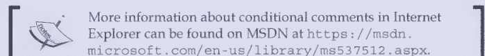

## 使用 Modernizr 检测原生功能

设计响应式应用程序的关键挑战是将应用程序正确地适配到用户设备的外形因素（屏幕尺寸和分辨率）。了解外形因素并利用原生工具（例如媒体查询）有助于创建非常响应式的应用程序。只要原生实现可用，我们就希望使用它们；只要可以使用 CSS 而不是 JavaScript 来实现某个功能，我们就希望这样做以获得重要的性能提升。因此，如果我们希望不仅支持最新的浏览器，就需要能够检测原生功能是否可用。

有人可能会问，如何在用户的浏览器上检测某个特定功能。一种简单的方法是检查 API 是否可用，这与以下示例类似。我们检查名为 Array.prototype.every 的原生函数是否可用：

```
if ('every' in Array.prototype) {
    console.log('Array.prototype.every is available');
}
```

前面的代码可以轻松地推广到针对不同对象和 API 函数进行测试。但是，如果我们想知道浏览器中是否可用 in 关键字呢？或者是否支持箭头函数呢？这的工作方式略有不同；我们必须在 try-catch 块中计算表达式。以下是测试当前是否可用箭头函数的示例：

```
function hasArrow() {
    try {
        eval('() =>{}');
    } catch (err) {
        return false;
    }
    return true;
}
```

使用此技术，我们可以将其扩展到大量不同的功能和 API，并检查这些功能是否可用。但是，我们非常懒惰，不想全部实现它们。幸运的是，有一个名为 Modernizr 的优秀库可以为我们完成所有这些工作，并额外提供一种易于使用的基于类的方法来在 CSS 中进行功能检测。

首先，我们将安装 Modernizr；然而，这并非一个简单的过程。没有全局的 Modernizr.js 文件可让您检查目标浏览器中可用的每个功能。此外，您必须自己构建（精简版）Modernizr。听起来复杂，但实际并非如此。首先，使用 npm 通过以下命令全局安装 Modernizr（您可能需要 sudo 权限）：

```
npm install -g modernizr
```

现在，我们可以创建 modernizr-config.json 文件，用于存储项目的 Modernizr 配置。我们为 SVG 功能设置了配置文件；不过，随时可以向配置中添加更多功能（通过链接 https://modernizr.com/download 查看可用选项，并单击 BUILD 创建配置文件。

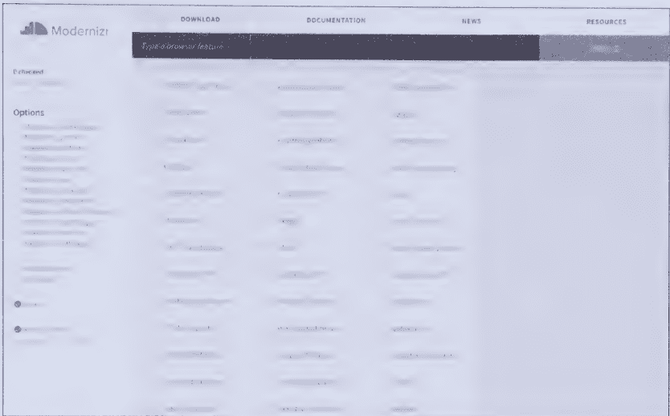

Modernizr 网站

我们为基本的 Canvas 和 SVG 支持以及其他 SVG 功能创建配置文件：

```
{
    "minify": true,
    "options": [
        "setClasses"
    ],
    "feature-detects": [
        "test/canvas",
        "test/svg",
        "test/svg/asimg",
        "test/svg/clippaths",
        "test/svg/filters",
        "test/svg/foreignobject",
        "test/svg/inline",
        "test/svg/smil"
    ]
}
```

最后，我们可以使用以下命令构建自定义的 Modernizr 功能检测脚本：

```
modernizr -c modernizr-config.json
```

您也可以使用 -d scripts/modernizr.min.js 标志将 Modernizr 脚本的安装目标更改到 scripts 文件夹。让我们创建一个包含此脚本的 HTML 文档：

```
<!DOCTYPE HTML>
<html>
<head>
    <title>Feature Detection using Modernizr</title>
    <script src="scripts/modernizr.min.js"></script>
</head>
<body>

<script>
/* here we go */</script>

</body>
</html>
```

前面的代码展示了如何将 Modernizr 脚本包含到页面中。请注意，除了使用 Modernizr 的命令行工具和配置文件外，您还可以为喜欢的任务运行器（例如 Gulp 或 Grunt）使用插件，或者直接从 Modernizr 网站下载自定义构建版本。

## 在 JavaScript 中使用 Modernizr

让我们尝试 Modernizr 的 JavaScript API；它将所有可用功能直接作为属性暴露在全局 Modernizr 对象上。检查 SMIL 支持就像以下代码片段一样简单：

```
if (Modernizr.smil) {
    console.log('SMIL is available');
}
```

太棒了；我们现在可以轻松地在 JavaScript 中检查所有功能是否可用，并轻松地将应用程序和功能适配到用户的目标浏览器。

> 可用功能的完整列表在 Modernizr 网站上提供，网址为 https://modernizr.com/docs/#features。

## 在 CSS 中使用 Modernizr

在 JavaScript 中使用 Modernizr 非常适合根据目标浏览器的功能调整函数和脚本。但是，当我们处理的是 HTML 元素而非 JavaScript 时，我们可能希望使用 CSS 类根据浏览器的可用功能来显示和隐藏 DOM 元素。

在前面的示例中，我们向配置文件添加了一个名为 setClasses 的选项。该选项会为每个受支持和不受支持的功能向 HTML 根节点添加类。我们可以通过查看以下图中显示的演示页面的 DOM 树来观察这一点：

```
<html class="canvas svg svgasimg svgclippaths svgfilters svgforeignobject inlinesvg smil">
<head></head>
<body>
<script></script>
</body>
</html>
```

使用 Modernizr 的网站的 DOM 树

在前面的示例中，我们只看到了根 HTML 节点上命名为受支持功能的类。不受支持的功能会导致带有名为 no- 前缀的类，例如 no-canvas、no-svg 等等。现在，我们可以向可视化添加 CSS 样式，以显示和使用可用功能或隐藏不受支持的功能：

```
.no-svg .chart {
  display: none;
}

.no-svg .sorry-for-not-using-a-modern-browser {
  display: block;
}
```

在前面的片段中，我们从页面中删除图表，并向用户显示一条错误消息，要求其更新到现代浏览器。但是，通常我们并不想简单地为不兼容浏览器的用户禁用某个功能。此外，我们希望将缺失的功能添加到用户的浏览器中，以便他/她可以获得类似于使用最新浏览器的用户体验。请在以下部分中了解更多相关信息。

我们将更频繁地使用 Modernizr 基于类的功能检测来为应用程序设置样式，而不仅仅是检测 SVG 或 Canvas 支持。想想这样一个场景：您想使用 CSS3 动画为可视化的某些部分添加动画。优势显而易见：您将拥有 CSS 中原生动画的功能，而不是在 JavaScript 中使用手动计时器和 DOM 转换。

因此，我们可以在配置文件中包含 CSS3 特定的动画选项，例如 `cssanimations`、`csstransforms`、`csstransforms3d`、`preserve3d` 等，并检查这些功能的可用性。现在，我们可以在 CSS 中创建原生动画，并在不支持 CSS 过渡时创建回退解决方案：

```
@keyframes fadeIn {
    from {opacity: 0.0;}
    to {opacity: 1.0;}
}
```

```
.cssanimations .chart {
    animation-name: fadeIn;
    animation-duration: 4s;
}
```

作为 JavaScript 回退解决方案，我们添加以下脚本：

```
<script>
d3.selectAll('.no-cssanimations .chart')
    .transition()
    .duration(4000)
    .style('opacity', 1.0);
</script>
```

当然，我们也可以使用略显更明确的 Modernizr JavaScript 语法：

```
<script>
if (!Modernizr.csstransitions) {
    d3.selectAll('.chart')
    .transition()
    .duration(4000)
    .style('opacity', 1.0);
}
</script>
```

现在，我们可以通过适配目标浏览器的功能，为可视化在用户体验、兼容性和性能之间提供一种折中方案。请注意，这种折中方案是有代价的——应用程序中存在多个冗余代码片段，需要进行测试和维护。

## 原生功能的自定义实现

如果目标平台或设备上不可用原生功能，开发者有三种选择：

- 删除使用原生功能的那段代码


- 放弃对不支持原生功能的浏览器的支持
- 使用原生功能的自定义实现

完全不使用该功能显而易见，并且大多数情况下不是首选方式。开发人员希望利用现代浏览器及其功能来提供更好的性能和最佳功能。

仅因为缺少一小段原生代码就排除某些浏览器也是令人沮丧的。别误会，我不是在说支持 IE7。新的原生功能通常首先以前缀（例如 moz、webkit、ms 等）形式在某个 JavaScript 引擎中出现，然后才在所有现代浏览器中无前缀提供。这个过程通常需要几年时间，并且不能保证所有功能都会在所有引擎中实现。

## Polyfill – 实现缺失的功能

我们希望在包含原生功能的同时，不破坏应用程序对旧版浏览器和不同 JavaScript 引擎的向后兼容性。可以通过在 JavaScript 中自己实现原生功能，并在原生功能不可用时将其用作回退解决方案来实现——这也就是所谓的 Polyfill。

需要注意的是，当然，用 JavaScript 对不同原生功能进行 Polyfill 存在很大差异。通过实现 forEach、indexOf、map 等数组方法来提供 ECMAScript 5 兼容性的 Polyfill，比为完整的 SVG 1.1 规范或 CSS Media Query 规范编写 Polyfill 要容易得多。

Polyfill 通常是一个函数，用于为不支持该功能的 JavaScript 引擎实现原生功能。如果我们谈论支持整个 API（如前面提到的 SVG 或 Media Query 规范），我们通常谈论的是抽象层而不是 Polyfill。下面是一个示例（略微过时）：Internet Explorer 8 及更低版本不支持 SVG 规范，而支持其自己的矢量标记语言（VML）。要在这些浏览器中使用矢量图形，必须使用一个抽象层，该层提供一致的 API，并根据用户的浏览器生成 SVG 或 VML；RaphaëlJS 就是 SVG 的此类抽象层。

> 可以在 Github 上的 Modernizr 项目 WIKI 中找到流行 Polyfill 列表，网址为 https://github.com/Modernizr/Modernizr/wiki/HTML5-Cross-Browser-Polyfills。

## Shims – 拦截 API 调用

如果您在互联网上查找关于跨浏览器兼容性的资源，将会遇到许多不同的术语，它们都以类似的方式使用。Shim 是这些术语之一，常与 Polyfill 一起使用。

Shim 是一段代码的通用表达，用于拦截原生 API 调用（例如函数），以提供该函数的修改后行为。这种行为范围从实现函数、修改参数列表和调整返回值，到您所能想到的任何内容。因此，Polyfill 是实现旧版浏览器缺失功能的 Shim。

## Wrappers – 抽象 API

我需要再次为提及 IE8 而道歉——当 SVG 变得重要时，这个话题非常流行。为 IE8 对 SVG API 进行 Polyfill 简直是疯狂，并且经常会导致不兼容。因此，在两个 API 之上实现一个 Wrapper 要好得多。

Wrapper 抽象了 API（例如 SVG）的行为，并为开发者提供更高级别的 API。目标是能够更改 Wrapper 的底层技术，例如输出 VML 而不是 SVG，从而在不修改开发者 API 的情况下创建跨浏览器矢量图形。

## D3 的兼容性

有人可能会问 D3 作为库的兼容性如何；然而，这个问题没有简单的答案。D3 是一个用于 DOM 转换的库，旨在使用 CSS、HTML 和 SVG 等底层技术。它只是一个支持框架，让您访问原生 API 和功能。当然，用户不必在 D3 中使用 SVG，也可以同样使用 Canvas。用户可以只使用地图投影、事件系统或缩放。因此，在谈论 D3 的跨浏览器兼容性时，我们必须更加概括。

> D3 的许多内部功能（例如缩放、计时器、颜色、插值等）可作为额外的包在 Github 上获得，网址为 `https://github.com/d3`。当您只需要应用程序中 D3 功能的某个部分时，这非常方便。

如果您使用 D3，必须检查应用程序中使用的底层技术的兼容性。如果使用 D3 操作 SVG，必须检查 SVG 兼容性；如果使用 SMIL，则检查 SMIL 兼容性；如果使用 Canvas，以此类推。您应该明白我的意思。

如果您只想使用 D3 的单个部分，并且对内部核心的兼容性感到好奇，那么必须检查 ES5 数组函数的兼容性。下面的截图显示了 ES5 的一般跨浏览器支持。可以看出，IE8 是问题制造者：

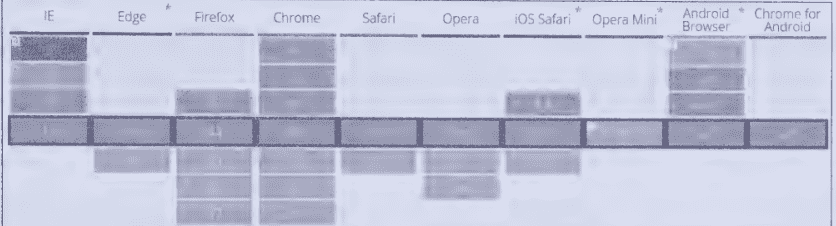

ES5 的跨浏览器兼容性（来源：http://caniuse.com/#feat=es5）

在 IE8 和 IE7（老天保佑！）中使用 D3 功能推荐的 Polyfill 是 `Aight` 库，它主要包含 ES5 数组函数和 API。该库可通过 `https://github.com/shawnbot/aight` 在 Github 上找到。

## 跨浏览器 Media Queries

在创建跨浏览器响应式可视化时，很可能需要处理 Media Query 的支持、度量和单位问题。后两者可以使用 Modernizr（`cssvhunit`、`cssvmaxunit`、`cssvminunit`、`cssvwunit` 等）和回退解决方案轻松检测和修复。

但是，在 Media Query 支持不可用时修复它相当棘手。为什么呢？如果检测 Media Queries 的可用性很简单（使用 Modernizr），那么对其进行 Polyfill 则非常麻烦。主要原因是 Media Queries 通常出现在 CSS 样式中，而不是 JavaScript 代码中。到目前为止，您只了解到 JavaScript 函数和 API 可以使用 JavaScript 进行 Polyfill。因此，如果我们想要 CSS 的 Polyfill（必须用 JavaScript 编写），则必须始终解析完整的 CSS 文档以扩展其功能。这意味着，我们不能依靠原生样式性能，而必须使用 JavaScript 解析 CSS，应用所有已知样式，并修复新选择器、属性、样式等，然后再应用它们。这通常会导致次优解决方案（性能方面）。

## Window.matchMedia() 及其 Polyfill

CSS Media Queries 的 JavaScript 对应物是 window.matchMedia() 函数。如果该函数可用，则支持 CSS Media Queries；如果不可用，我们必须为该函数提供 Polyfill，并使用 JavaScript Polyfill 修复 CSS 样式。

在下面的截图中，可以看到不同浏览器中 matchMedia 函数的支持情况。可以识别出导致问题的 IE9 和 Opera Mini 8。因此，如果应用程序支持这两个版本，则需要包含 matchMedia 的 Polyfill。

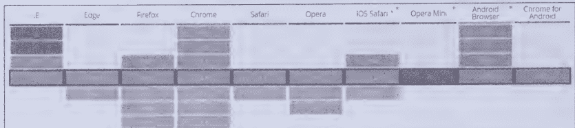

matchMedia 的跨浏览器兼容性（来源：http://caniuse.com/#feat=matchmedia）

可以通过下载最新源代码或使用 bower 包管理器并从终端运行以下命令来安装 matchMedia Polyfill：

```
bower install matchmedia
```

让我们回顾第 1 章（使用响应式设计、Bootstrap 和 D3.js 入门）中的以下示例。使用 matchMedia 函数，可以在 JavaScript 中仅对某些设备类型应用代码：

```
if (matchMedia('screen and (max-width: 480px)').matches) {
    // user is on a smartphone
}
```

但是，当我们查看样式表时，通常会找到以 CSS 编写的样式，例如以下代码片段：

```
@media screen and (max-width: 480px) {
    body {
        /* user is on a smartphone */
    }
}
```

如前一章所发现的，现在需要使用 matchMedia Polyfill 将 Media Query 功能添加到 CSS 样式中。以下部分将完全做到这一点。


## Min-width 和 max-width 支持（通过 Respond.js）

我们知道如何为 CSS 填充 Media Queries 的 polyfill；我们需要使用 JavaScript 加载 CSS 样式，解析它们，找到 Queries，将它们通过 matchMedia polyfill 传递，然后相应地为所有受影响的 DOM 元素应用样式。这就是 Respond.js 库所做的，但仅针对 min-width 和 max-width 查询，这些查询被视为响应式应用的最低限度功能集。Respond.js 由 Scott Jehl 编写和维护，可在 Github 上找到 https://github.com/scottjehl/Respond。以下是 Respond.js 测试运行器的截图，它可以在任何浏览器中运行并测试功能：

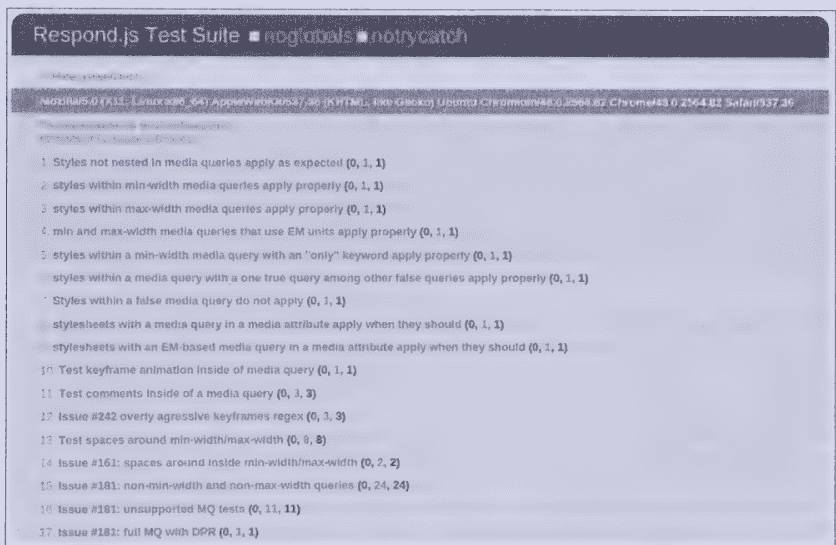

浏览器中的 Respond.js 测试套件

您可以通过下载最新源代码或使用 bower 包管理器来安装 Respond.js，并在终端中运行以下命令：

```
bower install respond
```

## 使用 Enquire.js 在 JavaScript 中实现 Media Queries

太棒了！现在，我们可以设置 Respond.js 来自动 polyfill Media Queries（伴随所有性能限制）。我们只需在所有包含的样式之后引入 Respond.js；它不会查找内联、导入或在其引入后链接的样式。以下是使用 Respond.js 的最小布局示例：

```
<!doctype HTML>
<html>
<head>
<title>Media Queries using Respond.js</title>
<link rel="stylesheet" href="styles/responsive.css">
<!--[if lte IE 9]>
<script src="bower_components/respond/dest/respond.min.js"></script>
<![endif]-->
</head>
<body>

</body>
</html>
```

在前面的代码中，我们将 Respond.js 包装在条件 HTML 注释中，以便仅在版本小于或等于 9 的 Internet Explorer 中加载。这不会影响所有其他浏览器中的代码，并且仅为 Internet Explorer 加载 polyfill。

使用 Media Queries 是根据目标浏览器的分辨率定义响应式应用尺寸的好方法。但是，每当我们想要提供跨浏览器兼容性时，CSS 文件必须通过 JavaScript 重新加载和解析。与其进行这种繁琐的资源重新加载，不如将响应式样式直接移动到 JavaScript 中。

当我们在 JavaScript 中实现响应式样式时，我们需要在 Media Query 匹配时运行函数，并在不同 Query 匹配时运行清理函数。因此，我们希望有一个舒适的解决方案来完成此操作，而不是直接使用原生 matchMedia 查询。Nick Williams 的 Enquire.js 库提供了这样一个接口，用于注册 Media Queries、回调函数和清理函数。源代码可在 Github 上找到 https://github.com/WickyNilliams/enquire.js。

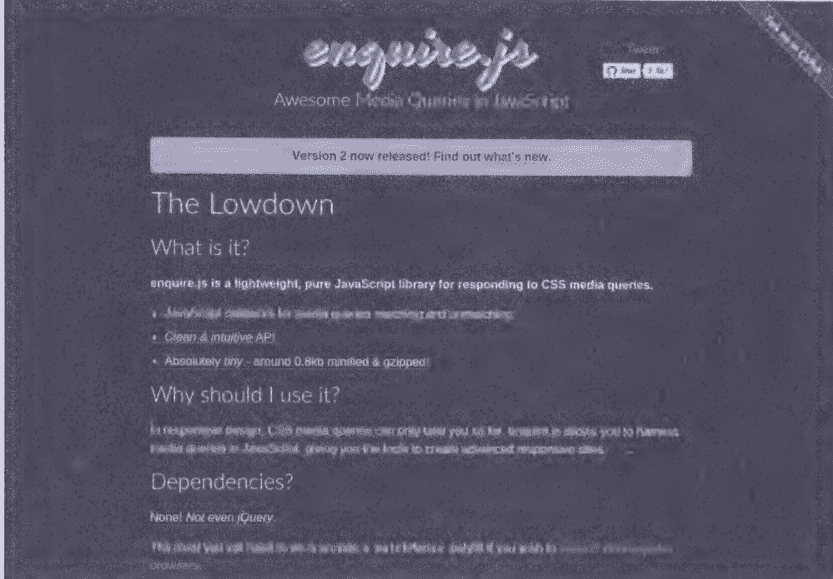

Enquire.js 网站

您可以通过下载最新源代码或使用 bower 包管理器来安装 Enquire.js，并在终端中运行以下命令：

```
bower install enquire
```

现在，我们可以开始在 JavaScript 中而不是 CSS 中定义响应式样式了。这样做的优点是，结合 matchMedia polyfill，在 Internet Explorer 上兼容性不需要其他依赖项。我们只需在 JavaScript 中直接提供响应式样式，这意味着无需加载和解析 CSS 文件。

让我们创建一个小示例，使用 Enquire.js 在移动设备上隐藏菜单：

```html
<!doctype HTML>
<html>
  <head>
    <title>Media Queries using Enquire.js</title>
    <script src="bower_components/matchMedia/matchMedia.js"></script>
    <script src="bower_components/enquire/dist/enquire.min.js"></script>
    <script>
    enquire.register("screen and (max-width: 480px)", {
        match: function() {
            // Enter smartphone mode
            document.querySelector('.menu').style.display = 'none';
        },
        unmatch: function() {
            // Leave smartphone mode
            document.querySelector('.menu').style.display = 'block';
        }
    });
    </script>
  </head>
  <body>
    <div class="menu">
      <ul>
        <li><a href="#">test</a></li>
        <li><a href="#">test</a></li>
        <li><a href="#">test</a></li>
      </ul>
    </div>
  </body>
</html>
```

在前面的代码中，我们使用 match 和 unmatch 函数来执行回调，并对名为 screen and (max-width: 480px) 的 Media Query 使用了清理函数。这使我们能够完全控制响应式应用，它仅使用 JavaScript，因此具有完全的跨浏览器兼容性（前提是包含 matchMedia polyfill）。

## 跨浏览器 SVG 功能

我们在前面的章节中已经看到，SVG 仅受 Internet Explorer 9 及更高版本支持。为 Internet Explorer 的旧版本提供完全的跨浏览器兼容性并非不可能，但具有挑战性。理论上，您可以使用包装器（例如 Raphael.js）将 D3 的输出转换为有效的 VML；然而，这很棘手、困难，而且性能表现不佳。在这种情况下，最好根本不为这个问题使用 D3，因为它不会带来额外的好处。

每当我们谈论 SVG 支持时，我们指的是基本 SVG 支持，即 SVG 1.1 规范。然而，还有更多有趣的功能可以在您的应用程序中使用，其中一些功能具有不同的兼容性。让我们来看看这些功能。

### SVG 动画

我们在前面的章节中已经讨论过 SMIL 动画；然而，我们想再次提及它。尽管在当前浏览器中兼容性看起来还不错（暂时忽略微软浏览器），但我们需要意识到 SMIL 将来将不再受支持。

如果您打算实现 SMIL 动画（因为它们简单且酷），您还应该为 Internet Explorer、Edge 和 Opera Mini 提供 JavaScript 降级解决方案：

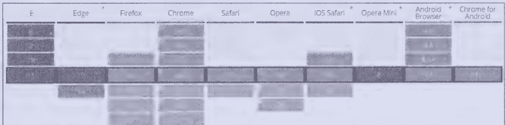

SMIL 动画（来源：http://caniuse.com/#feat=svg-smil）

如果您计划使用 CSS 沿着 SVG 路径动画化元素（所谓的运动路径），请注意许多浏览器也不支持此功能：

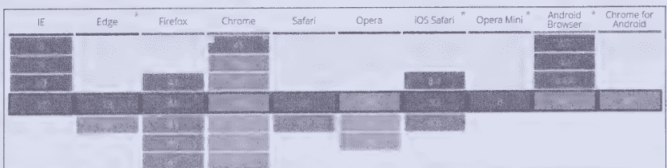

CSS 运动路径（来源：http://caniuse.com/#feat=css-motion-paths）

如果您仍想沿运动路径动画化元素，应该使用非原生的 JavaScript 方法。有一个很棒的 JavaScript 函数，它返回自定义路径上的某个点，并给出路径上的参数长度；这个函数称为 `getPointAtLength()`。

> 有关 SVG 函数 getPointAtLength 的更多信息，请参阅 W3C 的 https://www.w3.org/TR/SVG/paths.html。使用此函数实现路径动画的示例可在 http://bl.ocks.org/KoGor/8162640 找到。

## 使用 SVG 滤镜

如果您计划在 SVG 中使用滤镜，例如混合、模糊、湍流等，可以放心使用。SVG 元素上的滤镜在大多数浏览器中受支持，Internet Explorer 9 除外：

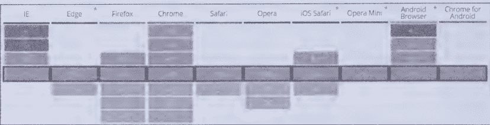

SVG 滤镜（来源：http://caniuse.com/#feat=svg-filters）

与许多其他 SVG 功能一样，它们也通过 CSS 引入 HTML 元素。然而，这无法解决我们在 Internet Explorer 9 中使用的问题，只会带来更多限制。

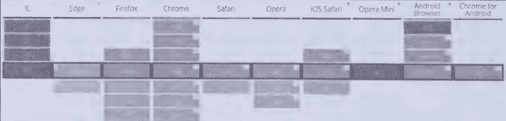

CSS 滤镜（来源：http://caniuse.com/#feat=css-filters）

要支持 Internet Explorer 9 中的图像滤镜，我建议使用功能检测和已弃用的旧版 DX 滤镜。

> 有关 DX 滤镜的更多信息，请参阅 MSDN 的 https://msdn.microsoft.com/library/ms532853.aspx。

### 在 SVG 中剪辑元素

SVG 允许开发者创建可重用作为其他元素剪辑路径的元素。虽然这是一个很棒的功能，我经常在可视化中使用它（我喜欢剪辑路径），但并非所有浏览器都支持它。下图显示了使用 url(#id) 语法的 CSS 属性用于剪辑蒙版的兼容性：

| IE | Edge | Firefox | Chrome | Safari | Opera | iOS Safari | Opera Mini | Android Browser | Chrome for Android |
|---|---|---|---|---|---|---|---|---|---|
| | | | | | | | | | |

CSS clip-path 属性（来源：http://caniuse.com/#feat=css-clip-path）

剪辑路径（和填充模式）的另一个缺点是这种语法；元素必须通过 URL、ID 和 # 符号才能访问。我可以想象许多场景，其中元素无法通过 URL 和符号访问——例如，使用哈希进行路由的单页应用程序。然而，目前没有有用的解决方案，我们需要依赖没有剪辑蒙版的可视化。

## 轻松处理触摸和鼠标事件

至今，我们一直试图为移动设备以及 PC 或电视屏幕上的用户提供触摸和鼠标事件。使用 D3 时，我们将触摸事件视为鼠标单击事件，只是交互半径不同。然而，用户很可能同时拥有触摸（或多点触控）和鼠标作为输入设备。在本节中，我们解决开发者在为用户提供两种输入类型时遇到的问题。

### 鼠标和触摸事件

为什么我们可以使用鼠标单击事件来检测触摸屏上的手指触摸？为了回答这个问题，我们将查看目标 DOM 元素上的鼠标事件执行链，并进入触摸设备。我们将它们合并为一个执行链，用于在触摸设备上用手指触摸目标元素。以下是将被传播的事件列表：

- touchstart: 指尖接触屏幕
- touchmove: 指尖在屏幕上移动


- touchend: 手指停止触摸屏幕
- mouseenter: 鼠标光标正进入元素
- mouseover: 鼠标光标正悬停在元素上方
- mousemove: 鼠标在元素上移动
- mousedown: 鼠标按钮被按下
- mouseup: 鼠标按钮被释放
- click: 元素被点击
- mouseleave: 鼠标光标正离开元素

查看前面的列表后，很多事情都变得清晰了。在开发响应式应用程序时，处理交互设计时，前面的列表将是你最好的助手。

我们首先注意到，用手指轻触也会传播 click 事件。这解释了为什么我们可以使用简单的 `click` 监听器来检测触摸和鼠标输入。这很有用，它将为鼠标交互设计的基本 click 功能也可用于触摸交互。但是，在实现触摸支持时，请确保调整交互目标。

观察执行链的第二个最重要的洞察与第一个直接相关。每当我们同时支持触摸和鼠标事件时，就需要确保触摸事件不会在执行链中作为鼠标事件传播。我们将在下一节中看到这如何工作。

另一个有趣的洞察可能从观察事件链中并不明显。我们观察到，开头有 `touchmove` 事件，而 `mousemove` 事件在若干事件之后触发。虽然这对单指点击成立，但对于手指在屏幕上移动的触摸手势则不成立。不幸的是，当手指移动并触发 `touchmove` 事件时，不会传播任何 `mousemove` 事件。这意味着，仅基于 `mousemove` 事件设计的 UI 由于这种行为，在触摸设备上无法正常工作。

### 打破事件执行链

如前所述，如果在支持触摸输入的浏览器上操作，触摸事件也会作为鼠标事件传播。浏览器的这种行为称为鼠标模拟处理，并在每个触摸事件上默认启用。虽然这是一件好事，因为即使未实现触摸事件，它也使鼠标 UI 可在触摸设备上使用，但当我们实际使用触摸事件时，它会降低性能。

我们有很多理由希望拦截浏览器触发的事件链和默认操作——为了提高性能（正如我们刚才所说），为了在可视化中使用相同手势时禁用滚动，以及为了完全控制事件链。

JavaScript 提供了一个函数，用于在保持执行链和传播事件的同时禁用浏览器的默认行为；此函数称为 `event.preventDefault()`。单击复选框切换其状态的默认行为，以及使用鼠标滚轮滚动页面的默认行为。每当我们想要阻止这些默认操作时，我们都会使用前面的函数。

还有另一个函数，它不会影响事件的默认操作，但会停止事件的执行链；此函数称为 `event.stopPropagation()`。每当我们想要停止事件传播时，我们都会使用这个函数。

如果要停止特定事件的所有事件监听器，也可以使用 `event.stopImmediatePropagation()`。这将停止特定事件的所有自定义事件监听器。

> 有关 preventDefault、stopPropagation 和 stopImmediatePropagation 的更多信息，请参阅 MDN 上的 https://developer.mozilla.org/en-US/docs/Web/API/Event/preventDefault、https://developer.mozilla.org/en-US/docs/Web/API/Event/stopPropagation 和 https://developer.mozilla.org/en-US/docs/Web/API/Event/stopImmediatePropagation。

### D3 中的触摸事件

我们之前看到，touchmove 事件不会传播 mousemove 事件。虽然这两个事件看起来相同（一个用于鼠标，一个用于触摸），但有一个小的差异。理解这一差异对于明白为什么我们不应该简单地使用相同的回调处理程序来监听这两个事件并执行相同的函数非常重要。

为了理解这些事件之间的差异，我们只需考虑它们的目的。在台式计算机上，用户经常移动鼠标光标以到达屏幕上的某个元素。因此，`mousemove` 事件针对光标下方最近的元素，例如，鼠标正在移过一个元素。

然而，touchmove 事件是在特定元素上故意发生的，可以看作是拖动（使用鼠标点击并移动）事件。用户的目标是移动特定元素。出于这个意图，touchmove 事件针对的是开始时被触摸的元素和也接收了 touchstart 事件的元素。虽然这似乎是 mousemove 事件规范中一个微小的差异，但它对如何实现事件监听器有重大影响。

让我们看一个使用 D3 实现合适触摸界面的小示例。我们在屏幕上绘制一个全尺寸画布，然后在画布上处理触摸事件；这可以成为一个小型绘图应用程序的开始：

```
<svg class="drawing">

</svg>
<script>
$canvas = d3.select( '.drawing' )
    .attr( 'width', document.body.clientWidth)
    .attr( 'height', document.body.clientHeight );

$canvas.on( "touchstart", touchstart );

function touchstart () {
    console.log( 'Touch started' );
    d3.event.preventDefault();
    d3.select( d3.event.target )
        .on( "touchmove", touchmove)
        .on( "touchend", touchend );
}

function touchmove () {
    console.log( 'Touch moving' );
    d3.event.preventDefault();
}

function touchend () {
    console.log( 'Touch ending' );
}
</script>
```

在前面的应用程序中，我们将 touchmove 和 touchend 事件直接注册在 touchstart 事件的目标上。这是一个很好的技巧，因此我们不必担心这些事件的静态目标。在下面的截图中，我们可以看到如何在 Chrome 中模拟触摸事件来测试这个小示例应用程序：

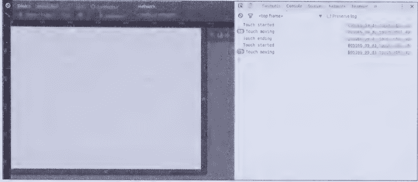

Chrome 中模拟的触摸事件

但是，使用 D3 时，我们需要确保事件不会传播通过完整的执行链并导致鼠标模拟。正如我们已经看到的，使用 D3 时，事件存储在全局 d3.event 对象中。您仍然可以使用 d3.event.preventDefault() 和 d3.event.stopPropagation() 函数来停止事件的执行链并阻止默认操作。

### 关于检测触摸设备的说明

在本章的第一节中，我们了解了特性检测和 Modernizr。我们可以简单地发展这些思想，并认为检测支持触摸的设备应该相当容易，并可能为触摸设备提供与台式设备不同的用户体验。

虽然检测触摸支持相当容易和直接，但没有办法检测触摸设备。我们可以检查 touchstart 事件是否可用，如果工作正常，我们可以检查设备宽度，等等。归根结底，这不重要，因为不再存在经典的仅触摸和仅鼠标设备。有连接鼠标的 Android 平板电脑、兼具触摸和鼠标的二合一设备、兼具触摸和轨迹球的笔记本电脑；列表还在继续。您会很快意识到，将这些设备分类为触摸和非触摸没有任何意义。

因此，我的建议是，不要为触摸实现一个功能，为鼠标交互实现另一个功能，而是实现一种既可以用鼠标又可以用触摸（甚至手写笔）的交互。

### 触摸的悬停状态

我们会很快意识到，在处理触摸和鼠标支持时，应用程序状态需要进行调整。这些状态中一个非常常见的情况是悬停状态，可以通过将鼠标指针悬停在元素上来实现。下图显示了可视化中悬停状态的典型应用；它通过在数据点上悬停来揭示当前位置的更多信息：

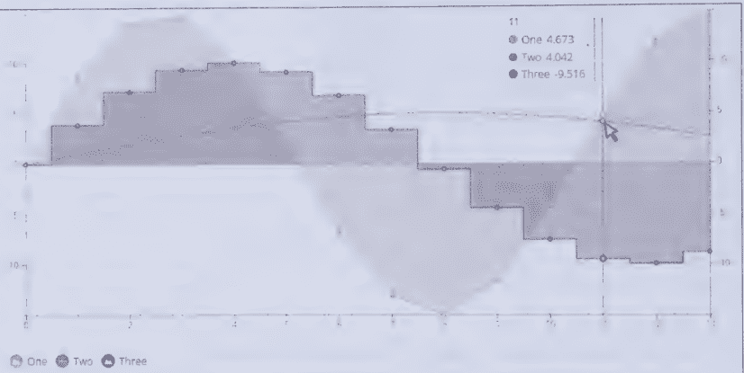

悬停交互

虽然这是当前鼠标指针位置的一个绝佳用途，但这种状态在仅触摸设备上通常不存在。因此，我们需要修改这种行为，以便即使触摸设备也可以访问此信息。我们之前读到过，检测触摸设备是不可能的，因此，我们不能简单地为触摸设备添加一个按钮，而应该重新思考交互。

在前面的示例中，我们可以实现一个可以从轴拖动到图表中的光标。这可能不是悬停状态的完美替代品，但它让我们走上新的交互模型的正确轨道。我们现在可以争辩说，图表上的悬停事件（或简单的轻触）会在该位置（或最近的数据点）显示一个光标。实际上，这与之前的交互完全相同；然而，我们现在还必须考虑如何将光标从可视化中移除——也许是将其移回轴上。希望你明白我的意思；重新思考交互，我的意思正是如此——思考悬停状态（或轻触）在哪里仍然有效，并通过从头到尾为触摸设备实现和优化交互来增强新的交互。


如果你想同时支持触摸和鼠标事件，最好彻底放弃悬停功能，改用其他交互方式。之所以我们经常在这样做时遇到问题，是因为 `:hover` 状态是一个有效的 CSS 选择器，因此可以通过 CSS 而非 JavaScript 实现许多不错的功能。

不过，如果你舍不得放弃悬停状态，可以在每个悬停状态中添加聚焦状态（这也是一个有效的 CSS 选择器）。这样可以确保在触摸设备上轻触一次会显示鼠标光标在悬停状态下的信息。以下示例展示了悬停（左侧）与悬停 + 聚焦（右侧）状态之间的区别；我鼓励你使用触摸设备打开它并尝试（本书提供了源代码）：

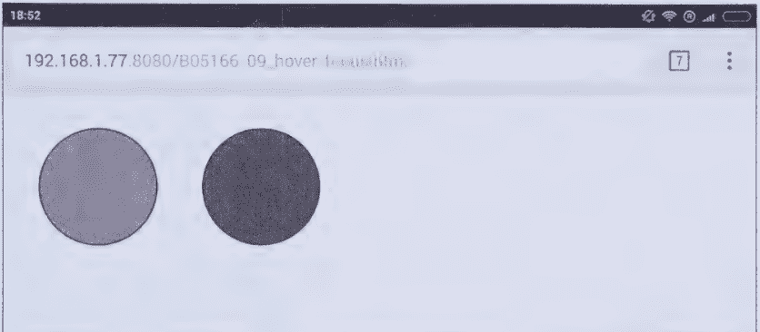

在触摸设备上使用悬停和聚焦

> > 请注意，在某些浏览器中，点击也会触发悬停状态（不过这与 JavaScript 事件执行链不同）；因此，在触摸设备上的某些浏览器中，悬停状态只需轻触即可生效

## 指针事件 – 结合鼠标、触摸和手写笔

浏览器厂商意识到，仅在触摸事件上模拟鼠标事件不足以解决多种交互设备的问题。因此，W3C 在所有指针输入设备之上提出了一种抽象层，并编写了指针事件规范。

这个想法很简单，如下图所示，所有指针输入设备不应单独处理（通过独立事件），而应合并为一个名为 Pointer 的单一输入设备。开发者随后即可实现对指针事件的支持，从而自动为所有类型的指针设备提供出色的 UI。

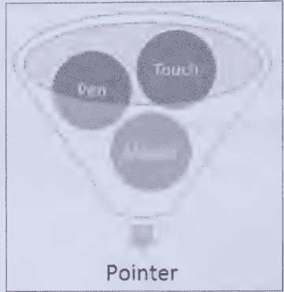

指针事件（来源：https://www.w3.org/TR/pointerevents/)

虽然这听起来很棒，也是朝着多种指针输入设备迈出的一大步，但浏览器厂商并不热衷于实现此规范。查看跨浏览器兼容性图表（如下图）可知，该规范目前尚不可用：

| IE | Edge | Firefox | Chrome | Safari | Opera | iOS Safari * | Opera Mini * | Android * 浏览器 | Chrome for Android |
|---|---|---|---|---|---|---|---|---|---|
| | | | | | | | | | |
| | | | | | | | | | |
| | | | | | | | | | |
| | | | | | | | | | |
| | | | | | | | | | |

指针事件的跨浏览器兼容性（来源：http://caniuse.com/#feat=pointer）

现在你可能会感到失望，并问我为何要提起这个指针事件的事情来逗你，但我相信未来的浏览器将支持这种针对指针设备的抽象。不过，请注意，随着 Apple 的 ForceTouch 的出现，将会涌现新的交互可能性，这些可能性可能需要单独处理。在为提升用户体验而在独立设备类型上支持这些功能的同时，请将 Web 视为面向用户友好、易访问和多平台应用程序的共同场所。

有关指针事件的更多信息，可在 MDN 上找到：https://developer.mozilla.org/en-US/docs/Web/API/PointerEvent，以及 W3C 网站：https://www.w3.org/TR/pointerevents/。

### 为元素禁用指针事件

为完整起见，我也想提一下 `pointer-events` CSS 属性，不要将其与之前讨论的指针事件混淆。此属性可用于在 DOM 元素上禁用指针事件（即鼠标、触摸等）。虽然这已是 SVG 规范的一部分，但现在 HTML 也支持了。以下图显示了完整的跨浏览器兼容性：

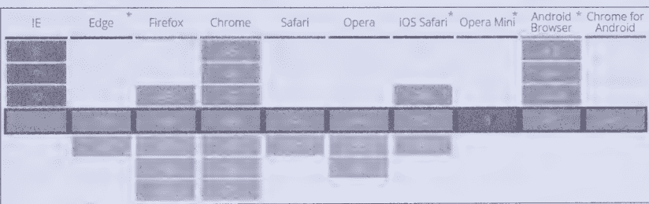

pointer-events 属性的跨浏览器兼容性（来源：http://caniuse.com/#feat=pointer-events）

每当你希望阻止元素接收事件时，`pointer-events` 属性都非常有用，例如遮罩层或部分重叠的元素，或者当你希望确保在触摸设备上正确的元素接收事件时。

### 让我们看一个带有重叠圆形的简单示例：

```
<style>
circle.focus:hover, circle.focus:focus {
  fill: rgba(0, 0, 255, 0.5);
}

.all-events {
  pointer-events: auto;
}

.no-events {
  pointer-events: none;
}
</style>
<svg class="drawing">
<circle class="focus" r="35.9" cx="50" cy="75" />
<circle class="all-events" r="35.9" cx="50" cy="50" />
<circle class="focus" r="35.9" cx="150" cy="75" />
<circle class="no-events" r="35.9" cx="150" cy="50" />
</svg>
```

在前面的代码中，我们将第一个重叠的 `circle` 元素设置为正确接收所有事件，而第二个不接收任何事件。在生成的应用程序中，我们现在可以轻松点击第二个底层圆形，而第一个由于重叠元素的原因很难点击。以下是此示例的截图：

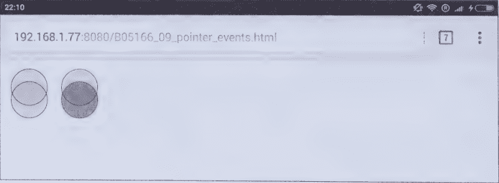

Pointer-events 属性

## 总结

在本章中，你学习了如何使用最佳工具解决最常见的跨浏览器问题。借助 Modernizr，我们可以构建一个轻量级脚本，用于检测 CSS 和 JavaScript 中支持的浏览器功能。在必要时，我们可以提供 Polyfill 或使用封装器。

使用 D3 创建 SVG 可视化时，需要了解受支持的 SVG 规范的限制。因此，在处理过滤器、动画和剪辑路径时，需要格外小心。

你学习了如何创建在所有浏览器上都能运行的响应式可视化。使用 Media Queries 时需要记住的一个关键点是 matchMedia Polyfill，它通常被其他工具用于为原生 JavaScript 函数提供 Polyfill。Respond.js 是简单 CSS Media Queries 的绝佳 Polyfill，而 Enquire.JS 鼓励你将 Media Queries 移至 JavaScript。

最后，我们讨论了不同的鼠标和触摸相关问题，以及构建兼容鼠标和触摸的跨浏览器应用程序的解决方案。现在，你已准备好使用目前最出色的可视化库之一 D3 实现出色的响应式可视化。

希望你喜欢这本书；能与你分享我的一些热情和专业知识，对我来说是一种乐趣。如果你对这本书满意，或有任何问题、意见或反馈，请在 Twitter 上联系我 @ChrisiKrnr。祝编程愉快！
