# SAP Analytics Cloud 学习：发现、规划、预测、协作、可视化并扩展，一站式解决方案


```
< html PUBLIC "-//W3C//DTD HTML 4.0 Transitional//EN"
"http://www.w3.org/TR/REC-html40/loose.dtd">
```

## 鸣谢

| 作者 | 校对编辑 |
| Riaz Ahmed | Manisha Sinha |
| 审阅者 | 项目协调员 |
| David Lai | Manthan Patel |
| 委约编辑 | 校对员 |
| Merint Mathew | Safis Editing |

| **收购编辑** | **索引员** |
|---|---|
| Tushar Gupta | Tejal Daruwale Soni |
| **内容开发编辑** | **生产协调员** |
| Tejas Limkar | Deepika Naik |
| **技术编辑** |  |
| Dharmendra Yadav |  |

## 关于作者

**Riaz Ahmed** 是一名拥有超过 25 年从业经验的 IT 专业人士。他于 1990 年代初开始职业生涯担任程序员，并曾在多种信息技术岗位任职，包括分析程序员、系统分析师、项目经理、数据架构师、数据库设计师和高级数据库管理员。目前，他担任一家公司集团的 IT 负责人。他的核心兴趣领域包括基于 Web 的开发技术、商业智能和数据库。Riaz 在数据库设计和开发方面拥有丰富的经验。他曾与市场上几乎所有主要的关系型数据库管理系统进行过深入工作。在其职业生涯中，他为各种应用设计和实施了众多数据库，包括 ERP。

## 关于审阅者

**David Lai** 是 SAP Analytics 和 SAP BI 顾问，专长于数据可视化、数据分析和数据仓库架构。他毕业于多伦多大学计算机工程专业。他热衷于为组织提供包含最佳实践和技术的智能商业智能解决方案。

David 喜欢与 SAP 社区分享他的知识。他合著了书籍 SAP BusinessObjects Dashboards 4.1 Cookbook，并于 2008 年开设了商业智能博客 (http://www.davidlai101.com/blog)，其中提供有关 SAP 相关材料的技巧、窍门和最佳实践。他还在多个 SAP 大会上发表演讲，并为众多客户提供 SAP BI 培训。

David 是 Xinfinity Solutions 的总裁，他与一支技术精湛的顾问团队为各行业众多满意客户提供商业智能相关咨询服务。

## www.PacktPub.com

有关本书的支持文件和下载，请访问 [www.PacktPub.com](www.PacktPub.com)。

您知道 Packt 提供每本出版书籍的电子书版本，文件格式为 PDF 和 ePub 吗？您可以在 [www.PacktPub.com](www.PacktPub.com) 升级到电子书版本，作为印刷书籍客户，您有权享受电子书折扣。请通过 `service@packtpub.com` 与我们联系了解更多详情。

在 [www.PacktPub.com](www.PacktPub.com)，您还可以阅读大量免费技术文章，订阅各类免费通讯，并享受 Packt 书籍和电子书的独家折扣和优惠。


https://www.packtpub.com/mapt

使用 Mapt 获得最受欢迎的软件技能。Mapt 让您完全访问 Packt 的所有书籍和视频课程，以及帮助您规划个人发展和推进职业生涯的行业领先工具。

## 为什么订阅？

- 在 Packt 发表的每本书中完全可搜索
- 复制、粘贴、打印和书签内容
- 按需访问，可通过网络浏览器访问

## 客户反馈

感谢您购买 Packt 出版的书籍。在 Packt，质量是我们编辑流程的核心。为了帮助我们改进，请在本书的 Amazon 页面 https://www.amazon.com/dp/1788290887 上留下诚实的评价。

如果您想加入我们的常驻审阅者团队，您可以发送电子邮件至 customerreviews@packtpub.com。我们会用免费的电子书和视频作为对您宝贵反馈的回报。帮助我们无情地改进我们的产品！

# 6. 使用地理地图和其他对象分析数据
- 使用故事页面
- 向页面添加注释
- 创建带有气泡层的地理地图
- 地理地图中的位置聚类
- 创建带有色带层的地理地图
- 对地理地图应用筛选器
- 链接不同的模型
  - 基于链接的维度创建图表。
  - 连接类型
  - 相交数据示例
- 创建组合列和折线图
- 通过趋势时间序列图使用预测性预测
  - 添加预测
  - 修改预测
  - 添加时间计算
- 摘要
# 7. 使用表格和网格
- 在页面之间复制对象
- 应用排名
- 将对象复制到同一页面
- 网格和表格
- 使用表格
- 对表格应用筛选器
- 显示/隐藏表格元素
- 对表格数据进行排序
- 显示总计
- 应用日期筛选器
- 测试页面筛选器对表格的影响
- 设置表格样式
- 创建格式规则
- 设置可见性筛选器
- 交换表格轴
- 冻结表格行和列
- 在表格中使用 KPI
- 使用网格
- 创建混合表格
- 复制对象、页面和故事
- 复制分组对象
  - 复制包含所有对象的页面
- 复制整个故事
- 将故事保存为 PDF
- 通过固定故事对象创建个性化仪表板
  - 固定故事对象
- 向主屏幕添加文本注释
- 摘要
# 8. 协作
- 创建事件和任务工作流
- 创建事件
- 创建任务
  - 显示和监控事件和任务
- 事件工具栏
- 与同事共享故事并授予访问权限
- 通过讨论协作
- 共享文件和其他对象
- 摘要
# 9. 数字董事会
- 优化显示
- 创建议程
- 创建议程子项
- 启用数据探索
- 设置导航目标
- 启用触摸单元格输入
  - 设置偏好
  - 数字董事会页面
- 开始会议
  - 邀请人员参加会议
  - 在会议中开始演示
- 添加注释
- 停止在线会议
- 摘要
# 10. 系统管理
- 创建用户
- 设置用户密码
- 修改密码
- 导入用户
- 导出用户
- 删除用户
- 分配角色
  - 为多个用户分配单个角色
  - 分配或更新单个用户的角色
- 内置角色
- 创建新角色
- 角色设置
- 权限
- 测试角色权限
  - 更新用户资料
- 组建团队
- 转移系统所有者角色
- 为模型设置安全
- 监控用户活动
  - 监控数据更改
- 监控系统
- 部署
- 导出过程
- 导入过程
- 摘要
## 前言
SAP Analytics Cloud 是一款基于云的商业智能、规划和预测应用程序，可帮助用户整合来自不同来源的数据、创建引人注目的数据可视化、运行临时报表等。本书将演示 SAP Analytics Cloud 如何帮助您在一个解决方案中改变发现、规划、预测、协作、可视化和扩展的方式。您将首先了解 SAP Analytics Cloud 环境。从这里开始，您将了解不同的模型，并理解 SAP Analytics Cloud 的不同功能，例如预测分析、BI 和规划。进一步地，您将学习如何创建地理地图、图表、表格和其他对象。使用 SAP Analytics Cloud，您将学习如何连接到 SAP 和非 SAP 数据源。您还将学习如何在本地和云端分析并整合小数据和大数据。

本书从 SAP Analytics Cloud 的基础开始，涵盖了初学者所需几乎所有重要功能。书中配有插图和简短说明，提供独特的学习体验。

您的探索之旅从对 SAP Analytics Cloud 最基础的介绍开始。在此介绍中，您将了解产品的各个部分，例如模型、故事、数字董事会。然后您将熟悉产品的界面（主屏幕、主菜单等）。接下来您将进入本书的实践部分，从模型创建开始。随后，您将学习如何利用模型借助图表、表格、地理地图等准备不同类型的故事（报表）。在本书的最后几章中，您将学习数字董事会、协作和管理。

本书的目标如下：
- 首先是自主学习。本书提供的易于遵循的视觉说明帮助业务用户和报表开发人员能够独立快速创建简单和复杂的故事。
- 本书的主要目标是让您对 SAP Analytics Cloud 的内容有扎实的理解，以便您能有效利用该产品。
- 完成本书提供的练习后，您将对 SAP Analytics Cloud 平台有清晰的理解。您将能够使用不同的数据源（包括 Excel 和文本文件）创建数据模型，并能够使用不同类型的图表、表格和地理地图展示专业分析。您可以与团队成员分享您的故事，或将它们汇编到 SAP 数字董事会议程中以向主要利益相关者展示。
## 本书涵盖内容
第 1 章《开始使用 SAP Analytics Cloud》提供了对 SAP Analytics Cloud 平台的简要介绍并展示了其结构。在本章中，您将了解 SAP Analytics Cloud 的不同部分（模型、故事、数字董事会等）的概览，这些内容将在后续章节中详细讨论。

第 2 章《模型》提供了关于模型的一些基本概念，例如分析模型和规划模型、度量和维度。模型是您在 SAP Analytics Cloud 中创建的每项分析的基础。在本章中，您将创建分析模型以亲身体验该应用的这一部分。

第 3 章《规划模型》详细介绍了规划模型，即您使用规划功能的工作模型。规划模型被称为全功能模型，因为它预先配置了实际、预算、规划、预测和滚动预测的时间和类别维度。它还支持多币种，并在模型和维度级别提供安全性，以限制特权用户对报表中特定值的访问。它还配备了用于可追溯性的审计功能。

第 4 章《使用图表创建故事》讨论了故事，即在 SAP Analytics Cloud 中使用图表、表格、地理地图、文本、图像和形状以图形方式展示数据的功能。本章包含一些实践练习，帮助您探索这一重要部分。

第 5 章《使用 KPI、筛选器和其他实用对象扩展故事》也与故事相关。在这里，您将学习关键绩效指标（KPI），添加不同类型的筛选器以缩小分析范围，添加参考线，创建关联分析，添加动态和静态文本等等。

第 6 章《使用地理地图和其他对象分析数据》讨论了包含经纬度信息且可在故事中用于在地理地图中可视化数据的模型。通过添加不同类型数据的多层，您可以展示不同的地理特征和兴趣点，从而执行复杂的地理分析。您还将学习如何在故事中添加、删除、复制和重复页面，以及如何为其提供富有表现力的名称。添加注释、创建关联维度、预测性预测和时间计算也在本章中讨论。

第 7 章《使用表格和网格》详细讨论了表格和网格。表格是一种类似电子表格的对象，可用于查看和分析文本数据。您还将了解网格页面，这是一种用于创建包含文本和公式的分析的页面类型。对图表应用排名、对表格应用筛选器、设置可见性筛选器、在表格中使用 KPI 以及创建混合表格是本章涵盖的一些主题。

第 8 章《协作》强调了 SAP Analytics Cloud 中的协作功能，用户可借此讨论业务内容并共享信息。这些功能包括创建

事件和分配任务，对图表数据点进行评论，对故事页面进行评论，将故事保存并分享为 PDF，讨论，以及分享文件和故事。

第 9 章，*数字董事会*，讨论 SAP Digital Boardroom，它正在改变董事会会议的格局。除了支持传统的演示方法外，它还超越了企业董事会室，允许远程成员在线加入并参与会议。这些远程参与者可以积极参与会议，并可以使用自己的设备操作实时数据。本章将演示如何创建董事会议程并设置在线会议。

第 10 章，*系统管理*，讨论如何通过创建用户并设置其密码、设置团队、创建角色并设置权限、监控用户活动、数据更改和系统性能来确保您的 SAP Analytics Cloud 环境安全。在本书的最后一部分，您将学习系统部署，其中涉及导出和导入系统组件。

## 本书所需

该平台最显著的优势是您无需在机器上安装或配置任何软件。只需一个兼容的网络浏览器和适中的互联网连接，即可访问此应用程序在云中创建交互式仪表板。

## 本书适合谁

本书面向 IT 专业人员、业务分析师、BI 开发人员、经理、SAP Analytics Cloud 新手以及任何希望通过自学、专业指导学习并需要扎实 SAP Analytics Cloud 基础的人士。

## 约定

在本书中，您会找到多种文本样式，用于区分不同类型的信息。以下是这些样式的示例及其含义说明。文本中的代码词、数据库表名、文件夹名、文件名、文件扩展名、路径名、虚拟 URL、用户输入和 Twitter 账号显示如下：“The `Bocage.xlsx` file is a simple Excel file being provided with this book for demonstration purpose.”

**新术语**和**重要词汇**以粗体显示。您在屏幕上看到的文字，例如菜单或对话框中的文字，在文本中如下所示：“select Live Data Connection | SAP HANA.”


*警告或重要说明如下所示。*


*技巧和窍门如下所示。*

## 读者反馈

我们始终欢迎读者的反馈。请告诉我们您对本书的看法——您喜欢或不喜欢的内容。读者的反馈对我们非常重要，因为它有助于我们开发您真正能充分利用的书目。如需发送一般反馈，只需发送电子邮件至 `feedback@packtpub.com`，并在邮件主题中提及本书标题。如果您在某个主题方面有专长，并且有兴趣撰写或为书籍做出贡献，请参阅我们的作者指南 [作者指南](http://www.packtpub.com/authors)。

## 客户支持

现在您已成为 Packt 书籍的自豪拥有者，我们提供多项帮助以助您充分利用购买。

## 下载示例代码

您可以从 http://www.packtpub.com 的账户下载本书的示例代码文件。如果您在其他地方购买了本书，可以访问 http://www.packtpub.com/support 并注册以便将文件直接发送到您的电子邮件。您可以按照以下步骤下载代码文件：

- 1. 使用您的电子邮件地址和密码登录或注册我们的网站。
- 2. 将鼠标指针悬停在顶部的 SUPPORT 选项卡上。
- 3. 点击 Code Downloads & Errata。
- 4. 在搜索框中输入书名。
- 5. 选择您要下载代码文件的书籍。
- 6. 从下拉菜单中选择您购买本书的渠道。
- 7. 点击 Code Download。

下载文件后，请确保使用最新版本的以下工具解压或提取文件夹：

- 适用于 Windows 的 WinRAR / 7-Zip
- 适用于 Mac 的 Zipeg / iZip / UnRarX
- 适用于 Linux 的 7-Zip / PeaZip

本书的代码包也在 GitHub 上托管，地址为 https://github.com/PacktPublishing/Learning-SAP-Analytics-Cloud。我们丰富的书籍和视频目录中的其他代码包也可在 https://github.com/PacktPublishing/ 获取。快来看看吧！

## 下载本书彩色图片

我们还为您提供一份 PDF 文件，其中包含本书中使用的屏幕截图/图表的彩色图片。彩色图片将帮助您更好地理解输出的变化。您可以从 https://www.packtpub.com/sites/default/files/downloads/LearningSAPAnalyticsCloud_ColorImages.pdf 下载此文件。

## 勘误

尽管我们已尽一切努力确保内容的准确性，但错误仍会发生。如果您在我们的书籍中发现错误——也许是文本或代码中的错误——我们将非常感谢您向我们报告。通过这样做，您可以避免其他读者感到沮丧，并帮助我们改进本书的后续版本。如果您发现任何勘误，请访问 http://www.packtpub.com/submit-errata，选择您的书籍，点击 Errata Submission Form 链接，并输入您的勘误详情。一旦您的勘误得到验证，您的提交将被接受，勘误将被上传到我们的网站或添加到该标题勘误部分下的现有勘误列表中。要查看之前提交的勘误，请访问 https://www.packtpub.com/books/content/support 并在搜索字段中输入书名。所需信息将出现在勘误部分下。

## 盗版

互联网上版权材料的盗版是所有媒体持续存在的问题。在 Packt，我们非常重视对版权和许可的保护。如果您在互联网上以任何形式遇到我们作品的非法复制品，请立即向我们提供位置地址或网站名称，以便我们采取补救措施。请通过 `copyright@packtpub.com` 联系我们，并附上疑似盗版材料的链接。我们感谢您帮助保护我们的作者以及我们为您提供有价值内容的<|message|>
## 数据源和模型
### 数据源
- 本地应用程序
- 实时数据
- 导入数据
- 云应用
- 文件
### 模型
- 分析模型
- 规划模型
- 指标
- 维度
### 可视化
### 故事
- 页面
- 画布
- 响应式
- 网格
- 图表
- 地理地图
- 表格
- 静态和动态文本
- 图像和形状
### 协作
- 事件和任务
- 评论
- 创建 PDF
- 分享故事
- 讨论
- 分享文件
### 演示
- 创建议程
- 创建议程子项
- 开始在线会议
- 邀请人员
### 管理与安全
- 设置用户和团队
- 设置角色并分配权限
- 系统监控
- 部署

## 主屏幕
当您成功登录 SAP Analytics Cloud 时，您会看到主屏幕。
请注意，主屏幕对每个 SAP Analytics Cloud 用户都是私有的，因此无法共享。
以下是一些提示，帮助您熟悉主屏幕：

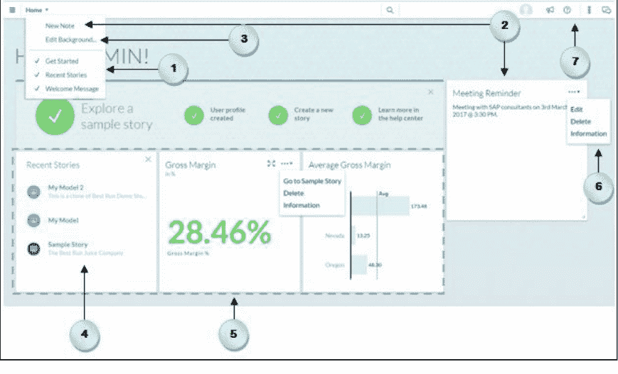

- 1. 若要移除“开始使用”小部件、最近的故事磁贴或欢迎消息，请转到“主页”菜单，并取消选择要移除的项目。
- 2. 主屏幕还允许您为即将到来的事件添加有用的提醒和个人笔记。
- 3. 使用“编辑背景”选项，您可以自定义显示背景并向主屏幕添加徽标。
- 4. 标题为“最近的故事”的第一个磁贴列出了您访问过的最近五个故事。
- 5. 您的最近故事和可视化以磁贴形式显示。您可以将来自故事的额外磁贴固定到主屏幕。
- 6. 单击省略号图标以修改或删除笔记。
- 7. 工具栏出现在每个屏幕的顶部。使用工具栏上的图标，用户可以看到自己的个人资料、查看通知、获取在线帮助、查看时间面板并进行协作。

## 主菜单
以下屏幕截图和要点将帮助您更好地了解主菜单：

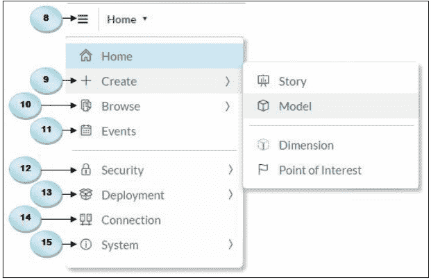

- 8. 主菜单图标是您进入 SAP Analytics Cloud 的入口。它为您提供完成任务所需的所有选项。
- 9. 单击“创建”以添加新的故事、模型、流程、维度、货币和兴趣点。模型在第 2 章《SAP Analytics Cloud 中的模型》和第 3 章《规划模型》中讨论，而您将在第 4 章至第 7 章中创建故事。流程子菜单下的“分配”选项在第 3 章《规划模型》中讨论。
- 10. 选择“浏览”以访问现有的故事、模型、维度、货币、兴趣点和文件。文件在第 8 章《协作》中讨论。
- 11. “事件”选项打开“事件”页面，您可以在其中管理规划和分析活动并将任务分配给其他用户。该主题在第 8 章《协作》中讨论。
- 12. “安全”菜单项中提供的选项可让您创建和管理应用程序用户、团队、角色、请求，并监控数据更改和用户活动。这些选项在第 10 章《系统管理》中讨论。
- 13. “部署”包括应用程序内容的导出和导入的创建和管理。该主题在第 10 章《系统管理》中讨论。
- 14. 使用“连接”菜单项，您可以创建和维护与远程系统的连接。您可以创建连接以将数据导入 SAP Analytics Cloud，或创建到 SAP HANA 的实时数据连接。本章后面将看到一些建立连接的实例。
- 15. “系统”菜单项包括“监控”、“管理”和“启用 SAML 单点登录（SSO）”选项。使用这些选项，系统管理员监控系统，在系统日志中读取系统事件和错误，并设置 SAML 单点登录（SSO）以与 SAP Analytics Cloud 配合使用。

由于 SAP 对应用程序的频繁更新，本书中提供的屏幕截图可能与您的不同。

## 数据源和模型
在 SAP Analytics Cloud 中开始分析任务之前，您需要创建模型。模型是您创建的每项分析的基础，用于评估组织的绩效。它是一种高级设计，体现了最终用户的分析需求。规划和分析是您可以在 SAP Analytics Cloud 中创建的两种模型类型。

分析模型更简单、更灵活，而规划模型是功能齐全的模型，您可以在其中使用规划功能。规划模型预先配置了时间和类别的维度，支持在模型和维度级别的多货币和安全功能。本书的第 2 章和第 3 章专门介绍这两种模型。

为了确定模型中应包含的内容，您必须首先确定用户需要查询的源数据中的列。您模型中需要的列位于某种数据源中。SAP Analytics Cloud 支持三种类型的数据源：通常位于计算机上的文件（如 CSV 或 Excel 文件）、来自已连接远程系统的实时数据连接以及云应用。

除了计算机上的文件外，您还可以使用本地数据源，例如 SAP Business Warehouse、SAP ERP、SAP Universe、SQL 数据库等，来获取模型的所需数据。在云端，您可以从 Concur、Google Drive、SAP Business ByDesign、SAP Hybris Cloud、OData Services 和 Success Factors 等应用获取数据。以下图表描绘了这些数据源。您可以在 SAP Analytics Cloud 中使用的云应用数据源显示在防火墙标记上方，而本地网络中的数据源则显示在防火墙下方。

如以下图表所示，SAP Analytics Cloud 目前支持二十多个数据源。连接到这些数据源的方法也各不相同。由于篇幅限制，本章无法概述每种连接方法。然而，本章提供的一些实例将让您了解如何建立连接以获取数据。这里提供的连接方法涉及本地和云应用数据源。考虑到本书的读者可能无法访问这些数据源，并为保持简单，第 2 章《SAP Analytics Cloud 中的模型》将指导他们使用本书提供的 Excel 文件在 SAP Analytics Cloud 试用版中创建分析模型。


> *由于与主题的相关性，以下子部分在此添加，以概述您可以在 SAP Analytics Cloud 中建立的不同类型的连接来构建模型。*

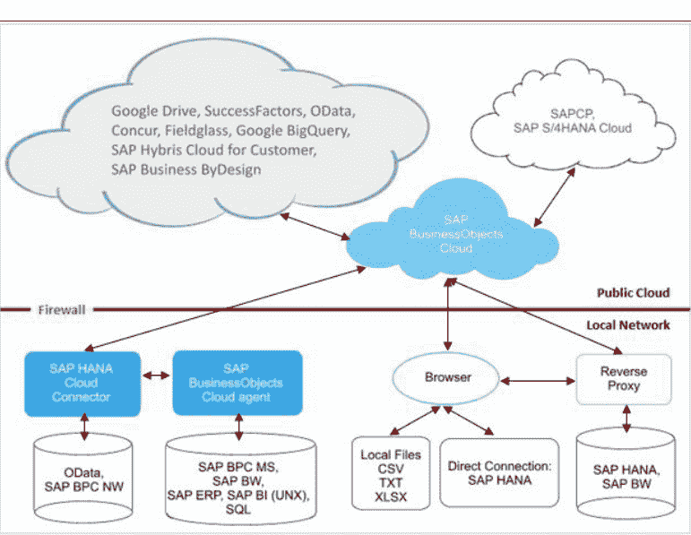

## 创建到 SAP HANA 的直接实时连接
执行以下步骤以连接到本地 SAP HANA 系统，以便在 SAP Analytics Cloud 中使用实时数据。实时数据意味着当您在 SAP Analytics Cloud 中打开故事时，您可以获取最新数据。在这种情况下，对源系统中数据的任何更改都会立即反映出来。通常，有两种方法可以建立到数据源的连接——从主菜单使用“连接”选项，或在创建模型的过程中指定数据源。但是，实时数据连接必须在创建相应模型之前通过“连接”菜单选项建立。以下是步骤：

- 1. 从主菜单中选择“连接”。
- 2. 在“连接”页面上，单击“添加连接”图标（+），然后选择“实时数据连接 | SAP HANA”。
- 3. 在“新建实时连接”对话框中，为连接输入名称（例如，HANA）。
- 4. 从“连接类型”下拉列表中选择“直接”。“直接”选项用于连接到位于企业网络内部的数据源。“路径”选项需要 HANA XS 服务器的反向代理。此列表中的“SAP Cloud Platform”和“云”选项用于连接到 SAP 云环境。当您选择“直接”选项时，系统类型设置为 HANA，协议设置为 HTTPS。
- 5. 在相应的文本框中输入主机名和端口号。
- 6. “身份验证方法”列表包含两个选项：用户名和密码以及 SAML 单点登录。SAML 单点登录选项要求 SAP HANA 系统已配置为使用 SAML 身份验证。如果没有，请选择“用户名和密码”选项并在相关框中输入这些凭据。
- 7. 单击“确定”完成流程。新的连接将出现在“连接”页面上，现在可作为模型的源数据使用。模型的创建将在下一章讨论。然而，为了完成此练习，我们将在此进行一个简短的演示。
- 8. 从主菜单转到“创建 | 模型”。
- 9. 在“新建模型”页面上，选择“使用数据源”。
- 10. 从右侧出现的列表中选择“实时数据连接”。
- 11. 在显示的对话框中，从“系统”列表中选择您在前几步中创建的 HANA 连接。
- 12. 从“数据源”列表中选择您要使用的 HANA 视图。视图列表可能很长，并且提供搜索功能来帮助您找到您是

正在查找。

- 13. 最后，输入新模型的名称和可选描述，然后单击“确定”。
- 模型将被创建，其定义将显示在另一个页面上。请参阅接下来的两章以了解有关模型的更多详细信息。

## 连接远程系统以导入数据

除创建实时连接外，您还可以创建允许将数据导入 SAP Analytics Cloud 的连接。在您为访问远程系统而建立的此类连接中，数据会被导入（复制）到 SAP Analytics Cloud。用户对源数据所做的任何更改都不会影响导入的数据。

要建立与这些远程系统的连接，您需要安装一些额外的组件。例如，您必须安装 SAP HANA Cloud Connector 以访问用于 Netweaver 的 SAP **Business Planning and Consolidation (BPC)**。同样，SAP Analytics Cloud agent 应为 SAP **Business Warehouse (BW)**、SQL Server、SAP ERP 等安装。请查看上一页中说明的连接图。

以下步骤集提供了连接到 SAP ERP 的说明。您可以从“连接”菜单连接到此系统，或在创建模型时建立连接。在这些步骤中，我们将采用后一种方法。

- 1. 从主菜单中，转到 创建 | 模型。
- 2. 在“选择如何开始模型”页面上，单击“使用数据源”选项。
- 3. 从右侧的可用数据源列表中，选择 SAP ERP。
- 4. 在“连接名称”列表中，选择“创建新连接”。
- 5. 在“连接名称”框中输入连接的名称（例如，ERP）。您还可以提供描述以进一步说明新连接。
- 6. 对于“服务器类型”，选择“应用程序服务器”，并输入“系统”、“系统编号”、“客户端 ID”、“系统 ID”、“语言”、“用户名”和“密码”的值。提供这些信息后，单击“创建”按钮。
- 7. 接下来，您需要基于 SAP ERP 系统数据创建查询。输入查询的名称，例如 sales。
- 8. 在同一对话框中，展开数据所在的位置的 ERP 对象。找到并选择该对象，然后选择要包含在模型中的数据列。在导入之前，您会获得数据的预览。在预览窗口中，单击“完成”开始导入过程。导入的数据将出现在“数据集成”页面上，这是模型创建部分的初始屏幕，并在后续章节中进行讨论。

## 连接 Google Drive 以导入数据

您已了解两种数据获取场景。在第一个场景中，您创建了实时连接以在实时数据上创建模型，而在第二个场景中，您学习了如何从远程系统导入数据。在本节中，您将了解如何使用名为 Google Drive 的云应用程序创建模型。Google Drive 是 Google 开发的文件存储和同步服务。它允许用户将文件存储在云中、在设备之间同步文件并共享文件。以下是使用 Google Drive 上存储的数据的步骤：

- 1. 从主菜单中，转到 创建 | 模型。
- 2. 在“选择如何开始模型”页面上，选择“从应用程序获取数据”。
- 3. 从右侧的可用应用程序中，选择 Google Drive。
- 4. 在“从 Google Drive 导入模型”对话框中，单击“选择数据”按钮。
- 5. 如果您尚未登录 Google Drive，系统会提示您登录。
- 6. 另一个对话框出现，显示兼容文件列表。选择一个文件，然后单击“选择”按钮。
- 7. 您将返回到“从 Google Drive 导入模型”对话框，在此需要输入模型名称和可选描述。
- 8. 提供这些信息后，单击“导入”按钮。导入过程将开始，稍后您将看到“数据集成”屏幕已填充所选 Google Drive 文件中的数据。

## 刷新导入的数据

SAP Analytics Cloud 允许您刷新导入的数据。通过此选项，您可以根据需要重新导入数据以获取最新值。您可以手动执行此刷新操作，或创建导入计划以在特定日期和时间或定期刷新数据。以下数据源支持计划：

- SAP **Business Planning and Consolidation (BPC)**
- SAP **Business Warehouse (BW)**
- Concur
- OData services
- 一个 SAP **Analytics BI platform universe (UNX)** 查询
- **SAP ERP Central Component (SAP ECC)**
- SuccessFactors HCM suite
- Excel 和从文件服务器导入的 **comma-separated values (CSV)** 文件（不是从本地计算机导入）
- SQL databases

您可以采用以下方法访问模型的计划设置：

- 1. 从主菜单中选择“连接”。“连接”页面出现。此页面上的“计划状态”选项卡列出了与任何数据源关联的所有更新和导入作业。
- 2. 或者，转到 主菜单 | 浏览 | 模型。“模型”页面出现。列表中可更新的模型将在“数据源”列中显示多个数据源。在“数据源”列中，单击“查看更多”链接。与此数据源关联的更新和导入作业将出现。“更新模型”和“导入数据”作业是两种可立即运行或按计划运行的作业类型。
- 3. 要立即运行“导入数据”作业，请在“操作”列中选择“导入数据”。如果要运行“更新模型”作业，请选择作业以打开它。

以下刷新方法指定如何处理现有数据。

以下是“导入数据”作业列表：

- Update：选择此选项会更新现有数据并向目标模型添加新条目。
- Clean and Replace：现有数据将被清除，新条目将添加到目标模型。
- Append：现有数据保持不变。仅向目标模型添加新条目。

以下是“更新模型”作业列表：

- Clean and Replace：这会删除现有数据并向目标模型添加新条目。
- Append：这会保留现有数据并向目标模型添加新条目。

“计划设置”选项允许您选择以下计划选项之一：

- None：导入立即执行
- Once：导入仅在计划时间执行一次
- Repeating：导入根据重复模式执行；您可以选择开始和结束日期和时间以及重复模式

- 4. 设置偏好后，单击“保存”图标保存计划设置。

如果您为计划选择了“无”选项，请选择“更新模型”或“导入数据”以立即运行更新或导入作业。

一旦计划作业完成，其结果会显示在“计划状态”选项卡上，显示任何错误或警告。如果您看到此类令人困惑的消息，请选择作业以查看详细信息。展开“刷新管理器”面板中的条目以获取有关令人困惑内容的更多信息。如果导入过程拒绝了数据集中的任何行，您将有选项将拒绝的行下载为 CSV 文件以供离线检查。修复源系统中的数据，或修复下载的 CSV 文件中的错误并从中上传数据。

创建模型后，您可以通过 主菜单 | 浏览 | 模型 路径访问它们。如以下图所示的“模型”页面是管理模型的主要界面。

- 16. 所有现有模型都列在“模型”选项卡下。您可以单击其名称打开模型。
- 17. 公共维度与模型分开保存，并在“公共维度”选项卡上显示。在创建新模型或修改现有模型时，您可以添加这些公共维度。
- 18. 如果您的数据中使用多种货币，则汇率保存在单独的表中。这些汇率与任何模型独立保存，并在“货币转换”选项卡上列出。
- 19. 地理位置的数据在“兴趣点”选项卡上维护，这些数据在您的数据分析中显示并使用。

四个选项卡下提供的工具栏包含用于管理模型的常用操作的图标。

- 20. 单击“新建模型”图标创建新模型。
- 21. 通过在其前面放置复选标记 (A) 选择模型。然后单击“复制所选模型”图标制作所选模型的精确副本。
- 22. 使用删除图标删除所选模型。
- 23. “清除所选模型”选项会删除所选模型中的所有数据。


24. 支持的数据导入选项列表可从工具栏上“导入数据”图标下方的菜单中获取。
25. 您可以使用“导出模型为文件”一次性或按重复计划将模型导出为 .csv 文件。

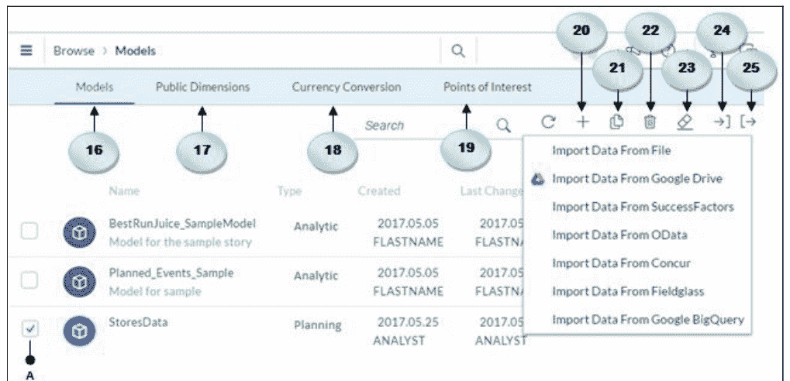

## 可视化

以下是在我们的讨论中重要的可视化方面：

- **故事**：创建模型后，您创建故事来探索模型数据。故事由一个或多个页面组成，用于使用图表、地理地图、表格、文本、形状和图像等对象来呈现模型数据。要创建新故事，请从主菜单转到“创建 | 故事”。系统会要求您从提供的四个选项中选择一个选项，以确定您希望如何开始故事。通常，您从添加画布页面开始，在该页面中手动放置对象。有关详细信息，请参阅第 4 章，*使用图表创建故事*。
- **图表**：SAP Analytics Cloud 提供了多种图表，因此请选择最佳图表类型来呈现您的分析。您可以将多种类型的图表添加到单个故事页面中。您将在第 4 章至第 6 章学习如何将图表添加到故事页面。
- **地理地图**：包含经纬度信息的模型可在故事中使用以在地理地图中可视化数据。通过在地理地图中添加不同类型数据的多个图层，我们可以显示不同的地理特征和兴趣点，从而使我们能够执行复杂的地理分析。您将在第 6 章中创建地理地图，*使用地理地图和其他对象分析数据*。
- **表格**：表格是一种类似电子表格的对象，可用于查看和分析文本数据。您可以将此对象添加到故事中的画布或网格页面。表格和网格在第 7 章中有讨论，*使用表格和网格*。
- **静态和动态文本**：您可以向故事页面添加静态和动态文本。静态文本通常用于显示页面标题，而动态文本会根据源输入控件或筛选器的值自动更新页面标题。您将在第 5 章中将这两种类型的文本添加到故事页面，*使用 KPI、筛选器和其他实用对象扩展故事*。
- **图像和形状**：您可以从计算机上传图像（如公司徽标）添加到故事页面。此外，除了图像之外，您还可以向页面添加形状，例如线条、正方形或圆形。这些主题在第 5 章中有所介绍，*使用 KPI、筛选器和其他实用对象扩展故事*。

创建故事时，屏幕上会出现一个具有默认名称的新故事，如以下分屏截图所示：

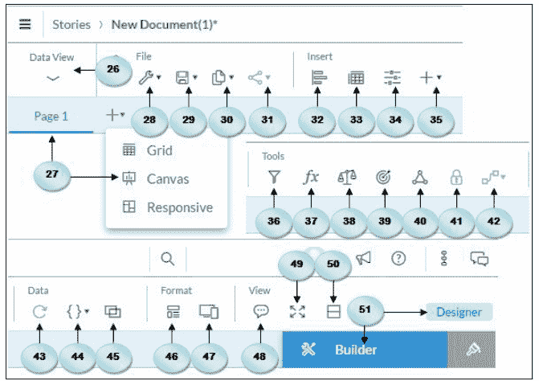

26. “数据视图”选项可让您探索模型数据。单击此选项时，画布会隐藏，屏幕上会出现两个新窗格，您可以在其中查看所选模型的度量和维度。有关详细信息，请参阅第 2 章《SAP Analytics Cloud 中的模型》和第 3 章《规划模型》。

27. 您可以在故事中创建三种类型的页面：网格、画布和响应式。网格类似于 Excel 工作表。您可以添加网格页面，然后通过输入数字或从其他应用程序粘贴来添加数据，或基于现有模型添加表格。网格和表格将在第 7 章《使用表格和网格》中讨论。在画布页面上，您可以布置图表、表格、地理地图、图像和其他对象来呈现您的数据。您将在第 4 章《使用图表创建故事》中了解画布页面的使用。

响应式页面允许您创建可在任何屏幕尺寸上展示的灵活仪表板。此响应式页面是应用程序的一项新增强功能，您可以在其中将内容排列在最多六个车道中。内容按顺序呈现，从最左边的车道开始，到最右边的车道结束。您可以使用垂直工具栏中提供的选项添加或删除车道，该工具栏显示在每个车道的右侧。一旦您向响应式页面车道添加了图表或地理地图等对象，请单击“设备预览”(47) 查看页面在不同屏幕尺寸下的显示效果。出现的页面可让您选择不同的屏幕尺寸，如下所示：小型 300 像素宽显示屏、中型 768px、笔记本电脑 1366px x 768px、HDTV 1920px x 1080px 和 4K UHD 3840px x 2160px。

28. “编辑故事”菜单有两个选项：故事详细信息和首选项。单击“故事详细信息”选项会显示一个对话框，您可以在其中更改故事的名称并提供描述（可选）。您在此处提供的名称会显示在屏幕顶部故事面包屑旁边。使用第二个选项，您可以更改画布和响应式页面大小以及背景颜色。您还可以在“故事首选项”对话框中为图表、地理地图、表格和其他元素设置首选项。

29. “保存”图标还附带多个选项。“保存”选项是通用的，用于保存您的故事。使用“另存为”选项，您可以使用不同的名称保存故事。“另存为文件”选项可让您将故事保存为 PDF 文件。“另存为模板”选项将您的故事保存为模板，可用于创建新故事。

30. “复制和粘贴”图标包含您已在 Windows 应用程序中使用的实用程序。这些实用程序允许您将所选对象复制到剪贴板、现有故事页面或新画布。您还可以将所选对象在同一画布上重复。

31. 如果您想与其它用户共享故事，请单击“共享”图标，并选择是否要与所有用户或仅选定用户共享故事。
32. “图表”工具栏选项将空白图表添加到画布。添加图表后，使用“设计器”面板格式化和操作其中的数据。
33. 此选项与图表选项类似，用于向画布添加空白表格。同样，使用“设计器”面板，您可以设置属性以在新表格中显示数据。
34. 使用“输入控件”，您可以定义一些在计算中充当变量的值。通过在输入控件中选择值，用户可以在不修改底层数据或公式的情况下影响计算结果。您将在第 4 章《使用图表创建故事》中使用输入控件。
35. “添加”图标列出了可添加到故事页面的其他对象，例如地理地图、图像、形状、文本、RSS 阅读器、网页、价值驱动树和符号。
36. 您可以应用两种类型的筛选器：故事筛选器和页面筛选器。如果您想对故事中的所有图表应用筛选器，请使用故事筛选器。页面筛选器顾名思义只能应用于故事中的一个页面。请参阅第 5 章《使用 KPI、筛选器和其他实用对象扩展故事》中的此主题。
37. 仅链接 Excel 工作表。您还可以向表格元素添加公式。公式栏图标用于查看您在表格单元格中输入的公式。单击此图标时，公式栏会出现在页面选项卡下方。您将在第 7 章《使用表格和网格》中使用公式栏。
38. 如果您在故事的多个图表中使用度量，则这些图表上的度量值通常按不同比例缩放，这使得比较值变得困难。使用“图表缩放”选项，您可以缩放这些图表，使度量在多个图表中具有相同的比例。
39. “条件格式”选项用于您想要突出显示某些关键信息（如低销售额）时。阈值用于为您的信息提供视觉提示。通过在对象上定义阈值，您可以一目了然地看到哪些区域表现良好，哪些区域需要改进。条件格式将在第 4 章《使用图表创建故事》中使用。
40. 您可以添加关联分析以在故事内图表之间创建交互。当您建立链接并钻取分层数据或创建筛选器时，故事中的多个图表会同时更新。此主题在第 5 章《使用 KPI、筛选器和其他实用对象扩展故事》中讨论。
41. 使用此图标，您可以打开或关闭表格单元格。例如，如果您在表格单元格中输入公式并且不希望其他用户更改它，请单击该单元格，然后单击锁定图标。单元格中的值将被冻结。要允许修改，请再次单击锁定图标以取消冻结值。
42. “单元格引用”选项在两个单元格之间创建链接以显示相同的值。例如，如果您从表格单元格复制值并将其粘贴到不属于表格的网格中的单元格，则会创建单元格引用。对一个单元格所做的任何更改都会传播到另一个单元格。使用“显示/隐藏”选项查看单元格引用。要断开单元格之间的链接，请在网格中选择引用单元格，然后选择“删除引用”。
43. 用于刷新表格数据。
44. 当您在模型中使用变量然后在表格中使用该模型时，系统会提示您为变量设置值。“编辑提示”选项允许您更改变量

在其他任何时间设置。当您单击此图标并选择模型时，您会看到“设置变量”对话框，在其中可以修改值。

45. 在您的故事中，您可以通过链接这些模型中的维度，在单个图表中显示来自多个模型的数据。当您单击此图标时，会出现“链接维度”对话框，您可以在其中指定要链接的两个模型。此选项在第 6 章《使用地理地图和其他对象分析数据》中使用。

46. 借助“布局”选项，您可以通过使用模板为故事应用格式，该模板提供预定义的布局和对象占位符，帮助您构建故事。

47. 在向响应式页面车道添加对象后，单击“设备预览”以查看页面在不同屏幕尺寸下的显示效果。

48. 您向故事页面添加注释以向其他用户提供重要信息。当您添加注释时，其他用户可以看到并回复它。注释视图图标显示要查看的注释数量。点击此图标会在相关页面的顶部显示注释编号。单击此编号会显示注释。您将在第 6 章《使用地理地图和其他对象分析数据》中看到注释视图的实际操作。

49. 在设计故事的任何时候，您都可以单击“演示”图标，以查看故事在演示时或具有仅查看权限的用户查看故事时的显示效果。

50. 在故事中处理图表时，有时您希望查看底层数据以评估在这些图表上显示的结果。选择图表并单击“检查”图标会打开一个表格，显示图表所基于的值。

51. 使用“设计器”面板来格式化和操作画布元素中的数据。设计器面板包含两个选项卡：构建器和样式。在“构建器”选项卡上，您为所选元素设置数据源、度量、维度、颜色等属性。在“样式”选项卡上，您指定诸如背景和字体颜色等属性以更改所选元素的物理外观。

您可以通过主菜单 | 浏览 | 故事访问所有已保存的故事。当您使用此路径时，如下图所示的故事页面会出现。故事面包屑下的六个选项卡（A）让您查看所有故事、供所有人使用的公开故事、您创建的故事、其他人共享给您的故事、示例故事和您的模板。使用工具栏（B）提供的选项，您可以通过名称搜索故事、刷新故事列表、创建新故事、修改现有故事的名称和描述、复制、删除或共享所选故事：

## 浏览 > 故事

全部  公开  我的故事  已共享给我  示例  我的模板

搜索

| 名称 | 创建时间 | 最后更改 |
|---|---|---|
| SalesPlanning | 2017.05.25 ANALYST | 2017.05.25 ANALYST |
| Sample - Revenue Analysis The Best Run Juice Company | 2017.05.11 ANALYST | 2017.05.11 ANALYST |

## 协作

在创建模型和故事的过程中，您需要其他人的意见。例如，您可能会要求同事通过提供第一季度销售数据来更新模型，或要求 Sheela 在您其中一个故事页面上输入她的评论。在 SAP Analytics Cloud 中，这些讨论属于应用程序的协作功能。使用这些功能，用户可以讨论业务内容并共享信息，从而使决策过程更加顺畅。以下是应用程序中允许团队成员讨论故事和其他业务内容的可用协作功能列表。所有这些功能都在第 8 章《协作》中详细讨论。

- **使用事件和任务创建工作流：** SAP Analytics Cloud 中的事件和任务功能是帮助您与其他团队成员协作并管理计划和分析活动的两个主要来源。在创建事件并将任务分配给相关团队成员后，您可以在“事件”界面中监控任务进度。以下是利用这两个功能的流程：
  - 基于类别和类别内的流程创建事件
  - 创建任务，将其分配给用户，并为其提交设置截止日期
  - 监控任务进度
- **对图表数据点进行评论：** 使用此功能，您可以对图表中的单个数据点添加注释或附加信息。要查看此功能的实际操作，请参阅第 5 章《使用 KPI、筛选器和其他实用对象扩展故事》中的“固定和对数据点进行评论”部分。
- **对故事页面进行评论：** 除了对单个图表添加注释外，您还可以选择对整个故事页面添加注释，以向其他用户提供重要信息。当您添加注释时，其他用户可以看到并回复它。有关详细信息，请参阅第 6 章《使用地理地图和其他对象分析数据》中的“向页面添加注释”部分。
- **将故事生成为 PDF：** 您可以将故事保存为 PDF 文件以与其他用户共享并离线访问。您可以将所有故事页面或特定页面保存为 PDF 文件。有关更多详细信息，请参阅第 7 章《使用表格和网格》中的“将故事保存为 PDF”部分。
- **与同事共享故事：** 完成故事后，您可以与组织中的其他成员共享。保存故事时，您会提供三个选项——公开、团队和私有。当您将故事保存在公共文件夹中时，任何人都可以访问。团队选项让您可以选择要与之共享故事的特定团队。在私有选项中，您必须手动选择要与之共享故事的用户。有关共享故事的更多详细信息，请参阅第 8 章《协作》。
- **通过讨论协作：** 您可以使用 SAP Analytics Cloud 的讨论功能与同事协作。讨论功能使您能够实时与其他成员联系。有关如何开始讨论，请参阅第 8 章《协作》中的“通过讨论协作”部分。
- **共享文件和其他对象：** “浏览”菜单下的“文件”选项允许您访问 SAP Analytics Cloud 仓库，其中存储了您创建的故事和上传的文件。访问“文件”页面后，您可以与其他用户共享其对象。在“文件”页面上，您可以管理文件和文件夹、上传文件、共享文件并更改共享设置。此主题也是第 8 章 *协作* 的一部分。

## 演示

创建故事的最终目的是向相关当局——组织的更高管理层展示。SAP Analytics Cloud 配备了名为 Digital Boardroom 的下一代演示工具，该工具正在改变传统董事会会议的格局。

SAP Digital Boardroom 是一个可视化和演示平台，可极大地协助决策过程。它通过用基于实时数据的互动讨论取代静态和陈旧的演示来改变高管会议，使他们能够做出基于事实的决策来推动业务。以下是 SAP Digital Boardroom 的主要优势：

- 与远程位置和其他设备上的其他人一起在互动会议室中协作
- 即时回答临时问题
- 通过在任何时候跳上跳下脚本来可视化、识别、实验和决策
- 通过直接在实时数据上进行探索并通过深入细节专注于相关方面，找到对您重要的问题的答案
- 发现机会或揭示隐藏威胁
- 模拟各种决策并预测结果
- 权衡并分享您发现的利弊

Digital Boardroom 具有交互性，因此您可以检索实时数据、更改计划，甚至运行假设分析。它通过三个互联触摸屏呈现您组织的实时画面，以便更快、更好的高管决策。

有两个方面可以与高管和决策者共享现有故事以揭示业务绩效。首先，您必须通过添加会议信息、议程项目并将故事作为导航结构中的页面链接来设计董事会演示的议程。一旦创建了数字董事会议程，您就可以安排会议来讨论议程。在 Digital Boardroom 界面中，您可以组织会议，在董事会演示期间成员可以与实时数据进行交互。第 9 章《Digital Boardroom》专门介绍 SAP Analytics Cloud 的这一迷人功能。


## 管理与安全

一个被多用户访问的应用程序如果没有适当的管理模块就毫无用处。该模块的存在确保事物处于受控并得到保护的状态。它还包括应用程序的维护、配置和可靠运行。该模块通常分配给一个人，他被称为系统管理员，其职责是监控应用程序的正常运行时间、性能、资源和安全。作为多用户应用程序，SAP Analytics Cloud 也配备了此重要模块，允许系统管理员负责以下部分：

- 创建用户并设置其密码
- 从其他数据源导入用户
- 导出用户配置文件供其他应用使用
- 从系统中删除不需要的用户账户
- 创建角色并将其分配给用户
- 为角色设置权限
- 组建团队
- 为模型设置安全
- 监控用户活动
- 监控数据变更
- 监控系统性能
- 通过导出和导入进行系统部署

请参阅第 10 章 *系统管理*，其中详细介绍了所有这些主题。

## 注册试用版

我知道你们大多数人会购买本书来评估 SAP Analytics Cloud，并且可能无法访问实时的 SAP 环境。好消息是，您可以通过注册免费的三十天试用来使用本书提供的绝大多数练习来探索该平台。请注意，试用版不允许您访问 SAP Analytics Cloud 的所有功能。例如，您无法在试用版中创建规划模型，也无法访问其安全和管理员功能。执行以下步骤以获取免费 SAP Analytics Cloud 试用版访问权限：

- 1. 在浏览器地址栏中输入以下 URL 并按回车：http://discover.sapanalytics.cloud/trialrequest-auto/。
- 2. 在相关框中输入并确认您的商务电子邮件地址。
- 3. 在“贵公司是否为 SAP 合作伙伴？”列表中选择“否”。
- 4. 点击“提交”按钮。片刻之后，您将收到一封包含连接 SAP Analytics Cloud 链接的电子邮件。

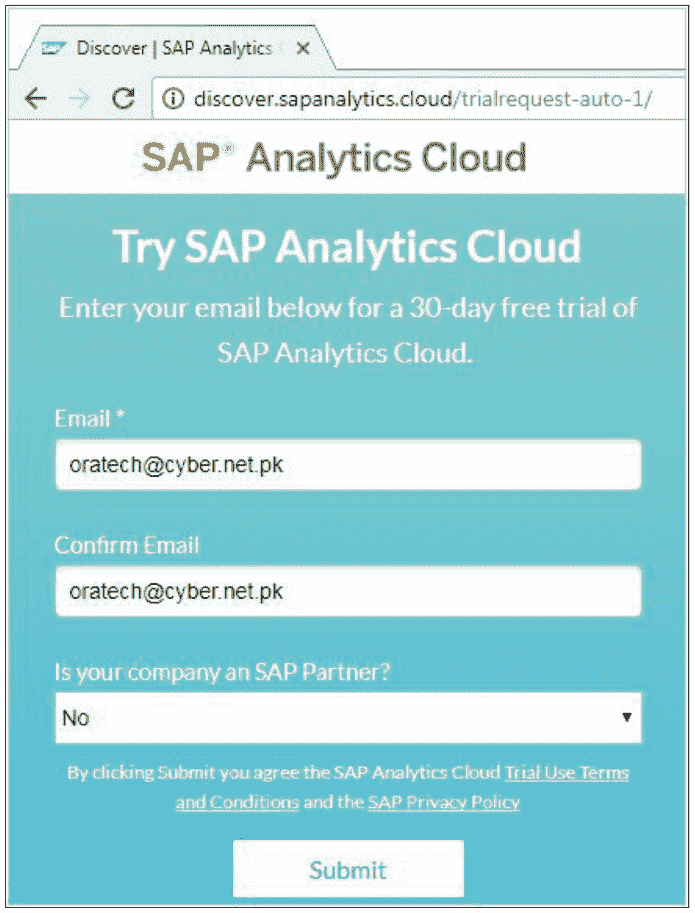

- 5. 在电子邮件中点击“激活账户”按钮。这将打开“激活您的账户”页面，在此您需要设置一个强密码。密码必须至少为 8 个字符长，并且还应包含大写和小写字母、数字和符号。
- 6. 输入并确认密码后，点击“保存”按钮以完成激活过程。确认页面会出现，告知您的账户已成功激活。点击“继续”。
- 7. 您将被带到 SAP Analytics Cloud 网站。您收到的电子邮件中在“ SAP Analytics Cloud 系统”部分下附带了一个链接，您可以随时使用该链接访问应用程序。您的用户名（您的电子邮件地址）也在同一封电子邮件中提及，并附带一个用于访问应用程序的登录按钮。

## 摘要

本章提供了下一代基于云的分析应用程序的简要概述，该应用程序提供端到端的云分析体验。SAP Analytics Cloud 可帮助改变您在单一解决方案中发现、规划、预测、协作、可视化和扩展的方式。除了本地数据源之外，您还可以从各种其他云应用甚至 Excel 和文本文件中获取数据来构建数据模型，然后基于这些模型创建故事。这款出色且易于使用的应用程序的最终目的是让您做出正确的决策。SAP Analytics Cloud 不仅仅是数据的可视化；它是洞察到行动，是成功的实现。

系好安全带，准备进行云之旅。从下一章开始，您将执行动手练习来探索 SAP Analytics Cloud 的精彩世界，从模型开始。

## SAP Analytics Cloud 中的模型

在 SAP Analytics Cloud 中，您创建模型作为所有数据输出的基础。模型是对组织业务数据的表示。它是暴露最终用户分析需求的高级设计。为了确定模型中包含的内容，您必须首先识别源数据中用户需要查询的列。然后，为了确定每列所扮演的角色，请确定它是度量列还是维度属性。我们将学习这些属性以及许多其他步骤，这些步骤将帮助我们创建和查看模型以及其他数据过滤。

本章将涵盖以下主题：

- 模型简介
- 理解度量和维度
- 规划和分析模型
- 创建新的分析模型
- 在建模器界面中查看模型详细信息
- 浏览模型
- 查看模型数据

## 理解度量和维度

您将在本书中看到“measures”和“dimensions”这两个术语。从源导入的每个数据列以在 SAP Analytics Cloud 中构建模型必须标记为度量或维度。度量是组织衡量其业务运营和绩效的列，而维度列包含用于限定度量的数据。
这些术语可以进一步扩展如下：

**度量：** 度量是可以进行测量、聚合或用于数学运算的字段。度量通常是计算得出的数据，例如美元价值或销售数量，并且可以根据维度进行指定。例如，您可能想要确定在给定市场在给定时间段内特定产品的美元总和。

**维度：** 企业使用度量通过成熟的维度来评估绩效，例如按时间、产品和市场。维度通常是无法聚合的字段。维度包含描述业务实体（例如时间、产品、客户名称、区域、国家、城市、地址等）的值。在给定的维度中，可能存在许多属性。例如，时间维度可以包含年份、季度、月份、周和日等属性。这些属性用于深入和跨维度钻取以获得数据的更详细视图。

在关系数据库管理系统（RDBMS）术语中，连接一端的表被视为维度表，而连接多端的表则被视为度量表。以下图示说明了到承载度量数据的表的多对一连接。在此图中，所有连接都具有鸽足符号（表示多侧）指向度量表：

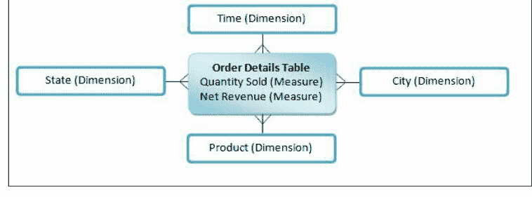


*当您在 SAP Analytics Cloud 中导入数据以创建模型时，它会确定将字段视为维度还是度量。默认情况下，所有文本值的字段被确定为维度，而数值字段被视为度量。*

## 规划和分析模型

在 SAP Analytics Cloud 中，您可以创建规划和分析模型。规划模型是一个功能齐全的模型，其中预先配置了实际、预算、规划、预测和滚动预测的时间和类别维度。规划模型还支持多币种，并在模型和维度级别提供安全功能，以限制对报告中特定值的访问，仅限指定个人。它还具有用于可追溯性的审计功能。拥有规划权限的用户可以创建模型数据的自己的版本，使用分配功能，向模型添加新数据，并将数据复制并粘贴到模型中。


*相比之下，分析模型是更简单、更灵活的通用 BI 模型。分析模型未预先配置预算和预测数据的类别。*

除了这两种模型之外，您还可以连接到 SAP **high-performance analytic appliance (HANA)** 数据库以导入数据库视图并创建新模型。您可以基于 HANA 视图创建分析模型，这使您可以从 HANA 访问维度。要创建此类模型，系统管理员必须首先设置 HANA 数据库。数据库中的分析或计算类型 HANA 视图可以导入以创建新的分析类型模型。视图只能导入一次；要重新导入视图，请从“模型”列表页面删除现有模型，然后开始导入过程。

本章将教您如何从 Excel 文件创建一个简单的分析模型，而规划模型是第 3 章 *规划模型* 的主题。


## 创建新的分析模型

执行以下步骤创建新的分析模型。截图中包含编号步骤，说明创建分析模型的顺序：

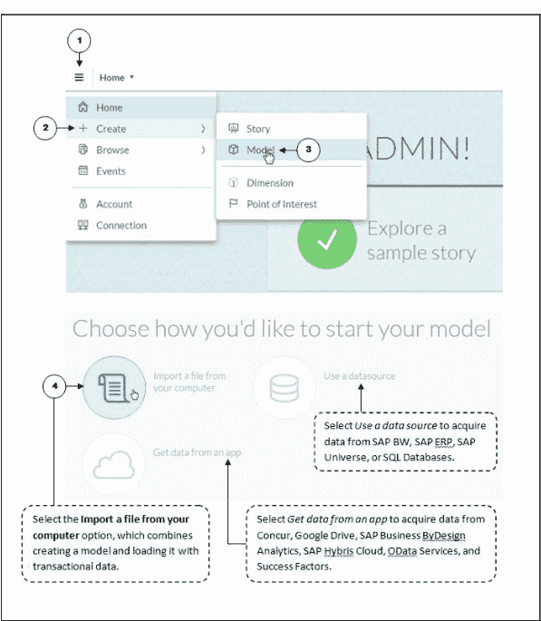

## 选择源文件

您可以将数据从外部文件（如 Excel 电子表格或逗号分隔值文件）导入到新模型中。如果数据保存在 Excel 工作簿的多个工作表中，您将看到一个下拉列表，可从中选择要导入的工作表：

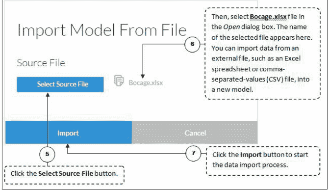

源数据必须包含可用于在新模型中创建维度的列，并且还必须包含事务数据（度量）。事务数据在建模器中不可见，仅在生成的输出中可见。

您可以连接到其他系统以从外部源创建新模型。要连接到此类外部源，您必须选择使用数据源或从应用程序获取数据选项。您也可以通过单独设置维度并精确定义模型的所有偏好和细节来手动创建模型。您可以在向故事添加表格时在规划向导中使用的模板创建模型。

请注意，其中一些模型创建选项在试用版中不可用。因此，为了保持简单，您将使用 Excel 文件创建模型。Bocage.xlsx 文件是随本书提供的用于演示目的的简单 Excel 文件。它包含度量数据（Quantity sold、Sales Revenue、Gross Margin、Discount、和 Original Sales Price）用于衡量使用日期、州、城市、商店、经理、产品和类别维度的绩效。除了度量和维度外，该文件还包含两列（纬度和经度）可帮助您在地理地图中可视化数据。此文件可从 https://github.com/PacktPublishing/Learning-SAP-Analytics-Cloud 下载。

## 为模型设置名称、描述和其他参数

一段时间后，您将在 DataView 选项卡中看到包含已上传数据的 Data Integration 屏幕，如以下屏幕截图所示：

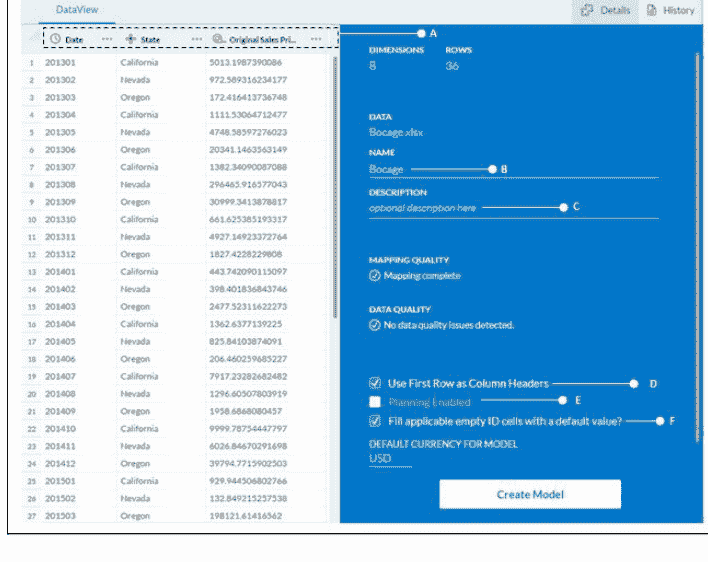

源数据的初始列标题名称与符号 (A) 一起显示，以显示已识别的数据类型。源文件中的数据列用于在模型中创建维度和度量。导入过程分析源数据并创建初始数据视图，其中包含新模型建议的维度。

完成此自动映射过程后，您可以通过指定维度类型并修复任何数据质量问题来完善建议，您将在下一步中执行此操作。在 Details 面板中，查看模型名称 (B)，如有需要可更改。您还可以输入可选描述 (C)。指定是否要将数据的第一行用作列标题 (D)，在当前场景中您应该这样做。您可以通过双击列标题或在 Details 面板中更改列名称来编辑列名称。指定是否要使模型处于 Planning Enabled 状态 (E)。

指定是否要使用自动生成的值填充空 ID 单元格 (F)。如果清除此复选框，则包含空 ID 单元格的行将被省略。

## 设置维度类型

导入数据后，您需要更改一些维度类型，以确保它们提供您希望从模型中获得的结果：

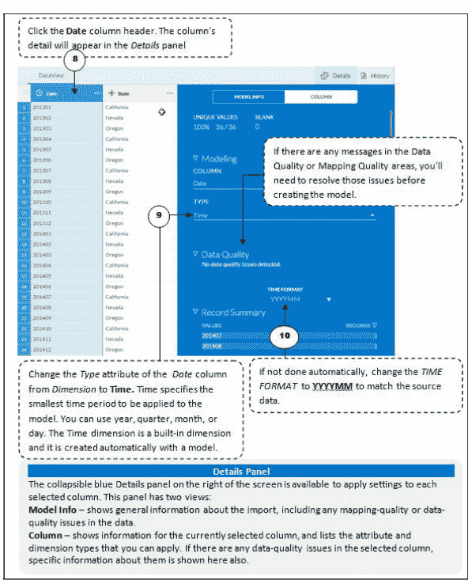

可以按照以下屏幕截图所示进一步完善属性：

切换 Type 属性后，两个列的标题图标也会发生变化。

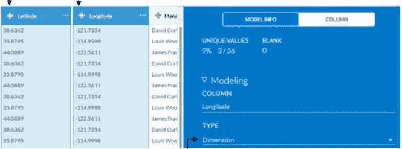

11

将纬度和经度列的 Type 属性从 Measure 改为 Dimension。您可以向模型添加多个此类维度。请注意，导入过程已将 State、City、Store、Manager、Product 和 Category 列的类型设置为维度。

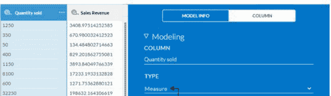

12

将 Quantity sold 列的 Type 属性从 Dimension 改为 Measure。在初始数据导入中，包含文本的列通常被识别为 Dimensions，而数值数据可能被识别为 Measures。确保 Quantity Sold、Sales Revenue、Gross Margin、Discount 和 Original Sales Price 列的 Type 属性标记为 Measure。

## 创建位置维度

您可以通过使用数据集中纬度和经度列创建位置维度来丰富模型，这将使用户能够在地理地图中可视化数据。以下是创建位置维度的步骤：

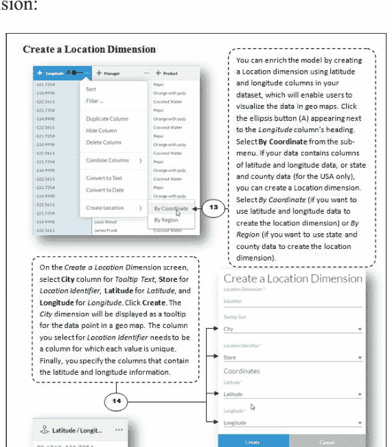

## 从模型中删除不必要的列

您应将模型保持清洁，避免不必要的数据。在此步骤中，您将从模型中删除几列冗余列：

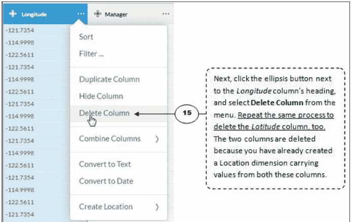

## 在两列之间创建层次关系

**层次结构**在两列之间存在层次关系时很有用，例如类别和产品。将列设置为层次结构允许我们在图表中在类别和产品值之间上下钻取。如果图表中包含层次维度，您可以上下钻取维度以在不同级别探索数据。

您使用名为 Parent-Child Hierarchy (Parent) 的维度属性为任何通用维度定义层次结构。例如，如果导入的数据包含两列 Country 和 City，您可以将 Country 列设置为 Country-City 层次结构的父级。

在当前场景中，您将在导入数据中可用的 Category 和 Product 列之间创建层次关系：

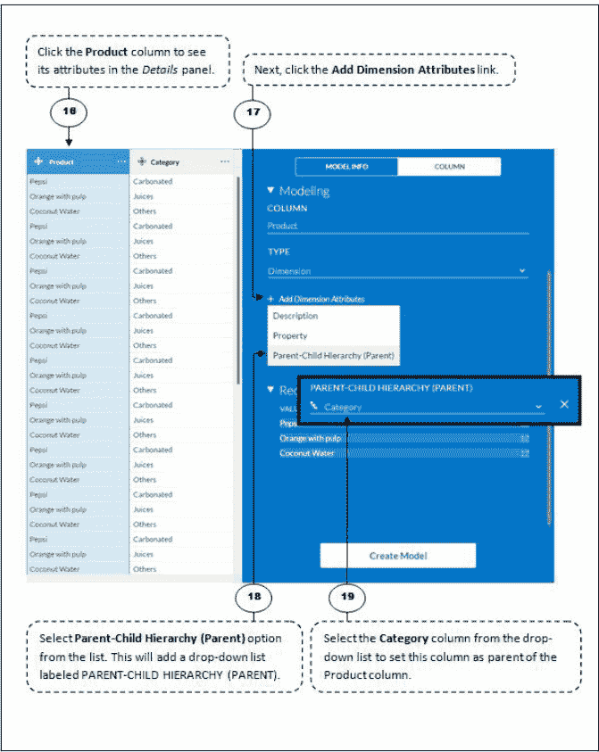

单击 Product 列以在 Details 面板中查看其属性。

接下来，单击 Add Dimension Attributes 链接。

从列表中选择 Parent-Child Hierarchy (Parent) 选项。这将添加一个标记为 PARENT-CHILD HIERARCHY (PARENT) 的下拉列表。

从下拉列表中选择 Category 列，将此列设置为 Product 列的父级。

以下步骤可确保 Category 列被标记为 Product 列的父级：

单击 Category 列，查看该列是否被标记为 Product 列的父级。

## 建模

+   - Carbonated
+   - Juices
+   - Others
+   - Carbonated
+   - Juices
+   - Others
+   - Carbonated
+   - Juices
+   - Others
+   - Carbonated
+   - Juices
+   - Others

COLUMN
Category
TYPE
Parent-Child Hierarchy (Parent)
+ Make this a Dimension
PARENT OF DIMENSION
Product

创建模型后，您将在 Modeler 界面中看到此层次关系。

NAME
Bocage
DESCRIPTION
optional description here
MAPPING QUALITY
Mapping complete
DATA QUALITY
No data quality issues detected.
Use First Row as Column Headers
Planning Enabled
Fill applicable empty ID cells with a default value?
DEFAULT CURRENCY FOR MODEL
USD
Create Model

最后，单击 Details 面板中的 Create Model 按钮，然后单击在单独对话框中出现的另一个 Create 按钮，以完成模型创建过程。

## 在建模器界面中查看模型

创建模型后，您将被带到建模器区域，新模型会出现在界面中。它包含一个选项卡，其中包含两个内置维度（time 和 account）和五个私有维度（state、city、store、manager、和 product），这些维度是使用源数据文件创建的。

## 时间维度

单击 Time dimension 选项卡 (A)。Time dimension 内置于分析模型中，用于定义计划时间线的开始和结束日期以及计划中将使用的最小时间单位。时间维度指定模型的整体时间范围以及粒度——数据将被分析到的最小时间段，例如年、季度、月或日。

*请注意，在当前场景中，最低粒度以及两个日期范围筛选器是根据底层模型中定义的时间粒度自动应用的（请参阅 `Bocage.xlsx` 文件中的 Date 列格式）。*

这些筛选器将确保仅在所选时间段内的详细信息可见，如以下屏幕截图所示：

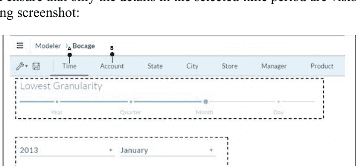


## 账户维度

账户维度（B）是模型的主要维度。账户维度定义了账户成员的集合以及账户数据的格式。您映射为度量的每一列（当前场景中为销售数量、销售额、毛利、折扣和原始销售价格）都将作为成员出现在账户维度中。模型只能有一个账户维度。与私有维度不同，其值位于不同的列中，账户维度成员的数据在建模器中不可见。正如以下插图所示，您为某些基于关键指标的列（销售额、毛利、折扣、原始销售价格和销售数量）导入的数据不可见：

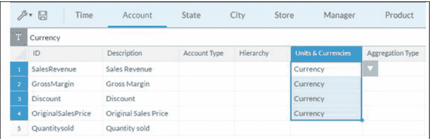

除了基本的 ID、描述和账户类型列之外，在首次设置维度时会自动创建一组技术属性。您可以使用工具栏上的技术属性按钮隐藏这些列，但它们无法删除。账户维度的大多数属性都提供列表框以帮助您输入数据。例如，您可以为四个货币列设置货币值，以便在数值后显示货币符号。默认情况下，所有这些账户成员的聚合类型均设置为 SUM，因此您在此处无需显式选择此聚合方法。

## 私有维度

私有维度仅存在于当前模型中，不会出现在公共维度列表中。当您在从文件或 SAP Business Warehouse、SAP ERP、SAP Universe 或其他数据库导入数据时创建维度时，它们会被创建为私有维度。当您删除一个模型时，该模型中的私有维度也会被删除，但公共维度不会被删除。所有维度至少都具有描述和 ID 属性。通常，对于每个维度，导入的数据列用作维度的描述属性。然后为每个维度自动生成一个 ID 列，以包含行的唯一 ID：

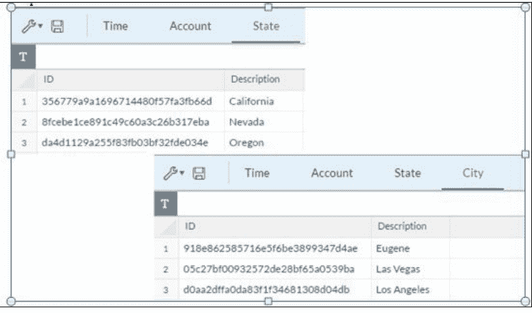

请回忆，在第 13 步创建位置维度部分时，我们将 Store 列设置为其位置标识符，并指定了纬度和经度列。模型创建过程将所有这些信息汇总到 Store 选项卡下，这将使您能够在地理地图中可视化数据：

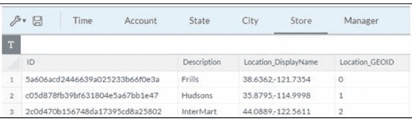

您在第 16 至 20 步中在类别和产品列之间创建了层级关系。您可以在产品选项卡下看到该关系。例如，椰子水产品已链接到其他类别。相同的层级关系在右侧的蓝色预览面板中呈现：

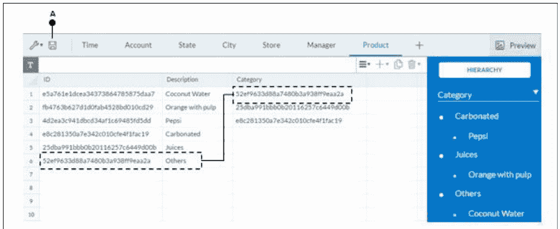

当您在建模器中对模型进行任何更改（例如在时间维度中更改筛选器）时，请单击保存图标（A）以保留您的更改。

## 浏览模型

要查看现有模型的列表，请单击主菜单图标上的模型并转到浏览 | 模型。您将被带到模型界面（此处所示），其中列出了您所有的模型：

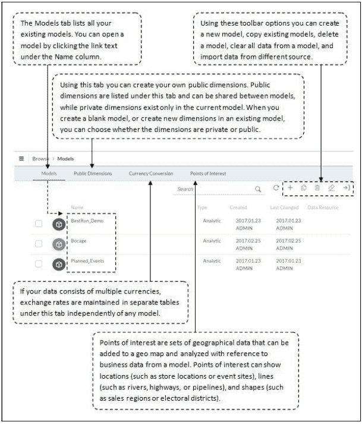

## 复制模型

模型工具栏部分中的复制选项是基于现有模型创建新模型的非常方便的选项。它在以下屏幕截图中说明。

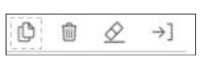

当您使用此选项复制模型时，数据和私有维度也会复制到新模型中。公共维度从被复制的模型中引用。请注意，您只能对 SAP Analytics Cloud 2016.21 版本或更高版本创建的模型使用此选项。此外，请注意，如果模型使用池维度（用于分配），则无法使用复制实用程序。执行以下步骤以复制现有模型：

- 1. 转到主菜单 | 浏览 | 模型。
- 2. 在要复制的模型前打勾。如果所选模型允许复制，则复制图标将被启用。
- 3. 单击复制图标。
- 4. 为新模型输入名称并提供描述，描述为可选。
- 5. 单击确定以进行复制。

## 删除模型

工具栏上的删除图标可让您删除模型及其所有数据：


但是，此选项仅适用于具有删除模型权限的用户角色。


> *请注意，您无法删除当前正在使用的模型。故事依赖于模型，因此如果您尝试删除在故事中使用的模型，则会显示故事的名称，并且删除操作将被中止。*

使用以下步骤集删除模型：

- 1. 转到主菜单 | 浏览 | 模型。
- 2. 使用要删除的模型旁边的复选框。请注意，您可以一次选择多个模型并同时删除它们。
- 3. 单击工具栏上的删除图标。

## 清除模型数据

工具栏上用橡皮擦图标表示的清除所选模型选项用于清除所选模型的所有数据：


与删除选项一样，此选项也需要对模型具有删除权限。以下是此过程的步骤：

- 1. 转到主菜单 | 浏览 | 模型。
- 2. 通过勾选其框来选择一个模型。
- 3. 单击工具栏上的清除所选模型图标。您将看到模型中每个维度的成员层次结构。请注意，您可以整体清除模型、单个维度或所选维度成员。选择单个账户成员，或在顶层选择分支的所有成员。
- 4. 在做出选择后单击确定按钮继续。将出现确认对话框。接受确认以完成该过程。

## 查看模型数据

如前所述，账户维度成员的数据在建模器中不可见。您可以在故事中查看此数据，这是第 4 章《使用图表创建故事》的主题。目前，您将创建一个临时故事来查看模型数据的反映。

要查看模型数据，请执行以下步骤：

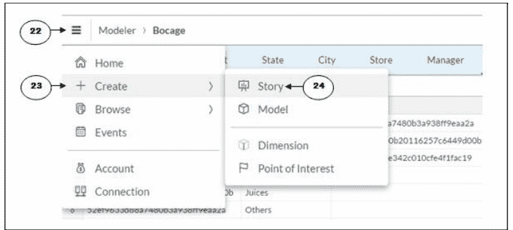

单击故事选项后，将启动向导，您将看到以下屏幕：

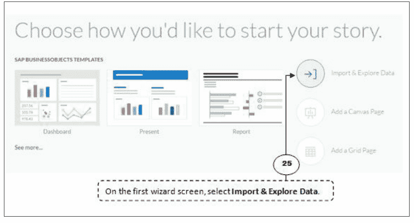

当您单击导入和导出数据时，您会看到选择如何添加数据的屏幕：

## 选择如何添加数据。

使用现有数据

导入文件

连接到 Google Drive

在下一屏幕中，选择使用现有数据。

## 选择您的数据

名称

Bocage

在选择您的数据屏幕上，选择 Bocage 模型并单击确定。

按照以下屏幕截图中显示的步骤继续添加维度：

## 故事 > 新文档(1)*

## 数据视图

## 指标

- 销售数量
- 销售额
- 毛利
- 折扣
- 原始销售价格

指标窗格显示所选模型中的所有可用指标。

## 添加维度

从您的数据集中引入更多维度以开始探索

单击添加维度图标。这将显示显示/隐藏数据框。选择显示全部选项以显示所有维度，或单独单击每个维度以按您想要查看的顺序对它们进行排序。

单击箭头图标以展开/折叠数据视图面板。

## 显示/隐藏数据

- 显示全部
- 州
- 城市
- 商店
- 经理
- 产品
- 日期

您可以使用眼睛图标（A）在初始选择后更改显示的维度。

## 查看数值数据

我们有查看数值数据的选项。我们可以用以下屏幕截图中描述的顺序来完成此操作：

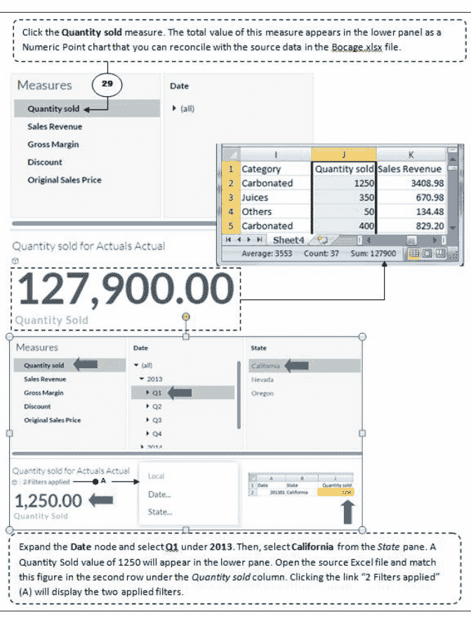

单击销售数量度量。该度量的总值将作为数字点图表出现在下部面板中，您可以将其与 Bocage.xlsx 文件中的源数据进行核对。

展开日期节点并在 2013 年下选择 Q1。然后从州窗格中选择加利福尼亚。下部窗格中将出现 1250 的销售数量值。打开源 Excel 文件并在销售数量列下的第二行匹配此数字。单击链接“已应用 2 个筛选器”（A）将显示两个已应用的筛选器。


## 以图形方式查看数据

图形化表示可以非常清晰地呈现数据。
我们可以通过以下截图中列出的步骤来实现：

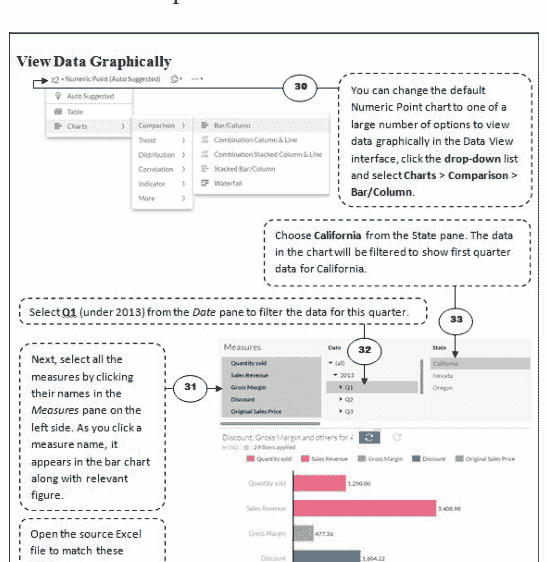

现在，再次点击加利福尼亚州将其取消选择，然后点击内华达州进行选择。当您点击该州名称时，图表会自动更新以反映内华达州的数据，您可以将其与源数据进行匹配。重复此步骤以查看俄勒冈州的数据。

## 观察更多的数据过滤

保持 Measures 面板中所有度量项处于选中状态（如前图所示），并在 Date 面板中选择 2013 年下的 Q1。当您不选择任何州时，结果将类似于以下截图中第一列所示的输出。结果显示所有州的所有城市、商店、经理和产品。在第二列中，您对加利福尼亚州设置了过滤器。当您选择该州时，其余面板将被过滤，仅显示与加利福尼亚州相关的城市、商店、经理和产品。同样，第三列和第四列分别显示内华达州和俄勒冈州的相应数据。这展示了 SAP Analytics Cloud 的自动过滤过程，该过程基于源数据执行。

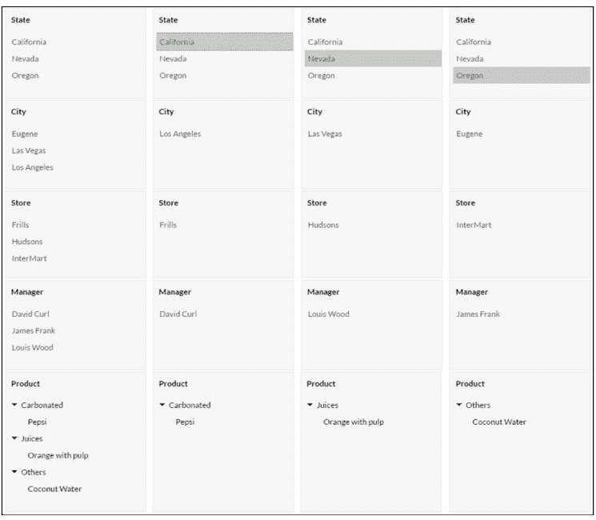

## 摘要

本章提供了在 SAP Analytics Cloud 中创建分析模型的实践操作，该模型是满足您所有分析需求的基础。

从文件创建新的分析模型的工作流程如下：

- 1. 导入源文件。
- 2. 为模型设置名称、描述和其他参数。
- 3. 在初始数据视图中，为新模型中的维度选择维度类型。
- 4. 为维度指定属性。
- 5. 清理您的数据并修复任何映射或数据质量问题。
- 6. 如有需要，创建位置维度以在地理地图中可视化数据。
- 7. 删除您不打算在故事中使用的列。
- 8. 在列之间创建层次关系。
- 9. 启动模型的自动创建。

在下一章中，您将学习第二种模型类型，即规划模型，它具有预算、计划和预测的类别。它还带有默认时间段，您可以根据数据进行调整。它通过审计功能提供可追溯性，并提供强大的安全功能来控制用户访问权限。

## 规划模型

本章是前一章的延续，在前一章中您了解了 SAP Analytics Cloud 中模型的概念，并对分析模型进行了实践操作。在这里，您将了解第二种模型类型，即规划模型。规划模型是您使用规划功能工作的模型。提醒您，规划模型是一个功能齐全的模型，它带有预配置的时间和类别维度，用于实际值、预算、规划、预测和滚动预测。

规划模型还支持多币种，并在模型和维度级别提供安全性，以限制对报告中特定值的访问，仅限指定个人。它还带有用于可追溯性的审计功能。具有规划权限的用户可以创建自己的模型数据版本、使用分配功能、向模型添加新数据以及将数据复制并粘贴到模型中。

在本章中，您将学习以下内容：

- 创建规划模型
- 可视化规划模型的数据
- 在表格中查看模型的文本数据
- 展开、分配和分配值
- 创建规划模型的私有版本

## 创建规划模型

执行以下步骤创建规划模型：

- 1. 点击主菜单图标，然后转到 创建 | 模型：

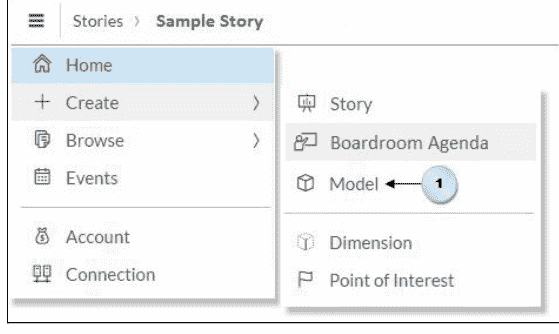

您可以从头开始创建规划模型，在其中手动在单元格中输入值或从电子表格复制和粘贴数据。您也可以通过从各种来源导入数据来创建此模型类型。为了简化操作，在本练习中您将从名为 `storesData.xlsx` 的 Excel 文件中获取数据。

- 2. 在 新建模型 页面上，点击 从计算机导入文件：

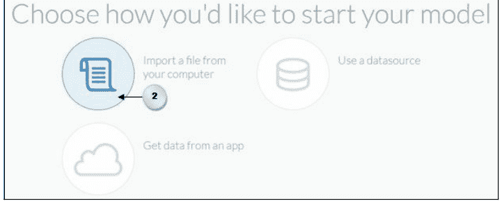

- 3. 在 从文件导入模型 对话框中，点击 选择源文件 按钮（A），并在 Windows 打开 对话框中浏览来自书籍源的 `storesData.xlsx` 文件（B）。请注意，该文件有三个工作表，包含 Actuals、Budget 和 Forecast 类别的数据。通过从 工作表 列表中选择 Actuals 选项（C）开始流程并导入数据。其他两个类别的数据将在后续步骤中导入。点击 导入 开始流程：

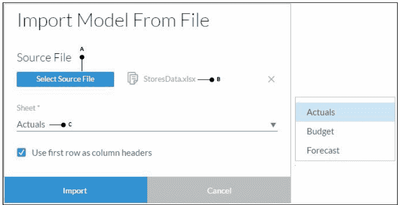

过了一会儿，您将看到数据集成屏幕，如以下截图所示。该屏幕对您来说应该很熟悉，因为您在上一章中使用过它。在这里，唯一需要您注意的是 Planning Enabled 选项，该选项必须为此模型打开。

- 4. 为模型名称输入 StoresData（A），并选择 Planning Enabled 选项（B）。点击 创建模型 按钮（C），并在后续对话框中确认模型创建：

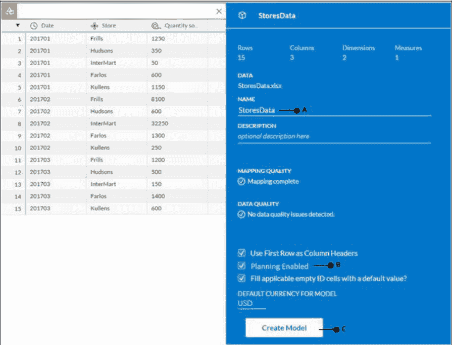

模型将被创建，其定义将出现在 Modeler 界面中，如以下截图所示。Store 维度包含您从 Excel 文件导入的五个商店的信息。对于每个规划模型，都会自动创建一个 Version 维度，它显示模型包含的数据类型。由于您在步骤 3 中选择导入 Actuals 类别的数据，Version 选项卡显示模型当前持有 Actual 类别的数据。当您在后续步骤中将数据上传到模型时，额外的版本类别（预算和预测）将被添加到此网格中：

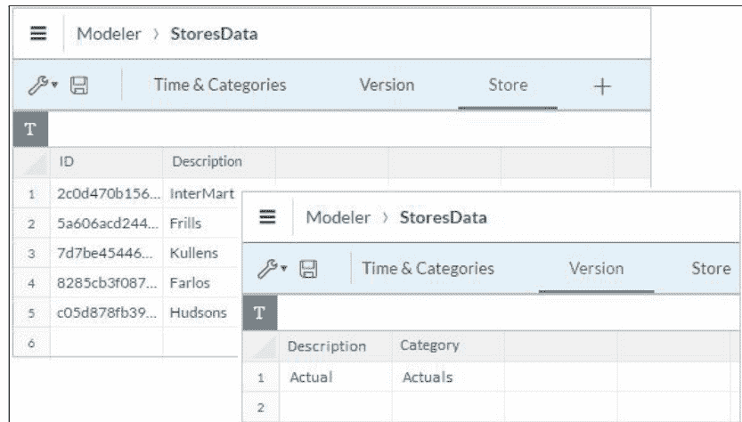

Time & Categories 选项卡显示 Lowest Granularity 部分，您在上一章创建分析模型时已了解过该部分。它现在有一个 Categories 部分，其中包含一些类别，用于定义您将在模型中管理的数据类型。请注意，分析模型仅包含一个类别来显示实际结果。规划模型中类别旁边的下拉列表让您可以分别定义每个类别的规划范围。例如，您可以将 Budget 设置为年，Planning 设置为季度，Forecast 设置为月。您可以通过在 Look Back 和 Look Ahead 框中输入值来设置范围。无论是对模型进行何种类型的更改，无论是添加新维度还是切换类别，都不要忘记保存您的模型。

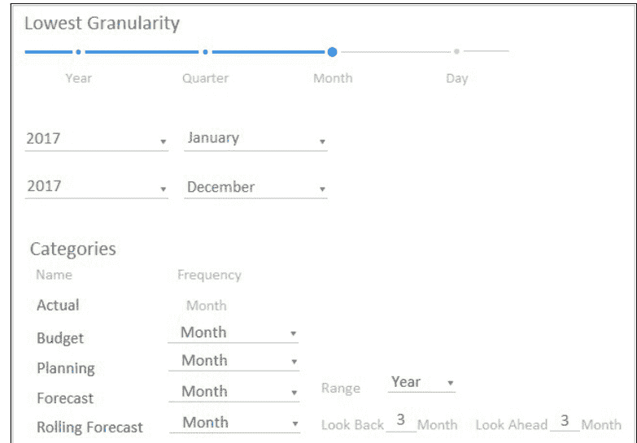

- 5. 点击 Modeler 面包屑链接返回并访问主 Models 页面，如下一截图所示。

在前四个向导式步骤中，我们创建了规划模型并从 Excel 文件添加了实际类别的数据。在以下步骤中，我们将附加剩余两个类别的数据。

- 6. 在 Models 页面上，选择 StoresData 模型（A）。然后点击工具栏上的 导入数据 图标（B）。除了从文件导入数据外，您还有多种其他选项可以使用数据填充模型。所有这些可用选项在您点击 导入数据 图标时都会显示。对于本示例，点击 导入数据自文件 选项（C）：

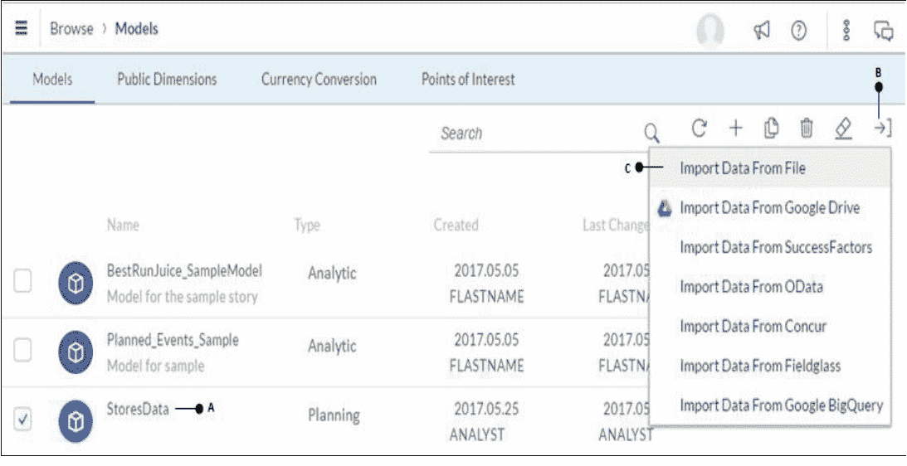

- 7. 再次在 导入数据自文件 对话框中点击 选择源文件 按钮（A）。这次，从 工作表 列表中选择 Budget 选项（B），以从同一 Excel 文件的第二个工作表中导入 Budget 类别的数据：

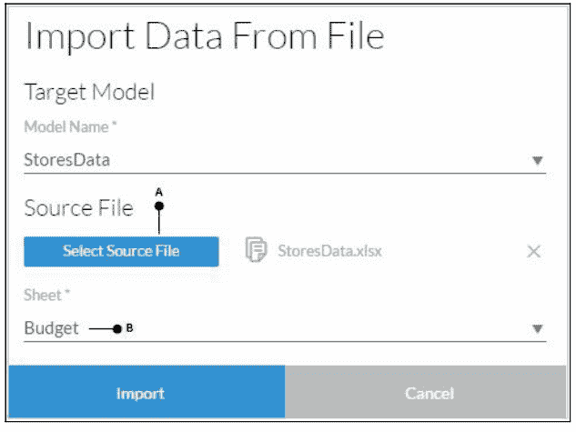


当您在“从文件导入数据”对话框中单击“导入”按钮时，StoresData.xlsx 文件中 Budget 工作表中的 Budget 类别数据将被导入，并且您将再次看到“数据集成”页面，如以下屏幕截图所示。

8. 单击 Date 列标题 (A) 以在“列信息”选项卡 (B) 上查看其详细信息。目前，该列未正确映射。为了使文件中的数据与模型中定义的数据维度保持一致，您需要正确映射该列，这可以通过从“映射到”列表中选择 Date (C) 来完成：

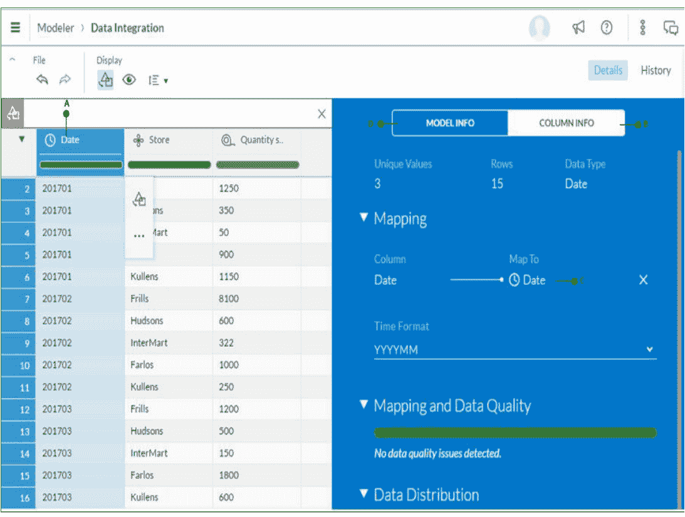

9. 单击“模型信息”选项卡 (D)。在此，您必须指定要导入数据的类别。要合并预算数据，请将“类别”设置为 Budget，并为“版本名称”输入 Budget。

10. 在“导入方法”部分，您必须选择三个选项之一。Update 选项 (A) 会更新现有数据并向目标模型添加新条目。Clean and Replace (B) 会删除现有数据并向目标模型添加新条目。Append (C) 会保留现有数据不变并向目标模型添加新条目。对于本次练习，请选择 Append 选项，将预算类别数据附加到模型中已有的 Actuals 类别数据。单击“完成映射”以完成映射过程并导入数据：

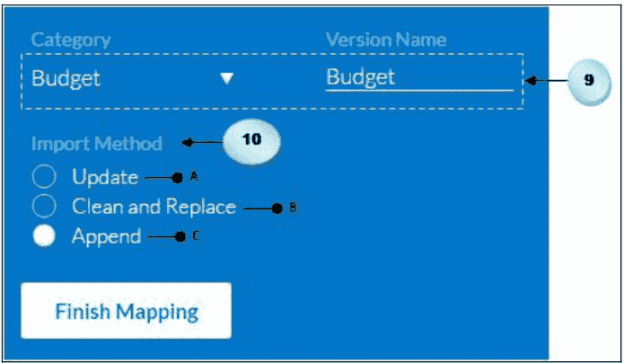

11. 使用前几步提供的说明并参考以下屏幕截图，从同一 Excel 文件导入预测数据。在“从文件导入数据”对话框中，从 Excel 文件中选择 Forecast 工作表 (A)。在“模型信息”选项卡上，将“类别”选择为 Forecast (B)，并为“版本名称”输入 Forecast (C)。最后，选择 Append 选项 (D) 以避免覆盖。单击“完成映射”以完成该过程。

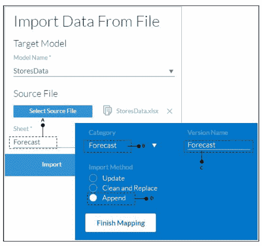

如果在为三个类别导入数据后查看“版本”选项卡，您会看到该选项卡现在显示全部三个版本 (A)，如以下屏幕截图所示：

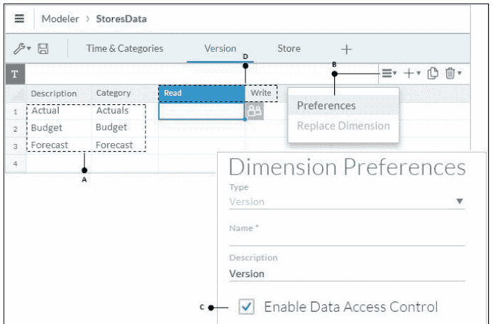

这些是模型中当前正在使用的每个类别的公共版本。您还可以对这些版本设置限制。要添加用户限制，请打开维度首选项 (B) 并启用“数据访问控制”选项 (C)。启用此选项后，维度中将添加“读取”和“写入”列 (D)，使您能够指定要在每个可用版本中授予读取和写入访问权限的用户。有关访问权限的更多详细信息，请参阅第 10 章 *System Administration* 中的 *Setting security for models* 部分。

## 可视化规划模型数据

模型已准备好进行分析。与分析模型一样，我们再次需要创建一个临时故事来查看此模型的数据。为此，请执行以下步骤：

- 1. 从主菜单转到“创建 | 故事”。
- 2. 在询问您如何开始故事的第一个向导页面上，选择“添加画布页面”选项。故事页面将出现，并为新故事提供默认名称。
- 3. 单击工具栏上“数据视图”部分中的箭头。系统将提示您添加数据。
- 4. 在此屏幕上，选择“使用现有数据”。
- 5. 在“选择您的数据”对话框中，选择 StoresData。这是您在上一节中上传的规划模型数据。单击“确定”以关闭对话框：

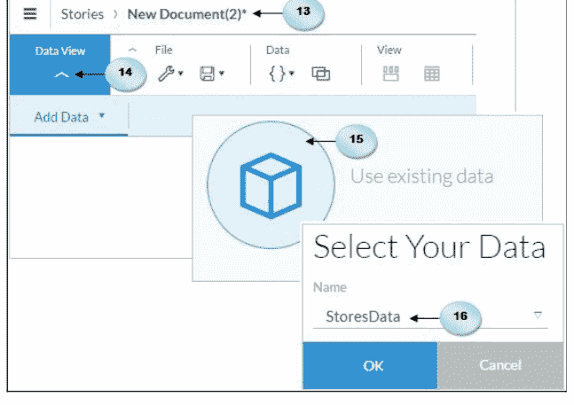

您将再次看到上一章中使用的“数据视图”面板。单击“度量”窗格中的 Quantity sold (A) 以查看其实际数据。默认情况下，“版本”设置为 Actual (B)。单击“显示维度”图标 (C)，并从列表中选择“显示全部” (D)，以同时查看 Date (E) 和 Store (F) 维度。展开 Date 节点，并选择一月 (G)。在“商店”窗格中，选择 Farlos (H)。Farlos 一月的实际销售数量 600 将出现在下部窗格中。您可以在源 Excel 文件中验证此数字 (I)：

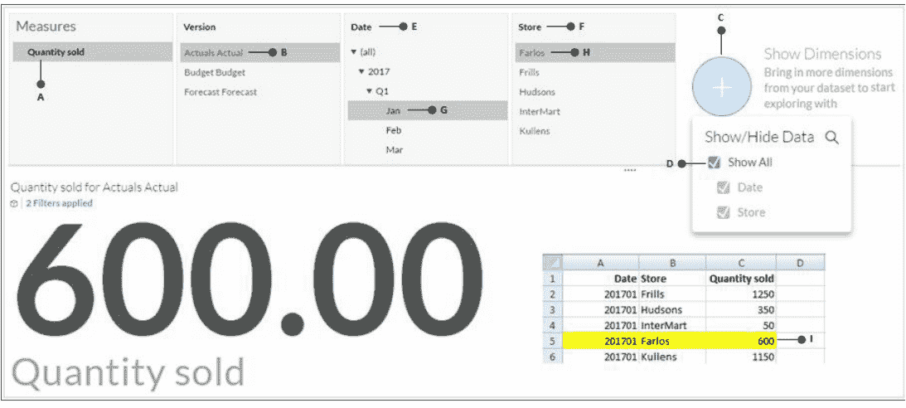

让我们从不同角度看看如何可视化规划数据。在这些步骤中，我们将在故事页面上添加一个条形图，以便同时比较实际、预算和预测数据。

- 1. 在工具栏上，单击“图表”图标以向故事的第 1 页添加空白图表。
- 2. 单击“设计器”链接以查看设计器面板：

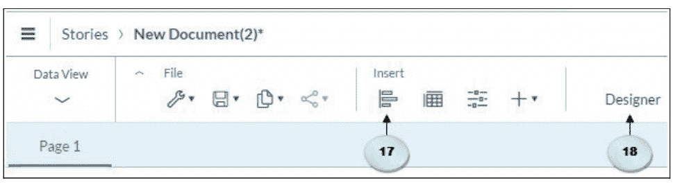

在设计器面板中单击“构建器”选项卡以设置图表的属性。由于您已在第 16 步中选择了模型，因此 StoresData 模型将自动出现在“数据源” (A) 下。执行以下步骤来填充图表。

- 3. 在“度量”部分，单击“添加度量”链接，并从列表中选择 Quantity Sold。
- 4. 在“维度”部分，单击“添加维度”链接，并选择 Date 维度。
- 5. 在“颜色”部分，单击“添加维度”链接，并选择 Version。将会添加一个 Version 部分，其中包含 Actual 版本。单击“添加版本”链接 (B)，并选择 Budget 以在 Actual 下添加 Budget 版本。重复此过程以添加 Forecast 版本。您可以选择设置不同的图案 (C) 和颜色 (D) 以在图表中区分三个版本：

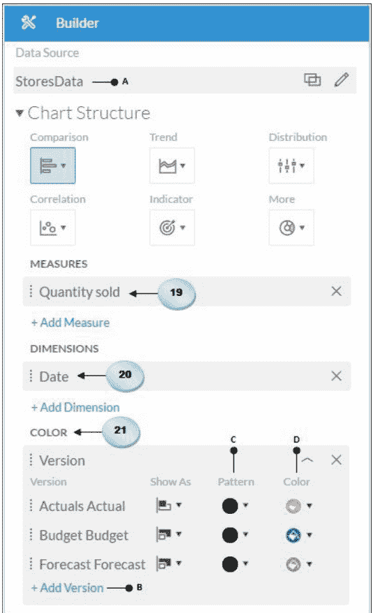

图表将根据您的选择进行转换，并显示代表三个版本的三个条形。单击图表下方的 all 链接 (A)，并从出现的工具栏中选择“按日期下钻” (B) 图标。再次单击此选项三次，直到看到月份，这是最低粒度；您无法在此级别之外进行下钻。

- 6. 单击图表垂直工具栏上的“更多操作”图标。
- 7. 从后续菜单中选择“添加差异”：

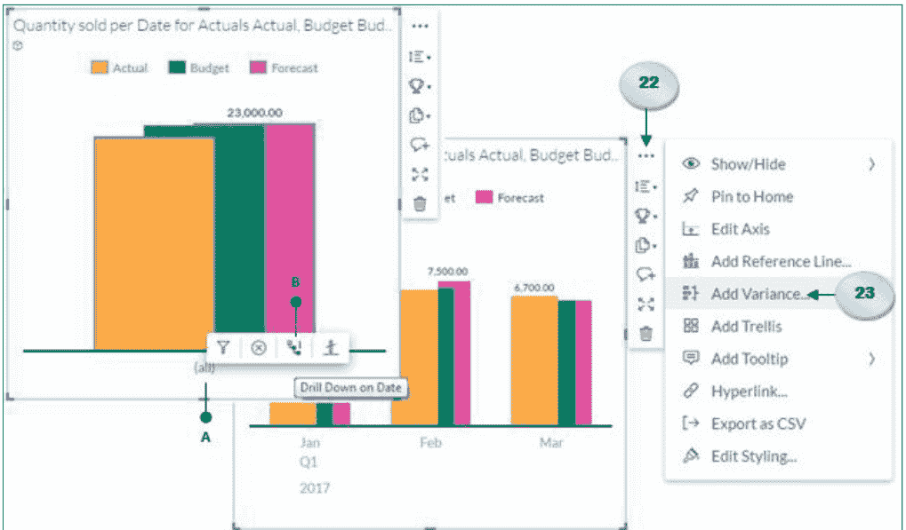

“创建差异”面板出现在您的右侧。通过向图表添加差异，您可以比较两个值。例如，在当前场景中，您将创建一个差异，以显示销售数量的实际值与预算值之间的差异。

- 8. 在“比较” (A) 部分，选择 Quantity sold 作为度量。
- 9. 在“比较” (A) 部分中选择 Actual 作为版本。
- 10. 在“到” (B) 部分，选择相同的 Quantity sold 列作为度量。
- 11. 在“到” (B) 部分中选择 Budget 作为版本。
- 12. 单击“确定”以保存您的差异设置。

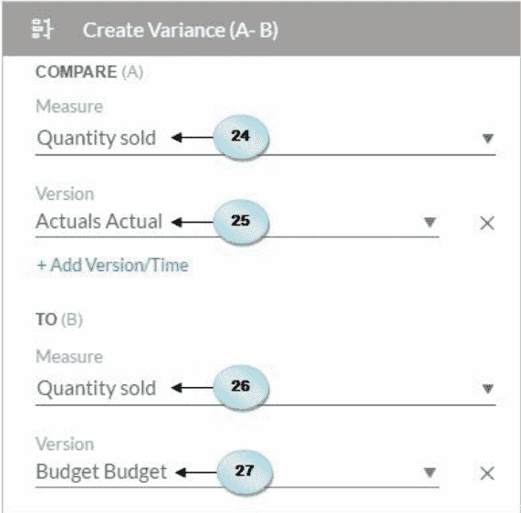

您的设置输出将类似于以下屏幕截图。第一个差异数据点显示负值 -1,200 (A)。该数字是通过减去一月份的实际值 (8,000) 和预算值 (9,200) 计算得出的。剩余点以相同方式计算。为方便起见，图中已显示数值。如果您还想以百分比查看结果，则可在“创建差异”面板的“显示选项”部分下打开“百分比”选项：

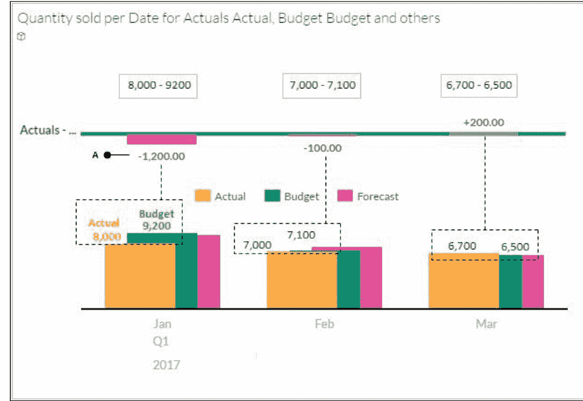

## 查看文本数据

在 SAP Analytics Cloud 中，您可以使用表格对象查看模型数据。表格是一种类似电子表格的对象，可用于查看和分析模型中的文本数据。有关此对象的更多详细信息，请参阅第 7 章《Working With Tables and Grids》。执行以下步骤以在表格对象中查看三个版本的数据：

- 1. 在您的故事页面上，单击页面工具栏上的加号图标，并选择“网格”以向故事添加网格页面。
- 2. 在新的网格页面上，单击工具栏上的“添加”图标以添加表格对象。
- 3. 在“选择模型”对话框中，选择第一个“现有模型”选项 (A)，然后从“名称”列表中选择 StoresData (B)。单击“确定”。

在“构建器”面板中，设置表格对象的以下属性：

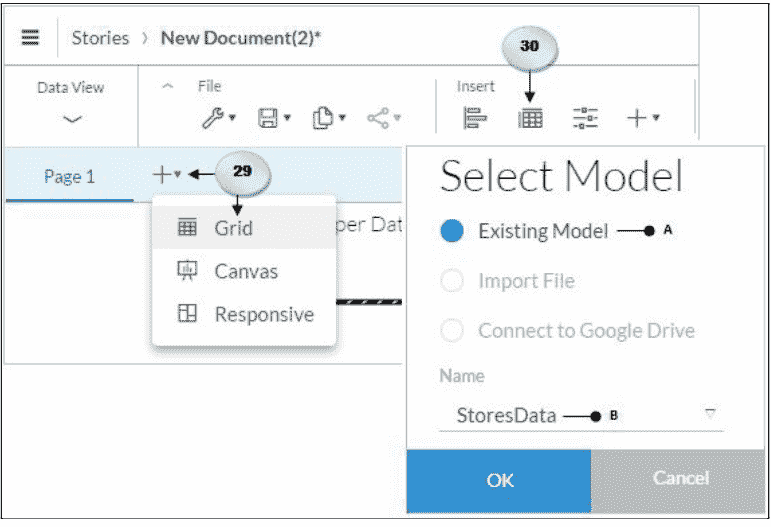

- 4. 在“行”部分单击“添加度量/维度”链接 (A)，并选择 Store 维度。
- 5. 再次单击同一链接，并选择 Date 维度。
- 6. 在“列”部分单击“添加度量/维度”链接，并选择 Version。
- 7. 将鼠标指针悬停在 Version 维度上，并单击“管理筛选器”图标。
- 8. 在“Version 的所选筛选器”对话框中，选择全部三个版本，如以下屏幕截图所示：


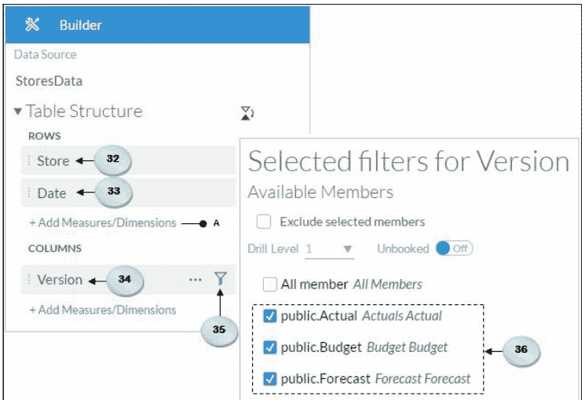

您选择的输出在以下截图中显示。商店和日期维度占据行位置，而三个数据版本则显示在单独的列中。日期维度以层次结构呈现，包含年份、季度和月份节点。月度数据汇总到季度，然后再汇总到年份：

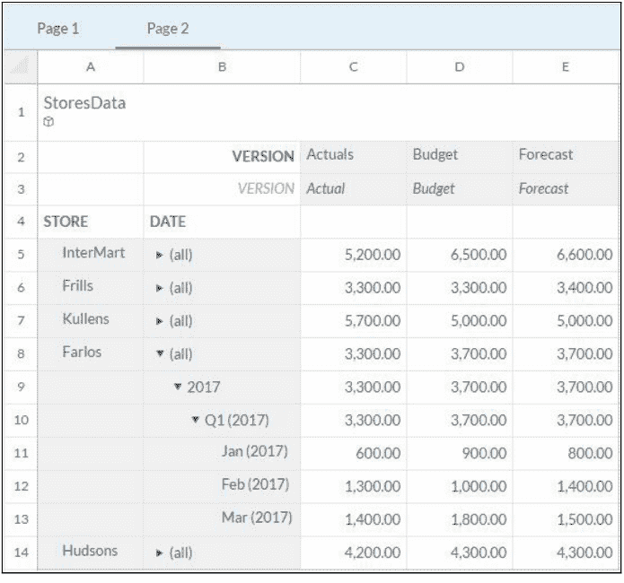

## 分摊、分配和指派值

除了从模型数据中获取值之外，您还可以在表格中添加自己的值。为此，您使用 SAP Analytics Cloud 的分配功能，其中包括分摊、分配和指派值。分配是将源数据派生的值拆分为多个值并将值存储到目标数据的过程。分配功能用于规划和数据分析以获得洞察。

分摊、分配和指派操作是将表格中的值分配到一个或多个目标单元格的方式。这些功能可以帮助您快速录入新值并调整计划中的现有值：

- **分摊**：在分摊操作中，源单元格的值会分摊到叶成员。值从层次结构的较高层级获取并分摊到较低层级。您可以自动或手动执行分摊。
- **分配**：在分配中，值在层次结构内通过将源成员的金额分配给其兄弟节点的叶成员而发生变化。您可以将一个单元格中的部分或全部值移动到同一层级中的其他单元格，或移动到同一层次结构不同分支的成员。与分摊不同，分配会从源单元格中减去值以添加到目标单元格。汇总到源单元格的叶成员会按比例减少，而目标单元格的叶成员会按比例增加。
- **指派**：使用指派功能，您可以在不指定源单元格的情况下向目标单元格追加或覆盖值。在此，您选择要指派的金额。您指派的值不会从使用分摊或分配时出现的任何其他单元格中扣除。

让我们看看当我们在已有值的单元格中指定新值时，值是如何自动分摊的。将 Farlos 商店的第一季度预测值从 3,700 改为 4,000。该商店的整个层次结构都将受到此更改的影响。如以下截图所示，新值已根据每个月先前分配的值在三个月之间进行分摊。当您以这种方式指定值时，层次结构中较低层级项目之间的现有权重得以保留。例如，修改前的 1 月份预测值为 800，该数字对总金额的贡献为 21.62%（800*100/3700）。修改后，相同的百分比用于计算该月份的新值，即（4000 * 21.62% = 864.80）。

|  | 商店 | 日期 | 实际值 | 预算 | 预测 |
|---|---|---|---|---|
|  |  | 版本 | 实际值 | 预算 | 预测 |
|  |  | 版本 | 实际 | 预算 | 预测 |
|  | 商店 | 日期 |  |  |  |
| 5 | InterMart | ▶ (all) | 5,200.00 | 6,500.00 | 6,600.00 |
| 6 | Frills | ▶ (all) | 3,300.00 | 3,300.00 | 3,400.00 |
| 7 | Kullens | ▶ (all) | 5,700.00 | 5,000.00 | 5,000.00 |
| 8 | Farlos | ▼ (all) | 3,300.00 | 3,700.00 | 4,000.00 |
| 9 |  | ▼ 2017 | 3,300.00 | 3,700.00 | 4,000.00 |
| 10 |  | ▼ Q1 (2017) | 3,300.00 | 3,700.00 | 4,000.00 |
| 11 |  | Jan (2017) | 600.00 | 900.00 | 864.80 |
| 12 |  | Feb (2017) | 1,300.00 | 1,000.00 | 1,513.60 |
| 13 |  | Mar (2017) | 1,400.00 | 1,800.00 | 1,621.60 |
| 14 | Hudsons | ▶ (all) | 4,200.00 | 4,300.00 | 4,300.00 |

除了自动分摊值之外，您还可以手动为特定维度和层级的成员指定权重，方法是选择源单元格，然后从工具栏转到分配值 (↕) | 分摊。

在分摊对话框中，您需要指定要分摊所选值的目标维度。在当前场景中，日期维度将被设为目标维度。使用此对话框右侧的图标，您可以选择要分摊所选值的层次级别。未预订选项允许您分摊到没有值的成员。


> *请注意，如果您未选择层次结构的底部级别作为目标，则值将使用现有权重自动分摊到叶单元格，前提是这些单元格已填充。如果您已打开未预订选项且单元格为空，则会将相等的值分摊到所有叶单元格。*

有几种方法可以分摊值。您可以输入数值权重值，例如成员之间的简单比率，或单击吸管图标以按顺序从故事中的其他单元格复制值到可用字段中。当您手动输入值时，分摊的是值的相对权重，而不是值本身。

当我们希望在成员之间应用相同的权重时，此功能很有用。预览列显示分摊后表格中会出现的值。一旦您对该对话框中的统计数据感到满意，请单击应用分摊按钮以分摊值：

## 分摊 4000.00 $

目标维度

日期

## 选择级别和权重

未预订 关闭

| 级别 | 权重 | 预览 |
|---|---|---|
| Jan | 864.80 | 21.62% 864.80 $ |
| Feb | 1513.60 | 37.84% 1513.60 $ |
| Mar | 1621.60 | 40.54% 1621.60 $ |

应用分摊

取消

## 创建私有版本

您在上一节中添加到规划模型中的三个数据版本（实际值、预算和预测）被称为公共版本。公共版本存储在数据库中的原始模型数据中。如本章前面所述，对模型数据的访问由数据权限控制，您可以通过为维度启用数据访问控制并在建模器中为用户分配适当的权限来建立这些权限。

在 SAP Analytics Cloud 中，您可以从这些公共版本类别创建自己的私有数据版本。私有版本仅对模型的创建者或所有者可见。您使用这些版本来更改或模拟计划值，而不会让其他人看到。当您发布私有版本时，它会被提升为公共版本，而私有版本将被删除。您可以使用 SAP Analytics Cloud 的版本管理功能在给定类别内创建私有版本。通过创建私有版本，您可以修改值而不干扰公共版本数据。采用此方法的另一个优点是，在您进行更改时，公共数据仍在您的视图中。

以下是创建私有版本的步骤。在此练习中，您将为预测类别创建一个私有版本：

- 1. 选择表格，然后在工具栏上单击版本管理图标 ( )。版本管理面板，如以下截图所示，将显示在屏幕右侧。
- 2. 在版本管理面板中，选择要用作私有版本的版本，然后单击复制图标。
- 3. 在复制到私有版本对话框中，为版本输入名称，例如 Private Forecast。
- 4. 单击确定按钮。


新版本 (A) 将被添加到表格中（请参阅下一张截图），并且在版本管理面板的私有版本部分中也会出现相应的条目 (B)。您可以随意对新的私有版本进行任何更改。

更改私有版本中的值后，通过单击保存图标 (C) 保存它。您将获得两个选项：保存和另存为。保存选项将您的工作作为对公共版本的更新保存，而另存为则创建新的公共版本。在后一种情况下，您必须选择一个类别，例如规划，为新版本输入名称，然后选择确定。选择另存为选项以将私有版本发布到模型中尚未使用的类别，例如规划或滚动预测。


> 保存选项用于在任何类别中替换现有公共版本。例如，如果您想替换现有的公共预测，请选择保存。一旦您选择保存选项，现有的公共预测值将被您的私有预测替换，并且私有预测将从版本管理面板中移除。


当然，您也可以在不先创建私有版本的情况下直接在公共版本中进行更改。公共版本在版本管理中切换到编辑模式 (D)


在您进行更改时面板。在公共版本中编辑数据时，其他用户无法看到您的更改，您也无法看到他们的更改。

当您完成编辑后，必须选择是否丢弃更改或将其发布到原始公共版本。当您进行此类更改并尝试离开页面时，会出现一个对话框，提示您发布编辑内容或丢弃它们。您也可以通过选择 Revert Changes (E) 来丢弃更改，该选项位于版本管理面板中每个版本旁边。

## Summary

计划失败就是失败的计划。因为规划有助于您确定短期和长期目标，因此其对组织的重要性不容忽视。规划是一个涉及确定未来行动方向的过程。为什么、如何以及何时采取行动是规划的主要内容。提高组织适应未来不确定性的能力，使公司在其行业中更具竞争力，减少错误和疏忽，有效利用组织资源并更好地控制，是规划的一些特点。

鉴于规划的重要性，SAP Analytics Cloud 可帮助您创建功能齐全的规划模型。创建和使用规划模型是一个庞大的主题，可以专门为此撰写一本完整的书籍。在本简短章节中，您获得了该重要领域的概述，足以让您起步。一旦您熟悉这些基础知识，就可以在自己探索其他领域。您学习了如何为规划启用模型并在同一模型中使用数据的不同版本。

您还体验了可视化和查看模型数据的方法，并创建了差异以比较来自两个不同版本的数据。分摊、分配和指派值也在此上下文中进行了讨论。最后，您学习了使用现有公共版本创建自己的私有版本的过程。

创建模型后，您可以在不同类型的对象中可视化其数据，例如图表、表格和地理地图；本章也为您提供了这一方面的概览。这些对象是在一个或多个故事页面上创建的，我们将在后续章节中详细介绍。
