## Creating Stories Using Charts

在 SAP Analytics Cloud 中，故事用于使用图表、表格、地理地图、文本、图像和形状以图形方式呈现数据。在本章以及接下来的几章中，您将学习使用不同类型的图表和其他对象创建故事页面的方法，如下图所示：

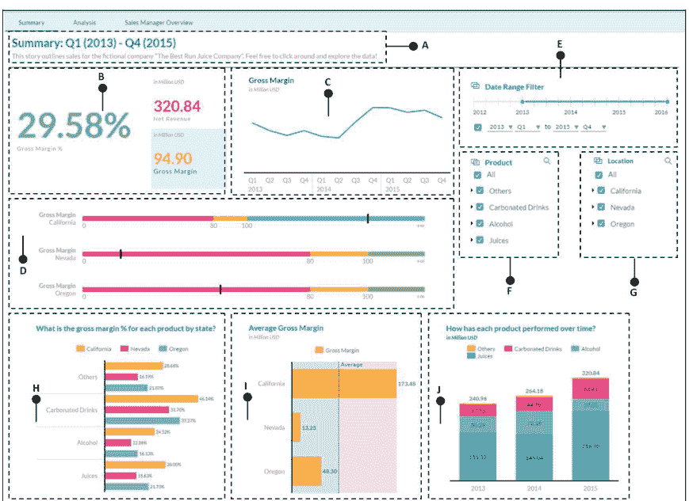

以下是所示例故事页面的简要说明：

- A: 这是描述其用途的故事页面标题。
- B: 添加了这三个单独的图块，用于演示如何创建 Numeric Point 图表，使用自定义阈值以不同颜色动态呈现数值数据。
- C: 毛利率图表将使用折线图创建。
- D: 关键绩效指标（KPI）是一种成功度量类型。根据用户定义的阈值，KPI 指示度量的状态。
- E, F, and G: 这些数据筛选器将在下一章中为日期、产品和位置维度创建。
- H, I, and J: 这些图块将演示条形图的使用及其不同功能，例如在图表中向上和向下钻取以及绘制参考线以显示图表上的重要值。

## Demo models

本章和一些后续章节将使用几个随试用版提供的演示分析模型（**Best Run** 和 **Planned Events**）。**Best Run** 模型被使用是因为它是一个全面的模型，并且包含比 Bocage 分析模型（在 Chapter 2, *Models in SAP Analytics Cloud* 中创建）更多的数据以评估不同场景。**Planned Events** 模型另一方面是一个关联模型，演示了如何使用您将在 Chapter 6, *Analyzing Data Using Geo Maps and Other Objects* 中学习的两个模型创建链接维度。现在，让我们先浏览这两个模型以获得概览。要访问这些模型，请单击主菜单，然后转到 Browse | Models。

## The Best Run demo model

在 Models tab（在 Models page 上）中，单击 Name 列下的 Best Run 链接（A），以在 modeler 界面中打开此模型：

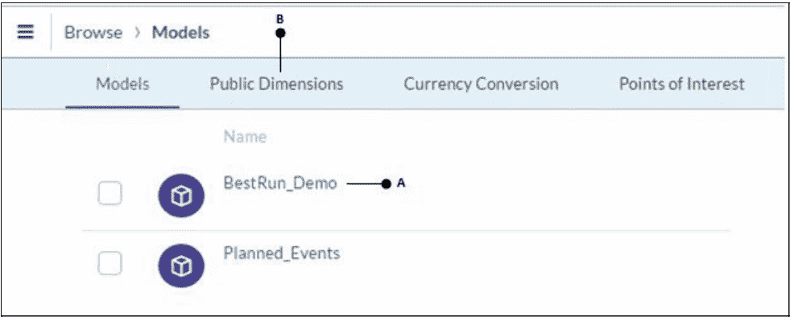

单击 Time dimension 选项卡，您会看到 time granularity（C）与您为 Bocage 模型设置的一样：

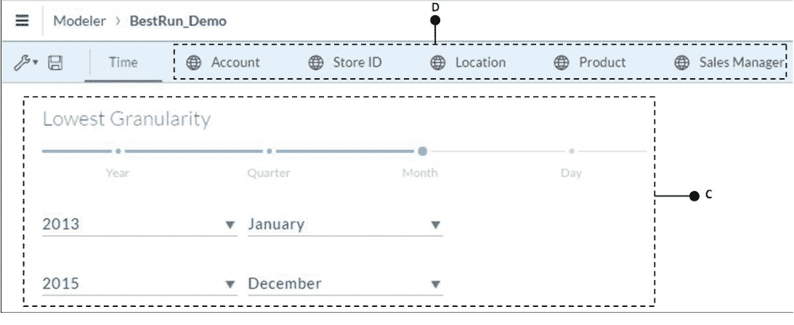

请注意，在此模型中，Account、Store ID、Location、Product 和 Sales Manager 维度（D）被标记为 Public Dimensions。公共维度由地球图标标识。如果您切换回 Models page 并单击 Public Dimensions 选项卡（B），您将在该选项卡下看到所有这些维度。

Account 维度包含您在 Chapter 2, Models in SAP Analytics Cloud 中学习到的同一组度量，其自动生成的 ID 和列名称作为 Descriptions：

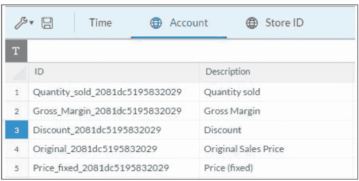

在此模型中，经纬度坐标合并到商店中形成 location 维度，您将在 Chapter 6, Analyzing Data Using Geo Maps and Other Objects 中在 geomap 中使用它：

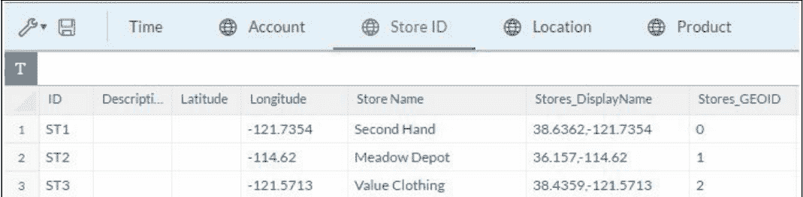

单击 Location 维度。此选项卡下显示的数据是手动输入的。如以下屏幕截图所示，此维度在州和城市之间具有层级关系。三个 state IDs（A）输入在 city IDs（B）下，然后这些 state IDs 在每个城市的单独 State 列中输入以创建关系。例如，在以下屏幕截图中，您可以看到 California state code（SA1）分配给 Los Angeles 和 San Francisco，Nevada state code（SA2）分配给 Reno 和 Henderson，以及 Oregon state code（SA3）分配给 Portland 和 Salem。手动创建此类关系后，您可以在右侧的 Hierarchy 选项卡中查看它：

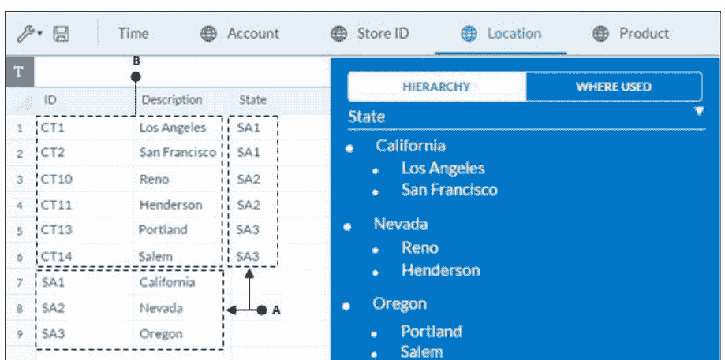

就像 State 和 City 层次结构一样，Product 维度也在 Category 和 Product 之间具有层级关系。四个 product category IDs（C）列在底部，每个 product（D）在 Product Category 列中被分配其中一个类别：

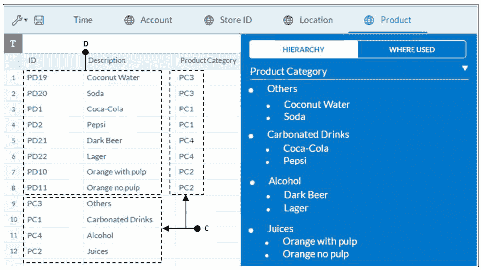

最后，有一个 Sales Manager 维度，这是所有中最简单的。它只有两个属性：ID 和 Description：

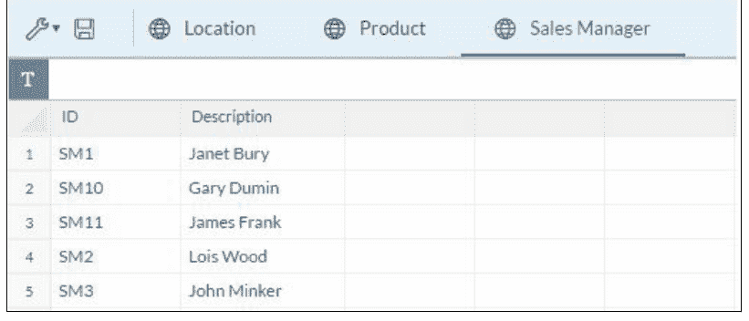

## The Planned Events model

Planned Events 模型由两个度量（*Number of Events for 2015* 和 *Planned Events for 2016*）组成：date-time 维度和三个公共维度（state、city 和 event）。您将在 Chapter 6, *Analyzing Data Using Geo Maps and Other Objects* 中使用此模型创建链接维度，以按城市显示获得的收入金额与事件数量。

## Creating a new story

1. 要创建新故事，您可以通过主菜单导航或直接从 home screen 启动该过程：

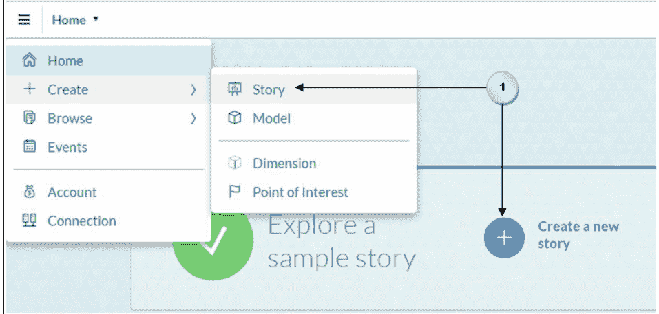

New Document (A): 当您单击前一屏幕截图中说明的两个选项之一时，将创建新文档，并提示您为故事的第一页选择预定义布局、导入数据、添加空白画布页面或添加网格页面，后者功能类似于电子表格。

Templates (B): Templates 部分提供的四个选项可让您为故事应用格式。这些模板带有预定义布局和对象的占位符，有助于您构建专业外观的故事。

Import & Explore Data (C): 使用此选项，您可以从 Excel 或 CSV（comma-separated-values）文件、Google Drive 或现有模型导入数据。

Add a Canvas Page (D): 通过选择此选项，您可以通过图表、表格、geomaps、图像和其他对象在一个或多个画布页面上探索和呈现您的数据。您可以向故事添加多个页面以分隔您的分析。通过此选项添加的页面将作为水平选项卡出现在故事页面的顶部。

Add a Grid Page (E): 如前所述，网格功能类似于电子表格，您可以通过键入或从其他来源粘贴来添加数据，或基于另一个模型添加表格。在网格页面上，您可以使用包含多个模型值的公式。

2. 对于本示例，请选择 Import & Explore Data 选项，如下所示

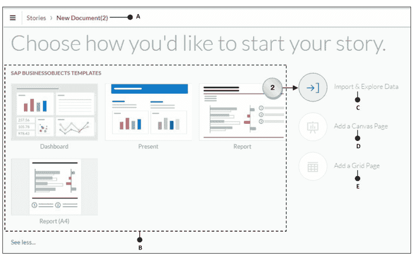

选择“导入和探索数据”选项后，您将被提示选择一个选项，以确定如何将数据添加到您的故事中。 “导入文件”选项允许您从外部文件导入数据，例如 Excel 电子表格或逗号分隔值（CSV）文件到新的故事中。

当您通过导入文件创建新故事时，导入过程会分析源数据并创建包含建议指标和维度的初始数据视图。 数据导入过程完成后，您可以通过更改列的类型并修复任何数据质量问题来完善建议，就像您在第 2 章《SAP Analytics Cloud 中的模型》中所做的那样，在那里您从头开始创建了一个新的分析模型。 您从文件或 Google Drive 导入的数据显示在数据操作视图中，您可以在其中修改数据、定义维度并执行排序和筛选等操作。 您还可以切换到数据视图，在那里开始分析数据并创建可视化。 第一个选项（使用现有数据，您将在本示例中选择此选项）从现有模型导入数据并直接在数据视图中打开它。

3. 对于本示例，请选择“使用现有数据”：

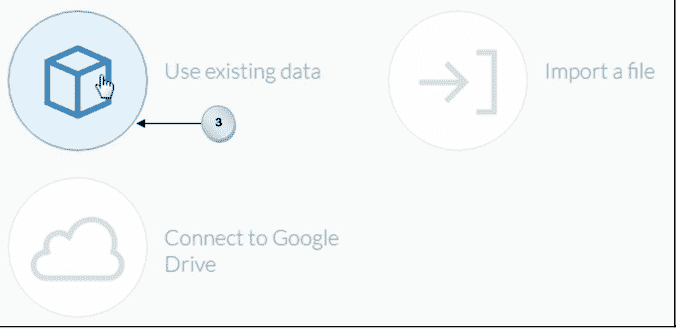

## 为故事选择模型

4. 从下拉列表中选择 Best Run 模型。 该模型也将在接下来的几章中用于创建不同的故事：

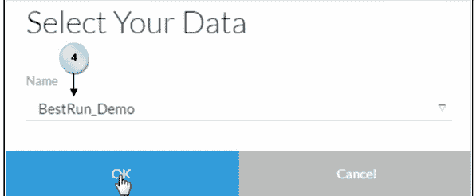

5. 当您在上一屏幕上单击“确定”按钮时，您会看到数据视图界面，您已在第 2 章《SAP Analytics Cloud 中的模型》中详细了解过它。

目前，请单击箭头隐藏数据视图面板，如以下屏幕截图所示：

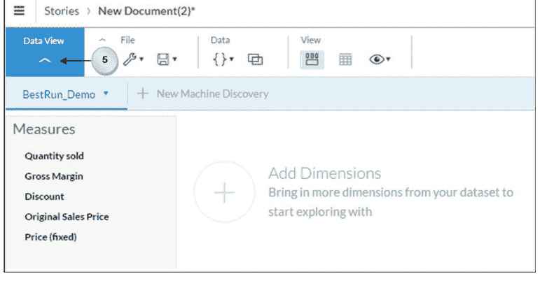

## 创建数值点图以显示净收入

6. 隐藏数据视图面板后，您会看到六个选项（图表、地理地图、表格、图像、形状和文本），可以将其添加到画布中。 此外，请注意，会自动创建一个标记为“第 1 页 (A)”的空白画布，您可以在其中放置这些对象。
单击“向画布添加对象”部分中的图表选项，或单击“插入”工具栏上的图表图标 (6)。 无论哪种方式，都会在第 1 页上添加一个空白图表：

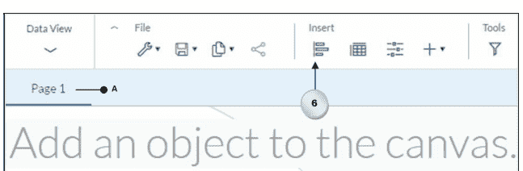

7. 在右侧设计器面板中的“构建器”选项卡上，从“图表结构 | 指标”中选择“数值点图”。 顾名思义，数值点图显示粗体数字数据。 在本示例中，您将在此图表中显示名为“净收入”的计算指标的值。 设计器面板用于格式化和操作画布元素中的数据：

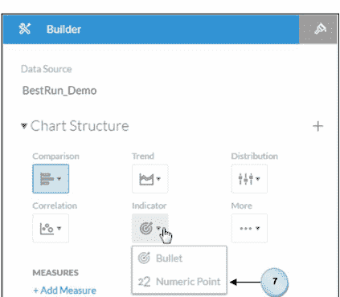

8. 在同一个构建器面板中，单击“指标”部分下的“添加指标”链接。 然后选择“点击创建新计算”。 这将带您进入计算编辑器界面，您将在其中为数值点图创建新的计算指标：

### 指标

主要值

⚠ 至少需要 1 个指标

搜索

### 计算

- 点击创建新计算

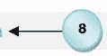

### 账户

- 折扣
- 毛利率
- 原始销售价格
- 价格（固定）

展开列表...

## 计算编辑器

在故事中，您通常从模型中选择指标（例如，如前一屏幕截图所示，从“账户”维度中选择毛利率或原始销售价格）以在图表上显示。 除了从模型中选择指标外，您还可以根据某种计算创建新指标以可视化结果。 在 SAP Analytics Cloud 中，您可以通过计算编辑器界面为图表或表格创建自定义计算。 然后您可以在图表或表格中使用这些计算。

您可以在计算编辑器界面中创建以下类型的计算：

- **计算指标**：在此类型中，您对“账户”维度或“计算”维度中的一个或多个成员执行计算。 结果会创建一个所选维度的新的计算成员。 计算指标使我们能够使用函数、条件和数学运算符的组合创建公式（请参阅以下屏幕截图中的 A）。
- **受限指标**：这会限制来自“账户”维度或“计算”维度成员的数据，以排除一个或多个维度的某些成员。 结果会创建一个所选维度的新的受限成员。
- **与...的差异**：这会查找账户在两个日期之间的价值差异。 结果会创建一个新的计算账户成员。
- **聚合**：顾名思义，您可以使用此类型进行聚合，例如求和、计数、平均值、最大值和最小值，以便使用聚合维度对指标执行这些操作。

您可以使用输入控件（请参阅下图中 B）作为计算指标中的变量。 通过添加输入控件，您可以进一步增强计算的功能。 在设置了输入控件的情况下，最终用户可以在不修改底层数据或公式的情况下影响计算结果。 例如，当您为输入控件添加预定义值列表时，用户可以从该列表中选择不同的值以查看对其画布的影响。 您将在本章末尾看到输入控件的使用。

在本示例中，我们正在创建名为“净收入”的计算指标选项，它是通过从原始销售价格中扣除折扣值计算得出的。 以下是我们进行的步骤：

9. 在计算编辑器屏幕上，从“类型”下拉列表中选择“计算指标”。
10. 为此新指标的“名称”输入“净收入”。
11. 在“编辑公式”区域中，输入左方括号 [，它返回来自连接模型的全部指标，即 BestRun_Demo。 从弹出的列表中选择“原始销售价格”。
12. 在“公式函数”列表中，单击“运算符”以查看数学运算符列表。 单击减号 (-) 运算符，将其添加到“编辑公式”部分中“原始销售价格”指标之后。
13. 再次在“编辑公式”区域中输入左方括号 [，这次选择
折扣指标以完成计算。

以下是更好地理解的图像：

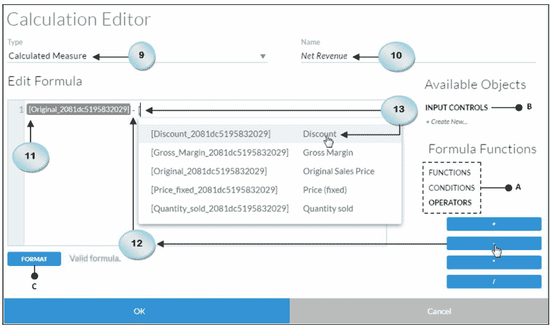

接下来，单击屏幕底部可用的“格式”按钮 (C) 以验证公式。 验证公式后，单击“确定”按钮关闭计算编辑器对话框。

您可以在“编辑公式”部分使用以下快捷方式查看值列表：

- [: 返回“账户”维度的所有指标
- #: 返回所有计算（使用计算编辑器界面创建的指标）
- @: 返回输入控件（仅返回单值数字输入控件）

关闭计算编辑器屏幕后，您将在故事页面上看到以下数值点图。 图表所包含的边框称为图块。 您还会在每个选定图块的右侧看到一个侧边栏菜单。 以下是有关图表和侧边栏菜单的一些提示和重要信息：

- A: 将鼠标放在标题区域，按住鼠标左键并拖动以定位图表。
- B: 更多操作图标显示多个选项，可让您隐藏某些图表元素； 例如，标题或图例。
- C: 复制允许您将图表复制到剪贴板、现有故事页面或新画布。 您还可以在同一画布上复制图表。 使用命令 Ctrl+C（复制）和 Ctrl+V（粘贴），您可以将现有图表复制到同一故事页面或不同的故事页面。
- D: 评论图标允许您在图表上放置评论。
- E: 全屏将图块扩展以填充画布。
- F: 删除允许您从画布中删除图表。
- G: 新的计算指标“净收入”将出现在“构建器”选项卡上的“指标”部分下，并且相应的值将显示在图表中。
- H: 使用这些手柄调整图表大小。

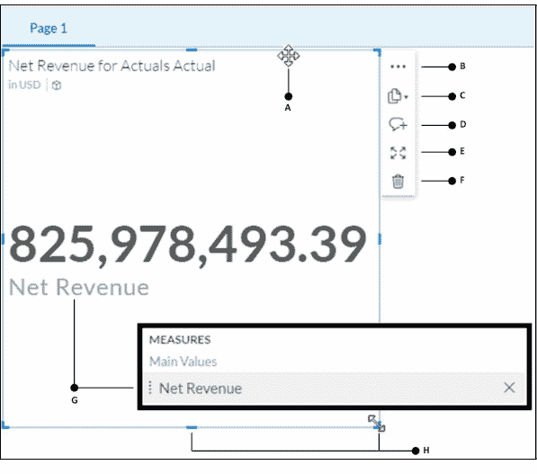

14. 单击代表净收入度量的省略号图标，以在小型菜单中显示可用选项。
15. 从菜单中选择格式。

16. 在“格式”对话框中，将“比例”设置为“百万”。此操作将把数值按百万缩放，以改善输出中数字的呈现：

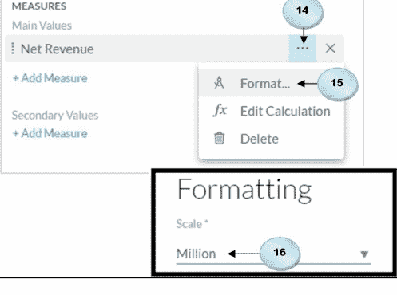

图表中的数值将以百万为单位显示。单击图表，这将用蓝色边框包围图表，并且您会看到一个小型侧边栏菜单（A）。单击更多操作图标（B），该图标以省略号表示，会显示一个菜单。单击此菜单中的第一个“显示/隐藏”菜单选项会在子菜单中显示一些图表选项。子菜单中选项前面的复选标记表示该选项已打开并在图表中显示。要关闭某个选项，请单击它。例如，单击“图表标题”、“副标题”和“图表详细信息”，以从净收入数值点图表中关闭这些选项：

## 实际的实际净收入

百万为单位

825.98

净收入

- Show/Hide >
- 固定到主页
- 添加差异...
- 添加子图
- 超链接...
- 编辑样式...

- ☑ 图表标题
- ☑ 副标题
- ☑ 图表详细信息
- ☑ 主要值
- ☑ 主要值标签
- ☑ 次要值
- ☑ 次要值标签
- 页脚文本

A

B

## 使用阈值应用条件格式

在本练习中，您将向数值点图表添加阈值。阈值用于为您的信息提供视觉提示。通过在对象上定义阈值，您可以一目了然地看到哪些区域表现良好，哪些区域需要改进。默认情况下，您会获得三个默认范围，其标签和颜色如下所示。但是，您可以根据需要使用任意多个或任意少的范围，并且还可以更改标签名称和颜色：

| 标签 | 颜色 |
|---|---|
| 正常 | 绿色 |
| 警告 | 黄色 |
| 严重 | 红色 |

17. 在工具栏的“工具”部分中，单击“条件格式”图标。然后，在右侧的条件格式面板中单击“添加阈值”链接。使用条件格式功能，您可以添加阈值并分配颜色以突出显示信息，例如某个区域的低销售额：

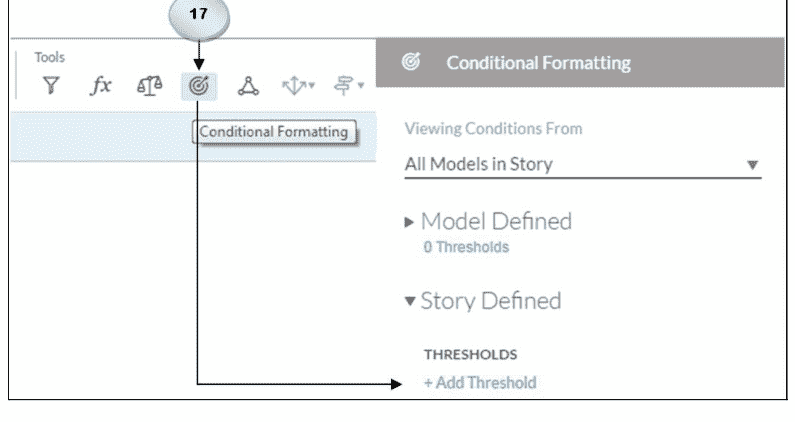

18. 确保在“模型”部分中选择了 BestRun 模型。如果没有，请从下拉列表中选择该模型。接下来，从“度量”列表中选择计算度量净收入。

此面板的初始视图仅显示“正常”范围。使用 + 图标（A）添加更多范围：

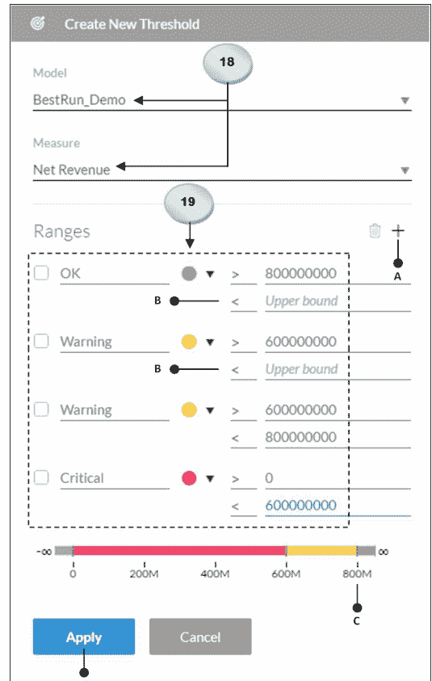

19. 在“范围”中，为您的范围设置下限和上限。在您输入上下限的值时，如果值不在范围内，您会看到警告出现。例如，下限不能大于上限。如果您只有一个范围，则无需同时设置上限和下限。当您添加更多范围时，可以将上限或下限留空（B）。

当您输入范围的值时，您会看到该值出现在面板底部的行上（C）。该值将包含一个字母来表示单位，例如千、百万等。提供阈值范围后，单击“应用”按钮（D），然后在条件格式面板中单击“完成”。

20. 返回后，单击图表以选择它，然后在“生成器”选项卡上，单击“颜色”部分中的“添加阈值”链接。

21. 从“阈值”列表中选择净收入。此操作将把图表的颜色方案设置为您在上一步为净收入度量设置的阈值。设置阈值后，图表中的值将以绿色显示，这指向“正常”范围，因为净收入的值大于 800 百万。当您在“颜色”部分应用阈值时，图表会更改以反映所需的范围。

净收入阈值将显示在“颜色”部分（A）。请注意，您可以通过单击阈值选项图标（B），然后从菜单中选择“编辑范围”选项（C）来修改阈值范围。此操作将显示“编辑故事阈值”面板，您可以在其中重新定义阈值：

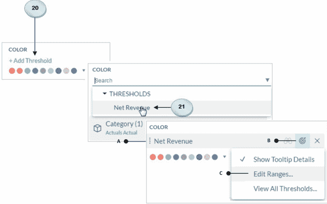

## 毛利率数值点图表

在之前的练习中，您创建了一个数值点图表来显示净收入计算度量的值。在这里，您将创建类似类型的图表来显示毛利率的值。

22. 再次单击“插入”工具栏上的“图表”图标。
23. 在“生成器”选项卡上，选择“数值点”选项。
24. 单击“度量”部分下的“添加度量”链接，并通过在其框中放置复选标记来选择毛利率度量。请注意，这次您从模型中选择了一个度量。列表显示来自“账户”维度的所有度量。单击“展开列表”链接（A）会在单独的面板中显示所有这些度量：

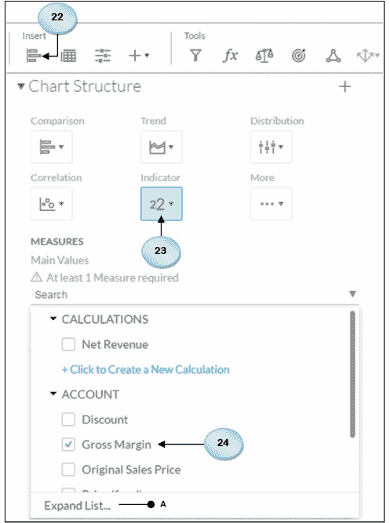

按照步骤 17 到 21 提供的说明，为毛利率图表添加另一个阈值，如图所示。这次，在“创建新阈值”对话框中选择毛利率度量（27），并在“颜色”部分中选择毛利率阈值（29）。再次，图表的颜色将更改以反映所选度量的状态：

## 工具

## 阈值

净收入 (BestRun_Demo)

- 添加阈值

25

26

## 创建新阈值

模型

BestRun_Demo

度量

毛利率

27

范围

正常

100000000

上限

警告

28

80000000

100000000

严重

0

80000000

应用

取消

## 颜色

搜索

阈值

净收入

毛利率

29

## 样式化图块

您可以通过更改字体、颜色、图表上的轴缩放等来设置故事页面图块的外观。输入控件、图表、表格和其他图块类型都有自己的样式选项。您可以更改背景颜色或字体、创建超链接、设置对齐方式等。尽管不同图块类型有自己的样式选项，但访问样式选项的过程对所有图块都相同。在此步骤中，您将更改毛利率图块的背景和字体颜色。

30. 在页面上选择毛利率图块。要查看对象的属性，您必须首先通过单击页面上的图块来选择它。如果不可见，请单击“设计器”链接（30）以打开设计器面板，您可以在其中查看所选对象的属性。相同的链接用于隐藏面板。
31. 选择“样式”选项卡。样式面板显示所选图块类型可用的选项。
32. 单击向下箭头，并为图块选择背景颜色。
33. 选择字体颜色，并将字体样式设置为粗体（A）。

毛利率图块的输出应如下图所示的 B 所示：

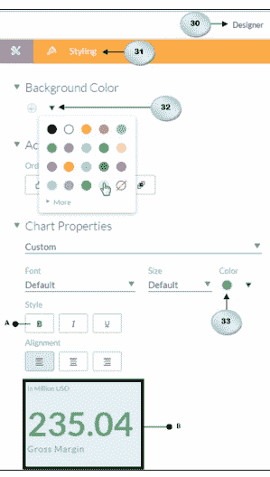

## 毛利率百分比数值点图表

这是第三个数值点图表，将显示毛利率百分比。图表将基于一个计算度量，该度量将使用来自模型的账户度量和在先前练习中创建的净收入计算度量进行评估。为了以适当的格式呈现派生值，您将把此计算度量按百分比缩放。

34. 单击“图表”图标以向页面添加新图表。
35. 再次选择“数值点”选项。
36. 单击“添加度量”链接，然后选择“单击以创建新计算”链接：

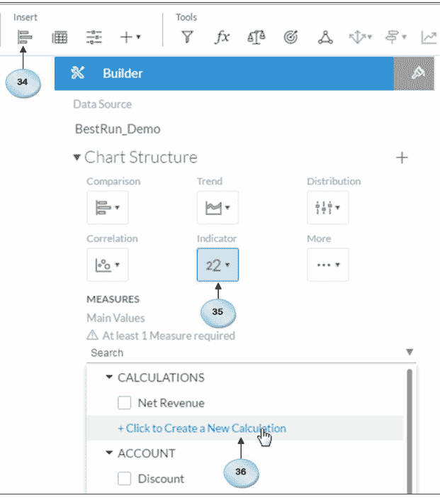

## 创建计算度量 – 毛利率 %

在本示例中，您将创建另一个名为毛利率 % 的计算度量，其派生方式为毛利率度量除以净收入计算度量。步骤如下：

37. 从“类型”下拉列表中选择“计算度量”。
38. 为度量“名称”输入毛利率 %。
39. 在“编辑公式”区域中，输入左方括号 [，并从度量列表中选择毛利率。
40. 在“公式函数”列表中，展开“运算符”列表，并选择除法（/）运算符。除法运算符将放置在毛利率度量之后。
41. 按 Shift+3 键输入 # 符号。这将显示计算度量的列表。选择净收入度量，这是唯一可用的计算度量。

单击“格式”按钮以验证公式，并单击“确定”以关闭“计算编辑器”对话框：

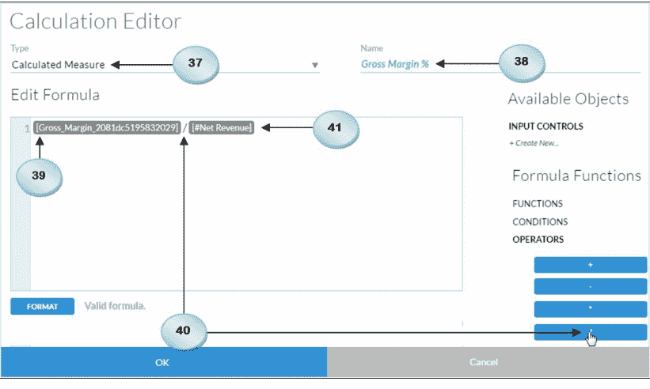

## 格式化度量值

创建 `Gross Margin %` 计算度量值后，您将格式化此计算的结果：

- 42. 通过在 Builder 选项卡中单击省略号图标并从菜单中选择 Format 来打开计算的格式化窗口。
- 43. 在格式化窗口中，您可以设置比例、小数位数和单位。对于此示例，将比例设置为百分比，小数位数设置为 2，单位设置为 %。设置这些参数后单击“确定”：

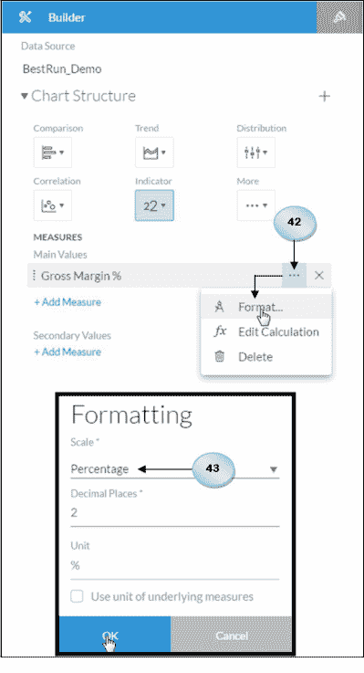

- 44. 单击条件格式图标为 `Gross Margin %` 度量值添加阈值。
- 45. 单击“添加阈值”链接。如您所见，之前创建的两个阈值在条件格式面板中也可见。
- 46. 根据此插图设置三个范围。
- 47. 在“颜色”部分中选择 `Gross Margin %` 阈值，并观察图表中的变化：

## 工具

## 条件格式

查看条件来源

故事中的所有模型

## 模型定义

0 个阈值

## 故事定义

阈值

毛利润 (BestRun_Demo)

净收入 (BestRun_Demo)

+ 添加阈值

## 创建新阈值

模型

BestRun_Demo

度量值

Gross Margin %

范围

确定

> 0.2

< 上限

警告

> 0.1

< 0.2

严重

> 0

< 0.1

应用

取消

颜色

搜索

净收入

毛利润

Gross Margin %

44

45

46

47

## 在数据视图中查看计算度量值

随时在您处理故事时，您可以单击数据视图下的箭头（A）来在资源管理器和故事页面之间切换。现在，单击此箭头以隐藏故事页面并显示数据视图面板。

请注意，您在之前的练习中创建的两个度量值 Net Revenue 和 Gross Margin % (B) 已添加到度量值列表中。

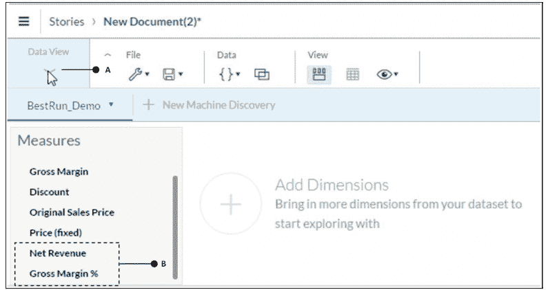

## 在故事中使用折线图展示数据

在此示例中，您将学习如何使用折线图显示数据值的趋势，特别是对于基于时间、例如年份或您的数据进展以及可能模式的维度。

- 48. 单击图表图标插入空白图表。
- 49. 从趋势列表中选择折线图选项。
- 50. 选择毛利润作为此图表的度量值。
- 51. 从“维度”部分添加日期维度。
- 52. 添加日期维度后，单击筛选图标，然后从其菜单中选择“按成员筛选”：

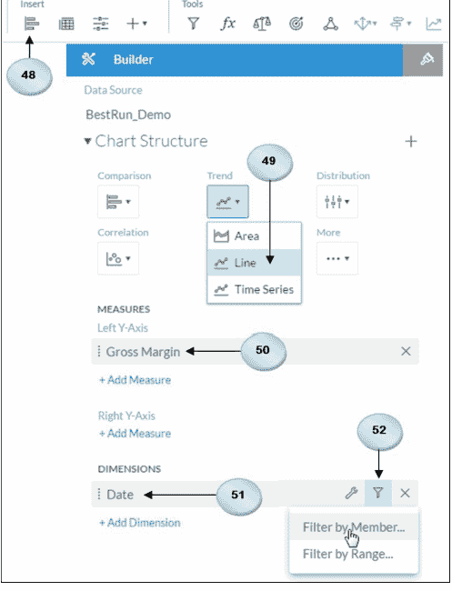

## 对时间维度应用筛选器

在 SAP Analytics Cloud 中，您可以对故事和页面应用筛选器以缩小分析范围。除了这些筛选器之外，您还可以对出现在图表上的单个维度添加筛选器。对于此示例，您将对在上一步中添加到图表的日期时间维度添加筛选器。您提供了几种在时间维度上应用筛选器的选项：

- 按成员筛选：此选项基本上与使用复选框选择或排除层次结构中单个成员的标准筛选器相同。
- 按范围筛选：使用此选项，您可以根据年份、半年、季度、月份、周或天（取决于底层模型中定义的时间粒度）定义时间段，并将日期范围作为筛选器应用，以便仅显示所选时间段内的详细信息。还可以定义多个范围时间筛选器并一起应用。例如，您可以通过为三年中的每一年分别定义一月至二月的三个单独范围，来比较一年中前两个月在三年期间的情况。当这些范围作为单个筛选器应用时，除所选期间外的所有内容都将被筛选掉。

- 53. 展开根节点（全部），然后展开 2013。选择该年的全部四个季度。当您在这些框中放置复选标记时，您的选择会出现在右侧的“已选成员”窗格中。展开 2014，选择该年的全部四个季度，并对 2015 重复此过程：

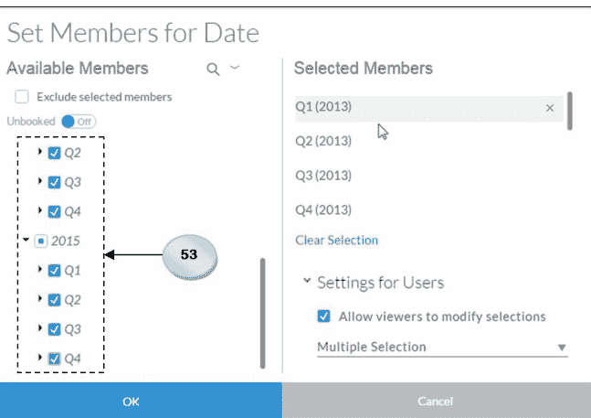

您的选择的结果会显示在图表上，显示所选三年中的所有季度（A）。您可以使用上一页所示的“设置成员”窗口通过取消选择年份和季度来进一步细化数据。现在保留这些选择并执行接下来的两个步骤来设置图表线的样式并隐藏一些属性。请注意，您将在下一章中向此故事添加一些页面筛选器，这些筛选器将动态地将所选筛选器同时应用于所有页面对象。

- 54. 单击图表线。在 Designer 中，单击“样式”选项卡，并从“填充颜色”调色板中为图表线选择一种颜色。
- 55. 取消选中副标题、图表详细信息、图例、数据标签和 Y 轴标签以删除这些图表属性：

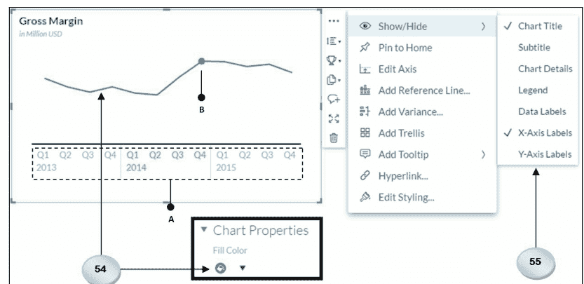

如前一屏幕截图所示，折线图显示了三年不同季度中的毛利润趋势。根据此图表，2014 年第四季度（B）的毛利润最高。

## 创建条形图

比较类别下列出的图表可让您比较值之间的差异，也用于显示度量的分类划分的简单比较。此类别中的条形/列图适用于按产品、地区或短时间段（如一年或季度）比较销售额差异。您在此练习中创建的条形图将显示每个产品按州的毛利润百分比。

- 56. 使用工具栏上的插入 | 图表图标创建新图表。然后，从“比较”类别中选择“条形/列”选项。
- 57. 选择计算度量值 `Gross Margin %` 作为此图表的度量值。
- 58. 选择产品作为维度。
- 59. 在“颜色”部分中选择位置维度，这将启用按州以及按城市的分析：

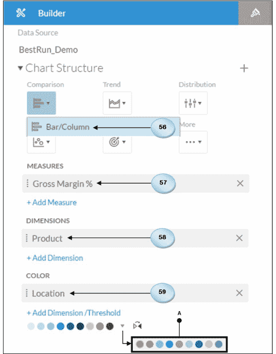

通过在“颜色”部分中选择维度，您可以根据所选维度按颜色进一步细分数据。如需选择不同的配色方案，请单击小向下箭头（A）。所选方案将以不同颜色显示每个州的数据。要复制此操作，请按以下步骤操作：

- 60. 单击现有图表标题，并将其替换为此处所示的标题以描述此图表的目的。在此图表中，数据按产品类别细分，每个类别以不同颜色显示每个州的毛利润百分比。请注意，BestRun 模型中有四个产品类别和三个州的数据。

- 61. 单击图表中的空白区域（A）以在“样式”选项卡中查看图表的样式属性。通过从“文本选择”列表中选择“图表标题”、选择颜色并使其加粗来更改图表的标题颜色并使其加粗：

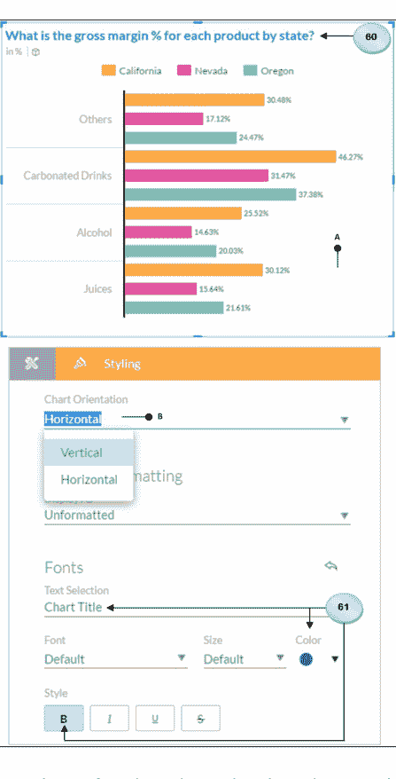

您还可以通过从“图表方向”列表中选择“垂直”选项来更改图表的方向（B）。对于此示例，保持水平方向。

## 在图表中向上和向下钻取

此图表的初始视图提供了按州每个产品类别毛利润百分比的高级概览：

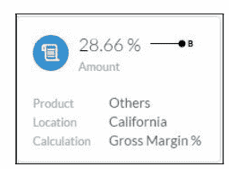

例如，如果将鼠标悬停在“其他”产品类别中代表加利福尼亚的条形上（A），则工具提示（B）显示该类别在加利福尼亚的毛利润百分比为 28.66%。对于内华达州，为 16.19%，对于俄勒冈州，为 21.07%：

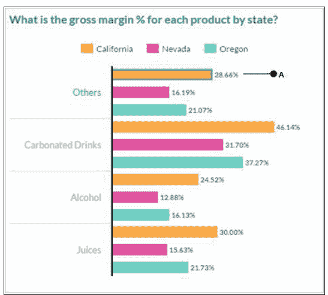

单击“其他”链接（C）。将出现一个小型工具栏。单击工具栏中的向下钻取链接（D）。您将钻取到“其他”产品类别的详细信息，其中可以分析该类别中每个产品在全部三个州的贡献，如下图所示（E）：

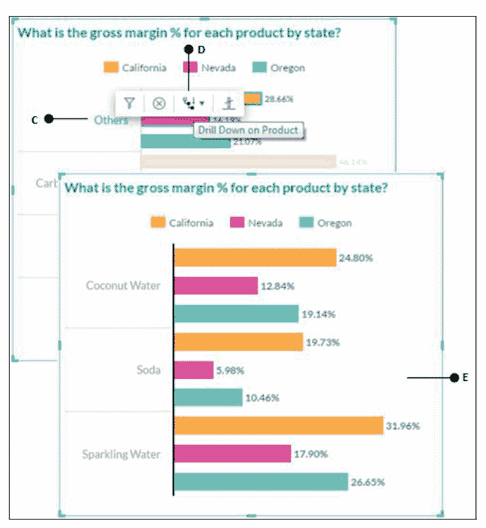

如果图表中包含层级维度，您可以通过维度向上或向下钻取，以在不同层级上探索数据。在当前场景中，您选择了产品维度，该维度是一个包含类别和产品的层级维度。因此，您可以在此图表中向上和向下钻取，以在不同层级上分析数据。请注意，如果图表包含多个层级维度，您可以选择要钻取的维度。

单击任意产品链接 (F)、图表中的条形 (G) 或州图例 (H) 以显示小型工具栏。在工具栏中，单击向下钻取图标 (I)。您将在位置级别上进一步向下钻取，在此您可以按城市分析单个产品的毛利率百分比，如以下屏幕截图所示：

## 每个产品的按州毛利率 % 是多少？

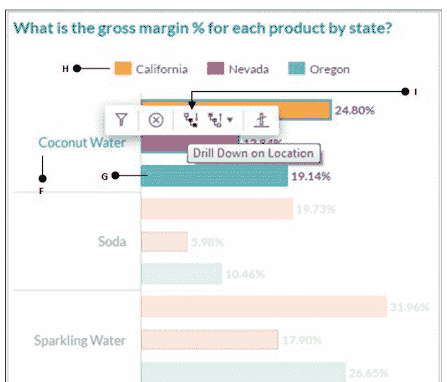

再次单击任意产品链接、图表条形或城市图例以显示小型工具栏。单击向上钻取图标 (J) 返回到高层视图：

## 每个产品的按州毛利率 % 是多少？

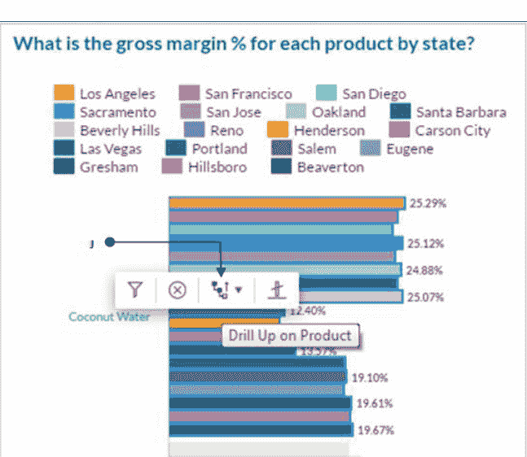

## 创建堆叠条形图/柱形图

堆叠柱形图位于“比较”类别下。您使用此图表将不同类别的值叠放在彼此之上。它还使您能够比较总计。在以下堆叠图表中，我们将产品类别收入作为彼此叠加的柱值，并将日期作为维度，这使我们能够比较每年的净收入。堆叠条形图/柱形图通常用于表示至少三个数据系列，其中每个系列由一种颜色在单个条形中堆叠表示（例如，2013 年、2014 年和 2015 年的销售额）。

- 62. 插入新图表，并选择“比较”类别中的堆叠条形图/柱形图选项。
- 63. 选择计算度量 Net Revenue 作为此图表的度量。
- 64. 选择 Date 作为维度。
- 65. 在“颜色”部分中选择 Product 维度，这将按日期启用产品销售分析：

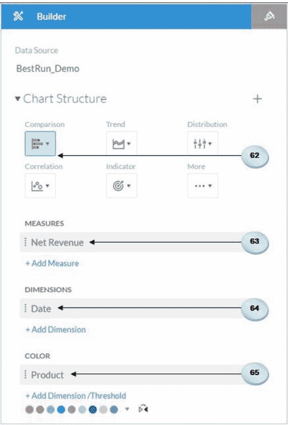

这是图表的初始输出，其中每个产品类别彼此叠加。这是对所有三年产品销售的高层概述。单击“全部”链接 (A)，然后单击向下钻取图标以查看后续页面中说明的输出：

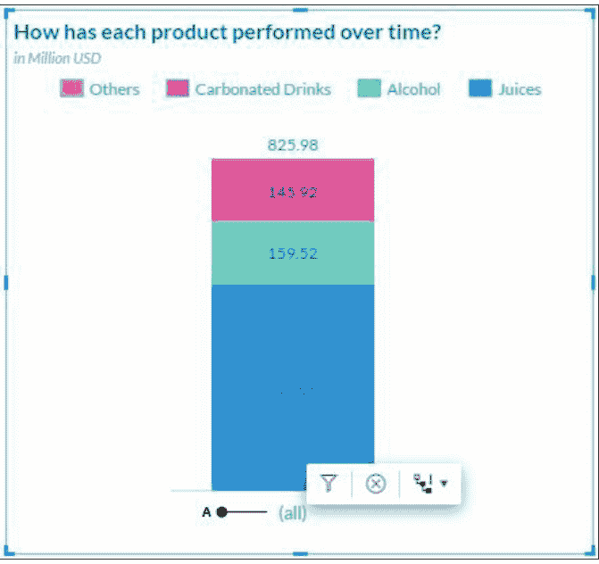

此图表的第二个视图按年份显示产品销售。上一视图中碳酸饮料的收入为 145.92M。该数值的细分 (B) 在此视图中呈现。单击此视图中的 2013 链接 (C) 以进一步向下钻取：

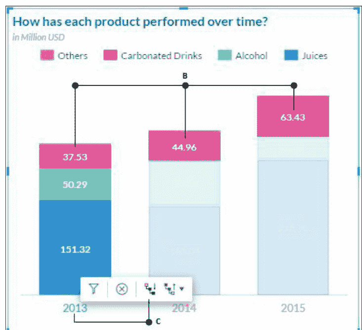

现在您将获得 2013 年的四个季度视图。上一视图中显示的收入金额 (37.53M) 的细分在此处显示为碳酸饮料。单击 Q4 链接 (D) 以进一步向下钻取：

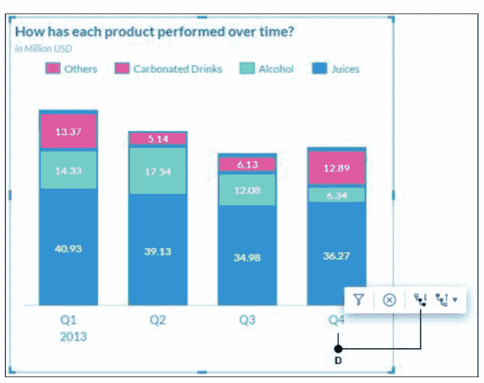

在以下视图中，2013 年的四个季度收入数据进一步细分为月份，相同的 37.53M 数值在每个月下进行拆分：

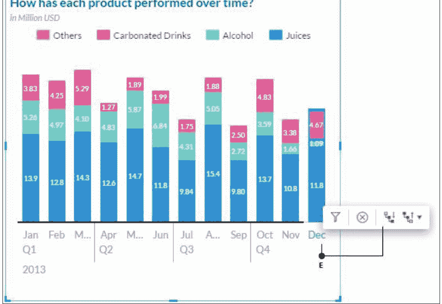

单击 December 链接 (E) 并向下钻取以获取此图表的底层视图，如下视图所示，这是最终视图，您可以在其中查看所有产品的收入数据，而不考虑类别：

## 每个产品随时间表现如何？

单位：百万美元

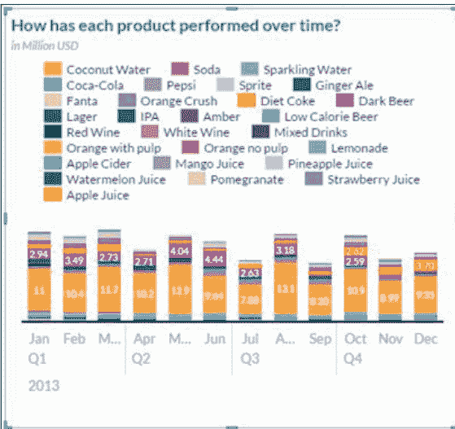

## 使用输入控件创建计算和受限度量

您已通过 Calculation Editor 界面在之前的练习中完成了创建一些计算度量的过程。在本练习中，您将创建带输入控件的计算和受限度量。通过将受限度量添加到图表或表格中，您只能在度量中使用选定的值，这有助于将一个值与其他一组值进行比较。使用输入控件，您可以定义一些作为计算度量中变量的值。通过在输入控件中选择这些值，用户可以在不修改底层数据或公式的情况下影响计算结果。例如，当您为输入控件添加预定义值列表时，用户可以从该列表中选择不同的值以查看对其画布的影响。

让我们创建一个图表以获得一些实践经验。在此示例中，您将创建一个图表来显示迄今为止一直使用的四个产品类别的销售额。首先，您将向图表添加一个带输入控件的计算度量，以可视化使用不同值递增销售额的结果。然后，将添加受限度量以将结果限制为仅加利福尼亚州。

- 66. 使用工具栏上的 Insert | Chart 图标创建新图表。然后，从“比较”类别中选择 Bar/Column 选项。
- 67. 从 Account 维度列表中选择 Original Sales Price 作为此图表的度量。
- 68. 选择 Product 作为其维度：

## Builder

数据源

BestRun_Demo

## 图表结构

比较

趋势

分布

相关

指标

更多

## 度量

Original Sales Price

+ 添加度量

## 维度

Product

+ 添加维度

66

67

68

## 创建计算度量和输入控件

- 69. 在 Builder 面板中，单击“度量”部分下的 Add Measure 链接，并选择 Click to Create a New Calculation。在 Calculation Editor 界面中，将 Type 设置为 Calculated Measure (A) 选项，并为此新计算的名称输入 Incremented Sales (B)。然后单击 INPUT CONTROLS 下的 Create New 链接 (C)：

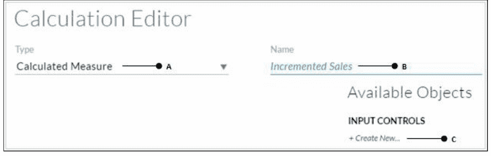

- 70. 在 Calculation Input Control 屏幕上，为此输入控件的名称输入 Incremental Factor (D)。选择 Static List 选项 (E)。Existing Dimension 选项允许用户从维度的成员中选择，而在 Static List 中，您可以添加自定义值作为输入控件的选项。由于您将为此输入控件定义一些静态值，因此应选择第二个选项。在“值”部分，单击 Click to Add Values (F) 链接。

您将看到另一个对话框（如下一个屏幕截图所示）以输入输入控件的值。您在该对话框中输入的值将出现在“值”部分 (G)：

## 计算输入控件

名称

Incremental Factor D

Existing Dimension

Static List E

## 属性

数据类型

Number

## 输入值

值

Click to Add Values... F

值

2.5, 5, 10 G

OK

Cancel

## 向输入控件添加值

- 71. 在 Custom Members 区域中，输入以逗号分隔的数值，例如 2.5, 5, 10。
- 72. 提供值后，单击 Update Selected Members 按钮将这些值移动到右侧的 Selected Members 窗格。
- 73. 在 Settings for Users 部分，选择 Single Selection。选择此选项将以单选组的形式呈现三个值，您可以从中选择一个值以查看其对图表的影响。
- 74. 最后，单击 Set 按钮关闭此对话框：

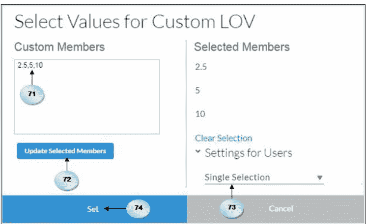

当您返回到 Calculation Editor 界面时，请使用以下说明选择输入控件：

- 75. 在 Edit Formula 区域中，输入左方括号 [, 并从度量列表中选择 Original Sales Price。
- 76. 在 Formula Functions 列表中，展开 OPERATORS 列表，并选择乘法 (*) 运算符，该运算符将放置在 Original Sales Price 度量之后。
- 77. 单击 Input Controls 下的 Incremental Factor 链接，在乘法运算符之后添加此输入控件以完成计算度量公式：

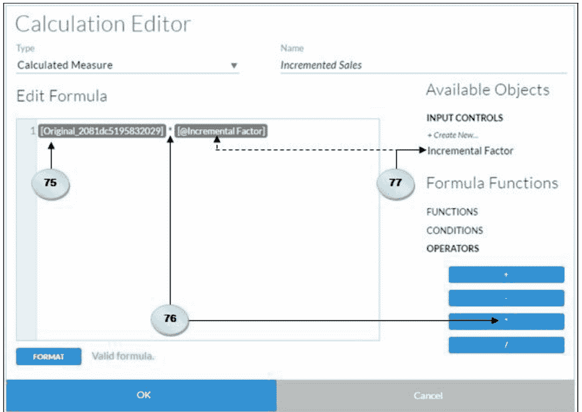

图表将使用两个度量进行更新：原始销售价格 (A) 和递增销售额 (B)。单击增量因子输入控件 (C) 以展开列表。在列表中选择一个值，并查看其对递增销售额条形图 (D) 的影响。如第一视图所示，当增量因子设置为 2.5 时，碳酸饮料的销售价值 (172.82) 显示递增后的数值为 432.04 (D)：

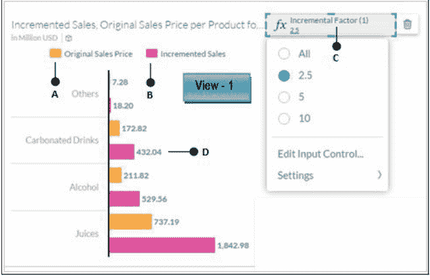

第二视图中，同一销售数据被递增五次并显示为 864.08 (E)：

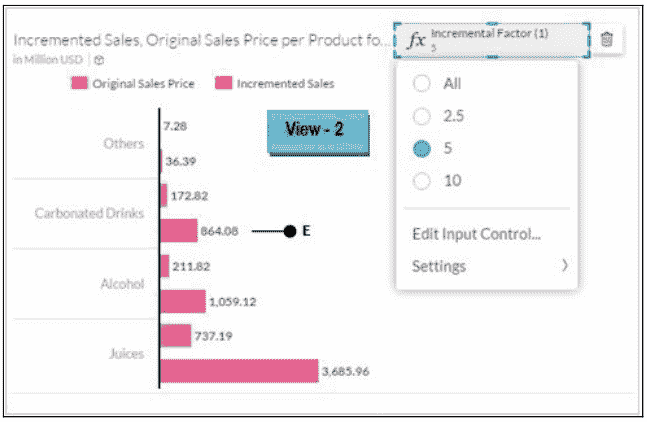

第三视图显示当销售量增加 10 时的递增效果。如果您希望修改值列表，请单击编辑输入控件链接 (F)：

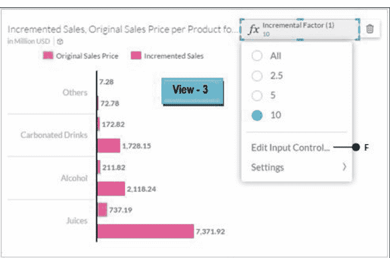

## Creating a Restricted Measure

受限度量创建

受限度量选项的作用类似于筛选器。当您创建此度量时，您将结果限制为某些特定度量。在本练习中，您将创建受限度量以将分析限制在特定州：

78. 在 Builder 选项卡中单击添加度量链接，并选择创建新计算。这次，为计算类型选择受限度量。
79. 为名称度量输入 `California`。
80. 为度量选择原始销售价格。
81. 为维度选择位置。位置维度的成员将出现在下一个屏幕中，您将在其中选择一个成员来限制结果。

82. 从值或输入控件下拉列表中，选择第一个选项，按成员选择。您在后续屏幕上选择的值将在此列表中显示 (A)：

83. 当您在前一个对话框中单击按成员选择选项时，会看到此对话框。在 California 前放置一个复选标记以从位置维度中选择此成员，然后单击确定。位置维度中选择的成员将出现在计算编辑器界面的值或输入控件列表中，并且同一成员将作为受限度量 (B) 选项添加到图表中：

## Select Values for Location

为位置选择值

现在您可以看到每个产品类别的三个值——原始销售额、递增销售额以及在加利福尼亚报告的实际销售额：

## Creating the Difference From measure

创建 Difference From 度量

在计算编辑器界面中您可以创建的第三种计算类型是 Difference From。您创建这种类型的计算是为了比较时间段之间的值。在之前的练习中，您创建了一个条形图来显示每个州每个产品的毛利率百分比。在这里，您将使用相同的图表在计算编辑器界面中创建 Difference From 计算，以评估 2014 年和 2015 年之间毛利率百分比的差异。

要从现有图表创建新图表，您有三个选项：复制、复制到和重复。如果您选择现有图表并选择复制选项 (A)，或按 Ctrl+C，图表将被放置到剪贴板。单击粘贴选项 (B) 或按 Ctrl+V，即可在当前页面上从剪贴板恢复克隆。复制到选项 (C) 有一些子选项，可让您将所选对象复制到新画布或故事中的另一页面。在当前场景中，您将使用重复选项来创建所选图表的克隆。

84. 单击图表（如以下屏幕截图所示），并在工具栏的复制和粘贴菜单中选择重复。此操作将在同一页面上创建所选图表的副本：

选择重复的图表并打开设计器面板。

85. 在 Builder 选项卡上，单击度量部分下的删除图标以删除毛利率 % 度量。

86. 删除现有度量后，单击添加度量链接，并选择单击创建新计算以在计算编辑器界面中创建新的 Difference From 类型计算度量：

87. 在计算编辑器界面中，为计算类型选择 Difference From。

88. 在名称框中输入 GM% Change Between 2014-2015。

89. 在度量部分，选择毛利。这是计算的基础度量。时间维度已设置为日期维度。

90. 对于当前值或输入控件，选择按成员选择，并在随后的屏幕上展开 all 节点以选择 2015。单击确定以关闭为日期选择值的对话框。所选年份 (2015) 将出现在当前值或输入控件框中。

91. 从 Difference From 下拉列表中选择 previous；另一个选项是 Next。在这里，您可以指定一个先前的时间段或后面的时间段来比较您在当前值中选择的时间段。

92. 在第 N 个期间部分，您提供除当前或基线时间段之外的要包含在计算中的数字。此处提供的值使用您在当前值部分中选择的时间粒度级别。因此，在当前场景中，一个期间为一年。在第 N 个期间部分输入 1 以将 2015 年的结果与 2014 年的结果进行比较。

93. 选中计算为百分比复选框以将结果显示为百分比。

94. 当您选中计算为百分比选项时，还需要指定是除以当前值还是第 N 个期间值。在本例中，选择第 N 个期间值以将 2015 年的结果除以 2014 年的结果。提供所有这些参数后，单击确定以关闭计算编辑器界面：

如您所见，图表现在显示每个州每个产品类别的毛利百分比变化：

## Summary

摘要

故事是 SAP Analytics Cloud 中最重要的组件，您可以使用不同类型的对象直观地分析您的数据。在本章中，您对这一重要主题进行了实践，并学习了如何通过添加和配置不同类型的图表来填充故事画布。以下是本章中您所涉及主题的简要总结：

- An introduction to and creation of a story
- 对故事的介绍和创建
- A brief about the two demo models that you will also utilize in subsequent chapters
- 关于您将在后续章节中也使用的两个演示模型的简要介绍
- Using Numeric Point charts to display summarized information in bold-faced dynamic numbers
- 使用数字点图表以粗体动态数字显示汇总信息
- Learning how to use the Calculation Editor interface to create your own formulas
- 学习如何使用计算编辑器界面创建自己的公式
- Adding thresholds to your charts to present the status of values in different colors
- 向图表添加阈值以用不同颜色显示值的状态
- Styling your charts with the help of options provided in the styling tab
- 在样式选项卡提供的选项帮助下为图表设置样式
- Using Numeric Point, Line, Bar, and Stacked Bar/Column charts to present data visually
- 使用数字点、线、条形和堆叠条形/列图表直观地呈现数据
- Applying filters to time dimension to present data for specific years
- 对时间维度应用筛选器以显示特定年份的数据
- Drilling up and down in charts to observe the data at different levels
- 在图表中向上和向下钻取以在不同级别观察数据
- Creating a Calculated Measure with Input Controls and seeing how to confine your analysis by adding Restricted Measures.
- 使用输入控件创建计算度量并了解如何通过添加受限度量来限制分析。
- Finally, you learned how to create a measure using the Difference From calculation type to compare values between time periods.
- 最后，您学习了如何使用 Difference From 计算类型创建度量以比较时间段之间的值。

在下一章中，您将学习一些更重要的技术，使用关键绩效指标 (KPI) 在故事页面上呈现数据并向页面添加筛选器以查看特定数据。您还将学习如何向图表添加参考线、添加静态和动态文本、形状、图像、超链接，并将指导您保存故事。

## Extending Stories with KPI, Filters, and Other Handy Objects

使用 KPI、筛选器和其他便捷对象扩展故事

在上一章中，您创建了不同类型的图表以图形方式呈现数据。在本章中，您也将在同一故事页面上继续您的努力。在这里，您将创建一个子弹图，通常添加到故事页面以通过关键绩效指标 (KPI) 监控组织的绩效。您还将学习如何添加页面筛选器以缩小分析范围。以下屏幕截图说明了这两个部分。

子弹图 (A) 将显示每个州的毛利状态。日期范围筛选器 (B) 是页面筛选器，用于将所有页面图表的结果限制为所选期间。

同样，产品 (C) 和位置 (D) 页面筛选器将允许您查看特定产品和位置的数据。

除了上述两个故事功能外，您还将学习以下内容：

- Adding a reference line to a chart
- 向图表添加参考线
- Creating a linked analysis
- 创建关联分析

- 通过静态和动态文本添加故事标题
- 添加形状和徽标
- 创建超链接
- 检查可视化背后的数据
- 设置故事首选项，等等

## 关键绩效指标 (KPIs)

组织的成功取决于组织如何追求其目标。业务目标是对支持企业战略的方向的执行声明。业务目标是一个高层次的目标，具有可量化、可衡量和以结果为导向的特点。更大的组织战略是通过业务目标演进而来的。为了监控和改进这些目标，组织使用称为**关键绩效指标 (KPIs)**的特殊度量。关键绩效指标是用于跟踪业务目标的详细规范。

业务目标被转化为 KPI，使组织能够将流程的某个方面与他们定义的目标进行衡量。当这些目标未达成时，相关负责人会在通知中心收到警报。您创建 KPI 以评估和监控目标的绩效。创建 KPI 时，您会定义阈值以指示值的状态。状态是通过将实际值与为 KPI 定义的阈值进行比较，然后将结果放在定义绩效状态级别的相应范围内来确定的（例如，OK、Warning 或 Critical）。

*KPI 阈值中的每个范围都被分配了不同的颜色，表示其绩效状态。您可以通过从 Accounts 维度的成员中选择值来定义 KPI，例如 Net Revenue 或 Gross Margin。*

## Story and page filters

如前所述，您向故事和页面添加筛选器以限制分析结果的范围。在 SAP Analytics Cloud 中，您可以创建两种类型的筛选器：故事筛选器和页面筛选器。

> 如果您想对故事中的所有图表应用筛选器，请使用故事筛选器。页面筛选器顾名思义，只能应用于故事中的一个页面。这些筛选器可以在向故事添加至少一个图表后创建。

如果在同一故事或页面中存在相关的页面筛选器，它们会产生级联效应。例如，如果页面上有关州和城市筛选器，并且您将州筛选器从 All 切换到 Oregon，则城市筛选器会刷新以仅显示俄勒冈州的城市。所有其他城市都将被隐藏。

除了这些筛选器之外，您还可以向图表上出现的各个维度添加筛选器。您已在上一章中为毛利润折线图为日期时间维度添加了此类筛选器。本章中专门有一个部分来展示这种类型的筛选器。

## Creating a chart to display key performance indicators

请回忆您在上一章中创建了一些阈值并将它们用于三个 Numeric Point 图表。在本练习中，您将使用为 Gross Margin 指标定义的阈值之一，使用 Bullet 图表展示三个州的 Gross Margin 状态。

照常，点击 Insert 工具栏上的 Chart 图标创建新图表。在 Builder 选项卡上，确保 Data Source 字段设置为 BestRun_Demo 模型 (A)。

1. 从 Indicator 部分选择 Bullet 选项。
2. 将 Measures 设置为 Gross Margin。
3. 将 Dimensions 设置为 Location。
4. 将 Color 设置为 Gross Margin。

## Setting a chart's attributes

如下图所示的条形图将出现在页面上。

5. 点击图表以查看其工具栏。点击 More Actions 图标 (A) 并选择第一个选项 Show/Hide (B)。在 Show/Hide 菜单中，取消选择 Chart Title、Subtitle 和 Chart Details 选项 (C)：

6. 在 Styling 选项卡上，从 Text Selection 列表中选择 All Text (A)，从 Color 调色板中选择一种颜色 (B)，并点击字母 B (C) 使所有图表文本加粗。您选择的输出如下图所示 (D)：

将这些指标的结果与为 Gross Margin 指定的阈值进行匹配 (A)：

超过 1 亿的值表示毛利润良好，这就是您为 OK 范围指定的内容。如您所见，加州的毛利润截图为 1.7348 亿，远高于为 OK 范围设定的阈值。因此，该州的绩效指标出现在绿色区域 (B)，并且工具提示框也显示 OK 状态 (C)：

接下来，内华达州和俄勒冈州的毛利润值分别为 1325 万和 4830 万，均低于为 Critical 状态设定的 8000 万阈值：

因此，这些州的绩效指标出现在红色区域 (D 和 E)：

Gross Margin
California

0 80 100 +∞

Gross Margin
Nevada

0 80 100 +∞

E

Gross Margin
Oregon

0 80 100 +∞

48.30 Million $

Amount

Location
Oregon

Account
Gross Margin

Range
Critical

## Adding a reference line to a chart

您可以定义参考线以在图表上显示重要值，例如产品的平均价格和最高价格。您可以为部分图表添加两种类型的参考线：Fixed 和 Dynamic。固定值参考线是使用特定参考值创建的，并且在更改图表中的数据时不会更改。例如，当您筛选数据时，参考线仍保持在应用筛选器之前的数据点处静态。

另一方面，动态值参考线在对图表应用筛选器、排名和排序时会更新。动态值参考线可与任何度量一起使用，包括故事计算度量。添加参考线时，您可以选择用颜色填充线条上方和下方的背景区域。更改图表类型时，参考线会保留。本示例中创建的图表带有参考线，显示按位置划分的平均毛利润。

使用工具栏上的 Insert | Chart 选项创建新图表。

7. 在 Builder 选项卡上，从 Comparison 类别中选择 Bar/Column 选项。
8. 从 Account 维度列表中选择 Gross Margin 作为此图表的度量。
9. 选择 Location 作为图表的 Dimension。

选择 Location 维度后，图表会出现在页面上。

10. 点击 More Actions 图标。

11. 在结果菜单中选择 Add Reference Line。

12. 在 Create Reference Line 面板上，选择 Fixed 选项 (A)，在 Value 框中输入 100000000（1 亿）作为目标值 (B)，在 Label 框中输入 Average (C)，然后点击 OK。参考线及其标签 (D) 会出现在图表上。如果将鼠标指针悬停在此线上，您将在工具提示中看到 1 亿的值 (E)。现在，尝试与图表交互，看看在您进行更改后参考线是否生效。

您会注意到固定参考线保持在特定值，并且在修改图表时不会更改（例如，通过下钻和应用筛选器和排名）。让我们评估这一概念。点击 Gross Margin 图例 (F)，然后点击 Drill Down 图标 (G)。您将被带到 City 级别。请注意，固定参考线没有更改以反映新的上下文，并且仍保持在 1 亿平均点处静态 (H)，如下图所示：

13. 如果你希望在与图表交互时参考线发生变化，需要将其从固定改为动态。向下滚动到“构建器”选项卡底部，并在“参考线”对话框中点击“固定（平均值）”的编辑图标：

14. 点击“动态”选项卡以添加动态值参考线。

15. 从度量列表中选择毛利。

16. 保留默认的平均值聚合，它将显示平均毛利。

17. 对于版本，选择实际值。

18. 为参考线标签输入“平均值”。

可选地，你可以通过在“上方”和“下方”颜色选择器中选择颜色（A）来为参考线左右两侧的背景区域着色。此外，你还可以设置不同的线条和标签颜色以使参考线更明显。

设置完“参考线”部分的参数后，点击“确定”关闭此屏幕。

> “编辑参考线”面板中的版本列表显示模型中可用的数据版本。你可以在 SAP Analytics Cloud 中使用的五个数据版本是：实际值、预算、规划、预测和滚动预测。当你处理的是分析模型（如同当前场景）时，只能看到实际值选项。其余四个版本与规划模型相关。

这是你的工作成果。按照之前练习中提供的说明，更改图表标题、更改其颜色并使其加粗（A）。如果将鼠标指针悬停在“参考线”部分，你将看到平均毛利为 78.35 百万（B）的截图，其计算方式如下：（173.48+13.25+48.3）/3。点击上一张截图中的加州链接（C），然后点击“下钻”图标即可看到以下截图中所示的输出。现在，平均值将显示为 21.69 百万（D），并且“参考线”部分将相应调整。

要修改现有的“参考线”部分或添加更多参考线，请使用“构建器”选项卡底部可用的“参考线”部分（E）。

## 平均毛利

以百万美元计

78.35 百万美元 $
动态参考
度量 毛利
聚合 平均值
版本 实际值

A

B

C

## 平均毛利

以百万美元计

21.69 百万美元 $
动态参考
度量 毛利
聚合 平均值
版本 实际值

D

E

参考线
动态（平均值）
+ 添加参考线

## 设置单个图表筛选器

最简单的筛选器类型是直接应用于图表的筛选器。这包括在图表中选择单个值（A）、使用 Shift+单击选择多个值（B），或在图例中选择成员（C）以对整个值集应用筛选。做出选择后，点击“筛选所选数据点”图标（D）。你对图表应用的筛选器会出现在图表标题下方（E）。要移除筛选器，请点击“移除”图标（F）。

除了应用这些视觉筛选器外，你还可以在“构建器”选项卡中添加筛选器。要添加此类筛选器，将鼠标移到“构建器”面板中已选择的维度上，然后选择“按成员筛选”或“按范围筛选”。请回忆你在第 4 章《使用图表创建故事》中为毛利折线图应用了此筛选器。

## 添加页面筛选器

页面筛选器可以应用于故事中的单个页面。在本练习中，你将创建一个页面筛选器，以便同时按日期筛选迄今为止创建的所有图表上的数据。请回忆底层模型定义的时间粒度设置为年、季度和月。因此，你在此设置的日期范围筛选器将显示相同的时间粒度，并且仅显示所选时间段的数据。

19. 在“插入”工具栏部分，点击“输入控件”图标。此操作将在当前页面放置“页面筛选器”（A）选项。要删除此控件，请使用“移除”图标（B）。

20. 从“页面筛选器”选项提供的维度列表中，选择“日期”维度。

21. 当你点击“日期”维度时，会看到一个子菜单。从此子菜单中选择“按范围筛选”。如果要筛选某些类型的维度，例如日期维度，可以使用“按范围筛选”。请回忆你在第 4 章《使用图表创建故事》第 52 步中使用了“按成员筛选”选项。

23. 在“为日期设置日期范围”对话框中，将层级设置为 YQM，以便在“粒度”下拉列表中显示年、季度和月值。如果选择 YHQM，“粒度”列表将显示年、半年、季度和月。

24. 从“粒度”列表中选择“季度”以在筛选器中显示年和季度。如果从此列表中选择“年”，范围将从 2013 年到 2015 年。如果选择“月”，范围将除年份外还显示月份。

请注意，你可以通过点击“添加新范围”链接（A）添加多个筛选器。现在，保持只有一个筛选器，如以下截图所示。同时保持“允许查看者修改选择”框（B）被选中，然后点击“确定”关闭此对话框。如果取消选中此选项，筛选器将变为静态。保持此选项选中可允许用户选择多个筛选值。

24. 返回页面后，你可以放大页面上的筛选器对象（A），以便筛选值出现在各自的列表（B）中。然后你可以从这些列表中查看和更改筛选值，如以下截图所示：

25. 点击“更多操作”图标（C），并从菜单中选择“编辑样式”（D）。在“样式”选项卡上，展开“标题”列表（E），并为筛选器标题选择一种颜色。同时使标题加粗。如果需要，你还可以从各自的颜色块中设置“背景”和“内容”颜色：

在以下截图中从第一个下拉列表（A）中选择 2015。这将把 2015 设置为整个页面的筛选器（B）。当前页面上的所有图表都将刷新，仅显示 2015 年的数据。请参考以下截图：

现在，在以下截图中从第一个列表（C）中选择 2014。页面将再次刷新，以显示 2014 年和 2015 年的数据（D）。如果只想查看 2014 年的数据，请在包含年份信息的第三个列表中选择该年份。此外，从两个季度列表中选择不同的季度以查看效果。

最后，将筛选器恢复到之前的状态（E），如以下截图所示：

28.46%
毛利 %

以百万美元计

825.98
净收入

以百万美元计

235.04
毛利

## 毛利

以百万美元计

## 日期范围筛选器

2012 2013 2014 2015 2016

2013 Q1 to 2015 Q4

+   - 2013
+   - 2014
+   - 2015

E

毛利 加州

毛利 内华达

毛利 俄勒冈

## 为产品添加页面筛选器

本练习中添加的筛选器将为产品创建，以便在当前页面创建的所有图表上查看特定产品（或产品）的数据。

26. 在“插入”工具栏部分再次点击“输入控件”图标以添加另一个页面筛选器。这次，选择“产品”维度。请注意“日期”维度已被灰显，因为你已经为该维度设置了筛选器：

27. 在“为产品设置筛选器”屏幕上，选择“所有成员”以将所有产品添加到筛选器中，然后点击“确定”：

筛选器将出现在页面上。拖动手柄调整其大小，并将其放置在“日期范围筛选器”屏幕下方，如以下截图所示（A）。使用为“数据范围筛选器”提供的说明来设置此筛选器的标题样式。在“产品”页面筛选器中，取消“全部”框（B）的选中标记，并选择单个产品，如以下截图所示。当你选中或取消选中某个产品时，你会在所有图表上实时看到选择的反映。

请注意，屏幕截图 (C) 中显示的数据从 2014 年第一季度到 2015 年第四季度（请参阅日期范围筛选器 (D) 屏幕中应用的筛选器）。

## 添加位置页面筛选器

这是添加到当前页面的最后一个页面筛选器。此筛选器将允许您将分析范围限定为特定的州或城市。

28. 再次单击“插入”工具栏上的“输入控件”图标，并选择“位置”维度：

29. 在下一个屏幕中，选择“所有成员”以将所有州和城市包含到筛选器中：

调整筛选器并将其拖动放置在“产品”筛选器 (A) 旁边。取消选择“全部”选项，然后单击加利福尼亚 (B)，以在所有图表上查看该州的数据：

取消选择加利福尼亚，并展开其节点以查看该州的城市列表。在以下屏幕截图中选择洛杉矶 (C)，以分析该城市的数据：

## 添加故事筛选器

通过添加故事筛选器，您可以应用会影响故事中每个页面上每个对象的筛选器。在此示例中，您将创建故事筛选器以仅显示加利福尼亚州的数据。由于您目前的故事中只有一个页面，您可以在完成第 7 章 *使用表格和网格* 中的所有故事页面后重新进行此练习。

30. 在工具栏上单击“故事筛选器”图标 (A)。“添加故事筛选器” (B) 图标将出现在工具栏正下方。单击此图标，并从其菜单中选择“位置” (C)。在“为位置设置筛选器”对话框中，选择加利福尼亚州 (D)，然后单击“确定”关闭对话框。加利福尼亚州筛选器将应用于整个故事。以后如果要删除此筛选器，只需单击“X”图标 (E)。所有故事页面将恢复到之前的状态，如以下屏幕截图所示：

## 创建关联分析

您已了解如何通过在故事页面对象上应用不同类型的筛选器来限制分析结果的范围。当您应用筛选器时（例如，日期范围页面筛选器中的 2015 年第一季度），页面上的所有其他图表都会刷新以显示所选条件的数据。除了这些筛选器之外，您还可以创建关联分析，通过它可以在故事内的图表之间创建交互。当您创建关联分析并钻取分层数据或创建筛选器时，故事中的多个图表会同时更新。

> *筛选器与关联分析的主要区别在于，在关联分析中，筛选器仅应用于您包含在分析中的图表，而页面和故事筛选器会影响所有图表。*

您可以为属于同一模型的图表设置关联分析。如果图表基于不同的模型，则模型必须包含关联维度。您将在下一章看到关联维度的实例。现在我们的故事页面上有一些图表，我们可以创建关联分析，以便对一个图表（在本练习中称为主图表）执行的操作会影响故事中的其他关联图表，但对其他图表执行的操作不会相互影响，也不会影响触发更新的主图表。要应用图表交互，请选择主图表。在此示例中，我选择了（接下来说明的）图表，该图表显示每个产品的毛利率按州划分。

31. 在“工具”工具栏上单击“关联分析”，以在右侧打开“关联分析”面板：

您将在“关联分析”面板上看到三个图表交互选项，分别如下：

- 本图表（默认选项）(A)：选择此选项时，筛选和钻取分层数据将仅更新所选图表。
- 关联图表集 (B)：在所选图表上筛选和钻取分层数据将更新基于同一模型或与此图表模型具有关联维度的集合中的所有图表。选择“数据点选择上的筛选”选项可细化设置，以便在主图表中单击特定成员时，其他图表也会更新。如果未选择此选项，其他图表仅受钻取或筛选操作影响。
- 整个故事 (C)：在此图表上筛选和钻取分层数据将更新故事中基于同一模型或与此图表模型具有关联维度的所有图表。

默认情况下，您故事中的所有图表都包含在关联图表集中。要排除某个图表，请选择它并取消选择“将此图表包含在集合中” (D) 选项。被排除的图表将被移至关联图表集区域之外到被排除图表区域。

32. 现在，只需将“图表交互”选项设置为“关联图表集”，并勾选“数据点选择上的筛选”。保持其他所有值保持默认值，然后单击“完成”。这将设置主图表的交互以影响其他图表。请注意，其他所有图表的图表交互选项均设置为默认的“本图表”选项。您可以通过在页面上选择其他任何图表并单击“关联分析”图标在“关联分析”面板中验证这一点。

在主图表中，只需单击“其他”产品链接 (E)，即可查看此操作对其他图表的影响，如以下两个与主图表关联的图表所示。再次单击“其他”链接以恢复到之前的状态。您也可以尝试主图表上的钻取和筛选选项，以观察这些操作对其他图表的影响。现在，对未设置关联分析的某些其他图表执行钻取和筛选操作。您会注意到，对此类图表执行的操作仅影响该特定图表，页面上的其他图表不会发生任何变化。

## 添加动态文本

您为内容添加标题和标题以描述其用途。同样，您为故事页面添加静态和动态文本以解释这些页面包含的内容类型。在当前场景中，您将向“故事”页面添加动态文本以描述其呈现的内容类型。

33. 单击“插入”工具栏上的“添加”图标，该图标会显示一个菜单。从此菜单中选择“文本”选项 (A)。如下一屏幕截图所示，文本框将放置在您的页面上，并带有一些默认文本。您可以使用文本框显示静态标题和标题信息，例如 Summary Report From Q1-2013 To Q4-2015。但是如果您使用日期范围筛选器通过选择其他持续时间来更改页面数据怎么办？为应对这种情况，您可以将同一文本框的静态内容转换为动态文本。您将在下一步执行此操作！此转换将根据您选择的筛选器更改页面标题。

34. 在文本框的工具栏中单击“更多操作”图标，并从菜单中选择“动态文本”；请参阅以下屏幕截图。动态文本是根据源输入控件或筛选器的值自动更新的文本。

35. 当您在菜单中单击“动态文本”选项时，您会看到“插入动态文本”对话框。此对话框在左侧窗格中显示五个选项，当您在此窗格中选择一个选项时，相关选项会出现在右侧窗格中。对于此示例，请在左侧窗格中选择“输入控件”选项，以查看您在先前练习中创建的三个筛选器。选择“日期”筛选器的复选框以将此对象用作动态文本的源：

当您通过单击“创建”按钮关闭“插入动态文本”框时，您会在文本框中看到文本 Q1(2013) - Q4(2015)。根据您在“日期范围筛选器”屏幕中应用的日期筛选器，您的文本可能不同。

36. 单击文本框，并在动态日期文本前输入 Summary。单击“更多操作”图标 (A)，并从菜单中选择“编辑样式” (B)。更改文本的颜色 (C) 和样式 (D)，如以下屏幕截图所示：

在“日期范围筛选器”屏幕中，在第一个列表中选择 2015，在第二个列表中选择 Q2，再次在第三个列表中选择 2015，并在最后一个列表中选择 Q4。动态文本将相应更新以显示所选期间，如以下插图所示：

## 添加静态文本

在故事页面添加静态文本，如以下屏幕截图所示，非常简单。正如名称所示，在本练习中添加到故事页面的文本将保持静态。

- 37. 再次单击“插入”工具栏上的“添加”图标（+），并从 resulting 菜单中选择“文本”选项。用以下所示的文本替换默认文本，该文本位于主摘要文本下方。您可使用多种选项来格式化文本，例如更改字体、大小和颜色（A）。

使其加粗并斜体、下划线或删除线（B）。使用提供的四个对齐选项对其进行对齐（C），或创建项目符号或编号列表（D）。

## 添加形状

除了动态和静态文本之外，您还可以向页面添加形状，例如线条、正方形或圆形。在本练习中，您将在添加到此页面的两个文本项之后添加一条线。

- 38. 单击“插入”工具栏上的同一“添加”图标，并从菜单中选择“形状”：

插入形状对话框出现。正如您所见，插入形状对话框包含不同类别的许多形状。

- 39. 选择线条形状（在“基本”类别中列为第一项），然后单击“确定”。线条对象将被添加到页面中。将它放在两个文本框下方。使用其右侧手柄扩展线条以覆盖页面（A）。

将三个对象拖动并放置在页面的顶部，如下所示

## 摘要：2015 年第二季度 - 2015 年第四季度

本故事概述了虚构公司“The Best Run Juice Company”的销售情况。随意点击并探索数据！

## 添加图像

您可以通过从计算机上传来向故事页面添加图像（如公司徽标）。上传的图像将作为故事定义的一部分保存，并且可以添加到其他故事页面。在本练习中，您将在页面上添加一个徽标。

- 40. 再次单击“添加”图标，并从菜单中选择“图像”：

- 41. 在“插入图像”屏幕上，单击“上传”图标，并在“打开”对话框中选择一个图像。一旦在此屏幕上看到所选图像（A），请单击“确定”按钮关闭屏幕，如下所示：

图像将被放置在您的页面上。根据以下屏幕截图拖动并定位它（B）：

## 演示模式

完成页面后，您可以通过单击“更多”工具栏部分下的“演示”选项来预览它，以查看其他用户将如何看到它。在此模式下，故事页面以全屏显示，无工具栏。

- 42. 在工具栏中，单击“更多”工具栏部分下的省略号图标，并选择“演示”：

当您单击“演示”选项时，页面应如下图所示。要退出演示视图，请将鼠标悬停在页面选择器栏顶部，并再次选择“演示”图标（A）。

## 创建超链接

您可以将故事中的各种对象转换为超链接，使其链接到其他故事、同一故事中的其他页面或外部网站。静态图表、图片和文本对象是创建超链接的最佳候选对象。在此示例中，您将设置徽标以充当超链接。

- 43. 单击徽标，并从“更多操作”菜单中选择“超链接”。从“链接到”列表中选择“外部 URL”（A），并在“外部 URL”文本框（B）中输入外部网站的 URL，例如 http://www.sap.com。要在新标签页中打开此网站，请选中“在新标签页中打开”（C），然后单击“完成”。以演示模式查看页面，并单击徽标以打开外部网站：

## 检查可视化背后的数据

在故事中处理图表时，有时您希望查看底层数据以评估图表上显示的结果。以下是如何检查图表背后的数据。

- 44. 选择 KPI 图表，并从“更多”菜单中选择“检查”（A）。网格将出现在页面的下部（B），其中包含图表所基于的所有值以及层级结构：

如果您在“构建器”面板中对图表的定义进行任何更改或对图表应用任何筛选器，则网格中显示的数据也会受到影响。为了测试此场景，请在“位置”筛选器中取消选中“加利福尼亚”和“俄勒冈”，并保留“内华达”州的选中状态。正如以下屏幕截图所示，应用的筛选器不仅会影响图表（A），而且网格中的数据也会被筛选为仅显示所选州（B）。

Gross Margin
Nevada
0 80 100 +∞
A

13.25 Million $
Amount
Location Nevada
Account Gross Margin
Range Critical

|   | A | B |
|---|---|---|
|1|BestRun_Demo in Million USD| |
|2|ACCOUNT|Gross Margin|
|3|LOCATION| |
|4|Nevada|13.25|
|5| | |

- 位置
- - 全部
- - 加利福尼亚
- - 内华达 ☑
- - 俄勒冈

## 设置故事的样式首选项

在之前的一些练习中，您使用“设计器”面板中的“样式”选项卡了解了如何将样式应用于故事页面上的不同对象。除了这些单独的样式选项之外，SAP Analytics Cloud 还允许您设置适用于所有故事页面的首选项。这些格式选项在故事级别设置样式首选项，以为所有故事页面提供一致的外观和感觉。

- 45. 要设置故事级别的样式首选项，请在工具栏中单击“文件”下的“编辑故事”图标，然后选择“首选项”：

选择“首选项”选项后，您会看到“故事首选项”对话框。此对话框的左侧窗格可让您设置故事页面及其上的图块的样式。“图块设置”选项进一步细分为五个部分，提供相关的样式选项：图表和地理地图、文本、形状、输入控件和其他。

如果在左侧窗格中选择“页面设置”，则在右侧窗格中会看到两个样式选项——“默认页面背景”（A）和“默认页面大小”（B）——用于定义故事页面的设置。您可以通过从“默认页面背景”调色板（C）中选择颜色为所有故事页面设置背景颜色。将“默认页面大小”部分中的“固定页面大小”滑块（D）切换到“开”位置会启动一些选项来设置页面的大小、宽度、高度和方向。通过选中“连续高度”选项（E），可确保新图块始终在页面底部有空间。您还可以指定新图块是否应自动吸附到网格。

最后，在“应用到”部分（F）中，您可以选择将这些设置应用于所有现有页面和图块，还是仅应用于新页面和图块。

“图块设置”部分列出了图表和其他对象的选项。在这里，您可以为不同的页面对象设置不同的背景和文本。在“图表/地理”部分，您还有设置颜色调色板的额外选项。除了一系列默认颜色设置外，您还可以创建自己的调色板（G）。即使指定了这些默认样式选项，您也可以在“设计器”面板中为页面对象覆盖这些首选项。

## 创建聚合计算

您已在上一章中学习了四种计算类型中的三种。在本练习中，您将了解聚合计算类型的工作原理。您可以在图表和表格中使用此类型。您将在第 7 章《使用表格和网格》中了解表格，因此在这里您将创建一个新图表来尝试此计算类型。该图表将显示每个州每种产品类型的每个商店的平均毛利率。

- 46. 使用“插入”工具栏上的“图表”选项创建一个新图表。
- 47. 将数据源设置为 Best Run Demo。
- 48. 从“比较”类别中选择“条形/列”选项。
- 49. 单击“添加度量”链接，然后选择“单击以创建新计算”。创建聚合计算的说明在下一页提供。
- 50. 在下一页创建名为“商店平均毛利率”的聚合计算后，将“产品”选为图表的维度。
- 51. 在“颜色”部分单击“添加维度/阈值”链接，并选择“位置”：

当您在步骤 49 中选择“单击以创建新计算”选项时，您会看到

计算编辑器屏幕。

52. 在计算编辑器窗口中，为计算类型选择聚合。

53. 为计算名称输入 Store Average Gross Margin。

54. 从操作下拉列表中选择 Average。这是您将在当前场景中使用的聚合类型。此列表中的 Count 类型计算具有度量值的维度成员的数量，而 Count Dimensions 用于计算维度成员的数量，无论它们是否有度量值。剩余的类型不言自明。

55. 选择 Gross Margin 作为度量。这是您将应用聚合的度量。

56. 为聚合维度选择 Store ID。通过将 Store ID 选择为聚合维度，您指定使用此维度执行聚合。然后毛利率平均值将在商店级别计算。如有需要，您可以使用本节提供的链接添加更多聚合维度。

57. 选中标记为使用条件聚合的复选框。当您想要对聚合计算添加进一步限制时使用此选项。

58. 为条件选择不具有度量值。使用条件聚合时，您可以选择在指定条件下存在度量值时应用聚合，或在这些条件下没有度量值时应用聚合。在此示例中，您选择了不具有度量值的条件选项以从计算中排除已关闭的商店。

59. 在条件部分，从维度列表中选择 Store ID 以选择要排除的商店。

60. 从值或输入控件下拉列表中，选择第一个选项按成员选择。您在后续屏幕上选择的值将显示在此列表中。请注意，如果需要，您也可以创建输入控件，以便用户在查看故事时指定条件值。

61. 当您在计算编辑器窗口中单击按成员选择选项时，会看到此对话框。在 ST101 商店 ID 前放置一个复选标记以选择此成员，然后单击确定。所选商店将出现在计算编辑器窗口中的值或输入控件列表 (60) 中。

在计算编辑器窗口中，单击确定按钮并提供维度信息，如步骤 49 和 50 中所述。完成上述步骤后，您将看到的图表显示了除商店 101 外，三个州中每个商店以及每个产品类别的平均毛利率。

## 商店平均毛利率

## 固定数据点并进行评论

在您的部分故事图表中，您可以固定单个数据点以添加注释或附加信息。本练习的唯一步骤将向您展示如何执行此操作：

62. 选择您刚刚创建的商店平均毛利率图表。选择图表中的一个条形 (A)，并从弹出工具栏中单击固定图标 (B)。一个数值点图表 (C) 将放置在故事页面上，表示固定的数据点，并有一条虚线 (D) 将其连接到源图表的数据点。
用您的注释 (F) 替换此图表底部输入页脚文本 (E)。您可以将数值点图表拖动并放置在页面的任何位置。随着您移动此图表，虚线会自动调整以保持链接。然而，如果您向下钻取图表，虚线会消失，因为图表的场景已更改。如果再次向上钻取，线条会回来。您可以通过从数值点图表的更多操作菜单中单击断开链接选项 (G) 来删除此链接。断开后，注释将变成普通的数值点图表：

## 保存您的故事

定期保存故事被认为是一种良好的做法。为了遵循此做法，请执行以下步骤：

63. 在工具栏中单击保存图标，并选择保存选项 (A)，这将打开保存对话框。您可以以三种方式保存故事：公开、团队和私有。单击菜单图标 (B) 查看这些选项。如果您选择公开选项，您的故事将公开可用。团队选项将访问权限授予指定团队。而如果您选择私有选项，则您的故事将仅对您与之共享的用户可用。选择其中一个共享选项后，输入唯一的标题 (C) 和描述 (D)，以便其他用户可以轻松识别该故事。
一旦您提供所有信息并单击确定按钮，故事将被保存，其名称将出现在页面顶部的故事面包屑条目旁边的面包屑 (E) 中。如果您导航到主故事界面（通过单击主故事面包屑或通过主菜单 | 浏览 | 故事），您将在可用故事列表中看到您的故事 (F)。全部选项列出所有故事；公共选项卡下列出的故事对所有人可用；我的故事选项卡包含您创建的故事，而共享给我选项卡显示与您共享的故事。使用故事工具栏，您可以搜索故事、编辑故事的名称和描述，以及复制、删除或共享所选故事。

## 摘要

恭喜！您已成功创建了第一个故事页面。以下是本章中您所涉及主题的简要总结：

- 学会如何使用子弹图显示关键绩效指标
- 向图表添加参考线
- 学会如何在图表上应用单独的筛选器
- 了解页面筛选器的工作方式
- 创建故事筛选器以对所有故事页面应用筛选器
- 创建关联分析以在图表之间建立交互
- 了解添加动态和静态文本的过程
- 向故事页面添加形状和徽标
- 在演示模式下查看故事页面
- 创建超链接，可通过它访问内部和外部资源
- 检查可视化背后的数据
- 学会如何为故事设置样式首选项
- 在图表上使用聚合类型计算
- 向图表的数据点添加注释
- 保存故事并了解不同的保存选项

下一章将使您更进一步。在该章节中，您将在故事中创建另一个页面，以学习一些更重要的部分，例如地形图、散点图、组合柱线图和关联维度，仅举几例。
