# 使用地理地图和其他对象分析数据

您已在上一章中完成了故事的第一页并以其默认名称（第 1 页）保存。在本章中，您将创建另一个名为“分析”的页面。该页面将包含一个地形图、一个散点图和一些其他图表。由于这些对象将在新页面上创建，您首先需要学习如何向故事添加页面并用有意义的名称替换其默认名称。

以下是本章涵盖的主题列表：

- 向故事添加新页面并为故事页面提供表达性名称。您还将了解操作页面的其他选项，例如删除、复制、重复等。
- 通过添加评论与他人分享您对页面内容的看法。
- 使用不同类型的图层在地形图中可视化数据。
- 使用位置聚类更好地在地形图中可视化数据。
- 对地形图应用筛选器。
- 通过关联维度链接多个模型。
- 使用柱线组合图比较不同的值。
- 通过趋势时间序列图使用预测性预测。
- 向图表添加时间计算。

您将在本章中创建的故事页面连同其对象一起在以下屏幕截图中说明：

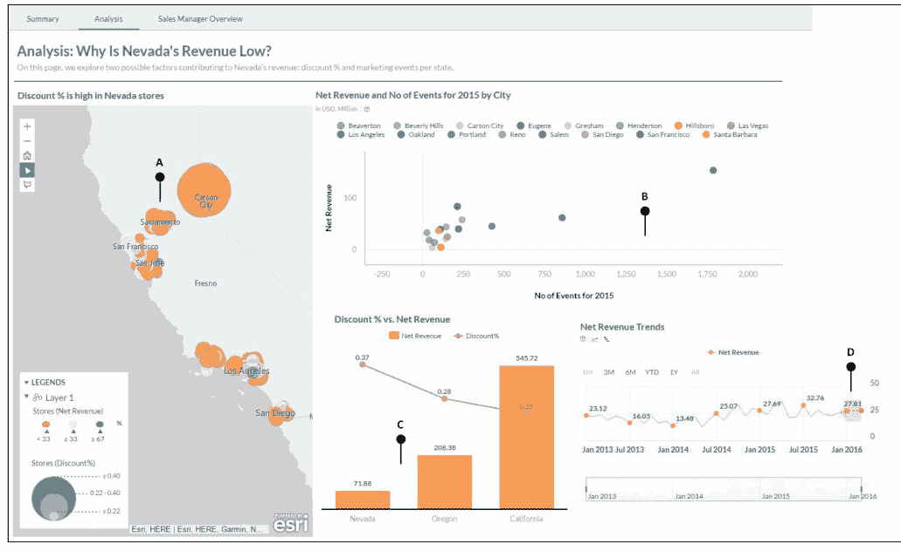

## 页面对象的简要说明：

- **A:** 这是一个地理地图，将使用气泡图层显示三个州中每个商店的净收入和折扣百分比
- **B:** 散点图展示了关联维度的使用，其中数据来自两个不同的模型显示
- **C:** 这是柱状图和折线图的组合，其中折线显示折扣百分比，对比每个州的净收入（以柱状图显示）
- **D:** 这是一个趋势-时间序列图，将演示如何执行预测性预测
- **E:** 您还将使用 SAP Analytics Cloud 的时间计算功能在条形图中比较年度结果（在屏幕截图中不可见）

根据上一章提供的说明，在完成此页面后添加标题、副标题和线条对象（如插图所示）。

## 使用故事页面

您可以根据主题将故事分隔到多个页面中。在本练习中，您将学习如何添加和重命名页面，并将介绍与故事页面相关的其他主题：

- 1. 将鼠标指针悬停在页面名称区域以查看添加新页面图标（A）。点击此图标会显示两个选项：网格和画布。选择画布选项。当您点击画布选项时，一个标记为第 2 页的新页面将添加到第 1 页旁边。重复此步骤再创建一页：

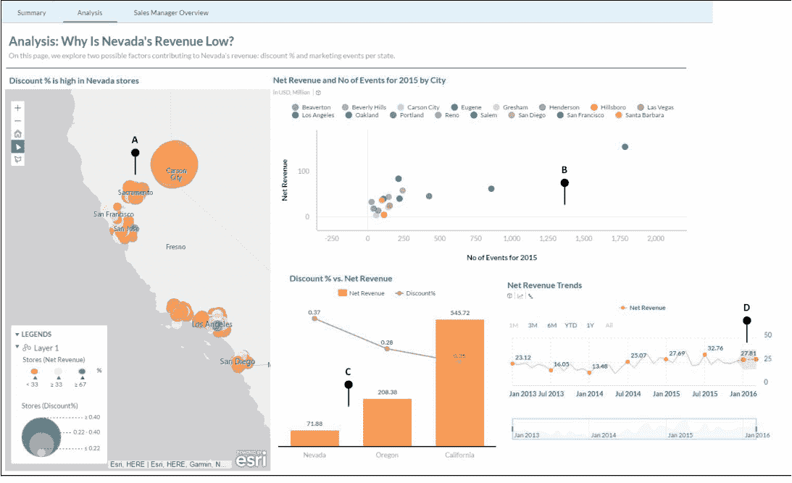

- 2. 将鼠标指针移到第 1 页上。页面名称旁边会出现一个小箭头（B）。点击此箭头以查看菜单（C）。从此菜单中选择重命名选项（D）。在重命名页面对话框中，输入 Summary（E）作为页面名称，然后点击确定。页面名称将更改。对第 2 页和第 3 页重复此步骤，并分别输入 Analysis 和 Sales Manager Overview 作为其名称：

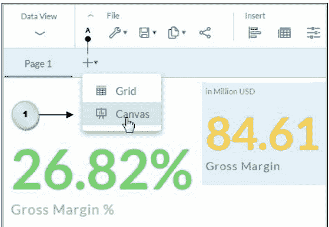

创建多个页面后，您可以按特定顺序排列它们，以便其他用户更容易理解内容。当您将鼠标光标悬停在页面选项卡栏中的页面名称上时，您会看到一个小向下箭头图标。点击此图标会显示该页面的菜单。您已从此菜单中使用了重命名选项。以下是其他菜单实用程序，允许您对故事页面执行一些重要任务：

- (F) Delete: 这会从您调用删除操作的页面中移除该页面。
- (G) Duplicate: 这会创建页面的精确副本。新页面采用现有页面的名称并附加后缀数字，您可以使用重命名菜单选项更改该名称。
- (H) Set as hidden: 在您不想与他人共享特定故事页面的情况下，您可以使用此选项将这些页面标记为隐藏。当您将页面标记为隐藏时，该页面的名称将被划掉（I）并且菜单标签更改为 Set as visible，点击后可恢复页面。
- (J) Move Left/Right: 使用这两个选项，您可以安排页面的位置。当您使用其中任一选项时，页面会向左或向右移动一个位置。或者，您可以点击并拖动页面到新位置。

页面名称、顺序和可见性在保存故事时会被保存。这些定义随后会根据保存的设置呈现给您共享故事的其他用户。例如，页面名称会按您定义的顺序显示，而标记为隐藏的页面不会在其屏幕上显示：

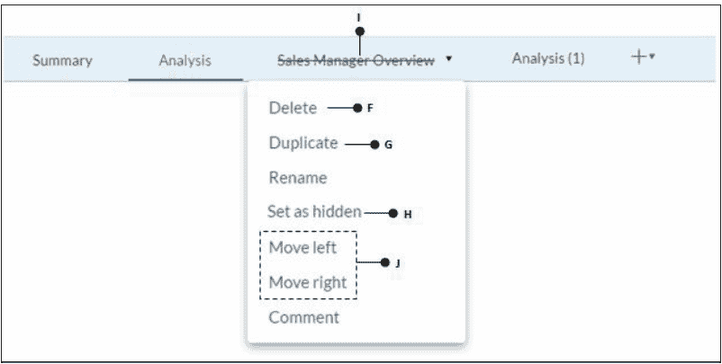

## 向页面添加注释

在上一节中，您已了解页面菜单中可用的选项。其中一个选项是 Comment，您将在此处看到其实际应用。正如名称所示，您使用此选项在所选页面上添加注释，以向其他用户提供一些重要信息。当您添加注释时，其他用户可以查看和回复它。

为故事页面添加注释的步骤如下：

- 3. 将鼠标指针悬停在 Analysis 页面上以查看小菜单图标（A）。点击此图标并选择 Comment。
- 4. 您将看到 Comment 对话框。在此对话框中输入一些注释，然后点击 Place Comment 按钮（B）。您添加到故事页面的每个注释都会分配一个编号，该编号出现在页面名称顶部（C）。
- 5. 点击保存图标，并从菜单中选择保存选项以保存故事并向他人发布新注释。您将在屏幕底部看到 story and comment saved successfully 的消息：

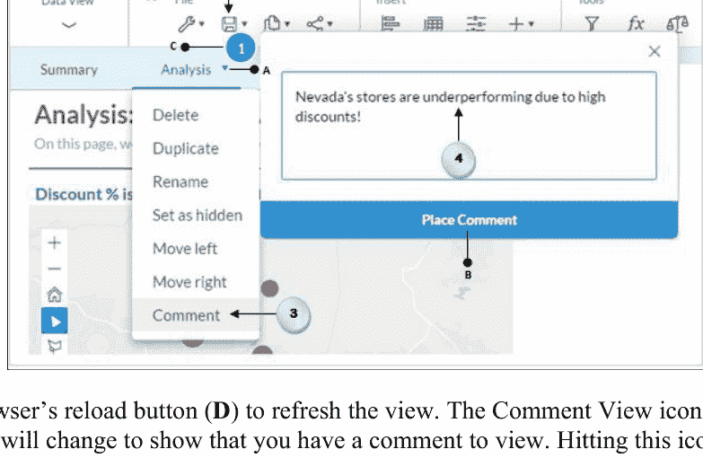

点击浏览器的重新加载按钮（D）以刷新视图。视图工具栏中的 Comment View 图标（E）将更改以显示您有注释可查看。点击此图标将在 Analysis 页面顶部显示注释编号（F）。点击此编号可查看注释（G）。您可以通过在 Reply here… 区域输入一些文本并点击 Send 图标（I）来回复此注释。当您添加回复时，线程中会添加另一条注释。重新加载页面并观察注释视图现在在其图标下显示 2。点击 Collaboration 图标（J），然后点击 Comments 选项卡（K）以查看线程。要删除注释，请点击垃圾桶图标（L）。请注意，您只能删除自己的注释。当您查看他人发布的注释时，垃圾桶图标不会显示。

## SAP BusinessObjects Cloud

安全 | https://sapbusinessobjects

重新加载此页面

应用

## 摘要

## 分析

## 分析：Why Is Net Revenue Declining?

在此页面上，我们探讨两个 pos

Admin today 12:24 PM

> 内华达州的商店因折扣过高而表现不佳！

OK! 我们很快就会处理此事。

## 注释

1 Thread

Admin today 12:45 PM

OK! 我们很快就会处理此事。

## 使用气泡图层创建地理地图

包含经纬度信息的模型可用于故事中以地理地图可视化数据。通过添加不同类型数据的多层，我们可以显示不同的地理特征和兴趣点，从而使我们能够执行复杂的地理分析。在本练习中，我们将基于 BestRun_Demo 模型创建一个地理地图，该模型已进行地理丰富。

6. 选择 Analysis 页面（A）以放置地理地图。点击插入工具栏部分的 Add 图标（B），并选择 Geo Map：

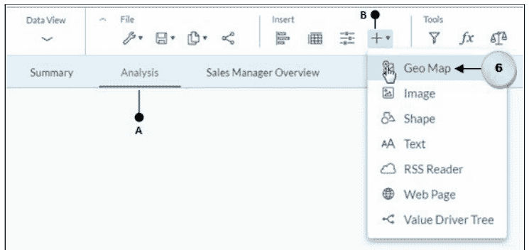

7. 一个空白地图（C）将被添加到页面，如以下屏幕截图所示。Base Layer 部分下的菜单包含一些内置地图供您选择。对于本练习，请保持默认的 Light Gray 选项（D）选中，并点击 Add Layer 链接：

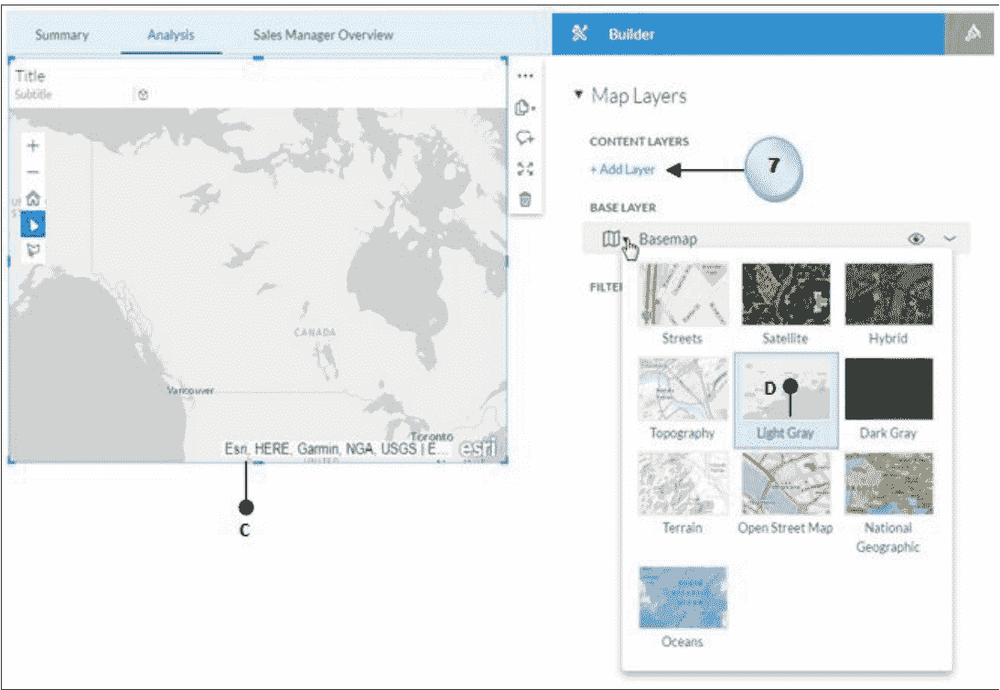

8. 在 Builder 选项卡上，点击 Data Source 部分中的 Edit 图标（A）。在 Select Datasource 屏幕上，选择 Existing Model 选项（B），然后从 Name 列表中选择 Best Run Demo 模型（C）。点击 OK。如果您未为给定图层选择模型作为数据源，则该图层将不会显示任何数据点。一旦您将模型添加到地理地图，它将成为您创建的任何后续图层的默认模型。您始终可以通过在 Data Source 部分中选择 Edit 图标来更改任何给定气泡、色带、热图或流图层的数据源。

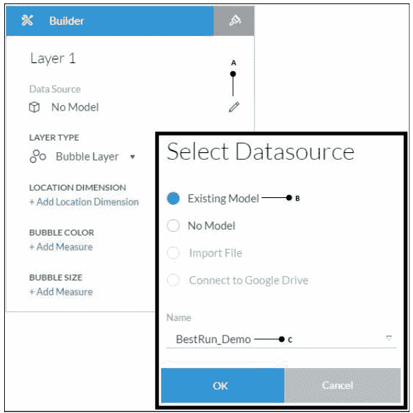

9. 点击 Layer Type 部分中的箭头。会出现一个图层列表，其中包含六种不同类型的图层。从此列表中选择 Bubble Layer。本示例中的 Bubble Layer 选项将使用气泡显示数据点以可视化商店的净收入。

10. 点击 Add Location Dimension 链接，并从列表中选择 Stores。该维度是在模型进行地理丰富时创建的，以捕获每个商店位置的经度和纬度。要将模型中的数据添加到气泡、色带或热地图层，模型必须包含至少一个位置维度。流地图图层至少需要两个位置维度。当您选择商店位置维度时，气泡图层会根据模型中生成的商店位置出现在地图上。

11. 点击 BUBBLE COLOR 下的 Add Measure 链接，并选择 Net Revenue。第 4 章《使用图表创建故事》中为此度量定义的颜色将与该度量相关联。

12. 点击 BUBBLE SIZE 下的 Add Measure 链接，并选择 Click to Create a New Calculation。在这里，您将通过商店提供的折扣指定气泡的大小：

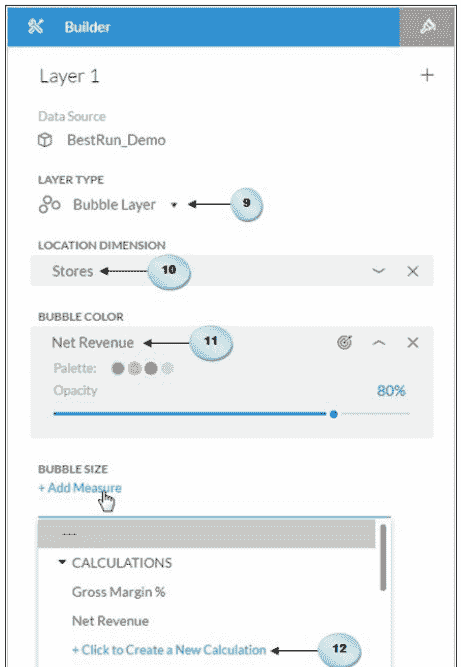

-   13. 在计算编辑器中，将类型设置为计算度量。
-   14. 在名称框中输入 Discount%。
-   15. 在编辑公式区域中，输入左方括号 [，并从度量列表中选择 Discount。
-   16. 在公式函数列表中，单击 OPERATORS 以查看数学运算符列表。单击除法 (/) 运算符，将此运算符放置在编辑公式部分中 Discount 度量之后。
-   17. 再次在编辑公式区域中输入左方括号 [，这次选择 Original Sales Price 度量以完成计算。单击屏幕底部可用的 FORMAT 按钮以验证公式。公式验证后，单击 OK 关闭计算编辑器对话框。Discount% 计算度量将出现在气泡大小部分下，该部分确定相对于销售额提供的折扣百分比：

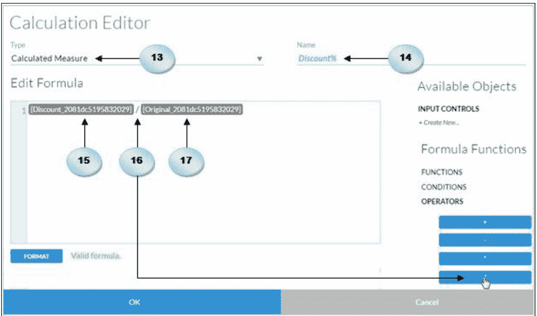

18. 单击代表净收入的阈值图标。

19. 从菜单中选择显示阈值 | 无。当你在步骤 11 中选择此度量时，一个故事定义的阈值（在第 4 章《使用图表创建故事》中创建）与之关联。我们将其设置为无，因为在当前场景中，我们将为此度量定义新的阈值。

20. 展开调色板列表 (A)，并从发散部分中选择第二个方案：

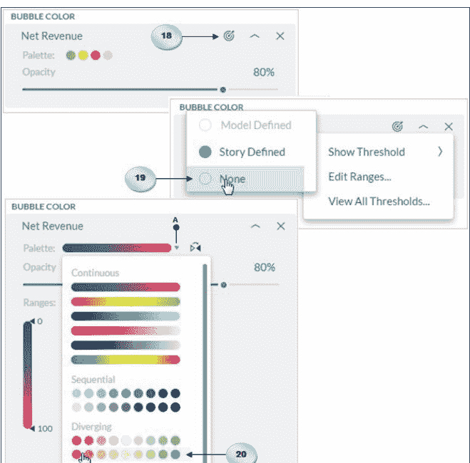

21. 将气泡的不透明度值设置为 100%，或进行调整以使底图或其他图层可见。开关图标 (A) 可用于反转调色板顺序，而比例滑块 (B) 用于调整气泡的大小。

22. 范围列表旁边的开关用于将 KPI 值显示为百分比或绝对值。对于本练习，将此开关从默认的百分比 (%) 位置切换到绝对值 (22) 位置。

23. 双击代表警告（黄色）范围的值 (C)，并输入 4,000,000（四百万）替换现有的警告值，如以下屏幕截图所示。相同的数值将出现在关键范围中，但比较运算符不同。现在，双击 OK 范围中显示的值 (D)，并将其替换为 7,000,000（七百万）。如果商店的净收入值小于 400 万，则该商店的气泡将显示为红色。大于或等于 400 万的值将以黄色气泡显示。等于或超过 700 万的任何值都将以绿色气泡显示。当你输入这些值并点击离开这些范围时，这些值的影响会立即反映在地理地图上。如你所见，地理地图上的商店根据 KPI 值以三种不同颜色的集群显示。为了支持大量位置的渲染，气泡图层默认设置为显示集群而不是所有单个点。使用此部分，你可以通过指定要显示在地图中的最大显示点数（将在下一节中讨论）将气泡分组。你还可以调整地图中集群的不透明度和集群颜色。

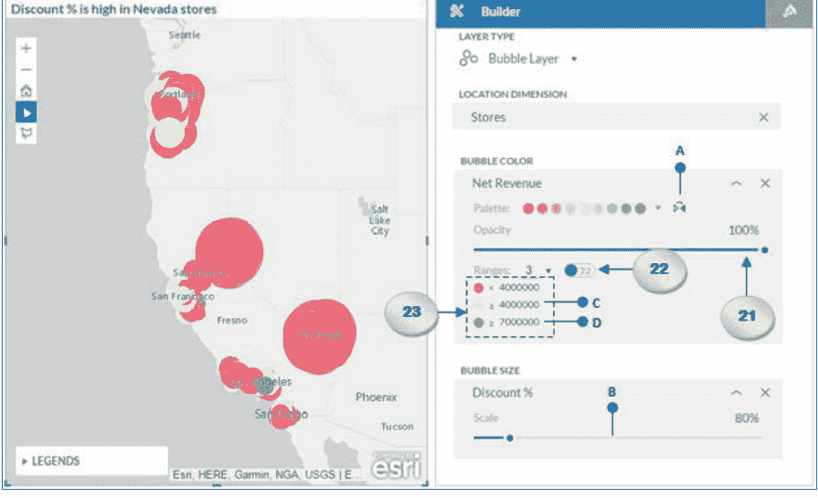

如以下屏幕截图所示，内华达州 (E) 的所有商店都显示为红色气泡，因为所有这些商店的净收入均低于 400 万。单击 + 图标 (F) 或使用鼠标滚轮放大以查看洛杉矶的商店，如以下屏幕截图所示：

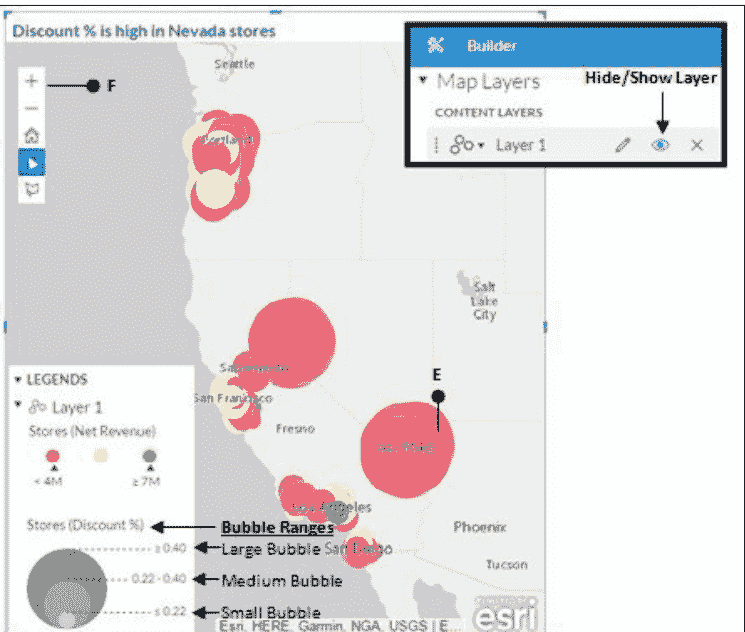

在此视图中，Conoco Food Stop 显示为绿色气泡，因为该商店的净收入为 8.3 百万，高于 OK 阈值 7 百万。

McLeods 商店的位置显示为警告，因为其净收入为 6.26 百万，介于 4 百万和 7 百万之间。

最后，Park Market 商店显示为红色气泡，因为其收入为 3.43 百万，低于关键的 4 百万阈值。

气泡的大小表示折扣百分比；气泡越大，该商店的折扣百分比越高。例如，以下屏幕截图中的 Aegis Market 商店 (G) 给予的折扣比任何其他商店都多，因此其气泡最大。

## 内华达州商店的折扣 % 较高

Park Market
商店
Discount % 0.25
Net Revenue 3.43 Million

McLeods
商店
Discount % 0.26
Net Revenue 6.28 Million

Conoco Food Stop
商店
Discount % 0.24
Net Revenue 8.30 Million

图例

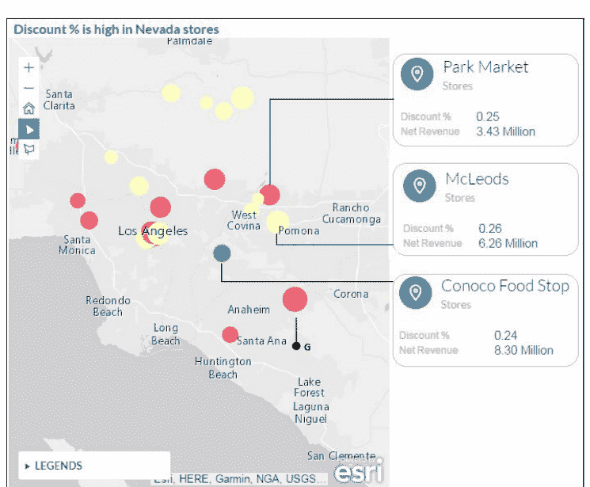

## 地理地图中的位置聚类

本地图的初始视图如以下屏幕截图所示，气泡众多，无法从此视图中解读结果。在位置聚类的帮助下，可以使地图更易于使用。

执行以下步骤以了解位置聚类的工作原理：

24. 选择地图，并展开位于构建器面板底部的集群属性部分。注意，如果你从另一个故事位置到达此页面并单击地图，你将在构建器选项卡上看到地图图层信息。在内容图层部分，单击 Layer 1 旁边的编辑图标以访问集群属性部分：

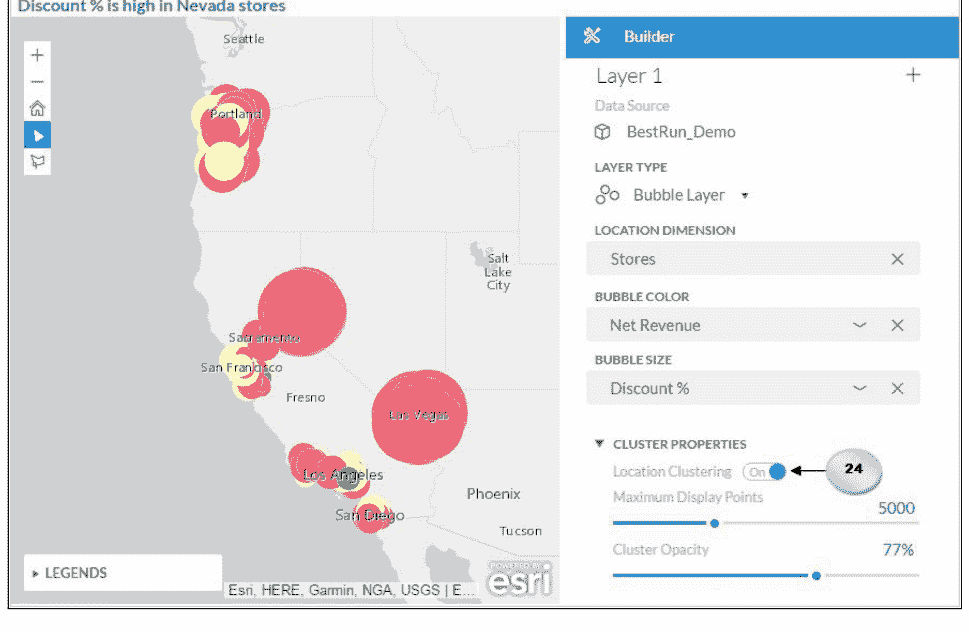

25. 如果未打开，将位置聚类切换到开启位置。

26. 双击现有的最大显示点数 (5,000)，并将其替换为 10。

27. 将集群不透明度设置为 100%，如有需要，使用集群颜色调色板更改默认的蓝色集群颜色。单击 OK 关闭此面板。

地图视图发生变化。现在各个气泡被聚类为每个城市的一个大气泡。集群大小表示气泡的数量。你也可以在每个集群上看到这些数字。例如，以下屏幕截图显示旧金山有 70 家商店，洛杉矶有 54 家。由于旧金山的商店更多，其气泡比洛杉矶的气泡更大：

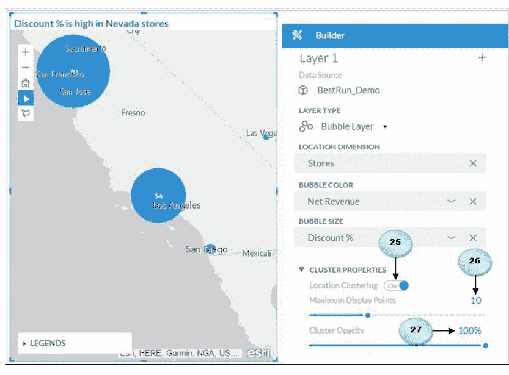

当你放大地图时，会根据地图上的新显示点数生成新的集群。当放大到显示点数低于你设定的最大值时，你将再次看到各个气泡。让我们看看它是如何工作的：

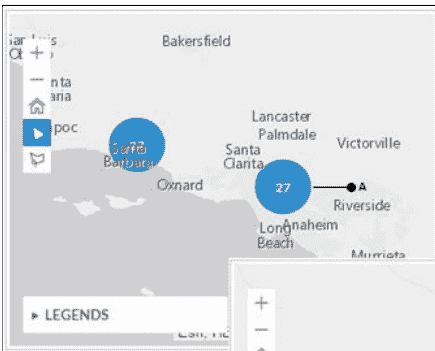

双击上一个屏幕截图中显示 54 家商店的洛杉矶气泡。你将看到地图的新视图，如第一幅图所示。此视图显示了洛杉矶 54 家商店的细分。现在，双击图中的第二个气泡 (A)。

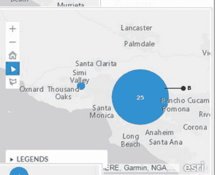

第二幅图显示了 27 家商店的细分。双击较大的气泡 (B) 以查看这些商店的位置。

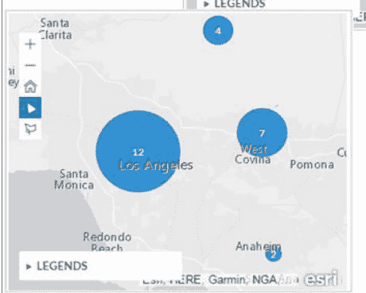

你将在此视图中看到 25 家商店的位置。继续放大直到看到各个气泡。

## 创建带分层设色图层的地理地图

在本练习中，你将创建一个基于分层设色图层的地理地图，该图层以颜色显示划分的地理区域。这提供了一种在地理区域上可视化值的方法，以显示在显示位置上的变化或模式。以下是创建此图层的步骤：

-   28. 在插入工具栏上单击添加图标，并选择地理地图。
-   29. 在构建器面板中，从底图列表中选择地形，并单击添加图层链接。
-   30. 为数据源选择 BestRun_Demo 模型。
-   31. 对于图层类型，选择分层设色图层。
-   32. 单击添加位置维度链接，并选择商店作为位置维度。
-   33. 在分层设色颜色部分下单击添加度量链接，并从列表中选择净收入。从调色板列表 (A) 中选择一种配色方案。将范围部分中的开关 (B) 移动以使用实际值，并分别输入 200,000,000 (C) 和 400,000,000 (D) 作为警告和 OK 范围。单击 OK 保存图层设置。

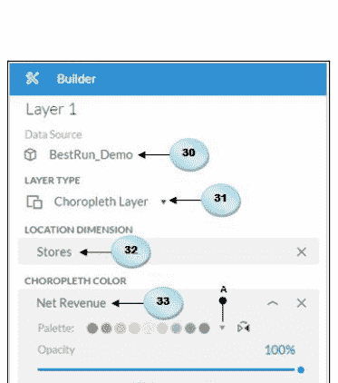

地图将刷新以显示国家级视图。由于该国的净收入值为 815.83 百万，整个国家都应用了 OK 状态，因为该值超过了上一步为 OK 状态设定的 400 百万范围。在地图的标题区域，你将看到一个分层导航图标 (E)，可用于在层次结构中向上和向下导航。单击此图标，并通过单击 Layer 1 (F) 展开列表。如你可

看，您有四个导航层级。国家选项（G）默认被选中以提供顶层视图，如以下屏幕截图所示：

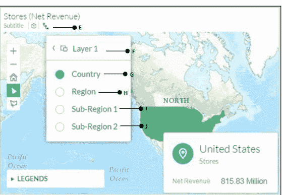

从导航列表中点击区域选项（H）。地图刷新以显示州级数据。三个州的数据根据指定的范围以不同颜色呈现：

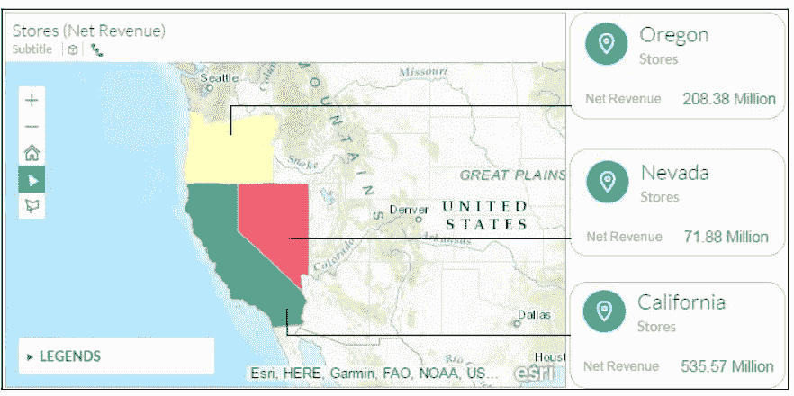

点击导航图标，并选择子区域 1（I）以向下钻取到城市层级。由于阈值过高（该阈值适用于区域层级但在此层级不适用），地图上的所有城市均显示为关键。修改这些范围，将警告和正常范围分别设置为 20,000,000 和 40,000,000。进行这些调整后，您将看到地图的合理视图：

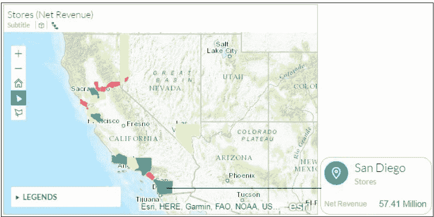

再次点击导航图标，并选择最终层级子区域 2（J）。在此最终层级，您将获得每个城市的店铺级信息。再次需要调整范围数值。将警告值设置为 2,000,000，正常值设置为 4,000,000。洛杉矶店铺的净收入为 40.21 million，因此该区域显示为绿色。Garden Grove 店铺收入为 3.68 million，因此显示在警告范围内。最后，Anaheim 的店铺仅收入 1.87 million，因此被置于关键范围内：

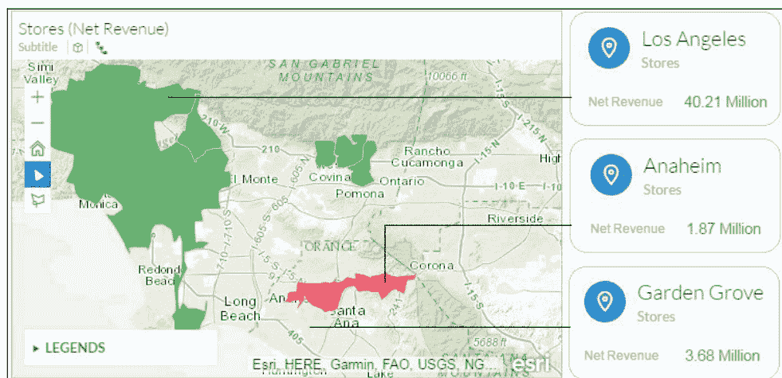

## 对地理地图应用筛选器

地理地图中的垂直工具栏配备了筛选选项，您可以通过绘制形状、多边形、圆形或正方形围绕要关注的数据点，直接在地图上筛选数据。执行以下步骤以了解如何对地理地图应用筛选器：

- 34. 从垂直工具栏中选择多边形形状，并在地理地图上绘制一个形状，如以下屏幕截图所示：

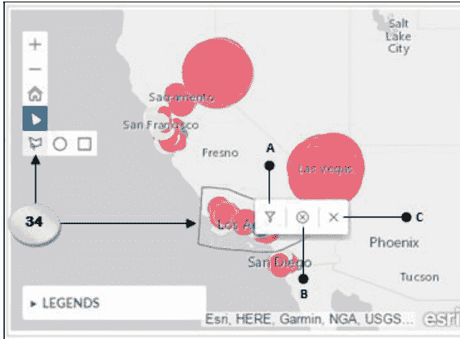

绘制形状后，您会获得几个选项。第一个选项（A）可筛选所选数据点，第二个选项（B）排除所选数据点，第三个选项（C）移除筛选器。前两个选项的输出在以下屏幕截图中说明。当您对所选数据点应用筛选器时，地图上的其他数据点会消失（见 View-1）。如果选择第二个选项，所选数据点将从地图上消失，如 View-2 所示：

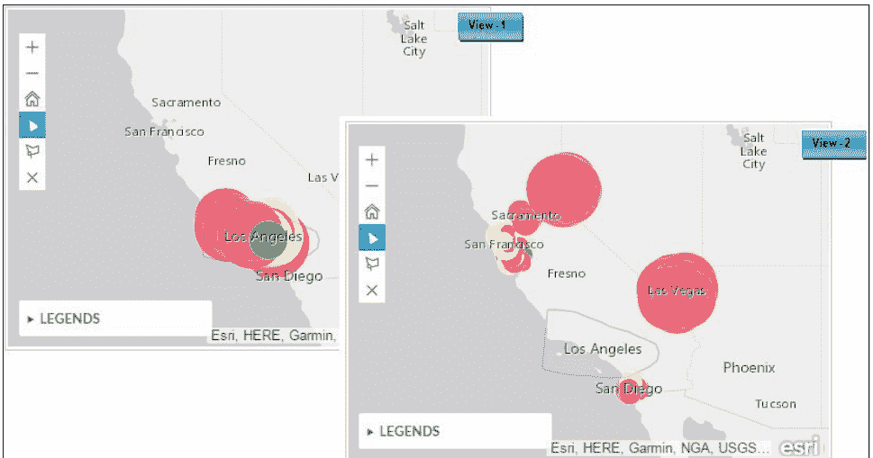

## 链接不同的模型

在您的故事中，您可以通过链接这些模型中的维度，在单个图表中显示来自多个模型的数据。在本练习中，您将链接两个模型（BestRun_Demo 和 Planned_Events），以在散点图图表中查看来自两个模型的数据。

以下是链接维度的步骤：

- 35. 在“更多”菜单中点击“链接维度”选项。在较宽的屏幕上，该选项列在数据工具栏部分（A）中。或者，在创建或编辑图表时，您也可以在构建器面板的数据源区域中找到此选项：

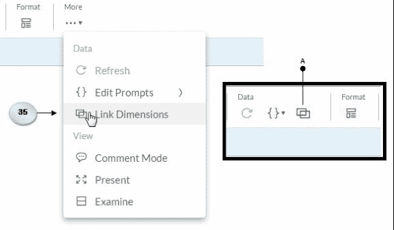

- 36. “链接维度”对话框出现。在此对话框中，您需要将左侧主模型中的维度与右侧次要模型中的维度链接。展开左侧窗格中的下拉列表，然后点击“添加模型”选项。在“选择要添加的模型”对话框中，选择现有的 Planned_Events 模型，然后点击“确定”关闭对话框。该模型中的维度将出现在左侧窗格下：

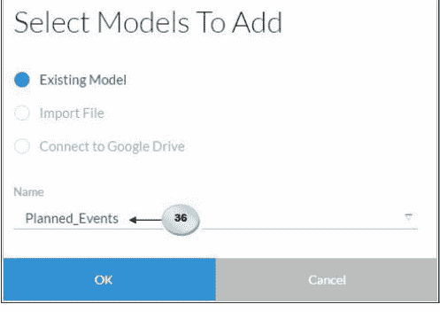

- 37. 在右侧窗格中，从相应的下拉列表中选择 BestRun_Demo 模型。该模型中的维度也会出现。

- 38. 选择这些模型后，您需要通过映射在两个模型中都出现的至少一个维度来在两个模型之间创建链接。从这些模型中选择的维度不需要具有相同的名称，但它们包含的数据必须为相同类型。从 Planned_Events 模型中选择 City，从 BestRun_Demo 模型中选择 Location。系统将验证链接（A）。在此示例中，我们只需要一个匹配项。然而，“已链接维度”对话框允许您匹配多个维度。通过点击“设置”按钮建立链接：

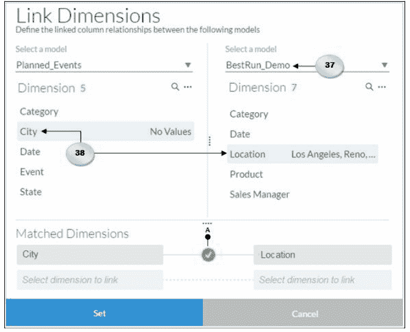

- 39. 如以下屏幕截图所示，“链接维度”对话框弹出以查看链接。它允许您修改（A）、删除（B）或添加更多链接（C）。现在，点击“完成”：

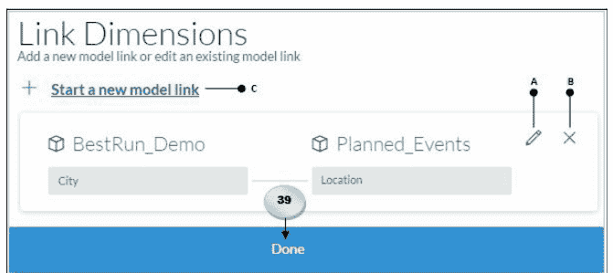

## 基于已链接维度创建图表

现在我们已链接了两个模型，可以创建图表来显示来自两个模型的数据。在本示例中，我们将创建散点图图表，使用已链接的维度获得来自两个模型的结果。执行以下步骤集来创建此图表：

- 40. 如往常一样，通过点击“插入”工具栏上的图表图标添加空白图表。
- 41. 在构建器面板中，点击“数据源”下的“编辑”链接。
- 42. 在“选择您的数据”对话框中选择 Planned_Events 模型。该模型将被视为图表的主模型：

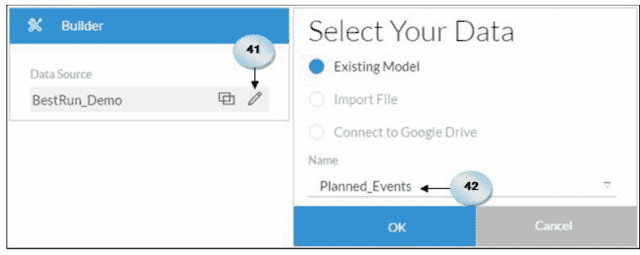

- 43. 从相关性类别中选择散点图图表。
- 44. 在 X 轴部分点击“添加度量”链接，并选择 No of Events for 2015。请注意，这是在 Planned_Events 模型中的一个度量。
- 45. 在颜色部分点击“添加维度/阈值”链接，并选择 City。这是 Planned_Events 模型维度，在上一节中已链接到 BestRun_Demo 模型中的 Location 维度。请注意，已链接的维度具有链接图标（B）。
- 46. 现在，在“数据源”部分点击“链接维度”图标（A），并选择 BestRun_Demo 模型。模型名称、度量和维度旁边的蓝色点（C）表示它们来自主模型。
- 47. 在 Y 轴部分，点击“添加度量”链接，并从 BestRun_Demo 模型中选择 Net Revenue。当您从 BestRun_Demo 模型中选择 Net Revenue 度量时，您将在构建器面板的“数据源”下看到一个名为 Join Type 的新部分（将在下一节中讨论）：

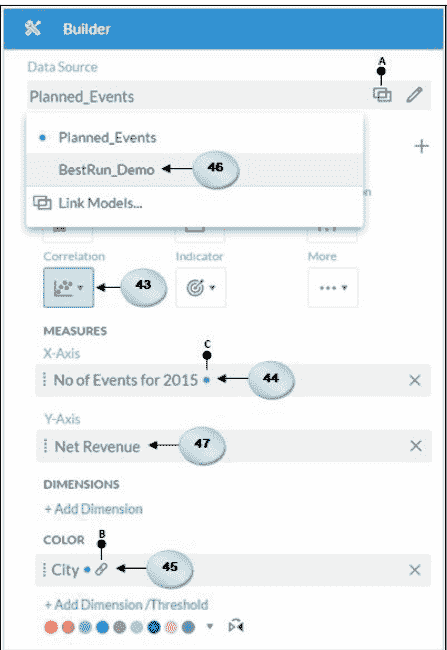

图表刷新以显示来自两个模型的数据。X 轴上的数据使用来自 Planned_Events 模型的 No of Events for 2015 度量获取，而 Y 轴上的 Net Revenue 度量数据来自 BestRun_Demo 模型：

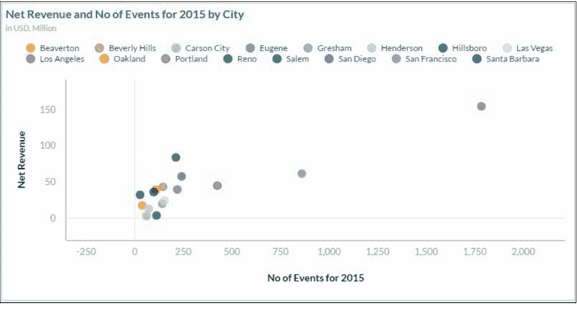

## 连接类型

当您选择次要模型并向图表添加其度量时，您将在构建器面板中看到一个附加部分。该部分标记为 JOIN TYPE，如以下屏幕截图所示。该部分提供的选项允许您选择要在图表上显示的数据类型：

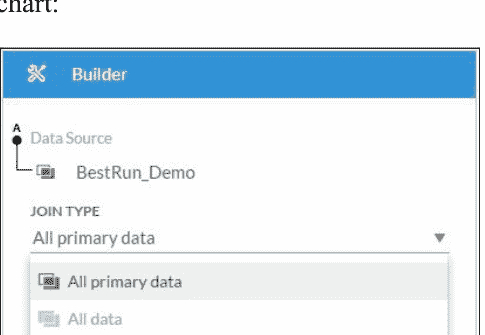

All primary data: 这是默认选项。它显示主模型中的所有数据以及次要模型中对应的数据。这意味着来自 Planned_Events 模型的所有事件数据都会显示，无论它们在 BestRun_Demo 模型中是否有关联记录。

All data: 如您所见，此选项为灰色，因为它仅适用于数据来源为 SAP HANA 的已链接模型。当满足此条件时，该选项变为可访问，并获取主模型和次要模型中的所有数据。

Intersecting data only: 此选项将仅允许已链接的数据出现在图表中。请参阅下一节，其中使用示例演示了此连接类型。

当您从列表中选择这些选项中的任何一个时，次要模型旁边的图标（A）会更改以指示当前生效的连接类型。

## 相交数据示例

你在上一练习中创建的散点图展示了 16 个城市的活动数据。然而，BestRun_Demo 模型中的城市数量为 18，如以下截图所示，该截图取自 Data View 面板。Planned_Events 模型中没有这两个突出显示的城市 Sacramento 和 San Jose 的活动数据。此场景将允许我们测试“仅相交数据”连接类型。

执行以下步骤集以测试选择“仅相交数据”连接类型的效果：

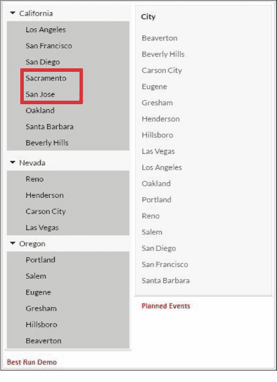

- 48. 通过点击插入工具栏上的图表图标添加空白图表。
- 49. 为数据源选择 BestRun_Demo 模型。
- 50. 从趋势类别中选择面积图。
- 51. 点击“添加度量”链接，并选择净收入。
- 52. 在“维度”部分点击“添加维度”链接，并选择位置。
- 53. 在数据源中，点击“链接维度”图标，并选择 Planned_Events 模型以从该模型中选择第二个度量。
- 54. 在“度量”部分，点击“添加度量”链接，并选择 2015 年的活动数量，如以下截图所示：

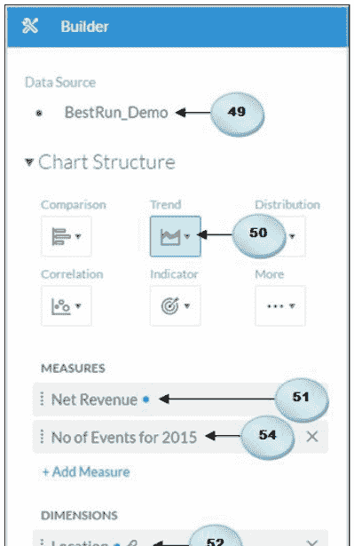

趋势图出现在页面上。点击该图表底部 California 链接（A），然后点击下钻图标（B）以对该州进行下钻：

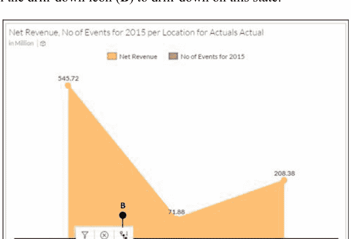

在构建器面板中，在数据源部分选择 Planned_Events 模型以查看“连接类型”部分。将连接类型的默认选项设置为“所有主数据”时，图表将如以下截图中的 View-1 所示呈现。在此视图中，两个城市（Sacramento 和 San Jose）可见，并显示来自 BestRun_Demo 模型的相应净收入数据。

现在，将连接类型选项切换为“仅相交数据”。图表刷新后，您将得到 View-2。好了！这两个城市已从场景中消失，因为它们在 Planned_Events 模型中没有对应的数据：

### 视图 - 1
### 视图 - 2

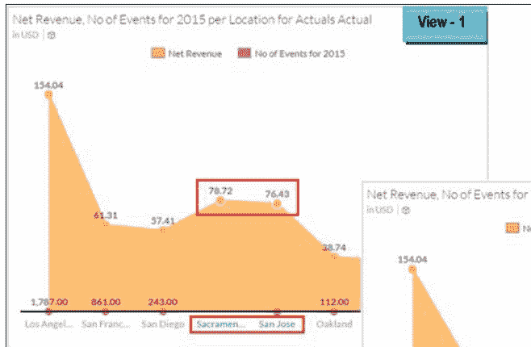

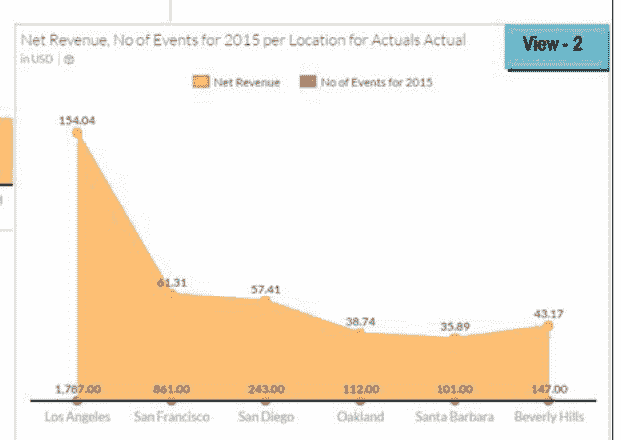

## 创建组合柱状图和折线图

组合图用于在同一图表中比较两种不同类型的数据。在本练习中，您将创建一个组合柱状图和折线图，以显示提供的折扣百分比与净收入的对比。初始图表视图将为三个州提供此信息。图表将允许您通过图例或通过州的链接进行下钻，以查看相关详细信息。如果您通过图例进行下钻，您将看到三个州中全部十八个城市的数据。另一方面，如果您对某个州进行下钻，您只能获得该州的城市数据。以下是步骤：

- 55. 从插入工具栏添加空白图表。
- 56. 将数据源设置为 BestRun_Demo 模型。
- 57. 从比较类别中选择组合柱状图和折线图。
- 58. 在“度量”部分，点击“添加度量”链接，并为柱状轴选择净收入。您为柱状轴选择的度量值将使用柱状图显示。
- 59. 在折线轴下点击“添加度量”链接，并选择折扣 %。折扣百分比度量的值将使用折线呈现。
- 60. 最后，点击“添加维度”链接，并选择位置以显示每个州的所选度量信息，如以下截图所示：

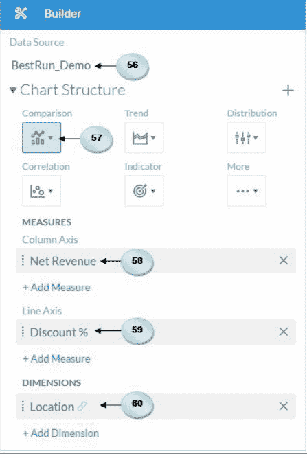

图表出现在页面上。图表中的三根柱状图代表三个州的净收入，而折线代表每个州提供的折扣百分比。执行以下步骤将图表柱状图从最低收入排序到最高收入：

- 61. 点击排序选项图标。您将看到一个包含图表中使用的度量和维度的名称的菜单。
- 62. 从菜单中选择净收入度量。
- 63. 选择度量时，会弹出一个包含几个排序选项的子菜单。从子菜单中选择从低到高，以将图表柱状图从最低净收入排序到最高：

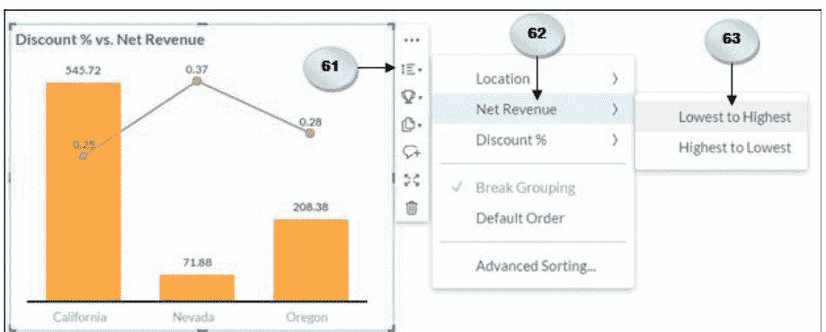

图表已更新以体现排序效果，如以下截图所示：

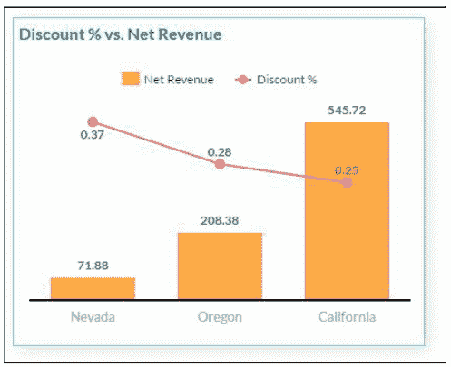

64. 点击净收入图例（A），然后点击下钻图标。您将看到图表，如 View-1 所示。该视图为所有州的所有城市提供数据。再次点击净收入图例，并选择上钻以查看图表的顶层视图。

现在，在顶层视图中点击 Nevada 州链接（B），并选择下钻。此选择的输出如 View-2 所示，其中仅获取 Nevada 州的城市：

### 折扣 % 与 净收入
### 折扣 % 与 净收入
### 折扣 % 与 净收入
### 视图 - 1
### 视图 - 2

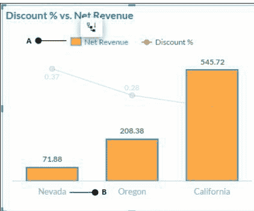

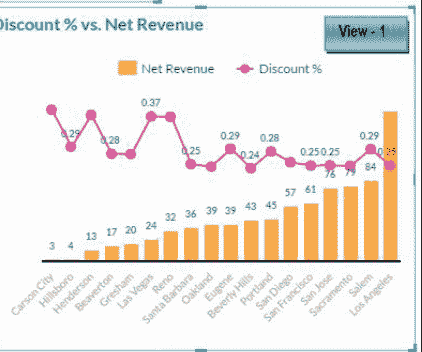

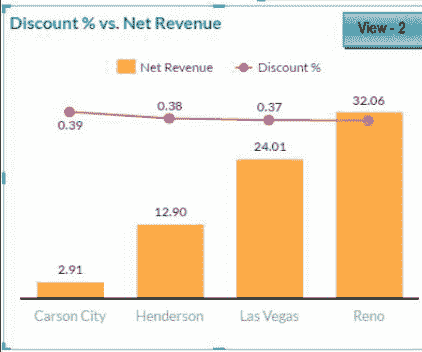

## 通过趋势时间序列图使用预测性预测

时间序列预测仅支持规划模型。因此，您需要规划权限和规划许可证才能运行预测性时间序列预测。然而，您可以通过创建基于分析模型的趋势时间序列图来估计未来值，从而添加预测性预测。在本练习中，您将使用趋势时间序列图查看全年范围内的净收入趋势。预测性时间序列预测在历史数据上运行算法以预测特定度量的未来值。对于此类图表，您最多可以预测三个不同的度量，并且必须指定预测的时间以及用作历史数据的过去时间段。

- 65. 从插入工具栏添加空白图表。
- 66. 将数据源设置为 BestRun_Demo 模型。
- 67. 从趋势类别中选择时间序列图。
- 68. 在“度量”部分，点击“添加度量”链接，并选择净收入。

最后，在“时间”部分点击“添加维度”链接，并选择日期作为图表的维度：

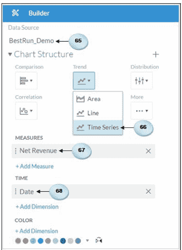

您选择的输出在以下截图中的第一个视图中显示。您在故事页面上创建的每个图表都有其独特的元素，可让您导航并深入细节。趋势时间序列图还允许您放大到不同的时间段并在整个时间轴上滚动。例如，以下插图中的第一个图

提供净收入趋势的一年视图（A），即 2015 年 1 月至 12 月。点击六个月链接（B）以查看相应的输出，如第二个视图所示。将矩形框（C）向左或向右拖动以在整个时间轴上滚动：

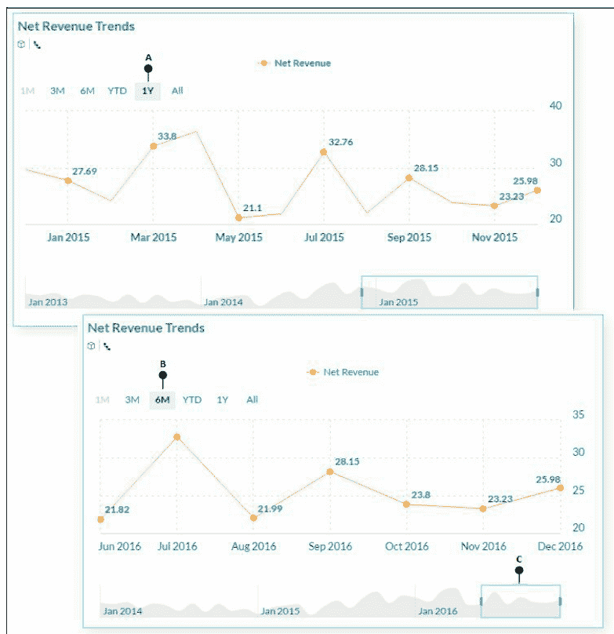

### 添加预测

69. 点击代表 2015 年 12 月的最后一个数据点，并从“更多操作”菜单（D）中选择“添加预测”以添加预测：

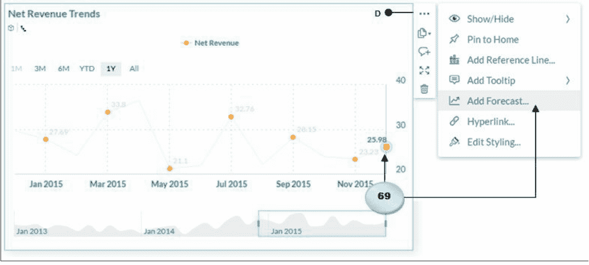

70. 您将在右侧看到预测性预测面板，其中显示最大预测期数。使用此部分中的滑块（E），您可以减少预测期数。默认情况下，您在滑块中看到的最大数量（在当前场景中为七）由您拥有的历史数据量决定。在“预测对象”部分，您可以看到为图表选择的度量（F）。如有需要，您可以在此类型的图表中预测最多三个不同的度量，您可以在构建器面板中添加这些度量。目前，点击“确定”以接受预测的默认值，如以下截图所示：

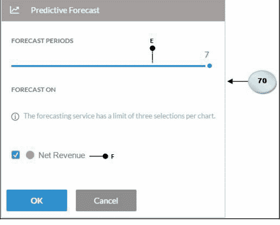

预测将被添加到图表中。它由高亮区域（G）表示，并且

一条虚线（H）。点击 1 年 链接（I）以查看与以下截图类似的输出，该输出位于 *Modifying forecast* 部分下。正如您所见，有几个数据点代表预测。突出显示区域的顶部和底部表示预测范围的上限和下限，并且数据点落在每个时间段的预测范围中间（在虚线上）。选择一个数据点以查看上限置信界限（J）和下限置信界限（K）值：

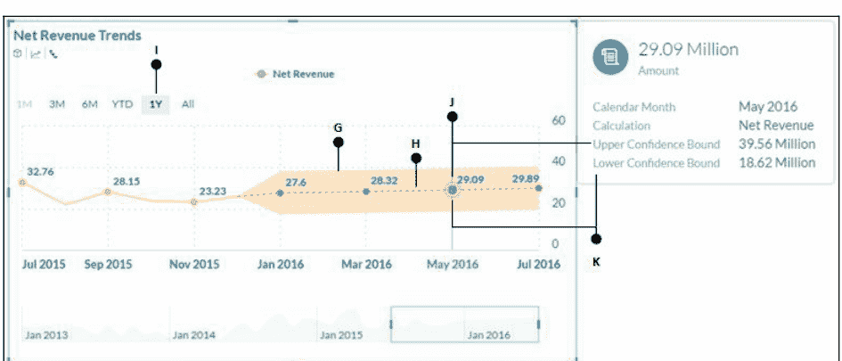

## 修改预测

您可以使用构建器面板底部“预测”部分提供的链接来修改预测。选择图表，然后滚动到构建器面板底部。点击编辑图标（L）再次查看预测性预测面板。查看您的设置，并在该面板中进行必要的更改。例如，将滑块向左拖动以将预测期值设置为 3（M）。点击确定保存设置。

图表现在应显示三个月的预测——2016 年 1 月、2 月和 3 月（N）：

## 添加时间计算

如果您想在图表中显示诸如同比销售趋势或年初至今总额等值，则可以使用 SAP Analytics Cloud 的时间计算功能。时间计算功能为您提供多种计算选项。为了使用此功能，您的图表必须包含具有适当粒度级别的时间维度。例如，如果您想查看季度环比结果，则时间维度必须包含季度甚至月度结果。篇幅限制不允许我们介绍所有这些选项。然而，我们将在本练习中使用同比选项来比较年度结果，以了解此功能。执行以下说明，首先创建一个条形图，显示四个产品类别的销售数量。然后，向图表添加时间计算，以显示每个类别销售数量的同比变化。

- 71. 像往常一样，使用插入工具栏上的图表选项向页面添加一个空白图表。
- 72. 选择 Best Run 模型作为图表的数据源。
- 73. 从比较类别中选择条形/列图。
- 74. 在“度量”部分，点击“添加度量”链接，并选择“销售数量”。
- 75. 点击“维度”部分中的“添加维度”链接，并选择“产品”作为图表的维度，如下所示：

图表出现在页面上。在此阶段，如果您点击代表销售数量的更多图标，您会看到“添加时间计算”选项（A）处于灰色状态。这是因为时间计算需要向图表添加时间维度，我们将在下一步添加。

76. 点击“维度”部分中的“添加维度”链接，并选择“日期”以向图表添加此时间维度。图表会转换，如以下截图所示：

要以年份级别显示图表中的结果，您需要按如下方式应用筛选器：

77. 点击“日期”维度中的筛选器图标，并选择“按成员筛选”。

78. 在“为日期设置成员”对话框中，展开 all 节点，并分别选择 2014、2015 和 2016。再次，图表会更改以反映筛选器的应用，如以下截图所示：

现在时间维度已添加到图表中，我们可以按如下方式向其添加时间计算：

79. 点击“销售数量”度量中的更多图标。

- 80. 从菜单中选择“添加时间计算”。
- 81. 选择“同比”。

新的条形（A）和相应的图例（B）将被添加到图表中，有助于您比较年度结果，如以下截图所示：

## 摘要

本章提供了对 SAP Analytics Cloud 中一些非常重要的主题的实践介绍。您在故事中创建了第二个页面并将其命名为“故事分析”。新页面被添加到故事中以分隔分析。

您还学习了如何为故事页面提供富有表现力的名称，同时了解了一些其他页面操作选项，允许您添加、删除、重命名、隐藏和移动页面。然后，您学习了如何通过添加评论与他人分享您对故事页面上提供的分析的看法。您创建了气泡和色带图层以在地理地图中可视化数据，并应用了位置聚类以更好地在地图中可视化数据。

您还了解了可以应用于地理地图的不同类型的筛选器，以将分析限制在特定区域。您通过关联维度连接了两个不同的模型，并创建了组合列和折线图以比较不同的值。在最后几节中，您学习了通过趋势时间序列图在分析模型上进行预测性预测的技术，并了解了向图表添加时间计算以比较同比值的过程。

下一章将教您如何在分析中使用表格。表格是一个对象，以行/列矩阵的形式呈现数据，例如 Excel 电子表格。
