# 使用表格和网格

在完成“摘要”和“分析”页面后，您在其中添加了一些有用的对象来可视化数据，这里是第三个——“销售经理概览”。顾名思义，此页面将具有用于分析销售团队绩效的对象。此页面上要创建的一些对象（筛选器和条形图（A））您已经熟悉。表格对象（B）是本章的新内容。表格是一个类似电子表格的对象，可用于查看和分析文本数据。您可以在故事中的画布或网格页面上添加此对象，如以下截图所示：

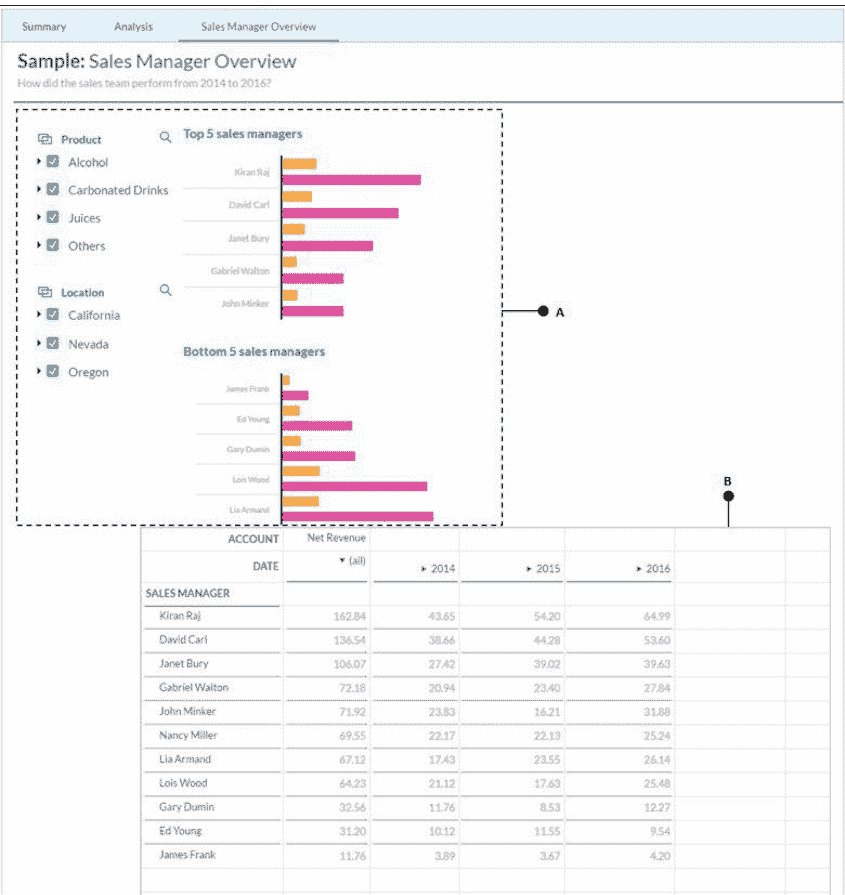

除了表格对象外，您还将亲身体验网格，它是一种用于创建包含文本和公式的分析的页面类型。以下是本章涵盖的主题列表：

- 在页面之间以及同一页面内复制对象
- 应用排名
- 创建表格
- 对表格应用筛选器
- 显示/隐藏表格元素
- 对表格中的数据进行排序
- 显示总计
- 设置表格样式
- 创建格式规则以将自定义样式应用于表格
- 设置可见性筛选器
- 交换表格轴
- 在表格中冻结行和列
- 在表格中使用 KPI
- 使用网格
- 创建混合表格
- 制作对象、页面和故事的副本
- 将故事保存为 PDF
- 为您的故事创建仪表板
- 使用文本注释设置提醒

## 在页面之间复制对象

如前一截图所示，此页面上有几个筛选器放置以缩小分析范围。请回忆，这两个筛选器是在第 5 章《使用 KPI、筛选器和其他实用对象扩展筛选器》中为“摘要”页面创建的。在本练习中，我们将通过将它们复制到“销售经理概览”页面来利用相同的筛选器。让我们开始吧！

- 1. 点击“摘要”页面，然后选择“产品”筛选器，如以下截图所示。
- 2. 点击菜单中的复制图标。
- 3. 从子菜单中选择“复制到”。
- 4. 最后，选择“销售经理概览”页面作为此筛选器的目标。请回忆，此页面是在第 6 章《使用地理地图和其他对象分析数据》中创建并重命名的。筛选器将出现在所选页面上。
- 5. 重复步骤 2 到 4 以将位置筛选器也复制到“销售经理概览”页面。

以下是说明上述要点的截图：

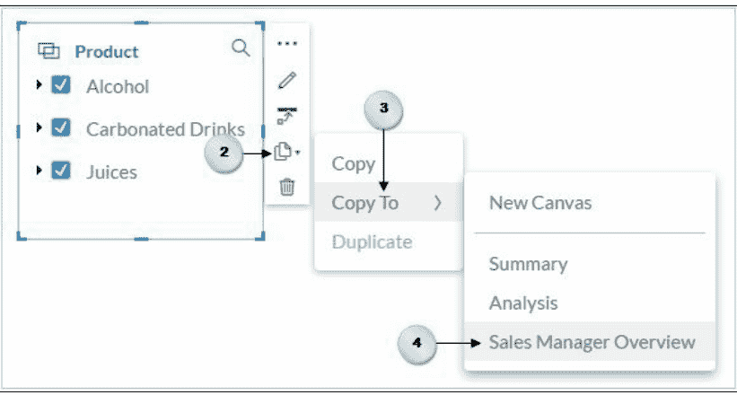

## 应用排名

现在，您将在页面上添加两个图表。两个图表都将使用相同的度量和维度创建。这两个图表之间的唯一区别在于，第一个图表将显示前五名经理，而第二个图表将显示后五名经理。此排名将通过在菜单中选择“Top N 选项”来应用。通过排名筛选数据可将图表聚焦于具有最高或最低值的指定数量的数据点。让我们看看如何在图表中应用排名。

- 6. 从“插入”工具栏添加一个空白图表。
- 7. 选择 BestRun 模型作为图表的数据源。
- 8. 从“比较”类别中选择“条形/列形”图表。
- 9. 在“度量”部分，单击“添加度量”链接，并选择“已售数量”。
- 10. 再次在“度量”部分单击“添加度量”链接，并将“净收入”选为该图表的第二个度量。此页面上的两个图表都将显示销售经理的销售数量值以及从销售所得中获得的金额。
- 11. 最后，在“维度”部分单击“添加维度”链接，并选择“销售经理”作为图表的维度。
- 12. 可选地，在“颜色”部分单击“添加维度/阈值”链接，并选择配色方案，如以下屏幕截图所示：

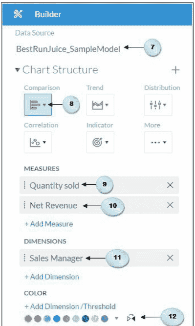

如以下屏幕截图所示，图表将出现在页面上。

- 1. 选择图表并将其标题替换为“前 5 名销售经理”。
- 2. 在图表的菜单中单击“Top N 选项”。
- 3. 从子菜单中选择“Top N 选项”。

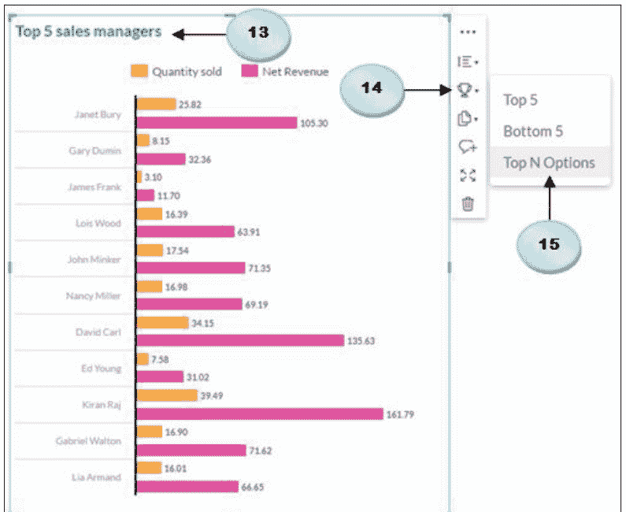

16. 在“Top N 选项”对话框中，将“模式”设置为“Top (A)”以显示顶部结果。将“值”设置为 5 (B) 以在图表中显示前五个结果。选择“净收入”(C) 作为“度量”以显示具有最高净收入的前五条记录。单击“应用”关闭对话框：

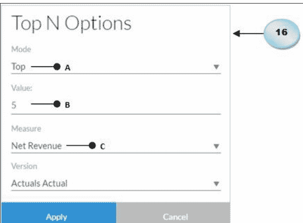

以下是图表的输出，它显示了根据为公司赚取的净收入排名的前五名销售经理。Kiran Raj 因其 1.6179 亿的销售额而位居图表榜首：

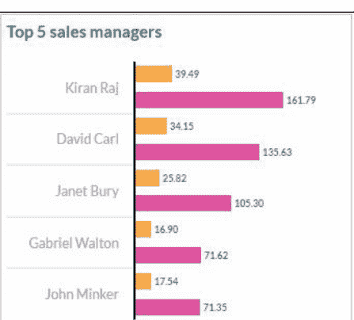

## 复制对象到同一页面

现在您将通过创建另一个图表来显示后五名销售经理，从而看到图片的另一面。

- 17. 选择“前 5 名销售经理”图表并单击“复制”图标。
- 18. 在子菜单中单击“复制”。所选图表将被复制到剪贴板，并且相应的消息 (A) 将出现在您的屏幕上：
- 19. 单击页面中的空白区域，然后按 Ctrl+V 将图表从剪贴板粘贴到页面上。或者，您也可以使用“文件”工具栏上的“复制和粘贴”菜单中的“粘贴”选项。页面上会出现“前 5 名销售经理”图表的副本。
- 20. 选择新图表并将其标题替换为“后 5 名销售经理”。
- 21. 在图表的菜单中单击“Top N 选项”。
- 22. 从子菜单中选择“Top N 选项”。

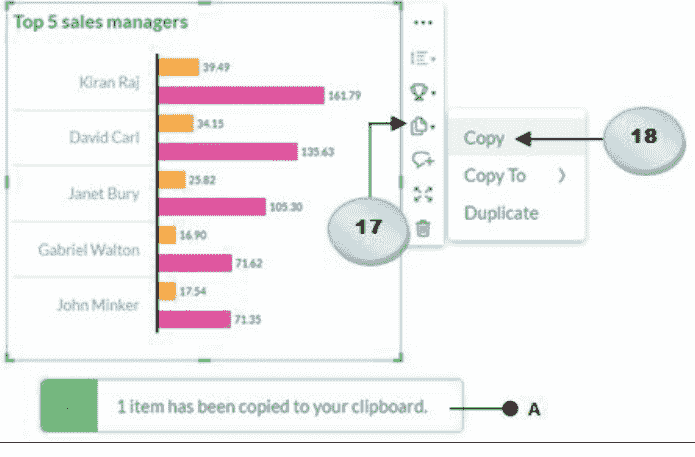

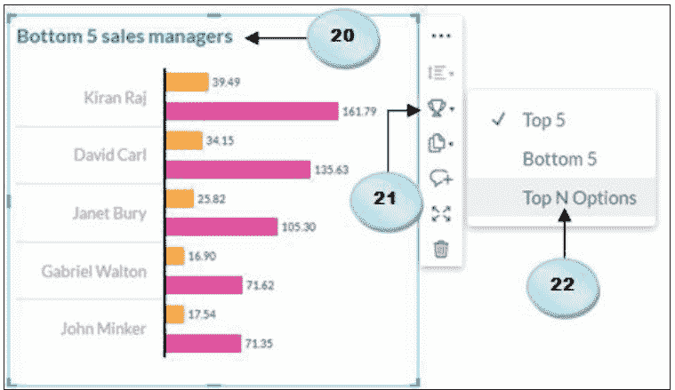

23. 在“Top N 选项”对话框中，将“模式”设置为“Bottom (A)”以显示底部结果。将“值”设置为 5 (B) 以显示底部五个结果。选择“净收入”(C) 作为“度量”以显示净收入最低的五条记录。单击“应用”关闭对话框：

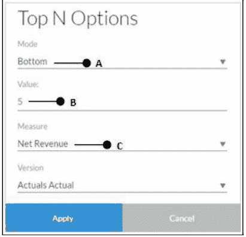

这是底部排名的结果。如您所见，James Frank 是收入最低的销售经理，仅产生了 1,170 万。尝试使用两个页面筛选器通过应用筛选器来操作这两个图表：

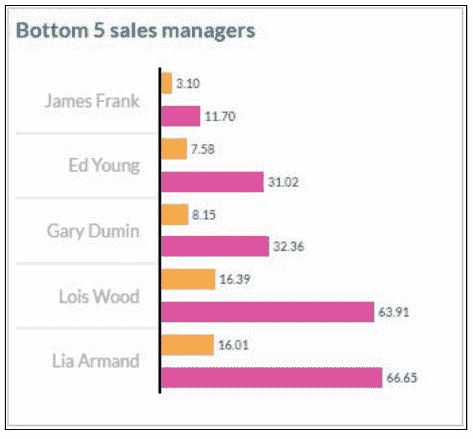

## 网格和表格

网格是一个空间，您可以在其中使用公式创建和处理表格，无论是否存在从现有数据生成的表格。另一方面，表格可用于查看和分析数据。表格和网格都提供类似电子表格的感觉，两者都可以在故事中使用，以处理已加载到模型中的数据，或在没有模型的情况下手动处理数据。

您可以在故事的画布或网格页面上添加表格。在前一种情况下，表格与底层模型集成，如您将在下一个练习中看到的那样。在网格页面上，表格可以绑定到模型，但您也可以创建空白表格并手动键入或粘贴数据。在画布页面上，表格充当图块，可以像其他任何对象一样移动。在网格页面上，您可以通过在表格上方或左侧添加行和列来更改表格的位置。

## 使用表格

在本练习中，您将使用将在画布页面上创建的表格对象，并在本章后面介绍网格。执行以下步骤在您的故事页面上创建表格以评估此对象：

24. 在“插入”工具栏上单击表格图标。将添加一个表格对象 (A)，其中填充了 BestRun 模型中“账户”维度 (B) 的所有成员：

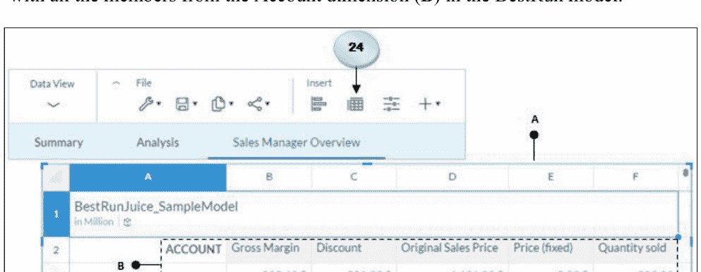

25. 在“构建器”面板中，在“行”部分单击“添加度量/维度”链接，并选择“销售经理”维度。表格将刷新以在第一个表格列中显示所选维度的值 (C)。另请注意，所有五个度量也已更新，以显示每个销售经理的相应值：

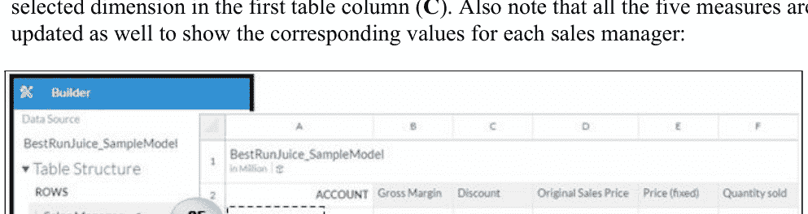

26. 在“列”部分下，单击“添加度量/维度”链接，并选择“日期”维度。再次，表格将刷新以在每个度量下显示所选维度的所有成员。例如，毛利润将显示 2014 年、2015 年和 2016 年的数据 (D)。同样，所有其他度量也将在“日期”行中具有这三列。单击“毛利润”列下的“全部”节点以查看日期维度中的顶级成员（年份）。单击任意一年以展开其节点并查看第二级成员（季度）。最后，展开一个季度节点以查看所选度量针对销售经理的月度统计数据：

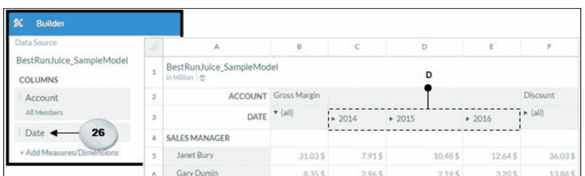

## 向表格应用筛选器

表格对象允许您对“行”和“列”部分中选择的度量和维度应用筛选器，以将分析限制为某些特定标准。在此步骤中，您将在“列”部分添加一个筛选器。此处应用的筛选器将仅显示“净收入”度量的值。请注意，表格是使用“账户”维度的所有度量创建的，并且不显示任何三个计算度量。但当您打算对表格应用筛选器时，您将获得一个包含所有度量的列表，包括您在前几章中创建的三个计算度量。

以下是步骤：

- 27. 在“构建器”面板中，单击代表“账户”维度的“管理筛选器”图标。
- 28. 在“账户的所选筛选器”屏幕上，选择“净收入”，然后单击“确定”。筛选器将从表格中删除所有默认度量并仅显示“净收入”的数据 (A)：

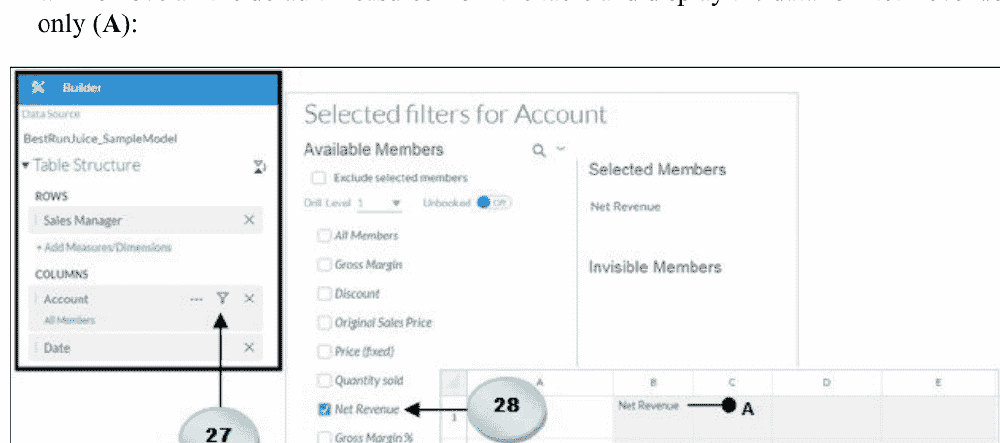

- 29. 添加另一个筛选器以显示 2016 年的数据。单击“日期”维度的“管理筛选器”图标 (A)。选择“按成员”(B)，并在“日期的所选筛选器”窗口中选择 2016 (C)。表格中将消失 2014 年和 2015 年的净收入数据：

### 构建器

数据源

BestRunJuice_SampleModel

### 表格结构

行

销售经理

+ 添加度量/维度

列

账户

所有成员

日期

按成员

按范围

29

### 日期所选筛选器

可用成员

排除所选成员

钻取级别

未预订关闭

动态时间筛选关闭

(全部)

2014

2015

2016

|   | A | B | C |
|---|---|---|---|
|1| | 净收入 | |
|2| | 2016 | |
|3| Janet Bury | 39.38 | |
|4| Gary Dumin | 12.21 | |
|5| James Frank | 4.18 | |

## 显示/隐藏表格元素

你可以应用一些格式选项来更改表格的外观和感觉。这些选项在“更多操作”(A)下的“显示/隐藏”(B)菜单中可用，用于打开或关闭表格元素。所有子菜单选项在左侧表格中都用相应的字母和虚线标记。“冻结行”选项将在本章后面 *冻结表格行和列* 部分进行讨论。

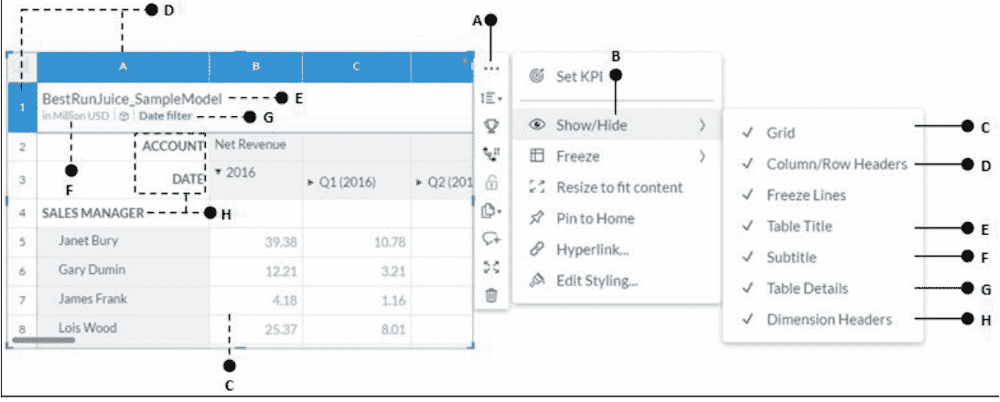

除了上述元素之外，您还可以使用“设计器”下的“样式”选项卡提供的选项来更改表格的外观。除了您在之前的练习中已应用的常规样式选项外，“样式”选项卡还允许您更改表格样式、合并单元格以及添加行和列。这些选项将在本章后面讨论。

## 排序表格数据

执行以下步骤对表格中的维度值进行排序：

-   30. 单击“净收入”单元格。
-   31. 选择“排序”选项，然后从其菜单中选择“值排序”(A)。并非表格中的所有值都可以排序。排序选项图标仅对可排序的维度启用。
-   32. 在“创建值排序”对话框中，将“类型”设置为“降序”(B)以按降序对值进行排序。“方向”列表包含两个选项：垂直和水平。只有当表格中可能有多个排序方向时，此列表才启用。如果选择“垂直”，则包含该维度的列将被排序。如果选择“水平”，则包含该维度的行将被排序。对于本练习，请保持默认的“垂直”选项(C)选中。确保“账户”设置为“净收入”(D)。对于“日期”，使用“编辑”图标(F)选择“第一季度”(E)，然后单击“确定”。表格将使用第一季度列按降序排序(G)。单击“日期”筛选器(H)会显示一个菜单，其中包含您在步骤 29 中应用的日期筛选器以及修改筛选器的选项。要修改排序参数，请单击“净收入”链接(I)，如下图所示：

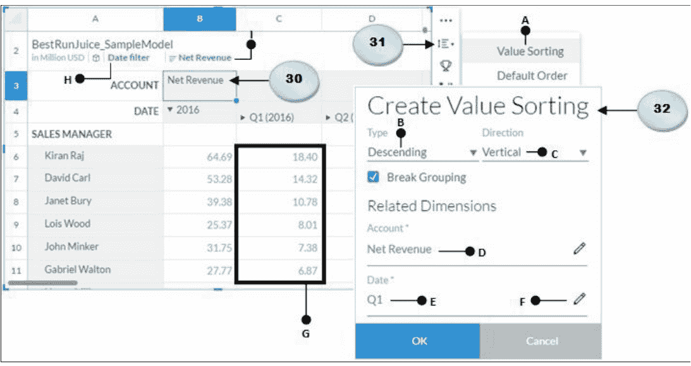

## 显示总计

您还可以显示维度值的总和。以下是如何在表格中显示总计的方法：

33. 单击代表“销售经理”维度的“更多”图标(A)，并选择“显示总计”(B)。将在第一个销售经理记录之前添加一行新行(C)以显示总计。使用 Shift+单击选择此行中的所有单元格，并在“样式”选项卡上更改此行的颜色(D)和样式(E)以使其更具吸引力。要突出显示整行，请单击其标题(数字)，并在“单元格”部分设置不同的填充颜色。如果您想在底部显示此行，请单击“总计”单元格，并在“样式”选项卡上选中标记为“在下方排列总计/父节点”的复选框。

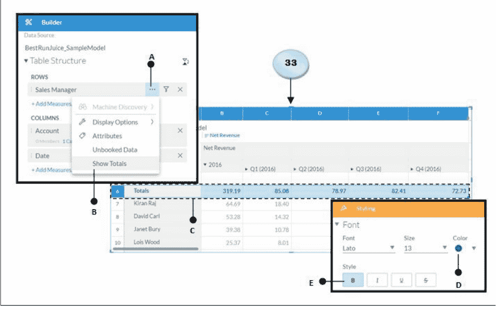

## 应用日期筛选器

当前页面的状态在以下部分插图中显示。如您所见，图表中 Kiran Raj 对净收入的贡献显示为 161.79 百万(A)，而表格中同一销售经理显示为 64.69 百万(B)。这是由于在步骤 29 中对表格数据应用的筛选器将表格结果限制为 2016 年。执行以下步骤对图表应用类似筛选器以匹配结果：

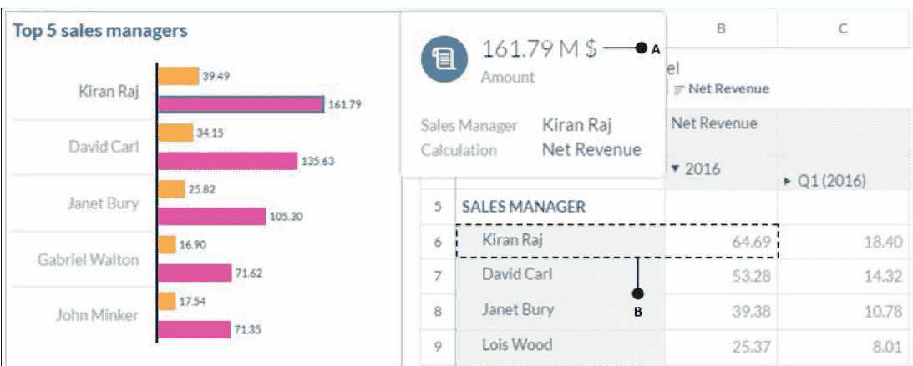

34. 选择图表，然后单击“构建器”面板底部位于的“添加筛选器”链接(C)。从弹出并携带维度列表的列表中，选择“日期(成员)”(D)。

这将显示“为日期设置成员”窗口。在此窗口中，选择 2016(E)并单击“确定”。图表的数字(F)现在与表格中显示的数字相匹配：

## 筛选器

类别 (1)
实际值 实际

- 添加筛选器

-   - 类别
-   - 日期(成员)
-   - 日期(范围)
-   - 位置
-   - 产品
-   - 销售经理
-   - 店铺

## 为日期设置成员

## 可用成员

排除所选成员
未预订 关闭

-   - (全部)
-   - 2014
-   - 2015
-   - 2016

## 前 5 名销售经理

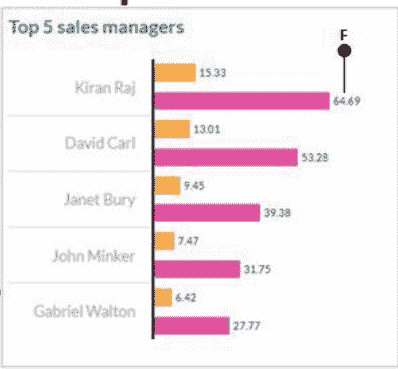

## 测试页面筛选器对表格的影响

您在第 5 章 *使用 KPI、筛选器和其他实用对象扩展筛选器* 中使用了故事和页面筛选器来缩小分析范围。在该章中，您将这些筛选器应用于图表。在本练习中，您将看到页面筛选器如何影响表格。为了获得准确的结果，您必须修改在步骤 32 中设置的排序顺序。

-   35. 单击表格标题区域中显示的“净收入”链接以查看“编辑值排序”窗口。
-   36. 在“编辑值排序”窗口中，单击编辑链接以修改排序值。
-   37. 在 *选择* 日期成员 对话框中，将排序值从 Q1 切换到 2016 并单击“确定”。所选值将出现在 *编辑值排序* 对话框(A)中。单击“确定”关闭此对话框。

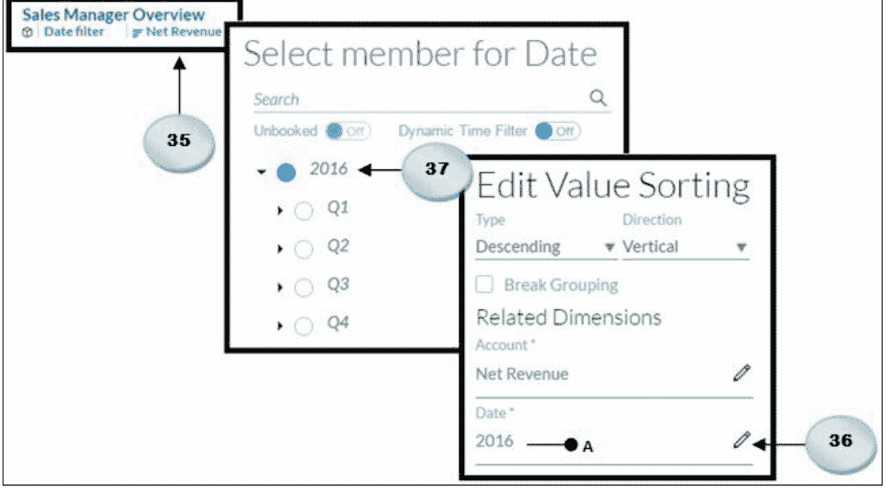

如以下屏幕截图所示，表格的结果现在与第一个图表相匹配：

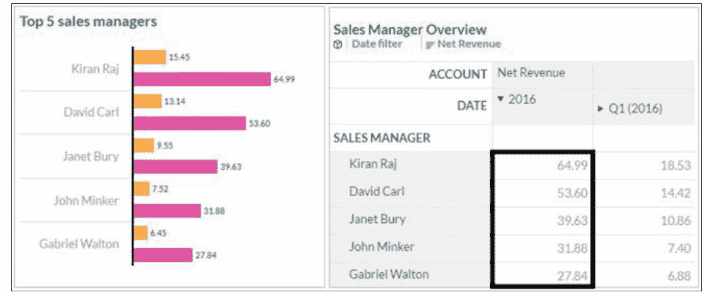

在协调这两个对象后，您可以应用筛选器来测试筛选器对表格的影响。取消产品筛选器中的所有选项，选择保留“其他”筛选器处于打开状态(B)。两个对象都将被刷新以显示相似的值，如以下屏幕截图所示。如果您将此输出与之前的输出进行比较，您会注意到两者之间的差异。在这里，David Carl 在“其他”产品类别中排名第一，而 Kiran Raj 在之前的输出中对所有类别排名第一。底线是，通过向页面添加不同类型的对象，您只需几次点击即可从不同角度生成分析。

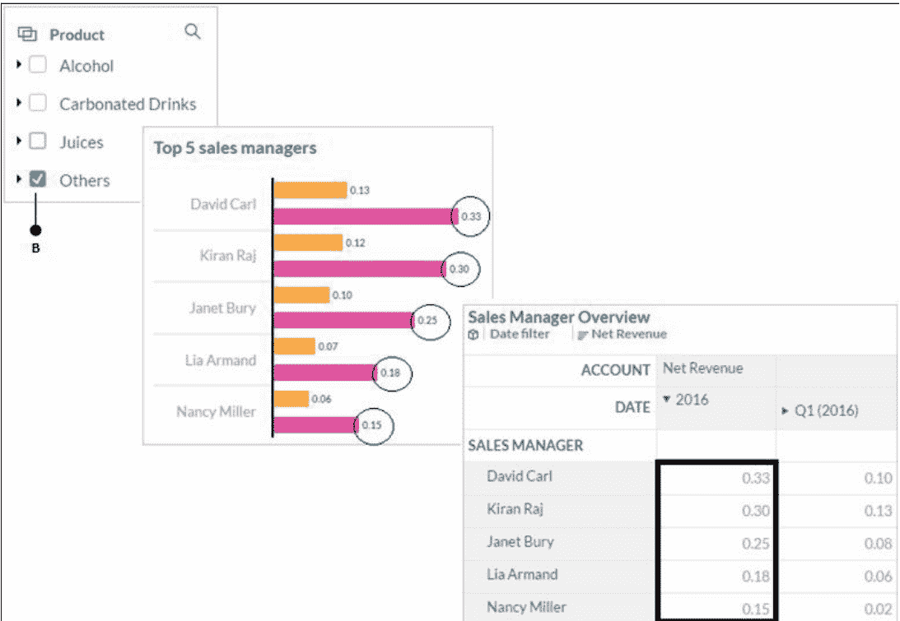

## 样式化表格

除了通过“显示/隐藏”菜单打开或关闭表格元素外，“设计器”下的“样式”选项卡还有一些格式选项，您可以使用它们来控制表格的外观。例如，您可以在“模板”部分将标准表格样式更改为“报表样式”。在本练习中，您将浏览“模板”部分中可用的选项。在更改表格样式之前，执行以下步骤向其添加一个维度：

38. 选择表格。单击“构建器”面板中的“添加度量/维度”链接，并选择“位置”维度。新的维度的层次数据将被放置在表格上(A)：

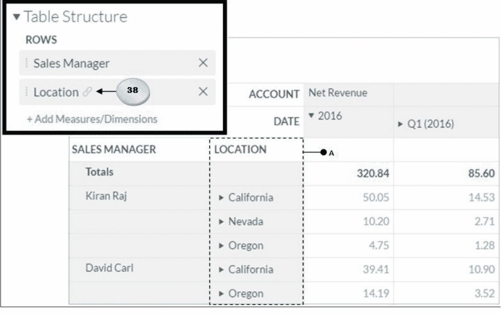

39. 单击并拖动“位置”维度将其放置在“构建器”面板中“销售经理”维度之上。在“样式”选项卡上，将“样式”从“标准”切换到“报表样式”(B)。表格的外观将发生变化，现在将按三个位置分组显示结果(C)：

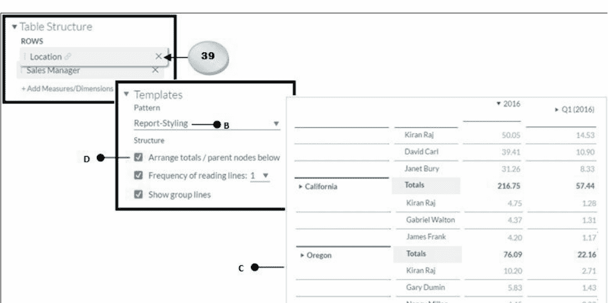

“在下方排列总计/父节点”选项(D)将总计和父节点显示在数据集底部，如前一个屏幕截图所示。如果关闭此选项，输出将更改为在顶部显示总计和父节点(E)：

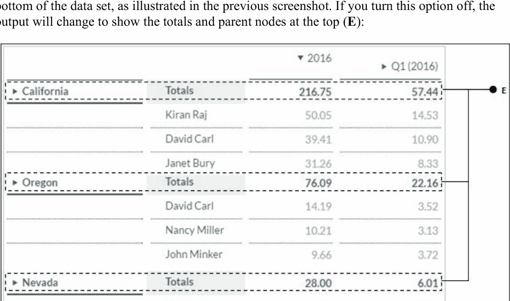

通过为“阅读线频率”设置值，您可以使用户更易于阅读。例如，如果将线频率设置为 4(E)，则记录分隔线(F)将在每四条记录后放置。您也可以通过关闭该选项来删除这些线：

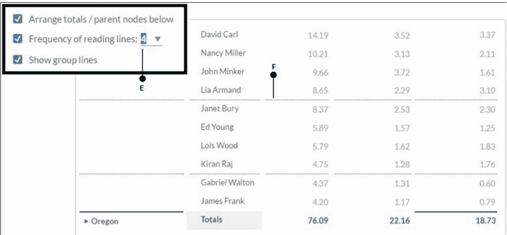

要查看“显示组线”选项的效果，请将“销售经理”维度恢复到“位置”维度之上(G)。然后，关闭“显示组线”选项。组线(H)将消失，如以下屏幕截图所示(I)：

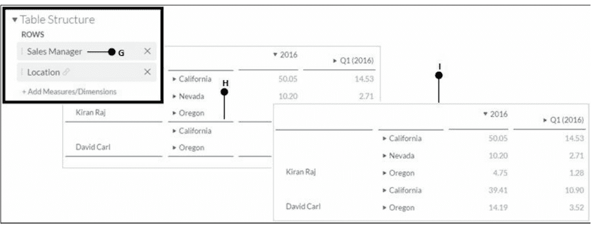

## 创建格式规则

Styling 选项卡下的 Formatting Rules 部分允许您创建规则，在其中指定如何格式化维度成员和层次结构。在本练习中，您将创建几条规则来突出显示销售经理 Kiran Raj 在三个州获得的净收入。执行以下步骤以完成此任务：

40. 选择表格，并在 Designer 下打开 Styling 选项卡。单击 Formatting Rules 部分中的 Add Formatting Rule 链接。在 Formatting Rule 面板中，为规则名称输入 State Rule (A)。在 Net Revenue 列中单击并按住显示 50.05 (B) 的第一个单元格，然后向下拖动以选择 Kiran Raj 的全部三个净收入数字。当您选择这三个单元格时，相关信息 (C) 会出现在 Formatting Rule 面板中的 Selected Content 区域下。从代表位置的 Level 列表中选择 Self & Children (D)，如下图所示：

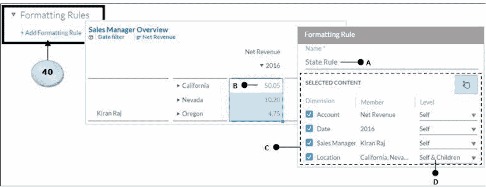

Selected Content 部分中的复选框用于选择要应用规则的维度以及规则如何应用于维度的不同成员。例如，如果您为 Account 维度从 Level 列表中选择 Self，则格式将仅应用于 Account 维度。Level 列表为层次维度提供了多个选项（如下简述）。对于其他维度，它只有两个选项：Self 和 All。

- Self: 这仅将格式应用于层次结构中当前选定的成员
- Self & Children: 这适用于当前选定的成员以及层次结构中下一级成员
- Self & Sibling: 这适用于所选成员以及同一层次级别的其他成员
- Self & Descendants: 这适用于所选成员以及层次结构中的所有下级
- Children: 这适用于当前所选成员各自下一级
- Descendants: 这适用于当前所选顶级之下所有成员

41. 在 Style 部分中，选择 New Style 为状态规则设置新样式：

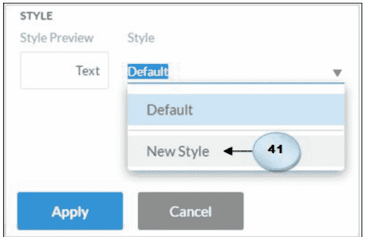

42. 在 Style 对话框中，为新样式的名称输入 StateStyle (E)。在 Font 部分中，选择字体、大小和不同的颜色 (F)。单击字母 B (G) 以使数据以粗体显示。此外，在 Fill 部分中选择一种浅色 (H) 以突出显示数据。单击 OK 关闭 Style 对话框，然后在 Formatting Rule 面板中单击 Apply 按钮：

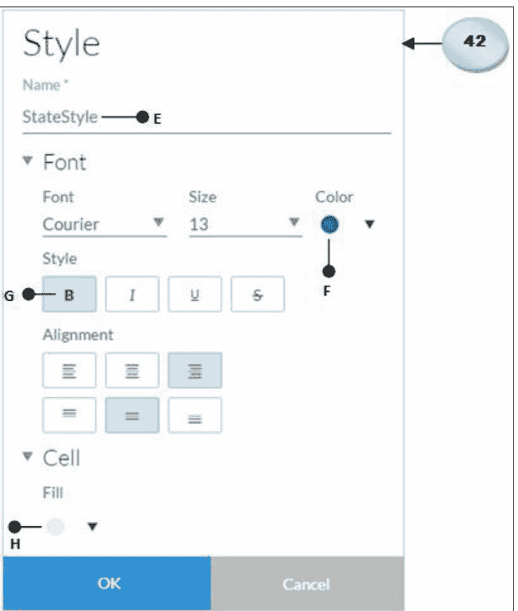

规则的输出如下图所示。三个州的净收入值被突出显示，并且以不同的颜色呈现以将其与表格数据的其余部分区分开：

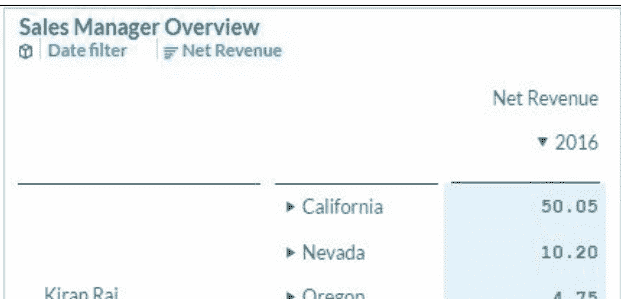

现在，展开 California 州的节点。同一规则也应用于该州下的城市，如下图所示。这是因为您在步骤 40-D 中选择了 Self & Children 选项。

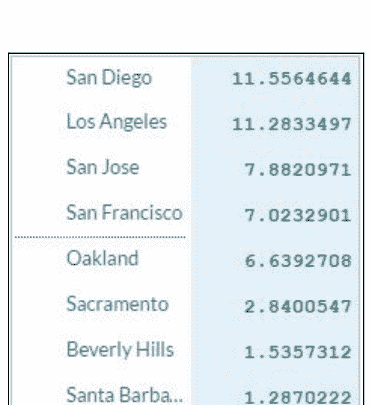

让我们创建另一条规则，在其中设置另一种样式以区分城市和州的数据。以下是此规则的步骤：

43. 选择表格，并在 Styling 选项卡中单击 Formatting Rules 部分中的 Add Formatting Rule 链接。在 Formatting Rule 面板中，为规则名称输入 City Rule (A)。展开 California 州节点以查看其城市。在 Net Revenue 列中单击并按住显示 11.5564644 (B) 的第一个单元格，然后向下拖动以选择该州的所有城市 (C)。再次，Selected Content 部分将填充与之前规则中看到的相同维度和其成员。这次，接受此部分中出现的默认值，包括为位置维度设置的级别 Self (D)。通过保留 Self 级别，您指定将规则应用于所选数据集，即 California 的城市，如下图所示：

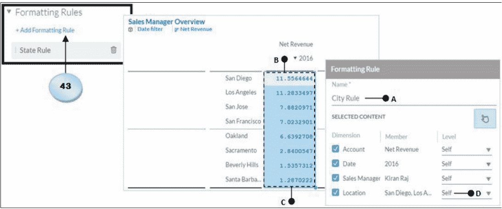

44. 再次在 Style 部分中选择 New Style 为 City Rule 设置新样式：

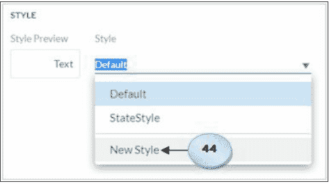

45. 在 Style 对话框中，为新样式的名称输入 CityStyle (E)。在 Font 部分中，选择字体、大小和不同的颜色 (F)。通过单击字母 B (G) 使文本加粗。还在 Fill 部分中选择不同的颜色 (H)。单击 OK 关闭 Style 对话框，然后在 Formatting Rule 面板中单击 Apply 按钮：

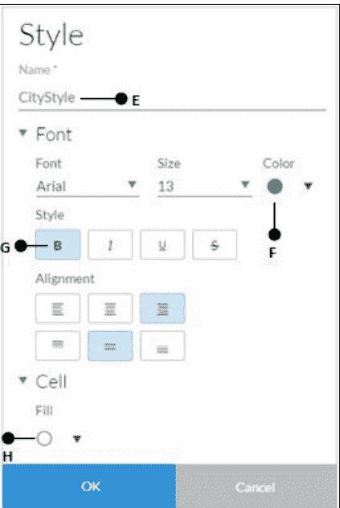

以下是规则的输出，其中城市数据 (I) 可以很容易地区分于州数据 (J)：

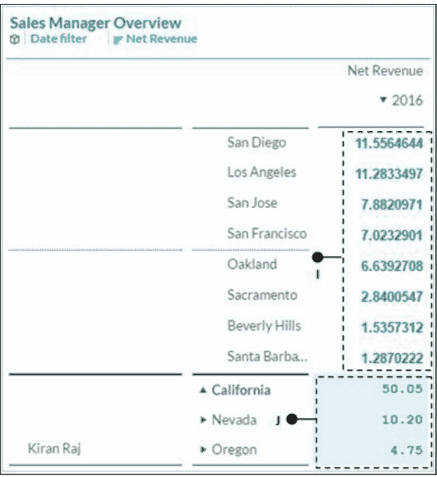

## 设置可见性筛选器

在之前的章节中，您学习了许多用于筛选页面对象返回结果的技术。在这些练习中，您应用了常规筛选选项来控制维度成员的显示。在本节中，我们将介绍另一种称为 **visibility filter** 的筛选器。常规筛选器与可见性筛选器之间的主要区别在于，当您应用常规筛选器时，被筛选出的成员会从场景中消失并且不参与计算，而如果您对某些维度成员应用可见性筛选器，它们也会从页面对象中消失，但仍参与计算。让我们通过一个示例来阐述这一概念。首先，您将添加一个常规筛选器，然后应用可见性筛选器以观察两者之间的差异。

目前，表格对象中显示的 Net Revenue 值为 320.84 百万 (A)，如下图所示。按照说明首先创建常规筛选器：

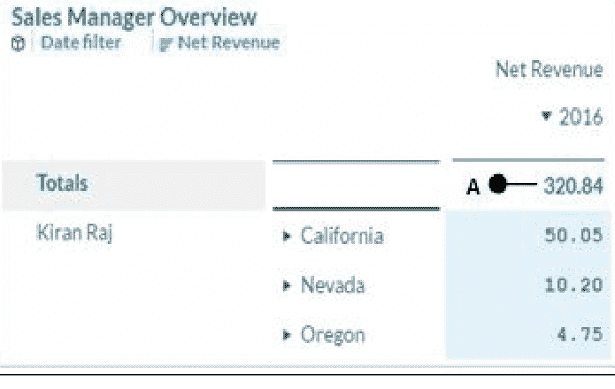

46. 选择表格，并单击代表 Location 维度的 Manage Filter 图标 (B)。在 Selected filters for Location 对话框中，在 Exclude selected members 选项 (C) 和 Oregon 州 (D) 框中放置复选标记以从表格中排除该州的数据。一旦您单击 OK 返回页面，您会注意到 Oregon 州的数据不再存在于表格中，如下图所示的下部视图所示。由于此排除，Net Revenue 度量的总值 (E) 也受到影响。

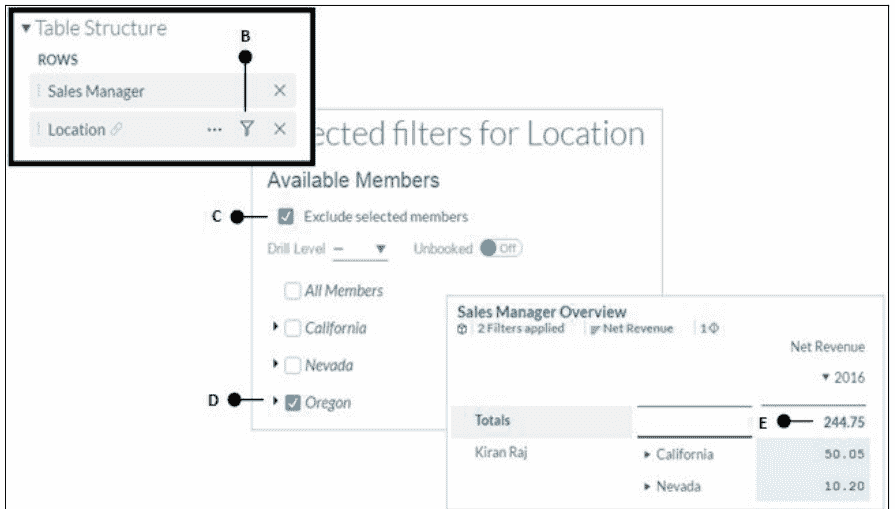

在了解了常规筛选器的功能后，让我们看看可见性筛选器是如何工作的：

47. 再次单击代表 Location 维度的相同 Manage Filter 图标 (F)。在 Selected filters for Location 对话框中，取消选中 Exclude selected members (G)，并选中 All Members (H) 以将所有维度成员包含到表格中。然后，单击 Oregon 州旁边的 Set to invisible 图标 (I) 使该州的数据不可见。单击 OK 返回页面。再次，Oregon 州在表格中未显示，但其数据会贡献到总计 (J)。使用可见性筛选器，您可以在不干扰整体汇总的情况下将视图限制为您最感兴趣的区域：

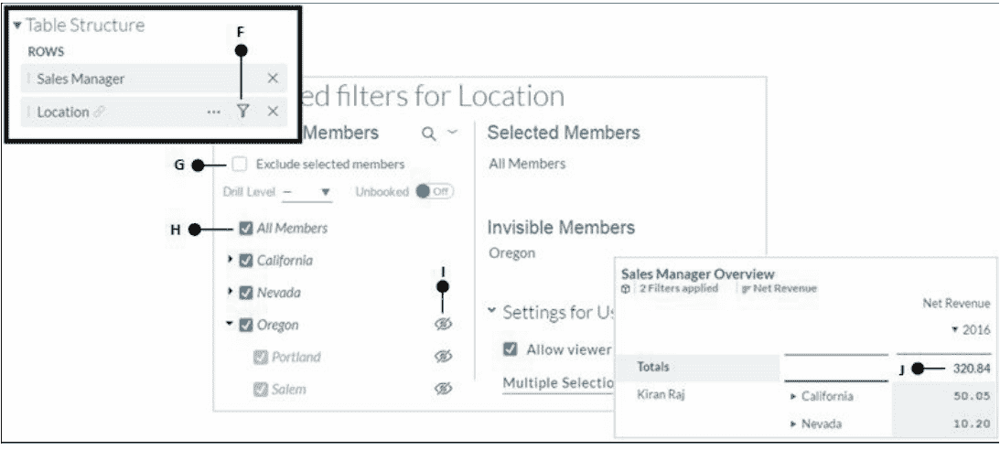

## 交换表格轴

如果您想从不同角度查看表格结果，则提供了交换选项，它将表格行转换为列，列转换为行。

48. 选择表格对象，并在 Builder 面板中单击 Swap Axis 图标 (A)。Net Revenue 度量将被交换到行中，而两个维度（Sales Manager 和 Location）将出现在列位置：

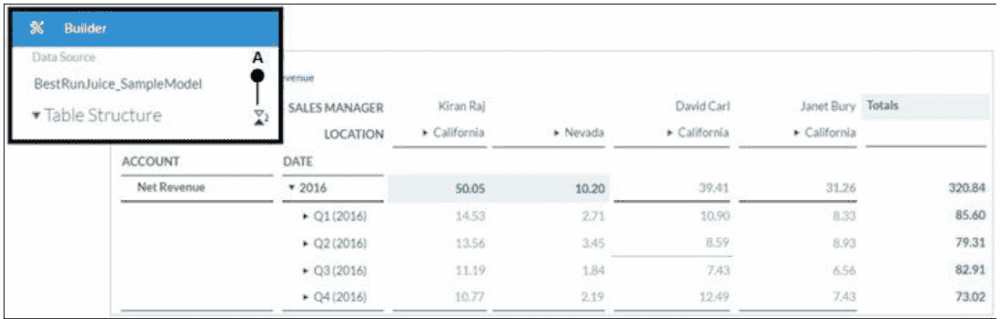

## 冻结表格行和列

你可能在电子表格程序中使用过冻结行和列的功能，它允许你通过始终保持承载该数据的行和列在视野内来专注于某些特定数据。该功能通常用于大量可向下或横向滚动的数据。

在 SAP Analytics Cloud 中，你可以使用类似的冻结功能来冻结表格中的特定行和列。当表格中有大量数据且你向下滚动时，表格的顶部行会消失。

同样地，当你向右滚动时，左侧的列会隐藏。通常，表格中的顶部行包含标题信息，而左侧的列包含度量或维度。如果这些重要信息被隐藏在幕后，就无法正确评估数据。例如，如果你在当前页面上的表格中向下滚动，就无法判断哪一列对应哪个时间段。同样，如果你扩展时间维度并在表格中横向滚动，就再也看不到你正在查看的是哪位销售经理的数据。

以下是应对这种情况的步骤：

- 49. 单击显示“日期”的单元格。
- 50. 单击更多操作图标。
- 51. 在菜单中选择“冻结”。

52. 从子菜单中选择“冻结至行”。在所选行下方会添加一条水平冻结线（A）。现在如果在表格中向下滚动，你会发现表格顶部三行是静止的，即使你在表格底部也能看到标题。如果再次打开“冻结”菜单，你会注意到“冻结至行”选项已被“取消冻结行”替换，从而可以取消之前冻结的所有行：

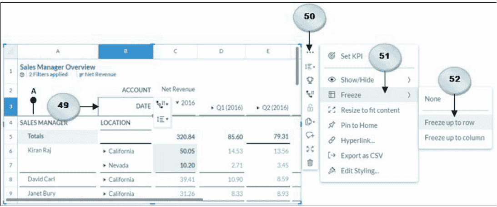

冻结标题后，让我们看看如何冻结表格左侧的列。

- 53. 单击“位置”单元格（B），然后从更多操作菜单中选择“冻结”（D）|“冻结至列”（E）。这次会在表格中添加一条垂直冻结线（F）。在表格中横向滚动，你会发现即使查看表格的最后一列，两个维度列仍然可见。这样，你可以轻松判断哪些行属于哪位销售经理。例如，在下面的屏幕截图中，你可以看到 David Carl 在 2016 年第四季度产生了 12.49 百万净收入：

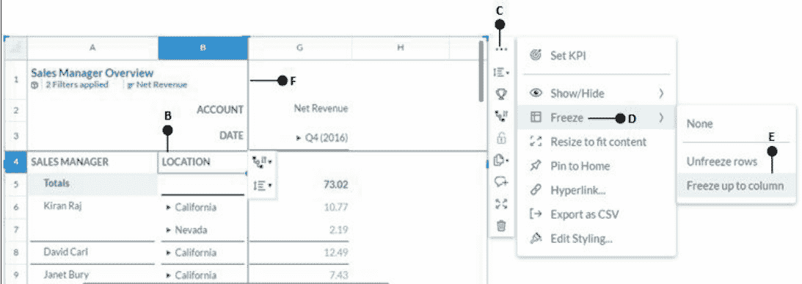

注意：如果想隐藏两个冻结线，请单击更多操作，并在“显示/隐藏”菜单中取消选中“冻结线”。

## 在表格中使用 KPI

关键绩效指标（KPIs）根据用户定义的阈值指示度量的状态。你在前几章中已经了解了一些 KPI 的实例。在这里，你将学习如何将此成功指标应用于表格。在此练习中，你将创建一个 KPI 来分析 2016 年的净收入。首先，你将在表格中的单个单元格中定义 KPI，然后将同一 KPI 应用于所选单元格的范围。以下是操作步骤：

- 54. 单击“净收入”列中第一个记录的单元格以选中它。
- 55. 单击更多操作图标。
- 56. 在更多操作菜单中选择第一个选项“设置 KPI”。
- 57. 在右侧出现的 KPI 面板中，单击“添加 KPI”链接：

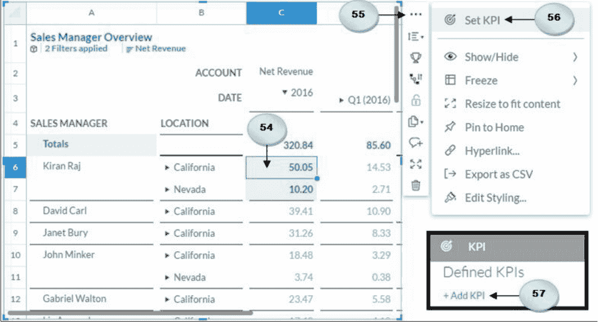

58. 在“定义 KPI”窗口中，为 KPI 名称输入 Net Revenue 2016，并创建三个阈值（OK、Warning 和 Critical）以及相应的值，如下图所示。使用“+”图标（A）添加额外阈值。完成后，单击“应用更改”按钮：

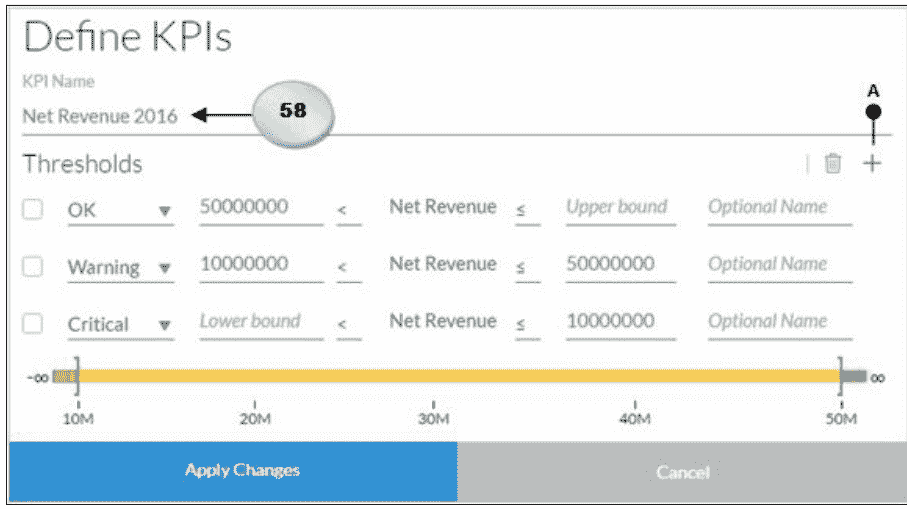

59. 单击“确定”按钮关闭 KPI 面板。KPI 将应用于所选单元格，并且相应的图标（B）会出现在值前面——在本例中，它落在 OK 范围内，因为该值超过 50 百万。如果后端值将来发生变化，KPI 将重新评估，并使用适当的图标生成视觉警报。KPI 面板可通过更多操作菜单下的同一 Set KPI 选项重新调用。此面板中的 Edit 图标（C）可用于修改阈值，如果要删除 KPI，请单击 Delete KPI 图标（D）。

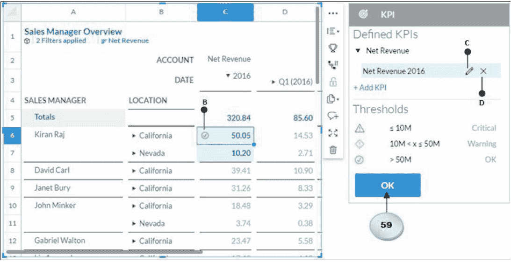

让我们扩展此 KPI 的范围，以包含净收入列中的其他单元格。

- 60. 在所选单元格（C6）中，按 Shift+Down Arrow 选择其他单元格，然后调用 KPI 面板。
- 61. 单击“添加 KPI”链接。重叠选择对话框出现。
- 62. 选择 Change scope of existing KPI to extend the scope of the KPI 选项到你的选择，然后单击“确定”。在询问“Do you really want to change the scope of the defined KPI Net Revenue 2016?”的对话框中单击“确定”，然后在 Edit KPI 窗口中单击“应用更改”按钮。每个所选单元格都会出现相关图标。根据 KPI，John Minker 在 Nevada 的净收入显示为 critical，因为该值小于 critical 阈值设定的 10 百万。Kiran Raj 在 California 的数据为 OK，而他在 Nevada 的净收入（10.2 百万）显示为 warning，因为该值介于 10 百万和 50 百万阈值之间。

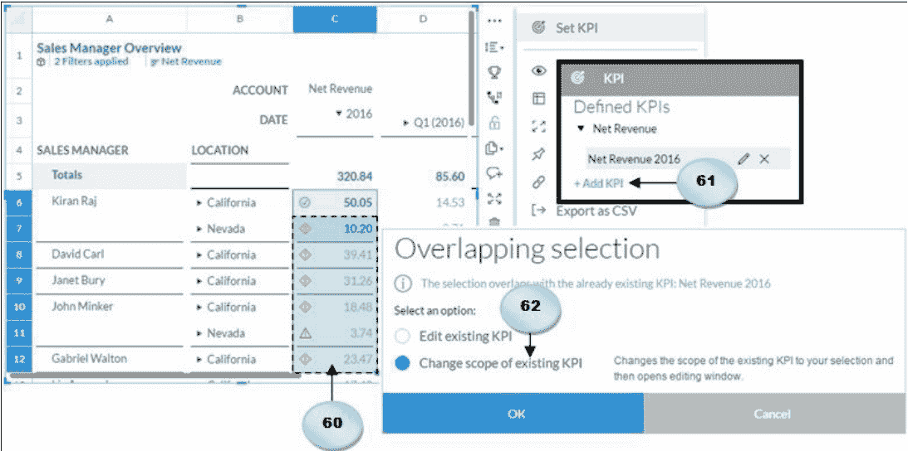

## 使用网格

如本章前面所述，网格是一个类似电子表格的对象，你可以在其中创建和处理公式。让我们通过向我们的故事中添加一个网格来了解此对象：

- 63. 单击“添加新页面”图标，然后从菜单中选择 Grid 以在你的故事中创建网格页面：

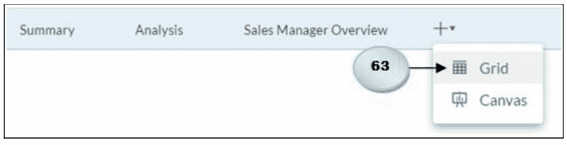

将创建一个新页面，其中包含覆盖整个故事页面的数据网格，如下图所示。就像电子表格一样，你可以自由地在网格的单元格（A）中输入或粘贴数据，创建执行计算的公式（B），并对单元格应用格式（C）。这是网格的一个方面，你可以在不连接模型的情况下使用它。但是，如果你想使用来自模型的数据，则必须按照以下步骤将表格添加到网格中：

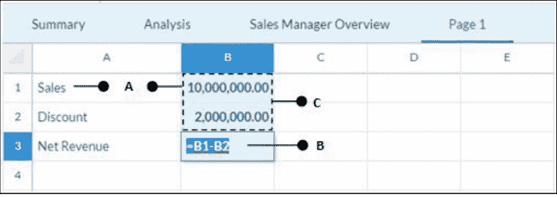

- 64. 单击“插入”工具栏上的“添加表格”图标。

- 65. “选择模型”对话框出现。在此对话框中选择“现有模型”选项，并选择 BestRun 模型（D）。

在网格页面上添加了一个轮廓表格（E），所选模型的数据显示在表格区域中。表格中的模型数据不可编辑，但你可以使用表格区域外的单元格来添加和操作自己的数据以进行分析，这将在下一步中进行：

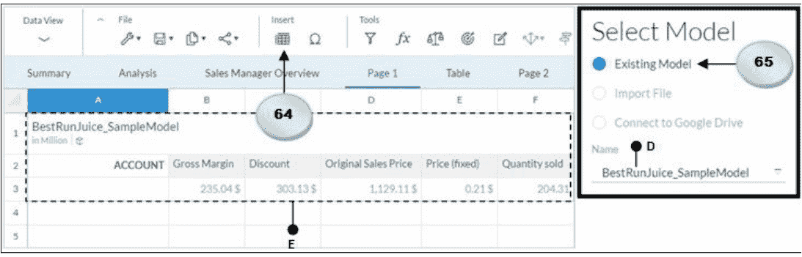

66. 在 A6 输入 Sales，在 A7 输入 Discount，在 A8 输入 Net Revenue。然后，在单元格 B5 输入 Actual，在 C5 输入 Forecast，在 C6 输入 1200，在 C7 输入 750。请注意，所有这些文本和数值都添加到表格外的网格中：

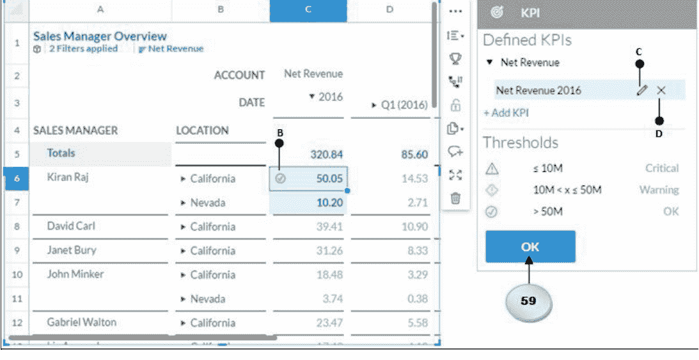

67. 单击包含原始销售价格 1,129.11 的 D3 单元格，并按 Ctrl+C 将此值复制到剪贴板。然后单击 B6 并按 Ctrl+V 粘贴复制的值。同样地，如下图所示，将折扣值从 C3 复制到 B7：

68. 接下来，单击 B8 单元格以输入一个公式，通过从销售额中扣除折扣值来计算净收入。在所选单元格中输入公式 =B6-B7，然后按 Enter。公式将得出净收入 825.98M（F）的值。如果要修改公式，双击 B8 单元格，或按 Formula Bar 图标（G）查看公式。Formula Bar 中的 T 符号显示单元格值。要查看公式，请单击此符号。T 符号将被 fx（H）替换，公式将出现在栏中。

69. 就像电子表格一样，你也可以将公式从网格的一个单元格复制到其他单元格。单击 B8 单元格并按 Ctrl+C 复制公式。单击相邻的 C8 单元格并按 Ctrl+V 粘贴公式。粘贴的公式会以适当的单元格地址（I）出现在 Formula Bar 中，目标单元格中会显示相关的净收入预测值（J）。或者，你也可以通过拖动源单元格的句柄（K）并将其拖放到目标单元格中来复制公式。

70. 你也可以像设置表格一样设置网格样式。回想一下你在之前的练习中为表格创建了两种样式。在此步骤中，你将使用相同的两种样式来格式化 Actual 和 Forecast 网格列。选择文本 Actual (B5)，并向下拖动句柄以选择该列中的三个值。然后滚动到 Styling 选项卡底部，并选择 StateStyle (L)。Actual 列中选中的单元格将被突出显示并以你为该样式设置的颜色呈现。对 Forecast 列重复相同的过程，使用 CityStyle (M) 格式化该列。

71. 在此步骤中，你将在网格中创建几个自定义公式。这些公式得出的值将使用 Styling 选项卡下可用的 Number Formatting 选项进行格式化。输入两段文本 Gross Margin (N) 和 Gross Margin % (O)。单击 B10 单元格并输入 =B3/B8。将此公式复制到 B11。选择 Gross Margin 值 (0.28$)，然后在 Styling 选项卡的 Number Formatting 部分中选择 Currency (P)。单击 Gross Margin % 值 (28.46$)，并从 Number Formatting 部分选择 Percentage (Q)。Gross Margin 值将被格式化为显示货币符号，而 Gross Margin % 值将后缀加上百分比符号。

|   | A | B | C |
|---|---|---|---|
|1|BestRunJuice_SampleModel（百万）| | |
|2|账户|毛利润|折扣|
|3||235.04 $ |303.13 $|
|4||| |
|5||实际|预测|
|6|销售额|1,129.11 百万 $ |1,200.00|
|7|折扣|303.13 百万 $ |450.00|
|8|净收入|825.98 百万 $ |750.00|
|9||| |
|10|毛利润 —● N|0.28$|= B3/B8|
|11|毛利润 % —● O|28.46%|= B3/B8|

**Number Formatting**
- 纯文本
- 数字 1,234.56
- 百分比 10.00%
- 货币 —● P 1,000.00 $  *(已选择)*
- 继承

**Number Formatting**
- 纯文本
- 数字 1,234.56
- 百分比 —● Q 10.00%  *(已选择)*
- 货币 1,000.00 $
- 继承

## 创建混合表格

混合表格是显示来自不同模型的数据的表格。你已经看到使用链接维度在单个图表中显示来自多个模型的数据。在这里，你将使用你在第 6 章《使用地图和其他对象分析数据》中创建的相同链接维度创建混合表格，以浏览来自两个模型的数据。

72. 单击 Add Page 图标 (A)，并选择 Grid (B) 为故事添加新的网格页面。在新的网格页面中，单击 Add 图标 (C) 向网格添加表格。在 Select Model 对话框中，选择现有的 Planned_Events 模型，然后单击 OK。一个表格 (D) 将被添加到网格中，其中包含来自 Planned_Events 模型的 Account 维度（2016 年的活动数量）：

73. 在 Builder 面板中，在 Rows 部分单击链接 Add Measures/Dimensions，并从维度列表中选择 City。单击相同的 Add Measures/Dimensions 链接，并选择 Event 作为第二个维度。表格将考虑这些维度并进行转换，如以下屏幕截图所示，以按活动类型显示每个城市举办的活动数量：

74. 在 Data Source 中，单击链接维度图标 (E)，并选择 Best_Run 模型 (F)。在 Columns 部分，单击 Add Measures/Dimensions 链接 (G)，并选择 Account 维度 (H)。当你选择此维度时，表格会刷新以显示 Best_Run 模型中 Account 维度中的所有度量 (I)，如下屏幕截图所示：

75. 在 Account 维度中单击 Manage Filter 链接 (J)，并从列表中选择 Best_Run 模型 (K)。在 Selected filters for Accounts 对话框中，选择 Discount 和 Original Sales Price 度量 (L)，然后单击 OK 以保留这两个度量在表格中并移除其余部分：

76. 在 F3 中输入 Net Revenue (M)，在 F5 中输入 =E5-D5 (N)。通过执行这两个操作，你在表格外部创建了一个新列，用于显示每个城市的净收入，该净收入由你刚刚指定的公式计算得出。将此公式复制到 F10、F15 等，以显示每个城市的净收入。

网格页面包含一个混合表格，其中包含来自两个不同模型的数据，并且还通过一个公式进行了增强，该公式计算每个城市的净收入。在此网格页面上创建的分析揭示了每个城市按类型举办的活动数量以及在这些城市赚取的收入金额。

这结束了我们在 SAP Analytics Cloud 中创建故事页面的工作。然而，还有一些更重要的领域你必须了解。在以下部分中，你将学习这些领域以进一步加强你的知识。

## 复制对象、页面和故事

在计算中，复制和粘贴是最有效且使用最广泛的实用工具，可让你复制工作以节省宝贵时间。SAP Analytics Cloud 也为你提供了这些实用工具。你已经在本章开头使用过此选项，在那里你将对象从一个页面复制到另一个页面以及故事的同一页面。在该部分，你只是复制了几个页面筛选器。然而，你可以在页面之间或同一页面中复制任何对象，例如图表、geomaps、表格、输入控件、图像、文本，甚至形状——另请参阅第 4 章《使用图表创建故事》中的 *Create Difference From Measure* 部分，以及第 6 章《使用地图和其他对象分析数据》中的 *Working With Story Pages* 部分。在此练习中，你将学习如何复制一组对象、包含所有对象的完整页面以及整个故事。

### 复制分组对象

你已经看到使用菜单选项和键盘快捷键复制单个对象的使用。除了单独复制对象外，你还可以对多个对象进行分组并一次性复制它们。以下是流程：

- 77. 要创建组，请按 *Ctrl* 并 *单击* 以选择多个对象，或单击并拖动以使用套索选择。
- 78. 单击 Group 图标以对选定的页面对象进行分组。图组中的图表和其他对象的集合被视为单个对象。例如，如果你为此组应用背景颜色，则颜色将应用于所有组对象。创建组后，垂直工具栏中的 Group 图标会发生变化，现在可用于取消分组对象。
- 79. 单击 Copy 图标，并选择是否将此组复制到故事中的另一个页面或新的画布页面：

### 复制包含所有对象的页面

以下是重复故事中单个页面的简单流程：

- 80. 将鼠标指针悬停在 Summary 页面标题上，并单击微小菜单图标。
- 81. 从菜单中选择 Duplicate。精确副本 (A) 将附加到页面选项卡中，选定页面的（名称后加数字）包含与原始页面相同的所有对象，具有相同的格式和布局：

### 复制整个故事

以下是制作整个故事副本的步骤：

- 82. 通过单击 Stories 面包屑返回到故事主列表。
- 83. 选择要复制的故事。
- 84. 单击 Copy Selected 图标。
- 85. 在 Copy to Story 对话框中输入名称，然后单击 OK。副本故事将出现在你的屏幕上：

### 将故事保存为 PDF

有时你需要一份硬拷贝以离线访问你的工作。SAP Analytics Cloud 允许你将故事保存为便携式文档格式（PDF）文件以满足你的需求。该选项允许你保存故事中的所有页面以及某些特定页面。以下是创建 PDF 的步骤：

86. 在故事打开时，单击 Save 图标，并从 Save 菜单中选择 Save As File。Save As File 对话框弹出：

87. 在 Save As File 对话框中，选择 Range 选项，并在相邻框中输入 1,3,7。默认 All 选项 (A) 保存所有故事页面，而使用 Range 选项，你可以指定要保存的页面。在我的场景中，我有七个页面，所以我选择保存第 1、3 和 7 页。你也可以指定不同的页面组合。例如，如果你在 Range 框中输入 1, 3-5，则页面 1、3、4 和 5 将被保存。每个故事页面在 PDF 中生成在单独的页面上，因此你可以在之后修改它。如果选择，Insert Appendix 选项 (B) 会将附录附加到 PDF 中，以提供所选页面中应用的筛选器的统计信息。

Grid Pages Settings 部分用于在 PDF 中格式化网格页面。默认使用

Whole Grid option (C) saves the whole grid. Using the Split Grid into Pages option the grid can be split across multiple pages. Here’s an example:

88. Select the Split Grid into Pages in the Save As File dialog box. Check the option Use all Columns (D) to include all the grid columns in the PDF. For Rows, enter 7 (E) to split the report after every seven rows:

The following screenshot shows the grid page (F) and the PDF output (G) of your selections. As you can see, the PDF is split into two pages, each comprising seven rows:

## Creating a personalized dashboard by pinning story objects

When you initially provide your sign-in credentials and are authenticated to access SAP Analytics Cloud, you see the Home screen, as illustrated in the following screenshot. The Home screen can be customized to create a personalized dashboard that contains objects from your stories, events and tasks, and notes. In this section, you will learn how to pin your story objects to the Home screen to create a personalized dashboard. By default, the Home screen displays a couple of objects from the sample story that you can remove by selecting the Delete option (A) from the Tile Settings menu.

Clicking on the first option in this menu takes you to the relevant story page, where the object exists. You can also remove the greeting bar and the Recent Stories tile by clicking on the respective Delete icons (B and C).

## Pinning story objects

Here is the step to pin story objects to the Home screen:

89. Open your story, and select a chart. From the selected chart’s toolbar, go to more actions | Pin to Home. The chart will be pinned to the Home screen. Repeat this step to pin more objects from other pages of the story:

Note: You can pin objects from multiple stories on the Home screen. In addition to story objects, you can pin events and tasks from your calendar (discussed in the next chapter), and add static text notes (discussed next) to the Home screen. Your Home screen is private, and you can't share it with other users or add it to discussions. This also applies to the notes and tiles you pin there.

## Adding text notes to the home screen

You can also add useful reminders, such as personal notes and upcoming events, to the Home screen. Here’s the process to add text notes:

90. Click on the Home menu (A), and select New Note (B) from it. In the New Note window, type Meeting Reminder (C) for the note Title, and enter Meeting with Nevada’s regional manager on 15th July 2017 @ 3:30 PM (D) in the Note text area. Click on OK to add the note to the Home screen:

Here is the screenshot of my dashboard carrying multiple tiles of different objects from my story:

## Net Revenue Trends

in Million USD

## Sample bar chart

Gross Margin USD

## Meeting Reminder

Meeting with Nevada's regional manager on 15th July 2017 @ 3:30 PM

## Sales Manager Overview

| Name | Net Revenue | 2014 | 2015 |
|---|---|---|---|
| Kiran Raj | 162.84 | 43.65 | 54.20 |
| David Carl | 136.54 | 38.66 | 44.28 |
| Janet Bury | 106.07 | 27.42 | 39.02 |
| Gabriel Walton | 72.18 | 20.94 | 23.40 |
| John Minker | 71.92 | 23.83 | 16.21 |
| Nancy Miller | 69.55 | 22.17 | 22.13 |

## Discount % vs. net revenue

in Million USD

## Summary

In this chapter, you completed the final page of your story. In these three pages, you learned the essence of SAP Analytics Cloud. You were taught how to create stories and pages and how to visualize data using different types of charts, geomaps, tables, and grids. In addition to demonstrating the use of different types of objects to analyze data, you were introduced to many options associated with these objects. For example, you learned how to copy objects between pages and on the same page, apply ranking and filters, show/hide object elements, sorting data, and more.

There is a long list of such options that you have already gone through, which doesn't need to be repeated here. In this chapter, you worked with tables and grid objects, which deal with text data. Besides the many features associated with the table object, such as setting visibility filters, swapping the axis, freezing rows and columns, and more, you learned the use of key performance indicators in tables. You added a grid page to the story in which you created your own formulas to analyze data. You also learned how to copy stories and objects and went through the process of creating a PDF of your story pages for offline access. Finally, you were guided on how to create a personalized dashboard, which provides a big picture of your story.

In the next chapter, you will learn how to manage planning and analytic activities by creating events and assigning tasks and how to monitor the task progress.
