# 协作

With the collaboration features available in SAP Analytics Cloud, colleagues can discuss business content and share information. Collaboration makes it easy to make decisions based on linked business content. Here is a list of features that allow group members to discuss stories and other business content:

- Creating a workflow using events and tasks
- Commenting on a chart’s data point (refer to the Pinning and Commenting on a Data Point section in Chapter 5, Extending Stories with KPI, Filters and other Handy Objects)
- Commenting on a story page (refer to the Adding Comments to a Page section in Chapter 6, Analyzing Data Using Geo Maps and Other Objects)
- Producing a story as a PDF to share it with other users (refer to the Save Story as a PDF section in Chapter 7, Working with Tables and Grids)
- Sharing a story with colleagues
- Collaborating via discussions
- Sharing files and other objects

In addition to notifications, e-mails, and discussions channels, you can use a digital boardroom to collaborate with others in remote locations and on other devices in an interactive meeting room. With the SAP Analytics Cloud mobile app, you can collaborate with colleagues through the chat feature and view events and tasks anywhere and anytime.

## Creating an events and tasks workflow

Collaboration is a joint effort of multiple individuals or work groups to accomplish a task. It directly impacts the outcome of a task or project. With SAP Analytics Cloud, you can use today's collaborative technology, such as tablets, and smartphones, that enable employees to work more flexibly from home and on the road taking advantage of the application's real-time collaborative capabilities to keep in touch with remote coworkers around the globe.

The events and tasks features in SAP Analytics Cloud are the two major sources that help you collaborate with other group members and consequently manage your planning and analytic activities. The chapter will demonstrate how events and tasks help in managing planning and analytic activities. After creating an event and assigning tasks to relevant group members, you can monitor the task progress in the Events interface. In this section, you will learn the use of these two features using the following workflow:

- Creating events based on categories and processes within categories
- Creating a task, assigning it to users, and setting a due date for its submission
- Monitoring the task progress

## Creating an event

An event is a calendar event scheduled for a specific day and time. Meetings are good example of events. The events section in SAP Analytics Cloud is a calendar interface using which you can organize events and assign tasks to dedicated team members. Execute the following set of steps to understand the purpose of creating events and tasks in SAP Analytics Cloud:

1. Click the main menu icon (A), and select Events from the menu:

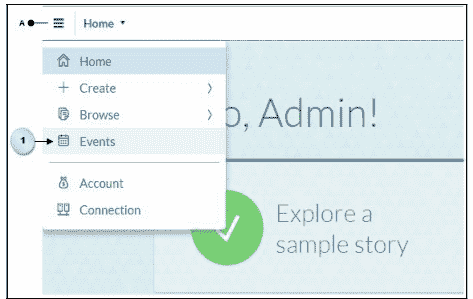

The Events screen appears in which the current date (B) is highlighted. You can switch months using the two arrow icons (C) to view events and tasks in other months. You can view events and tasks by Week (D), Month (E), and Year (F). By default, you see the Month view:

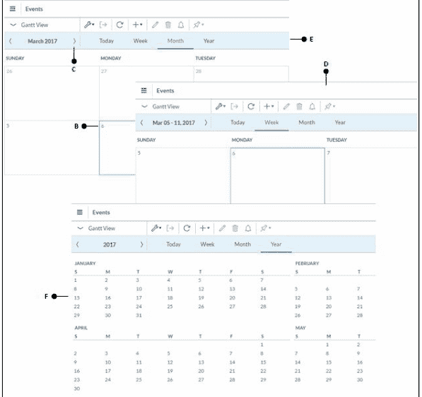

Before creating an event, you first need to modify the event categories and create processes within these categories. Event categories let you group your events in a way that makes sense to you. By changing the names and colors of event categories,

用于对您的事件类型进行分类。

2. 单击“操作”图标（A），然后选择“编辑事件类别”。

“编辑事件类别”屏幕（B）弹出，其中包含与标签颜色相匹配的类别名称。在下一步中，您将为其中一些事件类别提供描述性名称。

3. 单击第一个类别名称，并将其替换为 Financial Planning。同样，将第二个和第三个名称分别替换为 Capacity Planning（C）和 Global Planning（D），如下图所示。前面的颜色（E）让我们能够识别日历上的事件类型。您也可以从颜色下拉列表中指定不同的颜色。如有需要，您可以使用 + 图标（F）添加新的事件，如果要删除某些类别，请单击删除图标（G）。为事件提供描述性名称后，单击“保存”以关闭“编辑事件类别”屏幕。

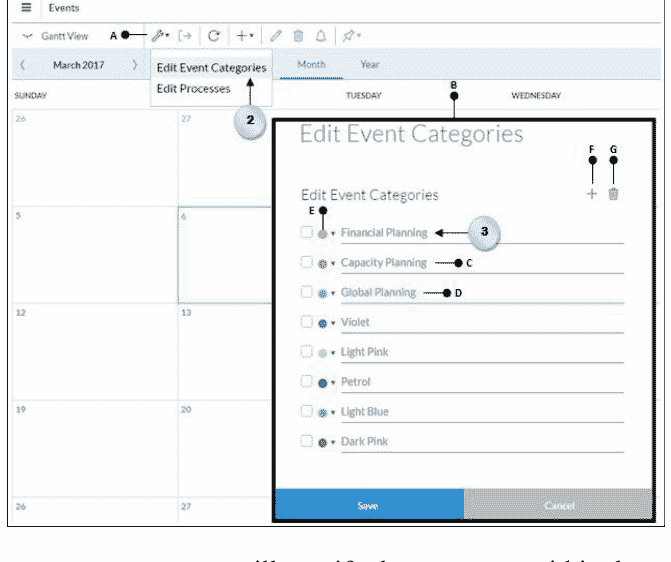

在接下来的两个步骤中，您将指定要在事件类别中执行的流程。您可以为每个事件类别创建任意数量的用户定义流程。

4. 再次单击“操作”图标，这次选择“编辑流程”选项。

5. 将鼠标指针悬停在 Financial Planning 类别上，然后单击“新建”图标。文本区域将在类别名称后立即添加。在此区域输入 Update Bocage First Quarter Data（A），然后单击“保存”。在事件类别下创建流程后，您现在可以添加事件。

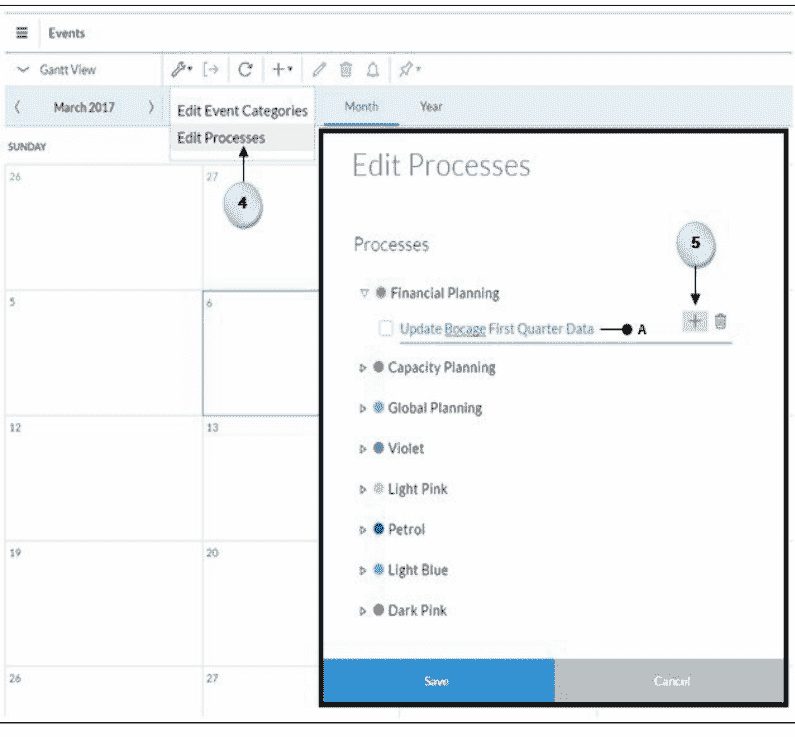

6. 单击“新建”图标（A），然后从菜单中选择“新建事件”。“新建事件”对话框出现：

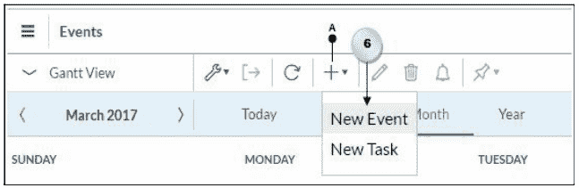

7. 在“新建事件”对话框中，从“类别”列表中选择 Financial Planning。

8. 从“流程”列表中选择流程 Update Bocage First Quarter Data。

9. 在新事件的“标题”字段中输入 Update Q1 Data。

10. 使用日历图标选择事件的开始日期和截止日期。截止日期必须在开始日期之后。

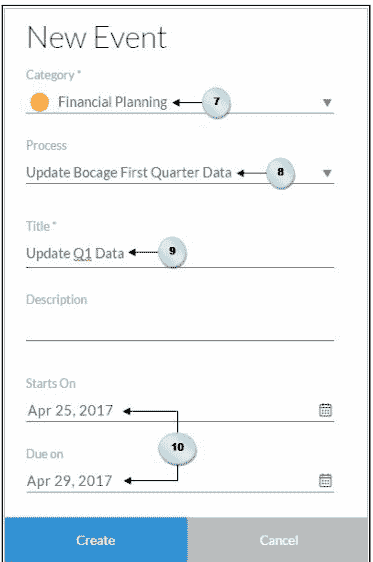

“新建事件”对话框中的“人员”部分有两个子部分：负责人和所有者。在“负责人”子部分中，您可以将事件分配给一个或多个用户。随后，在创建任务时，您可以将该用户组中的人员分配给各个任务。默认情况下，创建事件的人员被设为事件的所有者，但这可能是另一个人。因此，您可以选择更改事件所有者，以确保通知发送给正确的人员——真正的任务所有者，而不是创建者。

11. 单击“选择负责人”图标，并从“选择用户”屏幕中选择用户（A）。

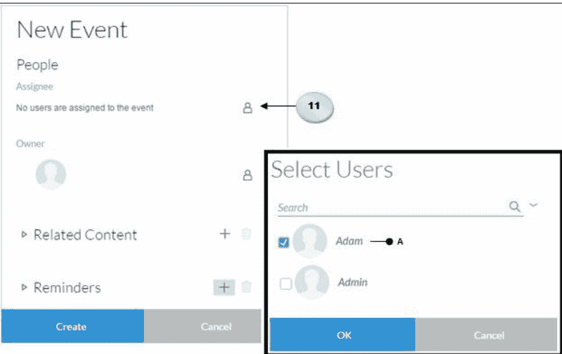

“新建事件”屏幕中的“相关内容”区域允许您添加指向对象（如故事或文件）的链接。

12. 单击“添加链接”图标，并在搜索框中输入一个字母（A）。对象列表（B）将弹出。从此列表中选择所需对象。所选对象将列在“相关内容”部分（C）中。如果在此处错误地添加了不正确的链接，您可以通过选择对象链接（D）并单击“删除链接”图标（E）将其删除。

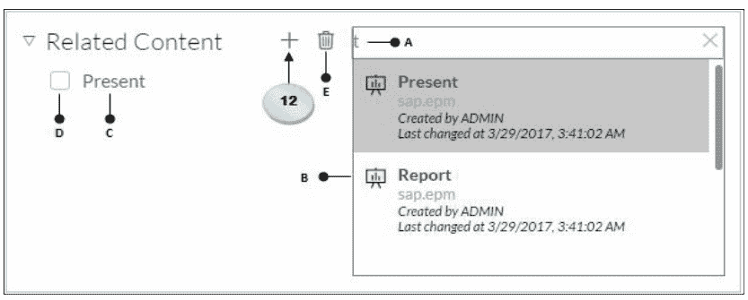

在“提醒”部分，您可以为事件创建提醒，该提醒会自动发送给负责人。提醒消息会在截止日期前指定的天数发送给任务负责人。消息可以作为屏幕通知消息、电子邮件或两者同时发送。

13. 单击“添加提醒”图标，这将显示“设置提醒”对话框。

14. 在“提醒时间”文本区域输入 3，以便在截止日期前三天向负责人发送提醒。选中电子邮件框（A），还可通过账户关联的电子邮件发送提醒。单击“设置”按钮设置提醒，提醒随后会放置在“提醒”部分（B）下，如下图所示：

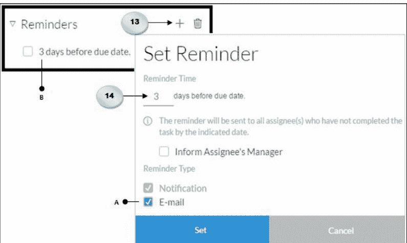

15. 提醒创建后必须激活。因此，选中提醒框以激活它。如有需要，您可以使用本节中的编辑图标（A）修改提醒。

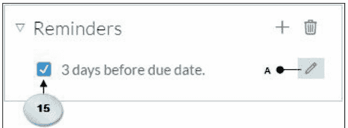

事件出现在日历的截止日期单元格中。日历中事件的颜色以及“详细信息”面板中的颜色与您在步骤 3 中为 Financial Planning 事件类别设置的颜色相同。单击显示事件的单元格以在“详细信息”面板中查看其详细信息，例如开始日期和截止日期、相关内容以及负责人。面板中提供的选项让您有机会开始关于该事件的群组讨论或添加相关任务，您将在下一步执行此操作。“相关内容”区域中提供的链接将带您进入您在 *Step 12.* 中选择的内容。

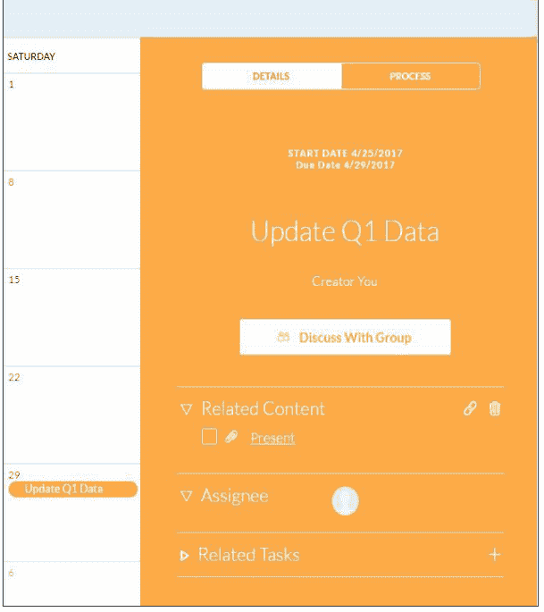

这是负责人登录时收到的事件通知：

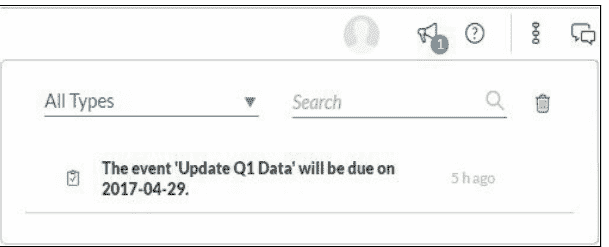

## 创建任务

创建事件后，您为该事件创建任务并将用户分配给任务。任务是不安排在特定日期和时间进行的活动。您可以为任务指定截止日期，也可能没有特定的时间或日期要求完成任务。在本节中，您将创建一个任务，要求负责人合并第一季度数据以更新 Bocage 模型。以下是创建任务并分配用户的步骤：

16. 您可以从工具栏或“详细信息”面板添加任务。前一种情况下，单击工具栏上的“新建”图标，然后选择“新建任务”。或者，在“详细信息”面板的“相关任务”部分下单击“添加任务”图标（A）。无论哪种方式，您都将获得“新建任务”窗口以设置新任务的参数。

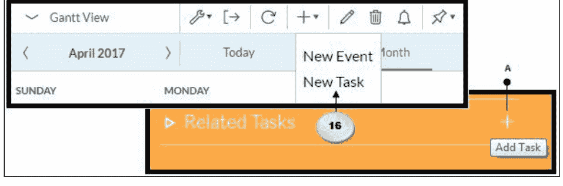

17. 在“新建任务”窗口中，输入 `Update Q1 data for West US in the Bocage model` 作为新任务的标题。

18. 使用日历图标按以下屏幕截图所示设置开始日期和截止日期：

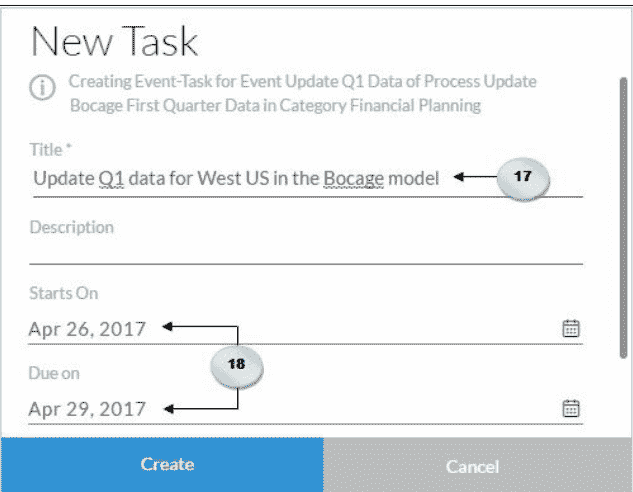

在“人员”部分，您必须将任务分配给至少一名负责人，还可以选择指定审阅者和最终审阅者（如有需要）。当您单击“选择负责人”图标时，您会看到在步骤 11 中分配给该事件的用户。

19. 单击“选择负责人”图标，从“选择用户”屏幕中选择负责人，然后单击“确定”。

如同事件一样，您也可以为任务指定相关内容并添加提醒。

20. 在“相关内容”部分单击“添加链接”图标以查看可用对象的列表。通常，您添加负责人需要更新的故事的链接。所选对象将出现在“相关内容”部分下。选中该对象的复选框（A），然后单击“创建”：

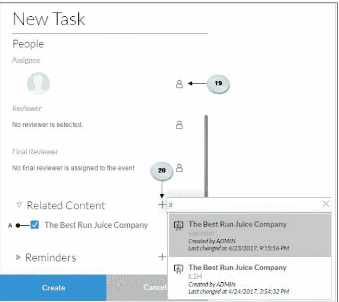

任务已创建并放置在日历中其所属事件下方。日历以及“详细信息”面板中的事件和任务条目均以相同的类别颜色显示，但图标不同：

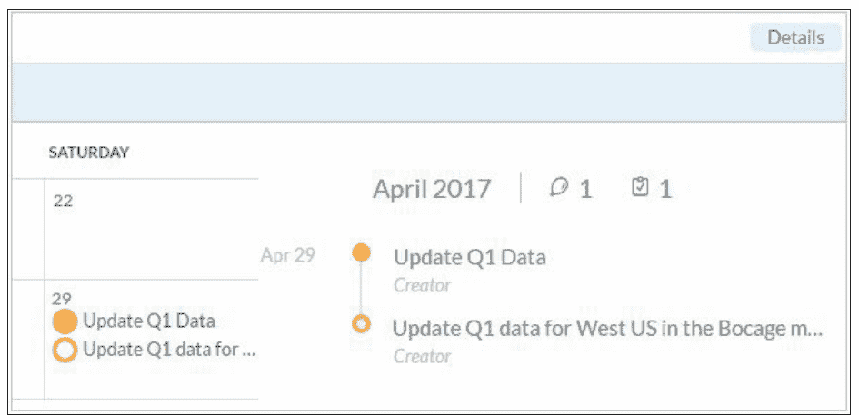

## 显示和监控事件与任务

监控是指检查事件和任务的进展情况。使用 SAP Analytics Cloud 的监控功能，您可以观察已创建事件和已分配任务中发生的活动。这有助于您关注项目的各个方面。关于显示和监控您创建的事件和任务，SAP Analytics Cloud 为您提供了以下三种选项：

- **Calendar**: 这是默认视图，事件和任务以标准日历布局呈现
- **Gantt**: 在此视图中，事件和任务以条形图呈现，显示开始日期和截止日期
- **Timeline**: 这提供了流程的线性视图

单击“甘特图视图”选项，从默认设置的“日历视图”切换到此视图。

21. 如以下屏幕截图（A）所示，“甘特图视图”最初以条形图（B）显示事件。单击箭头图标（C）展开 Update Bocage First Quarter Data 流程节点，还可查看任务（D），任务以虚线呈现。图表中也清晰显示了开始日期和截止日期（E 和 F）：

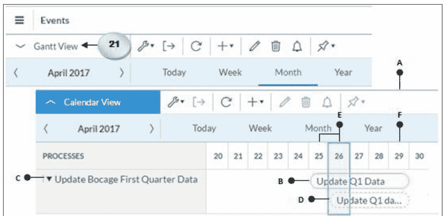

除了“日历”和“甘特图”视图外，您还可以以“时间线”视图查看事件和任务。

您可以配置事件时间线以显示所有事件和任务或其中的一部分。以下是查看时间线视图的步骤：

22. 在“事件”页面中，单击“时间面板”图标。时间线视图（A）将出现在

屏幕左侧。

默认情况下，时间线显示未来十天或更少的所有事件和任务。您可以修改要显示的天数以及时间线中要查看的特定类别。

- 23. 在时间线视图中，单击“首选项”图标。
- 24. 从“距今天的天数”列表中设置要显示的天数（例如，5）。
- 25. 选择要查看的类别，例如，财务规划。

单击“确定”以应用设置。时间线视图仅显示在指定天数范围内的所选类别。请注意，只有当您在不同类别中有多个事件，跨越不同的时间线时，这些步骤才会产生结果。

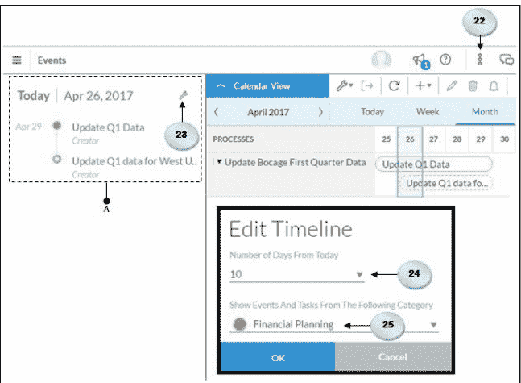

如果您在日历或甘特图视图中单击任务条目（A），您会看到一个标记为“分配者与状态”（B）的部分。该部分显示分配者的姓名（C）和任务的状态，目前应显示为“待处理”（D）。在下一节中，我们将看到分配者如何查看分配给他的任务和事件。

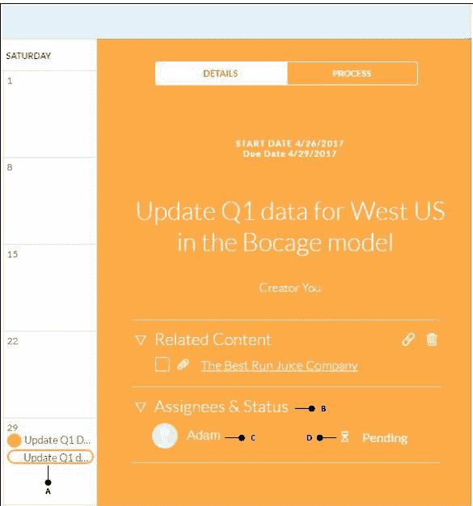

当分配者登录时，通知区域（A）提醒他有关分配给他的事件和任务的几条消息。单击通知图标会显示消息。当他单击事件通知时，事件屏幕会弹出，在那里他可以看到事件的详细信息。在其他详细信息中，他可以在“相关任务”部分中找到分配给他的任务，该任务要求他在 Bocage 模型中更新美国西部第一季度数据，如以下屏幕截图所示：

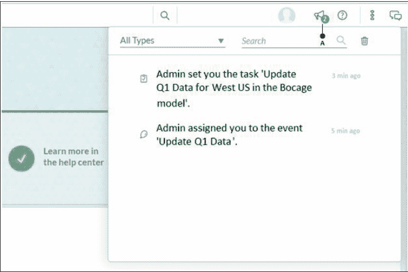

当他通过单击“相关任务”部分中的链接或在日历或甘特图视图中选择它来打开任务时，他将在“详细信息”面板中获得以下信息。该面板底部的两个按钮允许他接受任务或拒绝任务。“相关内容”区域中的链接显示他需要更新的故事名称。完成分配的任务后，他单击该面板中的“接受任务”按钮，然后单击“完成”按钮。

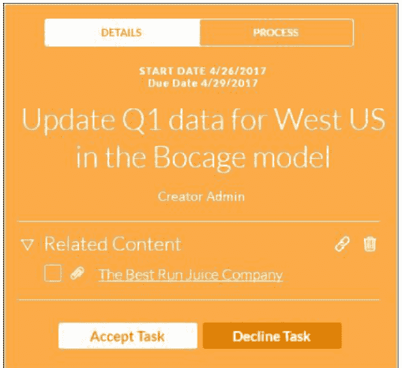

当事件和任务创建者登录时，他会收到三条通知，如以下屏幕截图所示。这些消息通知他任务已被分配者接受然后完成。

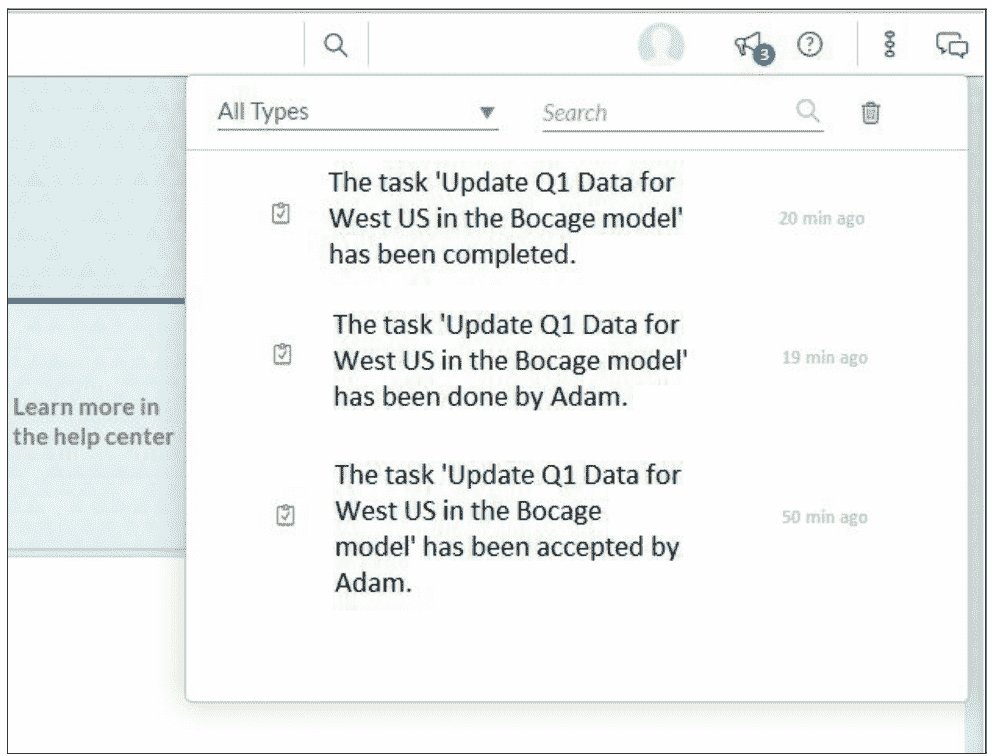

已完成的事件和相应的任务现在以深色显示，并且事件和任务的状态也在“详细信息”面板中标记为已完成：

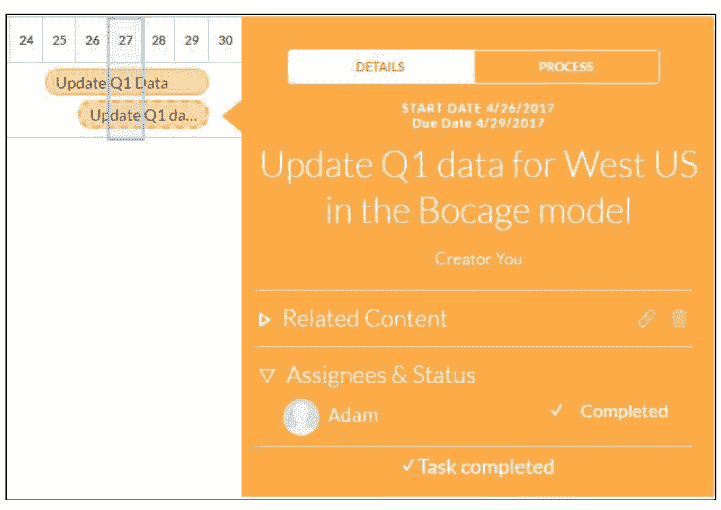

## 事件工具栏

您已经使用了工具栏中提供的一些选项。以下是剩余选项的简要说明：

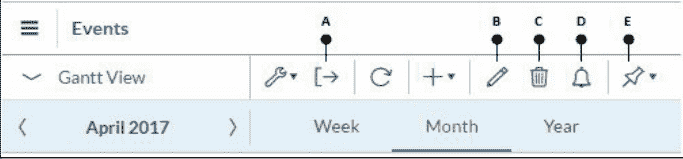

**导出事件（A）**：当您在日历或甘特图视图中选择一个事件并单击此工具栏选项时，事件将作为 `.ics` 文件导出。具有 ICS 文件扩展名的文件是 `iCalendar` 文件。它是包含日历事件详细信息的纯文本文件。在当前场景中，文件包含以下屏幕截图所示的事件详细信息。您可以在 Microsoft Outlook、Windows Live Mail 和 IBM Notes 中打开此文件，以及在日历程序中打开，例如适用于 Web 浏览器的 Google Calendar、Yahoo! Calendar、适用于 iOS 移动设备和 Mac 的 Apple Calendar、Mozilla Lightning Calendar 和 VueMinder。

```
Update Q1 Data, event from SAP BusinessObjects Cloud
• Link - https://eu1.sapbusinessobjects.cloud/sap/fpa/ui/#:view_id=em;eventId=E85BFF58EF
• Description -
• assignees
  • Admin
• Tasks
  • Update Q1 data for West US in the Bocage model
    • Description -
    • Duedate - 2017-04-29
    • Reminder - reminder 3 days before
```

- **编辑事件/维护任务（B）**：此工具栏选项可用于修改事件和任务的详细信息。当您在日历或甘特图视图中选择一个事件并单击此图标时，“编辑事件”对话框会出现。当您选择一个任务并单击此选项时，您会看到“编辑任务”对话框。
- **删除事件/任务（D）**：与编辑选项类似，此选项也可用于删除所选事件或任务。
- **编辑提醒（E）**：此选项用于修改您为事件和任务设置的提醒。
- **固定到主页（F）**：您可以使用此选项将事件和任务固定到您的主页屏幕。有关详细信息，请参阅第 7 章 *Working* 中的 *Pinning Story Objects* 部分。

## 与同事共享故事并授予访问权限

完成故事后，您将其保存并与其它用户共享。共享故事是协作的一部分。共享故事的主要目的是请求他人提供反馈，并基于他们的意见进一步完善故事。您已在第 5 章 *Extending Stories with KPI, Filters and other Handy Objects* 的 *Save Your Story* 部分了解了保存过程。为了提醒您，有三个选项可以保存并与同事共享您的工作：

- **公开**：您可以将故事保存到 `Public` 文件夹中进行共享，使其对每个人都可用
- **团队**：此选项将您的故事的访问权限授予指定的团队
- **私有**：如果选择私有选项，您的故事将仅对您与之共享的用户可用

您有多种选项可与他人共享故事。以下是最简单的途径：

- 26. 在您的故事中，单击“共享”图标，并从菜单中选择“共享故事”（A）：

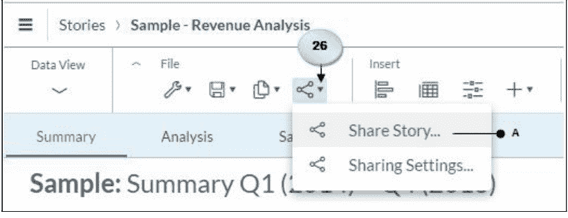

“共享故事”对话框弹出。您可以在此对话框中发送链接（B）给同事以与他们共享故事。

- 27. 要与特定用户或团队共享故事，请单击“添加用户名”图标，这将显示“选择用户和团队”对话框，您可以在其中选择团队（C）或个人用户（D）。
- 28. 从“访问”列表中，您可以为所选人员提供“读取”、“更新”或“完全控制”权限。对于此示例，请提供“读取”访问权限。

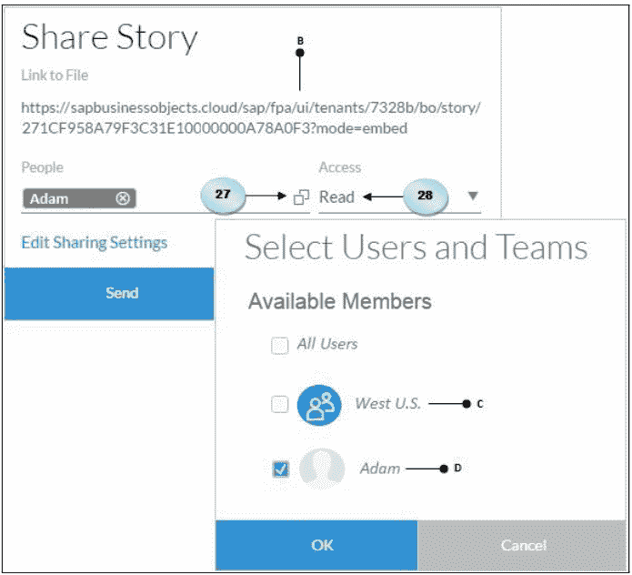

当其他用户登录时，他们会收到有关共享的通知（E）。单击通知会打开具有有限访问权限的故事，在其中他们可以看到并使用主工具栏中的部分选项。可用选项允许他们使用新名称保存故事、应用筛选器并创建自己的公式。

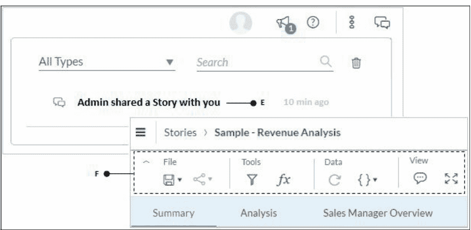

Share 菜单中的另一个选项是共享设置。单击此选项时，您会看到“编辑共享设置”对话框，如以下屏幕截图所示。在这里，您可以根据用户调整故事访问权限。如屏幕截图所示，对话框允许您向所选成员和组授予完全、读取、更新和删除访问权限。您可以为不同的人使用不同的组合。例如，您可以为某些成员提供更新访问权限，以便在需要时他们可以更新故事，并向其他人授予读取访问权限以防止故事更新。您还可以使用“添加用户和团队”按钮添加更多用户和团队。

### 编辑共享设置

| 用户/团队 | 完全访问 | 读取访问 | 更新访问 | 删除访问 |
|---|---|---|---|---|
| 所有用户 | ☐ | ☑ | ☐ | ☐ |

添加用户和团队

保存

取消

## 通过讨论协作

您可以使用 SAP Analytics Cloud 的讨论功能与同事协作。讨论功能使您能够实时与其他成员连接。以下是使用此功能的步骤：

- 29. 单击主工具栏上的“协作”图标以访问“讨论”面板。
- 30. 单击“新建讨论”图标。如果要返回，请使用左箭头。
- 31. 在“新建讨论”中，单击“+”图标以添加参与者
- 32. 在“选择用户”对话框中，选择要添加到讨论中的用户。

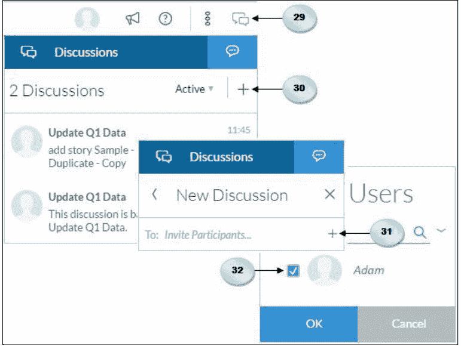

邀请参与者后，您可以通过单击“讨论”面板底部的“新建”图标（A）开始讨论。该按钮为您提供一些协作选项。如果选择“链接故事”选项（B），您的故事将被添加到讨论面板中。“新建任务”选项（C）会调用本章前面介绍的用于创建新任务的相应窗口。您还可以通过输入消息（D）并单击发送图标（E）发送文本消息。您发送给参与者的消息也会添加到讨论面板（F）中。

单击“管理”图标（G）会显示一个菜单（H），该菜单允许您管理相关内容、管理用户、归档讨论以供以后参考以及删除讨论。如有需要，您可以使用“讨论”面板菜单（I）访问已归档的讨论。参与者会在通知区域收到有关讨论的提醒。他们可以通过单击通知区域中的相关消息加入讨论。单击协作图标会显示类似的讨论屏幕，如以下屏幕截图所示，他们可以从那里访问和响应共享内容：

## Discussions

## Update Q1 Data

收件人：邀请参与者...

4/25/2017

本次讨论基于事件 Update Q1 Data。

由 Admin 授予

11:45

故事：Sample - Revenue Analysis Duplicate - Copy

由 Admin 添加

12:03

请在此故事上输入您的反馈。

请在此故事上输入您的反馈。

- 相关内容
- 首选项
- 归档讨论
- 删除讨论

- 链接故事
- 新任务

## Discussions

1 次讨论

已归档

- 活动
- 已归档

更新 Q1 数据

Admin 已归档

## Sharing files and other objects

您创建的故事和上传的文件存储在 SAP Analytics Cloud 仓库中。您可以通过文件页面访问和共享这些对象与其他用户。以下是在文件页面上可以执行的主要任务：

- **管理文件和文件夹**：此页面的主要目的是组织您的故事、输入表单、董事会议程和上传的文件。
- **上传文件**：除了使用不同类型的对象创建故事外，SAP Analytics Cloud 还允许您从自己的计算机上传文件。您可以将这些文件存储在仓库中并与同事共享。
- **共享文件**：使用此界面，您可以将故事和其他内容与个人成员或团队共享。
- **更改共享设置**：一旦您决定与他人共享内容，您可以为共享的文件或文件夹定义访问权限。

3.3. 转到主菜单 | 浏览 | 文件以访问文件界面：

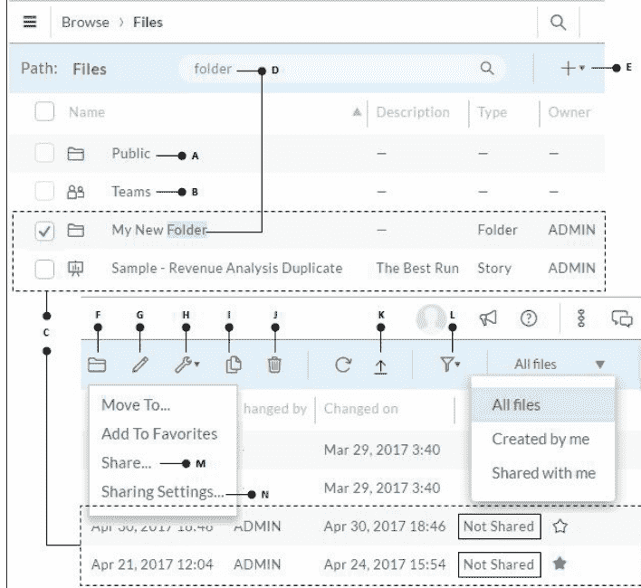

- 公共文件夹 (A)：回想一下，当您在第 5 章《使用 KPI、筛选器和其他实用对象扩展故事》中保存故事时，您被提供了三个选项：Public、Teams 和 Private。文件页面将您的内容组织到其中一个视图类别中。公共文件夹包含一个 Samples 子文件夹，其中包含示例模板、故事以及您被分配了完全、读取、更新和删除访问权限的公共文件。点击公共文件夹链接以查看 Samples 子文件夹及其包含的内容。
- **Teams 文件夹 (B)**：Teams 选项将您的故事的访问权限授予指定团队，并将您的故事存储在 Teams 文件夹中。
- **私有文件 (C)**：私有文件是指未与其他用户共享的文件。文件夹也适用相同的规则。
- **搜索框 (D)**：您可以通过在搜索框中输入关键字来查找文件夹或子文件夹中的任何内容。
- **创建 (E)**：如果您拥有适当的权限，则文件页面还允许您通过创建图标创建故事和董事会议程。
- **新建文件夹 (F)**：点击新建文件夹图标在界面中创建新文件夹。
- **编辑 (G)**：点击编辑图标会打开另一个窗口，您可以在其中修改所选文件的名称和描述。
- **管理 (H)**：管理选项附带一个小菜单。如果您想将所选对象移动到另一个位置，请从此菜单中选择“移动到”选项。通过在收藏列中选择星形图标将文件标记为收藏。或者，您可以选择多个文件并从管理菜单中选择“添加到收藏”。共享的概念以及此菜单中的共享设置选项将在稍后讨论。
- **复制到 (I)**：在工具栏中选择“复制到”选项会在所选文件夹中创建所选对象的精确副本。
- **删除 (J)**：使用工具栏上的删除图标删除不需要的文件或文件夹。根据为文件定义的访问权限，选择一个或多个文件时删除选项可能处于活动状态。
- **上传文件 (K)**：使用工具栏上的上传文件图标将文件从自己的计算机上传到 SAP Analytics Cloud。请注意，在撰写本文时，您可以上传 PDF、文本和 MS Office 文件，最大大小为 250 MB。
- **筛选 (L)**：选择工具栏上的筛选图标以显示某些文件类型。要进一步细化列表，请从相邻列表中选择“由我创建”或“与我共享”。
- **共享文件 (M)**：未与其他用户共享的文件和文件夹在文件页面上显示为“未共享”。您可以通过在管理菜单中点击“共享”选项将这些对象与其他用户共享。有关更多详细信息，请参阅本章中的 *与同事共享故事并授予访问权限* 部分。
- **更改共享设置 (N)**：通过在管理菜单中选择“共享设置”选项，您会看到与本章前面 *与同事共享故事并授予访问权限* 部分中看到的相同对话框。使用此对话框中提供的选项，您可以授予或撤销其他人员或团队对文件或文件夹的访问权限。

## Summary

在当今瞬息万变的商业环境中，事物变化非常快，员工之间的及时协作对任何企业的生存都至关重要。SAP Analytics Cloud 是一个平台，提供应对日常业务挑战所需的所有协作功能。

本章对这些重要功能进行了深入概述。首先，您了解了 SAP Analytics Cloud 的事件和任务功能，这些功能在协作环境中非常有用，在这种环境中，每个人都负责在规定的时间内完成一项工作。

除此之外，您还对这两个重要功能进行了实践操作。最初，您需要设置事件类别并将相关流程添加到这些彩色编码的类别中。然后，您通过提供标题、指定开始和截止日期并挑选将在下一阶段分配相关任务的用户来发起事件。接下来，您创建任务并提供与事件设置相同的信息。

一旦任务创建完成，您可以在日历、甘特图或时间线视图中监控事件和任务。通知区域会让任务创建者了解进度，同时生成警报以通知受让人他们需要完成的任务。

然后向您展示了如何与同事共享故事并为不同的同事和团队授予故事的不同访问权限。接下来，您了解了如何通过讨论进行协作，这是一种实时共享内容和信息的方式。最后，您被简要介绍了通过文件页面共享文件和其他对象的方法。

本章让您体验了 SAP Analytics Cloud 中的不同协作功能。下一章将介绍另一种协作功能——数字董事会，用于远程协作。
