# 数字董事会

为什么我要放弃传统的演示方式？当有人建议您切换到 SAP Digital Boardroom 时，这是您脑中首先出现的问题。对这个问题的简短回答是，SAP Digital Boardroom 已经彻底改变了董事会会议。本章专门展示数字董事会如何彻底改变会议体验。

SAP Digital Boardroom 是一款下一代可视化和演示平台，在决策过程中提供巨大帮助，并实时将董事会体验置于人员、地点和设备之间。它通过用基于实时数据的互动讨论取代静态和陈旧的演示来改变高管会议，从而让您做出基于事实的决策来推动业务。通过设置数字董事会，您可以实现以下目标：

- 在互动会议室中与远程位置和其他设备上的其他人协作
- 深入公司核心，了解每个流程和数据
- 分析和规划您的活动
- 即时回答临时问题
- 通过随时脱离脚本和回到脚本来可视化、识别、实验和决策
- 实时分析财务流程、生成销售预测并了解员工
- 通过直接探索实时数据并通过深入细节关注相关方面，找到对您重要的问题的答案
- 发现机会或揭示隐藏威胁
- 模拟各种决策并预测结果
- 权衡并分享您的发现的利弊

数字董事会是互动的，因此您可以检索实时数据、更改日程安排，甚至运行假设情景。它通过三个互联的触摸屏呈现您组织的实时画面，以便做出更快、更好的高管决策：

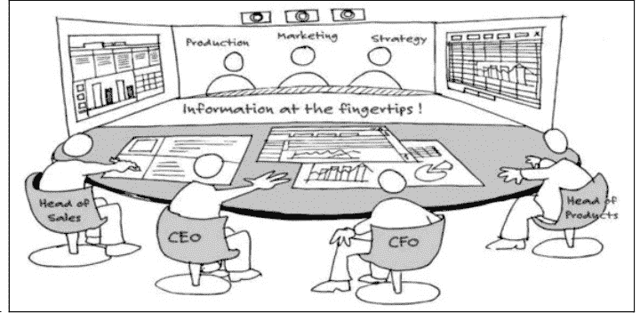

数字董事会有两个方面，使用它可以共享现有故事与

面向高管和决策者以揭示业务绩效：

- **创建议程**：首先，您需要通过添加会议信息、议程项目并将故事作为页面链接到导航结构中，为您的董事会演示设计议程。
- **开始会议讨论议程**：创建 Digital Boardroom 议程后，您可以安排会议来讨论议程。在 Digital Boardroom 界面中，您可以组织一次会议，让成员在董事会演示期间与实时数据互动。

> *在您调用 Digital Boardroom 功能之前，请确保您的管理员已向您以及所有其他成员授予适当的权限。如果您要创建议程，则需要 boardroom Creator 角色。其他将访问议程的参与者必须被授予 boardroom Viewer 角色。角色的创建和分配在下一章中介绍。*

在本章中，您将了解 SAP Digital Boardroom 的以下部分：

- 通过设置显示大小、启用数据探索、设置导航目标、启用触摸单元格输入以及设置各种偏好设置来自定义环境，以更改 Digital Boardroom 的外观和感觉
- 创建议程
- 创建议程子项
- 开始在线会议
- 邀请人员参加会议
- 在演示期间添加注释
- 停止在线会议

## 优化显示

正如刚才提到的，您首先需要为 Digital Boardroom 会议创建议程。但在此之前，您需要为 Digital Boardroom 优化显示和导航。

执行以下步骤来设置舞台：

- 1. 在打开的故事中，单击 Designer 面板中的 Styling 选项卡。
- 2. 打开 Fix Page Size 开关。
- 3. 将 Width 设置为 1920 像素。这是 Digital Boardroom 中显示的每个故事页面的最佳宽度。
- 4. 在两个复选框中放置勾选标记以选择 Continuous Height 和 Snap to Nearest Grid 选项：

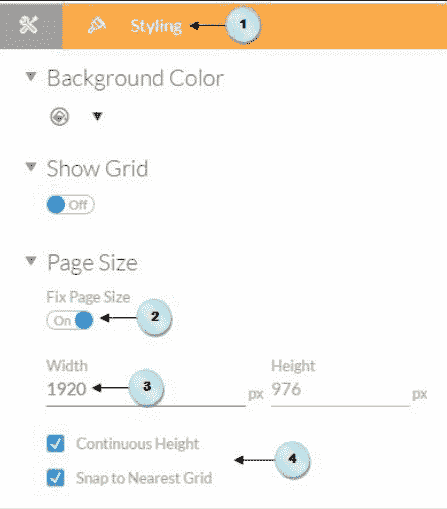

## 创建议程

调整页面宽度后，您就可以创建议程，在其中添加会议信息、议程项目并链接故事页面以供董事会演示。以下是创建议程的步骤：

- 5. 转到 主菜单 | 创建 | Boardroom Agenda：

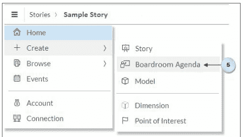

Create Agenda 对话框出现。与故事一样，议程也可以标记为 Public，供特定团队使用，或保持为私有。

- 6. 目前，从 Path 列表中选择 Public。
- 7. 输入 Annual Board Meeting 作为议程名称。

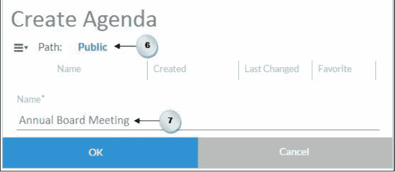

将显示创建新议程的界面，如以下屏幕截图所示，您可以在其中输入标题、日期、位置并为演示创建议程项目。

- 8. 单击 New 图标添加议程项目（A）。议程由一个或多个议程项目组成，可将演示分解为不同的主题。议程项目将演示分解为部分，以便不同的演讲者可以涵盖特定主题，每个主题都有自己的故事和数据。
- 9. 输入会议的标题、日期和地点。您可以从日期选择器中选择日期。
- 10. 为议程项目输入标题和副标题。
- 11. 从 Story 列表中选择要讨论的故事。
- 12. 从 Page 列表中选择将作为议程项目概述摘要的故事页面。此页面的内容将在左侧概述屏幕中显示。
- 13. 输入演讲者的姓名。
- 14. 输入演讲者的职位。
- 15. 设置议程项目的计划时间。

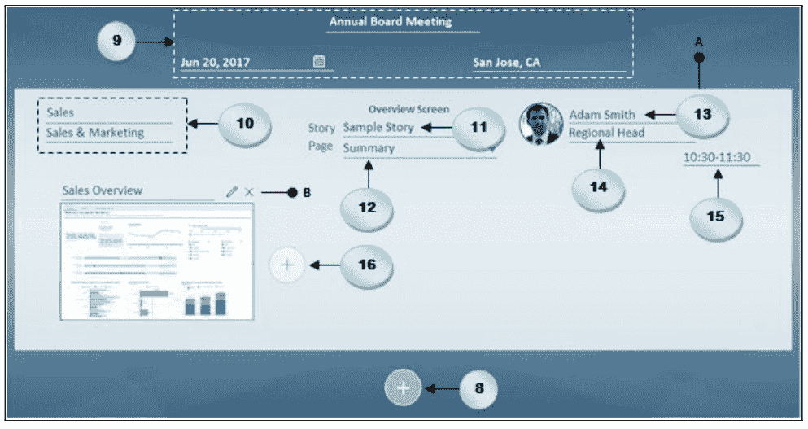

您可以通过单击相同的 New 图标添加更多议程项目。例如，您可以创建一个议程项目来讨论销售，另一个来讨论财务

## 创建议程子项

在为议程提供详细信息后，您将向其添加子项（参见上一个屏幕截图中的 B）。您向议程项目添加子项以将额外的故事页面链接到三屏显示。请注意，您可以通过将其拖动到新位置来重新排序议程项目和子项。

- 16. 单击 New（参见上一个屏幕截图）添加子项。显示 Agenda Sub Item 对话框，您可以在其中指定上一章中创建的三个故事页面。
- 17. 在 Agenda Sub Item 窗口中，为 Title 输入 Sales Overview。
- 18. 为所有三个屏幕选择 Sample Story。
- 19. 选择 Summary、Analysis 和 Sales Manager Overview 页面，如以下屏幕截图所示。

如果您想保留故事中设置的页面格式，请选择 Ignore Boardroom Formatting。单击 OK 保存议程子项：

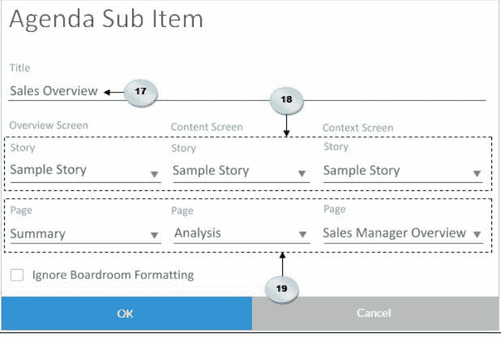

通过此设置，当您创建议程时，Summary 页面将显示在左侧屏幕，Analysis 页面显示在 Content 或 Center 屏幕，Sales Manager Overview 页面显示在 context 或右侧屏幕。从 Overview Screen 下拉列表中选择的 Story 页面出现在左侧屏幕。这是最好总结子项的故事页面，例如提供数据汇总视图的可视化。您为 Content Screen 指定的页面显示在 Center 屏幕。它链接一个故事页面来推动该子项讨论的主要观点。您为 Context Screen 选择的页面显示在右侧屏幕。通常，这是为 Content 屏幕中的数据提供上下文的页面，可以在此处进行下钻。

您还可以将故事的缩略图添加到子项。单击子项矩形框，并从计算机中选择故事图像。

如果需要，您可以向同一界面添加更多议程项目（A）和子项。例如，如果您计划在同一会议中介绍组织的财务状况，则重复步骤 8 到 20 以添加新的议程项目和映射到包含揭示财务状况的页面的不同故事的子项。

设置所有相关项目后，您需要保存议程，以便在 boardroom 模式下进行测试运行。

- 20. 在工具栏上，单击 Save 图标（💾）保存议程。
- 21. 要测试演示，请通过单击工具栏右侧出现的 boardroom 图标（ ）启动 boardroom 模式。
- 22. 单击箭头图标展开议程项目，并单击缩略图打开故事，如以下屏幕截图所示：

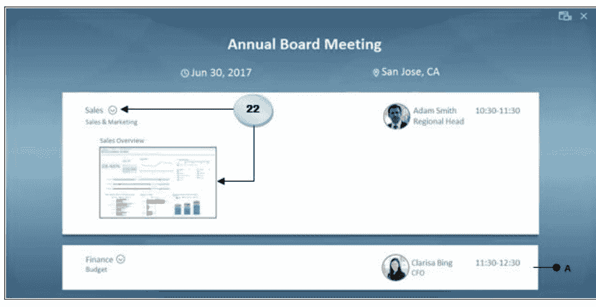

根据您在前几步中设置的偏好，故事的 Summary 页面在左侧 Overview 屏幕（A）中打开，另外两个页面显示在其右侧的缩略图（B）。您可以使用关闭图标（C）关闭 boardroom 模式。要开始在线会议，请单击 Start Meeting Room 图标（D）进行在线演示和录制。目前，您将在单屏模式下测试演示，因此您将在三个屏幕之间导航，而不是同时查看它们。要查看另外两个屏幕，请单击其缩略图。如果您想全屏显示，请单击全屏模式图标（E）。

在此模式下，所选页面占据全屏，两个缩略图消失。使用窗口两侧出现的页面控件在前后导航。

## 启用数据探索

在 Digital Boardroom 中演示故事图块时，有时需要更改度量、维度和图表类型以从不同角度分析数据。为此，您需要在所需故事对象上启用数据探索。因此，当您在 Digital Boardroom 中演示故事时，可以以 Explorer 模式打开图表以进行更改。以下是启用数据探索的步骤：

- 23. 在故事页面中选择图表图块后，单击 Designer 面板中的 Styling 选项卡，然后在 Widget 部分选择 Open in Explorer。

在故事中将图表配置为小部件后，在 boardroom 模式下工作时，您会在图表上看到一个额外的菜单（A）。单击此菜单时，您会看到 Open in Explorer 选项（B）。单击此选项会打开 Widget in Explorer，会议参与者可以在其中更改其度量（C）和维度（D）以获得不同的视图。您还可以通过在 Styling 选项卡上勾选相关选项，为 boardroom 启用排序（E）和排名（F）选项，如以下屏幕截图所示：

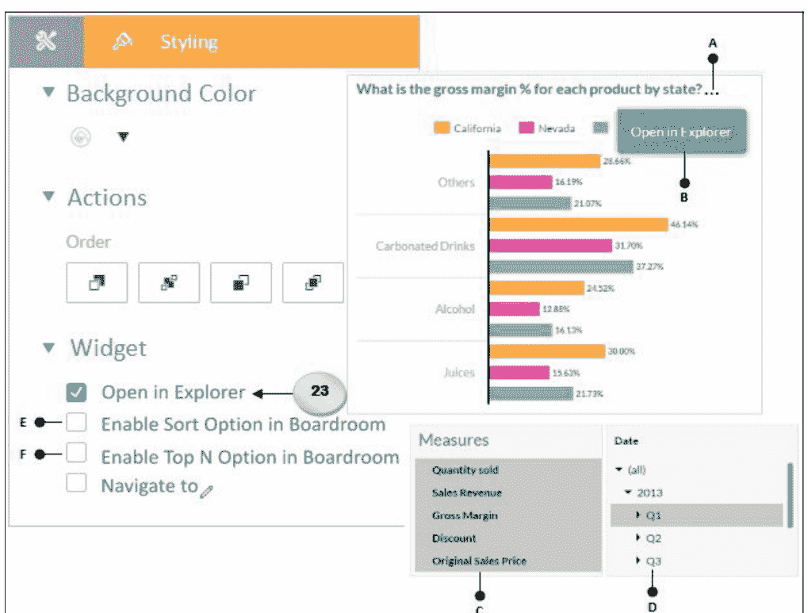

## 设置导航目标

数字董事会室能够在三个屏幕上显示不同的故事页面。由于您的故事可能包含超过三个页面，您可以通过打开“导航到”功能来导航到额外的页面。

通过在前面放置一个复选标记来启用“导航”选项。然后，单击它旁边的微小铅笔图标（请参阅之前的屏幕截图）。

在“导航目标”对话框中，您会提供一些导航选项。选择“导航到议程子项”（A）以创建链接来访问任何议程子项。否则，取消选择此选项，并指定在董事会室模式下由您的链接呈现的三个屏幕的故事页面（B）。

在董事会室模式下，当您单击所选小部件的“更多操作”菜单时，您将被带到议程子项或您在此处指定的替代路径。例如，如果您的故事中有四个页面，您可以在此处为“上下文”页面指定第四个页面，而不是“销售经理概览”页面。当图表配置为导航并且您在董事会室模式下单击“更多操作”菜单时，您会看到显示第四个页面名称的链接。当您选择此选项时，“销售经理概览”页面将被第四个页面替换，并且相应页面的缩略图会出现在“上下文”部分。

您还可以通过从单屏模式下拉列表（C）中选择一个选项来设置单屏显示的显示行为。它允许您定义在使用此视图时故事在单屏模式下的呈现方式。

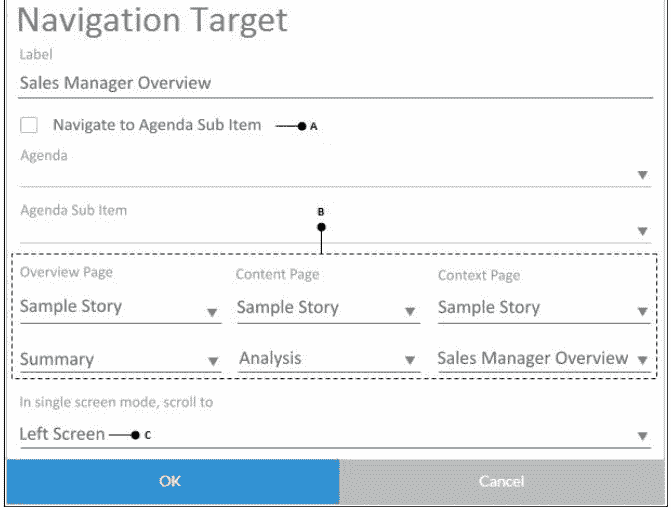

## 启用触控单元格输入

数字董事会室可与触控和非触控显示器一起使用。您需要在会议中具备触控功能，以便在故事页面上的表格单元格中修改数字。以下是如果尚未打开则打开此功能的步骤：

- 24. 在您的故事页面上选择一个表格对象。
- 25. 在“样式”选项卡上，将“董事会室单元格输入”设置为“开”。
- 26. 为触控键盘的滑块指定最小值、最大值和步长值。
- 27. 保存故事。触控键盘将被启用，并且可以在董事会室演示期间用于修改表格单元格中的数字。

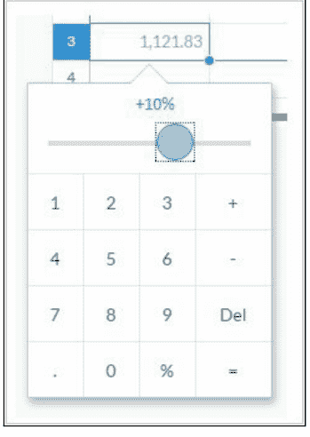

## 设置首选项

您可以通过“首选项”对话框应用自定义格式属性来更改议程的外观和感觉，您可以通过单击工具栏上的“首选项”图标（ 🔧 ）来访问该对话框。

在“首选项”对话框中，您可以更改议程的名称（A）。您在此处设置的名称在整个数字董事会室中都会被引用。您还可以添加缩略图图像（B）以便于视觉识别。

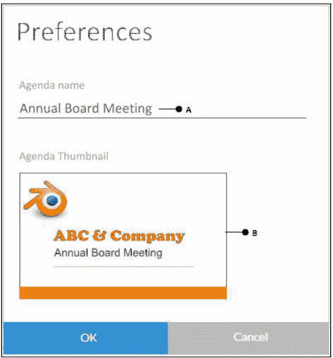

在“会议设置”部分，您可以通过选择是否显示议程或直接跳转到第一个子项来设置“演示模式”。从“在线会议会话”列表中，您可以选择是否在与数字董事会室相同的窗口中启动会议或在新窗口中启动会议。

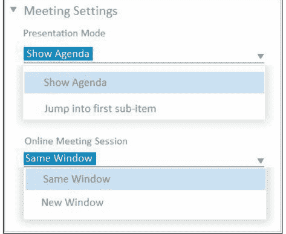

“董事会室背景”列表中提供的选项让您可以从会议的预定义背景中选择一个、上传将用作背景的图像，或选择“纯色”。通过选择“忽略故事背景”选项，您选择在演示期间呈现时隐藏故事页面的背景。

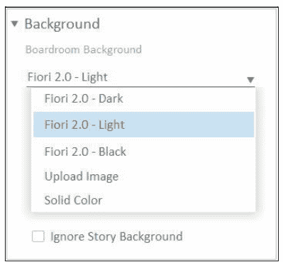

到目前为止，您对“字体样式”部分已经非常熟悉。在这里，您会提供一些更多选项，您可以使用故事中设置的样式为内容设置字体样式、保留默认格式或指定自己的样式。“文本元素”部分中提供的选项涵盖了内容中的几乎每个元素，这意味着您可以对列表中提供的每个选项应用单独的自定义。

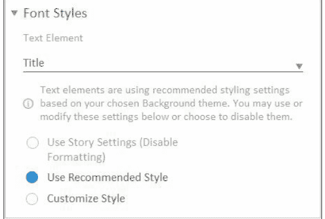

## 数字董事会室页面

数字董事会室页面列出了您所有的议程。就像故事和模型一样，您可以从此界面添加（A）、演示（B）、修改（C）、删除（D）、共享（E）以及开始在线会议（F）。要执行这些操作，您必须从列表中选择一个议程（G），如下图所示：

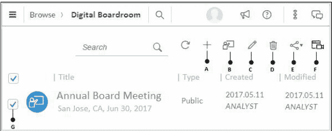

## 开始会议

一旦您创建了议程，您就可以召开会议来展示您组织的业绩。SAP 数字董事会室的在线会议功能是针对董事会成员位于世界各地且无法亲自参加的组织的绝佳解决方案。通过安排在线会议，您允许这些人从远程位置相互连接并使用自己的设备讨论议程。以下是开始在线会议的四种替代方法：

- 在数字董事会室页面上，选择一个议程，然后选择“开始在线会议”（请参阅上一节中的 F）。
- 从数字董事会室页面打开议程，然后单击议程页面上的“开始在线会议”图标。

当您开始会议时，您充当其组织者（A），并获得其他参与者没有的额外特权。

当您发起会议时，屏幕共享会与注释一起自动开始，这需要在演示期间突出显示特定区域。您会在屏幕底部收到有关这些功能启动的单独通知（B）。屏幕顶部会出现一个演示者面板（C），您可以使用它来开始演示或添加注释。另一个名为“会议小部件”（D）的面板显示在屏幕右侧。此小部件中提供的功能将在后续章节中讨论。

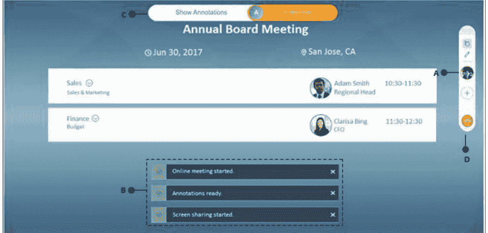

## 邀请人员参加会议

在启动会议流程后，您会邀请其他成员。作为会议组织者，您有权邀请人们加入会议。以下是执行此操作的步骤：

- 28. 在会议小部件上，单击“邀请”图标。
- 29. “邀请参与者”对话框出现。选择您要添加到会议的用户，然后单击“确定”。再次在“邀请参与者”对话框中单击“确定”以发送邀请。截至撰写本文时，您可以邀请参加董事会室会议的用户最大数量为 20 人。

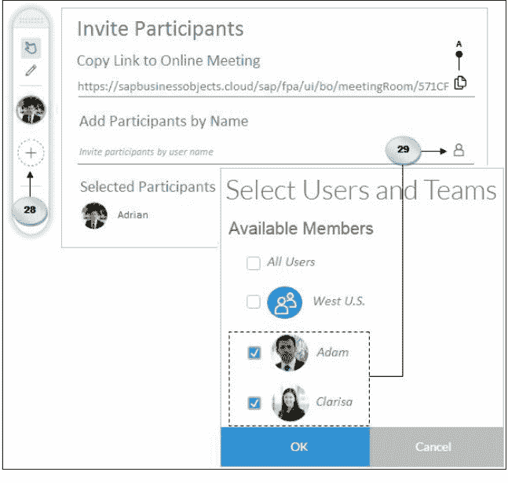

除了按名称添加参与者外，“邀请参与者”对话框还包含您组织的在线会议的链接。作为邀请的替代方法，您可以复制 URL（A）并直接发送给受邀者。

您在上一步中选择的所有成员在访问 SAP Analytics Cloud 时会在其屏幕上看到一个弹出通知（B），提示他们加入会议。他们可以通过单击通知中的“加入会话”链接接受邀请。类似的消息会同时放置在工具栏上的通知区域（C）。除了通知外，还会向其个人资料关联的电子邮件地址发送电子邮件（D）。当参与者通过通知或电子邮件链接接受邀请时，会议界面将在新标签页中打开，在那里他们可以看到组织者共享的屏幕，并且可以打开议程项以访问底层故事，如下图所示：

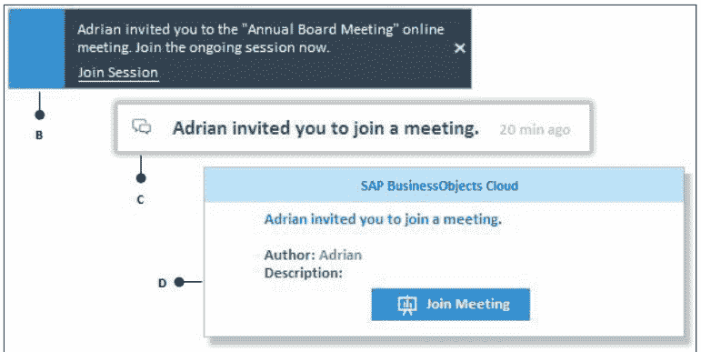

一旦参与者接受邀请，“邀请”图标（E）会更改以指示已加入会议的人数。如果您单击此图标，您将在单独的窗口中看到所有参与者（F）。如果需要，您可以从此窗口邀请更多人员。

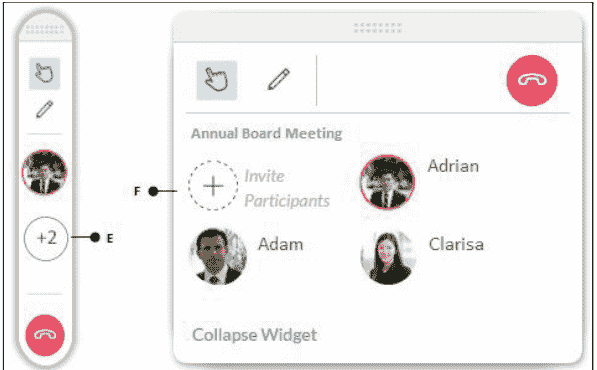

## 在会议中开始演示

加入会议后，参与者可以成为演示者，在董事会会议中与他人共享议程，并在屏幕上使用文字和绘图进行标注。作为会议组织者，您在董事会会议期间拥有默认的演示和标注权限。参与者可以向组织者请求权限以共享屏幕或启用标注。当参与者请求演示或标注权限时，您会收到一条消息，其中可以选择接受以授予控制权。

一旦参与者获得必要的权限，他们就可以深入层级结构、应用筛选器，并在议程中的故事页面之间导航，以向其他董事会成员展示他们的观点。

您可以通过在会议小部件上选择演示或标注按钮，随时从参与者手中收回控制权。请注意，同时只能有一名参与者进行演示或标注。

作为参与者开始演示，请执行以下步骤：

- 30. 在会议小部件上，单击演示图标。您将看到一条消息，提示您当前没有演示权限。
- 31. 在消息中单击“发送请求”链接，向组织者或当前演示者请求演示权限。
- 32. 组织者或当前演示者会通过通知收到请求，并可以接受或拒绝它，如以下屏幕截图所示：

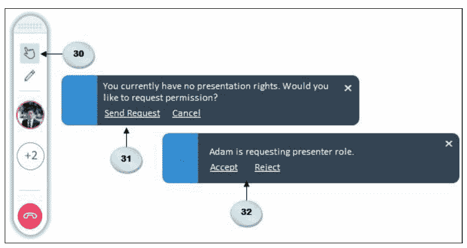

获得组织者或当前演示者的批准后，您将控制董事会议程屏幕，可以导航到不同的议程项目。屏幕顶部会显示一个演示者面板（A），表明您是当前演示者。完成演示后，选择演示者面板中的“停止演示”以归还演示控制权：

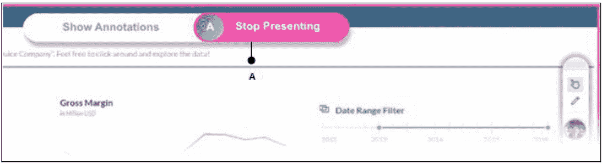

## 添加标注

参与者可以在故事页面上添加标注以突出显示关键信息，前提是他们已获得标注权限。当前演示者可以通过从演示者面板中选择“显示标注”切换到标注模式。此操作将面板切换到标注模式，演示者可以在其中使用手绘和文字注释标记当前议程页面。在添加标注时，演示会暂停，以便专注于当前页面并防止导航。为了标记当前议程页面，参与者需要标注角色。以下是获取此角色的过程，与您在上一节中请求演示权限时执行的过程类似：

- 33. 在会议小部件上，单击“标注”图标。
- 34. 单击“发送请求”链接，向当前演示者请求标注权限。

一旦当前演示者批准请求，您就可以在董事会屏幕上自由绘制（A）或添加文字注释（B）以突出显示特定区域。标注模式中的工具栏允许您擦除（C）、撤销（D）、重做（E）以及删除所有标注（F）。

标注按参与者进行颜色编码，这意味着每个参与者都被分配自己的颜色以识别其标注。最多可以为参与者分配九种颜色。一旦所有颜色都被分配，额外参与者将无法进行标注。

演示结束后，单击屏幕顶部演示者面板中的“停止标注”，将控制权归还给演示者。

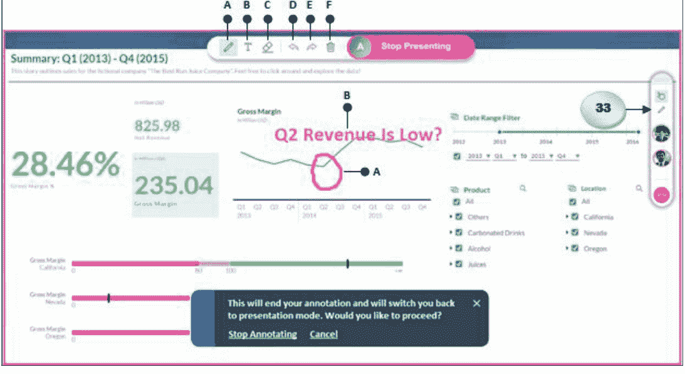

## 停止在线会议

一旦所有参与者都已演示其议程项目，组织者可以通过在会议小部件中单击“挂断”图标（A）来停止在线会议。单击通知中的“继续”链接（B）确认结束会议后，会在每个参与者的屏幕上显示一条消息，告知他们组织者已结束在线会议，他们可以关闭“会议”选项卡。

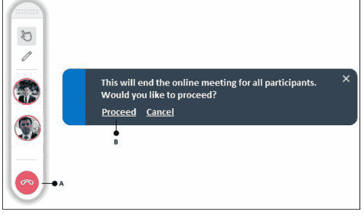

## 摘要

数字董事会为董事会会议树立了新的趋势。它不仅支持传统的演示方式，即董事会成员坐在一起分析业务绩效并设定未来方向，还具有超越企业董事会的潜力，允许世界各地成员在线参加会议。与本地参与者一样，这些远程成员也可以积极参与讨论，并通过设置筛选器、更改维度和度量、下钻到细节等，使用自己的设备操作实时数据。

本章向您介绍了数字董事会的两个方面：创建议程和设置在线会议。在数字董事会议程中，您提供一些基本信息，例如会议的名称、日期和地点。然后添加子项目，即您希望在会议中讨论的故事。您还分别指定每个子项目演示的演示者姓名和持续时间。

接下来，您作为组织者发起在线会议并邀请参与者，他们将在其 SAP Analytics Cloud 会话中或通过电子邮件收到通知以加入会议。

参与者接受邀请并向组织者请求授予他们演示和标注权限。经组织者批准后，参与者可以开始演示，并借助文字和手绘标注关键信息。

数字董事会是 SAP 提供的旗舰解决方案，用于应对当今快速发展的数字经济的需求。这种引人入胜且协作性的技术适用于所有团队会议，而不仅仅局限于董事会。它有潜力满足当今和明天的期望。那么，为什么不将您的董事会提升到下一个水平呢？

现在您已经了解了 SAP Analytics Cloud 提供的所有功能，让我们进入最后一章，在那里您将学习如何管理和控制您的 SAP Analytics Cloud 环境。
