# 系统管理

系统管理是计算中的一项关键任务，包括系统的维护、配置和可靠运行。系统的正常运行时间、性能、资源和安全是系统管理员的主要职责。在 SAP Analytics Cloud 中，系统管理员负责以下部分：

- 创建用户并设置其密码
- 从另一个数据源导入用户
- 导出用户配置文件供其他应用使用
- 从系统中删除不需要的用户账户
- 创建角色并将其分配给用户
- 为角色设置权限
- 组建团队
- 为模型设置安全
- 监控用户活动
- 监控数据更改
- 监控系统性能
- 通过导出和导入进行系统部署

## 创建用户

当新用户加入公司时，系统管理员有权在 SAP Analytics Cloud 中创建该用户的账户。此任务通过“用户”页面执行。以下是添加新用户账户的步骤：

- 1. 转到主菜单 | 安全 | 用户以访问用户页面。
- 2. 在用户页面上，在工具栏上选择新建（+）。用户管理表中将附加一行空白行，您可以在其中输入新用户的凭据。
- 3. 为新用户输入 ID，该 ID 应唯一。请注意，此字段不允许使用空格。用户 ID 中可以使用大写字母、数字、下划线、井号和与号。
- 4. 在相关单元格中输入用户的名、姓和显示名称。
- 5. 在“电子邮件地址”单元格中输入用户的电子邮件地址。创建账户后，包含登录信息的欢迎邮件将发送到此地址。
- 6. 如果用户是下属，则选择经理，该经理将批准该用户对访问权限的请求。角色将在后续章节中讨论。提供此信息后，单击“保存”图标（A），如下图所示：

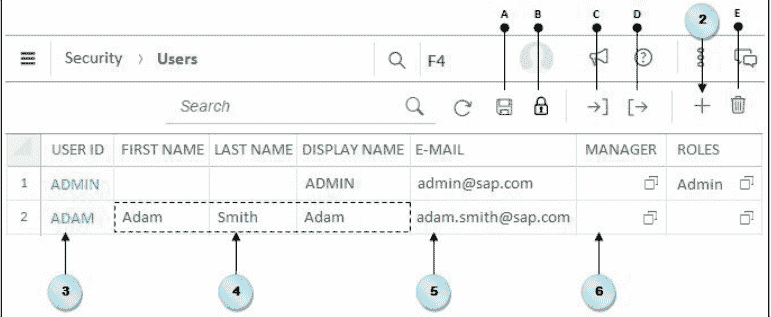

工具栏上提供的图标允许您创建和删除（E）用户记录。您还可以使用 CSV 文件从另一系统导入（C）用户数据。同样，您可以将 SAP Analytics Cloud 用户数据导出（D）到 CSV 文件，以便在其他系统中使用此信息。使用工具栏上的锁图标（B），您可以重置用户密码。以下各节提供了执行这些任务的顺序说明。

## 设置用户密码

当您在步骤 6 中单击保存图标时，会打开“设置密码”对话框以为新用户设置初始密码。如果您不使用 SAP Cloud ID，则必须为所有新用户设置临时密码。

- 7. 输入密码，然后在第二个文本框中确认此密码。密码必须至少为八个字符长，并且应包含大写字母、小写字母和数字。输入密码后，单击对话框中的“设置密码”按钮。

一封包含首次登录凭据的欢迎邮件将被发送给用户。当用户使用这些初始凭据登录时，系统会提示其更改临时密码：

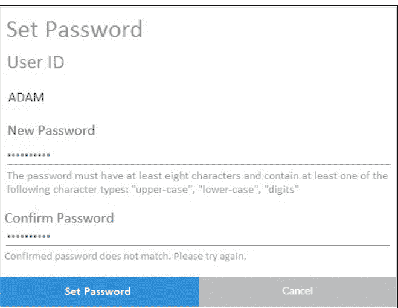

## 更改密码

出于安全考虑，用户经常需要更改密码。更改密码有两种方式：管理员可以在“用户”列表中为用户更改密码，或用户可以在其用户配置文件中更改密码。使用 SAP Cloud 平台 **身份验证服务 (IAS)** 连接的用户可以在登录页面上选择“忘记密码？”来创建新密码。作为管理员，您可以执行以下步骤来创建或更改密码：

- 8. 在“用户”页面上，在用户列表中选择一行或多行。
- 9. 在工具栏上单击“设置密码”图标 (🔒)。
- 10. 输入密码，然后确认。
- 11. 单击“设置密码”按钮结束流程。如果用户存在有效的电子邮件地址，系统会自动向用户发送包含用户名和新密码的电子邮件。

## 导入用户

如果您只需要创建几个用户帐户，应使用“创建用户”部分中提到的步骤。但是，如果用户列表很大，您可以使用导入实用程序，它会从 CSV 文件中获取用户数据并导入到 SAP Analytics Cloud。以下是此流程的步骤：

- 12. 在“用户”页面上，单击“从文件导入用户”(→)。
- 13. 在“导入用户”对话框中，选择“选择源文件”以上传您的 CSV 文件。
- 14. 通过选择“定义映射”将 CSV 文件中的用户数据映射到用户管理中的字段。
- 15. “映射源到目标”对话框出现，您需要在其中为标题、行分隔符、分隔符和文本限定符选择适当的条目。
- 16. 检查映射数据的预览。如果映射正确，请单击“定义映射”按钮。
- 17. 在“导入用户”对话框中单击“导入”以从 CSV 文件上传数据。

## 导出用户

除了从其他来源导入用户数据外，您还可以使用其导出实用程序在其他一些系统中利用 SAP Analytics Cloud 用户数据。

- 18. 在“用户”页面上单击“导出”图标 (↓→)。用户数据将被导出到 CSV 文件，您可以在浏览器中设置的默认下载文件夹中找到该文件。

## 删除用户

您可以删除已离开公司的员工的帐户。此特权仅允许管理员使用，并且在执行此操作时与用户关联的任何私人数据也将被删除。因此，请确保在删除帐户之前已归档该用户的私人数据。

- 19. 在用户管理表中，通过单击表格最左列中的用户编号来选择要删除的用户 ID。这将选择整行。
- 20. 在工具栏上单击“删除”图标 (🗑️)。
- 21. 单击“确定”以确认删除。

## 分配角色

创建用户帐户后，您必须为新用户分配角色，这将决定用户在应用程序中可以或不可以做什么。先创建用户还是先创建角色并不重要。如果在创建或导入用户时未分配角色，则会应用默认角色。作为系统管理员，您通常会处理两种分配用户角色的情况。第一种情况是为多个用户分配一个角色，第二种情况是为单个用户更新角色。处理这两种情况的步骤如下所述。

### 为多个用户分配单个角色

以下是为多个用户分配单个角色的方法：

- 22. 转到“主菜单 | 安全 | 角色”以访问“角色”页面。
- 23. 在“角色”页面上，单击现有角色以打开其定义页面。
- 24. 在所选角色的定义页面上，单击“分配角色”图标 (🔑)，并从用户列表中选择一个或多个用户。所选角色将被分配给所有所选成员，如以下屏幕截图所示：

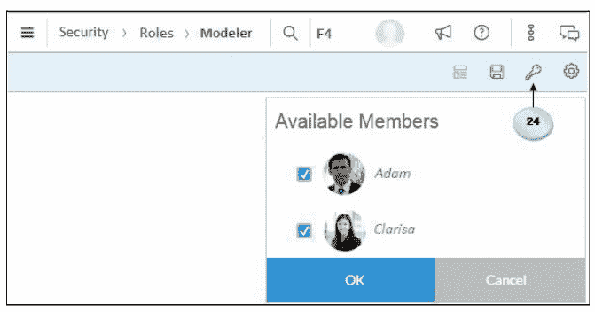

### 分配或更新单个用户的角色

以下步骤可用于为新用户分配角色或更新现有用户的角色：

- 25. 转到“主菜单 | 安全 | 用户”以访问“用户”页面。
- 26. 在“用户”页面上，找到要分配角色的用户。
- 27. 在所选用户的行中，单击“角色”列中的“复制”图标 (⎘)。此时，您将看到包含所有角色的列表。
- 28. 选择一个或多个角色，然后单击“确定”将所选角色分配给所选用户。

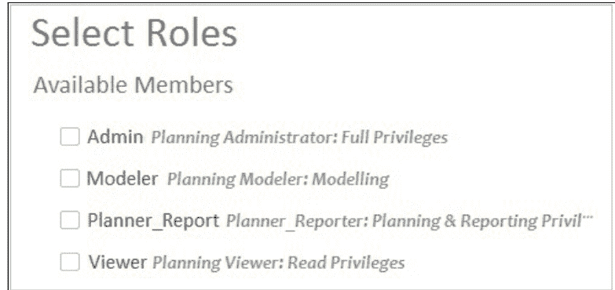

## 内置角色

SAP Analytics Cloud 附带了一些开箱即用的角色。除了直接将这些内置角色分配给最终用户外，您还可以将它们用作定义新角色的模板。

下表列出了这些角色：

| 角色 | 描述 |
|------|-------------|
| **系统所有者** | 完全权限。角色层级结构顶端是系统所有者。这是一个强制性的高级用户角色，必须始终分配给（分配角色后）拥有对应用程序所有区域不受限制访问权限的用户。 |
| **管理员** | 规划管理员：完全权限。该角色包括 SAP Analytics Cloud 中可用的所有任务授权。被分配此任务的人员担任系统管理员，并负责设置角色、创建用户以及通过导入和导出执行系统传输。 |
| **建模者** | 规划建模者：建模权限。该角色的持有者拥有管理模型和维度的所有必要授权。凭借此角色，他们有权创建模型和维度并对其进行更改。 |
| **规划报告者** | 规划报告者：规划和报告权限。此角色通常分配给负责规划和预算的用户。 |
| **查看者** | 规划查看者：只读权限。该角色包括只读权限，被授予此角色的用户只能读取数据。 |

| 角色 | 描述 |
|---|---|
| **BI 管理员** | 商业智能管理员：完全权限。被授予此角色的人员可以执行所有任务授权，除与规划相关的授权外。该人员担任商业智能管理员，并负责设置角色和用户。 |
| **BI 内容创建者** | 商业智能内容创建者：创建和更新权限。该角色的持有者有权创建和修改非规划模型和维度。 |
| **BI 内容查看者** | 商业智能查看者：只读权限。这是非规划数据的只读角色，分配给仅想查看数据的用户 |
| **SAPCP 内容创建者** | SAP 云平台创建者：创建和更新权限。这为分配的用户提供管理非规划模型和维度的所有授权。此角色仅与 SAP 云平台 (SAPCP) 数据源相关联。 |

除此之外，以下是一些更重要的角色：

| 角色 | 描述 |
|---|---|
| **SAPCP 内容查看者** | SAP 云平台查看者：只读权限。这为源自 SAP 云平台 (SAPCP) 的非规划数据提供只读访问权限。 |
| **预测分析师** | 预测分析师：自动化发现权限。这包括管理非规划模型和维度所需的所有授权。 |
| **董事会创建者** | 这包括在数字董事会区域创建、编辑、共享、删除和查看董事会议程的所有授权。 |
| **董事会** | 这为数字董事会区域提供只读权限，并且是 |

| 查看者 | 分配给仅允许查看董事会会议议程的用户。 |

## 创建新角色

作为系统管理员，您经常会遇到需要创建一些特殊角色的情况。例如，您可能被要求为新员工创建一个角色，该员工仅有权访问一个规划模型。请注意，您可以从头创建新角色，也可以使用内置角色作为创建新角色的模板。以下是创建新自定义角色的步骤：

29. 转到 主菜单 | 安全 | 角色 以访问角色页面。

30. 在角色页面工具栏上，单击 新 图标以向角色管理表添加新行。

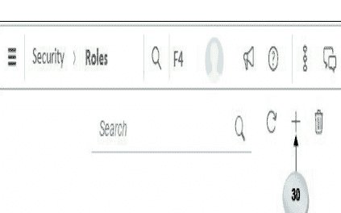

31. 在“创建新角色”对话框中为角色名称输入唯一名称（例如，Sales_Marketing_Plan_Role），然后单击“确定”，如前一个屏幕截图所示。请注意，角色名称中不允许有空格。

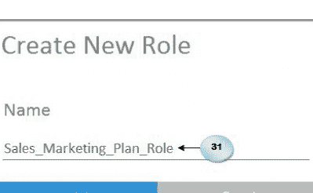

角色已创建，其权限页面（将在后续小节中讨论）显示，您可以在其中为新角色的每项活动定义权限，无论是对业务对象类型的全部对象还是对每个现有业务对象单独定义。例如，在当前场景中，您正在为只能访问一个模型的用户创建角色。

权限页面上的层次结构包含大量对象的列表。您可以手动为所有这些对象指定权限，也可以使用模板作为新角色的基础，后者更方便，因为使用这种方法，您只需对现有角色进行少量更改。

32. 如果您想基于内置角色定义权限，请在权限页面工具栏上单击“选择模板”图标（ ）。

33. 在“选择模板”对话框中，选择一个角色（例如，Planner_Reporter）。

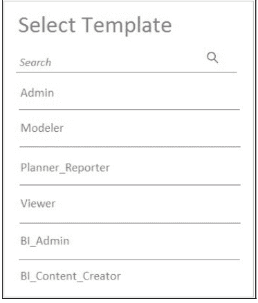

所选角色的权限将被复制到新角色。如有需要，您可以修改这些权限以满足特定的业务需求。

34. 要定义用户只能读取特定模型，请删除规划模型的全局读取设置，这将允许新员工读取所有模型。然后展开规划模型节点，并在 SalesMarketingPlan 模型的“读取”和“更新”列中设置指示器。

35. 单击“保存”图标保存角色。

36. 如果您已创建应分配新角色的用户，请选择“分配角色”，在“将角色分配给用户”对话框中选择一个或多个用户。当前已分配该角色的所有用户将与您选择的新用户一起出现在“已选用户”列表中。单击“确定”关闭“将角色分配给用户”对话框。读取和更新所选模型的权限将被授予：

## 安全 > 角色 > Sales_Marketing_Plan_Role

## 权限

## 已选模型

## 分析权限

| 名称 | 创建 | 读取 | 更新 | 删除 | 执行 | 维护 | 共享 |
|---|---|---|---|---|---|---|---|
| 维度 |  | ☑ |  |  |  |  |  |
| 货币 |  | ☑ |  |  |  |  |  |
| 规划模型 |  |  |  |  |  |  |  |
| SalesMarketingPlan |  | ☑ | ☑ |  |  |  |  |
| FinancePlan |  |  |  |  |  |  |  |
| ManufacturingPlan |  |  |  |  |  |  |  |
| HRPlan |  |  |  |  |  |  |  |

34

35

36

A

## 角色设置

工具栏中的“设置”选项可让您查看角色设置。单击“设置”图标（A），将在“设置”对话框中显示以下选项：

- **启用自助服务**：如果激活此选项，任何业务用户都可以使用“请求角色”选项（B）为自己请求此角色。一旦审批者收到角色分配请求的通知，他将从主菜单转到 安全 | 请求 页面，通过选择用户 ID 然后选择“批准”来批准请求。确认后，所请求的角色会立即分配给用户。请求也可以以相同的方式被拒绝。会显示一个对话框，审批者在其中输入解释拒绝请求原因的理由。
- **用作默认角色**：如果在导入或创建用户时未指定角色，则该角色将默认分配给所有新用户。
- **完全数据访问**：应谨慎使用此选项，因为分配此角色的用户可以看到任何模型的所有数据，而不管模型的数据访问方式如何定义。

审批者部分提供的两个选项决定谁有权授予该角色：

- **经理**：如果选择此选项，请求用户的经理将被授权批准角色请求。请注意，经理在用户管理区域的用户页面上分配给用户。
- **其他用户**：您从对话框中选择的具体用户必须批准请求。

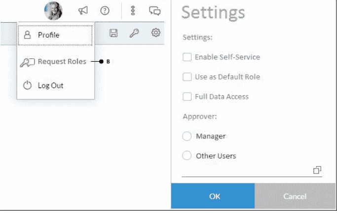

## 权限

当管理员创建新角色或修改角色时，他会看到权限屏幕，在此屏幕中他可以查看或编辑与该特定角色关联的权限。下表描述了您可以分配给不同文件类型和其他项目的[content]
| 查看者 | 分配给仅允许查看董事会会议议程的用户。 |

## 创建新角色

作为系统管理员，您经常会遇到需要创建一些特殊角色的情况。例如，您可能被要求为新员工创建一个角色，该员工仅有权访问一个规划模型。请注意，您可以从头创建新角色，也可以使用内置角色作为创建新角色的模板。以下是创建新自定义角色的步骤：

29. 转到 主菜单 | 安全 | 角色 以访问角色页面。

30. 在角色页面工具栏上，单击 新 图标以向角色管理表添加新行。

31. 在“创建新角色”对话框中为角色名称输入唯一名称（例如，Sales_Marketing_Plan_Role），然后单击“确定”，如前一个屏幕截图所示。请注意，角色名称中不允许有空格。

角色已创建，其权限页面（将在后续小节中讨论）显示，您可以在其中为新角色的每项活动定义权限，无论是对业务对象类型的全部对象还是对每个现有业务对象单独定义。例如，在当前场景中，您正在为只能访问一个模型的用户创建角色。

权限页面上的层次结构包含大量对象的列表。您可以手动为所有这些对象指定权限，也可以使用模板作为新角色的基础，后者更方便，因为使用这种方法，您只需对现有角色进行少量更改。

32. 如果您想基于内置角色定义权限，请在权限页面工具栏上单击“选择模板”图标（ ）。

33. 在“选择模板”对话框中，选择一个角色（例如，Planner_Reporter）。

所选角色的权限将被复制到新角色。如有需要，您可以修改这些权限以满足特定的业务需求。

34. 要定义用户只能读取特定模型，请删除规划模型的全局读取设置，这将允许新员工读取所有模型。然后展开规划模型节点，并在 SalesMarketingPlan 模型的“读取”和“更新”列中设置指示器。

35. 单击“保存”图标保存角色。

36. 如果您已创建应分配新角色的用户，请选择“分配角色”，在“将角色分配给用户”对话框中选择一个或多个用户。当前已分配该角色的所有用户将与您选择的新用户一起出现在“已选用户”列表中。单击“确定”关闭“将角色分配给用户”对话框。读取和更新所选模型的权限将被授予：

## 安全 > 角色 > Sales_Marketing_Plan_Role

## 权限

## 已选模型

## 分析权限

| 名称 | 创建 | 读取 | 更新 | 删除 | 执行 | 维护 | 共享 |
|---|---|---|---|---|---|---|---|
| 维度 |  | ☑ |  |  |  |  |  |
| 货币 |  | ☑ |  |  |  |  |  |
| 规划模型 |  |  |  |  |  |  |  |
| SalesMarketingPlan |  | ☑ | ☑ |  |  |  |  |
| FinancePlan |  |  |  |  |  |  |  |
| ManufacturingPlan |  |  |  |  |  |  |  |
| HRPlan |  |  |  |  |  |  |  |

34

35

36

A

## 角色设置

工具栏中的“设置”选项可让您查看角色设置。单击“设置”图标（A），将在“设置”对话框中显示以下选项：

- **启用自助服务**：如果激活此选项，任何业务用户都可以使用“请求角色”选项（B）为自己请求此角色。一旦审批者收到角色分配请求的通知，他将从主菜单转到 安全 | 请求 页面，通过选择用户 ID 然后选择“批准”来批准请求。确认后，所请求的角色会立即分配给用户。请求也可以以相同的方式被拒绝。会显示一个对话框，审批者在其中输入解释拒绝请求原因的理由。
- **用作默认角色**：如果在导入或创建用户时未指定角色，则该角色将默认分配给所有新用户。
- **完全数据访问**：应谨慎使用此选项，因为分配此角色的用户可以看到任何模型的所有数据，而不管模型的数据访问方式如何定义。

审批者部分提供的两个选项决定谁有权授予该角色：

- **经理**：如果选择此选项，请求用户的经理将被授权批准角色请求。请注意，经理在用户管理区域的用户页面上分配给用户。
- **其他用户**：您从对话框中选择的具体用户必须批准请求。

## 权限

当管理员创建新角色或修改角色时，他会看到权限屏幕，在此屏幕中他可以查看或编辑与该特定角色关联的权限。下表描述了您可以分配给不同文件类型和其他项目的[content]
| 查看者 | 分配给仅允许查看董事会会议议程的用户。 |

## 创建新角色

作为系统管理员，您经常会遇到需要创建一些特殊角色的情况。例如，您可能被要求为新员工创建一个角色，该员工仅有权访问一个规划模型。请注意，您可以从头创建新角色，也可以使用内置角色作为创建新角色的模板。以下是创建新自定义角色的步骤：

29. 转到 主菜单 | 安全 | 角色 以访问角色页面。

30. 在角色页面工具栏上，单击 新 图标以向角色管理表添加新行。

31. 在“创建新角色”对话框中为角色名称输入唯一名称（例如，Sales_Marketing_Plan_Role），然后单击“确定”，如前一个屏幕截图所示。请注意，角色名称中不允许有空格。

角色已创建，其权限页面（将在后续小节中讨论）显示，您可以在其中为新角色的每项活动定义权限，无论是对业务对象类型的全部对象还是对每个现有业务对象单独定义。例如，在当前场景中，您正在为只能访问一个模型的用户创建角色。

权限页面上的层次结构包含大量对象的列表。您可以手动为所有这些对象指定权限，也可以使用模板作为新角色的基础，后者更方便，因为使用这种方法，您只需对现有角色进行少量更改。

32. 如果您想基于内置角色定义权限，请在权限页面工具栏上单击“选择模板”图标（ ）。

33. 在“选择模板”对话框中，选择一个角色（例如，Planner_Reporter）。

所选角色的权限将被复制到新角色。如有需要，您可以修改这些权限以满足特定的业务需求。

34. 要定义用户只能读取特定模型，请删除规划模型的全局读取设置，这将允许新员工读取所有模型。然后展开规划模型节点，并在 SalesMarketingPlan 模型的“读取”和“更新”列中设置指示器。

35. 单击“保存”图标保存角色。

36. 如果您已创建应分配新角色的用户，请选择“分配角色”，在“将角色分配给用户”对话框中选择一个或多个用户。当前已分配该角色的所有用户将与您选择的新用户一起出现在“已选用户”列表中。单击“确定”关闭“将角色分配给用户”对话框。读取和更新所选模型的权限将被授予：

## 安全 > 角色 > Sales_Marketing_Plan_Role

## 权限

## 已选模型

## 分析权限

| 名称 | 创建 | 读取 | 更新 | 删除 | 执行 | 维护 | 共享 |
|---|---|---|---|---|---|---|---|
| 维度 |  | ☑ |  |  |  |  |  |
| 货币 |  | ☑ |  |  |  |  |  |
| 规划模型 |  |  |  |  |  |  |  |
| SalesMarketingPlan |  | ☑ | ☑ |  |  |  |  |
| FinancePlan |  |  |  |  |  |  |  |
| ManufacturingPlan |  |  |  |  |  |  |  |
| HRPlan |  |  |  |  |  |  |  |

34

35

36

A

## 角色设置

工具栏中的“设置”选项可让您查看角色设置。单击“设置”图标（A），将在“设置”对话框中显示以下选项：

- **启用自助服务**：如果激活此选项，任何业务用户都可以使用“请求角色”选项（B）为自己请求此角色。一旦审批者收到角色分配请求的通知，他将从主菜单转到 安全 | 请求 页面，通过选择用户 ID 然后选择“批准”来批准请求。确认后，所请求的角色会立即分配给用户。请求也可以以相同的方式被拒绝。会显示一个对话框，审批者在其中输入解释拒绝请求原因的理由。
- **用作默认角色**：如果在导入或创建用户时未指定角色，则该角色将默认分配给所有新用户。
- **完全数据访问**：应谨慎使用此选项，因为分配此角色的用户可以看到任何模型的所有数据，而不管模型的数据访问方式如何定义。

审批者部分提供的两个选项决定谁有权授予该角色：

- **经理**：如果选择此选项，请求用户的经理将被授权批准角色请求。请注意，经理在用户管理区域的用户页面上分配给用户。
- **其他用户**：您从对话框中选择的具体用户必须批准请求。

## 权限

当管理员创建新角色或修改角色时，他会看到权限屏幕，在此屏幕中他可以查看或编辑与该特定角色关联的权限。下表描述了您可以分配给不同文件类型和其他项目的[content]
| 查看者 | 分配给仅允许查看董事会会议议程的用户。 |

## 创建新角色

作为系统管理员，您经常会遇到需要创建一些特殊角色的情况。例如，您可能被要求为新员工创建一个角色，该员工仅有权访问一个规划模型。请注意，您可以从头创建新角色，也可以使用内置角色作为创建新角色的模板。以下是创建新自定义角色的步骤：

29. 转到 主菜单 | 安全 | 角色 以访问角色页面。

30. 在角色页面工具栏上，单击 新 图标以向角色管理表添加新行。

31. 在“创建新角色”对话框中为角色名称输入唯一名称（例如，Sales_Marketing_Plan_Role），然后单击“确定”，如前一个屏幕截图所示。请注意，角色名称中不允许有空格。

角色已创建，其权限页面（将在后续小节中讨论）显示，您可以在其中为新角色的每项活动定义权限，无论是对业务对象类型的全部对象还是对每个现有业务对象单独定义。例如，在当前场景中，您正在为只能访问一个模型的用户创建角色。

权限页面上的层次结构包含大量对象的列表。您可以手动为所有这些对象指定权限，也可以使用模板作为新角色的基础，后者更方便，因为使用这种方法，您只需对现有角色进行少量更改。

32. 如果您想基于内置角色定义权限，请在权限页面工具栏上单击“选择模板”图标（ ）。

33. 在“选择模板”对话框中，选择一个角色（例如，Planner_Reporter）。

所选角色的权限将被复制到新角色。如有需要，您可以修改这些权限以满足特定的业务需求。

34. 要定义用户只能读取特定模型，请删除规划模型的全局读取设置，这将允许新员工读取所有模型。然后展开规划模型节点，并在 SalesMarketingPlan 模型的“读取”和“更新”列中设置指示器。

35. 单击“保存”图标保存角色。

36. 如果您已创建应分配新角色的用户，请选择“分配角色”，在“将角色分配给用户”对话框中选择一个或多个用户。当前已分配该角色的所有用户将与您选择的新用户一起出现在“已选用户”列表中。单击“确定”关闭“将角色分配给用户”对话框。读取和更新所选模型的权限将被授予：

## 安全 > 角色 > Sales_Marketing_Plan_Role

## 权限

## 已选模型

## 分析权限

| 名称 | 创建 | 读取 | 更新 | 删除 | 执行 | 维护 | 共享 |
|---|---|---|---|---|---|---|---|
| 维度 |  | ☑ |  |  |  |  |  |
| 货币 |  | ☑ |  |  |  |  |  |
| 规划模型 |  |  |  |  |  |  |  |
| SalesMarketingPlan |  | ☑ | ☑ |  |  |  |  |
| FinancePlan |  |  |  |  |  |  |  |
| ManufacturingPlan |  |  |  |  |  |  |  |
| HRPlan |  |  |  |  |  |  |  |

34

35

36

A

## 角色设置

工具栏中的“设置”选项可让您查看角色设置。单击“设置”图标（A），将在“设置”对话框中显示以下选项：

- **启用自助服务**：如果激活此选项，任何业务用户都可以使用“请求角色”选项（B）为自己请求此角色。一旦审批者收到角色分配请求的通知，他将从主菜单转到 安全 | 请求 页面，通过选择用户 ID 然后选择“批准”来批准请求。确认后，所请求的角色会立即分配给用户。请求也可以以相同的方式被拒绝。会显示一个对话框，审批者在其中输入解释拒绝请求原因的理由。
- **用作默认角色**：如果在导入或创建用户时未指定角色，则该角色将默认分配给所有新用户。
- **完全数据访问**：应谨慎使用此选项，因为分配此角色的用户可以看到任何模型的所有数据，而不管模型的数据访问方式如何定义。

审批者部分提供的两个选项决定谁有权授予该角色：

- **经理**：如果选择此选项，请求用户的经理将被授权批准角色请求。请注意，经理在用户管理区域的用户页面上分配给用户。
- **其他用户**：您从对话框中选择的具体用户必须批准请求。

## 权限

当管理员创建新角色或修改角色时，他会看到权限屏幕，在此屏幕中他可以查看或编辑与该特定角色关联的权限。下表描述了您可以分配给不同文件类型和其他项目的[content]
| 查看者 | 分配给仅允许查看董事会会议议程的用户。 |

## 创建新角色

作为系统管理员，您经常会遇到需要创建一些特殊角色的情况。例如，您可能被要求为新员工创建一个角色，该员工仅有权访问一个规划模型。请注意，您可以从头创建新角色，也可以使用内置角色作为创建新角色的模板。以下是创建新自定义角色的步骤：

29. 转到 主菜单 | 安全 | 角色 以访问角色页面。

30. 在角色页面工具栏上，单击 新 图标以向角色管理表添加新行。

31. 在“创建新角色”对话框中为角色名称输入唯一名称（例如，Sales_Marketing_Plan_Role），然后单击“确定”，如前一个屏幕截图所示。请注意，角色名称中不允许有空格。

角色已创建，其权限页面（将在后续小节中讨论）显示，您可以在其中为新角色的每项活动定义权限，无论是对业务对象类型的全部对象还是对每个现有业务对象单独定义。例如，在当前场景中，您正在为只能访问一个模型的用户创建角色。

权限页面上的层次结构包含大量对象的列表。您可以手动为所有这些对象指定权限，也可以使用模板作为新角色的基础，后者更方便，因为使用这种方法，您只需对现有角色进行少量更改。

32. 如果您想基于内置角色定义权限，请在权限页面工具栏上单击“选择模板”图标（ ）。

33. 在“选择模板”对话框中，选择一个角色（例如，Planner_Reporter）。

所选角色的权限将被复制到新角色。如有需要，您可以修改这些权限以满足特定的业务需求。

34. 要定义用户只能读取特定模型，请删除规划模型的全局读取设置，这将允许新员工读取所有模型。然后展开规划模型节点，并在 SalesMarketingPlan 模型的“读取”和“更新”列中设置指示器。

35. 单击“保存”图标保存角色。

36. 如果您已创建应分配新角色的用户，请选择“分配角色”，在“将角色分配给用户”对话框中选择一个或多个用户。当前已分配该角色的所有用户将与您选择的新用户一起出现在“已选用户”列表中。单击“确定”关闭“将角色分配给用户”对话框。读取和更新所选模型的权限将被授予：

## 安全 > 角色 > Sales_Marketing_Plan_Role

## 权限

## 已选模型

## 分析权限

| 名称 | 创建 | 读取 | 更新 | 删除 | 执行 | 维护 | 共享 |
|---|---|---|---|---|---|---|---|
| 维度 |  | ☑ |  |  |  |  |  |
| 货币 |  | ☑ |  |  |  |  |  |
| 规划模型 |  |  |  |  |  |  |  |
| SalesMarketingPlan |  | ☑ | ☑ |  |  |  |  |
| FinancePlan |  |  |  |  |  |  |  |
| ManufacturingPlan |  |  |  |  |  |  |  |
| HRPlan |  |  |  |  |  |  |  |

34

35

36

A

## 角色设置

工具栏中的“设置”选项可让您查看角色设置。单击“设置”图标（A），将在“设置”对话框中显示以下选项：

- **启用自助服务**：如果激活此选项，任何业务用户都可以使用“请求角色”选项（B）为自己请求此角色。一旦审批者收到角色分配请求的通知，他将从主菜单转到 安全 | 请求 页面，通过选择用户 ID 然后选择“批准”来批准请求。确认后，所请求的角色会立即分配给用户。请求也可以以相同的方式被拒绝。会显示一个对话框，审批者在其中输入解释拒绝请求原因的理由。
- **用作默认角色**：如果在导入或创建用户时未指定角色，则该角色将默认分配给所有新用户。
- **完全数据访问**：应谨慎使用此选项，因为分配此角色的用户可以看到任何模型的所有数据，而不管模型的数据访问方式如何定义。

审批者部分提供的两个选项决定谁有权授予该角色：

- **经理**：如果选择此选项，请求用户的经理将被授权批准角色请求。请注意，经理在用户管理区域的用户页面上分配给用户。
- **其他用户**：您从对话框中选择的具体用户必须批准请求。

## 权限

当管理员创建新角色或修改角色时，他会看到权限屏幕，在此屏幕中他可以查看或编辑与该特定角色关联的权限。下表描述了您可以分配给不同文件类型和其他项目的[content]
| 查看者 | 分配给仅允许查看董事会会议议程的用户。 |

## 创建新角色

作为系统管理员，您经常需要创建特殊角色。例如，可能需要为新员工创建仅能访问一个规划模型的角色。您可以从零创建新角色，也可基于内置角色作为模板。创建自定义角色的步骤如下：

29. 转到 主菜单 | 安全 | 角色 访问角色页面。

30. 在角色页面工具栏单击 新 图标，向角色管理表添加新行。

31. 在“创建新角色”对话框中输入唯一角色名，如 Sales_Marketing_Plan_Role，然后点确定，如前图。角色名中不允许有空格。

角色创建后显示其权限页面，可为新角色的每项活动定义权限，可针对业务对象类型的所有对象或单个对象定义。本例中为只能访问一个模型的用户创建角色。

权限页的层次结构包含大量对象。可手动指定权限，也可基于模板创建角色，后者只需对现有角色做少量修改。

32. 若基于内置角色定义权限，在权限页工具栏单击“选择模板”图标（ ）。

33. 在“选择模板”对话框中选择角色，如 Planner_Reporter。

所选角色的权限会复制到新角色，必要时可修改以满足业务需求。

34. 若需用户仅读取特定模型，移除 Planning Model 的全局读取设置，否则新员工可读取所有模型。然后展开 Planning Model 节点，在 SalesMarketingPlan 模型的 Read 和 Update 列设置标记。

35. 单击保存图标保存角色。

36. 若已有应分配新角色的用户，选择 Assign Role，在 Assign Role to User 对话框中选择一个或多个用户。当前已分配该角色的用户会与新选用户一起显示在 Selected Users 列表中。点确定关闭对话框。所选模型的读取和更新权限将被授予：

## 安全 > 角色 > Sales_Marketing_Plan_Role

## 权限

## 已选模型

## 分析权限

| 名称 | 创建 | 读取 | 更新 | 删除 | 执行 | 维护 | 共享 |
|---|---|---|---|---|---|---|---|
| 维度 |  | ☑ |  |  |  |  |  |
| 货币 |  | ☑ |  |  |  |  |  |
| 规划模型 |  |  |  |  |  |  |  |
| SalesMarketingPlan |  | ☑ | ☑ |  |  |  |  |
| FinancePlan |  |  |  |  |  |  |  |
| ManufacturingPlan |  |  |  |  |  |  |  |
| HRPlan |  |  |  |  |  |  |  |

34

35

36

A

## 角色设置

工具栏的设置选项可查看角色设置。单击设置图标 A，设置对话框显示以下选项：

- **启用自助服务**：激活后，任何业务用户可用 Request Roles 选项 B 为自己请求该角色。审批者收到请求通知后，从主菜单进入 安全 | 请求 页面，选择 User ID 后点 Approve 批准。确认后角色立即分配。请求也可被拒绝，审批者需输入拒绝原因。
- **用作默认角色**：导入或创建用户时未指定角色，则默认分配给所有新用户。
- **完全数据访问**：需谨慎使用，被分配该角色的用户可查看任何模型的所有数据，不受模型数据访问定义限制。

审批者部分的两个选项决定谁有权授予角色：

- **经理**：选择后，请求用户的经理有权批准请求。经理在用户管理区的用户页分配。
- **其他用户**：需由您从对话框中选择的具体用户批准请求。

## 权限

管理员创建或修改角色时，会看到权限屏幕，可查看或编辑该角色的权限。下表说明可分配给不同文件类型和其他项目的[content]
| 查看者 | 分配给仅允许查看董事会会议议程的用户。 |

## 创建新角色

作为系统管理员，您经常需要创建特殊角色。例如，可能需要为新员工创建仅能访问一个规划模型的角色。您可以从零创建新角色，也可基于内置角色作为模板。创建自定义角色的步骤如下：

29. 转到 主菜单 | 安全 | 角色 访问角色页面。

30. 在角色页面工具栏单击 新 图标，向角色管理表添加新行。

31. 在“创建新角色”对话框中输入唯一角色名，如 Sales_Marketing_Plan_Role，然后点确定，如前图。角色名中不允许有空格。

角色创建后显示其权限页面，可为新角色的每项活动定义权限，可针对业务对象类型的所有对象或单个对象定义。本例中为只能访问一个模型的用户创建角色。

权限页的层次结构包含大量对象。可手动指定权限，也可基于模板创建角色，后者只需对现有角色做少量修改。

32. 若基于内置角色定义权限，在权限页工具栏单击“选择模板”图标（ ）。

33. 在“选择模板”对话框中选择角色，如 Planner_Reporter。

所选角色的权限会复制到新角色，必要时可修改以满足业务需求。

34. 若需用户仅读取特定模型，移除 Planning Model 的全局读取设置，否则新员工可读取所有模型。然后展开 Planning Model 节点，在 SalesMarketingPlan 模型的 Read 和 Update 列设置标记。

35. 单击保存图标保存角色。

36. 若已有应分配新角色的用户，选择 Assign Role，在 Assign Role to User 对话框中选择一个或多个用户。当前已分配该角色的用户会与新选用户一起显示在 Selected Users 列表中。点确定关闭对话框。所选模型的读取和更新权限将被授予：

## 安全 > 角色 > Sales_Marketing_Plan_Role

## 权限

## 已选模型

## 分析权限

| 名称 | 创建 | 读取 | 更新 | 删除 | 执行 | 维护 | 共享 |
|---|---|---|---|---|---|---|---|
| Dimension |  | ☑ |  |  |  |  |  |
| Currency |  | ☑ |  |  |  |  |  |
| Planning Model |  |  |  |  |  |  |  |
| SalesMarketingPlan |  | ☑ | ☑ |  |  |  |  |
| FinancePlan |  |  |  |  |  |  |  |
| ManufacturingPlan |  |  |  |  |  |  |  |
| HRPlan |  |  |  |  |  |  |  |

34

35

36

A

## 角色设置

工具栏的设置选项可查看角色设置。单击设置图标 A，设置对话框显示以下选项：

- **启用自助服务**：激活后，任何业务用户可用 Request Roles 选项 B 为自己请求该角色。审批者收到请求通知后，从主菜单进入 安全 | 请求 页面，选择 User ID 后点 Approve 批准。确认后角色立即分配。请求也可被拒绝，审批者需输入拒绝原因。
- **用作默认角色**：导入或创建用户时未指定角色，则默认分配给所有新用户。
- **完全数据访问**：需谨慎使用，被分配该角色的用户可查看任何模型的所有数据，不受模型数据访问定义限制。

审批者部分的两个选项决定谁有权授予角色：

- **经理**：选择后，请求用户的经理有权批准请求。经理在用户管理区的用户页分配。
- **其他用户**：需由您从对话框中选择的具体用户批准请求。

## 权限

管理员创建或修改角色时，会看到权限屏幕，可查看或编辑该角色的权限。下表说明可分配给不同文件类型和其他项目的[content]
| 查看者 | 分配给仅允许查看董事会会议议程的用户。 |

## 创建新角色

作为系统管理员，您经常需要创建特殊角色。例如，可能需要为新员工创建仅能访问一个规划模型的角色。您可以从零创建，也可基于内置角色作为模板。步骤如下：

29. 转到 主菜单 | 安全 | 角色 访问角色页面。

30. 在角色页面工具栏点 新 图标，向角色管理表添加新行。

31. 在“创建新角色”对话框输入唯一角色名，如 Sales_Marketing_Plan_Role，点确定，如前图。角色名不允许空格。

角色创建后显示权限页面，可为新角色的每项活动定义权限，可针对对象类型全部或单个对象。本例为只能访问一个模型的用户创建角色。

权限页层次结构包含大量对象。可手动指定权限，也可基于模板，后者只需少量修改。

32. 若基于内置角色定义权限，在权限页工具栏点“选择模板”图标（ ）。

33. 在“选择模板”对话框选择角色，如 Planner_Reporter。

所选角色权限会复制到新角色，必要时可修改。

34. 若需用户仅读取特定模型，移除 Planning Model 的全局读取设置，否则新员工可读取所有模型。然后展开 Planning Model 节点，在 SalesMarketingPlan 的 Read 和 Update 列设置标记。

35. 点保存图标保存角色。

36. 若已有应分配新角色的用户，选择 Assign Role，在 Assign Role to User 对话框选择用户。当前已分配的用户会与新选用户一起显示在 Selected Users 列表。点确定关闭对话框。所选模型的读取和更新权限将被授予：

## 安全 > 角色 > Sales_Marketing_Plan_Role

## 权限

## 已选模型

## 分析权限

| 名称 | 创建 | 读取 | 更新 | 删除 | 执行 | 维护 | 共享 |
|---|---|---|---|---|---|---|---|
| Dimension |  | ☑ |  |  |  |  |  |
| Currency |  | ☑ |  |  |  |  |  |
| Planning Model |  |  |  |  |  |  |  |
| SalesMarketingPlan |  | ☑ | ☑ |  |  |  |  |
| FinancePlan |  |  |  |  |  |  |  |
| ManufacturingPlan |  |  |  |  |  |  |  |
| HRPlan |  |  |  |  |  |  |  |

34

35

36

A

## 角色设置

工具栏设置选项可查看角色设置。点设置图标 A，设置对话框显示以下选项：

- **启用自助服务**：激活后，业务用户可用 Request Roles 选项 B 为自己请求角色。审批者收到通知后，从主菜单进入 安全 | 请求 页面，选择 User ID 后点 Approve。确认后角色立即分配。请求也可被拒绝，需输入原因。
- **用作默认角色**：导入或创建用户时未指定角色，则默认分配给所有新用户。
- **完全数据访问**：需谨慎使用，被分配该角色的用户可查看任何模型的所有数据。

审批者部分的两个选项决定谁有权授予角色：

- **经理**：选择后，请求用户的经理有权批准。经理在用户管理区的用户页分配。
- **其他用户**：需由您从对话框选择的具体用户批准。

## 权限

管理员创建或修改角色时，会看到权限屏幕，可查看或编辑该角色权限。下表说明可分配给不同文件类型和其他项目的[content]
| 查看者 | 分配给仅允许查看董事会会议议程的用户。 |

## 创建新角色

作为系统管理员，您经常需要创建特殊角色。例如，可能需要为新员工创建仅能访问一个规划模型的角色。您可以从零创建，也可基于内置角色作为模板。步骤如下：

29. 转到 主菜单 | 安全 | 角色 访问角色页面。

30. 在角色页面工具栏点 新 图标，向角色管理表添加新行。

31. 在“创建新角色”对话框输入唯一角色名，如 Sales_Marketing_Plan_Role，点确定，如前图。角色名不允许空格。

角色创建后显示权限页面，可为新角色的每项活动定义权限，可针对对象类型全部或单个对象。本例为只能访问一个模型的用户创建角色。

权限页层次结构包含大量对象。可手动指定权限，也可基于模板，后者只需少量修改。

32. 若基于内置角色定义权限，在权限页工具栏点“选择模板”图标（ ）。

33. 在“选择模板”对话框选择角色，如 Planner_Reporter。

所选角色权限会复制到新角色，必要时可修改。

34. 若需用户仅读取特定模型，移除 Planning Model 的全局读取设置，否则新员工可读取所有模型。然后展开 Planning Model 节点，在 SalesMarketingPlan 的 Read 和 Update 列设置标记。

35. 点保存图标保存角色。

36. 若已有应分配新角色的用户，选择 Assign Role，在 Assign Role to User 对话框选择用户。当前已分配的用户会与新选用户一起显示在 Selected Users 列表。点确定关闭对话框。所选模型的读取和更新权限将被授予：

## 安全 > 角色 > Sales_Marketing_Plan_Role

## 权限

## 已选模型

## 分析权限

| 名称 | 创建 | 读取 | 更新 | 删除 | 执行 | 维护 | 共享 |
|---|---|---|---|---|---|---|---|
| Dimension |  | ☑ |  |  |  |  |  |
| Currency |  | ☑ |  |  |  |  |  |
| Planning Model |  |  |  |  |  |  |  |
| SalesMarketingPlan |  | ☑ | ☑ |  |  |  |  |
| FinancePlan |  |  |  |  |  |  |  |
| ManufacturingPlan |  |  |  |  |  |  |  |
| HRPlan |  |  |  |  |  |  |  |

34

35

36

A

## 角色设置

工具栏设置选项可查看角色设置。点设置图标 A，设置对话框显示以下选项：

- **启用自助服务**：激活后，业务用户可用 Request Roles 选项 B 为自己请求角色。审批者收到通知后，从主菜单进入 安全 | 请求 页面，选择 User ID 后点 Approve。确认后角色立即分配。请求也可被拒绝，需输入原因。
- **用作默认角色**：导入或创建用户时未指定角色，则默认分配给所有新用户。
- **完全数据访问**：需谨慎使用，被分配该角色的用户可查看任何模型的所有数据。

审批者部分的两个选项决定谁有权授予角色：

- **经理**：选择后，请求用户的经理有权批准。经理在用户管理区的用户页分配。
- **其他用户**：需由您从对话框选择的具体用户批准。

## 权限

管理员创建或修改角色时，会看到权限屏幕，可查看或编辑该角色权限。下表描述了可分配给不同文件类型及其他项目的[content]
| 查看者 | 分配给仅允许查看董事会会议议程的用户。 |

## 创建新角色

作为系统管理员，您经常需要创建特殊角色。例如，可能需要为新员工创建仅能访问一个规划模型的角色。您可以从零创建，也可基于内置角色作为模板。步骤如下：

29. 转到 主菜单 | 安全 | 角色 访问角色页面。

30. 在角色页面工具栏点 新 图标，向角色管理表添加新行。

31. 在“创建新角色”对话框输入唯一角色名，如 Sales_Marketing_Plan_Role，点确定，如前图。角色名不允许空格。

角色创建后显示权限页面，可为新角色的每项活动定义权限，可针对对象类型全部或单个对象。本例为只能访问一个模型的用户创建角色。

权限页层次结构包含大量对象。可手动指定权限，也可基于模板，后者只需少量修改。

32. 若基于内置角色定义权限，在权限页工具栏点“选择模板”图标（ ）。

33. 在“选择模板”对话框选择角色，如 Planner_Reporter。

所选角色权限会复制到新角色，必要时可修改。

34. 若需用户仅读取特定模型，移除 Planning Model 的全局读取设置，否则新员工可读取所有模型。然后展开 Planning Model 节点，在 SalesMarketingPlan 的 Read 和 Update 列设置标记。

35. 点保存图标保存角色。

36. 若已有应分配新角色的用户，选择 Assign Role，在 Assign Role to User 对话框选择用户。当前已分配的用户会与新选用户一起显示在 Selected Users 列表。点确定关闭对话框。所选模型的读取和更新权限将被授予：

## 安全 > 角色 > Sales_Marketing_Plan_Role

## 权限

## 已选模型

## 分析权限

| 名称 | 创建 | 读取 | 更新 | 删除 | 执行 | 维护 | 共享 |
|---|---|---|---|---|---|---|---|
| Dimension |  | ☑ |  |  |  |  |  |
| Currency |  | ☑ |  |  |  |  |  |
| Planning Model |  |  |  |  |  |  |  |
| SalesMarketingPlan |  | ☑ | ☑ |  |  |  |  |
| FinancePlan |  |  |  |  |  |  |  |
| ManufacturingPlan |  |  |  |  |  |  |  |
| HRPlan |  |  |  |  |  |  |  |

34

35

36

A

## 角色设置

工具栏设置选项可查看角色设置。点设置图标 A，设置对话框显示以下选项：

- **启用自助服务**：激活后，业务用户可用 Request Roles 选项 B 为自己请求角色。审批者收到通知后，从主菜单进入 安全 | 请求 页面，选择 User ID 后点 Approve。确认后角色立即分配。请求也可被拒绝，需输入原因。
- **用作默认角色**：导入或创建用户时未指定角色，则默认分配给所有新用户。
- **完全数据访问**：需谨慎使用，被分配该角色的用户可查看任何模型的所有数据。

审批者部分的两个选项决定谁有权授予角色：

- **经理**：选择后，请求用户的经理有权批准。经理在用户管理区的用户页分配。
- **其他用户**：需由您从对话框选择的具体用户批准。

## 权限

管理员创建或修改角色时，会看到权限屏幕，可查看或编辑该角色权限。下面表格说明了可为不同文件类型和其它项目分配的[content]
| 查看者 | 分配给仅允许查看董事会会议议程的用户。 |

## 创建新角色

作为系统管理员，您经常需要创建特殊角色。例如，可能需要为新员工创建仅能访问一个规划模型的角色。您可以从零创建，也可基于内置角色作为模板。步骤如下：

29. 转到 主菜单 | 安全 | 角色 访问角色页面。

30. 在角色页面工具栏点 新 图标，向角色管理表添加新行。

31. 在“创建新角色”对话框输入唯一角色名，如 Sales_Marketing_Plan_Role，点确定，如前图。角色名不允许空格。

角色创建后显示权限页面，可为新角色的每项活动定义权限，可针对对象类型全部或单个对象。本例为只能访问一个模型的用户创建角色。

权限页层次结构包含大量对象。可手动指定权限，也可基于模板，后者只需少量修改。

32. 若基于内置角色定义权限，在权限页工具栏点“选择模板”图标（ ）。

33. 在“选择模板”对话框选择角色，如 Planner_Reporter。

所选角色权限会复制到新角色，必要时可修改。

34. 若需用户仅读取特定模型，移除 Planning Model 的全局读取设置，否则新员工可读取所有模型。然后展开 Planning Model 节点，在 SalesMarketingPlan 的 Read 和 Update 列设置标记。

35. 点保存图标保存角色。

36. 若已有应分配新角色的用户，选择 Assign Role，在 Assign Role to User 对话框选择用户。当前已分配的用户会与新选用户一起显示在 Selected Users 列表。点确定关闭对话框。所选模型的读取和更新权限将被授予：

## 安全 > 角色 > Sales_Marketing_Plan_Role

## 权限

## 已选模型

## 分析权限

| Name | Create | Read | Update | Delete | Execute | Maintain | Share |
|---|---|---|---|---|---|---|---|
| Dimension |  | ☑ |  |  |  |  |  |
| Currency |  | ☑ |  |  |  |  |  |
| Planning Model |  |  |  |  |  |  |  |
| SalesMarketingPlan |  | ☑ | ☑ |  |  |  |  |
| FinancePlan |  |  |  |  |  |  |  |
| ManufacturingPlan |  |  |  |  |  |  |  |
| HRPlan |  |  |  |  |  |  |  |

34

35

36

A

## 角色设置

工具栏设置选项可查看角色设置。点设置图标 A，设置对话框显示以下选项：

- **启用自助服务**：激活后，业务用户可用 Request Roles 选项 B 为自己请求角色。审批者收到通知后，从主菜单进入 安全 | 请求 页面，选择 User ID 后点 Approve。确认后角色立即分配。请求也可被拒绝，需输入原因。
- **用作默认角色**：导入或创建用户时未指定角色，则默认分配给所有新用户。
- **完全数据访问**：需谨慎使用，被分配该角色的用户可查看任何模型的所有数据。

审批者部分的两个选项决定谁有权授予角色：

- **经理**：选择后，请求用户的经理有权批准。经理在用户管理区的用户页分配。
- **其他用户**：需由您从对话框选择的具体用户批准。

## 权限

管理员创建或修改角色时，会看到权限屏幕，可查看或编辑该角色权限。下面表格说明了可为不同文件类型和其它项目分配的[content]
| 查看者 | 分配给仅允许查看董事会会议议程的用户。 |

## 创建新角色

作为系统管理员，您经常需要创建特殊角色。例如，可能需要为新员工创建仅能访问一个规划模型的角色。您可以从零创建，也可基于内置角色作为模板。步骤如下：

29. 转到 主菜单 | 安全 | 角色 访问角色页面。

30. 在角色页面工具栏点 新 图标，向角色管理表添加新行。

31. 在“创建新角色”对话框输入唯一角色名，如 Sales_Marketing_Plan_Role，点确定，如前图。角色名不允许空格。

角色创建后显示权限页面，可为新角色的每项活动定义权限，可针对对象类型全部或单个对象。本例为只能访问一个模型的用户创建角色。

权限页层次结构包含大量对象。可手动指定权限，也可基于模板，后者只需少量修改。

32. 若基于内置角色定义权限，在权限页工具栏点“选择模板”图标（ ）。

33. 在“选择模板”对话框选择角色，如 Planner_Reporter。

所选角色权限会复制到新角色，必要时可修改。

34. 若需用户仅读取特定模型，移除 Planning Model 的全局读取设置，否则新员工可读取所有模型。然后展开 Planning Model 节点，在 SalesMarketingPlan 的 Read 和 Update 列设置标记。

35. 点保存图标保存角色。

36. 若已有应分配新角色的用户，选择 Assign Role，在 Assign Role to User 对话框选择用户。当前已分配的用户会与新选用户一起显示在 Selected Users 列表。点确定关闭对话框。所选模型的读取和更新权限将被授予：

## 安全 > 角色 > Sales_Marketing_Plan_Role

## 权限

## 已选模型

## 分析权限

[表格内容保持原格式，表头已译为 名称 创建 读取 更新 删除 执行 维护 共享，行内容为 Dimension Currency Planning Model SalesMarketingPlan FinancePlan ManufacturingPlan HRPlan]

34

35

36

A

## 角色设置

工具栏设置选项可查看角色设置。点设置图标 A，设置对话框显示以下选项：

- **启用自助服务**：激活后，业务用户可用 Request Roles 选项 B 为自己请求角色。审批者收到通知后，从主菜单进入 安全 | 请求 页面，选择 User ID 后点 Approve。确认后角色立即分配。请求也可被拒绝，需输入原因。
- **用作默认角色**：导入或创建用户时未指定角色，则默认分配给所有新用户。
- **完全数据访问**：需谨慎使用，被分配该角色的用户可查看任何模型的所有数据。

审批者部分的两个选项决定谁有权授予角色：

- **经理**：选择后，请求用户的经理有权批准。经理在用户管理区的用户页分配。
- **其他用户**：需由您从对话框选择的具体用户批准。

## 权限

管理员创建或修改角色时，会看到权限屏幕，可查看或编辑该角色权限。下面表格说明了可为不同文件类型和其它项目分配的[content]
基本权限，建议创建自定义角色而非修改默认角色，因默认角色在更新时会被重置：

| Permission | Description |
|---|---|
| Create | 创建所选项目类型的新的实例并修改其内容。 |
| Read | 查看项目的列表及其内容。 |
| Update | 修改和更新现有项目，包括模型和维度的结构。 |
| Delete | 删除项目。 |
| Execute | 执行项目以运行流程。例如，从数据源获取数据。 |
| Maintain | 允许维护数据值，例如向模型添加记录，而不允许更改实际数据结构。 |
| Assign | 允许将用户或团队分配给角色，并批准用户提出的角色分配请求。 |

每个项目类型可设置的权限如下表所示，取自 SAP 资料。部分项目如 Dimension、Currency、Planning Model、Analytic Model、Data Change Log 和 Value Driver Tree 可全局分配权限或针对特定项目分配。请回顾前文示例，其中移除了 Planning Model 的全局权限并为单个模型分配了读取和更新权限。

*部分权限需先激活其他权限，可能自动设置。例如，为 Public Files 设置 Delete 权限会自动设置 Read 权限。*

以下截图有助于理解权限：

| Name | Create | Read | Update | Delete | Execute | Maintain | Share | Assign | Notes |
|---|---|---|---|---|---|---|---|---|---|
| Dimension | X | X | X | X |  | X |  |  | 将 Maintain 权限设置为允许向维度添加成员而不能更改实际定义。将 Update 设置为允许更改维度定义本身。 |
| Currency | X | X | X | X |  |  |  |  |  |
| Planning Model | X | X | X | X |  | X |  |  | 将 Maintain 权限设置为允许向模型添加数据记录而不能更改实际结构。将 Update 设置为允许更改模型结构本身。 |
| Analytic Model | X | X | X | X |  | X |  |  | 将 Maintain 权限设置为允许向模型添加数据记录而不能更改实际结构。将 Update 设置为允许更改模型结构本身。 |

以下权限也很重要：

| Name | Create | Read | Update | Delete | Execute | Maintain | Share | Assign | Notes |
|---|---|---|---|---|---|---|---|---|---|
| SAP Cloud Platform Datasource |  |  |  |  | X |  |  |  |  |
| Other Datasources |  |  |  |  | X |  |  |  | 为用户设置 Execute 权限以查看 Connections 菜单。 |
| KPI | X | X | X | X | X |  | X |  |  |
| Role | X | X | X | X |  |  |  |  |  |
| User | X | X | X | X |  |  |  | X |  |
| Team | X | X | X | X |  |  |  | X |  |
| Activity Log |  | X |  | X |  |  |  |  |  |
| Data Change Log |  | X |  | X |  |  |  |  | 提供对 Security \| Data Changes 区域的访问。 |
| Lifecycle |  | X |  |  |  | X |  |  | 提供对 Deployment \| Export 和 Deployment \| Import 区域的访问。 |
| Event Category |  | X | X |  |  |  |  |  |  |
| Event Process |  | X | X |  |  |  |  |  |  |
| Connection | X | X | X | X |  | X |  |  | 还需在 Other Datasources 上设置 Execute 权限以使用户可访问 Connections 区域。 |

请注意以下方面的权限：

| 名称 | 创建 | 读取 | 更新 | 删除 | 执行 | 维护 | 共享 | 分配 | 备注 |
|---|---|---|---|---|---|---|---|---|---|
| 公共文件 | X | X |  | X |  |  |  |  | 允许访问公共文件。 |
| 私有文件 | X | X |  | X |  |  |  |  | 默认情况下，创建权限授予除查看者、BI 内容查看者和 SAP CP 内容查看者之外的所有角色。没有此权限，用户无法创建故事、向故事中上传数据或从其计算机上传其他本地文件。 |
| 内容所有权 |  |  |  |  | X |  |  |  | 拥有此权限的用户可以在用户被删除时将内容的所有权转移给另一用户。 |
| 系统信息 |  | X | X |  |  |  |  |  | 将读取设置为提供对系统 \| 监控区域的访问。将更新设置为额外提供对系统 \| 管理区域的访问。 |
| 分配步骤 | X | X | X | X | X |  |  |  |  |
| 分配流程 | X | X | X | X | X |  |  |  |  |
| 池映射 | X | X | X |  |  |  |  |  |  |

并且以下截图完成了我们的列表：

| 名称 | 创建 | 读取 | 更新 | 删除 | 执行 | 维护 | 共享 | 分配 | 备注 |
|---|---|---|---|---|---|---|---|---|---|
| 资源管理器 |  |  |  |  | X |  |  |  | 将执行设置为提供对故事中数据视图模式的访问。 |
| 个人数据采集 |  |  |  |  | X |  |  |  |  |
| 价值驱动树 | X | X | X | X | X |  |  |  |  |
| 自动化发现 |  |  |  |  | X |  |  |  |  |
| 董事会议程 | X | X | X | X |  |  | X |  |  |

## 测试角色权限

当您创建新用户的账户并分配相关角色时，用户会收到一封电子邮件，其中提供用户名、初始密码以及访问 SAP Analytics Cloud 的链接。当她成功登录后，会被提示重置密码。在完成这些手续后，当她进入模型区域时，会看到以下屏幕。请注意，她唯一可以访问的模型是销售营销计划，这是由于在上一节中分配给她的权限：

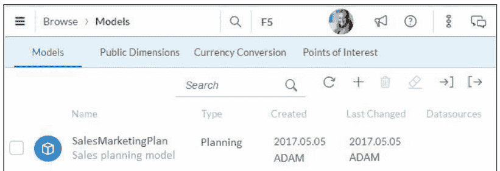

## 更新用户资料

用户可以更新自己的资料，其中包括添加图片、输入职位、电子邮件地址和职能领域，如以下截图所示。用户可以通过点击其默认图片图标并从菜单中选择个人资料（A）来访问各自的资料：

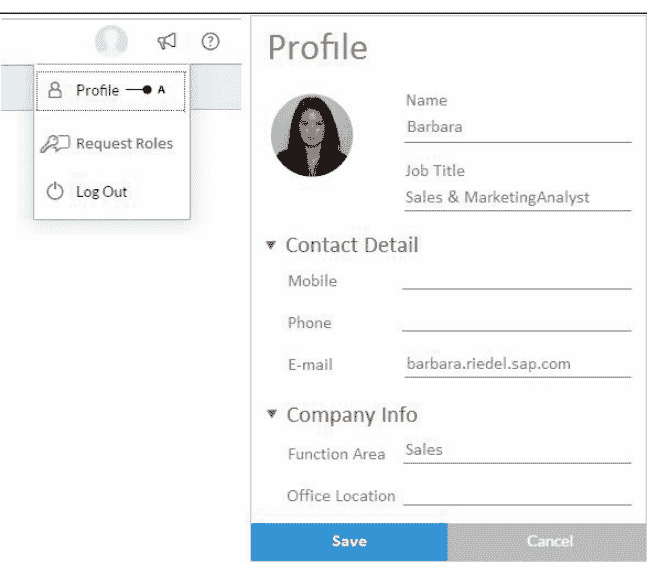

## 组建团队

团队是一组执行类似任务的用户。在 SAP Analytics Cloud 中，您可以将单个用户组合在一起创建团队。组建团队有很多好处。例如，您可以与团队的所有成员共享故事，而无需单独选择用户。同样，您可以创建一个角色并将其分配给团队。如果您对角色的权限设置进行任何更改，更改将继承给团队，进而继承给团队的每个成员。以下是创建团队的步骤：

- 37. 转到主菜单 | 安全 | 团队以访问团队页面，如以下截图所示。团队页面允许您添加、修改（A）和删除（B）团队。
- 38. 在工具栏上点击创建团队图标以形成新团队。

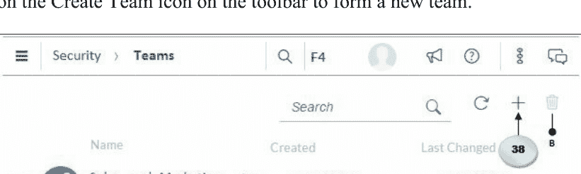

- 39. 在团队名称框中输入唯一名称。团队名称中不允许使用空格。您可以使用大写和小写字母、数字、下划线、井号和与号。
- 40. 如有需要，输入描述以进一步阐述团队。
- 41. 点击添加按钮从随后的选择用户对话框（A）中选择团队成员。完成后，选择确定返回创建团队对话框。

成员区域提供的控件可用于向列表中添加或删除用户。如果您的列表很长，请使用搜索控件查找特定用户。点击创建按钮完成团队创建过程。

现在团队成员可以通过在选择用户和团队对话框中选择团队名称而不是个人成员来相互共享他们的故事和文件。团队成员可以在故事页面的“共享给我”选项卡下找到共享的故事。有关更多详细信息，请参阅第 8 章《协作》中的《与同事共享故事》部分和《共享文件和其他对象》部分。

### 创建团队

### 选择用户

团队名称 *

Sales_and_Marketing

描述

West U.S. Sales Team

成员

搜索

- ☑ Bulent
- ☑ Dalia
- ☑ Sheela

创建

取消

搜索

- ☑ Bulent
- ☑ Dalia
- ☑ Sheela
- ☐ Sophie

39

40

41

A

## 转移系统所有者角色

必须始终为一个用户分配系统所有者角色。拥有此角色的用户可以无限制地访问应用程序的所有区域。此角色可转移。如果出于任何原因，您想要转移此角色，可以这样做。您必须以具有系统信息更新权限的用户身份登录。默认情况下，系统信息更新权限已为管理员、BI 管理员、系统所有者和 BI 系统所有者启用。

以下是转移此角色的步骤：

- 42. 转到主菜单 | 安全 | 用户。
- 43. 在用户页面上，选择您想要分配系统所有者角色的用户。
- 44. 在工具栏上点击分配为系统所有者图标。转移系统所有者角色对话框出现，其中显示所选用户为新的系统所有者，并显示先前系统所有者部分的姓名。
- 45. 在新角色下，点击图标打开可用角色列表。为先前的系统所有者选择一个或多个角色，然后在选择角色对话框中点击确定：

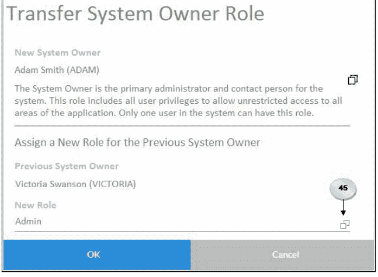

- 46. 在转移系统所有者角色屏幕上点击确定按钮以完成流程。

您选择的用户被分配系统所有者角色，先前的所有者被分配您选择的角色：

|  | 用户 ID | 名字 | 姓氏 | 显示名称 | 电子邮件 | 管理者 | 角色 |
|---|---|---|---|---|---|---|---|
| 1 | ADAM | Adam | Smith | Adam | adam.smith@sap.com |  | System_Owner |
| 2 | VICTORIA | Victoria | Swanson | Victoria | v.swanson@sap.com |  | Admin |

## 为模型设置安全性

您也可以使模型安全。以下是此目的可用的选项：

**模型安全性**：您可以通过在模型首选项中打开隐私选项（A）使模型安全。当此选项打开时，模型仅对所有者和管理员通过角色明确授予访问权限的其他用户可访问：

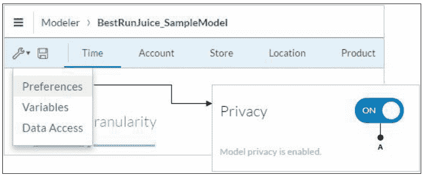

**维度安全性**：您还可以通过启用数据访问控制（B）在维度级别应用安全性。通过这种安全性，可以将模型输出中单个值的访问限制为特定用户。您可以将此安全性应用于新维度（C）或通过选择现有维度并点击首选项（D）来应用。当您启用数据访问控制时，读取和写入列将添加到维度中。使用这些列，您可以指定要授予权限以读取或写入该维度值的用户：

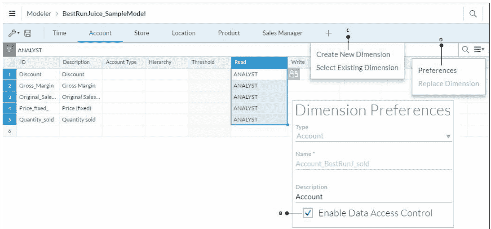

**基于角色的安全性**：您已在上一节中通过权限应用了基于角色的安全性。当您访问角色的定义时，您会看到权限屏幕，在此您可以授予访问应用程序特定功能区域（包括模型）的权限。除了对单个项目提供权限外，您还可以使用同一界面授予对所选模型和模型维度的读取或写入访问权限。对于启用了隐私功能的模型，您可以应用一些更精细的安全功能。

以下是步骤：

- 47. 点击选择模型菜单，并选择选择新模型选项。
- 48. 在选择新模型对话框中，选择一个启用了隐私的模型。所选模型的名称将出现在第二个选项卡上，屏幕将转换为定义模型的权限。您有授予角色完全访问或有限访问的选项。 从此单选组中选择一个选项后，您必须点击定义读取访问或定义写入访问按钮。点击这些按钮中的任何一个都会显示另一个窗口，您可以在其中基于模型的全部成员和类别指定详细的一组权限规则。例如，您可以添加一个条目，仅为角色提供对模型实际类别的读取访问权限。

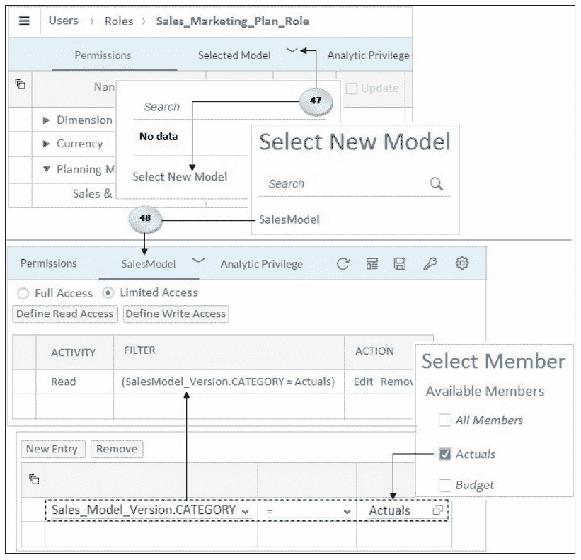

## 保持警惕

密切关注系统确实是管理员最重要的任务，尤其是在多用户环境中。在 SAP Analytics Cloud 中，您作为管理员可以监控用户活动、数据更改和系统使用情况。

## 监控用户活动

SAP Analytics Cloud 记录用户在业务对象上执行的所有活动，例如模型、维度、KPI、故事和讨论。例如，如果用户对模型进行任何更改，系统会记录该活动以供审计。以下是监控用户活动的步骤：

- 49. 转到 主菜单 | 安全 | 活动 以访问活动页面。

在此页面上，您可以看到对象类型、对象名称、用户名、活动、事务类型、状态和时间戳。页面顶部提供的导航控件 (A) 可让您翻阅活动记录。您在每个段页面上看到的搜索框对于承载数千条记录的该应用程序段非常有用。除了搜索工具之外，您还可以应用筛选器来定位特定类型的活动，例如限制列表以查看特定用户的活动：

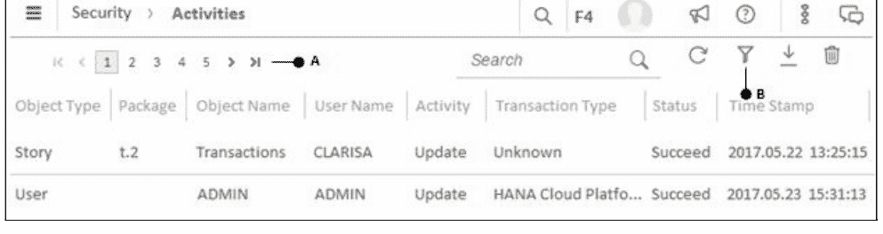

- 50. 单击筛选器图标以显示“设置筛选器”对话框。在此对话框中，您可以使用“可用筛选器”列表中提供的选项选择一个或多个参数来筛选活动数据。当您在“可用筛选器”部分标记一列时，右侧的“活动筛选器”部分会显示所选筛选器并提示您为其输入值。

- 51. 要查看 Adam 执行的活动，请在“可用筛选器”窗格中选择“用户名”列：

- 52. 在“活动筛选器”窗格的值框中输入 Adam，然后单击“确定”。日志将根据您的选择进行筛选：

### 设置筛选器

可用筛选器

- ☑ 所有筛选器
- ☐ 活动
- ☐ 包
- ☐ 对象类型
- ☐ 对象名称
- ☑ 用户名
- ☐ 事务类型
- ☐ 时间戳

活动筛选器

| 筛选器 | 值 |
|---|---|
| 用户名 | Adam |

重置为初始筛选器

确定

取消

## 监控数据更改

您还可以监控模型中事务数据的更改。要对模型执行此监控活动，您必须在该模型的“首选项”对话框中激活数据审计设置。一旦打开“数据审计”功能，SAP Analytics Cloud 就会记录该模型事务数据的所有更改，您可以使用以下步骤查看数据更改：

- 53. 从主菜单转到 安全 | 数据更改。

“数据更改”页面出现，您可以在其中查看已启用数据审计的模型的事务数据的所有更改日志。请注意，仅当数据从私有版本发布时才会记录审计数据，并且发布版本中的所有更改单元格都将被审计。当您从“选择模型”列表中选择模型时，您会看到每个更改单元格的审计信息表。该表显示更改的日期和时间、做出更改的用户、更改前的值以及新值。

使用工具栏提供的选项，您可以搜索特定项目，选择所需的列 (A)，并通过应用时间筛选器 (B) 限制结果。您还可以通过单击“下载”图标 (C) 将“数据更改”日志归档为 CSV 文件，并通过单击“删除”图标 (E) 删除模型的更改数据。普通用户必须对相应模型的“数据更改”日志具有“读取”和“删除”权限才能执行这些操作：

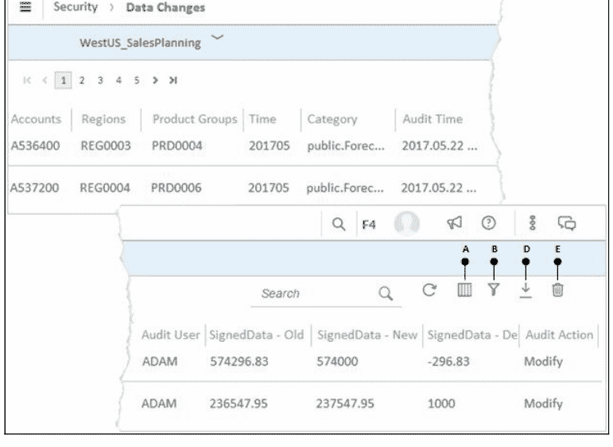

## 监控系统

管理员执行的另一项重要任务是系统监控。通过监控系统，管理员可以识别使用和性能的关键领域。利用这些信息，他们可以评估系统的当前状态，还可以回溯时间，将当前状态与历史信息进行比较。以下是访问监控屏幕的步骤：

- 54. 从主菜单转到 系统 | 监控。监控页面出现，包含以下四个选项卡：

- **概览**：这是一个仪表板，显示基本系统信息，例如正在使用的许可证、活动用户数、登录次数和内存使用情况。
- **按内存的系统使用情况**：此选项卡有两个图表，显示按模型的内存使用情况和按用户的内存使用情况。将鼠标指针悬停在数据点上以查看相应详细信息。两个图表均配备排序按钮以排序数据。
- **按用户的系统使用情况**：在此选项卡上，您可以看到每个用户的事务计数和存储使用量指标报告。每个列的标题中都提供了一个下拉菜单，用于排序和筛选值。
- **跟踪**：如果您想查看系统生成的任何错误消息，则“跟踪”选项卡是查找这些错误消息的地方。在这里，您将看到每条消息的日期和时间值、跟踪级别、用户名、组件和消息。“跟踪级别”列根据严重性级别对日志消息进行分类。该列中的默认条目（Error）可以由管理员从系统配置界面更改，该界面可从 主菜单 | 系统 | 管理 访问。

## 部署

系统管理员还负责部署，其中包括内容的导出和导入的创建和管理。“部署”菜单项中的“导出”选项可让您导出以下组件，而“导入”选项会将这些组件重新引入系统：

- 维度
- 模型
- 货币表
- 角色
- KPI
- 事件
- 事件类别
- 事件流程
- 分配步骤、流程和池映射
- 价值驱动树
- 文件，包括文件夹、故事和董事会议程
- 外部连接，包括导入数据连接和实时数据连接

## 导出流程

导出流程的主要优点是它备份了对象的当前状态和数据，可在将来用于还原。要从 SAP Analytics Cloud 导出对象，请执行以下步骤：

- 55. 转到 主菜单 | 部署 | 导出 以访问导出页面。
- 56. 在导出页面工具栏上，单击“新建”图标 (+) 创建新的导出。

“新建”页面左侧窗格列出了您可以导出的所有对象类别。您可以导出任何类别的所有对象，也可以展开列表以选择单个组件。请注意，当您从此列表中选择一个选项时，所有依赖对象都会自动选择。例如，如果您选择一个故事 (A)，则底层模型和维度 (B) 也会添加到导出中。但是，如果您不需要这些依赖项，可以通过取消其相关框中的选中标记来排除它们。

默认情况下选中的“数据”选项 (C) 可让您导出维度、模型和货币数据：

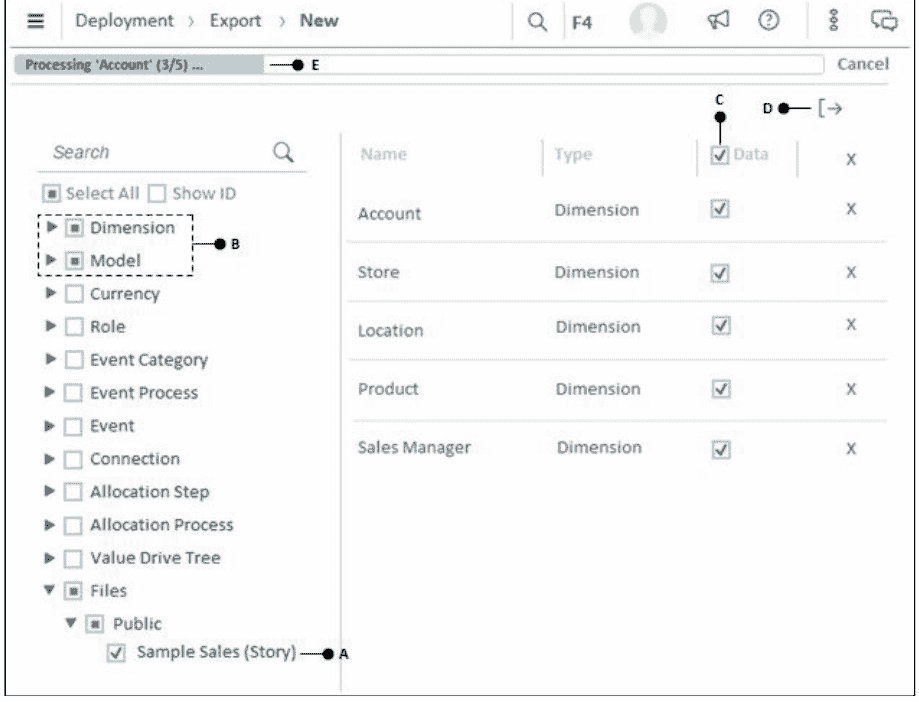

在进行选择后，单击“导出”图标 (D)。“导出”对话框出现，您可以在其中选择将对象导出到本地文件或为传输而导出。您需要为导出单元提供合适的名称。第一个选项将文件保存在您的本地计算机上，而第二个选项将导出单元保存在您的系统内。当您单击“导出”按钮时，导出过程开始，顶部会出现进度条 (E)，指示导出状态。

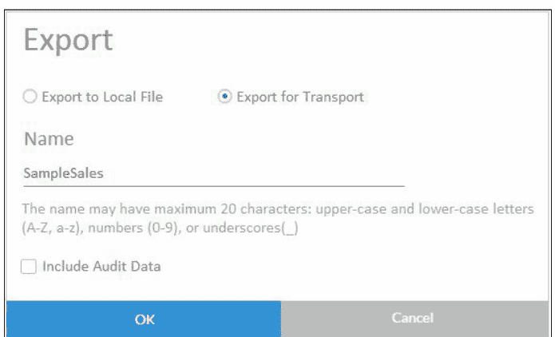

*导出的内容只能导入回 SAP Analytics Cloud 的同一版本或下一个版本。*

## 导入流程

您可以上传保存在本地计算机上的导出单元，也可导入保存在系统内的导出单元。以下是此流程的步骤：

- 57. 单击“主菜单”图标，然后转到 部署 | 导入。
- 58. 如果您要从本地驱动器上传导出单元，请执行此步骤。在“导入”页面上，单击工具栏上的“上传”图标。在“上传”对话框中，选择“选择源文件”，并从保存位置选择文件：

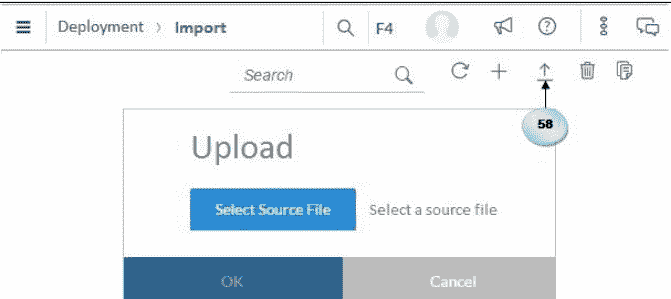

要从系统保存的导出单元导入对象和数据，请单击工具栏上的“新建”图标 (+)。从导出单元列表中选择一个要导入的单元 (A)。您将看到导出单元中所有对象的预览，您可以在其中选择或取消选择项目。选择对象后，单击屏幕右上角的“导入”图标。出现一个小窗口，提供以下选项：更新现有对象、仅导入数据和删除依赖对象。在输入这些信息后，导入过程开始，窗口顶部会出现进度条，显示导入的处理情况：

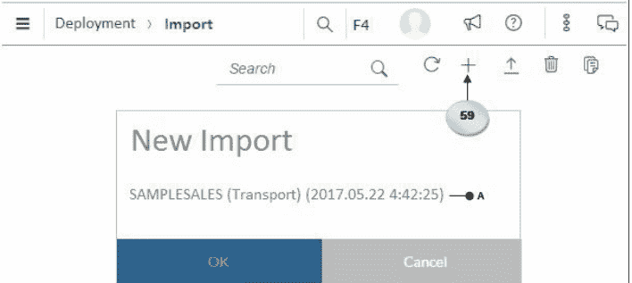

## 摘要

系统管理是计算中最重要的领域，尤其是在大型多用户环境中。本章简要介绍了与 SAP Analytics Cloud 相关的这一关键领域的各个方面。您已了解如何向系统添加用户以及如何设置其密码。除了手动创建用户账户外，您还可以通过 CSV 文件从另一个系统导入批量用户数据。同样，您可以将用户配置文件从 SAP Analytics Cloud 导出到 CSV 文件，以便在另一个系统中使用。

接下来，您学习了如何为系统用户分配角色。您可以将单个角色分配给多个用户，或将多个角色分配给单个用户。为了节省您的时间，SAP Analytics Cloud 附带了一些内置角色，您可以直接将它们分配给用户。您还可以向系统添加新角色，并为这些新角色定义自定义设置和权限。您还学习了用户如何更改自己的个人资料。接下来，您了解了组建团队的过程，团队是一组执行类似任务的用户。您还了解了如何转移系统所有者的角色并为模型设置安全措施。您学习了如何通过监控用户活动和数据变化以及监控系统本身来评估其性能，从而密切关注系统。最后，您获得了通过导出和导入实用程序部署系统的逐步说明。

恭喜！如果您已走到这一步，您值得为完成这一任务而拍拍自己的背。在这次探索中，您了解了 SAP Analytics Cloud，它是终端用户在 BI 和分析领域的一站式解决方案。本书试图帮助您学习如何使用该工具可视化、分析和共享数据，以满足您所有的商业智能和规划需求。

SAP Analytics Cloud 是新一代软件即服务（SaaS），将 BI、规划、预测分析、治理和风险整合到一个应用程序中。它提供对所有可能数据的访问，以便用户能够实时可视化、规划和预测。

正如您所体验到的，该产品极易使用。用户还受益于内置的协作和警报功能。无需额外基础设施即可生成分析的敏捷性是一个优势。

利用现代、直观的用户体验，通过规划、分析、预测和协作节省时间。世界正在走向云端，而许多企业在云端运行大量其他应用程序，为什么不也在云端运行您的 BI 和分析呢？

## 目录

-   前言 18
-     本书涵盖内容 19
-     阅读本书所需 21
-     本书适合人群 22
-     约定 23
-     读者反馈 24
-     客户支持 25
-       下载示例代码 26
-       下载本书彩色图片 27
-       勘误 28
-       盗版 29
-       问题 30
-   使用 SAP Analytics Cloud 入门 31
-     SAP Analytics Cloud 结构 32
-       主屏幕 34
-       主菜单 35
-     数据源和模型 37
-       创建到 SAP HANA 的直接实时连接 39
-       连接远程系统以导入数据 41
-       连接 Google Drive 以导入数据 43
-       刷新导入的数据 44
-     可视化 47
-     协作 52
-     演示 54
-     管理和安全 55
-     注册试用版 56
-     摘要 58
-   SAP Analytics Cloud 中的模型 59
-     了解度量和维度 60
-     规划和分析模型 61
-     创建新的分析模型 62
-       选择源文件 63
-       为模型设置名称、描述和其他参数 64
-       设置维度类型 65
-       创建位置维度 67
-   从模型中删除不必要的列 68
-   在两列之间创建层次关系 69
-   在建模器界面中查看模型 72
-     时间维度 73
-     账户维度 74
-     私有维度 75
-   浏览模型 77
-     复制模型 78
-     删除模型 79
-     清除模型数据 80
-   查看模型数据 81
-     查看数值数据 83
-     以图形方式查看数据 84
-     观察更多的数据过滤 85
-   摘要 86
-   规划模型 87
-     创建规划模型 88
-     可视化规划模型数据 95
-     查看文本数据 100
-     展开、分配和分配值 102
-     创建私有版本 105
-     摘要 108
-   使用图表创建故事 109
-     演示模型 110
-       Best Run 演示模型 111
-       Planned Events 模型 114
-         创建新故事 115
-         为故事选择模型 117
-         创建数值点图以显示净收入 118
-   计算编辑器 120
-   使用阈值应用条件格式 124
-     毛利率数值点图 127
-     样式化磁贴 129
-     毛利率百分比数值点图 130
-   创建计算度量 – 毛利率 % 131
-     格式化度量 132
-     在数据视图中查看计算度量 134
-   在故事中使用折线图呈现数据 135
-     对时间维度应用过滤器 136
-     创建条形图 138
-     在图表中向上和向下钻取 140
-     创建堆叠条形/柱形图 143
-     使用输入控件创建计算和受限度量 148
-     创建计算度量和输入控件 150
-     向输入控件添加值 152
-     创建受限度量 155
-     创建 Difference From 度量 157
-     摘要 160
-   使用 KPI、过滤器和其他实用对象扩展故事 161
-     关键绩效指标（KPI） 163
-     故事和页面过滤器 164
-     创建图表以显示关键绩效指标 165
-       设置图表属性 166
-     向图表添加参考线 169
-     设置单个图表过滤器 174
-       添加页面过滤器 175
-       为产品添加页面过滤器 179
-       添加位置页面过滤器 181
-       添加故事过滤器 183
-       创建关联分析 184
-     添加动态文本 187
-     添加静态文本 189
-       添加形状 190
-       添加图像 192
-         演示模式 193
-     创建超链接 194
-     检查可视化背后的数据 195
-       设置故事的样式首选项 197
-     创建聚合计算 199
-     固定和评论数据点 203
-     保存您的故事 204
-     摘要 205
-   使用地地图和其他对象分析数据 206
-     使用故事页面 208
-   向页面添加评论 210
-   创建带有气泡图层的地地图 212
-   地地图中的位置聚类 220
-   创建带有色带图层的地地图 223
-   对地地图应用过滤器 226
-   链接不同模型 228
-   基于链接维度创建图表。 230
-   连接类型 232
-   相交数据示例 233
-   创建组合列和折线图 236
-   通过趋势时间序列图使用预测预测 239
-   添加预测 241
-   修改预测 243
-   添加时间计算 244
-   摘要 247
-   使用表格和网格 248
-   在页面之间复制对象 250
-   应用排名 251
-   将对象复制到同一页面 254
-   网格和表格 256
-   使用表格 257
-   对表格应用过滤器 259
-   显示/隐藏表格元素 261
-   对表格数据排序 262
-   显示总计 263
-   应用日期过滤器 264
-   测试页面过滤器对表格的影响 266
-   样式化表格 268
-   创建格式规则 271
-   设置可见性过滤器 276
-   交换表格轴 278
-   冻结表格行和列 279
-   在表格中使用 KPI 281
-   使用网格 284
-   创建混合表格 289
-   复制对象、页面和故事 293
-   复制分组对象 294

- 复制所有对象的页面 295
- 复制整个故事 296
- 将故事保存为 PDF 297
- 通过固定故事对象创建个性化仪表板 299
- 固定故事对象 300
- 向主屏幕添加文本注释 301
- 摘要 303

## 协作 304
- 创建事件和任务工作流 305
- 创建事件 306
- 创建任务 312
- 显示和监控事件和任务 315
- 事件工具栏 320
- 与同事共享故事并授予访问权限 322
- 通过讨论协作 325
- 共享文件和其他对象 327
- 摘要 329

## 数字董事会 330
- 优化显示 332
- 创建议程 333
- 创建议程子项 335
- 启用数据探索 338
- 设置导航目标 339
- 启用触摸单元格输入 340
- 设置首选项 341
- 数字董事会页面 343
- 开始会议 344
- 邀请人员参加会议 345
- 在会议中开始演示 347
- 添加注释 349
- 停止在线会议 350
- 摘要 351

## 系统管理 352
- 创建用户 353
- 设置用户密码 354
- 更改密码 355
- 导入用户 356
- 导出用户 357
- 删除用户 358
- 分配角色 359
  - 将单个角色分配给多个用户 360
  - 分配或更新单个用户的角色 361
- 内置角色 362
- 创建新角色 365
- 角色设置 368
- 权限 369
- 测试角色权限 373
  - 更新用户资料 374
- 组建团队 375
- 转移系统所有者角色 377
- 设置模型的安全性 379
- 监控用户活动 381
  - 监控数据更改 383
- 监控系统 384
- 部署 385
- 导出流程 386
- 导入流程 388
- 摘要 389
