# 2 安装 Magento

## Installation

在本章中，我们将介绍在 Linux 服务器上安装 Magento 2 相关的任务，包括以下内容：

- Setting up an AWS server
- Installing PHP
- Installing MySQL
- Installing Magento dependencies
- Creating a custom domain for the server
- Setting up GIT for version control
- Setting the right permissions for the server

## System requirements for Magento 2

在继续安装之前，我们应该回顾 Magento 2 的系统要求，以确保环境适合 Magento 正常运行。

以下是 Magento 2 的系统要求：

- Operating System:
  - Linux
- Web servers:
  - Apache 2.2 or 2.4
  - nginx 1.8
- Database:
  - MySQL 5.6
    or
  - MySQL 5.7 (Magento 2.1.2 or above)
    or
  - MariaDB
    or
  - Percona
- PHP:
  - PHP 5.6 and later. PHP 7.0.2, 7.0.4, 7.0.6-7.0.x (Magento 2.1.2 and later)
  - PHP 7.0.2, 7.0.6-7.0.x (all Magento 2.1.x versions)
  - PHP 5.6.x (Magento 2.1.0)
- Required PHP extensions:
  - BC Math
  - curl
  - GD, ImageMagick 6.3.7 (or later), or both
  - intl
  - mbstring
  - Mcrypt
  - Mhash
  - OpenSSL
  - PDO/MySQL
  - SimpleXML
  - OPCache
  - SOAP
  - xml
  - XSL
  - Zip
  - JSON (PHP 7 only)
  - iconv (PHP 7 only)

### Installation

- PHP Dependency Manager:
  - Composer
- SSL:
  - Valid security certificate (required for HTTPS)
  - **Transport Layer Security (TLS)** requirement
- Mail Server:
  - **Mail Transfer Agent (MTA)** or SMTP server
- Optional:
  - Redis 3.0
  - Varnish 3.5 or latest stable 4.x version
  - Memcached
  - Xdebug
  - PHPUnit

### Local installation in your computer

在本节中，我们将回顾在本地计算机上使用示例数据设置 Magento 的一般流程。在接下来的两个部分中，我们将回顾选择合适的托管提供商并从头开始设置服务器以安装 Magento 的流程。

考虑到这一点，我们假设你的本地机器上正在运行 PHP 7 和 MySQL，并且也安装了上一节中列出的所有依赖项。

除此之外，你应该已经为本地实例创建了虚拟主机（即 `http://magento2-playground.dev`），hosts 文件中已为本地 Magento 实例添加了新条目（`127.0.0.1 magento2-playground.dev`），并且有一个空数据库。

### Getting the Magento code base

第一步是获取最新版本的 Magento 代码库。为此，你应该访问 Magento 下载页面 (https://magento.com/tech-resources/download) 并选择最新版本的 Magento：

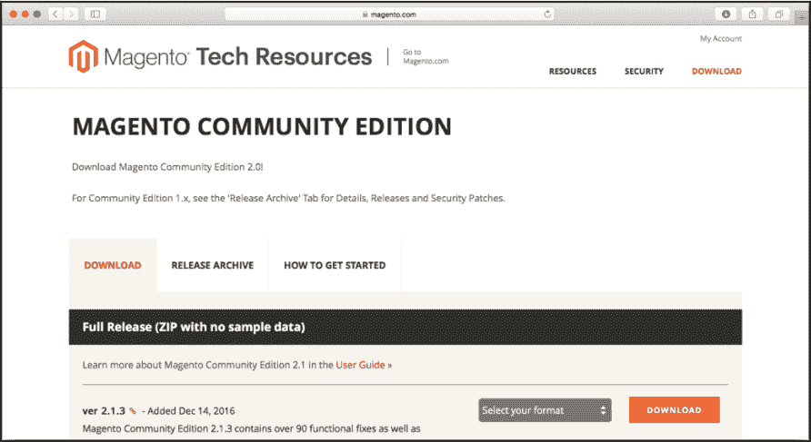


为了让我们的本地 Magento 安装拥有产品、分类和其他有用的信息，我们将从“完整版发布，附带示例数据（ZIP 格式，含示例数据）”部分选择最新版本：

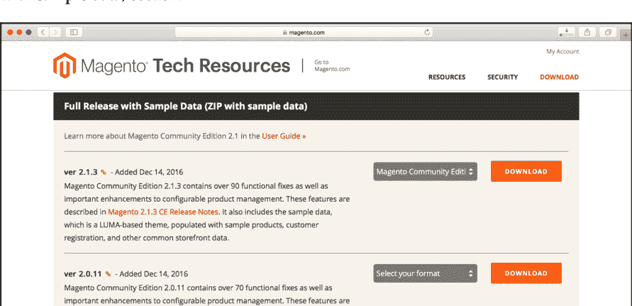

下载文件后，您应该将其解压到本地机器的文档根目录中。

解压文件后，您应该会看到与以下截图类似的输出：

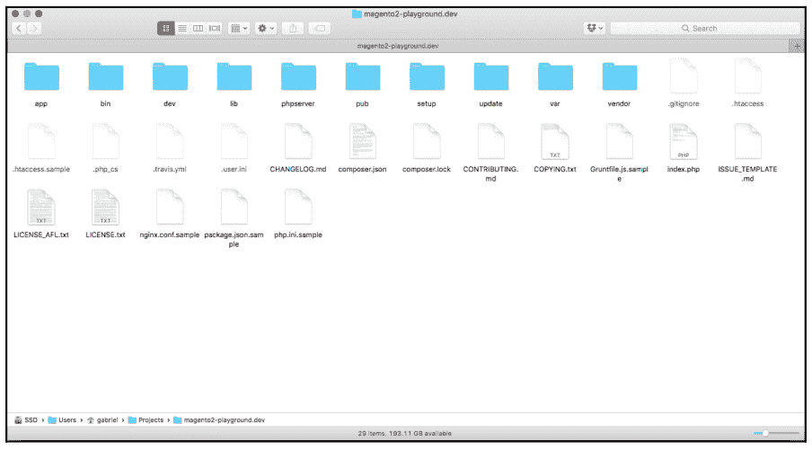

现在，我们已经准备好代码库，可以继续进行安装。

安装 Magento 有两种方式：

- Setup Wizard installation
- Command-line installation

### Setup Wizard installation

Setup Wizard 是一种简单的安装流程，可通过浏览器执行。

要使用 Setup Wizard 安装 Magento，您应按照以下步骤操作：

1. 打开您喜欢的网页浏览器。
2. 访问 `http://<host name>/setup` Setup Wizard URL。主机名是您为本地 Magento 2 安装在虚拟主机配置中分配的名称。例如，在本节中我们将 `magento2-playground.dev` 声明为主机名，因此 Setup Wizard 的 URL 将为 `http://magento2-playground.dev/setup`。
3. 点击 **Agree and Setup Magento** 以继续安装的第一步：

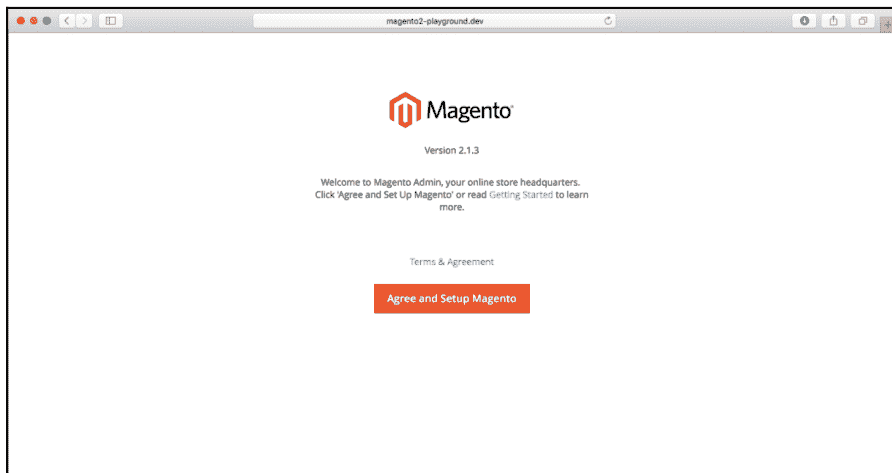

4. **Readiness Check:** 在此步骤中，Setup Wizard 将检查您的本地机器是否已准备好运行 Magento 2，并审查以下内容：

- PHP version
- PHP settings
- Enabled PHP extensions
- File permissions

### Installation

检查完成后，您将收到继续下一步的确认：

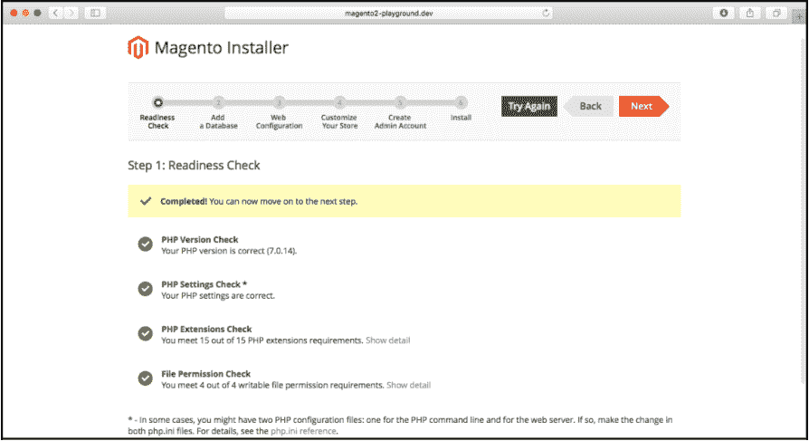

#### 5. Add a Database:

在此步骤中，您将指定为 Magento 2 安装创建的空数据库的连接详细信息：

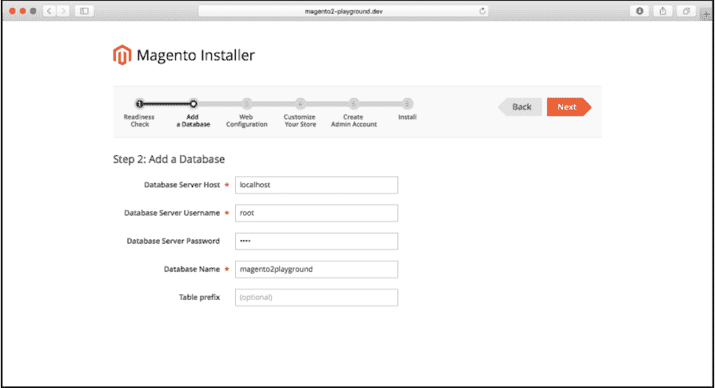

### Installation

#### 6. Web Configuration:

在此步骤中，您应指定为 Magento 2 网站创建的虚拟主机（默认自动完成），并且您可以为管理后台定义自定义 URL 以及 **Advanced Options**，例如 **HTTPS Options**、**Apache Rewrites**、**Encryption Key** 和 **Session Save** 配置。

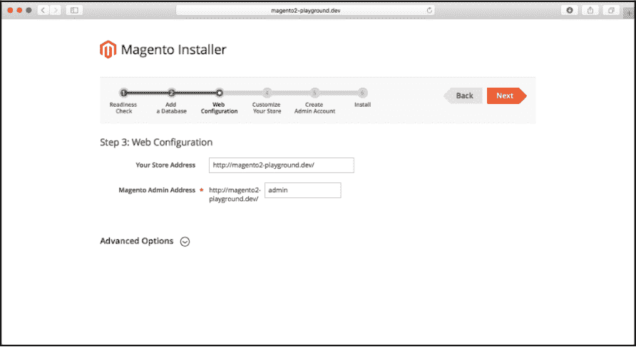

7. **Customize Your Store:** 此步骤包括时区、货币和语言配置，以及从 Magento 启用/禁用模块的列表，供该实例使用：

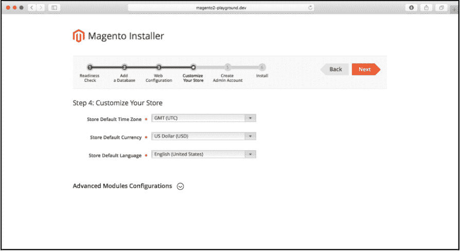

#### 8. Create Admin Account:

在此步骤中，您可以创建 Magento 管理面板的第一个用户：

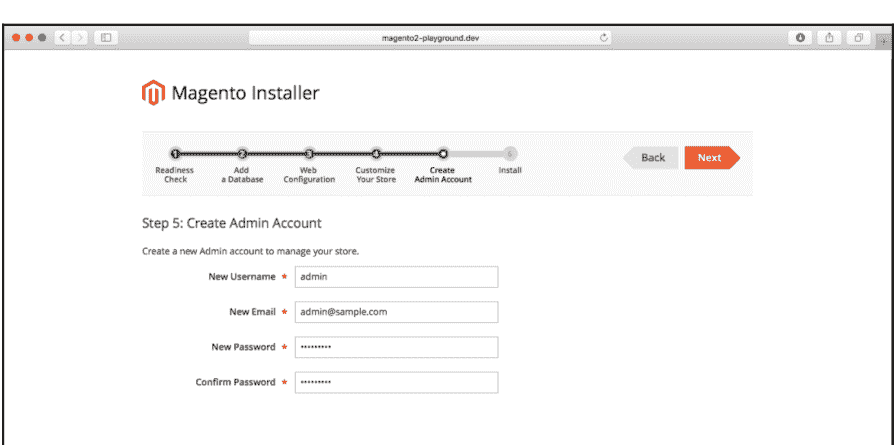

#### 9. Install:

这是最后一步，您会找到 **Install Now** 按钮以继续安装。
当您点击该按钮时，Magento 将开始安装。您可以通过查看进度条来跟踪安装进度。
此外，您还可以使用进度条下方的链接打开控制台日志，以查看安装进度的完整报告。
由于我们使用示例数据安装 Magento，Setup Wizard 将花费时间安装所有产品、分类、属性等。
安装完成后，您应该在 Setup Wizard 中看到以下成功页面：

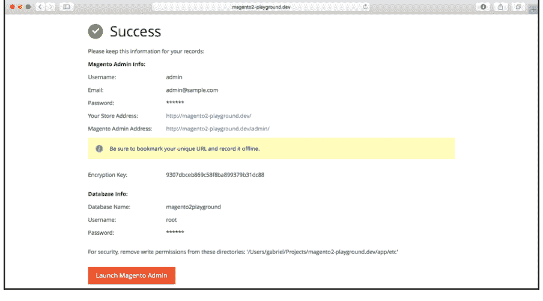

### Command-line installation

命令行安装是 Magento 提供的另一种方法，可从终端安装 Magento 2。

进行安装的步骤如下：

1. 打开终端并进入本地 Magento 安装的目录。

2. 命令行安装使用 Magento 2 命令行工具。您可以通过运行 `php bin/magento` 来确认您处于正确的目录。您将看到包含 Magento 2 命令行工具所有命令的输出列表：

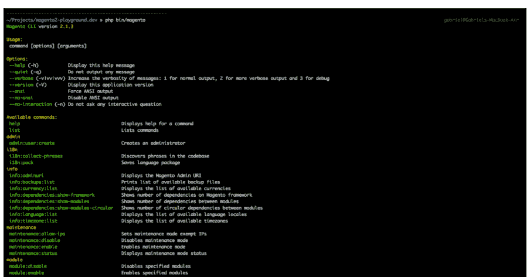

3. 下一步是在项目目录中运行 Composer。如果您的本地机器上未安装 Composer，您可以按照官方 Composer 网站上的说明进行操作：https://getcomposer.org/。然后，您应在终端中运行以下命令：

```
composer install
```

如果一切顺利，您应该会看到类似以下的输出：

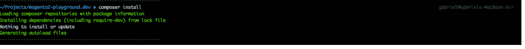

4. 最后，您应运行 setup:install 使用本地配置安装 Magento。也就是说，这是一个很长的命令，您可以将其自定义以匹配本地配置。我们将回顾该命令中的每个参数：

```
php bin/magento setup:install
--db-host=localhost
--db-name=magento2playground
--db-user=root
--db-password=root
--backend-frontname=admin
--admin-user=admin
--admin-password=ABC123xyz
--admin-email=email@sample.com
--admin-firstname=Gabriel
--admin-lastname=Guarino
--base-url=http://magento2-playground.dev/
--language=en_US
--currency=USD
--use-rewrites=1
--use-secure=0
--use-secure-admin=0
```

- db-host: 本地数据库的主机（localhost 或 127.0.0.1）
- db-name: Magento 安装的空数据库名称
- db-user: MySQL 用户名
- db-password: MySQL 密码
- backend-frontname: Magento 管理面板的 URL（frontname）
- admin-user: 您的第一个管理员用户的用户名
- admin-password: 您的第一个管理员用户的密码
- admin-email: 您的第一个管理员用户的电子邮件
- admin-firstname: 您的第一个管理员用户的名字
- admin-lastname: 您的第一个管理员用户的姓氏
- base-url: 本地 Magento 安装的基础 URL
- language: Magento 安装的语言

### Installation

- `currency`: Magento 安装的货币
- `use-rewrites`: 启用/禁用 URL 重写
- `use-secure`: 前端启用/禁用 HTTPS
- `use-secure-admin`: 管理后台启用/禁用 HTTPS

运行 `setup` 命令后，您将看到以下输出，确认安装已成功完成：

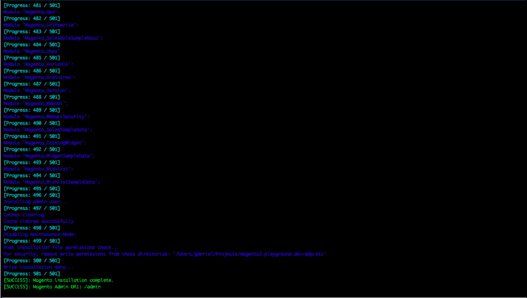

现在您已在本地机器上安装了 Magento，您可以使用之前声明的 URL 访问 Magento。

访问前端的 URL 将为 `http://magento2-playground.dev/`。

### Leader

Lieder der Roten Armee (Lied 1: Brüder, zur Sonne, zur Freiheit)

Brüder, zur Sonne, zur Freiheit, Brüder, zum Lichte empor!

Hell aus dem dunklen Vergangenen leuchtet die Zukunft hervor.

Seht, wie der Zug von Millionen aus dem Verderben ersteht!

Nicht nur in Deutschland, nein überall hört man den Freiheitsruf wehen.

> > Der Kampf für Freiheit und Frieden ist unser gemeinsames Ziel.

Mit dem Gesang der Roten Armee und den Liedern des Roten Wedding streben wir nach einer besseren Welt.

Die Lieder sind geprägt von Solidarität, Einheit und dem unerschütterlichen Willen zum Fortschritt.

Aus der Geschichte der Arbeiterbewegung erhebt sich der Chor aller Völker.

### How to choose the right hosting provider

Magento 是一个拥有庞大社区的大型平台，提供您所需的所有服务，从设计和开发到商店托管。

当产品背后有一个庞大的社区时，您可以获得专门的专业人员来帮助解决您的问题。

这是您可以利用的优势，以确保您的 Magento 商店始终保持良好状态，并且在必要时能够准备好解决紧急情况。

话虽如此，选择合适的服务器对于 Magento 商店来说非常重要。托管服务提供商提供两种类型的服务器：

- Managed servers
- Self-managed server

### Managed servers

托管服务器由托管服务提供商管理。这意味着托管服务提供商负责保持服务器正常运行。

如果服务器出现任何问题，您可以在托管服务提供商的帮助台上创建工单。

当您选择这种类型的服务器时，您应该找到一家对 Magento 具有广泛知识和经验的优秀托管服务提供商。这对于确保在紧急情况下托管服务提供商能够调查和审查 Magento 实例至关重要。

以下是推荐的 Magento 托管服务器列表：

- Nexcess: https://www.nexcess.net/magento/hosting
- MageMojo: https://magemojo.com/
- Rackspace: https://www.rackspace.com/digital/magento


### 自托管服务器

我们有自托管服务器；当你选择这种类型的服务器时，配置、升级和监控都是用户的责任。

这对于高级用户或拥有自己的系统管理员的商家来说是最好的选择。你可以完全控制服务器，这在管理 Magento 商店时非常重要。同时，如果服务器宕机或出现其他与服务器相关的问题，你需要负责解决紧急情况。

当你选择这种类型的服务器时，你应该具备服务器管理知识，或者找到一位真正优秀的系统管理员来处理紧急情况并正确配置服务器。

以下是 Magento 推荐的自托管服务器列表：

- Amazon EC2: https://aws.amazon.com/ec2/
- DigitalOcean: https://www.digitalocean.com/
- Linode: https://www.linode.com/

### 在 Amazon EC2 中安装 Magento

在本节中，我们将从零开始在 Amazon 上设置服务器。服务器将准备好用于 Magento，并安装了所有要求和依赖项，以便你可以管理你的第一个 Magento 开发服务器。

### 设置 Amazon AWS 账户

第一步是设置你的 Amazon AWS 账户，以便在 Amazon EC2 中创建服务器实例。

#### 安装

要做到这一点，你应该按照以下步骤操作：

1. 访问 Amazon AWS 首页 `https://aws.amazon.com/`。它看起来会是这样：

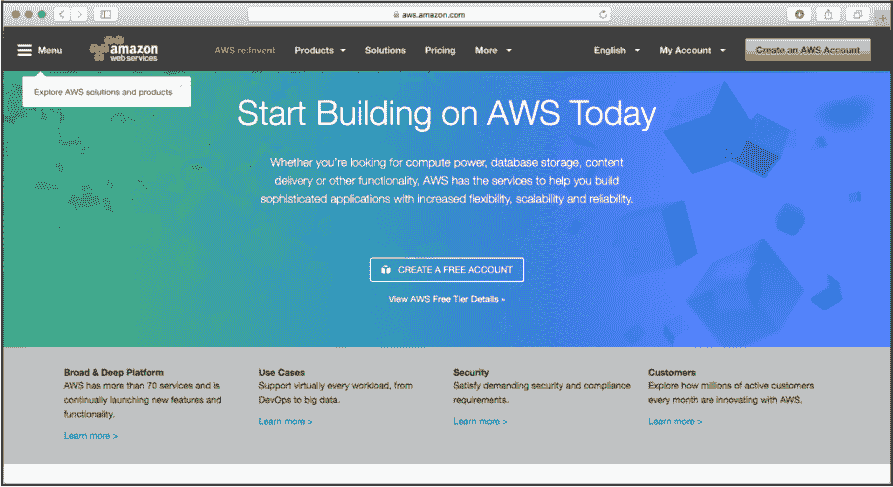

4. 点击 **使用我们的安全服务器登录。**

5. 使用你的个人信息完成表单并点击 **创建账户：**

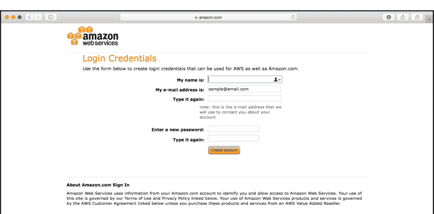

### 创建 Amazon EC2 实例

在验证 Amazon AWS 账户后，你可以创建你的第一个 Amazon EC2 实例。实例是可运行 Web 应用程序的虚拟服务器。让我们逐步了解创建 Amazon EC2 实例的步骤：

1. 转到 Amazon EC2 着陆页，即 https://aws.amazon.com/ec2/，它看起来会是这样：

Amazon EC2

Amazon Elastic Compute Cloud (Amazon EC2) 是一种 Web 服务，提供云中的可扩展计算容量。它旨在让开发人员更轻松地进行 Web 级云计算。

Amazon EC2 简单的 Web 服务接口允许你以最小的摩擦获得和配置容量。它为你提供对计算资源的完全控制，并让你能够在 Amazon 的成熟计算环境上运行。Amazon EC2 将获取和启动新服务器实例所需的时间缩短到几分钟，使你能够根据计算需求的变化快速按需扩展容量。Amazon EC2 通过让你只为实际使用的容量付费来改变计算的经济性。Amazon EC2 为开发人员提供构建容错应用程序的工具，并使他们免受常见故障场景的影响。

Introduction to Amazon EC2 (4:01)

- PRODUCTS & SERVICES
- Amazon EC2
- Product Details
- Instance Types
- Developer Resources
- FAQs
- Getting Started
- Pricing
- Amazon Lightsail
- Elastic GPUs
- Amazon EC2 Systems Manager
- RELATED LINKS
- Amazon EC2 Dedicated Hosts
- Amazon EC2 Spot Instances
- Amazon EC2 Reserved Instances
- Amazon EC2 Dedicated Instances

Launch an Amazon EC2 Instance for Free
Try Amazon EC2 for Free
AWS Free Tier includes 750 hours of Linux and Windows t2.micro instances each month for one year. To stay within the Free Tier, use only EC2 Micro instances.
View AWS Free Tier Details

FEATURED PARTNER: Rackspace
Let Rackspace manage your AWS Cloud so you can focus on your business. Learn more

2. 点击屏幕右上角的 My Account，然后点击 AWS Management Console，最后使用你的 Amazon 账户登录。

3. 在 AWS Management Console 中，在 AWS 服务搜索框中搜索 ec2：

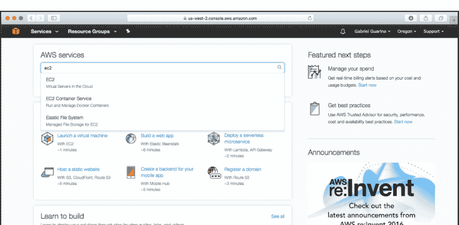

4. 你将被重定向到 EC2 控制台。这将是控制和监控你的 Amazon 实例的地方。接下来，点击页面中间的 Launch Instance：

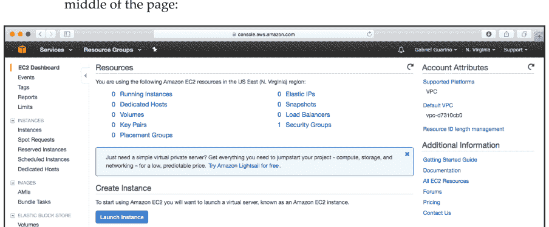

Choose an Instance Type: 在此页面上，你可以看到可以根据 Magento 商店大小选择的不同实例类型。现在，我们将选择 t2.micro Free tier eligible 实例类型：

5. Instance Setup Wizard：

   1. Choose an Amazon Machine Image (AMI): 在此步骤中，你可以选择 Amazon 实例的软件配置。对于本指南，我们将选择 Ubuntu Server：

   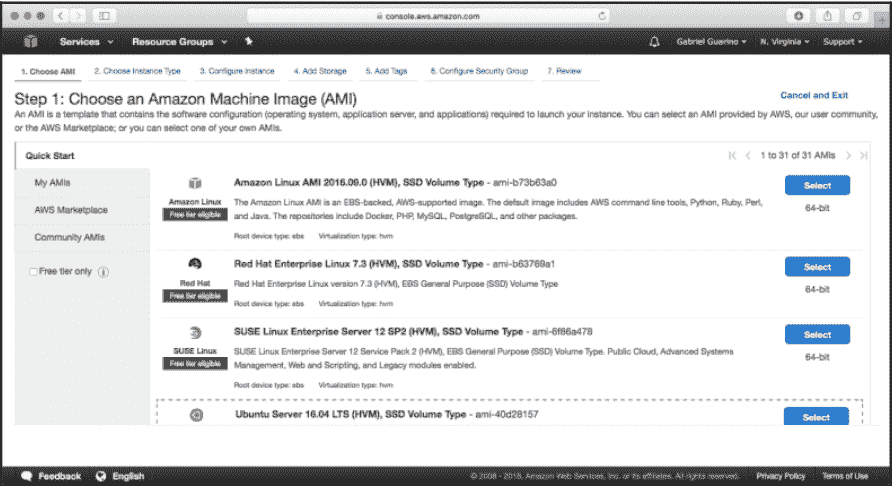

   2. Choose an Instance Type: 在此页面上，你可以看到可以根据 Magento 商店大小选择的不同实例类型。现在，我们将选择 t2.micro Free tier eligible 实例类型：

   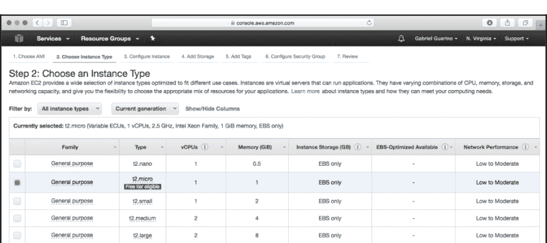

   3. **Configure Instance**: 你可以在此步骤中为实例设置高级选项。我们将在此步骤中保持默认配置以继续 Setup Wizard 的第 4 步。

   4. **Add Storage**: 在此步骤中，你可以指定实例的存储。由于 Magento 2 代码库加示例数据的大小为 530 MB，我们将保持卷的默认大小 8 GB。

   5. **Add Tags**: 当你拥有多个 Amazon 实例时，此步骤很有帮助，因为你可以添加标签来对 Amazon 账户中的资源进行分类。

   6. **Configure Security Group**: 安全组是一组控制 Amazon 实例流量的规则。默认规则端口是 SSH，允许用户从终端访问实例。为了允许 Magento 商店的 Internet 流量，你应该启用 HTTP 和 HTTPS 端口。你可以通过点击 **Add Rule** 然后从 **Custom TCP Rule** 下拉菜单中选择 **HTTP** 和 **HTTPS** 来添加这些端口。

   7. Review: 在此步骤中，你可以查看 Amazon 实例的配置。点击屏幕右下角的 Launch：

   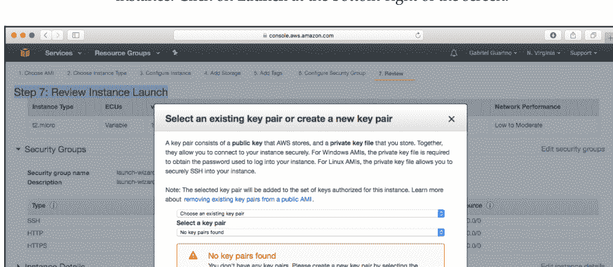

这是流程中非常重要的一部分。你可以通过使用私钥文件访问 Amazon 实例。

访问新实例的唯一方式是使用密钥对，即 AWS 存储的公钥和你的私钥文件。

选择 Create a new key pair 然后设置密钥对名称并点击 Download Key Pair。切勿丢失私钥文件，因为那是访问你的 Amazon 实例的主密钥。

最后，点击 Launch Instance 以完成 Setup Wizard。

### 为 Magento 2 准备 Amazon 实例

现在你已经创建了 Amazon 实例，我们准备安装所有软件包和依赖项以准备实例用于 Magento 2。

#### 安装

第一步是使用你在 Setup Wizard 中下载的私钥文件登录服务器。

要登录，你需要知道实例的公共 DNS 或公共 IP。你可以从 AWS EC2 Management Console 获取这些值：

1. 转到 `https://console.aws.amazon.com/ec2/` AWS EC2 Management Console。

2. 你将看到我们在列表中刚创建的实例。在表格中向右滚动以找到实例的 **Public DNS** 和 **Public IP**：

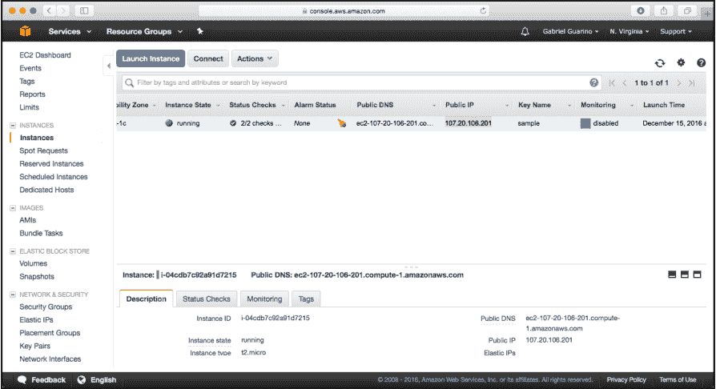

3. 在登录服务器之前，我们应该为私钥文件赋予正确的权限。在 Terminal 中定位该文件并运行以下命令：

```
chmod 400 ~/Key Pairs/sample.pem
```

现在我们可以使用以下命令登录 AWS 实例：

```
ssh -i ~/sample.pem ubuntu@107.20.106.201
```

我们也可以使用此命令：

```
ssh -i ~/sample.pem ubuntu@ec2-107-20-106-201.compute-1.amazonaws.com
```

一旦你登录到开发服务器，你应该获得 sudo 权限以便在没有问题地继续安装所有依赖项：

```
sudo su
```

现在，是时候为 Magento 2 设置所有依赖项了：

1. 更新服务器中所有现有的软件包：

```
apt-get update
```

2. 我们将使用以下命令安装 Apache、PHP、所需的 PHP 模块和 composer：

```
sudo apt-get install apache2
sudo apt-get install php7.0
sudo apt-get install libapache2-mod-php
sudo apt-get install php7.0-simplexml
sudo apt-get install php7.0-curl
sudo apt-get install php7.0-intl
sudo apt-get install php7.0-xsl
sudo apt-get install php7.0-zip
sudo apt-get install php7.0-xml
sudo apt-get install php7.0-curl
sudo apt-get install php7.0-gd
sudo apt-get install php7.0-mcrypt
sudo apt-get install php7.0-dom
sudo apt-get install php7.0-mbstring
sudo apt-get install composer
```


你可以像这样用一条命令运行所有依赖项的安装：

```
sudo apt-get install apache2 php7.0 libapache2-mod-php php7.0-dom php7.0-simplexml php7.0-curl php7.0-intl php7.0-xsl php-mbstring php7.0-zip php7.0-xml php7.0-curl php7.0-gd php7.0-mcrypt php7.0-dom php7.0-mbstring composer
```


3. 接下来，我们将安装 MySQL。请注意，安装程序会要求你为 root 用户设置密码：

```
sudo apt-get install mysql-server
sudo apt-get install php-mysql
```

4. 保护 MySQL 安装。为此，请运行以下命令：

```
mysql_secure_installation
```

它会要求输入你之前配置的 MySQL 密码：

- 移除匿名用户：是
- 禁止远程登录：是
- 移除测试数据库及其访问权限：是
- 现在重新加载权限表？：是

5. 打开 apache2.conf 文件，并将 `AllowOverride` 设置为 all，以授予文档根目录正确的权限。

6. 找到以下代码块：

```
<Directory /var/www/>
  Options Indexes FollowSymLinks
  AllowOverride none
  Require all granted
</Directory>
```

将其替换为以下代码：

```
<Directory /var/www/>
  Options Indexes FollowSymLinks
  AllowOverride all
  Require all granted
</Directory>
```

7. 重启 Apache 服务器以应用更改：

```
sudo service apache2 restart
```

8. 在文档根目录中创建一个示例 `phpinfo.php` 文件：

```
cd /var/www/html
rm index.html
echo "<?php echo phpinfo();" > phpinfo.php
```

9. 然后，你可以访问文档根目录，并在浏览器中查看 `phpinfo.php` 文件的输出。例如，<公共 IP>/phpinfo.php。

你应该在浏览器中看到以下页面：

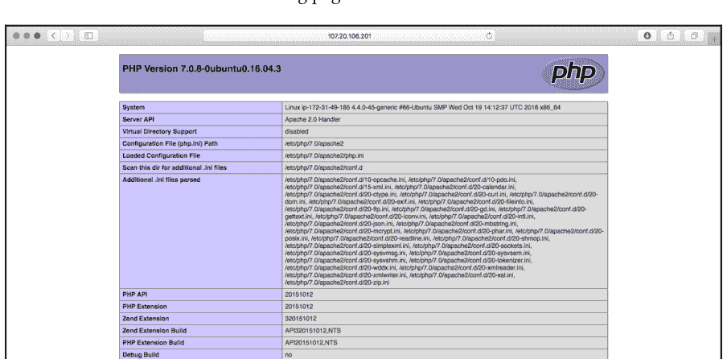

10. 如果 `phpinfo.php` 能正常显示，请删除该文件，并创建一个自定义 MySQL 用户和数据库以导入 Magento（创建与旧服务器相同的用户名）：

```
mysql -u root -p
CREATE USER '<username>'@'localhost' IDENTIFIED BY 'password';
GRANT ALL PRIVILEGES ON * . * TO '<username>'@'localhost';
FLUSH PRIVILEGES;
CREATE DATABASE <databasename>;
```

现在，Amazon 实例已为 Magento 2 准备就绪，你可以继续进行安装向导或我们在上一节中看到的命令行安装方法。

## 小结

在本章中，我们回顾了 Magento 的系统要求。我们在本地机器上安装了一个实例，甚至还从零开始为 Magento 2 设置了一台 Amazon 服务器。在下一章中，我们将回顾如何将商店从 Magento 1 迁移到 Magento 2。

## 代码审计

高级软件工程师应审查当前 Magento 1.x 商店的代码库，并记录当前代码的状态。

这意味着软件工程师将确保 Magento 1.x 商店中不存在不良实践，因为不良实践会导致 Magento 2.x 商店中缺少功能。

### 修改过的 Magento 核心

Magento 1.x 中一个不良实践的示例是直接修改 Magento 核心。有些开发者这样做而不是创建自定义模块，这导致平台上的一些更改在代码库中无法通过自定义模块体现出来。这些功能将无法迁移到 Magento 2，因为在审查自定义模块时，开发人员看不到这些更改。

如果核心已被修改，那么第一步就是将这些更改从核心移动到自定义扩展，并从 Magento 恢复原始核心文件。

你可以从 Magento 技术资源下载页面的 `https://magento.com/tech-resources/download` 下载从 1.0 起的任何 Magento 版本。

软件工程师将能够将你的商店核心的当前状态与原始 Magento 核心进行比较。

### 模板中的业务逻辑

Magento 中另一个不良编程实践是将业务逻辑放在模板中，而不是放在自定义扩展中。在 Magento 中向模板添加业务逻辑的正确方法是在自定义扩展的块中添加该逻辑，但有些开发者改为在前端模板中包含 PHP 代码。

软件工程师应审查前端模板，以查看是否有任何需要移至自定义扩展的自定义业务逻辑。

### 第三方扩展

我不建议拥有大量第三方扩展。你应该只保留你需要的、并且你认为对商店至关重要的扩展。

话虽如此，你应该审查你的商店使用的第三方扩展是否可用于 Magento 2。这意味着你应该访问模块供应商的网站，检查是否已为 Magento 2 创建了新扩展。

非常重要的一点是，一些模块供应商正在为其扩展创建 Magento 2 版本，但这些 Magento 2 扩展并不具备 Magento 1 扩展的所有功能。

这意味着你不仅应检查该扩展是否可用，还应检查你在 Magento 1 中使用的该扩展的所有功能在 Magento 2 的扩展中是否都可用。

如果某扩展不适用于 Magento 2，则你应该分析是否真的需要该扩展。如果你确实需要，可以联系模块供应商，了解近期是否有发布计划。如果模块供应商不打算很快发布 Magento 2 的新版本，那么你应该为 Magento 2 从零开始创建该扩展。

### 自定义扩展

如果你在 Magento 1 中寻找自定义功能但未在 Magento Connect 中找到任何扩展，那么你必须实现自定义代码来支持该扩展。这些是 Magento 1 中可用但与 Magento 2 不兼容的自定义扩展。

Magento 2 是一个具有新数据结构和新编码实践的新平台。你应该为这些扩展从零开始创建新版本，并使用与 Magento 2 兼容的代码。

### 未使用的扩展

是否有未使用的自定义或第三方扩展？如果有，你应该审查这些扩展的功能，以确定是否真的需要它们。通过减少扩展数量，你可以减少需要迁移的代码量，并保持更干净的 Magento 2 实例。

### 自定义 JavaScript

自定义 JavaScript 不会迁移到 Magento 2，你需要记录使用 JavaScript 实现的自定义功能。这些功能应由经验丰富的 Magento 开发人员手动迁移到 Magento 2，以使用 RequireJS。

### 迁移要求

现在你已经分析了代码，是时候审查迁移要求了。有时，原始需求在代码审计后会发生变化。这是合理的，因为你对商店当前状态的了解会更多，并且你将基于此制定行动计划。

代码审计过程之后，你将获得一个列表，包括：

- 需要移至自定义扩展的核心更改
- 需要移至自定义扩展的模板中的业务逻辑
- 可用于 Magento 2 的第三方扩展
- 需要为 Magento 2 更新的第三方扩展
- 需要为 Magento 2 更新的自定义扩展
- 不会在 Magento 2 中实现的未使用扩展
- 需要在 Magento 2 中实现的自定义 JavaScript

还有其他需要考虑的事项——主题（主题模板）。主题不会从 Magento 1 自动迁移到 Magento 2。就像你对第三方扩展所做的那样，你应该检查该主题是否适用于 Magento 2，并在必要时联系主题开发者，了解是否即将有发布计划。

如果你想保持商店相同的外观和感觉，那么如果主题不适用于 Magento 的新版本，你就应该考虑为 Magento 2 从零开始创建主题。

现在，推进迁移的计划应类似于以下内容：

- 准备好你之前创建的列表中的每一项
- 确保代码中没有问题，因为这些问题在迁移到 Magento 2 时仍会存在
- 将 Magento 1.x 升级到最新的 Magento 1.x 版本
- 如果你完成了以上所有项目，你就可以进行数据迁移了

## 使用数据迁移工具

数据迁移工具由 Magento 团队创建，允许商店所有者从 Magento 1 迁移到 Magento 2。

该工具有助于将数据库信息迁移到 Magento 2，例如产品、订单、客户、商店配置等。

你可以从 Github 上的以下地址访问数据迁移工具的代码：

```
https://github.com/magento/data-migration-tool
```

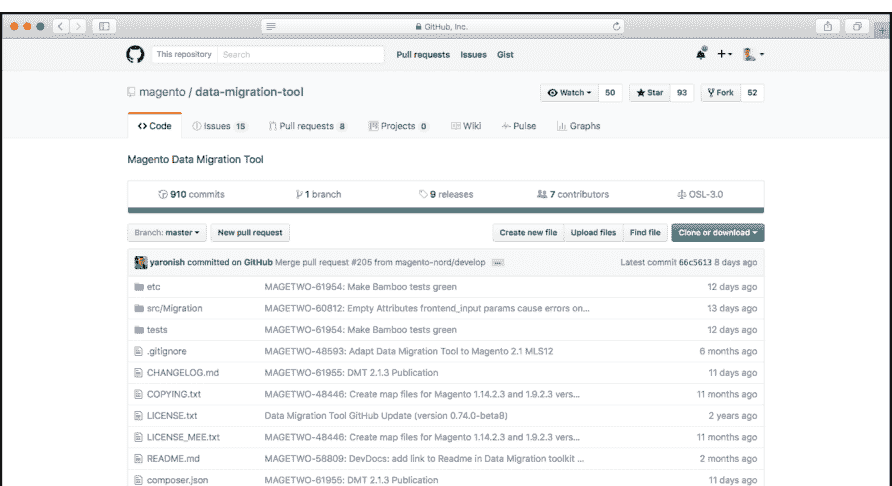


## 兼容版本

最好提到 Data Migration Tool 与以下 Magento 版本兼容：

- Magento Community Edition:
  - Version 1.6.x
  - Version 1.7.x
  - Version 1.8.x
  - Version 1.9.x
- Magento Enterprise Edition:
  - Version 1.11.x
  - Version 1.12.x
  - Version 1.13.x
  - Version 1.14.x

## 迁移流程

在使用 Data Migration Tool 之前，您应遵循以下步骤：

1. Set up an empty Magento 2 instance: The instance should meet the requirements described in Chapter 2, Installation and the cron jobs shouldn't be enabled.

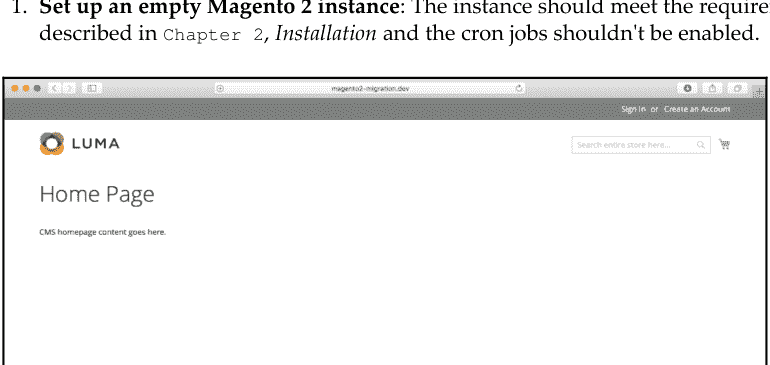

2. **Prepare your Magento 1.x instance**: From this point, make sure you don't modify the catalog, such as Products or Categories, until everything is migrated to Magento 2. Also, disable all the cron jobs and create a database backup before moving forward. It's also required to put the store into maintenance mode during the migration process. In the following image, you can see that we created a database backup using the command line:

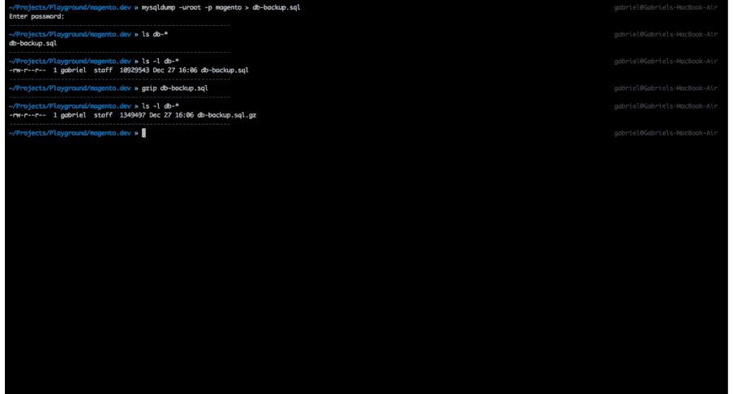

3. Ensure that you are using PHP 7 to ensure the best performance of the Data Migration Tool:

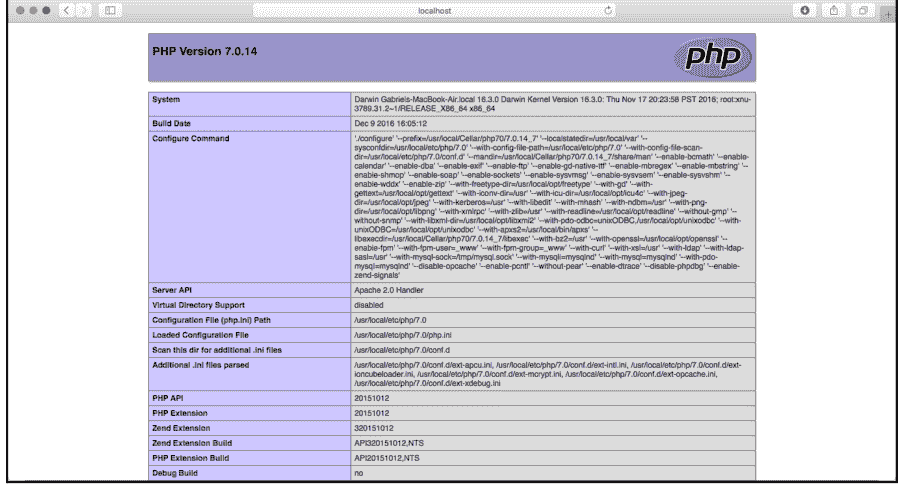

4. Install the Data Migration Tool in your Magento 2 directory by following these instructions:

   1. Go to the Magento 2 directory using the Terminal:

```shell
~/Projects $ cd Playground/magento2-migration.dev
~/Projects/Playground/magento2-migration.dev $ ls
CHANGELOG.md          Gruntfile.js.sample   LICENSE_APL.txt   composer.json   index.php   package.json.sample   pub   var
CONTRIBUTING.md       ISSUE_TEMPLATE.md     app               composer.lock   lib         php.ini.sample        setup   vendor
COPYING.txt           LICENSE.txt           bin               dev             nginx.conf.sample     phpserver   update
~/Projects/Playground/magento2-migration.dev $ 
```

   2. Check the latest release version of the Data Migration Tool at https://github.com/magento/data-migration-tool/releases:

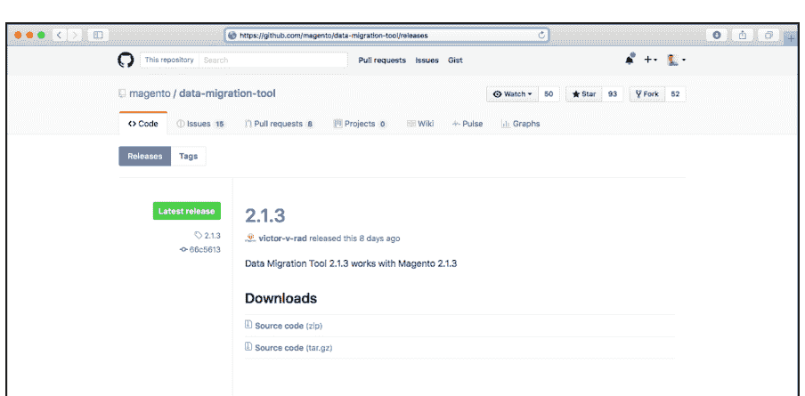

   3. Run the following commands in the Terminal:

```
composer config repositories.data-migration-tool git https://github.com/magento/data-migration-tool
composer require magento/data-migration-tool:2.1.3
```

Please note that the second command includes the latest version of the Data Migration Tool at the end (2.1.3). Make sure you update that command to match the latest release version from Github.

## Migration

The second command will require authentication from `repo.magento.com`. You can get these credentials from your Magento account by following these steps:

1. Go to `http://magento.com` and click on **MY ACCOUNT** at the top-right of the screen:


2. If you have a Magento account, log in using your username and password. If not, create your account by clicking on the Register button on the right:

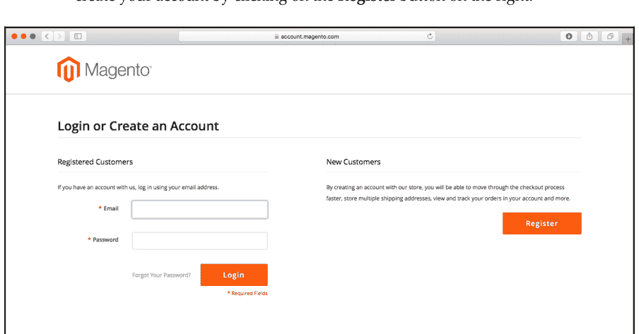

4. Click on the Magento 2 tab and then Create A New Access Key:

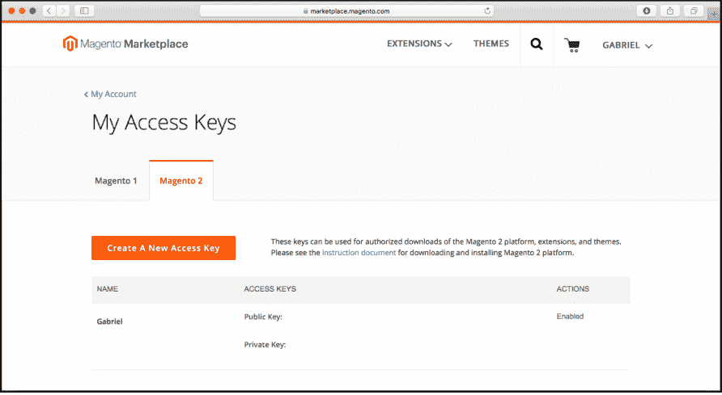

Now that you have your Access Keys, you can finish the Data Migration Tool installation by adding your credentials after running the command:

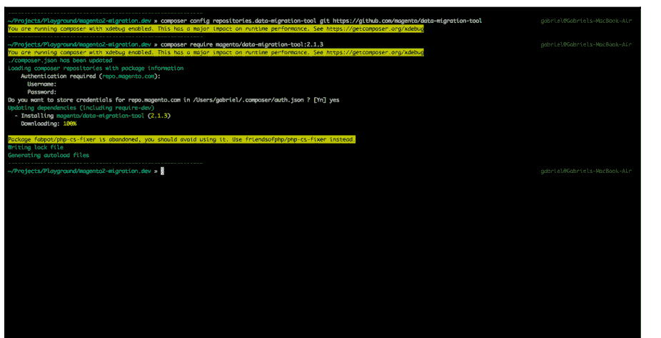

5. Configure the Data Migration Tool: After the installation, you will find the directory that contains the mapping and configuration files in the following locations in the Magento 2 directory:

- Migration from Magento 1 Community Edition to Magento 2 Community Edition:
  - `vendor/magento/data-migration-tool/etc/ce-to-ce`
- Migration from Magento 1 Community Edition to Magento 2 Enterprise Edition:
  - `vendor/magento/data-migration-tool/etc/ce-to-ee`
- Migration from Magento 1 Enterprise Edition to Magento 2 Enterprise Edition:
  - `vendor/magento/data-migration-tool/etc/ee-to-ee`

You can see the content of each of those directories in the following screenshot:

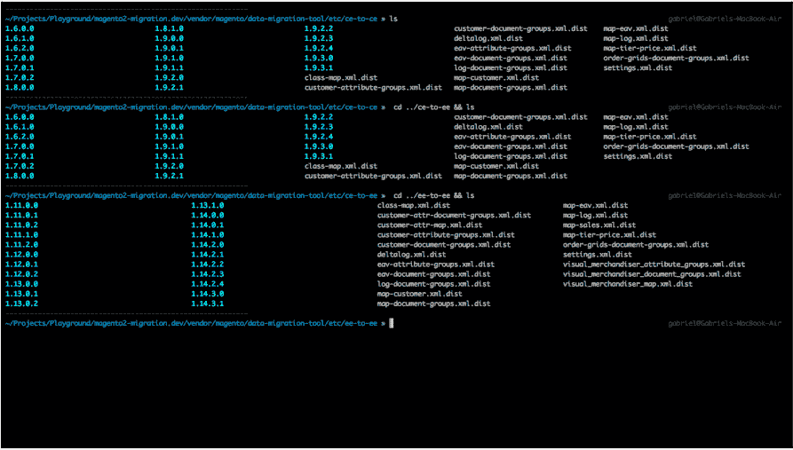

Before running the migration process, you should create `config.xml` with all the database connection details for the migration.

Depending on the type of migration (ce to ce, ce to ee, or ee to ee), you should add `config.xml` to the specific location that we previously described.

For this migration, I have prepared a Magento 1 Community Edition with a sample data instance:


This migration will be from Magento 1 Community Edition to Magento 2 Community Edition, so the location for the configuration file will be `vendor/magento/data-migration-tool/etc/ce-to-ce/<Magento 1 version>/config.xml`.

In the location, the `<Magento 1 version>` is the version number of your Magento 1 store. The installed Magento 1 version in this example is `1.9.2.4`, so the following command should be run to go to the right directory: `cd vendor/magento/data-migration-tool/etc/ce-to-ce/1.9.2.4`

There is a sample configuration file in that directory, so you should go to the directory and run the following command to duplicate it: `cp config.xml.dist config.xml`

Here, you can see all the commands to go to the right directory and duplicate the configuration file, including a preview of that file:

```shell
~/Projects/Playground/magento2-migration.dev $ cd vendor/magento/data-migration-tool/etc/ce-to-ce/1.9.2.4
~/Projects/Playground/magento2-migration.dev/vendor/magento/data-migration-tool/etc/ce-to-ce/1.9.2.4 $ ls
config.xml.dist  map.xml.dist
~/Projects/Playground/magento2-migration.dev/vendor/magento/data-migration-tool/etc/ce-to-ce/1.9.2.4 $ ls -lat
total 144
drwxr-xr-x 4 gabriel staff  1136 Dec 27 16:25 .
drwxr-xr-x 35 gabriel staff 11920 Dec 17 16:25 ..
-rw-r--r-- 1 gabriel staff  7002 Dec 19 11:38 config.xml.dist
-rw-r--r-- 1 gabriel staff  63779 Dec 19 11:38 map.xml.dist
~/Projects/Playground/magento2-migration.dev/vendor/magento/data-migration-tool/etc/ce-to-ce/1.9.2.4 $ cp config.xml.dist config.xml
~/Projects/Playground/magento2-migration.dev/vendor/magento/data-migration-tool/etc/ce-to-ce/1.9.2.4 $ cat config.xml
<?xml version="1.0" encoding="UTF-8"?>
<!--
/**
 * Copyright © 2015 Magento. All rights reserved.
 * See COPYING.txt for license details.
 */
-->
<config xmlns:xs="http://www.w3.org/2001/XMLSchema-instance" xs:noNamespaceSchemaLocation="../../config.xsd">
    <steps mode="settings">
        <step title="Settings Step">
            <integrity>Migration\Step\Settings\Integrity</integrity>
            <data>Migration\Step\Settings\Data</data>
        </step>
        <step title="Stores Step">
            <integrity>Migration\Step\Stores\Integrity</integrity>
            <data>Migration\Step\Stores\Data</data>
            <volume>Migration\Step\Stores\Volume</volume>
        </step>
    </steps>
    <steps mode="data">
        <step title="Data Integrity Step">
            <integrity>Migration\Step\DataIntegrity\Integrity</integrity>
        </step>
        <step title="EAV Step">
            <integrity>Migration\Step\Eav\Integrity</integrity>
            <data>Migration\Step\Eav\Data</data>
            <volume>Migration\Step\Eav\Volume</volume>
        </step>
    </steps>
</config>
```

Open config.xml in your favorite editor and locate the `<source>` tag:

```xml
<source>
    <step title="Customer Attributes Step">
        <delta>Migration/Step/Customer/Delta</delta>
        <volume>Migration/Step/Customer/Volume</volume>
    </step>
    <step title="Map Step">
        <delta>Migration/Step/Map/Delta</delta>
        <volume>Migration/Step/Map/Volume</volume>
    </step>
    <step title="Log Step">
        <delta>Migration/Step/Log/Delta</delta>
        <volume>Migration/Step/Log/Volume</volume>
    </step>
    <step title="OrderGrids Step">
        <delta>Migration/Step/OrderGrids/Delta</delta>
        <volume>Migration/Step/OrderGrids/Volume</volume>
    </step>
    <step title="SalesIncrement Step">
        <delta>Migration/Step/SalesIncrement/Delta</delta>
        <volume>Migration/Step/SalesIncrement/Volume</volume>
    </step>
</source>
<destination>
    <database host="localhost" name="magento1" user="root"/>
</destination>
<destination>
    <database host="localhost" name="magento2" user="root"/>
</destination>
<options>
    <map_file>etc/ce-to-ce/1.9.2.4/map.xml.dist</map_file>
    <eav_map_file>etc/ce-to-ce/1.9.2.4/eav_map.xml.dist</eav_map_file>
    <eav_document_groups_file>etc/ce-to-ce/1.9.2.4/eav_document_groups.xml.dist</eav_document_groups_file>
    <eav_attribute_groups_file>etc/ce-to-ce/1.9.2.4/eav_attribute_groups.xml.dist</eav_attribute_groups_file>
    <log_map_file>etc/ce-to-ce/1.9.2.4/log_map.xml.dist</log_map_file>
    <log_document_groups_file>etc/ce-to-ce/1.9.2.4/log_document_groups.xml.dist</log_document_groups_file>
    <settings_map_file>etc/ce-to-ce/1.9.2.4/settings.xml.dist</settings_map_file>
    <customer_map_file>etc/ce-to-ce/1.9.2.4/customer.xml.dist</customer_map_file>
    <customer_document_groups_file>etc/ce-to-ce/1.9.2.4/customer_document_groups.xml.dist</customer_document_groups_file>
    <customer_attribute_groups_file>etc/ce-to-ce/1.9.2.4/customer_attribute_groups.xml.dist</customer_attribute_groups_file>
    <delta_document_groups_file>etc/ce-to-ce/1.9.2.4/delta.xml.dist</delta_document_groups_file>
    <order_grids_document_groups_file>etc/ce-to-ce/1.9.2.4/order_grids_document_groups.xml.dist</order_grids_document_groups_file>
    <map_document_groups_file>etc/ce-to-ce/1.9.2.4/map_document_groups.xml.dist</map_document_groups_file>
    <class_map_file>etc/ce-to-ce/1.9.2.4/class_map.xml.dist</class_map_file>
    <tier_price_map_file>etc/ce-to-ce/1.9.2.4/tier_price.xml.dist</tier_price_map_file>
</options>
```

Customize the node to match the information in the Magento 1 and Magento 2 databases. Take into account that you should add the following to each of the database tags to specify the database password: `password="<database password>"` Now, locate the `<crypt_key />` tag.


将该密钥复制并粘贴到数据迁移工具配置文件中，如下所示：

```
</source>
<destination>
<database host="localhost" name="magento2migration" user="root">
</destination>
<options>
<map_file>etc/ce-to-ce/9.2.4/map.xml.dist</map_file>
<eav_map_file>etc/ce-to-ce/eav.xml.dist</eav_map_file>
<eav_document_groups_file>etc/ce-to-ce/eav/document-groups.xml.dist</eav_document_groups_file>
<eav_attribute_groups_file>etc/ce-to-ce/eav/attribute-groups.xml.dist</eav_attribute_groups_file>
<log_map_file>etc/ce-to-ce/log/map.xml.dist</log_map_file>
<log_document_groups_file>etc/ce-to-ce/log/document-groups.xml.dist</log_document_groups_file>
<settings_map_file>etc/ce-to-ce/settings.xml.dist</settings_map_file>
<customer_map_file>etc/ce-to-ce/customer.xml.dist</customer_map_file>
<customer_document_groups_file>etc/ce-to-ce/customer/document-groups.xml.dist</customer_document_groups_file>
<customer_attribute_groups_file>etc/ce-to-ce/customer/attribute-groups.xml.dist</customer_attribute_groups_file>
<delta_document_groups_file>etc/ce-to-ce/delta/log.xml.dist</delta_document_groups_file>
<order_grids_document_groups_file>etc/ce-to-ce/order-grids/document-groups.xml.dist</order_grids_document_groups_file>
<price_map_file>etc/ce-to-ce/price.xml.dist</price_map_file>
<class_map>etc/ce-to-class_map.xml.dist</class_map>
<tier_price_map_file>etc/ce-to-map/tier-price.xml.dist</tier_price_map_file>
</options>
```

如果 bulk_size=0，则将自动检测每个文档。
<bulk_size>0</bulk_size>
</...>
为了获得更好的性能，请设置 direct_document_copy = 1。
注意：'source' 和 'destination' 数据库必须位于同一 MySQL 实例上，并且 'destination' 用户必须被授予对 'source' 数据库的 'SELECT' 权限。
<direct_document_copy>0</direct_document_copy>
<source_prefix />
<auto_resolve_url_rewrite_duplicates>0</auto_resolve_url_rewrite_duplicates>
<log_file_migration>log/log_file>
<progress_bar_format>%percent% [%bar%] Remaining Time: %remaining%</progress_bar_format>
<edition_customer_password_hash>upgrade_customer_password_hash>
<edition_migrate>1.9.2.4</edition_number>
<init_statements_source>SET NAMES utf8</init_statements_source>
<init_statements_destination>SET NAMES utf8</init_statements_destination>
<crypt_key>e45b01f... </crypt_key>
</options>

6. 数据迁移工具映射：该工具使用映射文件在 Magento 1 和 Magento 2 数据库之间执行自定义数据库映射。

## 迁移数据

映射文件位于我们之前描述的相同目录中。在那里，我们将看到映射文件模板：

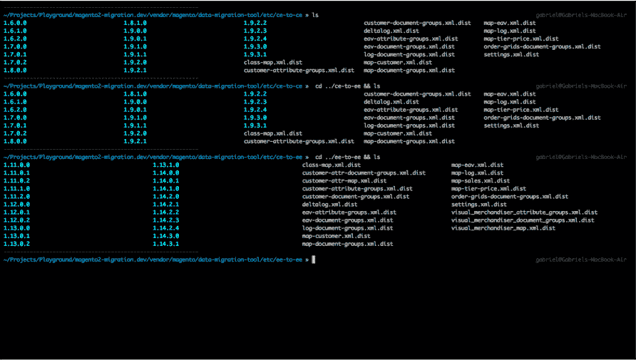

`map.xml.dist` 文件将是您最常使用的文件。除此之外，Magento 还提供了一组附加的映射文件：

+   - **通用：**
+     - `class-map.xml.dist`：Magento 1 和 Magento 2 之间的类映射
+     - `config.xml.dist`：数据迁移工具的主要配置文件
+     - `datalog.xml.dist`：用于设置数据库例程的数据表列表
+     - `settings.xml.dist`：用于 `core_config_data` 表迁移的配置文件
+   - **数据迁移工具中的 EAV 步骤：**
+     - `map-eav.xml.dist`：映射文件
+     - `eav-attribute-groups.xml.dist`：属性列表
+     - `eav-document-groups.xml.dist`：数据表列表

运行此命令只需几秒钟，您就可以将商店配置迁移到 Magento 2。

+   8. **迁移其余数据：** 在此步骤中，您将迁移所有其他数据，例如客户、订单、产品等。

该命令与上一条命令非常相似：

```
php bin/magento migrate:data <path to Data Migration Tool configuration file>
```

最终要运行的命令是：

```
php bin/magento migrate:data vendor/magento/data-migration-tool/etc/ce-to-ce/1.9.2.4/config.xml
```

此命令运行时间最长，会将 Magento 1 数据库中的所有数据映射到新数据库。

+   9. **迁移更改：** 如果您没有将商店置于维护模式，则自上次迁移数据以来可能会有新注册的客户和新订单。幸运的是，数据迁移工具允许您将这些更改也迁移到新的 Magento 2 数据库。如果您将商店置于维护模式，则此步骤不是必需的，因为不会有任何新订单或客户。

+   请注意，此步骤将迁移新客户和订单，但目录更改将不会被迁移。这就是为什么在决定继续迁移时，不要对目录进行更改很重要。

+   与之前的命令一样，我们将使用 Magento 命令行工具，并指定数据迁移工具配置文件的路径：

```
php bin/magento migrate:delta <path to Data Migration Tool configuration file>
```

最终要运行的命令是：

```
php bin/magento migrate:delta vendor/magento/data-migration-tool/etc/ce-to-ce/1.9.2.4/config.xml
```

增量迁移将实时映射 Magento 1 和 Magento 2 数据库之间的更改。您可以按 *Ctrl + C* 停止增量迁移。

## 总结

在本章中，我们回顾了从 Magento 1 迁移到 Magento 2 的过程，包括为 Magento 2 准备自定义和第三方扩展，以及将数据库中的所有信息迁移到新版本的 Magento。在下一章中，我们将回顾在 Magento 2 中创建产品的过程。

## 创建您的第一个产品、图像、库存和价格

在本章中，您将向 Magento 2 添加您的第一个产品，这是 Magento 管理员最频繁的任务之一。

我们将涵盖：

+   - 向 Magento 目录添加产品
+   - 处理图像
+   - 利用 Magento 的定价可能性

### 添加您的第一个产品

恭喜！您即将在 Magento 2 中添加您的第一个产品，这是 Magento 学习过程中的一大进步。

## 产品基本信息

首先，您应该使用用户名和密码登录到管理面板。登录后，您应该会在左侧边栏看到产品菜单项：

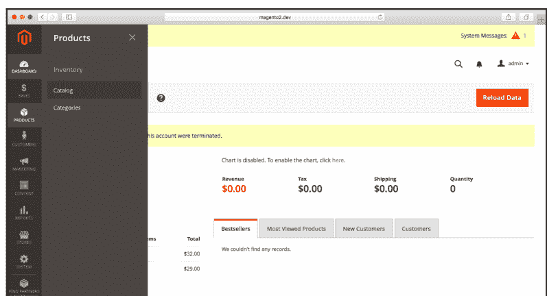

您应该转到产品 | 目录子菜单项以打开目录网格。页面加载后，您将在屏幕右上角看到“添加产品”按钮：

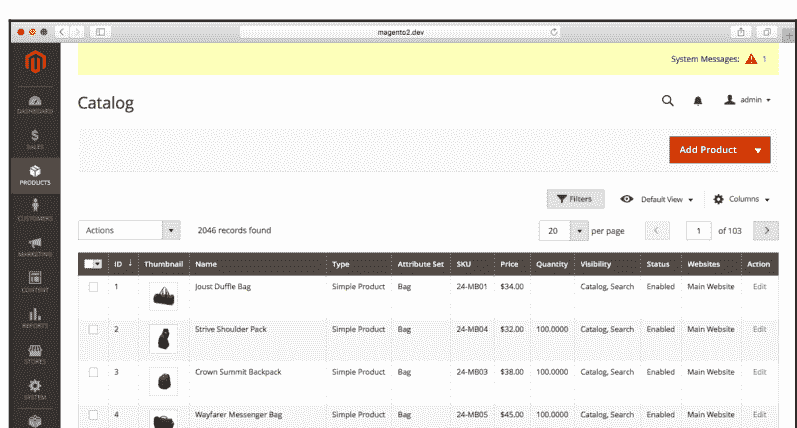

## 产品内容

当您单击该按钮时，您将被重定向到**新产品**表单。您应该会在屏幕上看到以下表单：

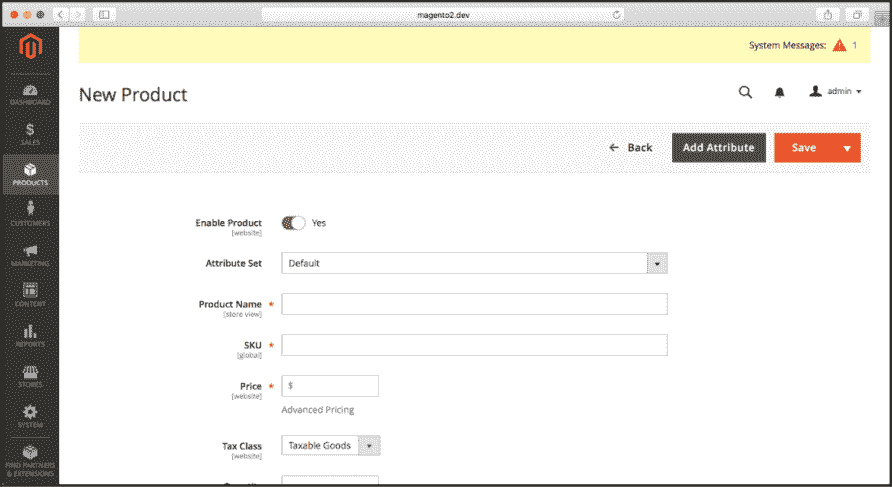

我们将逐一介绍该页面上的每个字段，以描述如何为您的新产品添加信息：

+   - 常规信息：
+     - **启用产品**：这是产品的状态。
+     - **属性集**：这是指分配给此产品的一组属性。我们将在下一章中详细介绍。
+     - **产品名称**：这是产品的名称。
+     - **SKU**：这是产品的唯一标识符。
+     - **价格**：这是产品的常规价格。
+     - **税类**：这是指与此产品关联的税务规则。
+     - **数量**：这是产品库存中的商品数量。

+   - **库存状态：** 这是一个设置，用于将产品标记为**有货**或**缺货**。
+   - **重量：** 这是产品的重量（如果适用）。
+   - **可见性：** 这将产品标记为在目录和/或搜索中可见。
+   - **类别：** 这些设置与模块关联的类别。
+   - **将产品设置为新品起始日期：** 这会在所选日期之间将产品标记为新。
+   - **制造国：** 这指定了产品的制造国家。

+   - **内容：**
+     - **描述：** 这是产品的描述。
+     - **简短描述：** 这是产品描述的简短版本。

+   - **配置：**
+     - **创建配置：** 这将创建可配置产品。这将在本书后面的章节中介绍。

+   - **图像和视频：**
+     - **添加视频：** 这可用于为产品添加视频。
+     - **浏览查找或拖拽图像到此处：** 这用于向产品添加多个图像。

+   - **搜索引擎优化：**
+     - **URL 键：** 这指定了此产品的 URL。例如，如果您将 `sample-product` 指定为 URL 键，则产品的 URL 将是 `http://magento2-playground.dev/sample-product.html`。
+     - **Meta 标题：** 这是产品的标题 meta 标签。这将是显示在谷歌等搜索引擎搜索结果中的标题。
+     - **Meta 关键字：** 这些是产品的关键字 meta 标签。它们是搜索引擎将考虑用于产品详情页的关键字。


- **元描述：** 这是产品的描述元标签。这将显示在搜索引擎结果中标题下方的描述。

- **相关产品、追加销售和交叉销售：**
  - **相关产品：** 相关产品是一组基于客户当前查看的产品而可能想要购买的产品推荐。这些产品显示在产品详情页中，如以下截图所示：

    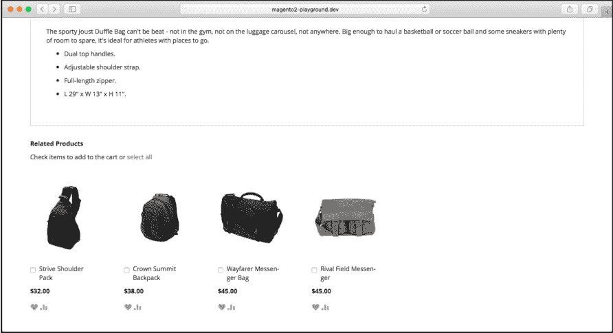

  - **追加销售产品：** 追加销售产品是来自同一产品系列中价格更高的产品。例如，如果客户正在查看显示器，追加销售会在产品详情页中推荐更昂贵的显示器。追加销售与当前产品相关联，并显示在产品详情页中，如下所示：

    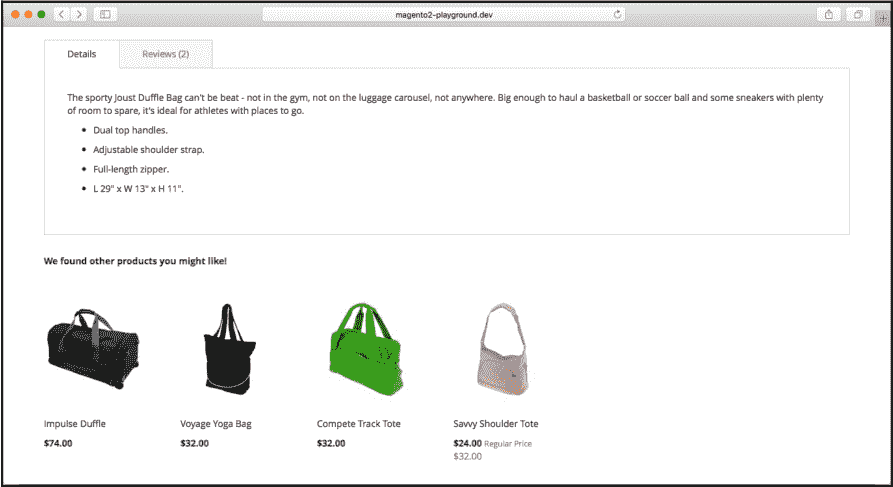

  - **交叉销售产品：** 交叉销售显示在购物车页面中。交叉销售就像在超市排队结账时、下单前看到的那样。那时，你会看到超市放在那个特定位置的产品，试图说服你购买更多。与超市一样，Magento 中的交叉销售产品旨在说服客户在下单前购买更多产品。交叉销售产品显示在购物车中，如下所示：

    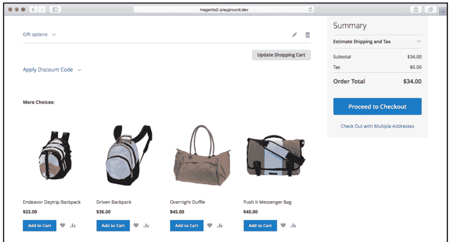

- **可自定义选项：**
  - **添加选项**：这为产品添加自定义选项。可自定义选项可以使用以下字段类型：
    - 文本字段
    - 文本区域
    - 文件
    - 下拉列表
    - 单选按钮
    - 复选框
    - 多选
    - 日期
    - 日期和时间
    - 时间

- **产品所在网站：**
  - **网站**：如果您的 Magento 商店有多个视图，您可以将产品设置为与特定视图关联。

- **设计：**
  - **布局：** 用于设置产品详情页的特定布局：
    - **空**
    - **1 列**
    - **2 列，带左侧栏**
    - **2 列，带右侧栏**
    - **3 列**
  - **产品选项显示位置：** 设置产品选项的特定位置：
    - **产品信息列**
    - **信息列后的块**
  - **布局更新 XML：** 为产品布局添加自定义 XML 配置，例如产品详情页的自定义样式表。
  - **计划设计更新：**
    - **计划设计从 – 至：** 这是在特定日期范围内应用的计划自定义设计。
    - **新主题：** 在计划日期为产品详情页设置特定主题。
    - **新布局：** 在计划日期为产品详情页设置特定布局：
      - **空**
      - **1 列**
      - **2 列，带左侧栏**
      - **2 列，带右侧栏**
      - **3 列**
  - **礼品选项：**
    - **允许礼品留言：** 允许客户在此产品上设置礼品留言。

- **可下载信息：**
  - **这是可下载产品吗？：** 仅当产品的重量属性已设置为**该商品无重量**时，此选项才可用。如果产品是可下载产品，您可以添加链接和示例。

既然我们已经查看了**新产品**页面的所有字段，接下来我们将创建第一个产品。

我们将使用以下信息创建一个简单产品：

## 基本信息：

- **启用产品：** 是
- **属性集：** 默认
- **产品名称：** `Red Shirt`
- **SKU：** `Red-shirt`
- **价格：** `$50.00`
- **税类：** 应税商品
- **数量：** `100`
- **库存状态：** 有货
- **重量：** `25 lbs`
- **可见性：** 目录，搜索
- **类别：** 默认类别 | 男装 | 上衣

## 内容：

- **描述：** 这是产品的长描述。
- **简短描述：** 这是产品的简短描述。
- **图片和视频：**
  - 为此产品上传两张图片。

为产品填写完这些信息后，点击**保存**。您将在屏幕上看到以下消息：

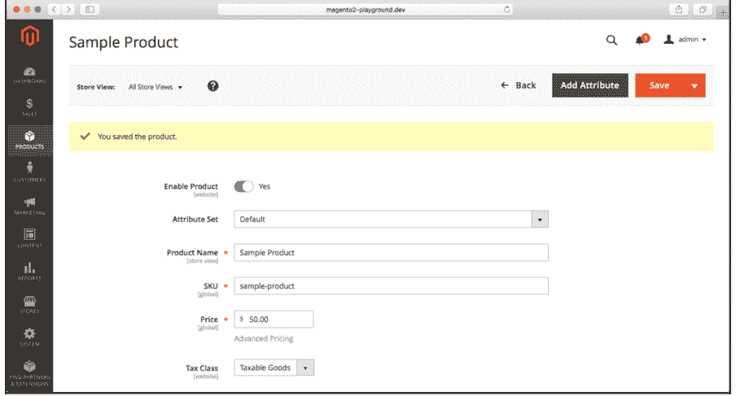

现在，是时候在网站上查看我们的产品了。

首先，访问主页：http://magento2-playground.dev/。

接下来，转到“男装 | 上衣”类别（新产品已与该类别关联）。您将看到新产品位于网格中的第一位：

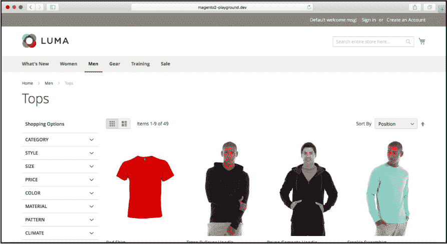

如果您点击该产品，您将被重定向到产品详情页。在那里，您将看到我们在新产品表单中添加到产品的所有信息：

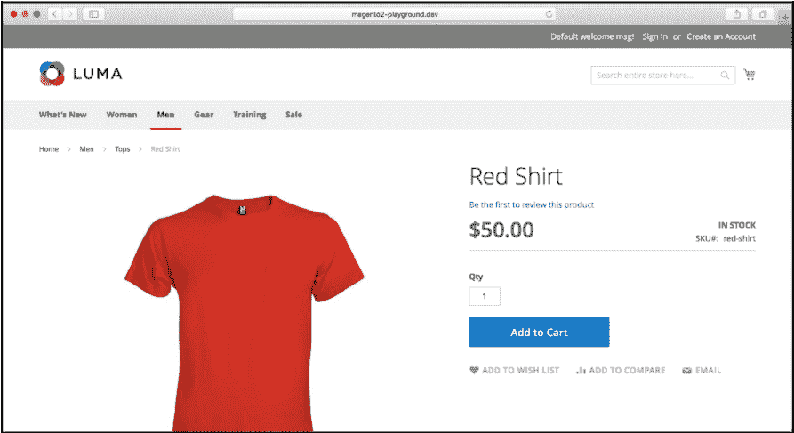

## 处理图片

在上一节中，您在 Magento 2 中创建了第一个产品。您可能想知道如何为产品列表页、产品详情页和购物车分配不同的图片。Magento 2 提供了为这些位置分别指定不同图片的功能，我们将在本节中介绍这一概念。

如果您返回并打开您在管理面板中创建的产品，您将看到类似以下截图的内容：

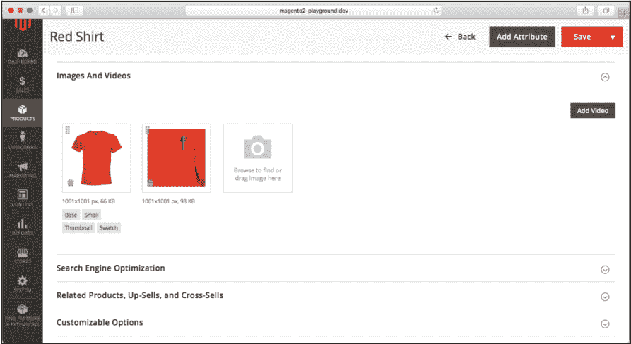

在每个图片缩略图的顶部，您会看到两个图标：

- **缩略图左上角的八个点：** 您可以直接拖放缩略图来设置产品详情页图片的顺序。
- **缩略图左下角的垃圾桶图标：** 您可以点击此图标移除图片。

在每个图片缩略图下方，您会看到以下内容：

- 图片的一般信息，例如图片大小和分辨率。
- 指示图片位置的标签。这些标签可以包括：
  - **基础**
  - **小图**
  - **缩略图**
  - **色板**

现在，让我们逐一了解这些位置的含义：

- **基础图片：** 基础图片作为产品详情页上的主图片显示。如果上传的图片大于图片容器，则启用缩放功能。
- **小图片：** 小图片用于多个位置，包括产品列表页、搜索结果页、相关产品和追加销售块。
- **缩略图：** 缩略图显示在购物车页面和交叉销售块中。
- **色板：** 色板图片是代表产品颜色、纹理或图案的示例图片。

如果您点击图片缩略图，**图片详情模态框**将从左侧出现，并显示该图片的配置，如以下截图所示：

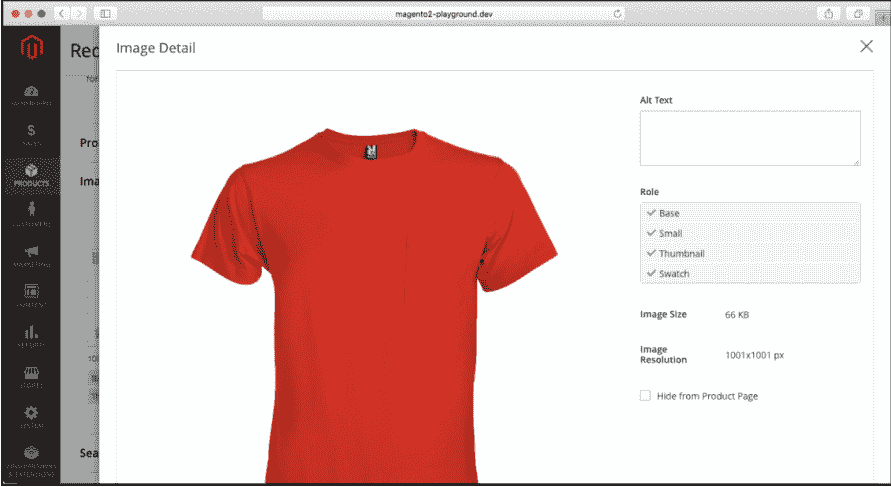

在**图片详情模态框**中，您可以更新以下图片配置：

- **替代文本**：替代文本是推荐用于 SEO 的属性。它有助于搜索引擎理解图片的内容。此外，**替代文本**会在鼠标悬停时以弹出框的形式显示在浏览器中。
- **角色**：您可以将图片与之前描述的特定角色关联，例如**基础**、**小图**、**缩略图**和**色板**。
- **图片的一般信息**：这指的是**图片大小**和**图片分辨率**。
- **从产品页面隐藏**：您可以标记此图片以使其不显示在产品详情页上。

## 使用 Magento 的定价功能

您可能已经在**新产品**页面上看到了**高级定价**链接。如果没有，您可以在**价格**字段正下方看到该链接：

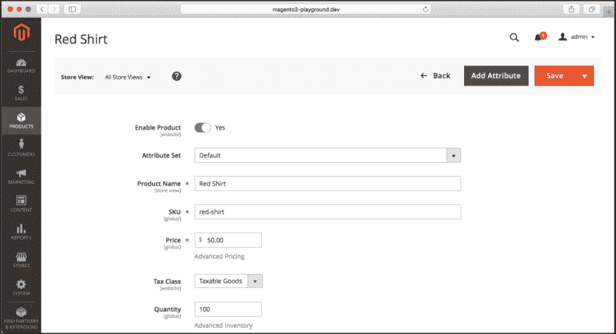


## 创建您的第一个产品、图像、库存和价格

如果您点击该链接，**高级定价** 模型将显示在屏幕上，允许您为产品设置高级定价规则：

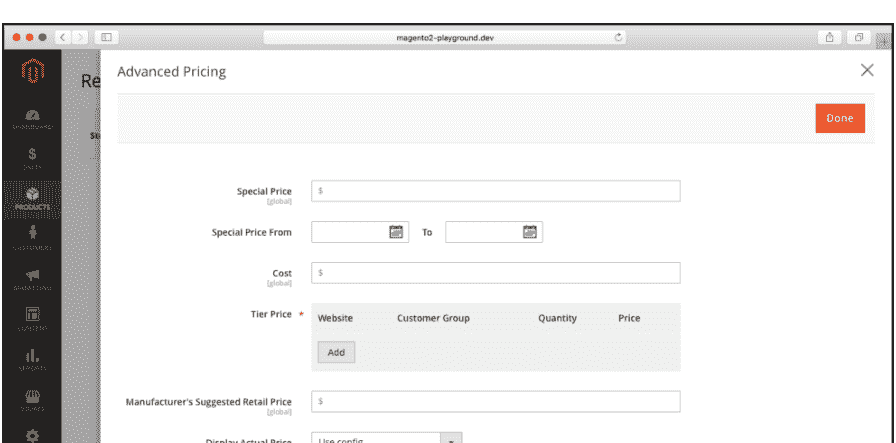

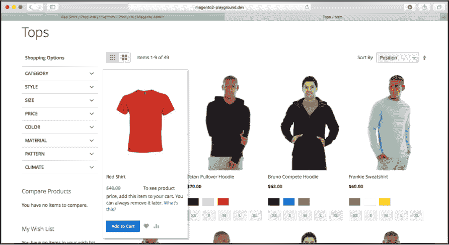

这是在产品详情页中的显示效果：

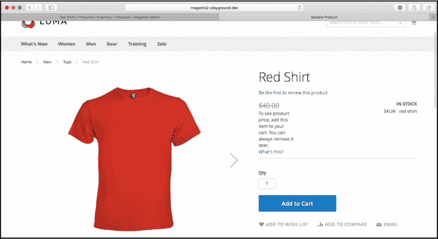

- **成本：** 这是代表产品成本的管理员信息。
- **阶梯价格：** 这是根据网站、客户组和购买数量而定的产品折扣价。
- **厂商建议零售价：** 这是产品的最低广告价格。
- **显示实际价格：** 通过此选项，您可以选择应显示 **厂商建议零售价 (MSRP)** 的位置：
  - **On Gesture：** 选择此选项时，MSRP 会在产品列表页和产品详情页中显示。此外，MSRP 价格旁边会添加一个 **Click for price** 链接，点击后会打开一个包含产品价格更多信息的弹出层。这是在产品列表页中 **On Gesture** 选项的显示效果：

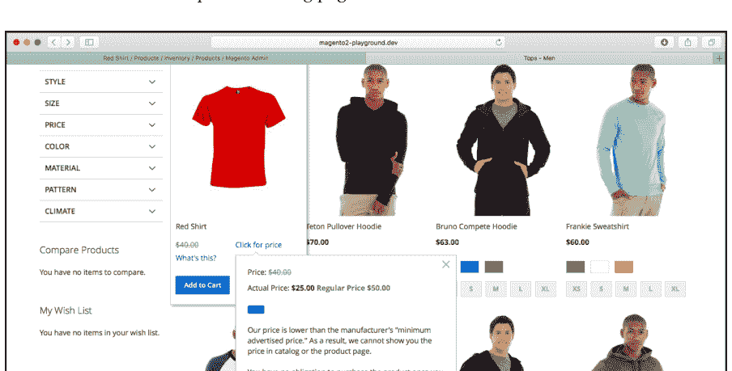

- **Before Order Confirmation**：最终价格在结账的最后一步显示。MSRP 和一条消息会在产品列表、产品详情和 **Shopping Cart** 页面中显示，以通知客户结账时的价格信息。以下是 MSRP 和消息在产品列表页中的显示方式：

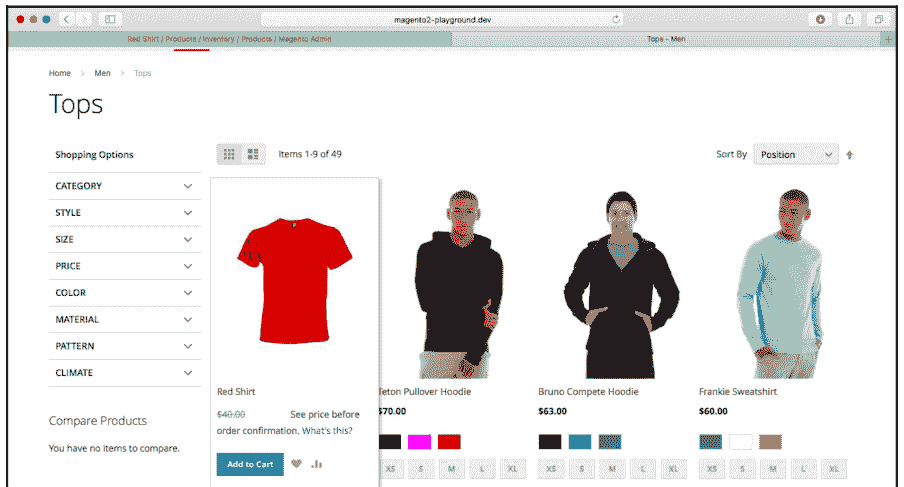

这是在产品详情页中的显示效果：

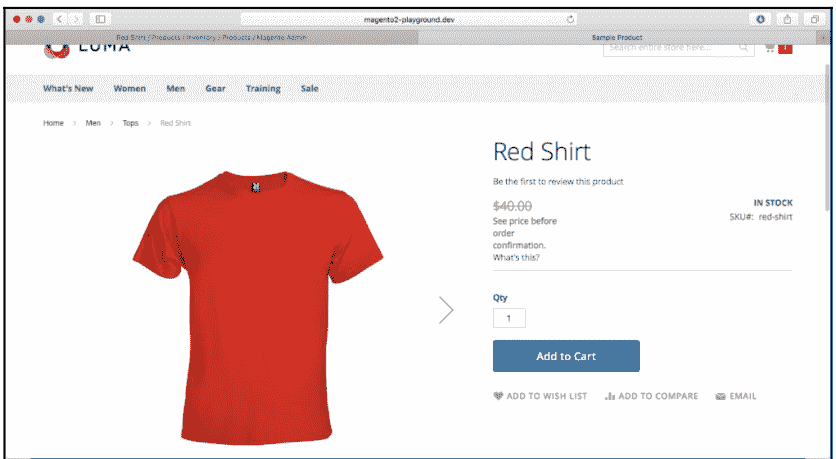

这里可以看到购物车页面：


## 总结

在本章中，我们学习了如何添加新产品，包括设置高级定价选项和产品图片。

在下一章中，我们将介绍属性和属性集，以向您的产品添加更多信息。

**Product** 属性是目录的核心部分。尽管您可以管理属性，但不能删除 Magento 默认包含的系统属性。为了查看系统属性列表，您应该通过 **System: Yes** 过滤网格，如以下屏幕截图所示：


如您所见，Magento 中有 43 个系统属性。您必须熟悉其中大部分，因为这些属性是我们在上一章中回顾的 **New Product** 表单字段的一部分。

## 创建产品属性

您可以在 Magento 中创建自定义产品属性，以向目录中的产品添加自定义信息。您可以通过以下步骤查看 **New Product Attribute** 表单：

1. 在 **Product** 属性网格的右上角点击 **Add New Attribute**。
2. 您将在屏幕上看到以下表单：


我们将逐一介绍表单上的每个字段：

- **Properties | Attribute Properties:**
  - **Default Label**：这是数据录入时描述新属性的标签。
  - **Catalog Input Type for Store Owner**：这为 **Product** 属性设置数据类型和输入控件。需要说明的是，一旦属性类型创建后，就无法更改。以下选项可用：
    - **Text Field**
    - **Text Area**
    - **Date**
    - **Yes/No**
    - **Multiple Select**
    - **Dropdown**
    - **Price**
    - **Media Image**
    - **Fixed Product Tax**
    - **Visual Swatch**
    - **Text Swatch**
  - **Values Required**：这定义了 **Product** 属性的值是否为必填。
- **Properties | Advanced attribute properties:**
  - **Attribute Code**：这为 **Product** 属性指定内部使用的唯一标识符。代码仅允许字母 (a-z)、数字 (0-9) 和下划线，且第一个字符应为字母。代码必须少于三十个字符且不能包含空格。
  - **Scope**：这定义属性是否可以在全局、网站或商店视图级别进行自定义。
  - **Default Value**：这是数据录入时为属性声明的默认值。
  - **Unique Value**：这设置此 **Product** 属性的值是否在作用域设置范围内唯一。例如，SKU 是一个系统属性，必须具有唯一的值来标识每个产品。
  - **Input Validation for Store Owner**：这在从管理面板创建产品时为属性值设置验证。

## 属性集和自定义属性

- **Add to Column Options：** 这将属性包含在产品网格的列选项列表中。
- **Use in Filter Options：** 这将属性包含在产品网格的过滤器选项列表中。
- **Manage Labels:**
  - **Manage Titles (Size, Color, etc.)：** 这按商店视图自定义 **Product** 属性的标签。例如，如果您有三种不同语言的商店视图，您可以为每个商店视图翻译标签。
- **Storefront Properties:**
  - **Use in Search：** 如果为 Yes，则属性将包含在搜索查询中，客户将能够根据属性值在目录中进行搜索：
    - **Search Weight：** 如果 Use in Search 设置为 Yes，则此字段将显示。您可以通过设置 1 到 10 之间的数字来设置搜索查询的优先级，其中 10 优先级最高。
    - **Visible in Advanced Search：** 如果 Use in Search 设置为 Yes，则您可以指定 **Product** 属性是否应包含在 **Advanced Search** 表单中。


注意：在 Magento 搜索中包含太多属性可能会降低搜索性能。

- **Comparable on Storefront：** 在 **Compare Products** 页面中包含 **Product** 属性。
- **Use in Layered Navigation：** 如果属性类型为 Dropdown、Multiple Select 或 Price，您可以将属性添加到产品列表页的分层导航（左侧边栏）中。
- **Use in Search Results Layered Navigation：** 如果属性类型为 Dropdown、Multiple Select 或 Price，您可以将属性添加到搜索结果页的分层导航（左侧边栏）中。


> 注意：在 Magento 分层导航中包含太多属性可能会降低产品列表页和搜索结果页的性能。

- **Position：** 这设置属性在分层导航中的位置，相对于该区块中的其他属性。
- **Use for Promo Rule Conditions：** 这将属性添加到促销规则可用条件列表中。
- **Allow HTML Tags on Storefront：** 这用于定义属性值是否可以包含用于格式化的 HTML。
- **Visible on Catalog Pages on Storefront：** 这将 **Product** 属性包含在产品详情页的 **Additional Information** 标签中。此配置仅适用于简单产品和虚拟产品。
- **Used in Product Listing：** 这将属性包含在产品列表页中。此属性配置取决于主题。
- **Used for Sorting in Product Listing：** 这将属性包含在产品列表页的 **Sort By** 选项中。此属性配置取决于主题。

现在我们回顾了 **New Product Attribute** 表单，我们准备为上一章中创建的产品创建一个自定义属性。

我们将为之前创建的 **Red Shirt** 创建一个新的产品属性——**Sleeve Length**。

在 **New Product Attribute** 表单中为该属性设置以下信息：

- **Properties | Attribute Properties:**
  - **Default Label:** `Sleeve Length`
  - **Catalog Input Type for Store Owner:** Dropdown
  - **Values Required:** No


- **管理选项（属性的值）**：在 **管理选项（属性的值）** 情况下，由于该属性的输入类型为 **下拉列表**，我们必须指定选项，如以下屏幕截图所示：


- **属性 | 高级属性属性：**
  - **属性代码：** `sleeve_length`
  - **作用域：** Store View
  - **唯一值：** 否
  - **添加到列选项：** 是
  - **用于筛选选项：** 是

- **管理标签：**
  - **管理标题（尺寸、颜色等） | 默认 Store View：** `Sleeve Length`

- **Storefront 属性：**
  - **用于搜索：** 是
  - **搜索权重：** 10
  - **在高级搜索中可见：** 是
  - **可在 Storefront 上比较：** 是
  - **用于分层导航：** 可筛选（带结果）
  - **用于搜索结果分层导航：** 是
  - **用于促销规则条件：** 是
  - **Storefront 上允许 HTML 标签：** 是
  - **在 Storefront 的目录页面上可见：** 是
  - **用于产品列表：** 是
  - **用于产品列表排序：** 是

当您为属性添加了所有信息后，应点击屏幕右上角的 **保存属性**。

保存属性后，您将看到以下弹出窗口：


该消息通知数据库需要重新索引。索引是 Magento 准备数据（如产品和属性）以提高商店性能的方式。当数据发生变化时，需要重新索引以更新数据库中的信息。

例如，当您更改产品的价格时，必须重新索引价格更改，以便在产品详情页中显示更新后的价格。如果不进行索引，Magento 将不得不即时计算每个产品的价格，包括高级价格规则、促销等的计算。

为了避免手动重新索引，您应设置 Magento cron 作业每分钟运行一次。由于我们未配置 cron 作业，因此应手动运行重新索引过程。

要重新索引，您可以点击来自最新屏幕截图的弹出窗口上的 **索引器无效** 链接，或前往 **系统 | 工具 | 索引管理** 菜单项。

在那里，您将看到索引器列表，您将看到需要重新索引的 **索引产品 EAV** 索引器，如以下屏幕截图所示：


如果您的网站未运行 cron 作业，您可以从 Magento 命令行工具手动运行重新索引：

1. 打开终端并进入项目文件夹。
2. 运行以下命令：

```bash
php bin/magento indexer:reindex
```

您将从命令中看到以下输出：


如果您重新加载管理面板中的页面，您将看到索引器不再需要更新：


### 属性集

正如我们在前一节中看到的，您可以通过添加新属性为产品定义新属性。当您创建属性时，它不会立即在新建产品表单中可用。例如，我们创建的袖长属性在编辑红衬衫产品或任何其他产品时尚未可用。

属性按属性集分组。属性集代表与特定产品系列相关的属性列表。例如，**袖长** 属性应为 **衬衫** 属性集的一部分。因此，该特定服装属性仅对与 **衬衫** 属性集关联的产品可用。

如果您添加新属性并希望该属性对大多数产品可用，则可以将它与 **默认** 属性集关联。

您可以通过进入管理面板的下一节，即 **商店 | 属性 | 属性集** 来查看属性集列表，如下所示：


如果您点击 **默认** 属性集，您将打开编辑该属性集的表单：


您将看到包含以下三个列的表单：

- **编辑属性集名称：** 这会更新属性集的名称。
- **组：** 这指定与此属性集关联的属性列表。这些属性包含在不同的组中以便于产品管理。
- **未分配属性：** 这是未与此属性集关联的属性列表。您可以将属性从此列表拖放到 **组** 列表中以将它们与属性集关联。

我们将为第一章中创建的 **衬衫** 创建第一个自定义属性集。

返回到 **属性集** 网格并点击 **添加属性集**，您将能够找到以下内容：

- **名称：** 在此处输入 `Shirt`
- **基于：** 您可以从现有属性集中选择将默认包含在新属性集中的属性。我们将选择 **默认** 属性集：


如果未配置 cron，您将在屏幕上看到以下消息：


正如我们之前看到的，我们应使用 Magento 命令行工具重新索引数据库：

```bash
php bin/magento indexer:reindex
```

### 将属性集与产品关联

现在我们有了包含新属性的新属性集，让我们继续将属性集与产品关联。

1. 导航到目录页面，即 PRODUCTS | Catalog。
2. 选择我们在上一章中创建的红衬衫：

   

3. 从 **属性集** 下拉列表中选择 **Shirt**：

   

4. 您将在 **新建产品** 表单中看到新属性。请注意，属性将显示在您在前一节中将属性从 **未分配属性** 移动到 **组** 列时所选择的组中。从列表中选择 **短袖**：

   

5. 点击屏幕右上角的 **保存**。

现在，产品已与新的属性集关联，并且包含我们在本章中创建的新属性。

让我们看看它在产品详情页上的显示效果：


现在，让我们检查属性是否也能在其他位置看到。

### 比较产品页面：

**比较产品** 页面如下显示该属性：


以下是产品列表页面中分层导航的视图（左侧边栏）：


请看以下在搜索结果页面中分层导航的视图（左侧边栏）：


以下屏幕截图显示了产品列表页面中的排序方式下拉菜单：


高级搜索表单（http://magento2-playground.dev/catalogsearch/advanced/）如下：


以下屏幕截图显示了管理面板中的促销规则条件：


## 摘要

在本章中，我们创建了一个属性和一个属性集，并将该属性集与产品关联。现在你可以通过属性添加新特性并通过属性集对它们进行分组来自定义产品。在下一章中，我们将介绍 Magento 中的不同产品类型和产品关系。
