# 6 产品类型

本章我们将介绍以下部分：

- Magento 中不同产品类型的介绍
- 简单产品
- 可配置产品
- 组合产品
- 虚拟产品
- 捆绑产品
- 可下载产品

## Magento 中不同产品类型的介绍

Magento 最重要的功能之一就是产品类型。不同的产品类型允许你以不同的方式设置产品，例如，在产品详情页中提供一组产品，或允许客户购买可下载产品。

Magento 中有六种产品类型：

- 简单产品
- 可配置产品
- 组合产品
- 虚拟产品
- 捆绑产品
- 可下载产品

你可以通过以下步骤查看列表：

1. 在管理面板中进入以下部分：
   **Products | Inventory | Catalog**
2. 点击屏幕右上角 **Add Product** 按钮内的箭头：

   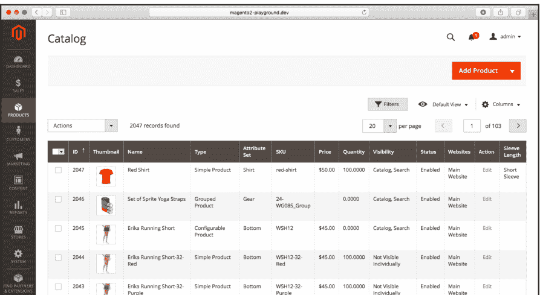

需要提到的是，Magento 可以根据产品信息设置正确的产品类型。例如，如果你添加一个没有重量的新产品，Magento 将创建一个虚拟产品。

你将看到我们在上一步中包含的新属性：

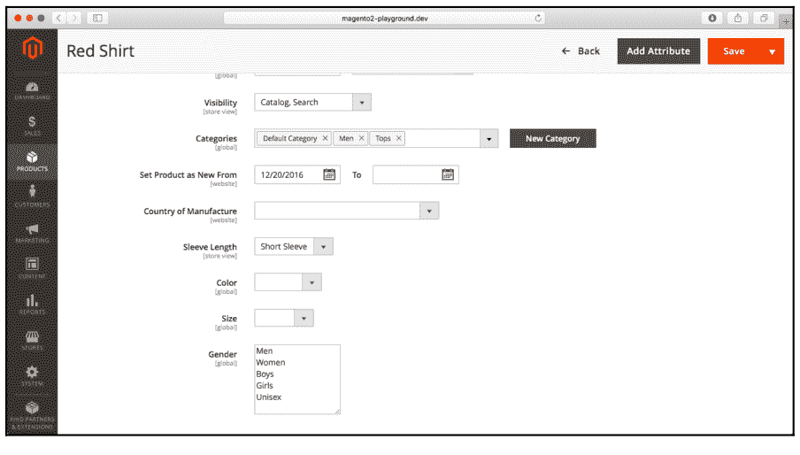

3. 我们将按如下方式更新产品信息：

- Product Name: Red Shirt - Men - L
- Color: Red
- Size: L
- Gender: Men

4. 接下来，点击保存，然后像我们在前几节中看到的那样重新索引目录。

如果我们返回 Storefront 并打开 Red Shirt 产品的产品详情页，我们将看到更新后的产品显示了该简单产品所需的所有信息：

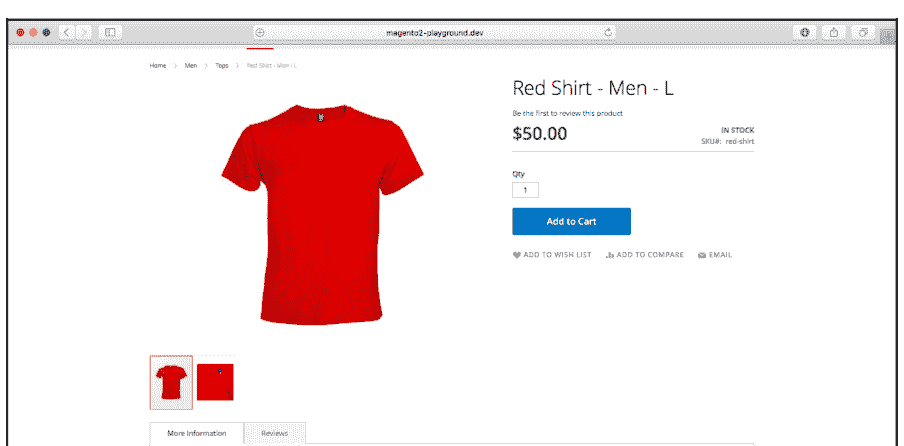

## 可配置产品

现在，假设你有不同尺寸和颜色的衬衫。如果将它们全部添加为简单产品并在目录中显示，结果将在产品列表页中出现几件看起来完全相同的红衬衫。找到所需的衬衫会很困难，而且在视觉上会令人困惑。

幸运的是，Magento 允许你创建可在产品详情页中配置的产品。在我们的示例中，你将拥有一个衬衫产品，可以从产品详情页中选择颜色和尺寸等多个选项。

这就是可配置产品的概念。可配置产品由关联的简单产品组成。当客户在可配置产品中选择一种组合时，客户实际上是从可配置产品页面中选择哪个简单产品将被添加到购物车。

让我们创建第一个可配置产品：Shirt。为此，我们将遵循以下步骤：

1. 进入 PRODUCTS | Inventory | Catalog 页面并选择 Red Shirt。
2. 点击 Add Product 按钮内的箭头，并选择 Configurable Product。

   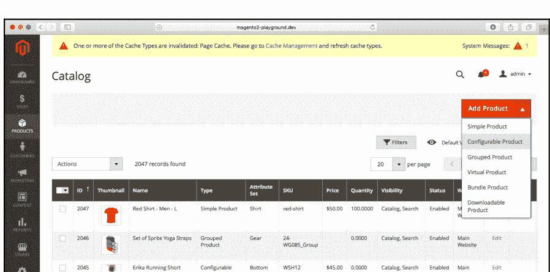

3. 为可配置产品设置以下信息：

   **General Information:**

   - Enable Product: Yes
   - Attribute Set: Shirt
   - Product Name: Shirt
   - SKU: shirt
   - Price: $50
   - Tax Class: Taxable Goods
   - Quantity: 100
   - Stock Status: In Stock
   - Weight: 1 lbs.
   - **Visibility:** Catalog, Search
   - **Categories:** Default Category | Men | Tops
   - **Sleeve Length:** None
   - **Color:** None
   - **Size:** None
   - **Gender:** None

   **Configurations:**

   - **Create Configurations:** 点击此按钮以打开 **Create Product Configurations** 窗口，如以下屏幕截图所示：

     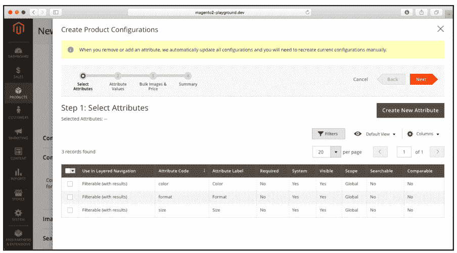

4. 按照以下步骤为可配置产品创建不同的配置（简单产品）：

    - **Step 1: Select Attributes:** 选择产品的可配置属性。所选属性集的可配置属性列表将显示在列表中。选择 **color** 和 **size**，然后点击屏幕右上角的 **Next** 按钮：

      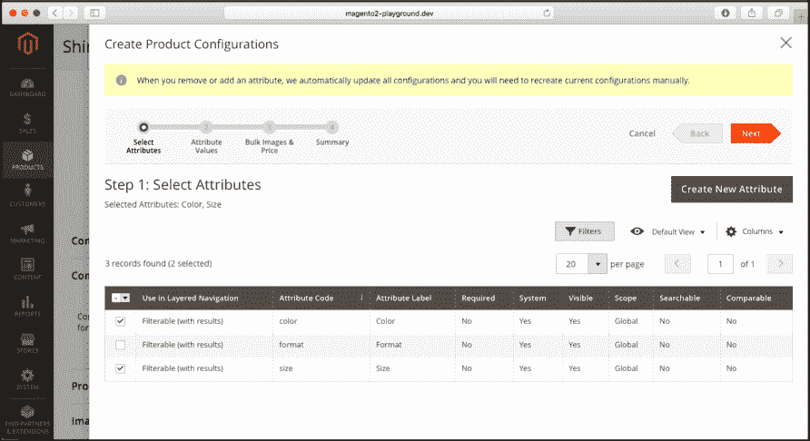

    - **Step 2: Attribute Values:** 在此步骤中，你可以选择产品可用的组合。每个唯一组合将创建一个新的简单产品。

      选择以下颜色：

      - **Black**
      - **Blue**
      - **Green**
      - **White**

      然后，选择以下尺寸：

      - S
      - M
      - L
      - XL

      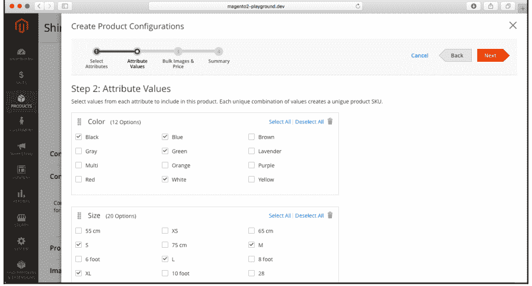

    - **Step 3: Bulk Images, Price, and Quantity:** 在步骤标题下方，你将看到根据你在上一步中选择的设置将创建的简单产品数量。在此步骤中，你可以自定义每个产品组合的图像、价格和数量。

      **Create Product Configurations**

      **Step 3: Bulk Images, Price and Quantity**

      Based on your selections 16 new products will be created. Use this step to customize images and price for your new products.

      **Images**

      - Apply single set of images to all SKUs
      - Apply unique images by attribute to each SKU
      - Skip image uploading at this time

      **Price**

      - Apply single price to all SKUs
      - Apply unique prices by attribute to each SKU
      - Skip price at this time

      **Quantity**

      - Apply single quantity to each SKUs
      - Apply unique quantity by attribute to each SKU
      - Skip quantity at this time

      你可以从以下选项中进行选择：

      **Images:**

      - **Apply a single set of images to all SKUs**: 如果选择此选项，你将能够上传一组图像并将其应用于所有产品组合。
      - **Apply unique images by attribute to each SKU**: 通过选择此选项，你将能够选择一个可配置属性，然后为每个属性值上传图像。例如，我们可以选择 Color，然后为产品的每种颜色上传图像。
      - **Skip image uploading at this time**: 你可以跳过此步骤并稍后上传图像。

      **Quantity:**

      - **Apply single quantity to each SKUs**: 将 100 设置为所有产品组合的数量

    - **Step 4: Summary**: 在此步骤中，你可以查看将为可配置产品创建的所有产品组合。查看完产品列表后，你可以点击 **Next** 完成产品配置：

      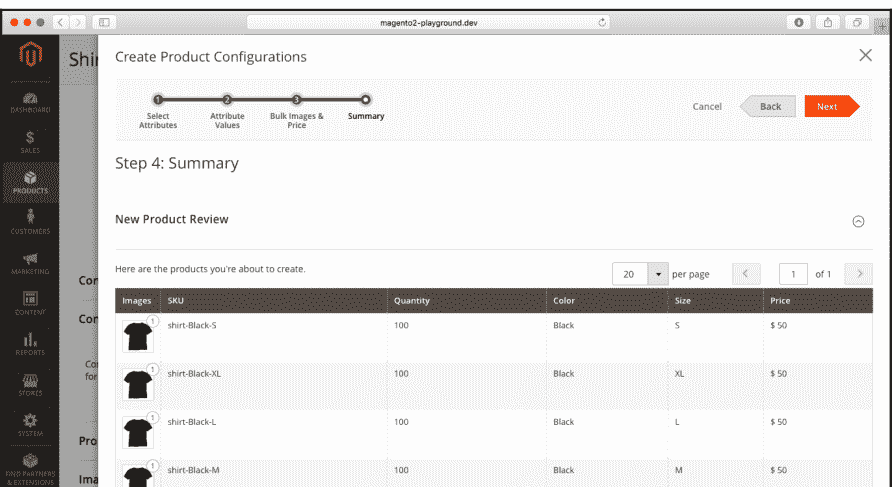

5. 最后，我们将为可配置产品上传一张图片。流程与我们在第 4 章《创建你的第一个产品、图像、库存和价格》中为 Red Shirt 上传图片时遵循的流程相同。

   对于此可配置产品，我创建了一张特殊图片，展示了多种颜色在一张图片中：

   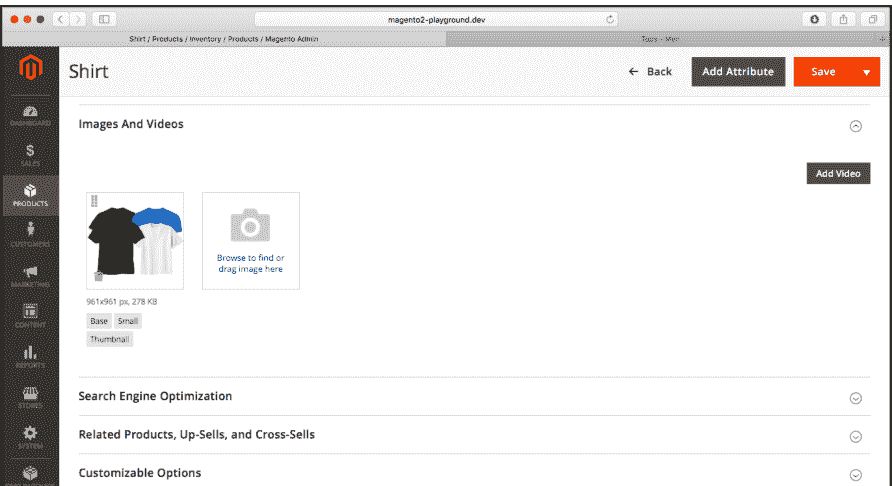

6. 最后，点击保存将产品添加到目录。我们准备好保存可配置产品并查看其在 Storefront 上的显示效果。

   这是可配置产品在产品列表页中的显示效果：

   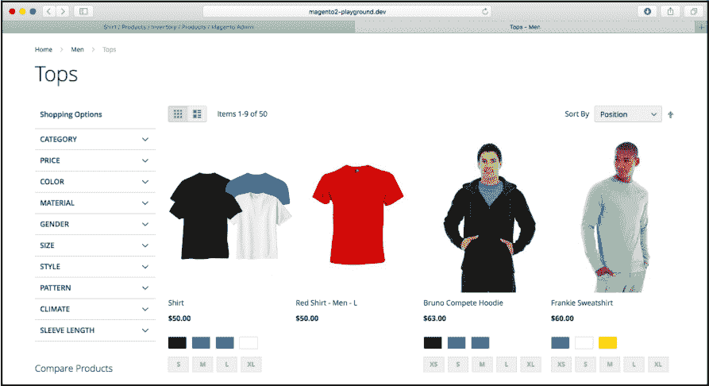

   如果你点击蓝色色块，你会看到产品列表页中的图片已更新：

   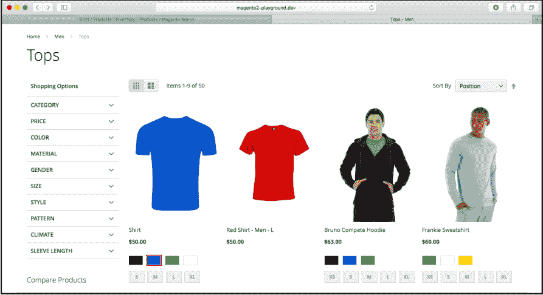

以下是产品在产品详情页中的显示效果：

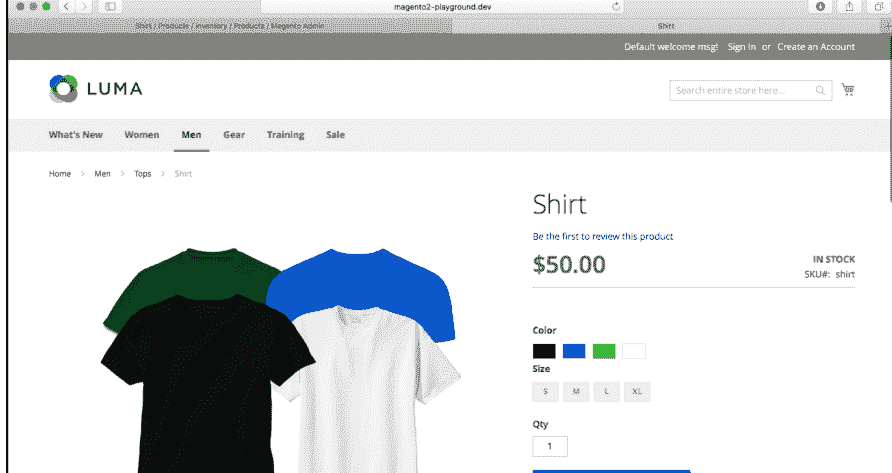

与产品列表页一样，点击颜色色块时产品图片会更新：

如果将可配置产品添加到购物车中，则在购物车项目中可以看到所选组合的详细信息：

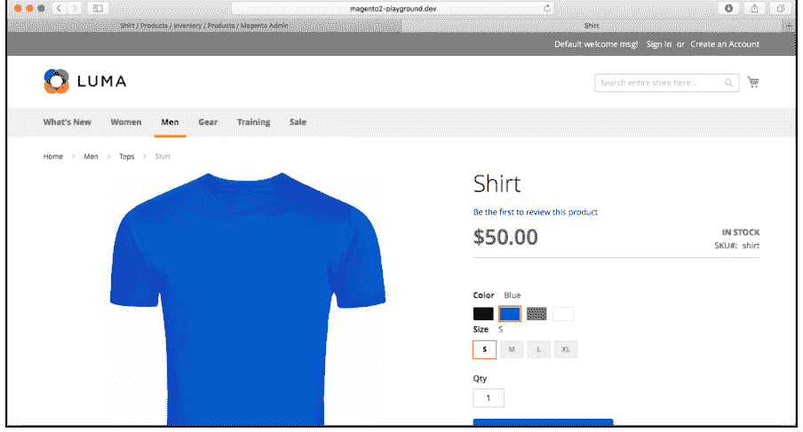

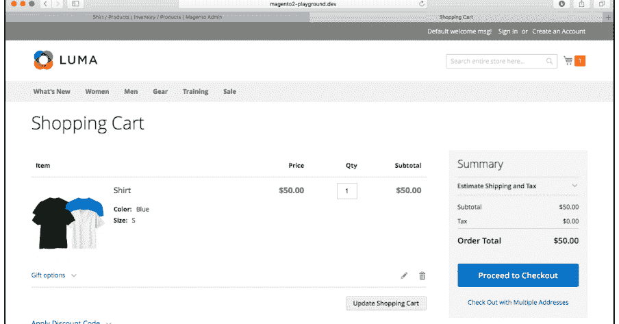

在这里，你可以在结账页面中看到详细信息：

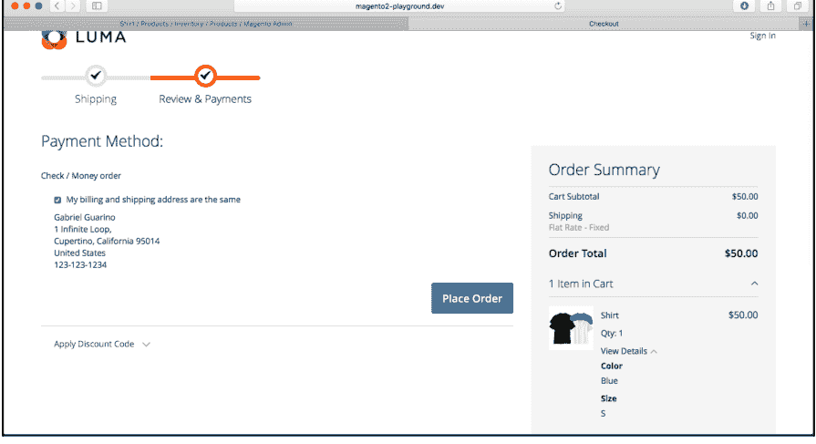

### Grouped Product

组合产品是在产品详情页中一起展示的简单产品。假设你想在主产品之外展示配件：

- Digital camera
- Memory card
- Tripod

通过这样做，你有机会将一组产品一起展示，以提高全部售出的概率。有多种方法可以实现这一点，而 **Grouped Product** 类型是其中之一。

让我们创建一个 **Grouped Product**：

1. 前往 **PRODUCTS | Inventory | Catalog** 页面。
2. 点击 **Add Product** 按钮内的箭头并选择 **Grouped Product**。

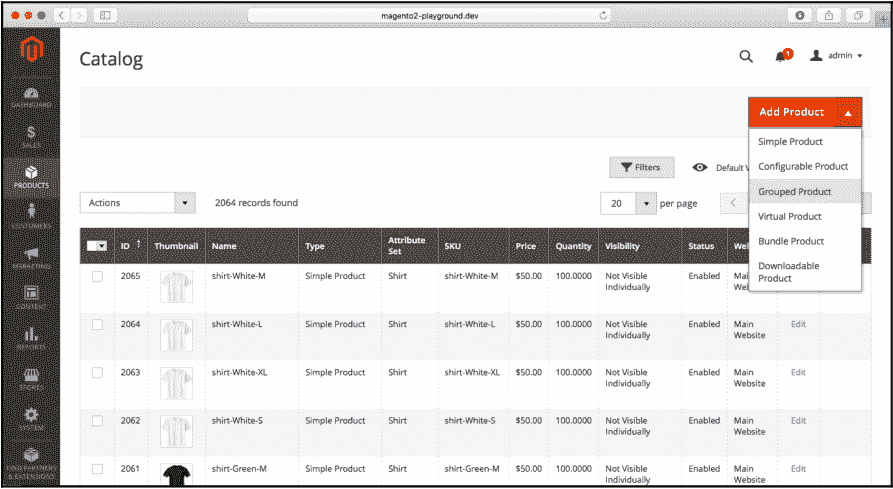

3. 打开 **New Product** 页面后，你会看到表单几乎与我们在该页面之前见过的其他表单相同。不同之处在于表单中有一个新部分：**Grouped Products**

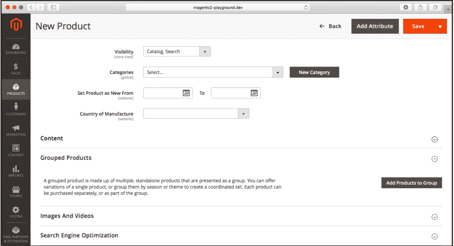

4. 如果你点击 Add Products to Group 按钮，以下窗口将在页面中显示：

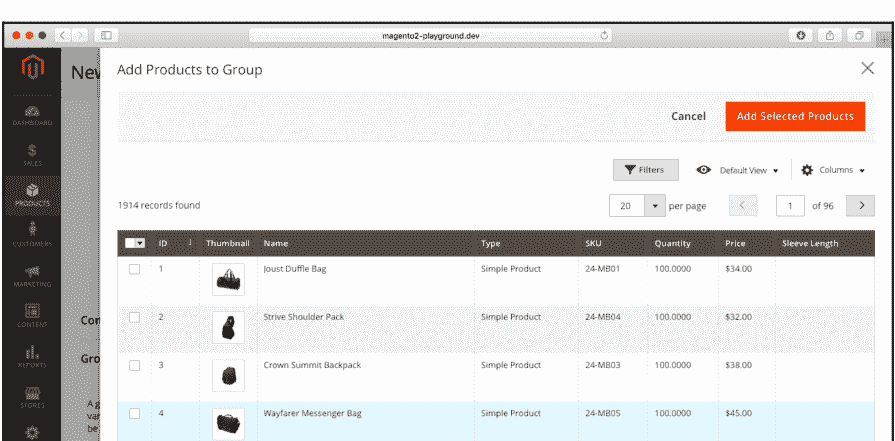

5. 对于组合产品，我们将从 Magento 2 示例数据中选择现有产品。

选择具有以下 ID 的产品：

- 1: Joust Duffle Bag
- 4: Wayfarer Messenger Bag
- 8: Voyage Yoga Bag

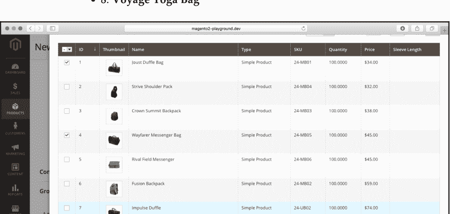

6. 现在，点击屏幕右上角的 Add Selected Products 按钮。最后，还请添加产品的附加信息：

#### General Information:

- **Enable Product:** Yes
- **Attribute Set:** Default
- **Product Name:** Bag Collection
- **SKU:** bag-collection
- **Stock Status:** In Stock
- **Visibility:** Catalog, Search
- **Categories:** Default Category | Collections | Erin Recommends

对于组合产品，我上传了来自相关简单产品的每张图片：

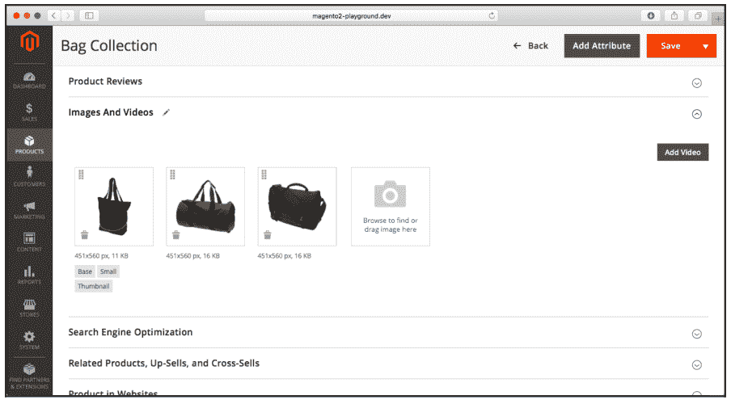

7. 现在，通过点击屏幕右上角的 Save 按钮保存产品。

让我们看看该产品在 Storefront 上的显示效果。我们已将产品与 Erin Recommends 分类关联。你无法从主导航菜单访问该分类；你应该点击页面中间的横幅，其中包含 Shop Erin Recommends 链接：

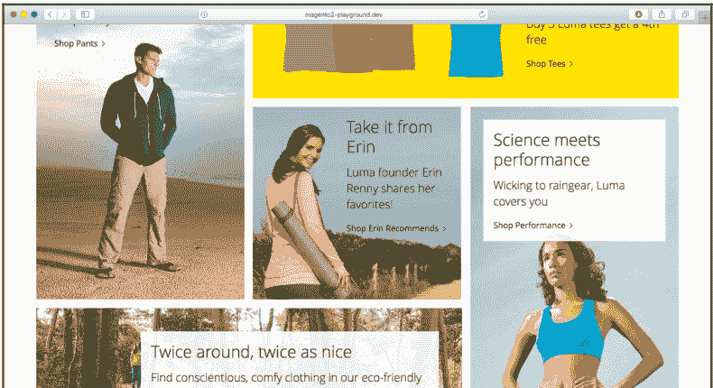

你将在产品列表页的最后一页找到该产品：

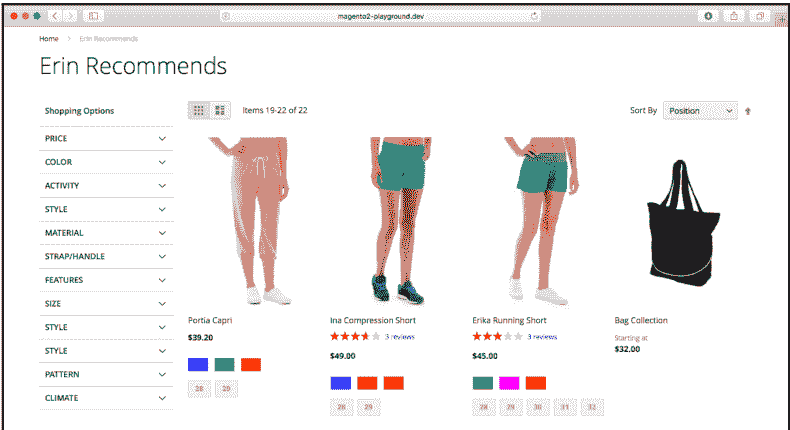

让我们点击该产品以查看产品详情页：

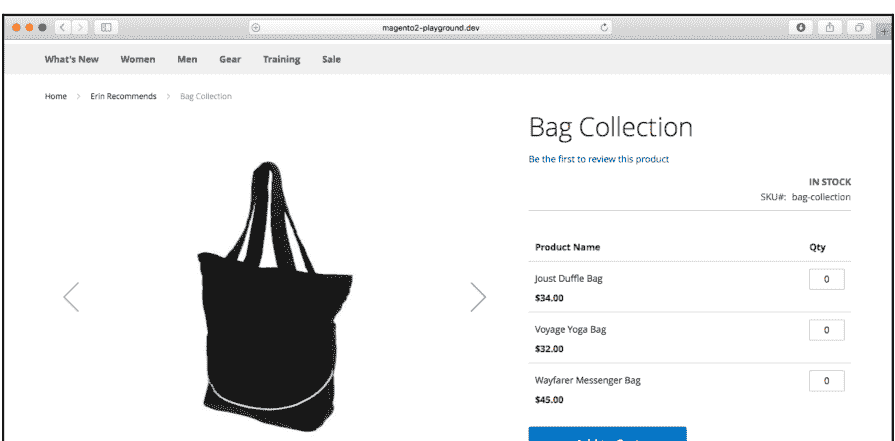

正如你在页面上看到的，你可以为每个产品添加任意数量的商品。如果你将其中一些产品添加到购物车中，它们将在其中单独显示。

### Bundle Product

**Bundle Product** 与 **Grouped Product** 非常相似；唯一的区别是客户可以选择要包含在捆绑包中的产品。最终价格将取决于所选选项。

**Bundle Product** 的一个很好的例子是电脑。客户将能够选择要包含在电脑中的组件；例如，客户可以在 8 GB 和 16 GB 之间选择内存，或在 256 GB 和 512 GB 之间选择 SSD 存储。产品价格将在选择时根据选择进行更新。

我们将使用 Magento 2 示例数据创建一个捆绑产品：

1. 前往 PRODUCTS | Inventory | Catalog 页面。
2. 点击 Add Product 按钮内的箭头并选择 Bundle Product。

你会看到表单将与其它产品相似，但会有一个新部分，Bundle Items：

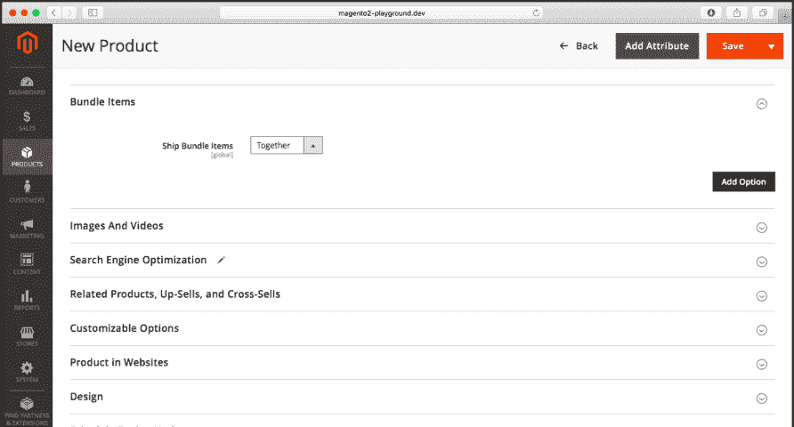

3. 我们将在此产品上添加以下信息：

#### General Information:

- **Enable Product:** Yes
- **Attribute Set:** Default
- **Product Name:** Bags
- **Dynamic SKU:** Yes
- **Dynamic Price:** Yes
- **Stock Status:** In Stock
- **Dynamic Weight:** Yes
- **Visibility:** Catalog, Search
- **Categories:** Default Category | Collections | Erin Recommends

通过启用 **Dynamic Price**、**Dynamic Weight** 和 **Dynamic SKU**，客户将在产品详情页中获得每个选项的信息。

**Ship Bundle Items:**

通过此设置，你可以指定捆绑产品是否将一起或分开发货。

- **Ship Bundle Items:** Together

4. 现在，点击该部分中的 **Add Option**：

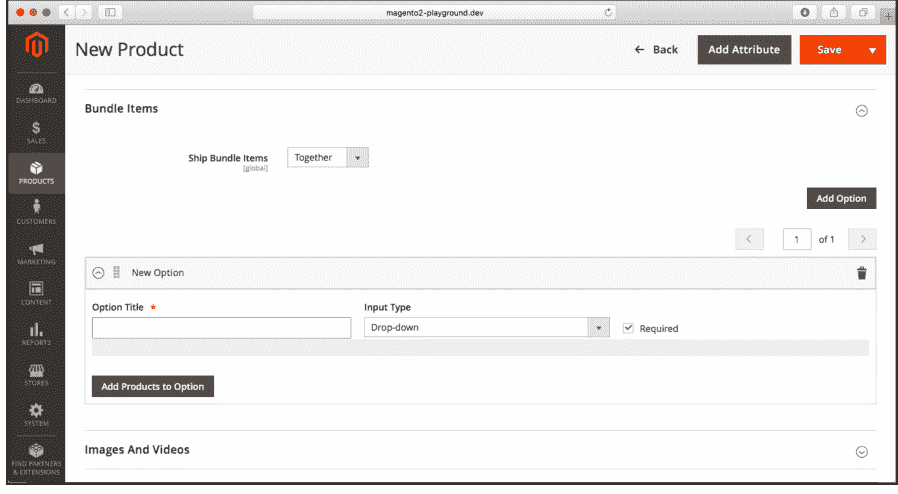

以下屏幕将被显示：

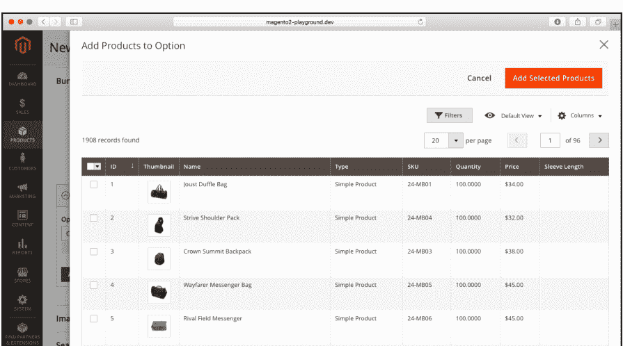

在这里，你可以设置选项标题、输入类型（下拉菜单、单选按钮、复选框或多选），并设置选项是否必填。捆绑产品中的每个选项都将有一组可供选择的商品。你可以通过点击 Add Product to Option 按钮将这些商品添加到选项中。

我们将为该选项设置以下信息：

- **Option Title:** Choose your collection
- **Input Type:** Radio Buttons
- **Required:** Yes

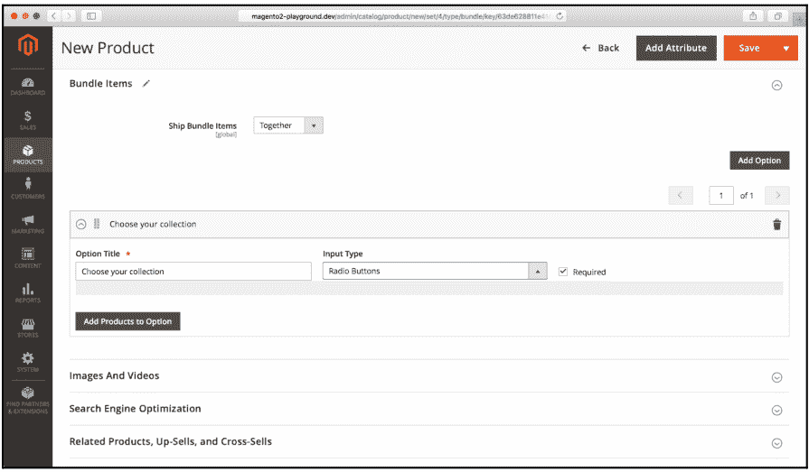

5. 现在，如果你点击 **Add Product to Option**，以下模态框将被显示：

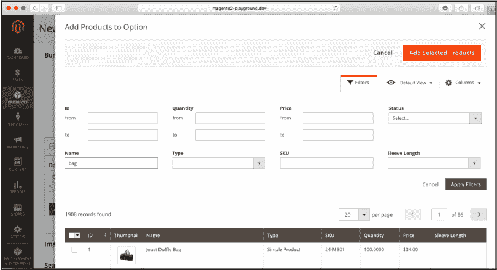

使用 **Name** 过滤器按如下方式过滤网格以显示包：

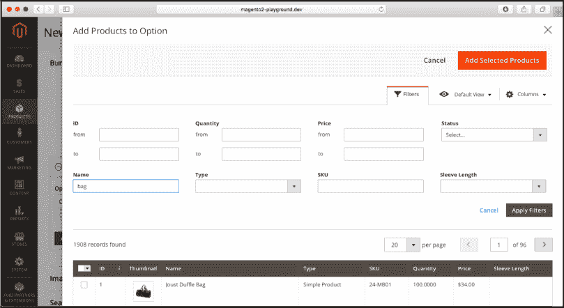

我们将选择过滤后的网格中的所有产品：

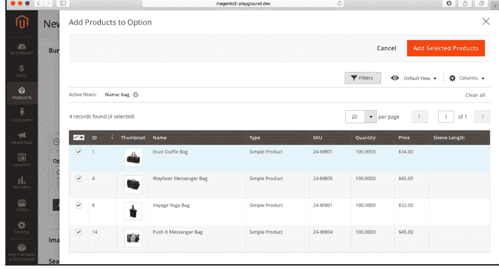

6. 点击 Add Selected Products 以关联产品，然后将捆绑商品的默认数量设置为 1，如以下屏幕截图所示：

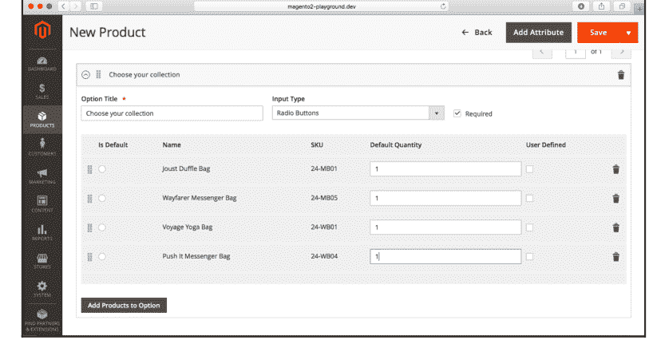

7. 我们将为新产品关联一个来自捆绑商品之一的图片：

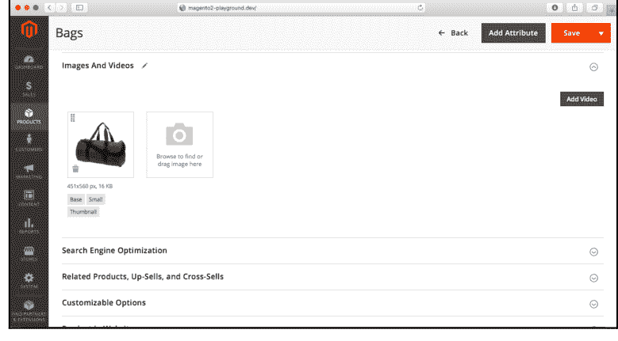

8. 最后，点击 Save 保存捆绑产品。

让我们在 Storefront 上查看新产品。这是在产品列表页中产品的显示效果：

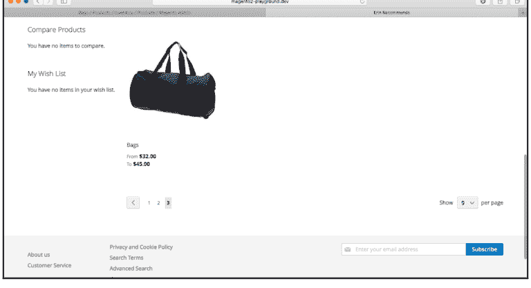

### Virtual Product

Magento 允许你为目录创建非有形产品，例如会员资格或专业服务。这些产品可以单独显示，也可以作为组合产品或捆绑产品的一部分包含在内。

虚拟产品与 Magento 中的简单产品非常相似，唯一的区别是虚拟产品没有重量属性并且不需要发货信息。

我们将通过以下步骤创建一个 **Virtual Product**：

1. 前往 **Products | Inventory | Catalog** 页面。
2. 点击 **Add Product** 按钮内的箭头并选择 **Virtual Product**。
3. 我们将为此产品设置以下信息：

#### General Information:

- **Enable Product:** Yes
- **Attribute Set:** Default
- **Product Name:** Membership
- **SKU:** membership
- **Price:** $100
- **Tax Class:** Taxable Goods
- **Quantity:** 50
- **Stock Status:** In Stock
- **Visibility:** Catalog, Search
- **Categories:** Default Category | Collections | Erin Recommends

4. 为产品添加示例图片：

   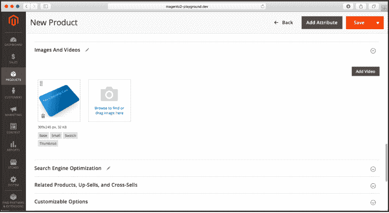

5. 点击**保存**以完成虚拟产品的设置。

现在，让我们在店面查看产品的展示效果。这是产品列表页面：

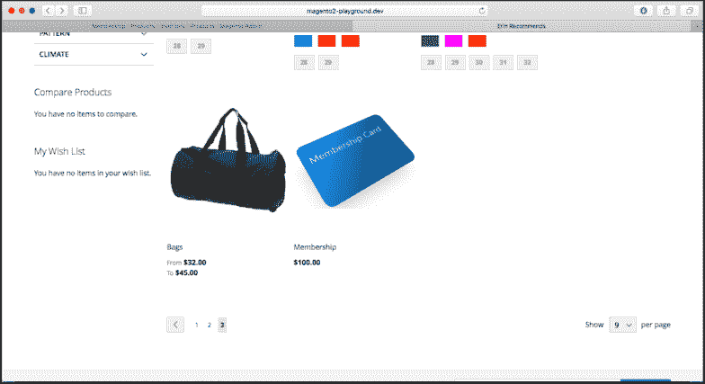

### 产品类型

这是产品详细信息页面：

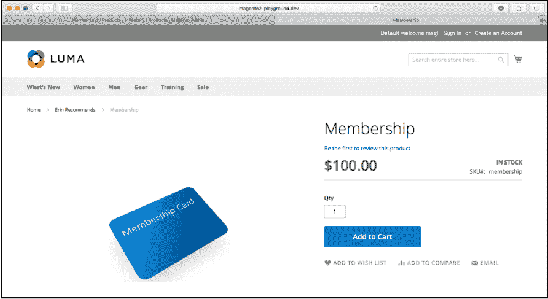

#### 可下载产品

**可下载产品**是一种可下载的数字文件，例如电子书、软件、音乐视频等。

由于下载文件在购买前不可用，你可以在产品详细信息页中添加示例，例如电子书简介、软件试用版或音乐视频短片。

让我们按照以下步骤创建一个**可下载产品**：

1. 转到**产品 | 库存 | 目录**页面。
2. 点击**添加产品**按钮内的箭头，然后选择**可下载产品**。

如下面的屏幕截图所示，可下载产品表单中有一个名为“可下载信息”的特殊部分：

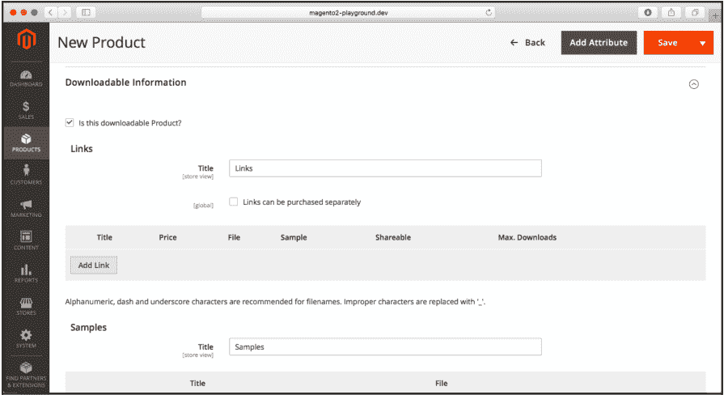

3. 我们将为此产品设置以下信息：

   **基本信息：**

   - 启用产品：是
   - 属性集：默认
   - 产品名称：示例培训计划
   - SKU：sample-training-program
   - 价格：$25
   - 税类：应税商品
   - 数量：100
   - 库存状态：有库存
   - 可见性：目录，搜索
   - 类别：默认类别 | 系列 | Erin 推荐

4. 为此产品添加示例图片：

   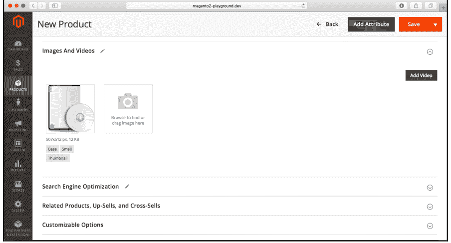

5. 你现在可以添加可下载产品的具体详细信息。“可下载信息”部分包含以下内容：

   - **链接**：用于指定此产品的下载链接。这些链接在购买产品时显示。
   - **示例**：用于为可下载产品添加示例，这些示例将显示在产品详细信息页中。

6. 让我们为可下载产品添加一个链接和一个示例。点击“链接”容器中的“添加链接”，并设置以下信息：

   - **标题**：示例链接
   - **文件**：URL | http://url.dev/file
   - **示例**：URL | http://url.dev/sample
   - **可共享**：否
   - **最大下载次数**：100

如详细信息中所示，你也可以为各个链接设置示例。

如果将“可共享”设置为“是”，客户将通过电子邮件收到链接，并能够与他人共享该链接。
如果将“可共享”设置为“否”，客户必须登录客户账户才能访问下载链接。

最后，你可以设置下载次数限制，并且还有一个复选框可以设置无限次下载，如下面的截图所示：

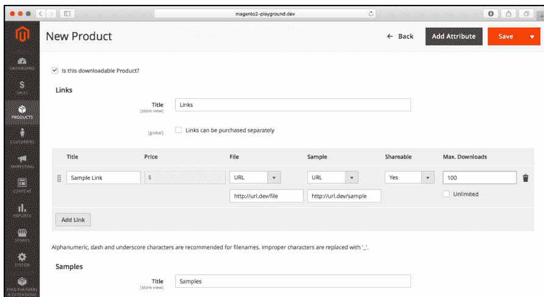

7. 现在，让我们在“示例”容器中为产品添加一个示例：

   - 标题：产品示例
   - 文件：URL – http://url.dev/product-sample

8. 最后，点击“保存”以完成可下载产品的设置。

现在，我们将从产品详细信息页面到客户账户，逐一查看可下载产品的各个页面：

- 产品列表页面：

  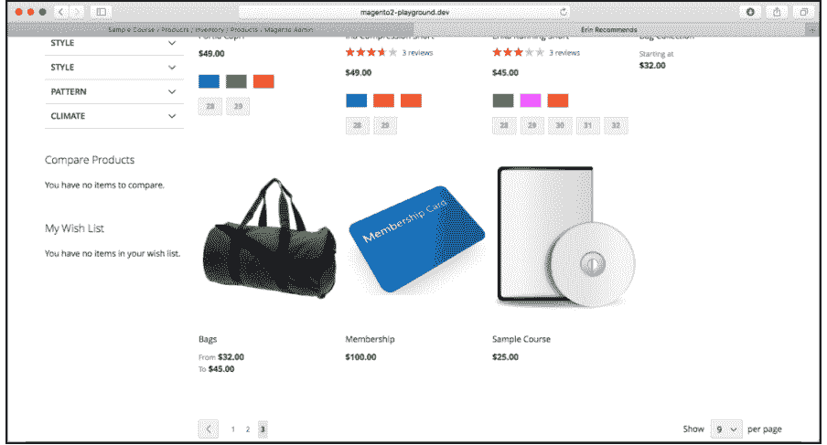

- 产品详细信息页面：

  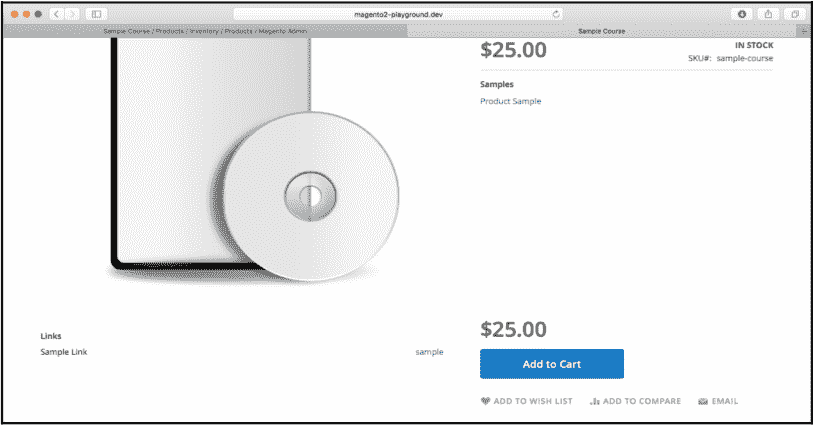

- 购物车：

  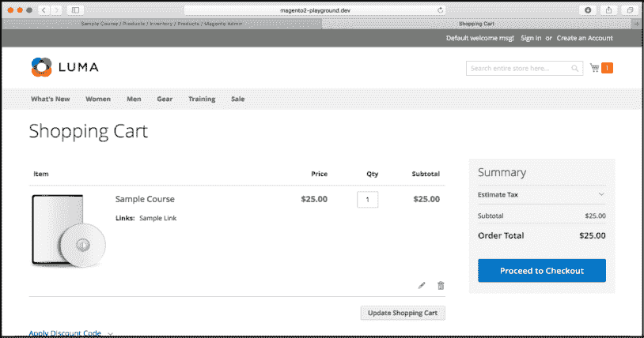

- 结账：

  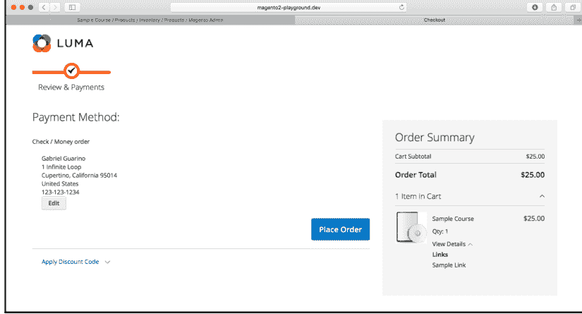

- 客户账户：

  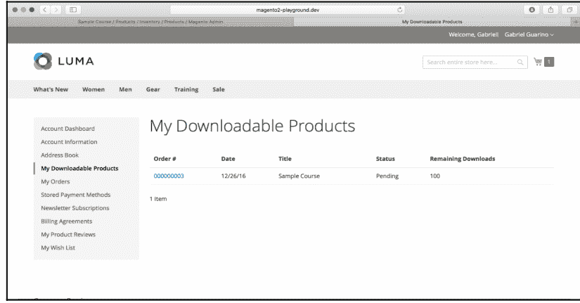

## 总结

在本章中，你了解了 Magento 中不同的产品类型，并为每种产品类型创建了一个示例产品。
在下一章中，我们将介绍 Magento 2 中管理类别的过程，以便为我们的商店设置主导航菜单和类别树。
