# 7 类别

在本章中，我们将涵盖以下概念：

- 类别
- 层级结构
- 顶部导航

## 类别

Magento 提供了一种将目录组织成不同类别和子类别的方式。你可以在管理面板内部组织目录，并为客户在店面提供清晰的产品浏览方式。

你可以通过转到管理面板中的**产品 | 库存 | 类别**部分来管理商店中的类别：

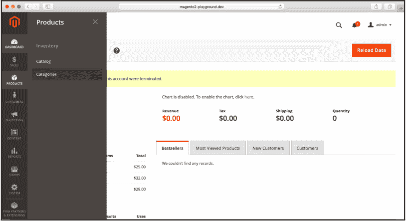

当该部分在管理面板中加载后，你将在左侧看到类别树，在右侧看到用于添加和编辑类别的表单：

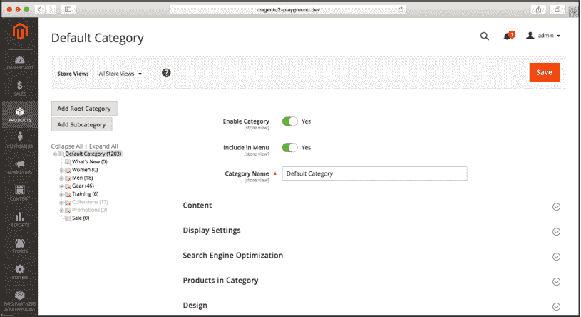

在类别树顶部，你会看到两个按钮：

- **添加根类别**：你可以添加根类别。这有助于设置多个商店视图，例如，一个服装商店和一个电子产品与电脑商店。这些商店是独立的商店视图，每个视图都有包含在不同根类别中的特定目录。下面这个屏幕截图展示了两个根类别的示例：

  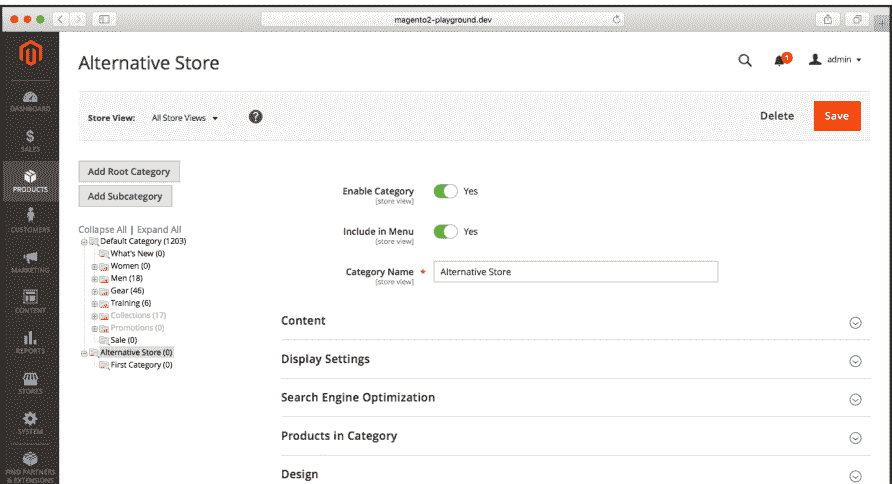

- **添加子类别**：你可以为当前类别添加子类别。在上面的屏幕截图中，**Alternative Store** 根类别已被选中，因此如果我们点击**添加子类别**，就会创建子类别，如下面的屏幕截图所示：

  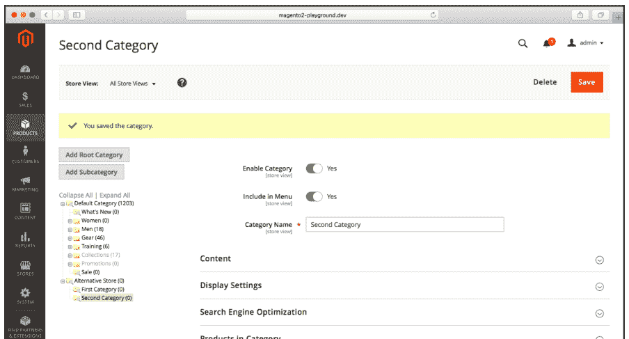

我们添加了一个根类别和一个子类别，但尚未查看创建它们的表单。我们将创建一个新类别，并逐步完成整个过程：

1. 点击类别树中的**默认类别**以选择它：

   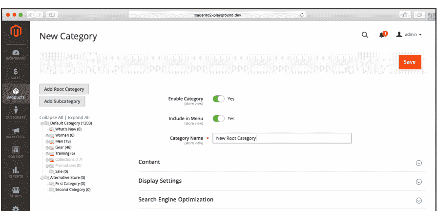

2. 点击屏幕左上角的“添加子类别”。

3. 在表单顶部区域添加以下信息：

   - 启用类别：是
   - 在菜单中显示：是
   - 类别名称：示例类别

这些字段不言自明。**在菜单中显示**字段允许您设置是否在店面的主导航菜单中显示该类别：

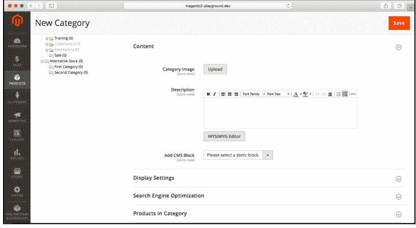

4. 在**内容**部分设置以下信息：

   - **类别图片**：为类别添加横幅图片，如下面的屏幕截图所示：

     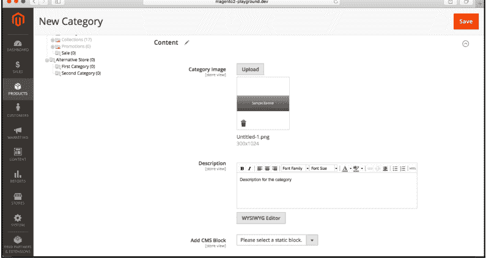

   - **描述：**为类别添加示例描述
   - **添加 CMS 块：**你可以添加一个静态块，使其显示在该类别中

5. 在“显示设置”中设置以下部分：

   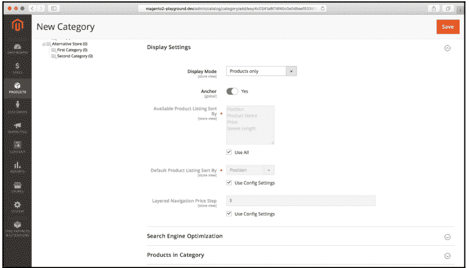

在此部分中，你可以设置：

- **显示模式：**你可以选择仅显示产品、仅显示选定的静态块，或两者都显示。对于此类别，我们将选择**仅产品**。
- **锚点：**如果你选择**是**，则该类别将在左侧边栏中显示分层导航筛选器。分层导航是一个块，可让你按属性（例如颜色或尺寸）筛选类别。我们将为此类别选择**是**。

6. 接下来，我们找到“搜索引擎优化”部分：

   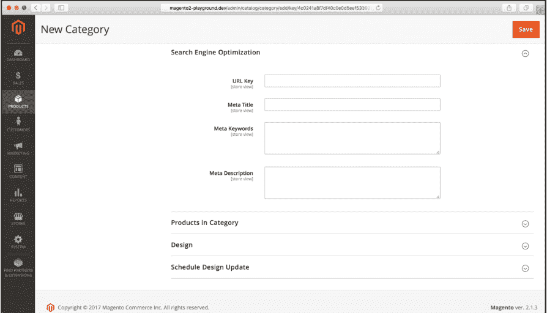

此部分提供以下设置：

- **URL 键**：你可以为该类别设置特定的 URL 键。对于此类别，我们将此字段留空，Magento 将根据类别标题创建 URL 键。
- **元标题**：你可以设置用于搜索引擎优化的标题元标记。
- **元关键字**：你可以设置用于搜索引擎优化的关键字元标记。
- **元描述**：你可以设置用于搜索引擎优化的描述元标记。

我们将**元标题**、**元关键字**和**元描述**字段留空，Magento 将根据类别标题分配元标记。

7. 你可以通过“**类别中的产品**”部分选择与此类别关联的产品：

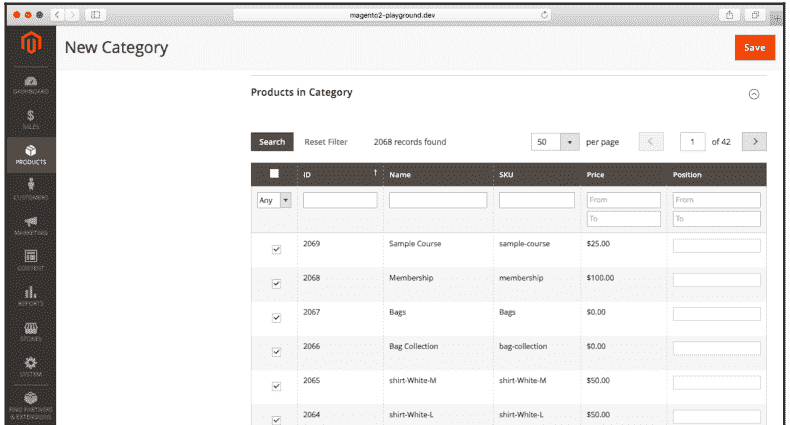

按照前面的截图，选择我们在上一章中创建的所有产品。

8. 下一节是 Design。就像产品一样，你也可以为分类设置特定的设计：

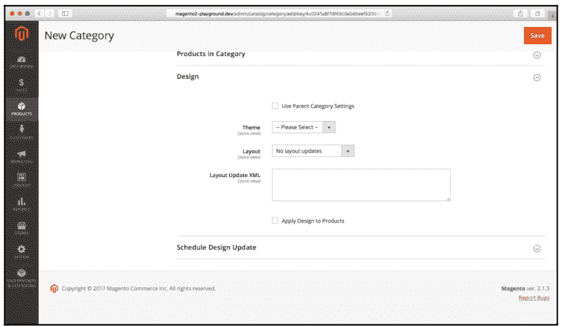

我们将逐一介绍各个字段，但我们将为所有字段保留默认值：

- **Use Parent Category Settings**: 如果你点击此复选框，该分类将继承父分类的设计配置
- **Theme**: 你可以为分类选择特定的主题
- **Layout**: 你可以为分类设置特定的布局：
  - **Empty**
  - **1 column**
  - **2 columns with left bar**
  - **2 columns with right bar**
  - **3 columns**
- **Layout Update XML**: 为分类布局添加自定义 XML 配置，例如自定义样式表
- **Apply Design to Products**: 如果你点击此复选框，相关产品将继承此分类的设计配置

9. 表单末尾的章节是 **Schedule Design Update**。在这里，你可以为上一节的设计更新指定一个日期范围。我们将对此分类保持为空。

10. 点击 **Save** 来添加新的分类。

分类保存后，你将看到确认消息以及该分类作为 **Default Category** 的子分类：

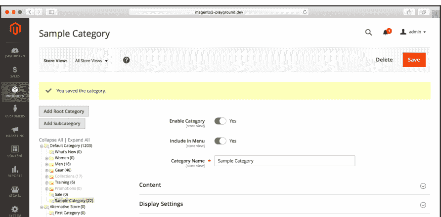

如果进入 Storefront，你将在主导航菜单中看到新的分类：

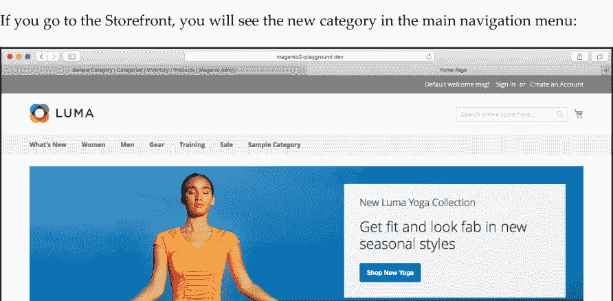

### Hierarchy

正如我们之前所见，你可以通过在创建子分类前选择父分类来设置分类的层级结构。Magento 允许你轻松管理分类的层级结构，我们将回顾如何更新分类树以更改父分类和子分类。

在分类树中，你会看到有些分类旁边有一个加号图标：

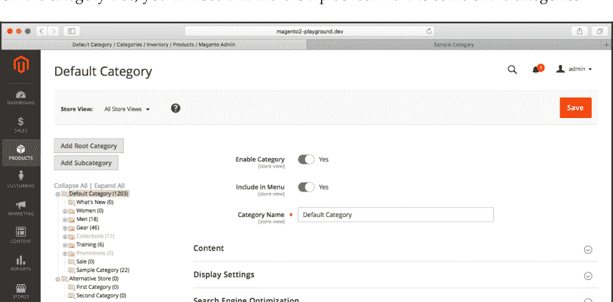

如果你点击任意一个加号图标，你将能够展开该分类以显示其子分类：

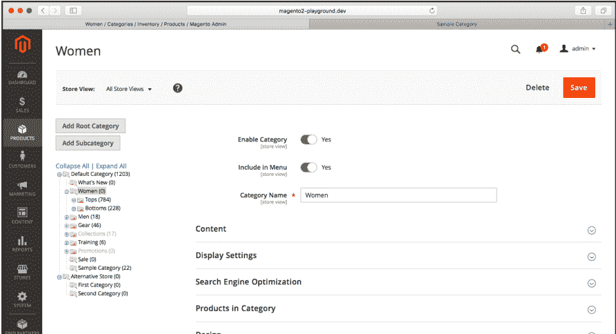

现在，假设我们想通过将 Sample Category 移为 Women 分类下的子分类来更改分类树的层级结构。

如果你想这样做，Magento 允许你像在你喜欢的操作系统中管理文件夹那样简单地拖放分类。

我们继续将 Sample Category 从当前位置拖出并放到 Women 分类之上。

你将在屏幕上看到以下消息：

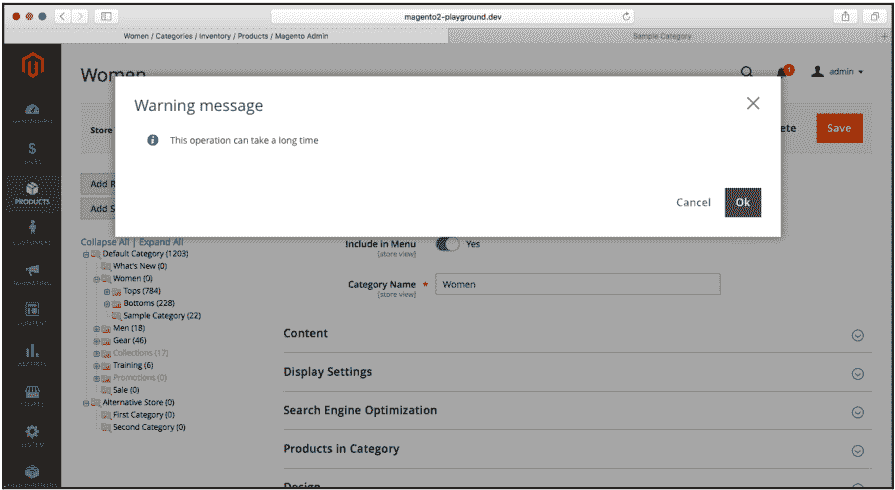

更新分类的层级结构会消耗 Magento 很多资源，这就是为什么屏幕上会显示警告。让我们继续前进并按下 Ok 以继续操作。

分类移动后，你将看到确认消息以及屏幕上的更新后分类树：

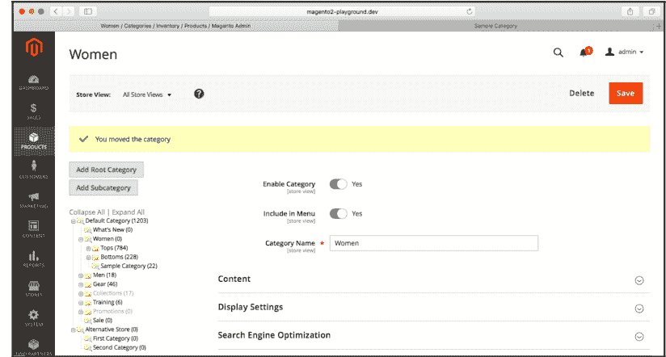

现在，如果你进入 Storefront，你将在屏幕上看到更新后的导航菜单：

### Top navigation

让我们再看一下管理面板中的分类树：

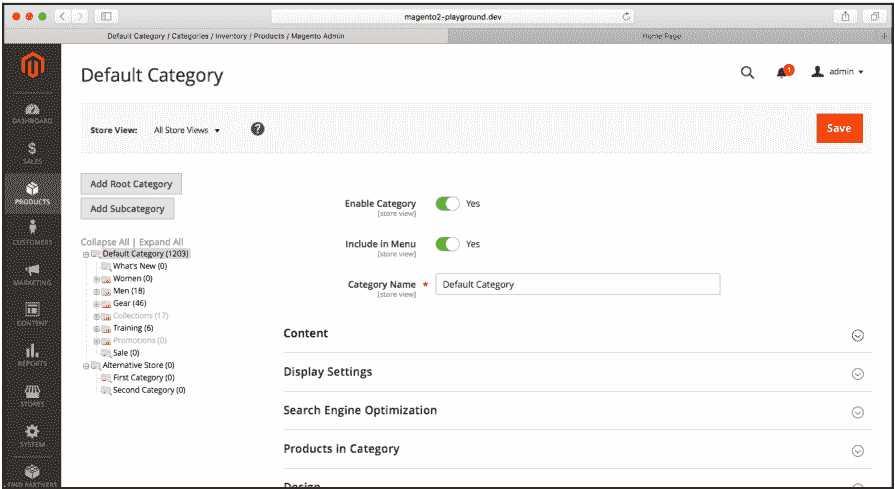

正如你所见，其中一些分类的颜色为浅灰色。这意味着这些分类已被禁用，这就是为什么 Collections 和 Promotions 在 Storefront 的主导航菜单中不可见。

即使这是正确的，一个分类在主导航菜单中不可见的第二个原因也可能是存在的。如果你查看前面的截图，你会看到表单中有一个 Include in Menu 设置。这是一个非常重要的设置，因为你可以保持分类启用但不包含在主导航菜单中。

我们继续选择之前创建的 Sample Category。进入后，将 Include in Menu 设置更新为 No，如以下截图所示：

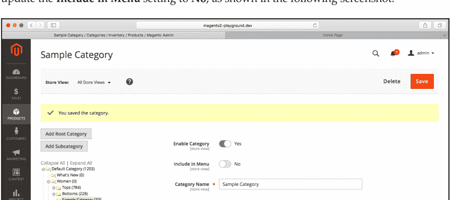

如果你现在进入 Storefront，你会看到 Women 菜单项在下拉菜单中不包含 Sample Category 子菜单项：

这允许你指定要在主导航菜单中保持可见的菜单项，这对于自定义目录在 Storefront 向客户展示的方式非常重要。

### Summary

在本章中，你学习了如何在你的 Magento 商店中管理分类，现在你可以将产品关联到不同的分类并更新主导航菜单。在下一章中，我们将介绍 CMS 页面、块和部件以继续自定义你的商店。
