# 8. CMS Pages, Blocks, and Widgets

在本章中，我们将介绍以下主题：

- CMS Pages
- Static blocks
- Widgets

## CMS Pages

如果你想知道是否可以添加带有静态内容的额外页面，那么这是适合你的部分。我们将介绍在 Magento 中管理静态页面的流程，例如 *Privacy Policy* 或 *Terms and Conditions*，让你可以创建额外页面以向你的商店添加更多信息。

你可以通过管理面板中的 **CONTENT | Elements | Pages** 部分管理这些页面：

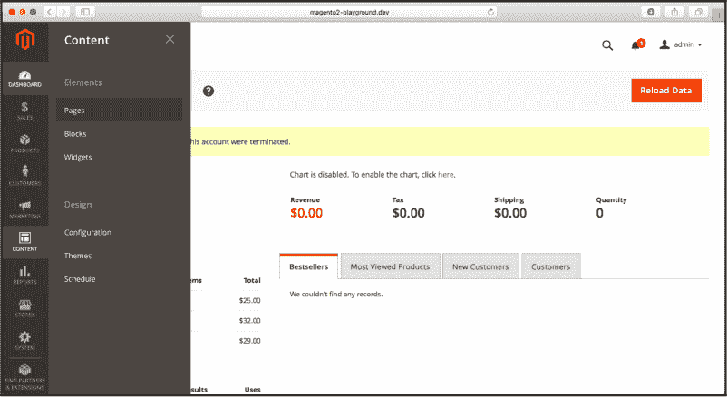

进入该部分后，你将看到商店中当前可用的页面列表：

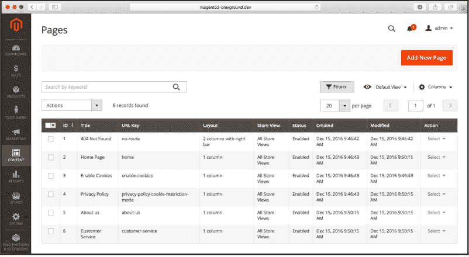

正如前一个截图中所示，Magento 2 示例数据中包含六个页面。CMS 页面一个重要方面是 **URL Key**，它对同一商店视图中的每个页面都是唯一的。

你可以通过组合商店的 Base URL 和 URL Key 来访问 CMS 页面。例如，要访问 **About us** 页面，你应该前往
http://magento2-playground.dev/about-us.

你将在屏幕上看到以下页面：

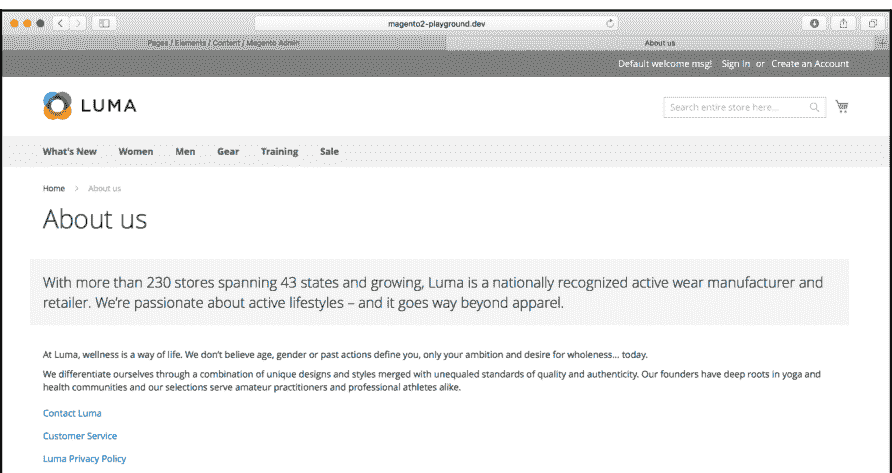

现在，假设你想编辑页面以更新副标题。然后，你应该在页面网格中该页面的行上点击 Select 并点击 Edit：

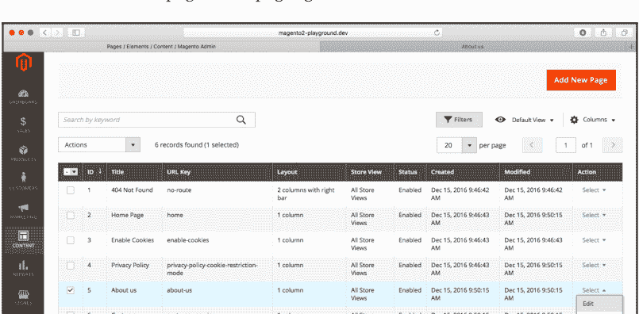

你将被重定向到以下表单：

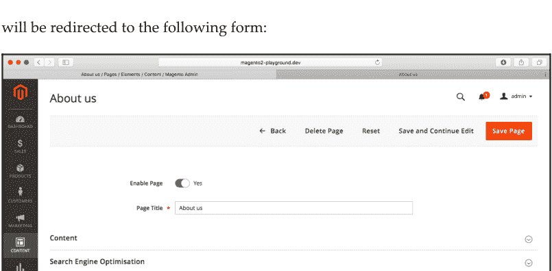

### CMS Blocks

#### CMS Blocks 管理

##### 创建静态块

本书以故宫学为整体研究视域，从故宫古建筑、院藏文物、宫廷遗存、学术成果等维度，系统梳理2024年度故宫博物院在文物保护、学术研究、对外文化交流等方面的重要进展与核心成果，力求全面呈现故宫学研究的年度面貌与发展趋势。

本卷在既往编辑经验的基础上，进一步突出研究的系统性、前沿性与开放性，围绕故宫学理论建构、文化遗产保护利用、明清宫廷历史与文化、文物科技保护等主题，精选重要论文与研究报告，以期为相关领域的研究者与爱好者提供兼具学术深度与阅读价值的年度文本。

- **New Layout:** Set a specific layout on the scheduled date:
  - Empty
  - 1 column
  - 2 columns with left bar
  - 2 columns with right bar
  - 3 columns

我们将通过更新以下字段来编辑 **About Us** 页面：

- **General:**
  - **Page Title:** `About this company`
- **Content:**
  - **Content Heading:** `The company`
  - **WYSIWYG Editor:** 将 `230 stores` 替换为 `300 stores` 并在副标题下方添加一张图片

现在，如果你尝试像之前一样访问同一页面，你将看到我们所做的更改：

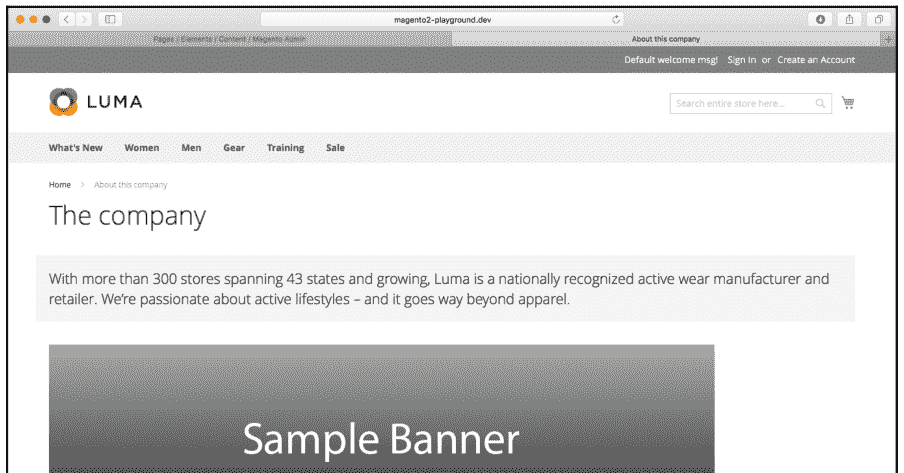

## Static blocks

如果你有想要在不同位置显示的信息，例如促销横幅，或你业务地点的 *Business Hours*，那么你应该有一种方式从管理面板的一个部分编辑信息并将其实现在网站的不同区域。

Magento 允许你通过静态块来实现同样的功能。静态块是管理 Magento 商店内容的一种强大方式，因为你可以添加 HTML 内容以在不同页面中显示并从管理面板的静态块部分进行管理。

你可以通过管理面板中的 **CONTENT | Elements | Blocks** 菜单项访问静态块部分：

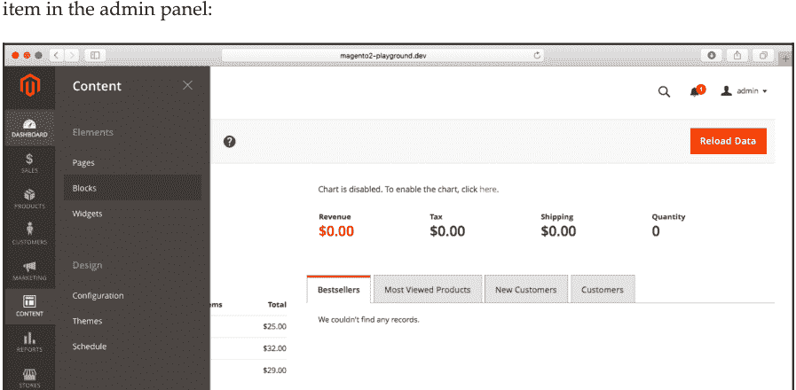

### CMS 页面、静态块和小部件

在那里，你会看到包含现有块的以下网格：

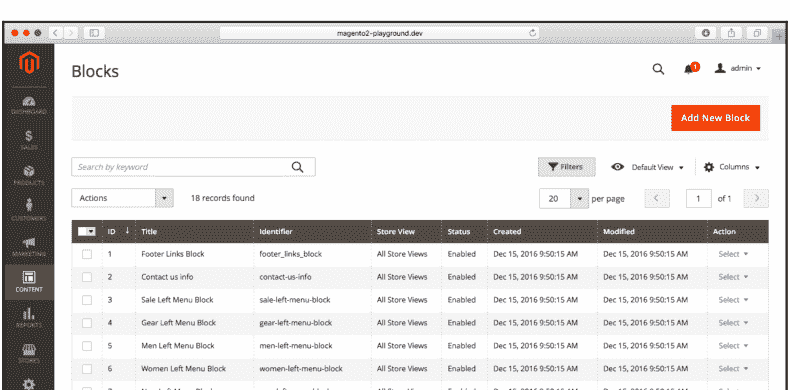

Magento 2 示例数据中包含 18 个静态块。让我们查看名为 Training Block 的静态块。在 Blocks 网格中，单击该静态块所在行上的 Select，然后单击 Edit：

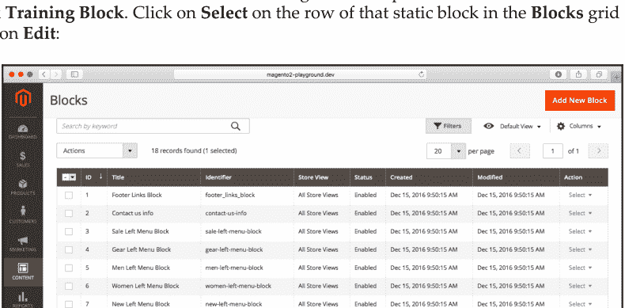

你将被重定向到以下表单：

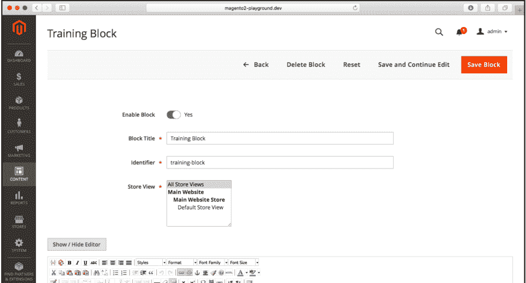

如你所见，这个表单比 CMS 页面中的新建/编辑页面更简单。有以下一些字段：

- **启用块**：将静态块设置为活动状态，以便包含在其他页面中
- **块标题**：静态块的标题
- **标识符**：静态块的唯一标识符
- **商店视图**：该页面将在选定的商店视图中可见
- **WYSIWYG 编辑器**：你可以使用所见即所得编辑器编辑静态块的内容

这是 Training 类别页面中包含的横幅。如果单击主导航菜单中的 Training 类别，就可以看到该横幅：

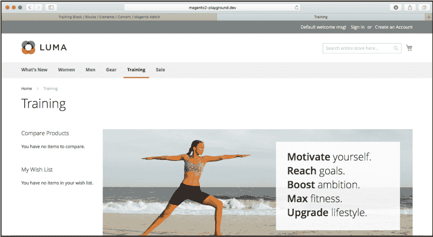

静态块可以包含在以下位置：

- 主题中的模板文件（以编程方式包含）
- 类别
- 通过小部件包含在 CMS 页面和其他静态块中

### 小部件

小部件是可以包含在不同页面中的模块，通过不同的小部件类型，根据不同的配置显示信息。

Magento 中提供以下用于内容管理的小部件：

- CMS 页面链接
- CMS 静态块
- 目录类别链接
- 目录新产品列表
- 目录产品链接
- 目录产品列表
- 订单和退货
- 最近比较的产品
- 最近查看的产品

你可以通过转到管理面板中的“内容 | 元素 | 小部件”部分来管理你的小部件：

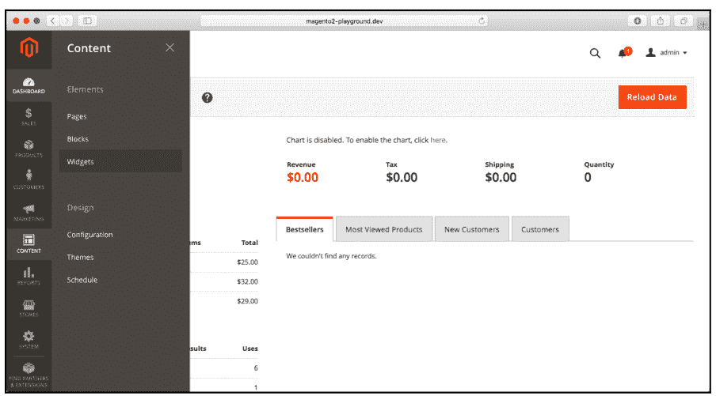

Magento 2 示例数据中包含 18 个小部件。如下面的截图所示，它们都是 CMS 静态块，分布在店面（Storefront）的不同位置。

### CMS 页面、静态块和小部件

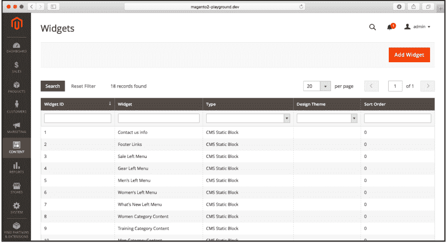

我们将通过单击屏幕右上角的“添加小部件”按钮来创建一个新小部件。将显示以下表单：

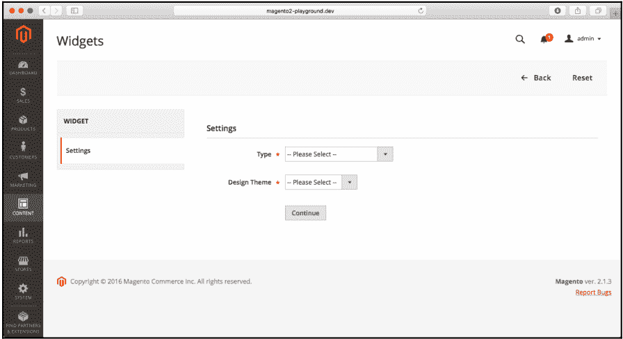

你可以在下面的截图中看到小部件的条件：

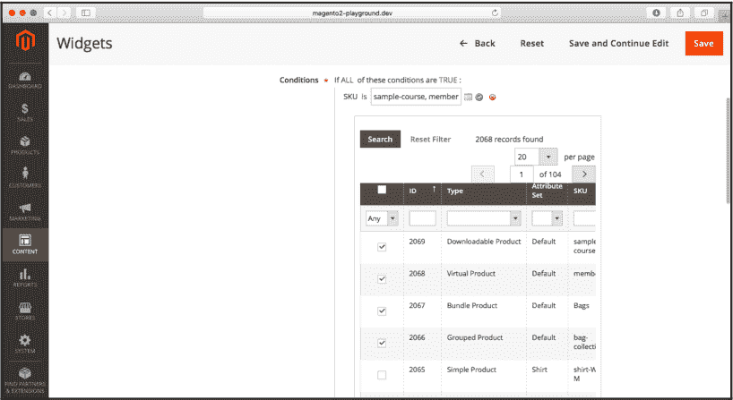

最后，单击**保存**以启用小部件。你会看到 Magento 通知你需要刷新缓存：

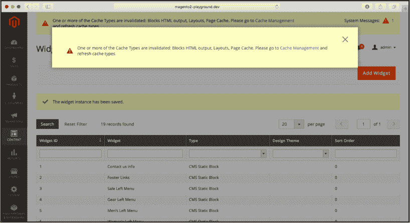

你应该像之前看到的那样，从“缓存管理”页面清除缓存类型。之后，你将在锚定类别中看到该小部件，例如“男装 | 上衣”：

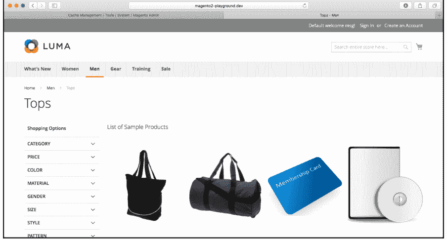

### 总结

在本章中，你学习了如何管理你的 Magento 商店中的内容，包括 CMS 页面、静态块和小部件。在下一章中，我们将介绍如何管理你的网站、商店和商店视图的范围，以及如何配置 Magento 商店中的区域设置选项。
