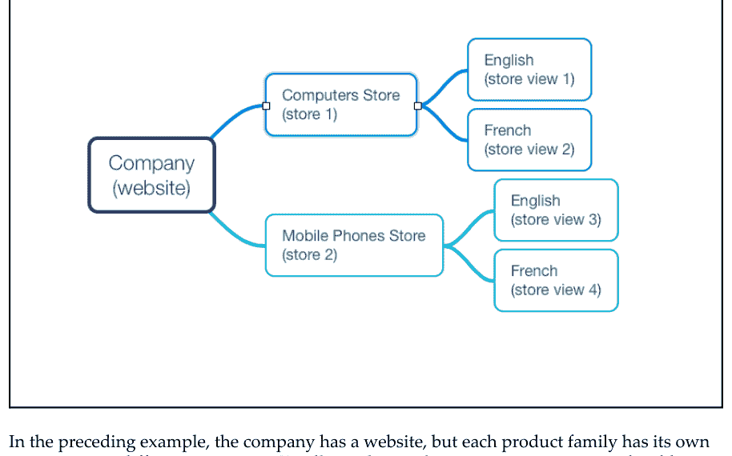
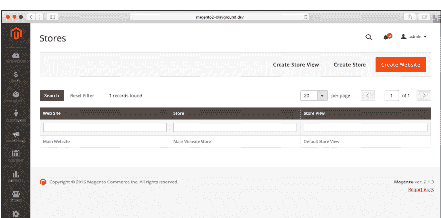
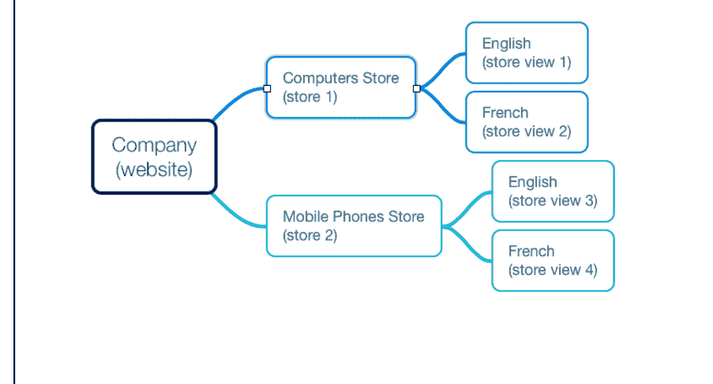
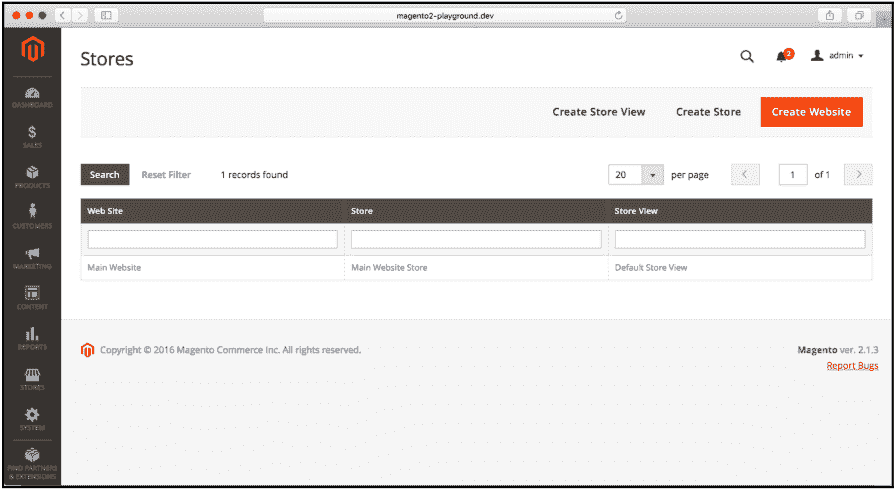
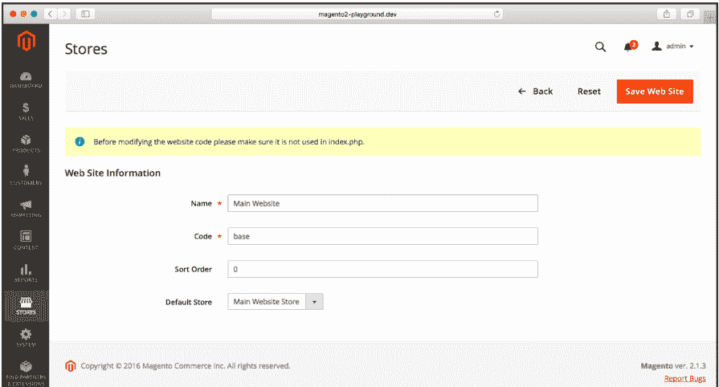
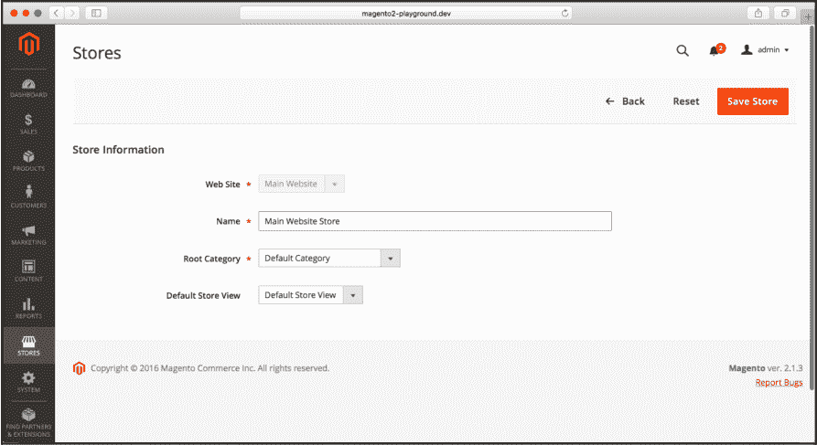
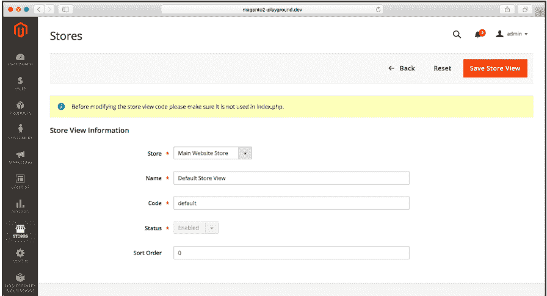
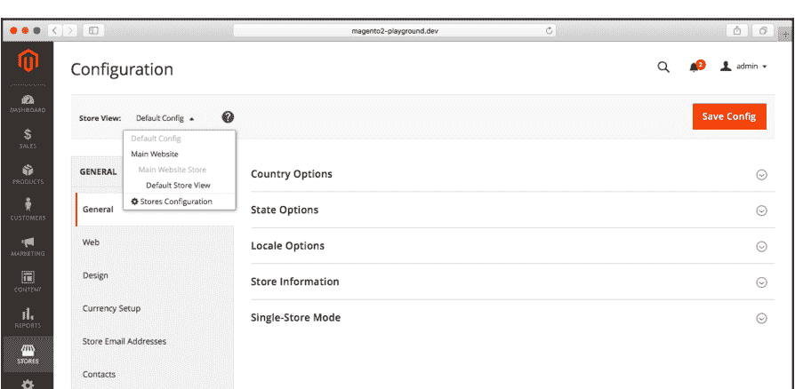

# 9 管理范围和区域设置
## 管理范围和区域设置

在本章中，我们将介绍：

- Magento 范围——网站、商店和商店视图
- 回顾添加商店视图如何影响目录和 CMS
- 语言

### Magento 范围——网站、商店和商店视图

Magento 最重要的功能之一是从单个 Magento 实例创建多个商店的能力。Magento 实现了一个包含四个层级的层级系统：

- 默认/全局
- 网站
- 商店/商店组
- 商店视图

Magento 中最常见的多商店配置场景出现在零售商中，他们按商店视图分离其目录，如下所示：

在前面的示例中，公司有一个网站，但每个产品系列都有自己的商店，以面向不同的客户。最后，每个商店都有自己的商店视图，以便能够以不同的语言显示内容。

使用单个 Magento 实例，你可以通过以下方式实现多商店配置：

- 多种语言
- 多个域名
- 不同的类别

### 管理范围和区域设置

你可以在 Magento 管理面板的“商店 | 设置 | 所有商店”部分看到你的 Magento 实例的商店配置。屏幕上将显示以下网格：

在那里，你将看到你的 Magento 实例的当前商店配置。Magento 2 示例数据中包括一个网站、一个商店和一个商店视图。在接下来的部分中，我们将回顾从网站到商店视图的所有概念。

### 网站

一个网站包含一个或多个商店。你可以在不同的网站中拥有不同的客户集合，所有这些都可以通过单个 Magento 实例进行管理。否则，你可以在所有网站之间共享客户账户。除此之外，你还可以按网站设置特定的产品价格、税类、货币和系统配置。

### 商店/商店组

一个商店包含产品和类别。每个商店都有一个关联的根类别，允许你按商店定义不同的类别。在前面的示例中，我们看到了两个拥有完全不同产品系列的商店：

Magento 允许你通过为每个商店定义根类别来实现这一点。与同一网站关联的所有商店共享相同的客户账户。

### 商店视图

商店视图通常用于为你的网站定义不同的语言。通过这样做，商家能够按照客户的语言来定位客户。

### 管理范围和区域设置

与同一商店关联的所有商店视图共享相同的根类别、配送方式和支付方式。通过使用商店视图，你可以设置不同的价格、标题、描述等。

我们将回顾 Magento 2 示例数据中包含的**网站**、**商店**和**商店视图**。

我们将进入管理面板中的**商店**部分：**商店 | 设置 | 所有商店**。

在那里，你将看到我们之前描述的网格：

### 管理范围和区域设置

我们将从单击第一列中的“主网站”链接开始。你将被重定向到以下屏幕：

在那里，你可以编辑名称、代码、排序顺序和默认商店。请注意，多商店配置可以在项目根目录的 index.php 文件中设置。如果已通过这种方式设置了多商店配置，并且你更改了网站代码，请确保更新 index.php 文件以指定网站的新代码。

### 管理范围和区域设置

如果我们回到**商店**网格并单击第二列中的**主网站商店**链接，我们将被重定向到以下页面：

正如你在该页面上看到的，你可以查看此商店的父网站，编辑**名称**，并设置**根类别**和**默认商店视图**。

最后，如果我们回到网格并单击第三列中的“默认商店视图”链接，我们将被重定向到以下表单：

你可以为商店视图编辑父商店，设置名称、代码、状态和排序顺序。需要说明的是，多商店配置可以使用 index.php 文件中的商店视图代码来设置。如果是这种情况，每次在管理面板中更改商店视图代码时，都应更新该文件。

### 默认/全局范围

除了网站、商店和商店视图之外，我们还应该提到，默认/全局范围定义了管理面板中不同配置的默认值。通过选择此范围，你将设置要应用于所有网站、商店和商店视图的特定配置。

当你编辑 Magento 配置、产品或类别时，你将能够为值选择范围。你可以在全局范围内定义值，也可以在网站、商店或商店视图级别专门定义值。

你可以在 Magento 管理面板中找到用于选择作用域的下拉菜单。例如，对于系统配置值（商店 | 设置 | 配置），你可以在屏幕左上角找到作用域下拉菜单：

#### 小结

在本章中，你了解了 Magento 用于管理商店的层级系统。我们介绍了网站、商店和商店视图的概念，现在你已经清楚这些作用域之间的区别。在下一章中，我们将介绍 Magento 中的系统配置设置。
