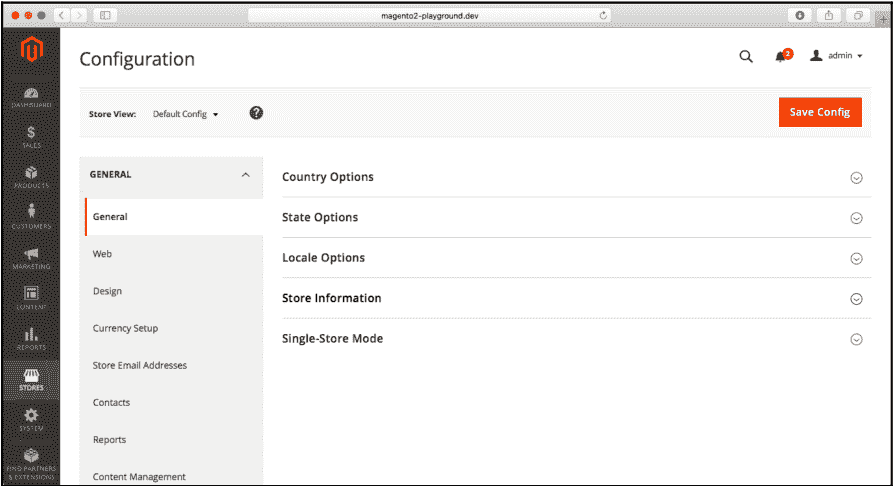
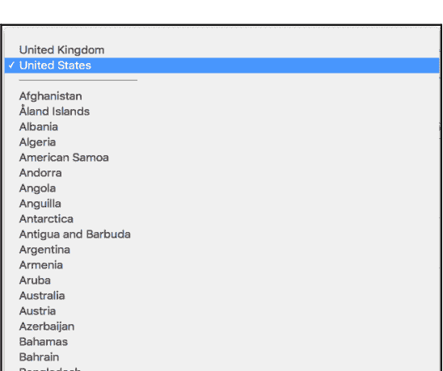

# 10 系统配置

本章将涵盖以下内容：

- 常规系统配置
- 目录配置
- 客户配置
- 销售、配送和付款配置
- 高级配置

## 系统配置部分和字段

系统配置页面是管理面板中最重要的页面之一，原因在于你可以在这里配置所有 Magento 模块。

你可以通过选择管理面板中的“商店 | 设置 | 配置”菜单项进入系统配置页面。屏幕上将显示以下页面：

系统配置页面包含以下部分：

- **常规：**
  - 常规
  - Web
  - 设计
  - 货币设置
  - 商店电子邮件地址
  - 联系人
  - 报表
  - 内容管理
  - New Relic 报告
- **目录：**
  - 目录
  - 库存
  - XML 站点地图
  - RSS 源
  - 邮件发送给朋友
- **客户：**
  - 新闻通讯
  - 客户配置
  - 愿望清单
  - 促销
  - 持久购物车
- **销售：**
  - 销售
  - 销售电子邮件
  - PDF 打印输出
  - 税
  - 结账
  - 配送设置
  - 多地址配送设置
  - 配送方式
  - Google API
  - 付款方式
- **服务：**
  - Magento Web API
  - OAuth
- **高级：**
  - 管理
  - 系统
  - 高级
  - 开发

我们将介绍系统配置中最重要的部分，并说明每个部分可以管理的内容。

#### 常规 | 常规

你可以从此部分更新以下设置：

- **国家选项：**
  - **默认国家**：你的业务所在的国家
  - **允许国家**：你可以选择接受订单的国家
  - **邮政编码/邮编可选的国家**：你可以指定不需要 ZIP/邮政编码信息的国家
  - **欧盟国家**：你可以选择在欧盟开展业务的国家
  - **热门目的地**：你可以定义在商店前台国家下拉菜单顶部显示的特定国家。根据此设置，下拉菜单将包含热门国家，如以下截图所示：

- **州/省选项：**
  - **必须填写州/省的国家**：你可以指定不需要州/省信息的国家
  - **若国家未强制要求，允许选择州/省**：如果此设置设为**是**，州/省将作为可选字段包含在商店前台中。如果此设置设为**否**，则该字段不会显示在商店前台中。
- **区域设置选项：**
  - **时区**：选择你的时区
  - **区域**：选择商店的语言
  - **重量单位**：设置商店的重量单位（磅或千克）
  - **每周第一天**：选择你所在位置被视为一周第一天的日期
  - **周末日**：选择你所在位置被视为周末的日子
- **商店信息：**你的业务的一般信息，包括：
  - **商店名称**
  - **商店电话号码**
  - **商店营业时间**
  - **国家**
  - **地区/州**
  - **邮政编码**
  - **城市**
  - **街道地址**
  - **街道地址第二行**
  - **增值税号**
- **单商店模式：**
  - **启用单商店模式**：你可以将此设置设为**是**，通过关闭所有商店视图和作用域指示器来简化页面显示

#### 常规 | Web

- **URL 选项：**
  - **在 URL 中添加商店代码**：如果将此设置设为**是**，商店 URL 将包含商店代码，例如 `http://www.magento2-playground.dev/[store-code]/url-key`
  - **自动重定向到基础 URL**：当请求的 URL 不同时重定向到基础 URL，例如从 `http://magento2-playground.dev/store/` 重定向到 `http://www.magento2-playground.com/store/`
- **搜索引擎优化：**
  - **使用 Web 服务器重写**：当此设置禁用时，URL 在基础 URL 后包含 `index.php`，例如 `http://magento2-playground.dev/index.php/url-key`。当此设置启用时，URL 在基础 URL 后不包含 `index.php`。
- **基础 URL：**
  - **基础 URL**：设置非安全基础 URL，例如 `http://magento2-playground.dev/`
  - **基础链接 URL**：设置用于创建指向非安全基础 URL 的相对链接的占位符
  - **静态视图文件的基础 URL**：这是一个可选字段，用于设置静态视图文件的替代位置
  - **用户媒体文件的基础 URL**：这是一个可选字段，用于设置用户媒体文件的替代位置
  - **基础 URL（安全）：**
    - **安全基础 URL**：设置安全基础 URL，例如 `https://magento2-playground.dev/`
    - **安全基础链接 URL**：设置用于创建指向安全基础 URL 的相对链接的占位符
    - **静态视图文件的安全基础 URL**：这是一个可选字段，用于设置静态视图文件的替代位置
    - **用户媒体文件的安全基础 URL**：这是一个可选字段，用于设置用户媒体文件的替代位置
    - **在商店前台使用安全 URL**：启用此设置以通过 HTTPS 提供商店前台的所有页面
    - **在管理面板中使用安全 URL**：启用此设置以通过 HTTPS 提供商店前台的所有页面
    - **卸载器标头**：设置 SSL 卸载器标头值
- **默认页面：**
  - **默认 Web URL**：Magento 实例中包含落地页的文件夹的相对路径
  - **CMS 主页**：设置将显示为首页的 CMS 页面
  - **默认无路由 URL**：当发生 404 错误时，Magento 实例中页面重定向到的文件夹的相对路径
  - **CMS 无路由页面**：设置将显示为 404 错误页面的 CMS 页面
  - **CMS 无 Cookie 页面**：设置当浏览器中禁用 Cookie 时显示的 CMS 页面
  - **为 CMS 页面显示面包屑**：指定是否为 CMS 页面显示面包屑

#### 常规 | 货币设置

- **货币选项：**
  - **基础货币**：设置商店交易的主要货币
  - **默认显示货币**：设置在商店前台产品价格中显示的货币
  - **允许的货币**：设置商店交易接受的货币

#### 常规 | 商店电子邮件地址

- **一般联系 / 销售代表 / 客户支持 / 自定义电子邮件 1 / 自定义电子邮件 2：**
  - **发件人名称**：为每种联系类型设置发件人名称
  - **发件人电子邮件**：为每种联系类型设置电子邮件地址

#### 常规 | 联系人

- **联系我们：**
  - **启用联系我们**：在商店前台启用联系我们页面
- **电子邮件选项：**
  - **发送电子邮件至**：将联系电子邮件发送到指定的电子邮件地址
  - **电子邮件发件人**：设置将成为联系电子邮件发件人的联系类型
  - **电子邮件模板**：设置联系电子邮件的电子邮件模板

#### 常规 | 内容管理

- **WYSIWYG 选项：**
  - **启用 WYSIWYG 编辑器**：当此设置禁用时，WYSIWYG 编辑器将不会显示，管理面板中的文本区域字段将使用纯文本

#### 目录 | 目录

- **商店前台：**
  - **列表模式**：设置产品列表页的显示模式。可能的值有：
    - 仅网格
    - 仅列表
    - 网格（默认） / 列表
    - 列表（默认） / 网格

### 系统配置

- **网格模式每页产品数允许值：** 设置产品列表页网格模式下每页允许的产品数量。
- **网格模式每页产品数默认值：** 设置产品列表页网格模式下每页默认的产品数量。
- **列表模式每页产品数允许值：** 设置产品列表页列表模式下每页允许的产品数量。
- **列表模式每页产品数默认值：** 设置产品列表页列表模式下每页默认的产品数量。
- **产品列表排序方式：** 设置产品列表页中产品的排序标准。
- **允许显示全部产品：** 允许客户在产品列表页中一次性显示所有产品。
- **使用扁平分类目录：** 打开此设置以启用分类的扁平表。此设置通过将所有分类信息合并到一个扁平表中来提高商店性能，以便通过一次查询获取数据。
- **使用扁平产品目录：** 打开此设置以启用产品的扁平表。此设置通过将所有产品信息合并到扁平表中来提高商店性能，以便通过一次查询获取数据。
- **允许在产品和分类中使用动态媒体 URL：** 启用此设置后，您可以添加对图像和其他媒体资源的相对引用。例如，您可以使用 `{{media url="path/to/image.jpg"}}` 引用媒体文件夹中的图像。启用此设置会影响目录性能。
- **产品评价：**
  - **允许访客撰写评价：** 如果此设置设为 **否**，则在 Storefront 上撰写评价时需要身份验证。
- **产品图片占位符：** 当产品图片缺失时设置默认图片占位符。您可以为每种 Magento 产品类型指定不同尺寸的不同占位符：
  - **基础**
  - **小**
  - **色块**
  - **缩略图**

#### CATALOG | 库存

- **最近查看/比较产品：**
  - **显示范围：** 设置最近查看或比较产品列表的作用域
  - **默认最近查看产品数量：** 设置最近查看产品区块中显示的产品数量
  - **默认最近比较产品数量：** 设置最近比较产品区块中显示的产品数量
- **分层导航：**
  - **显示产品数量：** 在分层导航的每个项目中显示产品数量
  - **价格导航步长计算：** 通过配置此设置，您可以在分层导航中按价格范围分布产品
- **分类顶部导航：**
  - **最大深度：** 设置在 Storefront 顶部导航菜单中应显示的子分类数量的限制
- **库存选项：**
  - **下单时减少库存：** 指定在客户下单后是否应立即减少产品的可用数量
  - **取消订单时将商品状态设为有库存：** 如果订单被取消，则增加产品的可用数量并将状态改回有库存
  - **显示缺货产品：** 指示是否应在 Storefront 上显示缺货产品
  - **仅剩 X 件阈值：** 设置在 Storefront 上显示仅剩 X 件标签的数量
  - **在 Storefront 上显示产品库存可用性：** 如果启用此设置，**缺货** 标签将在 Storefront 上显示

#### CATALOG | 发送邮件给朋友

- **邮件模板：**
  - **启用：** 指定是否应在 Storefront 上提供发送邮件给朋友功能。
  - **选择邮件模板：** 为发送邮件给朋友功能选择电子邮件模板。
  - **允许访客使用：** 如果将此设置设为是，则分享产品的链接将对所有客户可用。如果将设置设为否，则只有已登录的客户才能看到链接。
  - **最大收件人：** 设置共享产品的最大收件人数量。
  - **每小时最多发送产品数：** 设置客户每小时可以分享的产品数量限制。
  - **按以下方式限制发送：** 指定应通过 Cookie 还是 IP 地址来识别客户。产品每小时数量的限制将取决于此设置。如果选择 Cookie（不安全），则每小时允许每个 Cookie 发送 X 个产品。如果选择 IP 地址，则特定 IP 地址每小时可以分享 X 个产品。建议使用 IP 地址选项，因为浏览器中的 Cookie 可以被清除，客户将能够继续分享产品。

#### CUSTOMERS | 邮件订阅

- **订阅选项：**
  - **允许访客订阅：** 允许访客订阅邮件通讯
  - **需要确认：** 配置电子邮件地址是否应由订阅者确认
- **确认邮件发件人 / 成功邮件发件人 / 取消订阅邮件发件人：** 设置确认/成功/取消订阅邮件的联系人类型
- **确认邮件模板 / 成功邮件模板 / 取消订阅邮件模板：** 设置确认/成功/取消订阅邮件的电子邮件模板

#### CUSTOMERS | 客户配置

- **创建新账户选项：**
  - **启用自动分配客户组：** 设置客户是否应自动分配到特定客户组
  - **默认组：** 如果启用了上一个字段，您可以使用此下拉菜单指定自动分配的客户组
  - **默认欢迎邮件：** 指定在客户注册后发送给客户的默认交易邮件
  - **无密码默认欢迎邮件：** 指定在客户在未设置密码的情况下创建时发送的默认交易邮件
  - **邮件发件人：** 设置 **欢迎邮件** 的发件人联系人类型
  - **需要邮件确认：** 指定新客户账户是否需要验证才能激活
  - **确认链接邮件：** 选择确认链接邮件的交易邮件
  - **欢迎邮件：** 如果您指定了账户验证，您可以设置在账户确认时发送的交易邮件
- **登录选项：**
  - **登录后将客户重定向到账户仪表板：** 如果将此设置设为 **否**，客户登录后将停留在当前页面
- **CAPTCHA：**
  - **在 Storefront 上启用 CAPTCHA：** 您可以为以下表单启用和配置 CAPTCHA：
    - 创建用户
    - 登录
    - 忘记密码
    - 作为访客结账
    - 结账时注册
    - 联系我们
    - 修改密码

#### CUSTOMERS | 持久化购物车

- **常规选项：**
  - **启用持久化：** 如果启用此设置，客户在离开网站或从账户注销后仍可保留购物车中的产品。客户下次访问商店时仍会保留购物车中的产品。
  - **持久化生命周期（秒）：** 这是保存客户数据的 Cookie 的存储时间。31,536,000 秒等于 1 年，也是允许的最大值。
  - **启用“记住我”：** 在登录页面显示 **记住我** 复选框
  - **“记住我”默认值：** 指示 **记住我** 复选框是否应默认勾选。
  - **注销时清除持久化：** 客户注销后清除客户购物车中的产品。
  - **持久化购物车：** 会话过期后仍保留持久化 Cookie。例如，如果访客用户将产品添加到购物车且会话 Cookie 过期，则购物车项目仍会保留。

### 销售

- **重新订购：**
  - **允许重新订购：** 如果启用此设置，顾客将看到“重新订购”链接，以便能够再次提交相同订单。
- **礼品选项：**
  - **允许在订单级别添加礼品留言：** 允许顾客为订单指定礼品留言。
  - **允许为订单商品添加礼品留言：** 允许顾客为订单商品指定礼品留言。

### 销售 – 税费

- **计算设置：**
  - **税费计算方法依据：** 有三种税费计算方法：
    - **单价：** 按每个单位计算税费
    - **行总计：** 按每个商品行计算税费
    - **总计：** 按订单总额计算税费
  - **税费计算依据：** 你可以选择将哪种地址类型作为计算税费的位置
    - 收货地址
    - 账单地址
    - 发货地
  - **目录价格：** 指定目录中的价格是否包含税费
  - **配送价格：** 指定从 Magento 管理面板输入或从网关获取的配送价格是否包含税费
  - **应用客户税费：** 指定税费应在折扣前还是折扣后计算
  - **在价格上应用折扣：** 如果在上一个字段中选择了“折扣后应用客户税费”，则可以指定价格折扣是否包含税费
  - **税费应用对象：** 指定税费应用于原价还是自定义价格（如果可用）
  - **启用跨境贸易：** 如果启用此设置且目录价格包含税费，则无论顾客的税率如何，价格都将固定不变

### 销售 – 结账

- **结账选项：**
  - **启用单页结账：** 如果此设置设为“否”，则店面将无法使用默认结账功能（你仍然可以启用多地址配送结账）
  - **允许访客结账：** 允许访客用户在店面上下单
  - **启用条款与条件：** 在结账页面启用条款与条件复选框

### 销售 – 配送设置

- **发货地：** 设置订单商品的发货地址。此部分包含以下字段：
  - 国家
  - 省/州
  - 邮政编码
  - 城市
  - 街道地址
  - 街道地址第二行
- **配送政策参数：**
  - **应用自定义配送政策：** 你可以添加自定义配送政策以在结账页面中显示

### 销售 – 多地址配送设置

- **选项：**
  - **允许配送至多个地址：** 启用多地址配送结账
  - **允许配送至多个地址的最大数量：** 设置多地址配送结账允许的最大数量

### 销售 – 配送方式

在结账页面中为客户配置可用的配送方式。可用的配送方式包括：

- 统一费率
- 免费配送
- 表费率
- UPS
- USPS
- FedEx
- DHL

### 销售 – Google API

- **Google Analytics：**
  - **启用：** 启用 Google Analytics 以跟踪 Magento 商店的网络流量
- **Google AdWords：**
  - **启用：** 启用 Google AdWords 转化跟踪

### 销售 – 支付方式

在结账页面中为客户配置可用的支付方式。我们将在第 15 章“处理付款”中介绍支付方式的设置过程。可用的支付方式包括：

- PayPal
- Braintree
- 支票/汇票
- 银行转账付款
- 货到付款
- 零小计结账
- 采购订单
- Authorize.net Direct Post

### 高级 – 管理后台

- **启动页面：**
  - **启动页面：** 设置管理员登录管理面板后显示的页面
- **管理后台基础 URL：**
  - **使用自定义管理后台 URL：** 为管理面板设置自定义基础 URL，例如 http://magento-playground.dev/magento/
  - **使用自定义管理后台路径：** 在基础 URL 后追加自定义路径，例如 sample_admin

### 高级 – 系统

- **计划备份设置：**
  - **启用计划备份：** 如果此设置设为**是**，则 Magento 将按计划定期执行指定备份。
  - **备份类型：** 选择由 Magento 自动执行的备份类型。可用的备份类型包括：
    - 数据库
    - 数据库和媒体
    - 系统
    - 系统（不包括媒体）
  - **开始时间：** 设置一天中的特定时间以自动开始备份
  - **频率：** 设置自动备份的频率
  - **维护模式：** 指定备份期间是否应将商店置于维护模式（推荐）

### 高级 – 高级

- **禁用模块输出：** 你可以从此部分禁用 Magento 实例中的特定模块。通过在此部分禁用模块，你只是禁用了输出，而不是禁用整个模块功能。例如，从此部分禁用模块后，事件观察器仍会运行。
  - Magento_AdminNotification
  - Magento_AdvancedPricingImportExport
  - Magento_Authorization
  - Magento_Authorizenet
  - Magento_Backup
  - Magento_Braintree
  - Magento_Bundle
  - Magento_BundleImportExport
  - Magento_BundleSampleData
  - Magento_CacheInvalidate
  - Magento_Captcha
  - Magento_Catalog
  - Magento_CatalogImportExport
  - Magento_CatalogInventory
  - Magento_CatalogRule
  - Magento_CatalogRuleConfigurable
  - Magento_CatalogRuleSampleData
  - Magento_CatalogSampleData
  - Magento_CatalogSearch
  - Magento_CatalogUrlRewrite
  - Magento_CatalogWidget
  - Magento_Checkout
  - Magento_CheckoutAgreements
  - Magento_Cms
  - Magento_CmsSampleData
  - Magento_CmsUrlRewrite
  - Magento_Config
  - Magento_ConfigurableImportExport
  - Magento_ConfigurableProduct
  - Magento_ConfigurableSampleData
  - Magento_Contact
  - Magento_Cookie
  - Magento_Cron
  - Magento_CurrencySymbol
  - Magento_Customer
  - Magento_CustomerImportExport
  - Magento_CustomerSampleData
  - Magento_Deploy
  - Magento_Developer
  - Magento_Dhl
  - Magento_Directory
  - Magento_Downloadable
  - Magento_DownloadableImportExport
  - Magento_DownloadableSampleData
  - Magento_Eav
  - Magento_Email
  - Magento_EncryptionKey
  - Magento_Fedex
  - Magento_GiftMessage
  - Magento_GoogleAdwords
  - Magento_GoogleAnalytics
  - Magento_GoogleOptimizer
  - Magento_GroupedImportExport
  - Magento_GroupedProduct
  - Magento_GroupedProductSampleData
  - Magento_ImportExport
  - Magento_Indexer
  - Magento_Integration
  - Magento_LayeredNavigation
  - Magento_Marketplace
  - Magento_MediaStorage
  - Magento_Msrp
  - Magento_MsrpSampleData
  - Magento_Multishipping
  - Magento_NewRelicReporting
  - Magento_Newsletter
  - Magento_OfflinePayments
  - Magento_OfflineShipping
  - Magento_OfflineShippingSampleData
  - Magento_PageCache
  - Magento_Payment
  - Magento_Paypal
  - Magento_Persistent
  - Magento_ProductAlert
  - Magento_ProductLinksSampleData
  - Magento_ProductVideo
  - Magento_Quote
  - Magento_Reports
  - Magento_RequireJs
  - Magento_Review
  - Magento_ReviewSampleData
  - Magento_Rss
  - Magento_Rule
  - Magento_Sales
  - Magento_SalesInventory
  - Magento_SalesRule
  - Magento_SalesRuleSampleData
  - Magento_SalesSampleData
  - Magento_SalesSequence
  - Magento_SampleData
  - Magento_Search
  - Magento_Security
  - Magento_SendFriend
  - Magento_Shipping
  - Magento_Sitemap
  - Magento_Store
  - Magento_Swagger
  - Magento_Swatches
  - Magento_SwatchesLayeredNavigation
  - Magento_SwatchesSampleData
  - Magento_Tax
  - Magento_TaxImportExport
  - Magento_TaxSampleData
  - Magento_Theme
  - Magento_ThemeSampleData
  - Magento_Translation
  - Magento_Ui
  - Magento_Ups
  - Magento_UrlRewrite
  - Magento_User
  - Magento_Usps
  - Magento_Variable
  - Magento_Vault
  - Magento_Version
  - Magento_Webapi
  - Magento_WebapiSecurity
  - Magento_Weee
  - Magento_Widget
  - Magento_WidgetSampleData
  - Magento_Wishlist
  - Magento_WishlistSampleData

### 总结

在本章中，我们介绍了 Magento 中最重要的系统配置字段。在下一章中，我们将介绍管理客户账户和客户群组的过程，以便能够创建、编辑和删除账户，并将其与不同的群组关联。
